# AMD《大型语言模型的微调与强化学习：后训练入门｜Fine-tuning and Reinforcement Learning for LLMs》 - P39：4.data-feedback-flywheel.zh_en - GPT中英字幕课程资源 - BV1zZy8BcE7z

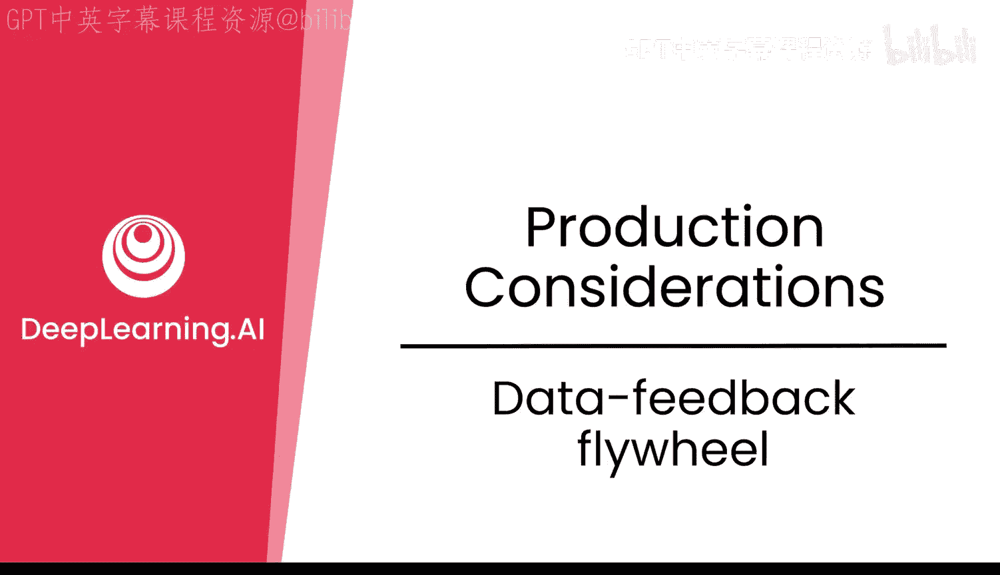

One of the great things about AI is that the data you get from a production model with your users actively using it can actually be harvested for the next generation of that model in posttraining。

 let's take a look at how that works So you've seen the error analysis flow before where you review the different failures you cluster them you have hypotheses for fixes you implement those proposed fixes in experiments and then you run a bunch of experiments to then do that flow over and over again to improve your model now in production what does that look like so you can actually review those failures and cluster them as well and you're reviewing them probably in a production settings the models already out there in the world and then you have additional questions so how urgent is it how urgent is the issue is it something that you feel panicked about because the user experience would be really bad you would lose a lot of money for example if you start refunding a bunch of customers when it shouldn't what other models exist what other models you have deployed today maybe your AB testing different models can you pull one of the models back and what's the budget so what kind of money what。

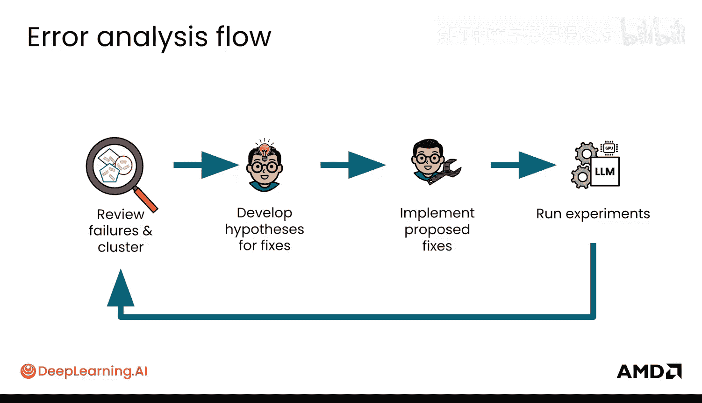

Resources and time and people do have to actually fix this error like basically how important is it and then from those things。

 you want to either redeploy a patch or you want to record that feedback to then be used later so typically what this is going look like is you'll have some user feedback you'll also have a lot of logs from usage and then you'll do a lot of clustering there just like before you'll clean it up there's a lot of additional data work here to transform it you might have some of those synthetic transform pipelines here and then you can use that data for downstream posttrain experiments what feedback might look like you'll see this in your lab essentially you might be able to plot user satisfaction also get a distribution of thumbs up thumbs down or thumbs middle clustering feedback you've seen this before with Ka meanss clustering you can apply this as well and maybe you get a sense of the error distribution or error type distribution in this case of JSON format errors which you'll see in your lab versus outdated knowledge you'll spend a lot of times in your logs to get really rich examples this is a great way。

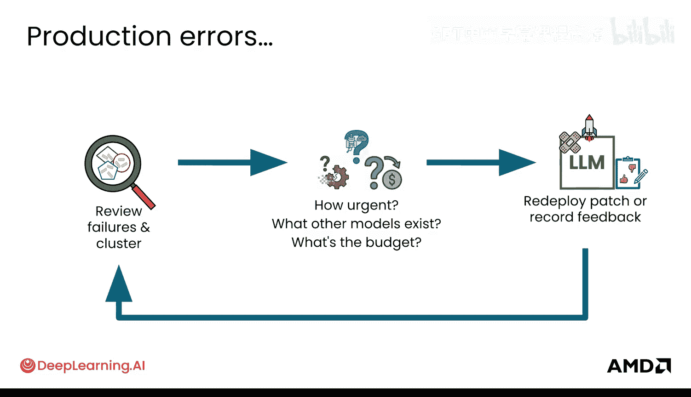

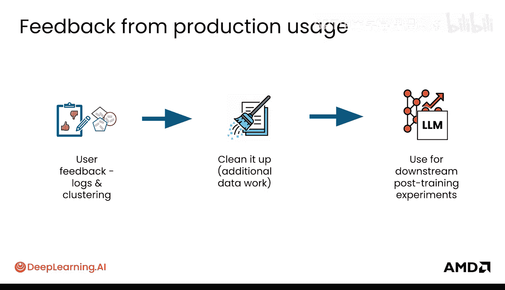

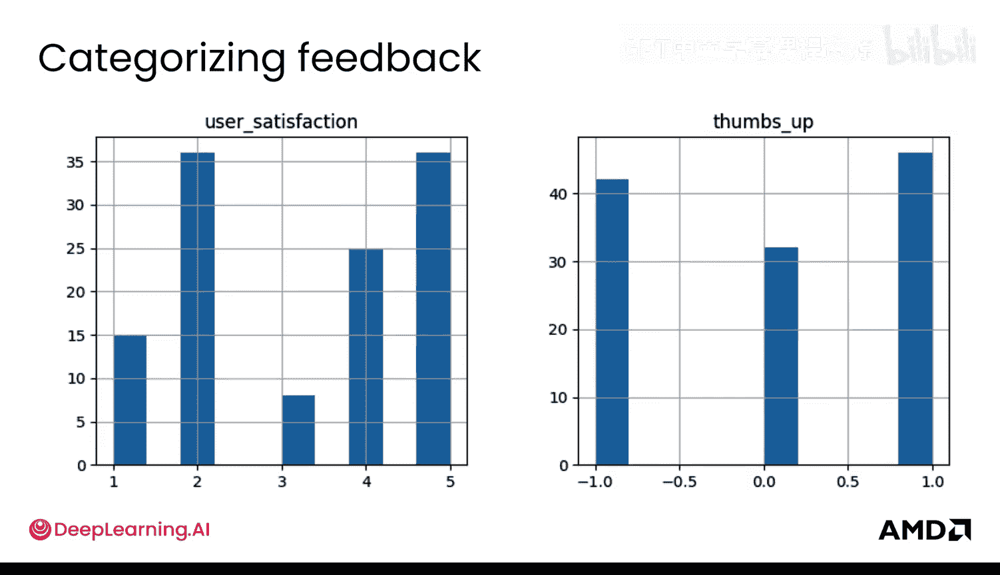

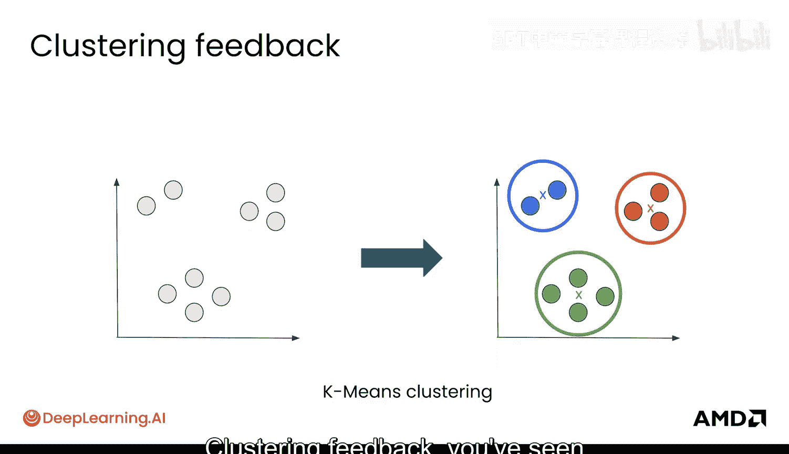

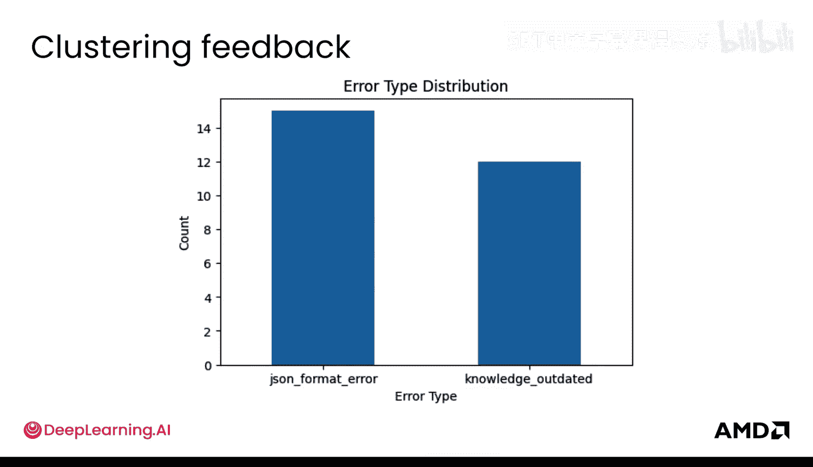

To utilize your production model to make it better。

 So here's where you can actually identify both really good failures。

 but also really good success cases as well。 you convert this into a good fine tuning pairs for example and you can use synthetic data pipelines to expand that coverage so you might find some really good like this is really good because of one reason and then you can expand it further if you don't have that coverage for fine tuning So as an example。

 you might have this input and you might have different model outputs and you can actually pair good versus bad from the logs and you can basically find these examples by mining the logs for this preference data as an example here's another one of correct concise versus ver both data hygiene is really important So you're gonna to have a lot of logs and those gonna be a lot of noise so you want to be filtering pretty aggressively here So what that might look like is just removing a lot of the factually incorrect logs or relevant examples and really honing on the examples that are correct This is where your synthetic pipelines for filtering could come into。

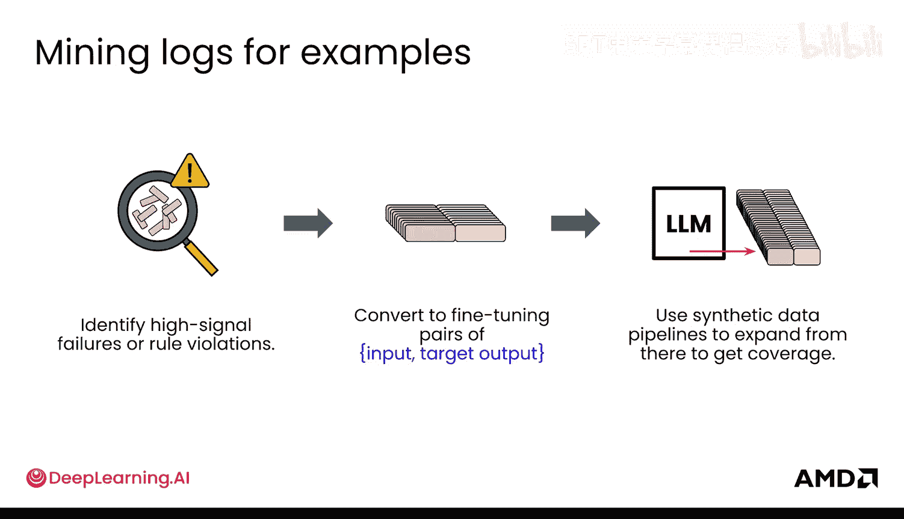

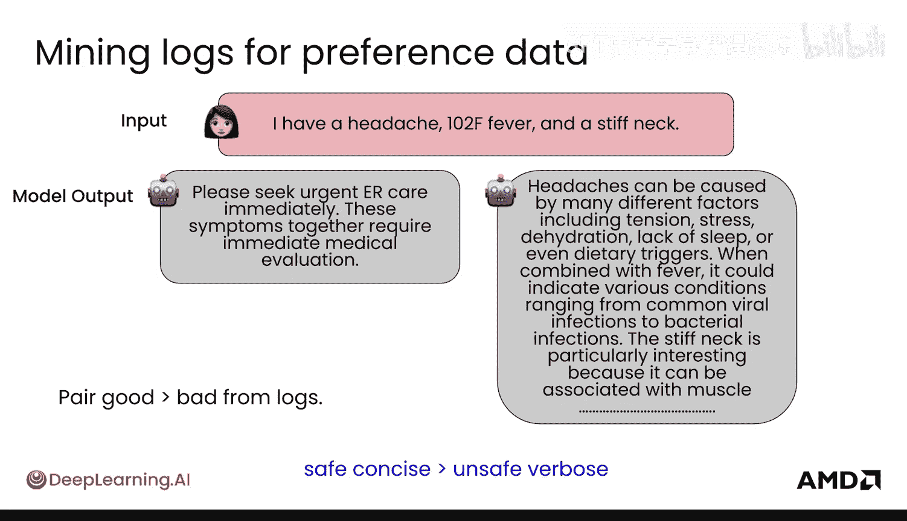

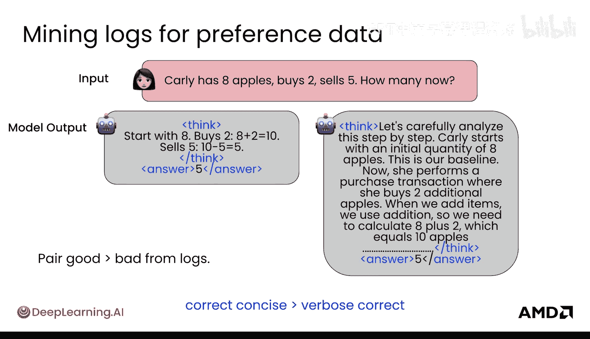

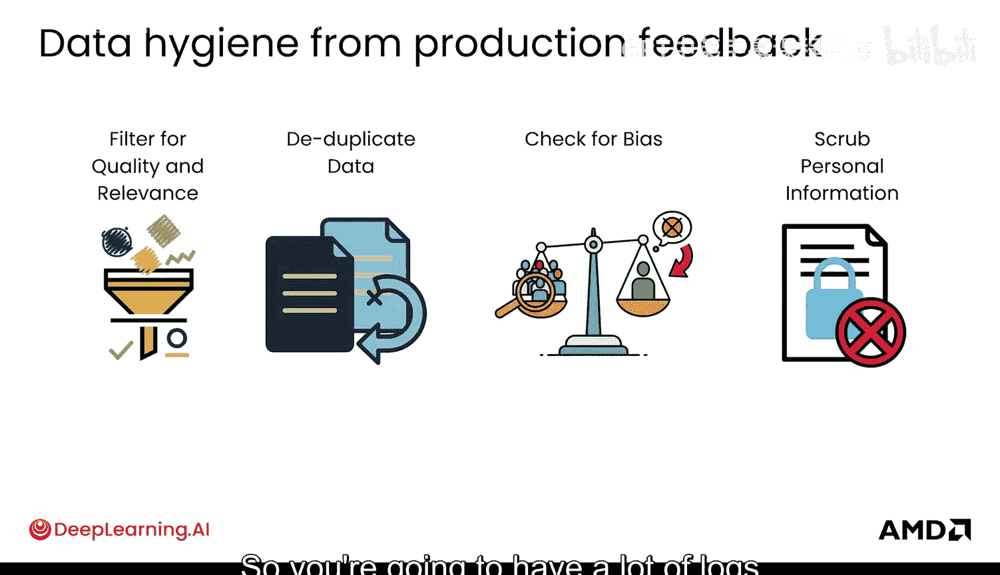

Very effectively Dduupplication is a big piece of this so you don't want to have a ton of identical examples taking over your datasets for fine tuning or even Rl like the different inputs that you want to turn your model on so making sure you're dedoing effectively is important as well and you've already learned some of the tactics around that checking for biases this is gonna be something that's gonna be important in production in particular and you'll hear from user feedback whether that is actually showing up and checking for those different sensitive aspects and dimensions that you care about Finally one really important thing in production that you're going to be getting probably sensitive information in some way and making sure youre scrubbing that personal information is important for your model to actually be more trustworthy later on as well you don't want your model spitting out peoples social security numbers So I think model providers actually quite aligned with scrubbing this personal information to use as trading data later so just to summarize you're getting your user feedback you're looking at your logs or're cleaning it up and of course then you can use this for your data Now realistic。

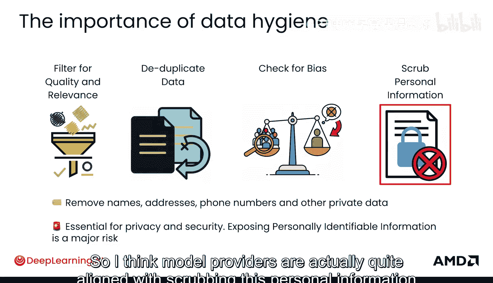

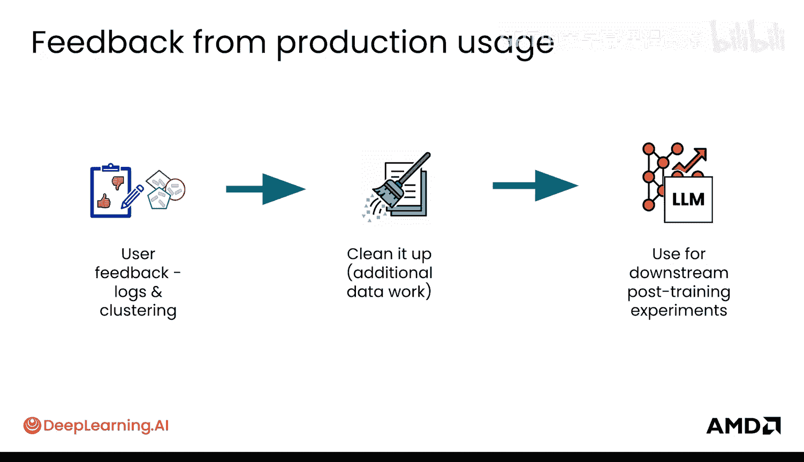

I'm just stepping back a bit there are different possible ways to intervene for different fixes I actually would suggest if you need to do a really big hop fix and just a change very quickly to think about prompt engineering basically just changing your prompt changing your input your basic template that your users are using to adapt to the models behavior to do that first because that will be a really quick intervention of just a improving and updating your Ra index also would be a way to really quickly improve the experience for the user for outdated information and for posttraining with fine tuning and reinforcement learning it's going to take about a week relative to actually get some results back because you're running many。

 many different experiments to actually see what that improvement could look like even if you have all the infrastructure ready in place to do that so just to summarize these are the types of issues that you might see and the types of interventions that might be a good first pass so if you see a lot of unseen topics you probably do need to dive into fine tuning and actually。

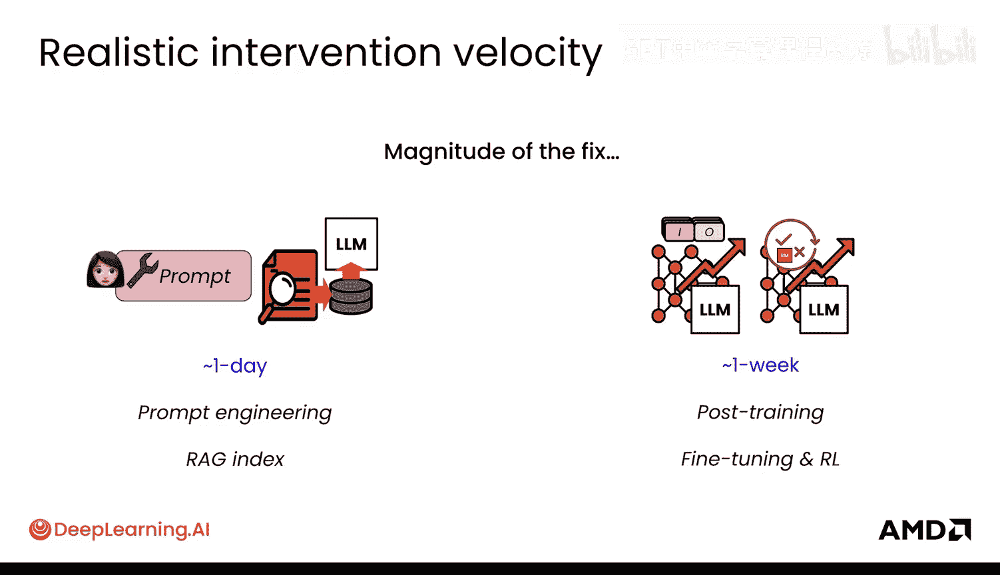

Examples to the model to understand them if you have outdated knowledge Ra is a really good first pass there if your users' preferences really shift if they shift really heavily and maybe your model's really syophic for example。

 that is what open AIs TbD40 was then you can use reinforcement learning to actually shift that preference over so the model is more balanced if you have small consistency issues。

 small issues I always recommend starting with prompt engineering just to start to see if you can nudge the model sufficiently and then if you have finally a major skill issue a capability gap and that is where you apply both fine tuning and RL。

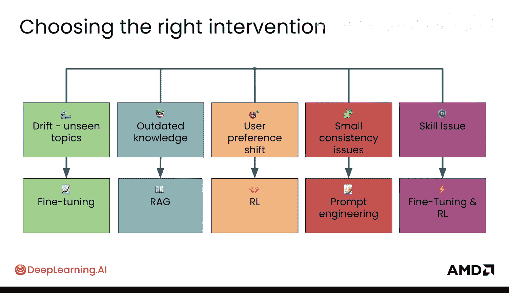

Now that you have your feedback to data Flywheel going。

 let's take a look at the observability you need to put in place for your production model。

