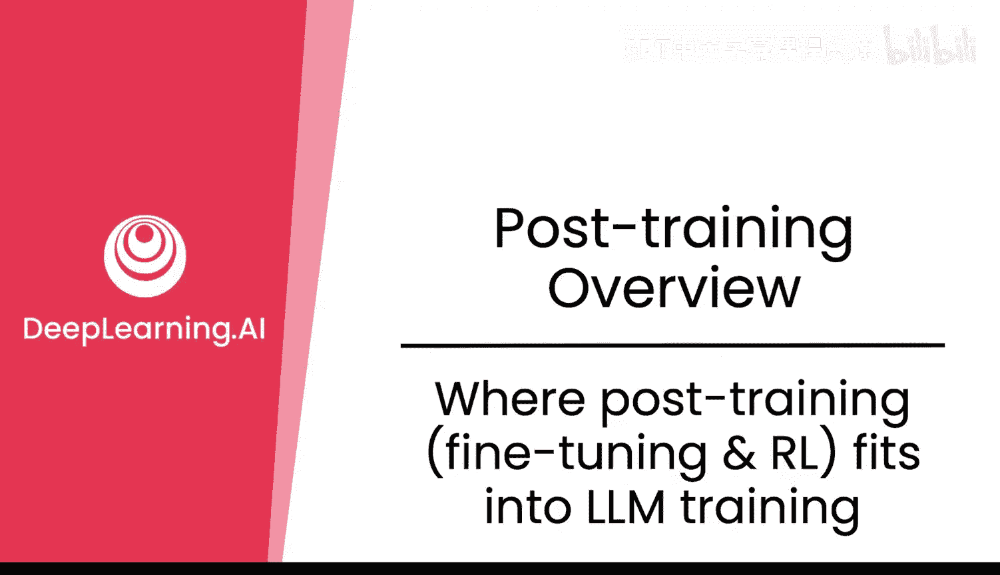
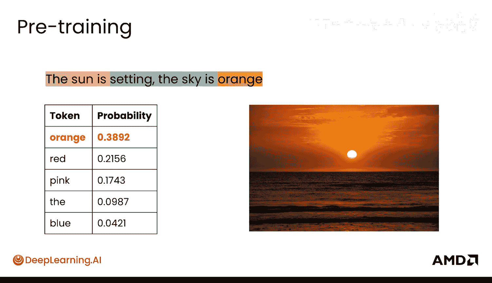
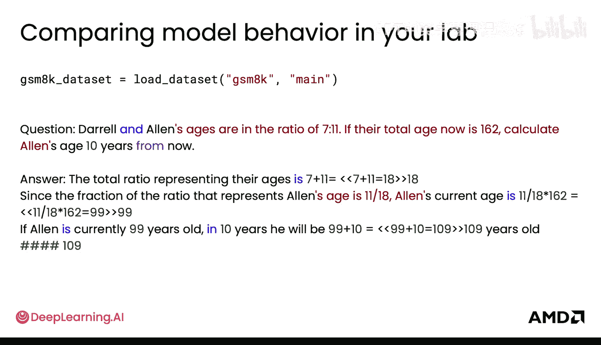
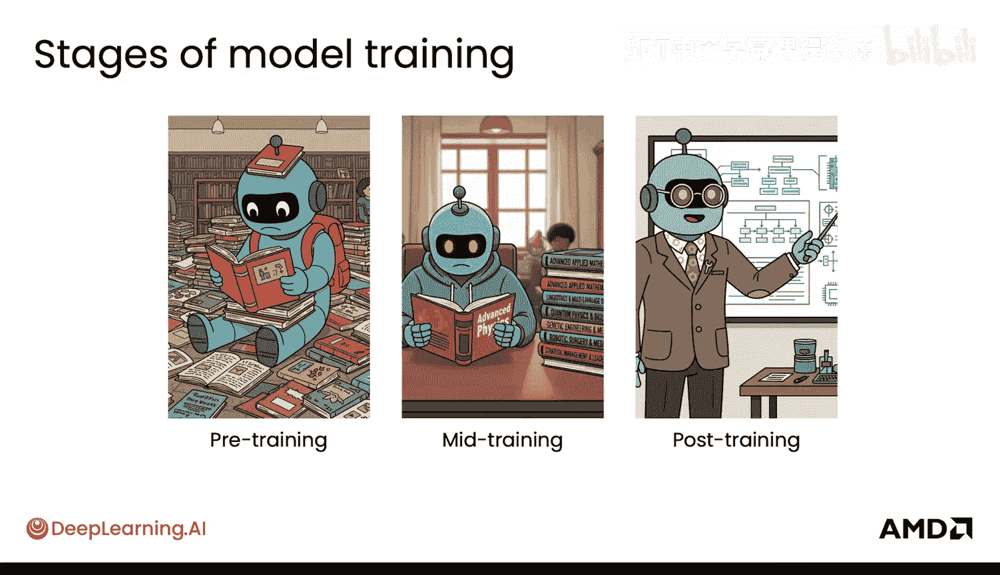

# AMD《大型语言模型的微调与强化学习：后训练入门｜Fine-tuning and Reinforcement Learning for LLMs》 - P3：3.where-post-training-(fine-tuning-and-rl)-fits-into-llm-training.zh_en - GPT中英字幕课程资源 - BV1zZy8BcE7z

LLM training has multiple stages， post training is just one of those last stages here you'll learn about pre training。

 mid training， which are stages that come before post training。

So the first stage of LLM training is pretraining。 That's where the model gets that raw intelligence。

 So you're gonna focus here for a little bit。 The model learns to generate text by looking at the next token。

 the next word for example in a giant corpus of text and that's all it's trying to do it's just trying to predict that next token the next word and you know a training example might look like this excerpt from the raven by Edgar Allen Poe but it's essentially taking that input once outputting you know upon getting once upon trying to output a once upon a midnight and it keeps going right so it's all it's trying to do is predict the future the next little token that comes afterwards and what it's looking at is a bunch of text over the entire internet it's a huge amount of data inside of the pre-training data set and all it's trying to do is that very simple task of predicting the next token the next word for example and it starts with that untrain。

Models completely randomized weights It does not output anything sensible in the beginning and it takes a lot of time when it looks through all that data through pretraining to predict that next token and it's very very expensive it can take months of compute to get that pretrain based model intuitively what's happening in pre-training is that through this next token prediction it's actually quite magical it's able to learn concepts through this across a huge amount of data for example。

 if the sentence you get is the sky is these are the probabilities it might see across blue or clear or darker orange it's very high probability on blue because it has learned that over course of huge amount of text that when it sees the sky is it's very likely to be blue so it essentially has learned this concept of the sky being blue and it also is learned when you give it a different sequence like the sun is setting the sky is therefore then orange becomes a higher probability than blue it might be a。

Sunset here right and so this is very， very powerful raw knowledge that the model knows。

 but it only knows how to predict that next token the next word， for example。

 the next stage after pretraining is often called midtraining I'm kind of detanling this from regular pretraining because it is usually a different team inside of these frontier labs not always but it essentially is continuous pretraining but on a more specific curated data set and it's still predicting that next token the next word but essentially it's used to target for example new languages so very curated well established a data sets for new languages so the model already has raw intelligence maybe here it's learning Chinese it can also be a good place to add different modalities such as audio or images。

And finally， it's also been used to increase the context length for the model。

 so the model previously maybe wasn't learning on huge context and now midtrain。

 you can actually teach it to expand its context so that's essentially what happens after pretraining it's kind of like a continuous pretraining phase that's more curated so there's pretraining there's midtrain Finally there's now posttrain。

 which is a type of training that comes after midtrain and the focus of this course So posttrain usually encompasses a couple different famous methods one is fine tuning so that's where you give the model different inputs。

 but also target outputs of exactly how it should respond to a particular input fine tuning can also be called superfines fine tuning or Sft in the context of language models here in the course you'll be seeing it as fine tuning another very popular and increasingly popular technique in posttrain is called reinforcement learning and that teaches the model based on a certain input whether it's response。

wa good or bad。 you give it some kind of reward or score for what it produced。

 So in these next modules， you'll learn for fine tuning how the model is actually supposed to learn from that target output and how it essentially takes that signal and improves it over time and these are some of the output gradients that you'll learn about you'll also learn about how to make fine tuning really efficient so that you can actually run this on very few GPUs just one GPU or even locally and these are using Laura adapters essentially little weights in fine tuning where the model doesn't need to learn so many changes in reinforcement learning in later modules you'll learn about how to actually get that reward or score using another model and how to actually train that other model on human preferences in reinforcement learning with human feedback and you'll learn how many models it takes to actually do reinforcement learning for these language models here are four different models to actually get us there and why that is computationally expensive。

Now bringing it back to your lab in this lab you're going to learn about the base model。

 the finet model and the reinforcement learned model and you'll be able to compare how these models do on an example prompt and how their behavior is very different so here's an example prompt that goes through a math problem and you'll see how it behavior shifts you'll also get to look through an actual data set a very popular data set for math where you'll see how the behavior shifts across the base model which is a pretrained model as well as the two types of post-training techniques。

 fine tuning and reinforcement learning and how the model behaves differently there so just to summarize the stages of model training there's pretraining where essentially the model is reading an entire library there might be low qualityality or high quality books。

 it doesn't have a specific goal is just reading in midtraining it's a little bit more curated the model is reading curated set of advanced books to actually be able to learn either new languages or new domains but still reading a huge amount。

And finally in post training， which includes fine tuning and reinforcement learning。

 the models learning to be almost an effective tutor right， how to answer questions clearly。

 how to interact politely， it can actually get a job at this point and be useful and usable to the world and for you as an assistant。

Now that you've learned how post training fits into LLM training overall。

 it's time to learn a little bit more about the intuition behind some of these post training techniques like fine tuning in reinforcement learning and how they differ and what makes them work。

