# AMD《大型语言模型的微调与强化学习：后训练入门｜Fine-tuning and Reinforcement Learning for LLMs》 - P40：5.monitoring-and-observability.zh_en - GPT中英字幕课程资源 - BV1zZy8BcE7z

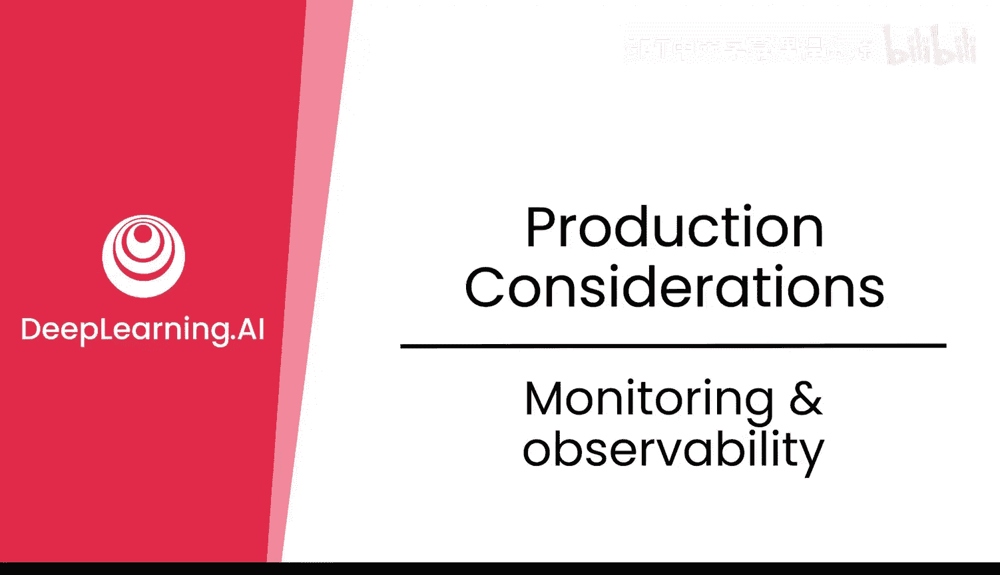

Monitoring and observability are important for any production system。

 Let's take a look at how this impacts your posttrain model。

 All right so there are a bunch of things you want to monitor in production。 there's performance。

 there's cost and there's reliability and under reliability you also probably want to be monitoring for a lot of the behavioral changes in the model because that will impact post-training the model further and around costs that will also affect posttraining for example。

 your lara size or your base model size of what you pick。 So in your code。

 this is what it could look like just monitoring all these different aspects of how the model is doing and how your users are interacting with the model creating graphs is a good way to understand at a glance what's going on here's a possible latency distribution graph that you'll see in your lab also token usage distribution just to understand。

 oh how are people really using this model and how can I then use this information to create the right types of examples。

 for example here you might want examples that are really low and very high token distribution in。

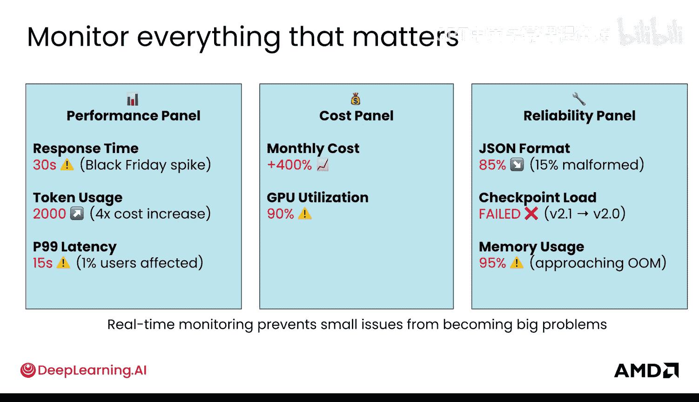

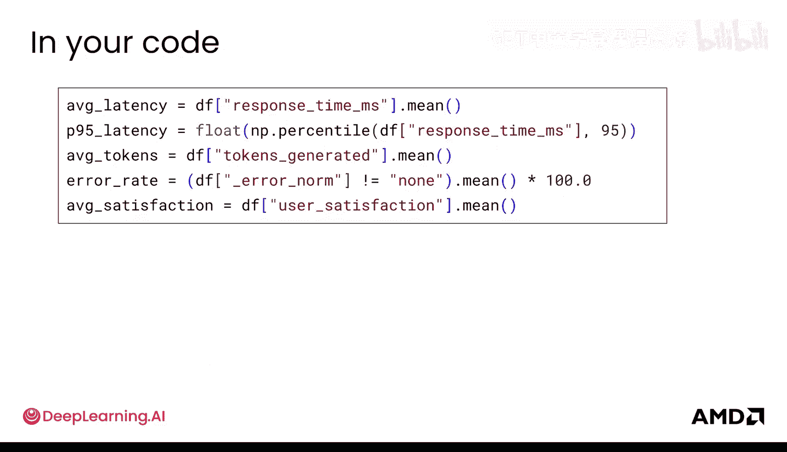

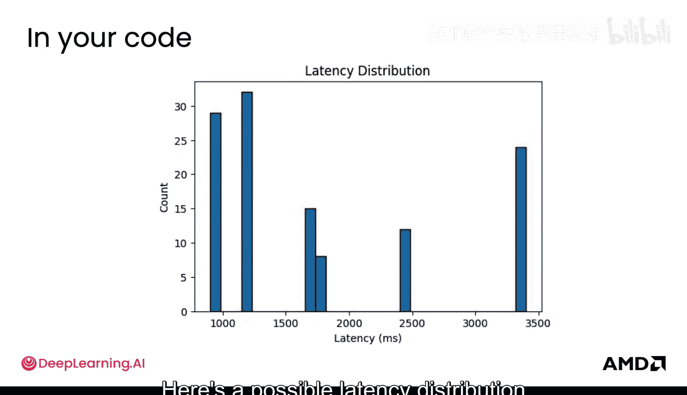

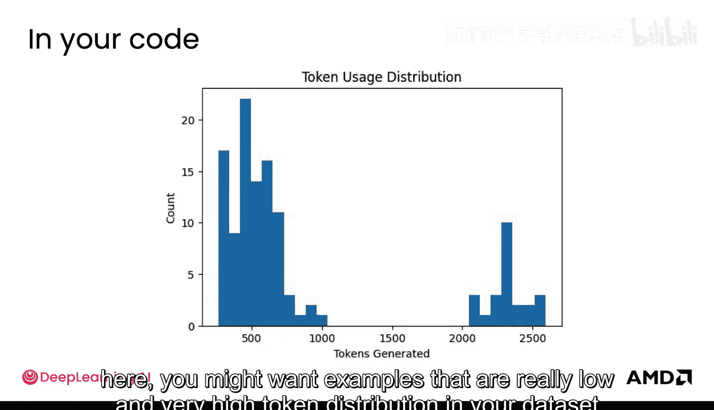

Data set to represent how users are using it。So here's a production cycle again。

 I've generalized it a bit from just the R promotion roles to just posttraining in general。

 so in your experimentation then you're evaluating on your test sets and test environments and then you go to staging and production and the monitoring of the production metrics is happening there in production of course you can also monitor some of this in staging so for things to be really reliable one of the most important things is around version control because when you're monitoring you see something wrong。

 you want to roll back to a previous version you want that to be possible and in order for that to be possible there's a lot of different things you have to make sure are stable and frozen and that you can actually do a reliable rollback just like in regular software and that is happening here in production as well but versioning is really just a foundation you also need a monitor for several other different things so datad input data will always change people will always use the model differently maybe they use different terms or they have different concepts that are relevant to what your model should know about maybe the laws change in some way。

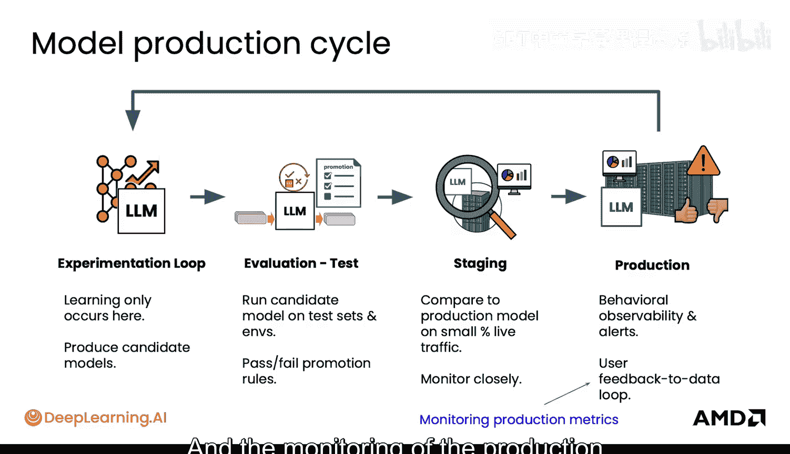

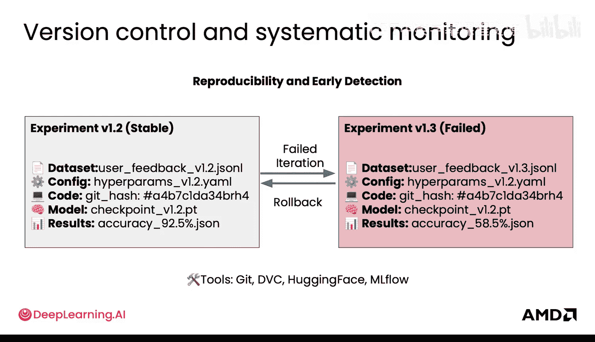

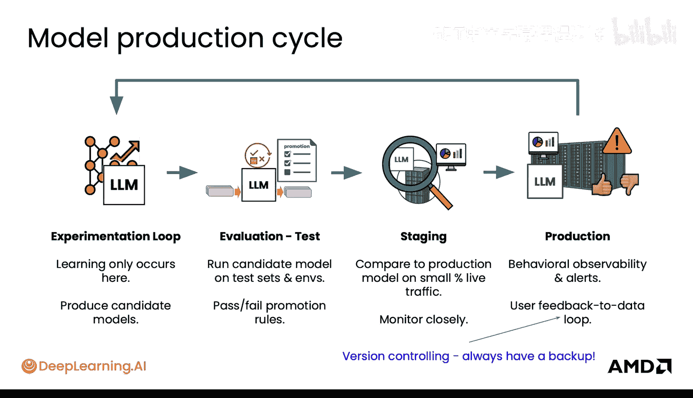

And the model needs to adjust to that the world is no longer the same an example is that after the pandemic queries for remote work surge and you need to be able to handle that。

 the model needs to be able to handle that in some way So reward collapse is where your R model is starting to gain metrics instead of optimizing for actual user satisfaction and that will also happen as well and is something that you need to monitor very closely for one very common example in general AI is high click through rate from clickbait will lead to low satisfaction for users but it will get that high click through rate that the model is trying to optimize for and finally data quality infrastructure problems and model for getting will overtime cause degradation and might be hard to actually see before you have it in production at a large scale and so you know there's been recent research around different problems that might actually cause the model to do worse than it actually is capable of and so getting all the infrastructure in the right place is important as well when you have multiple models it's also helpful。

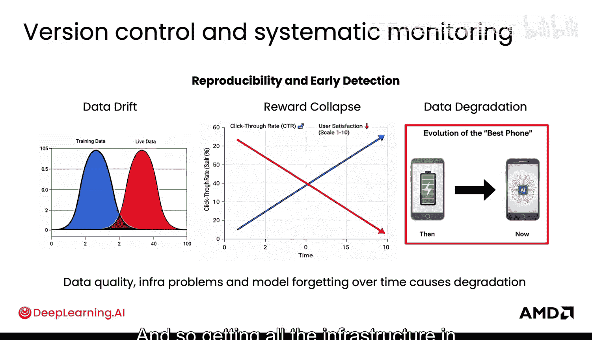

To be able to test them against each other so AB testing allows you to do that very live by segmenting live users to understand which model is actually doing better for which different types of users and that AB testing is probably happening here in production for the different passing models next a side by side comparison you might have seen this in chattBT or a different AI model that you've been using but essentially you can see comparisons of one response or another and you can actually have human evaluators pick one and those can be just your users actually at a large scale and this can help you with quality checks you might have also seen in some of your email apps that they give suggestions for a possible response and they give multiple suggestions that is also a very natural way to have the side by- side comparison with users and that's probably happening in like a staging phase obviously could also happen in production just to harvest that data back to the experimentation loop Finally it could be really helpful to have internal playgrounds for a limited set of users as you safely deploy。

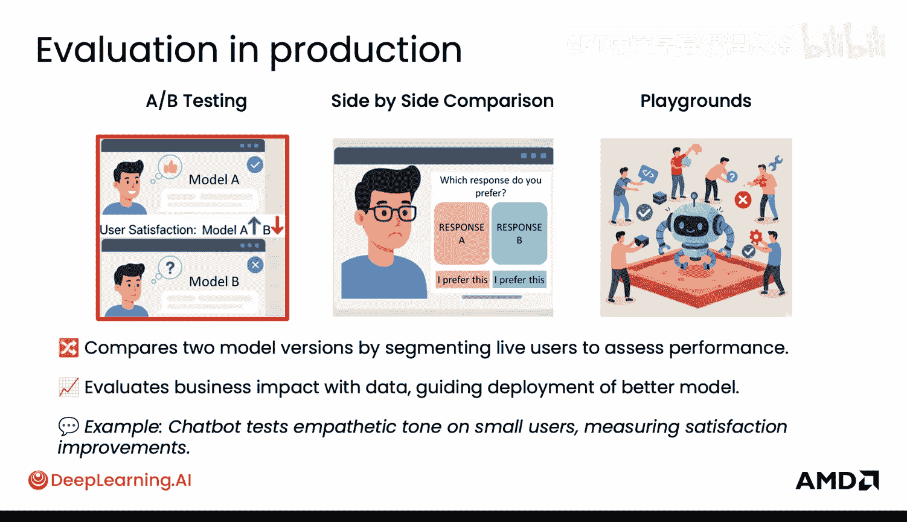

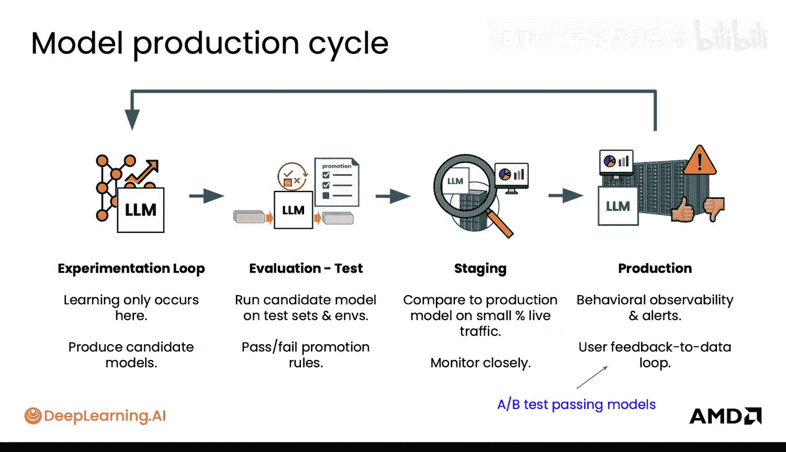

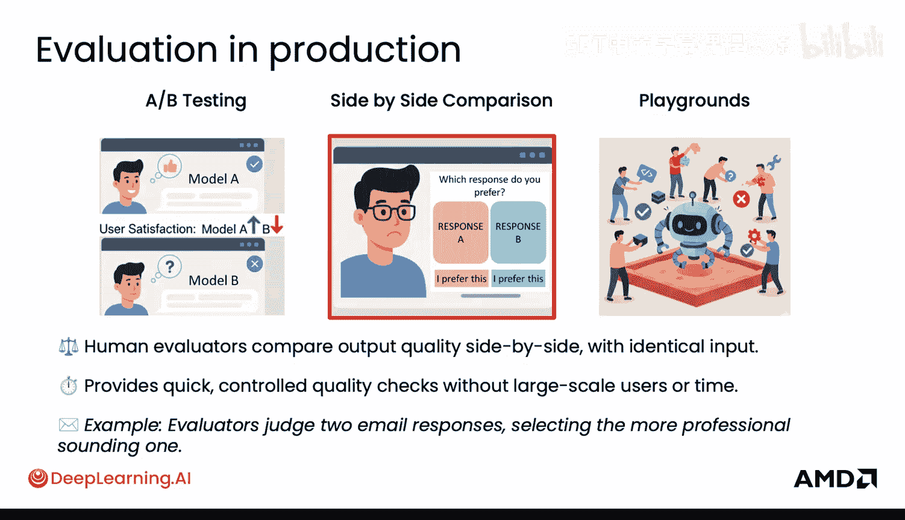

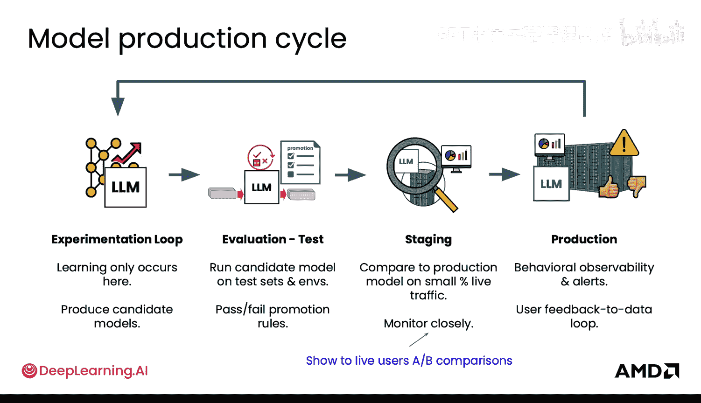

These models out and these are just areas where you can have people try to break these models and identify edge cases and failures and that's typically done in the staging phase so you can have internal playgrounds and then you can also have some beta testing external playgrounds on that you know live canary traffic。

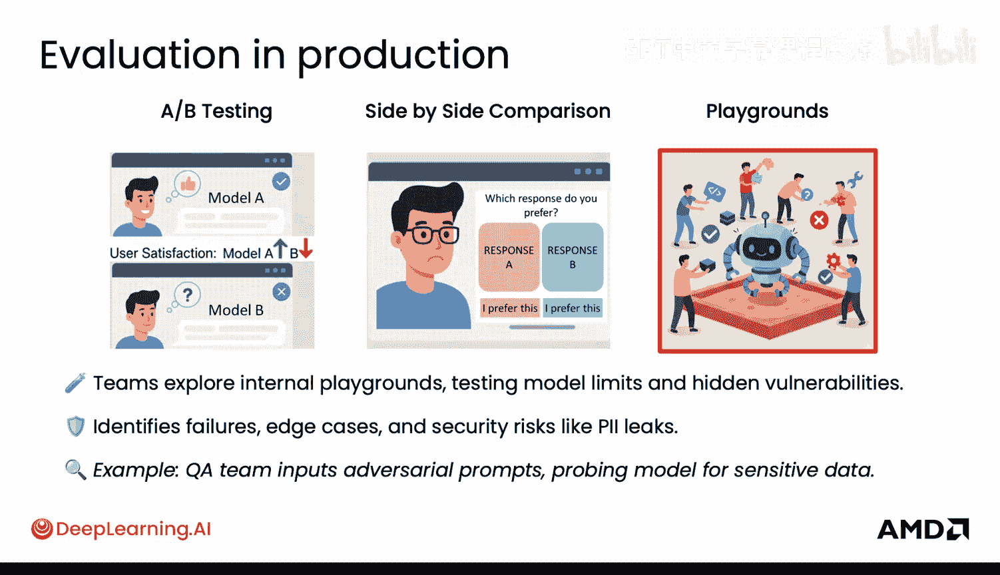

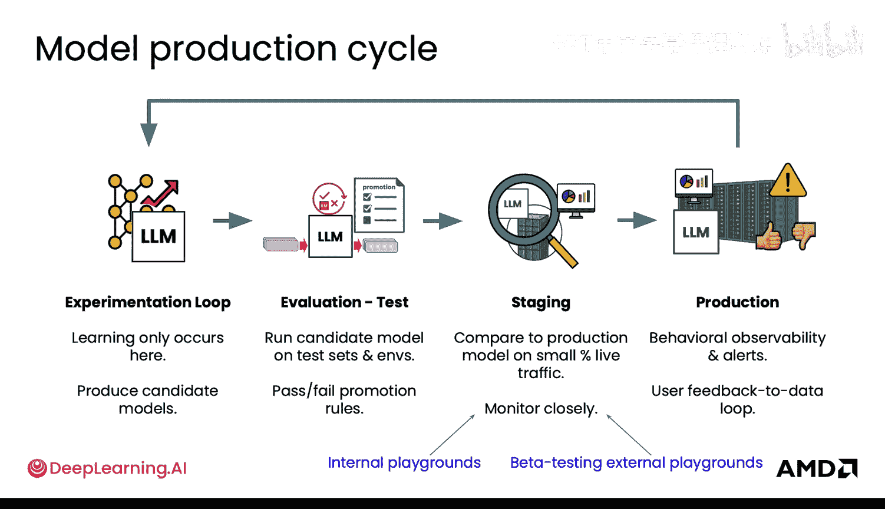

Now that you understand the model production lifecycle。

 let's take a look at the infrastructure to make all that magic happen。

