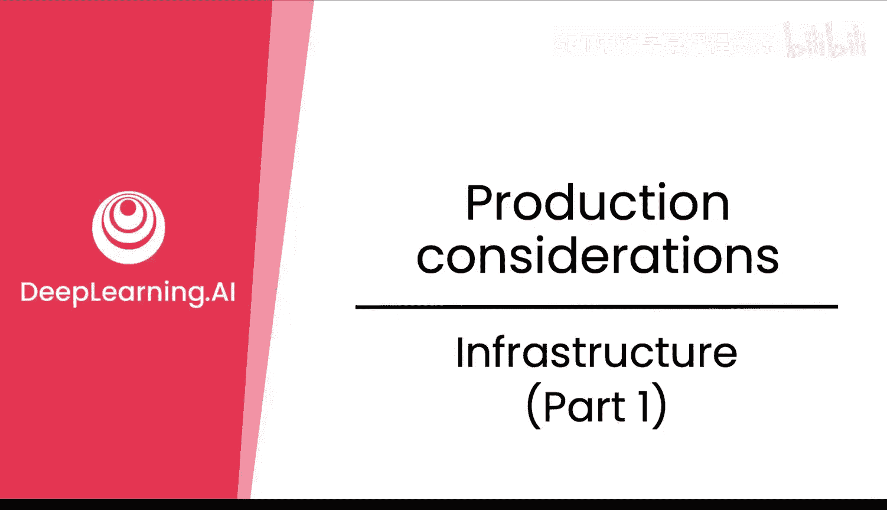
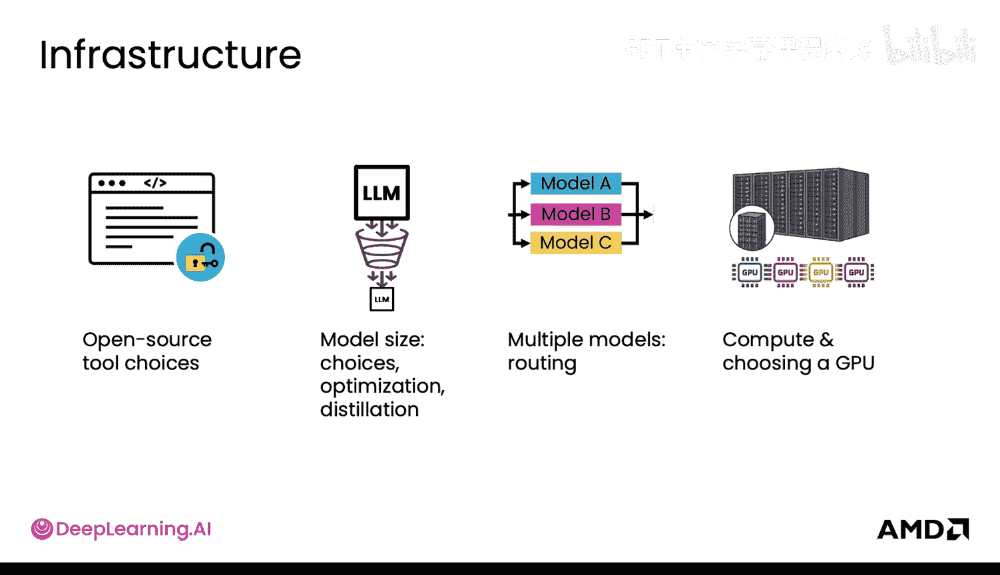
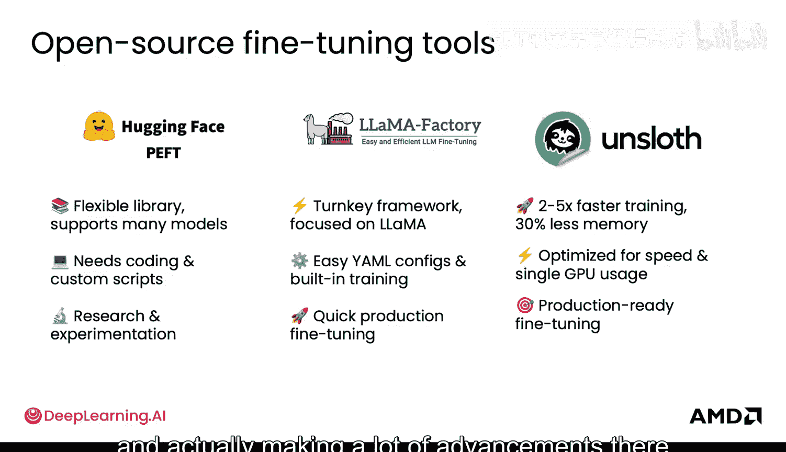
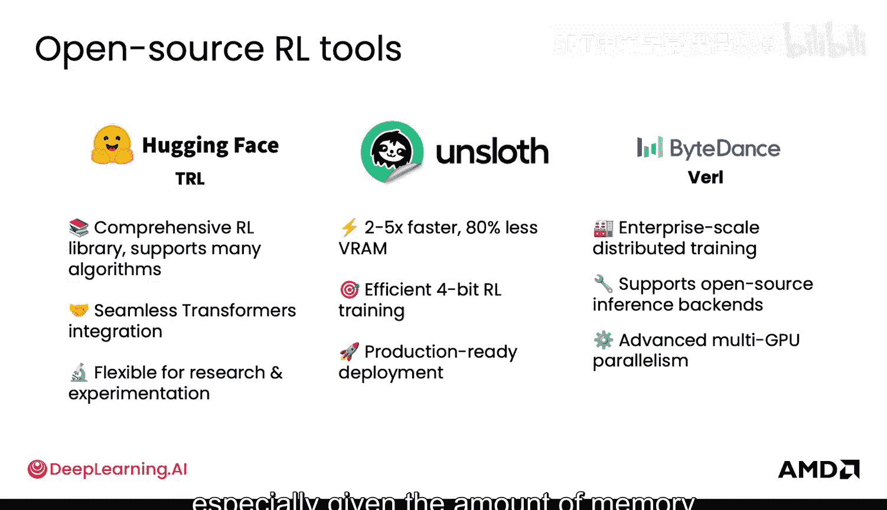
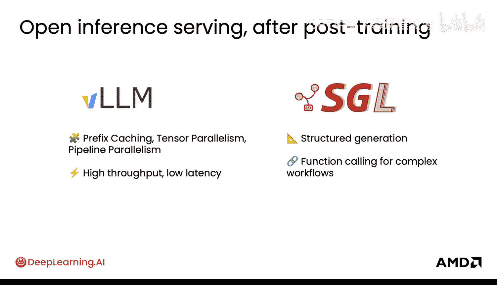
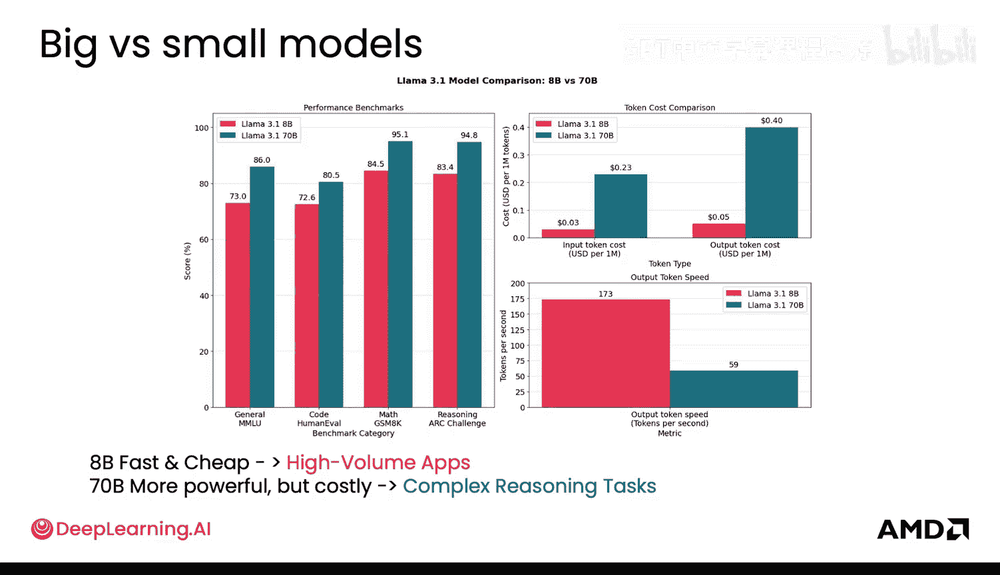
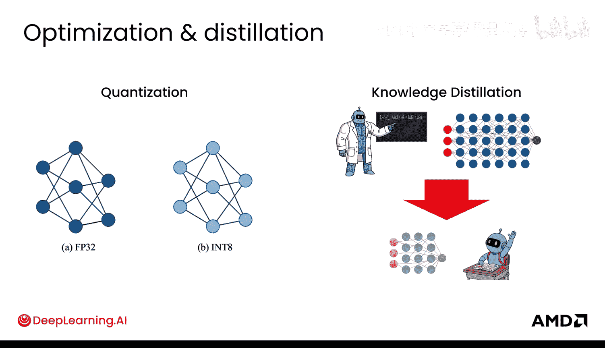
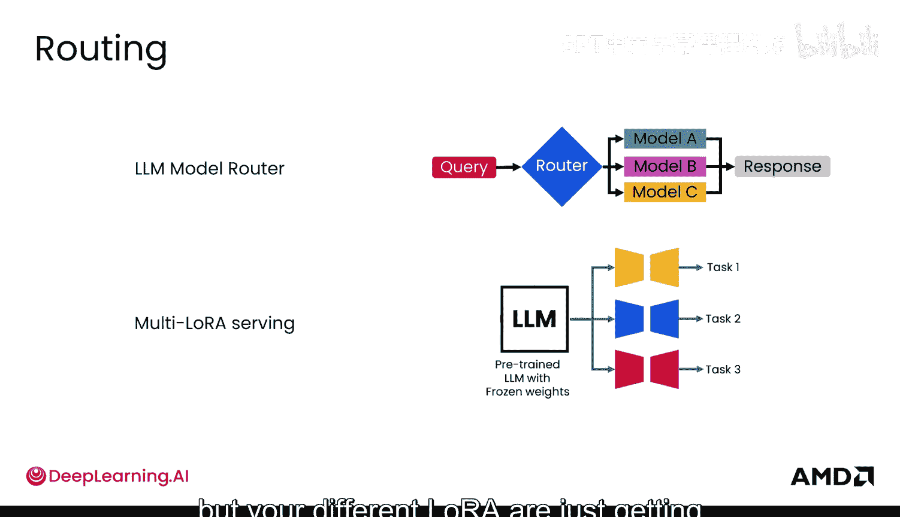
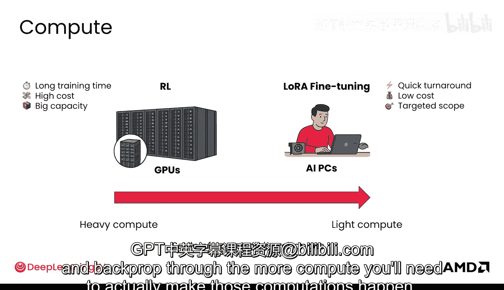

# AMD《大型语言模型的微调与强化学习：后训练入门｜Fine-tuning and Reinforcement Learning for LLMs》 - P41：6.infrastructure-(part-1).zh_en - GPT中英字幕课程资源 - BV1zZy8BcE7z

Infrastructure involves a bunch of different choices from the tools that you use to your GPU。

 Let's take a look at some of the most important ones。

 There are a bunch of infrastructure considerations that you need to make one is around the tool choices will' go for some of the possible open source options there another is around the model size which contributes a ton to your other compute considerations and tool choices as well as ways to reduce that model size to make it more amenable efficient and costeff next is around multiple models and how you route between them and finally around compute So on open source fine tuning tools there are a bunch I'll just highlight a few of them here one is hugging face which you're using already in your labs and it's very flexible it's very easy to use from a user interface perspective and it's where a lot of people first start Next is Lama factory Lama factory is probably better for production fine tuning today means's more turnkey it is also integrated with a bunch of the inference serving frameworks out there so that's made it easy。

To use and take off in the open source sphere and finally un slotth。

 which has focused a lot on optimizing for speed and actually making a lot of advancements there on making it really fast to fine tune on a GPU Next are Rl tools you'll see huggingface and unsth again here there are a bunch of other Rl tools such as Verl from byte danceance that enables more enterprisescale distributed training which is probably needed for some of the Rl that you'll see especially given the amount of memory that is needed and as a result the number of GPUs that are needed and you'll see that shortly after you've done some posttraining you want to serve your model so what are some of the inference- serving frameworks out there to very very popular ones today are VLM and SG L you I show differences here but they are really neck and neck in the types of features that they have out there so I suggest trying both of them and seeing which one is easier to use for you One big consideration is the size of the model that you're using because that leads to downstream decisions of compute。

So I always suggest starting with smaller models just to see what the performance is like on all of your different metrics and then when you need to scale that out。

 go to a bigger model， a smaller model also will enable you to have something faster and cheaper so if you're looking at something of very high volume you might want to start small there are ways to also getting your bigger model to fit in a smaller space。

 for example with quantization you can reduce the precision which you are representing the weights of the model。

 for example if you're representing in I don't know 16 bit precision or here 32 bit precision and you can drop it down to8 precision or even four bit you can cut the memory down by two to four to eight times and that's a huge amount of savings because maybe that means you can fit the same model on cheaper hardware or fit larger models onto the same GPUs and the tradeoff oftentimes you need to evaluate it empirically of course is adjust a small dip in that accuracy on your different metrics and of course you need to test this empirically because sometimes quantize。

It can reduce the performance of the model considerably next is knowledge distillation This is taking a larger model。

 a teacher model here and actually taking what it is predicting and using that as supervision for a smaller model so smaller student model that is learning from the knowledge of the larger model and learning from all the different probabilities it's outputting and as a result that that is really rich information that is going from the teacher model to the smaller student model and that is a way to get away with a smaller model with the same abilities as that teacher model of course you will also see a different performance here typically so please check this out empirically if it works for your use case If you have multiple models this is where having some kind of router is really helpful so you can route a single user's query across all those different types of models to get a response or even if you want an aggregate from all those models to get a response this is how you would do it if you are using Laura's this is a good opportunity to actually route between the Lauras and you can have the same pre-trained LLM base。

But your different lauras are just getting routeed to for the different tasks so finally。

 you need to consider compute Comp is going to underlie a lot of the costs for your training Rl is very。

 very heavy and compute takes longer and is just more expensive and so you'll need more compute to actually be able to parallelize things and get things done more quickly versus Laura fine tuning it's lighter compute it's lower cost you might even be able to get away with it locally on an AIPC and the scale of the changes also does matter so the more you're changing in the model and the more data that you have the model needs to see and represent and pass through its parameters and backpro through the more compute you'll need to actually make those computations happen。

