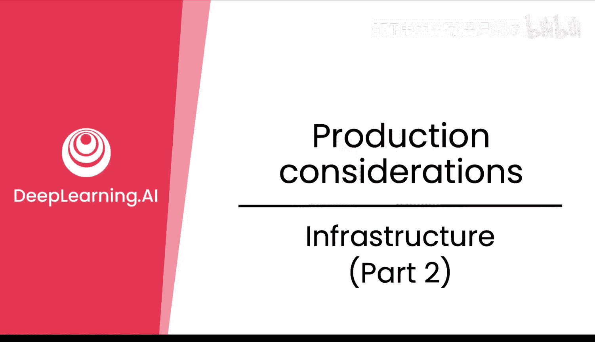
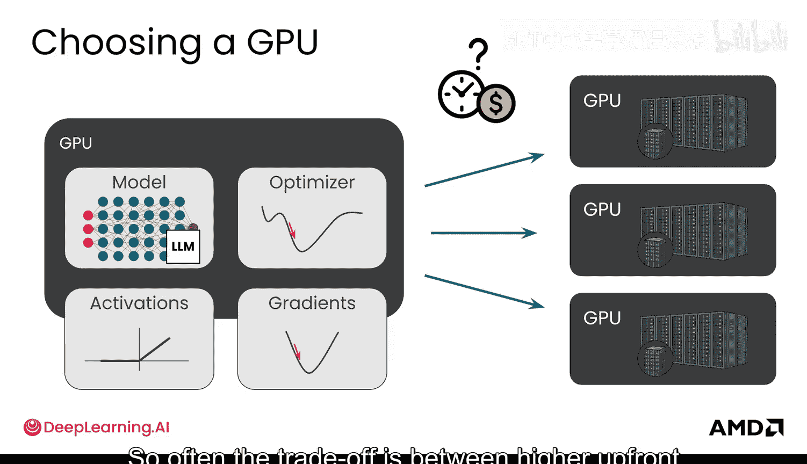
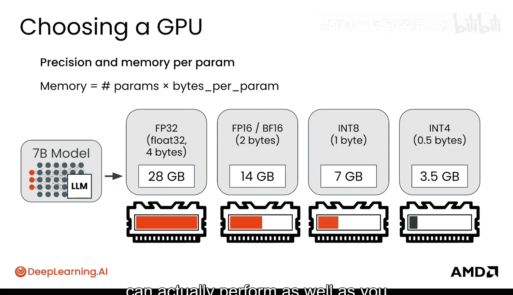
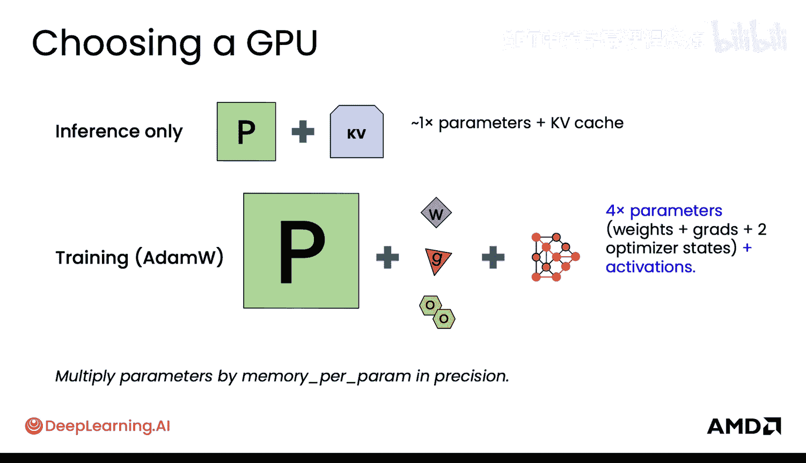
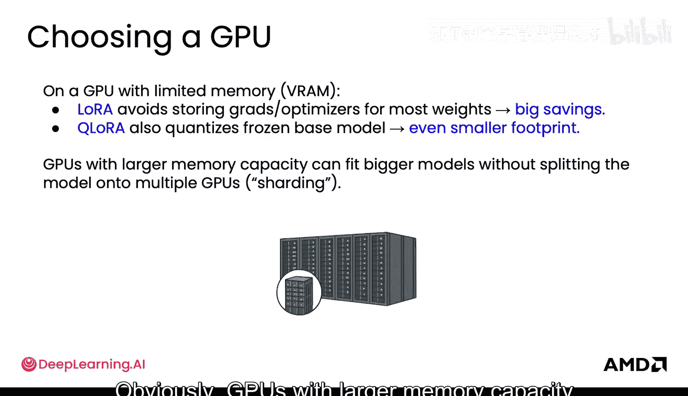
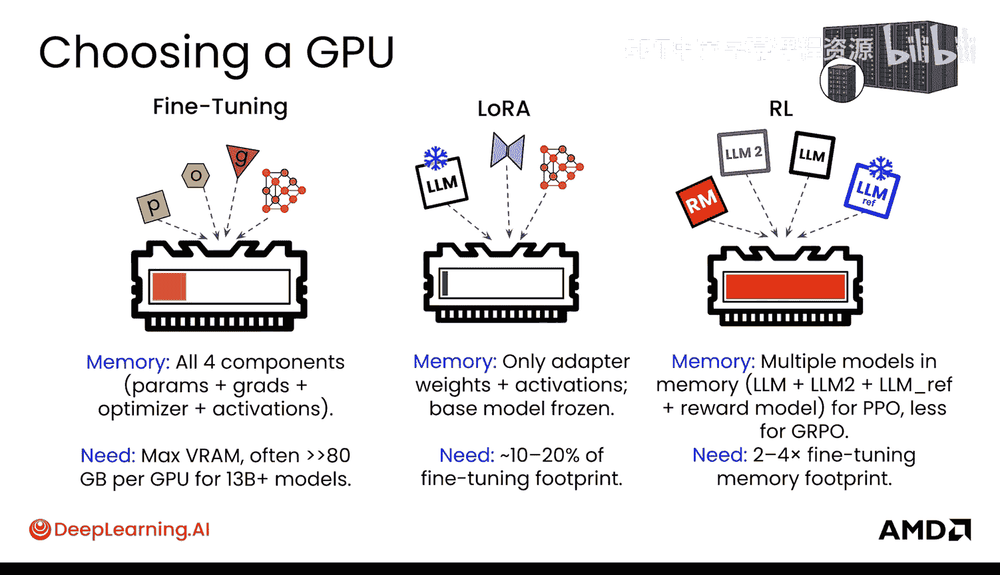
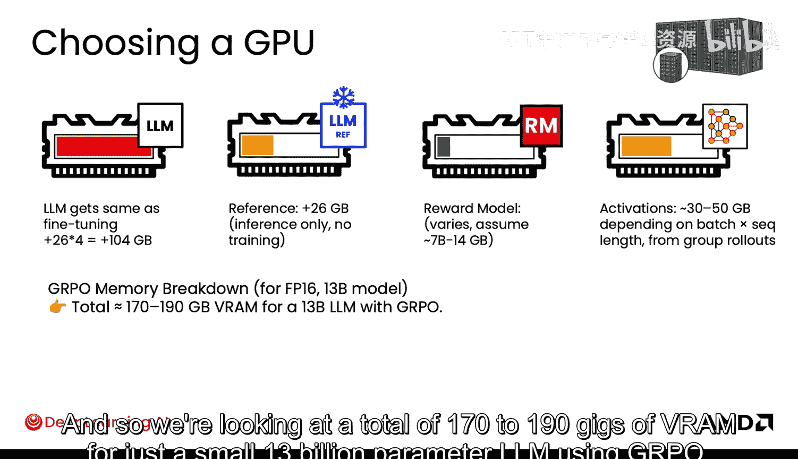
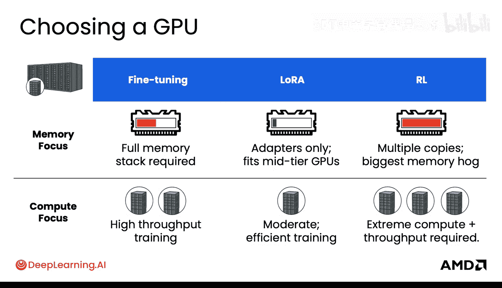
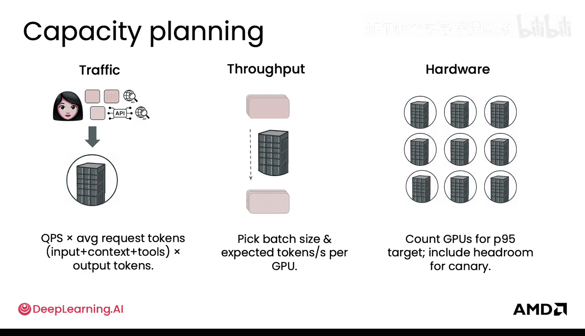
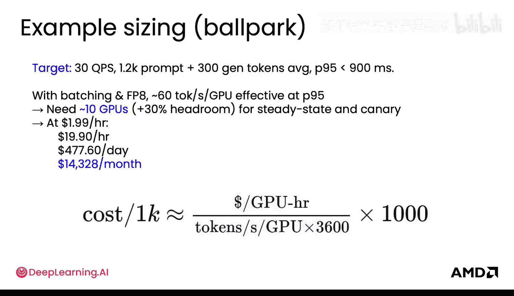

# AMD《大型语言模型的微调与强化学习：后训练入门｜Fine-tuning and Reinforcement Learning for LLMs》 - P42：7.infrastructure-(part-2).zh_en - GPT中英字幕课程资源 - BV1zZy8BcE7z

So a lot of things go into choosing a GPU， your memory matters a lot。

 and so that's the model that's the optimizer， its the activations。

 it's the gradient answer they all have to fit on that GPU for you to actually train the model and do backpro and if you need more memory than you need multiple GPUs to actually fit all of this and if your model itself is really large you actually need to split the model across a bunch of different GPUs and that is called model shing this obviously add some complexity and overhead to GPU communication as well on cost in time how long you're training for will really matter around the cost and cost estimates also the number of parallel experiments when you are doing error analysis you have to run so many different experiments and the more experiments you can run actually the faster arguably that you can hone in on what the right recipe is to get the model to the right performance level so using compute to scale out the number of parallel experiments is also another method but of course that comes with cost even if it reduces time。

Often， the tradeoff is between higher upfront costs to parallelize across many GPUs versus longer run times on cheaper GPUs。

So just to double click on the memory piece a bit and on precision so this is how a 7 billion parameter model can be represented in 32 bit 16 bit8 bit and 4 bit precision and this just shows you how much memory it takes and you can see that you can actually represent it in quite a small amount of memory 3。

5 gigs if you think that that in4based 7b model can actually perform as well as you were assessing the original model typically I suggest looking at quantization after you fully trained your model and you're running inference only and not during the training process itself because during training you want to be able to represent it quite fully so inference only you're really only storing one times the parameters of the model and there's something called a KB cache which is a way to optimize inference where you're caching some of those values for attention specifically the key in value and that enables you to do inference more efficiently and that takes up a little bit more memory depending on essentially the prompt length Now in training there are。

A ton more parameters that need to be stored and that comes from not only the weights of the model but the gradients and the two optimizer states for at W here as well as the activations so just to understand that the scale is just much much larger for training and that includes both fine tuning and RL training and this here is just for training one model and you'll see an RL where there's going to be a lot of different models at play so this is here for fine tuning。

With limited memory or VRA on the GPU you might also consider different las and that will avoid storing a lot of the gradients and optimizers for most of the weights。

 the base model， which are huge savings， Q Lauraura is a way of quantizing that frozen base model to have an even smaller footprint obviously GPUs with larger memory capacity can then fit larger models without splitting it across those multiple GPUs so when choosing a GPU across your different methods for fine tuning again it's those four components for Laura you're able to save a lot with Laura here so only the adapter weights and activations and the base model is really frozen though you still need to store it there and typically you can actually get away with 10 to 20% of the fine tuning footprint if not even more like you can even save even more and then Rl is very compute intensive and uses a ton of memory so you need to have multiple models in memory your multiple LLMs give your reference LLM you give your reward model that's just for PPO for GRPO。

Get rid of that baseline estimation model so you do save one model there and it's typically looking at a two to four times fine tuning memory footprint So looking at GRPO first you have your LLM that is using the same amount of memory as fine tuning。

 you have your reference LLm that's frozen so you don't actually need to train it。

 you don't need that extra memory to store the gradient or optimizer states and then you have your reward model that'll vary of course and we're typically looking at something much smaller for reward model you're not using a huge LLM orre using a head trained on top of your existing LLm but much smaller and then activations and this will depend on your batch size and your sequence length from your group rollout so you're rolling out in a group right in grRPO to be able to calculate that advantage so that'll take up memory as well and so we're looking at a total of 170 to 190 gigs of VRAM for just a small 13 billion parameter LLm using GPO and that is using 16 here so that is a ton of memory needed。

For fine tuning right it's in the middle Laura you get to save a lot so really recommend doing that and then Rl a huge amount of memory in addition to memory of course for compute you need a lot of high throughput training for fine tuning to get all your data through for Laura it's going be more efficient training because there are only a few wayss you're updating and then for Rl it's pretty extreme as well extreme amounts of compute and typically kind of more data going through Okay so that was all for training now you need to do some capacity planning for inference so you have your model already what considerations you need to make for the traffic that is coming through from your users what kind of considerations you may make for throughput like how much are you processing in parallel and then of course being able to count the number of GPUs to actually hit your targets for both production and in staging your canary so for user traffic you're looking atques per second Q times the average number of request tokens that's going to be the input your output。

 the different tools that it might be using as well so taking all of that。

in consideration to then calculate how much traffic you think you'll get and then the throughput。

 you know what is your batch size going to look like and number of expected tokens per second per GPU and then finally just on the number of GPUs let's take a look at an example sizing or ballpark so maybe you're looking at 30 Qps and your average prompt size looks like 1。

2k and you're generating 300 tokens as output and your 95th percentile and production output and you want the queries to be under 900 milliseconds okay so with batching and FPA so 8 bit precision what it looks like for 60 tokens per second per GPU for that 900 millisecond target you might need 10 GPUs here just to handle this massive inference load and a bit of headroom。

 maybe 30% headroom for those models that make it to staging and just calculating back of the envelope math what that could look like at 199 per hour per GPU could look like 20 an hour almost。

500 a day and about $14，000 per month so in order to kind of do the right sizing。

 you need to take into account all these different factors and be able to predict how users are going to use it and then of course it's going to be hard to predict this all upfront so making sure you think about elastic sizing with your different cloud compute options is also really helpful and important。

Now that you know what infrastructure you need to make the magic happen。

 let's take a look at your production checklist before you're ready to go。

