# AMD《大型语言模型的微调与强化学习：后训练入门｜Fine-tuning and Reinforcement Learning for LLMs》 - P43：8.production-ready-checklist.zh_en - GPT中英字幕课程资源 - BV1zZy8BcE7z

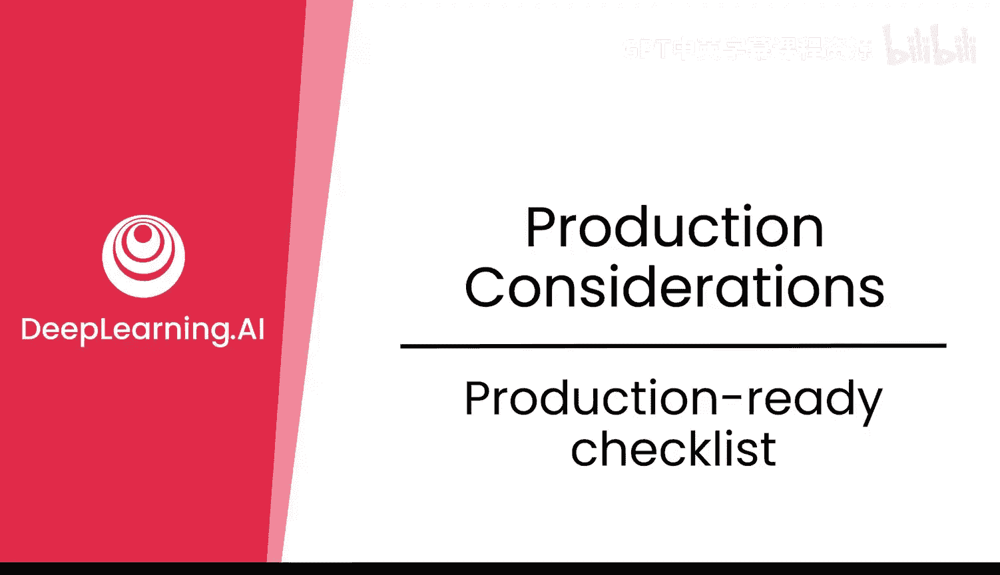

Just to make sure everything is squarely in production。 Let's run through your production checklist。

 So how do you know you're ready？ Well， here is a checklist for production that you should go through before you're ready to ship your model out there。

 So first is that clear reproducible model config So you want a reproducible config to actually get the model that you are releasing out into production。

 you want to be reproducible you want to be able to rerun it at any time and be able to get the same numbers so that you know for a fact that this is your model and how you got that model So the goal is that you can run it on all the held out test sets and suites and get the same numbers and within some of course confidence interval tolerance so that's number one so you can trust the model that you're putting out there boom next up is promotion roles and rollback conditions set up across your different stages from development to staging to production。

 So you saw that with the Ral promotion roles and the same thing with just generally your fine tune model as well。

 but afterwards。

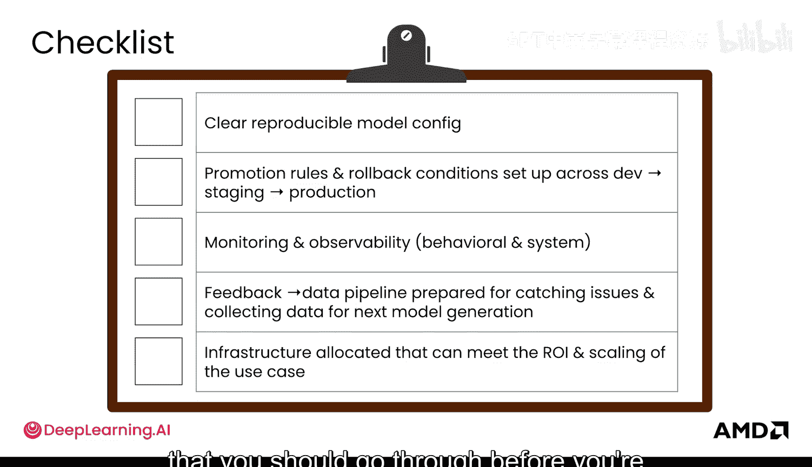

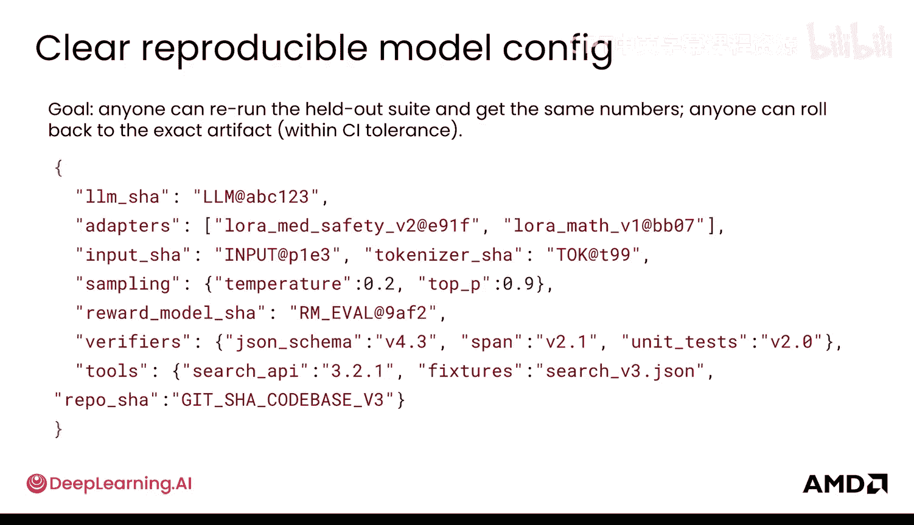

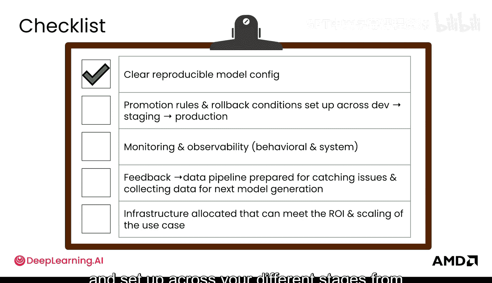

Turning your North star here into an actual contract with what's go or no go So what are you actually going to use as your gate between development and staging and then staging to production and getting really clear about what your promotion rules are and codifying that writing that down makes it so that you can automate a lot of these pieces of what model then goes out and then how you even roll back Next is monitoring and observability we looked into these a bit but for different slows or service level objectives being able to understand what the behavioral as well as the system metrics are for the different slices for example that matter for you and to understand just how well is this model doing out in the wild so what is its behavior and then what kind of actions can you take based on that behavior next is your feedback to data pipeline or that flywheel that we discussed before here the goal is to turn any failures or even good things that you see from how users are using your model into better high signal supervision for the next round of fine tuning and。

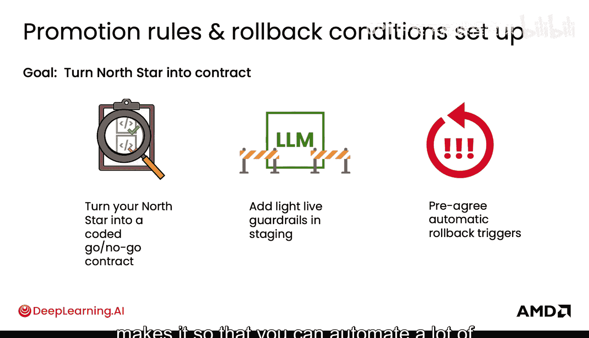

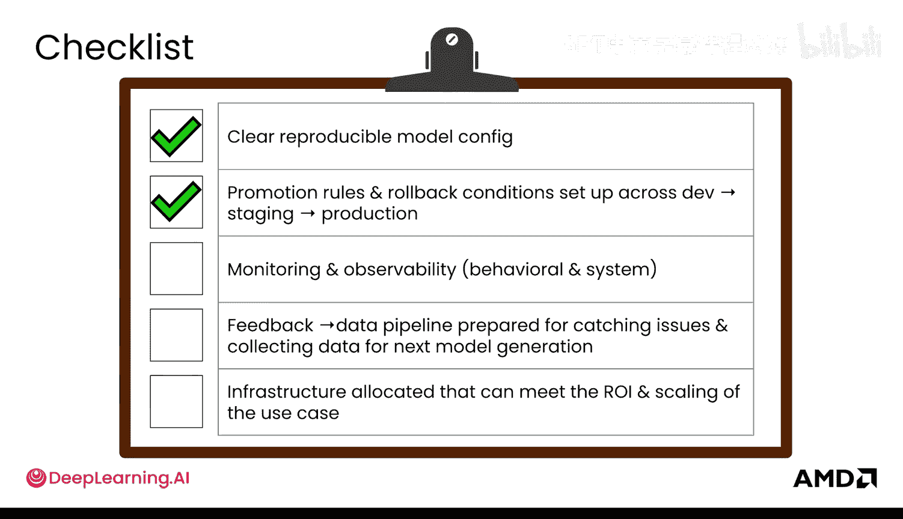

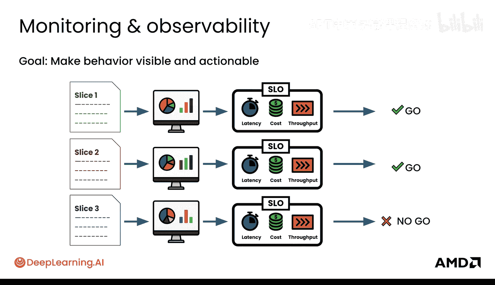

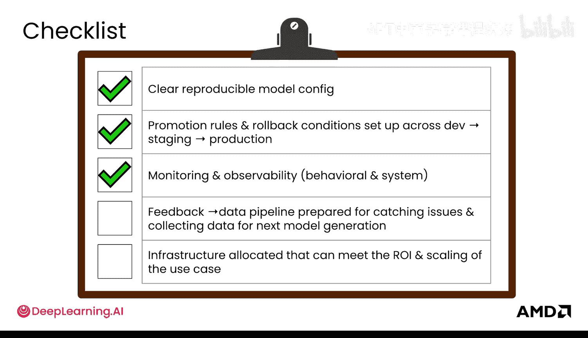

So you're looking at your logs， you're mining them， and then you're clustering them。

 you're understanding the patterns in them， and then of course using that for downstream data。

 which you can use synthetic pipelines to generate coverage for and then you queue for training for another experiment for both fine tuning and RL and finally your infrastructure so how you allocate your infrastructure is really important too to make it possible for you to run your different experiments but also to make sure you serve your users appropriately so you want to meet targets on your GPU scale out elastically and you don't want to regress on those important behaviors as well and here's where you're looking at throughput latency and of course cost Great so now you have your production checklist it's time to go row out your model。

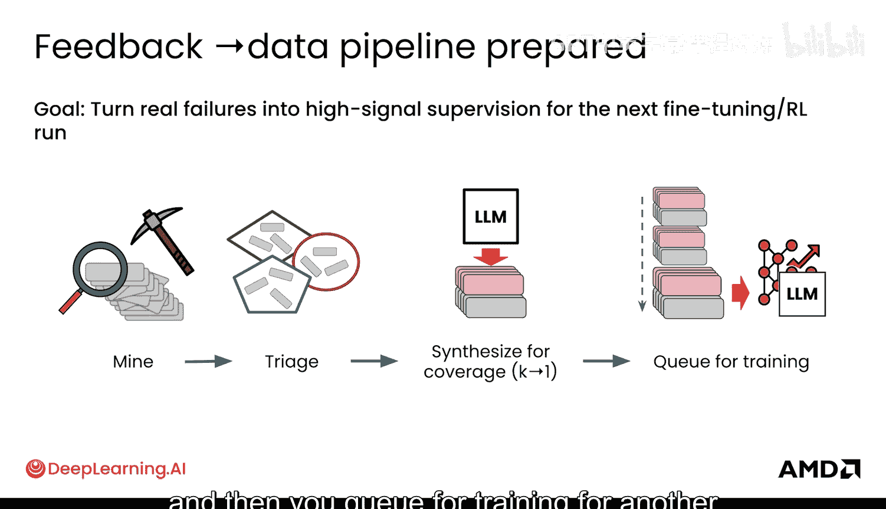

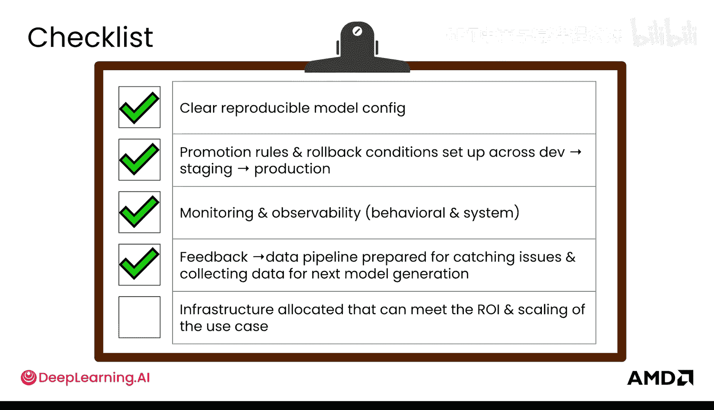

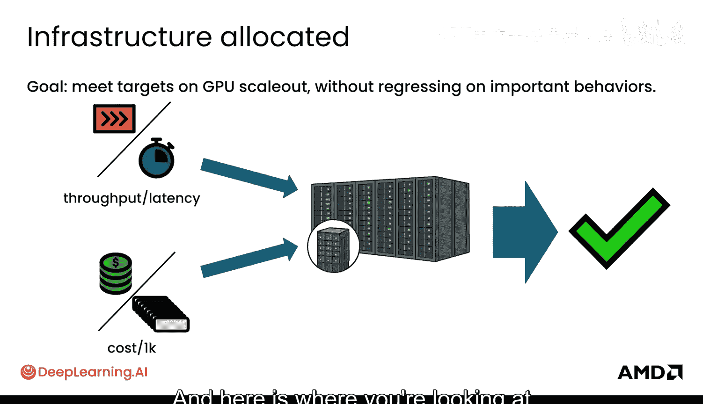

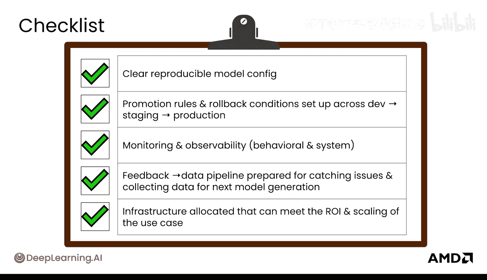

Congratulations on getting to the end of the course of post training。

 you've gone from just understanding the very basics and intuitions of reinforcement learning and fine tuning to understanding the nitty grty math behind them to using evaluation as the North Star to guide your post training to the data and the important data considerations you need to make to finally production and getting your model out there into the world。

 I'm so excited to see what you build。

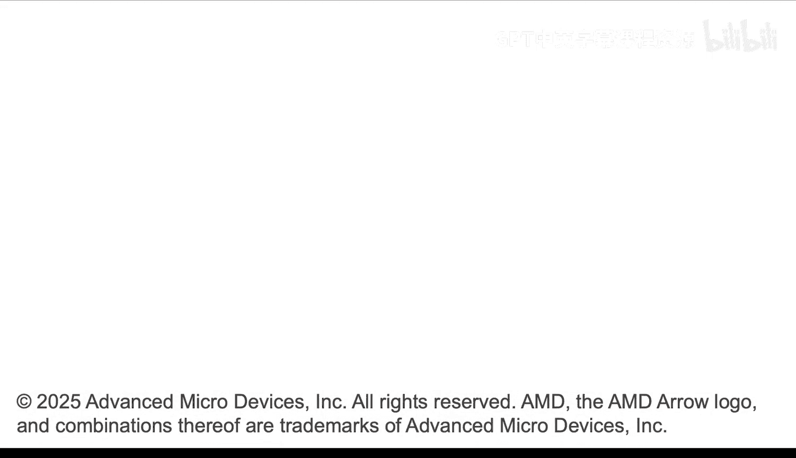