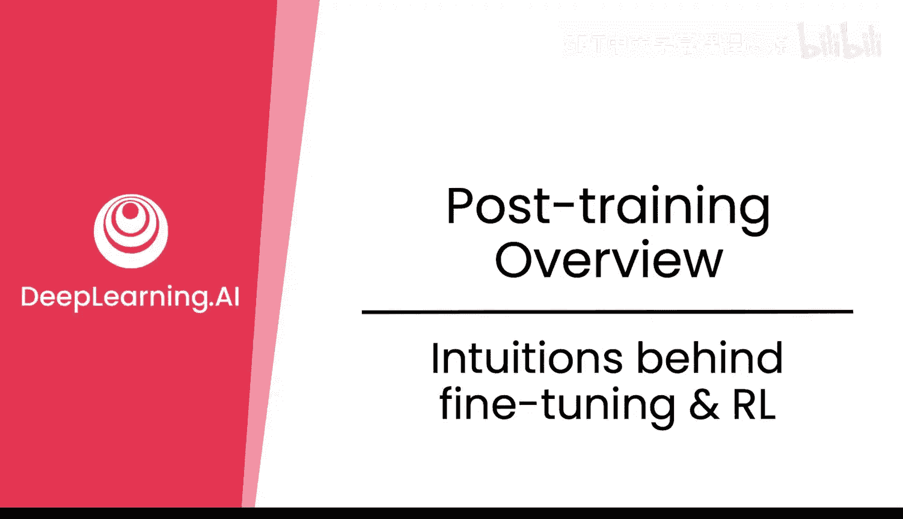
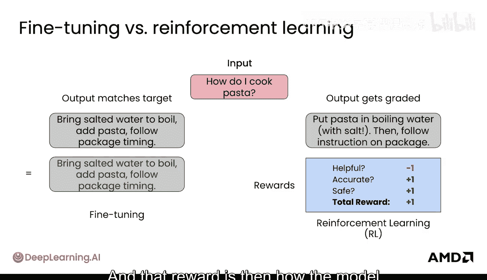
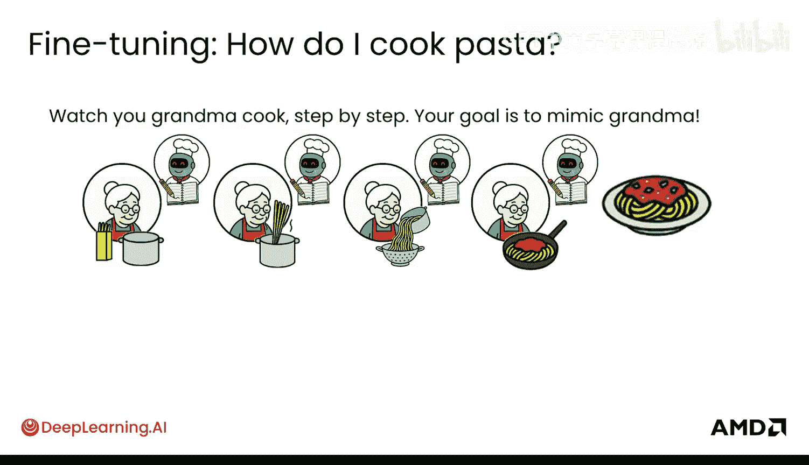
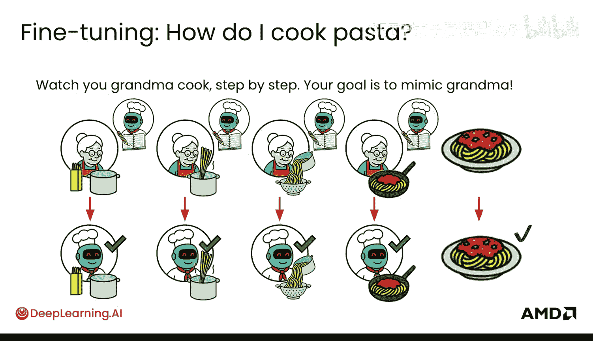
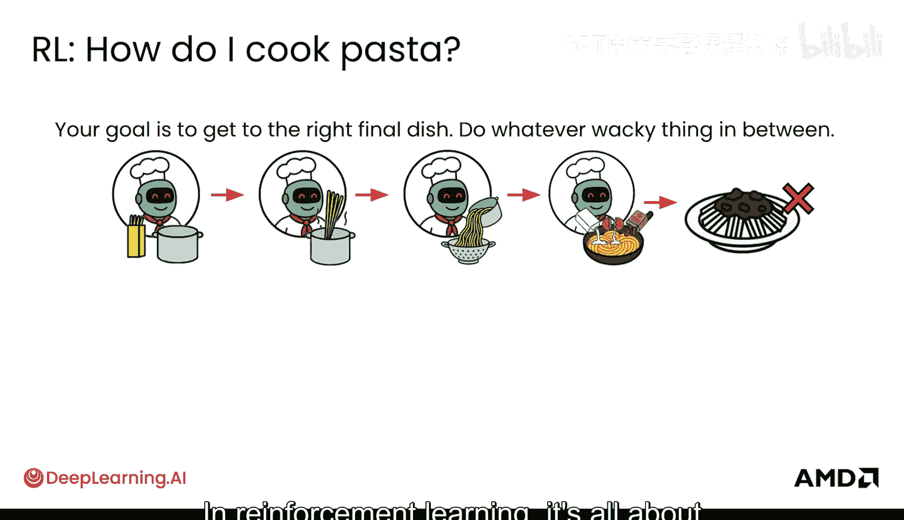
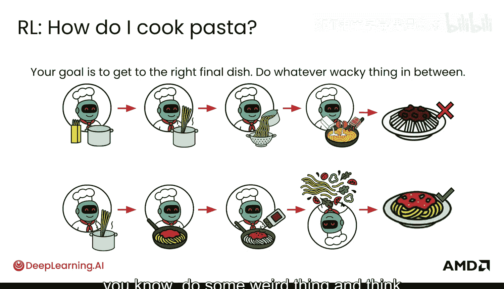
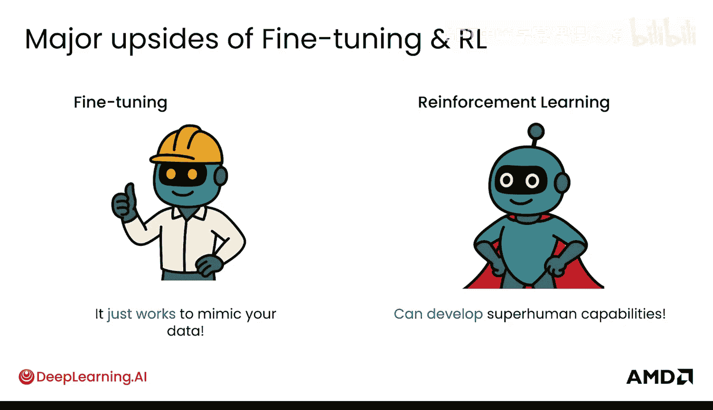
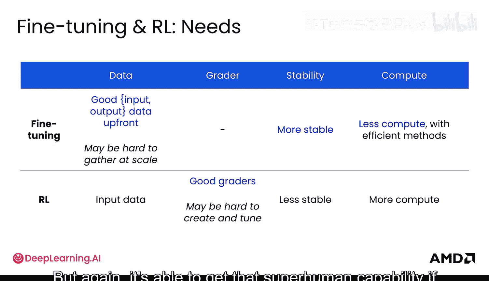
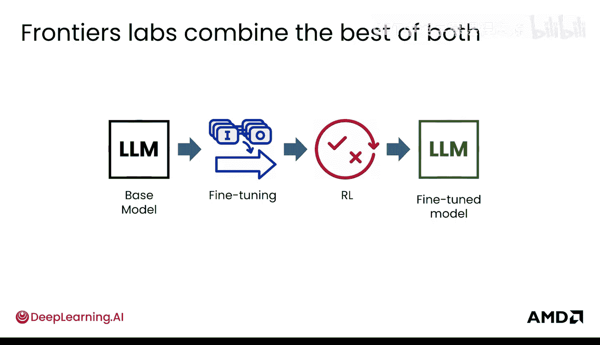
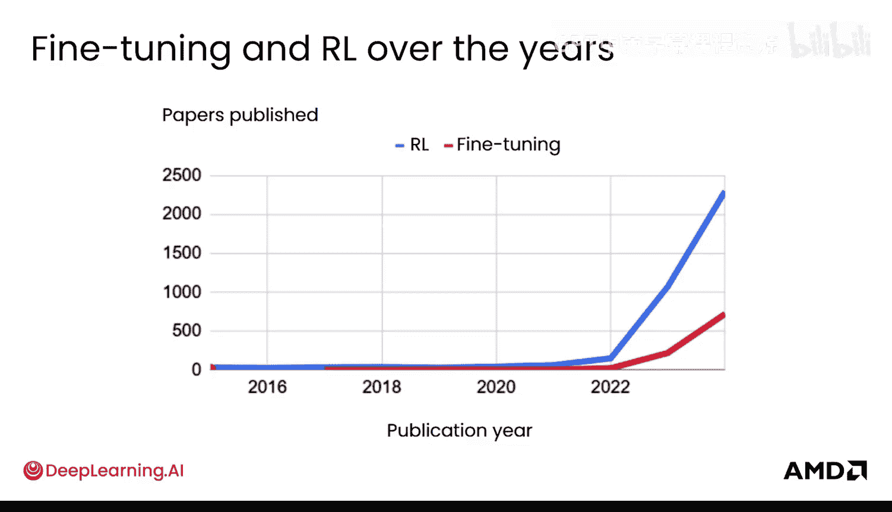

# AMD《大型语言模型的微调与强化学习：后训练入门｜Fine-tuning and Reinforcement Learning for LLMs》 - P4：4.intuitions-behind-fine-tuning-and-rl.zh_en - GPT中英字幕课程资源 - BV1zZy8BcE7z

Bine tuning and reinforcement learning are both important techniques for post training。

You'll dive into the intuitions behind both of them。

 how they differ and how they're alike using a really fun example with pasta。

So to first understand the difference between fine tuning and Rl or reinforcement learning。

 take a look at this example So if you have an input like how do I cook pasta in fine tuning。

 what it'll look like is it wants to nudge the output of the model to match some kind of target perhaps the target output is bring salted water to boil add pasta follow package timing so that's the target the model outputs bring okay that matches well salted that matches well water to boil etc so it's all about matching that target in reinforcement learning it doesn't actually matter what the output of the model is maybe it's put pasta and boiling water with salt。

 then follow package instructions or something like that it doesn't really matter as long as it gets scored later on and gets these rewards whether its helpful whether it's accurate whether it's safe and it gets a total reward and that reward is then how the model learns whether its output was good or not so just to go a little bit more into this pasta。

Intuition fine tuning is like watching your grandma cook step by step and your goal is to mimic your grandma at every single step so the model is trying to mimic every single step that grandma is doing in making this pasta and of course the final pasta dish hopefully is correct here as well but it's all about mimicking every single step in reinforcement learning it's all about just getting actually the right dish so it doesn't matter what any of the steps are。

 you can do any wacky thing in between like here's throwing all the pasta up in the air and if you still get the right pasta dish at the end it doesn't matter it'll still get a positive reward and say that was right and of course this can cause both interesting things like enable the model to learn new things like new ways other than what grandma has done maybe better than grandma's recipe or better than grandma's steps it can also introduce weird issues where the model might you know do some weird thing and think that was actually the right thing to do because they got the right dish in the end the major upsides。

fineine tuning versus reinforcement learning is that fine tuning often people just say。

 you know it just works。 it actually mimics my data it mimics the steps correctly and understands the overall distribution of the data I'm giving it so it's able to mimic that target output and it's much more stable in that sense reinforcement learning the major upside is that it can develop these almost superhu capabilities it can think of things that are better than the steps that we asked it to learn and so that's really powerful but it is less stable so to summarize a little bit about the needs fine tuning you really need that good data right the data has to be so good because it's trying to mimic that target output and you need that data upfront and that sometimes it's harder to gather at scale sometimes it's actually easier so that really depends on the type of domain R you need that same input data like how do I cook pasta but you don't need that target output data anymore instead you need good graders or good ways to get that score or reward at the end to say yes that pasta dish did match the exact pasta dish。

 a good pasta dish。

Right and these good graders are hard to create and they're hard to tune and they're ways to game them right and so this is one of the hardest parts of RL to get right for stability。

 fine tuning has been around much longer so they're more stable solutions in terms of getting the model to finet and as a result they're also more efficient methods so you need less compute and in some future videos and lessons you'll see how fine tuning can be significantly more efficient RL。

 on the other hand， suffers from a lot less stable methods and requires a significant amount of compute investment to get there but again it's able to get that superhuman capability if you're able to keep it stable for a long amount of time so that the model can learn ultimately frontronier labs combine the best of both worlds usually a base model pretrained model will go through fine tuning to learn some of the patterns first and then go through reinforcement learning to actually learn some additional ways to solve the same problems and to solve it in its own way maybe more。

or better and ultimately get that upgraded model in the end so fine tuning and reinforcement learning have both been very popular through the years fine tuning again much more mature here's just a graph plotting the papers published in both of those areas and you can see that reinforcement learning has really been picking up in excitement especially as it applies to language models Now that you've learned about the intuitions behind reinforcement learning versus fine tuning you'll dive a little bit deeper into what makes each of them really work for fine tuning it's the data and for reinforcement learning it's the grading。

