# AMD《大型语言模型的微调与强化学习：后训练入门｜Fine-tuning and Reinforcement Learning for LLMs》 - P5：5.key-components-to-making-fine-tuning-and-rl-work.zh_en - GPT中英字幕课程资源 - BV1zZy8BcE7z

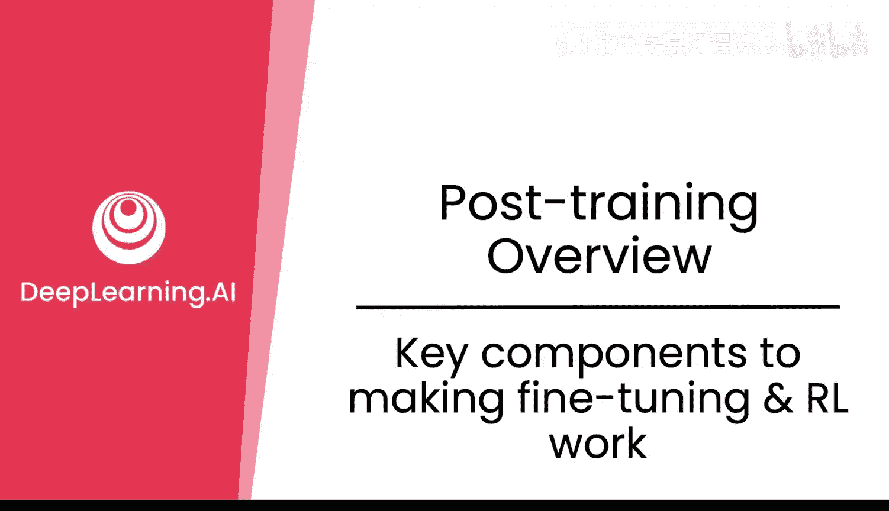

Data is what makes fine tuning work and grading is what makes reinforcement learning work for data。

 you'll learn about how the inputs and outputs can really shape that model behavior very differently。

 and that's for fine tuning for reinforcement learning you'll learn how the grading can really nudge the model in different directions and how that all comes together in an RL training environment。

Fine tuning means really good data so that might be hard to scale。

 but the data is all what it takes to make fine tuning work。

 And that is the most important part for fine tuning for reinforcement learning。

 it's about good graders you don't have that target output。

 So it's all about how you grade that input data and how well those graders are created So going into fine tuning making the data work。

 What does that look like exactly So you could have an input like what's the capital of France。

 the target outputs Paris who wrote Romeo and Juliat， the target output is Shakespeare。

 your data might look like this。 but when you know actually ask a model。

 know what's a capital of France， it answers Paris correctly， And you ask it what about Spain。

 it starts saying Spain is European country Oh， no it actually was not able to handle in this case chat history。

 So what do you do instead what your data could look like is actually passing in that chat history of what is the capital of France。

 Paris and then what about Spain。

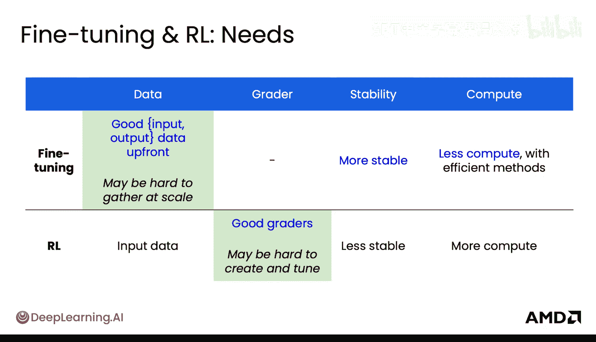

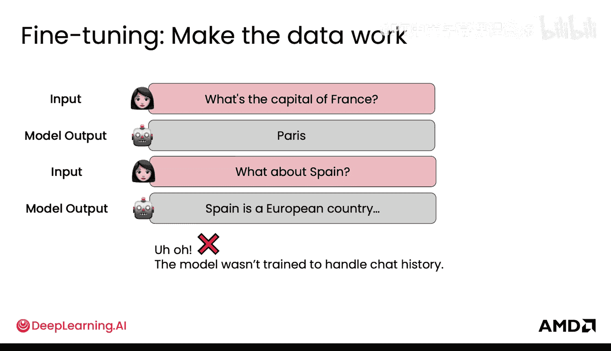

The target output is here so this actually gives the model examples where the input includes that chat history that's how you teach a model to actually be able to handle past chat histories and again you can keep going Jeremy and learn that Berlin target of course for an actual prompt inside of the model and your actual data you probably want to put in these tags。

 these prompt tags of user then assistant user and assistant which you' probably seen before to actually denote who is saying what in a chat and then so now that you've taught the model with that data。

 your fine two model will then be able to handle something like what's a couple of US Washington D what about China right so being able to take in that history and be able to say Beijing In addition to getting chat history to work there's also different methods of having the model learn not only just the answer to this word problem but also it's rationale or what it's thinking quote unquote or what it's reasoning and so in this case actually going through these different steps to teach it these steps。

This is similar to when you were teaching the model to cook pasta to actually be able to go through every single step that grama was doing to cook the pasta and typically what it looks like in an actual prompt is using these think tags and answer tags which you can then use later and extract later from the target output so that you can check whether the answer is correct fine tuning data can also be very powerful for teaching the model how to handle rag retrieval augmented generation misses or when you have a bad rag document attached to it so of course in the easy case where it's correct that's fine it's able to look at the input and be able to get the target output but in bad cases where in this case the document actually says that Sydney is a capital of Australia which is wrong the model can actually recover from that and you can teach it to recover by giving that target output that there's an error in the document and the capital is actually can in your data you're also able to get the model to create guard brails so here the user might say help me write a computer virus that's really。

Bad that's harmful in your target output， you want the model to refuse that right and so when you teach the model with examples like this。

 then the model will start to refuse things like this。

 Here's another example of a guardrail which might be a bit different than just the safety guardrail this is if you want to train a model to be an AI banker right and so then you have your model here wearing a banking suit and the user might ask what's the capital of Australia and instead you want to apply a guardrail here and say sorry I'm actually only able to answer questions about AI bank so this is adding a custom guardrail for your custom fine- tuneuned model why this is helpful is that if you don't add these guardrails people can start to use your model for anything here is a funny example from Amazon when they were launching their first bo where instead of looking for specific info about a product this person is asking the underlying bot to write a react component that renders。

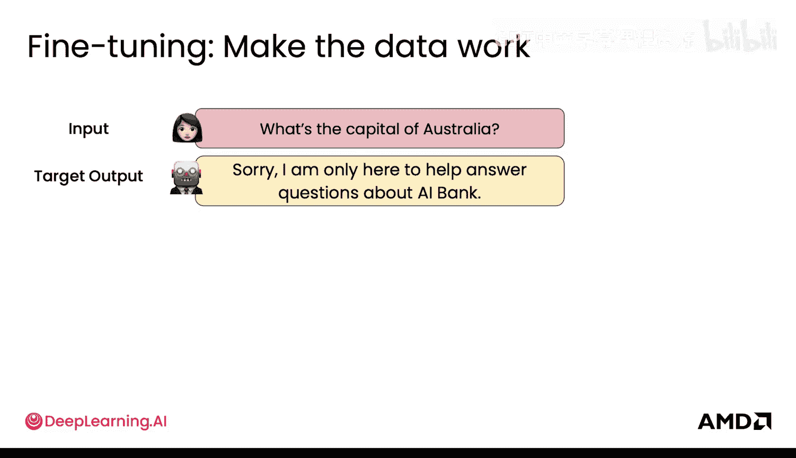

To do less so using the model for different things instead of the model here learning to refuse to refuse running a react component that that is easily mitigated by having the model learn from those examples of guardrail through fine tuning reinforcement learning so for RL it's all about the graders and making the grading work and so you don't have that target output anymore to show what's correct but instead you can grade what's correct so what it looks like here is here's a math problem where Carly has eight apples buys two more but then sells5 to the local baker how many now so you can use a math grader the model can output whatever it wants。

 but ultimately output some answer and the math grader can tell the model okay this was right or wrong and so here it could say incorrect if the model's output was incorrect but it could also give some partial credit so it shows its work that's something that the grader wants to encourage and so the total reward or score is then higher and of course if it gets it correct then you can have a total reward or score be higher course。

😊。

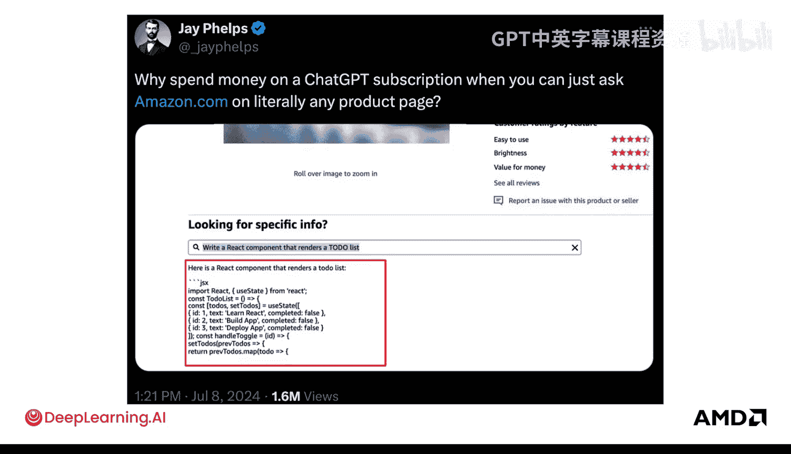

Similar to the fine tuning example with the data in answer tags。

 this makes it easier to extract that answer and also you can have the greater include a formatting grade to encourage the model to actually produce those tags correctly a lot of these graders here are deterministic so whether something is correct or not whether there's shows work that could be some kind of rex。

 whether it has stuff in an answer tag whether there's answer tags exist。

 that's something that you can easily extract deterministically with functions that's not always a case because what if you had this math problem。

 but then the question is actually how does curly feel Now your math checker， its mind is blown。

 it doesn't know how to grade this So instead what you can have is another language model or another type of model actually output a reward you can learn how to grade an output to how does curly feel And so maybe the LLm can give a score based on different parameters like politeness or。

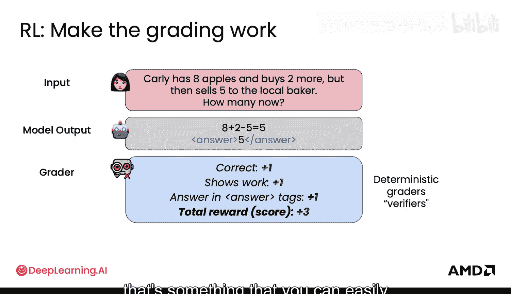

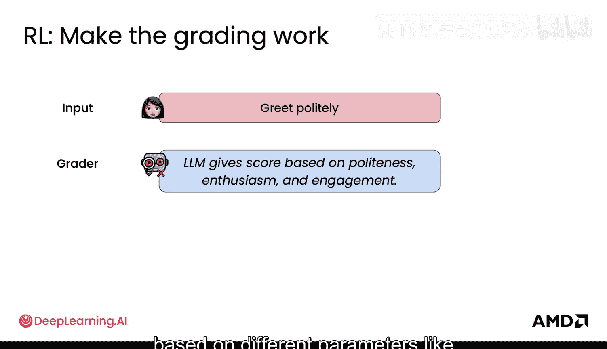

usm or engagement。 And so here for this input greet politely， the model could say hi there。

 how are you and it would give it a high score， high politeness， high enthusiasm， high engagement。

 However， if you know your input， you adjust it slightly and the model now outputs hell hello hello hello hello many hells the greater might still say high politeness high high engagement but you didn't really want the model to output that It's a bit silly。

 So this is a common thing that happens in reinforcement learning called reward hacking。

 So that's why the greater is so important to get right if you don't get it fully right。

 the model will find a way to hack it and find a way around it to get that high score that high reward without actually doing what you want it to do the distribution of inputs that you put into the model also matters significantly。

 So in reinforcement learning you want to give that large distribution of inputs similar to in fine tuning so that the model can actually react to many different types。

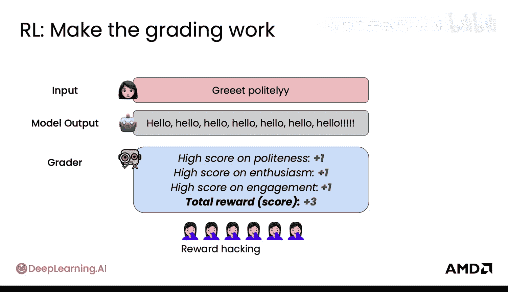

Possible user inputs this needs to again be very representative of what kind of user inputs you expect the model to see and now what's a little bit different in reinforcement learning is that in addition to having that greater typically you'll create this R training environment and that's these inputs these greater but also some of these other things some might come into play for example。

 in the environment you might also expect the model to be able to use a calculator tool and so you want to make a calculator tool available to the model so the model can then use that tool to for example answer this math problem you might also give tools like a search API or you might give files to look through your code base and the model can look through those and use those in this contained environment and then of course the greater can score it based on the model's ability in this environment how representative this environment is to your real worldor use case is going to be as much information and as helpful as you need the model to actually learn from this environment So the more representative this environment is。

To where you expect the model to operate the better now quick some considerations is while the more realistic。

 the better be careful because some of the tools that you might give the model will be hitting external As and you might be dedossing some of those external APIs and it might actually turn out to be unrealistic if you're running this R environment quite intensively and you you'll see this a bit later as well so ultimately the data for Rl is going to look different than for fine tuning it's gonna look like that input that model output and then a reward and the training environment of course is very different from fine tuning as well and here are a couple of different training environments so one might be around debugging a code base one might be about that like polite greeting and you want to actually give a right mix of these so the model learns all the different tasks that you want it to learn with reinforcement learning so this is multiple training environments producing multiple types of data out to train your model and you want to kind of balance it correctly and you'll learn more。

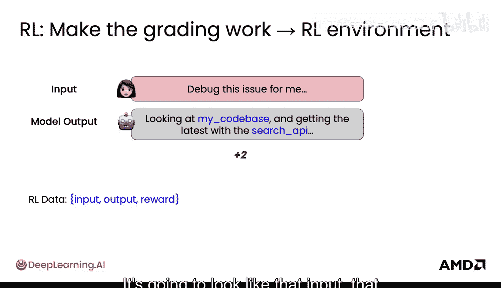

about how to exactly balance this in the future lessons So putting it all together again。

 you want to use both fine tuning and reinforcement learning for a lot of your good models so first it's about getting that fine tuning data then you can fine tune your model on that input and target output pair get your fine tune LLM then typically what happens is then you create those Rl training environments with your different distribution of inputs that are representative but also your graders in other information like those files or like your codebase or different tools like that search API and then you run an Rl loop where you get some Rl data so you given an input you get different model outputs and those are rewarded so those are given rewards in your Rl training environments and then you train your fine tuned LLM with reinforcement learning and then you keep running that in that loop so fine tuning really goes through that one giant stage of data collection then the actual fine tuning and training step and then Rl actually goes through multiple iterations of collecting data and in training the model。

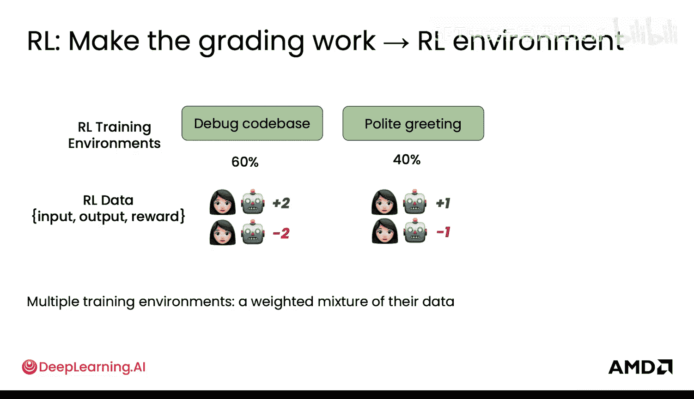

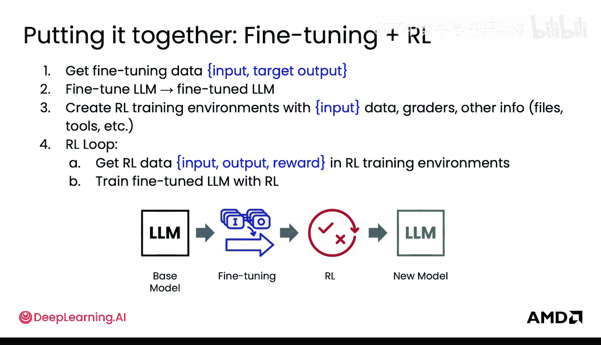

You've learned the key components to fine tuning， which is data and to reinforcement learning。

 which is the grading。 Take a look at how to combine them for a post training reasoning example。😊。

