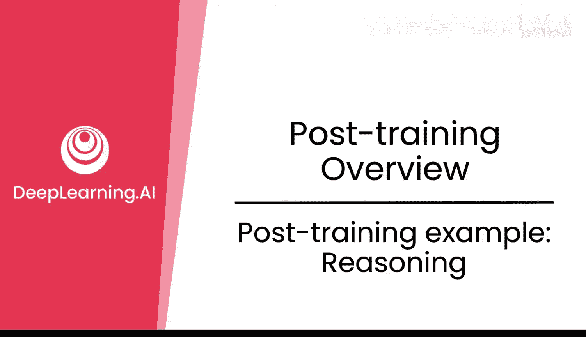
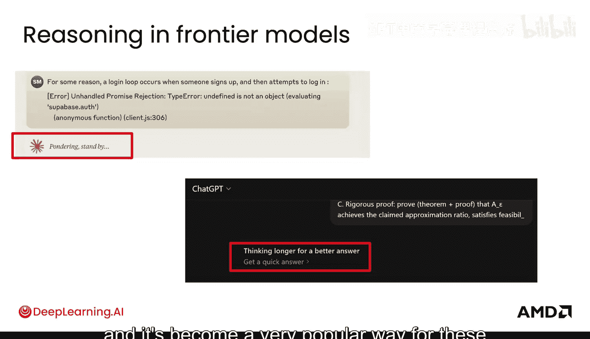
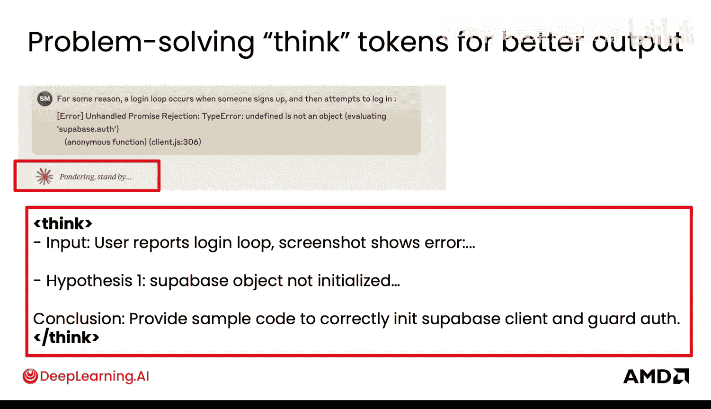
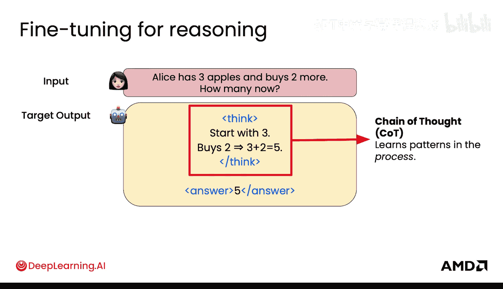
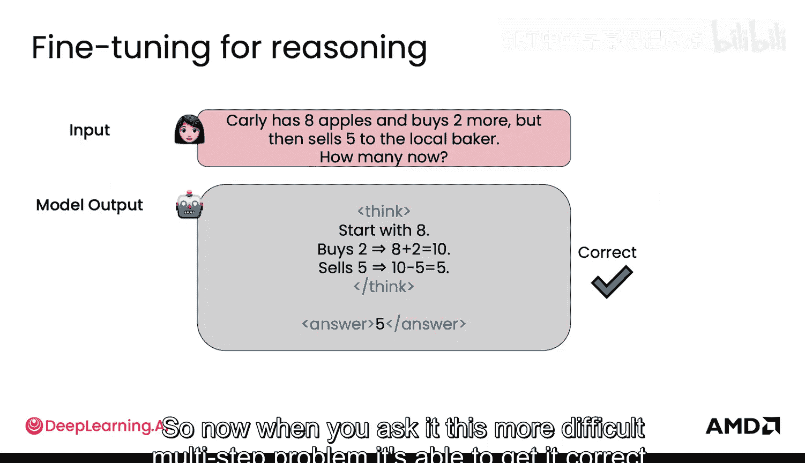
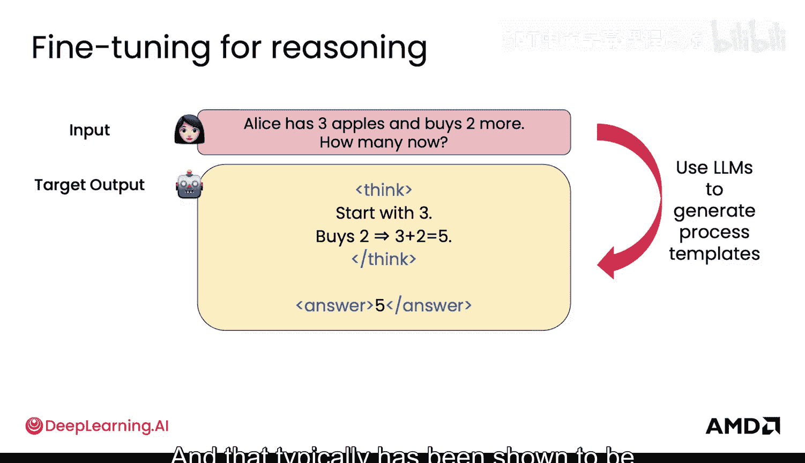
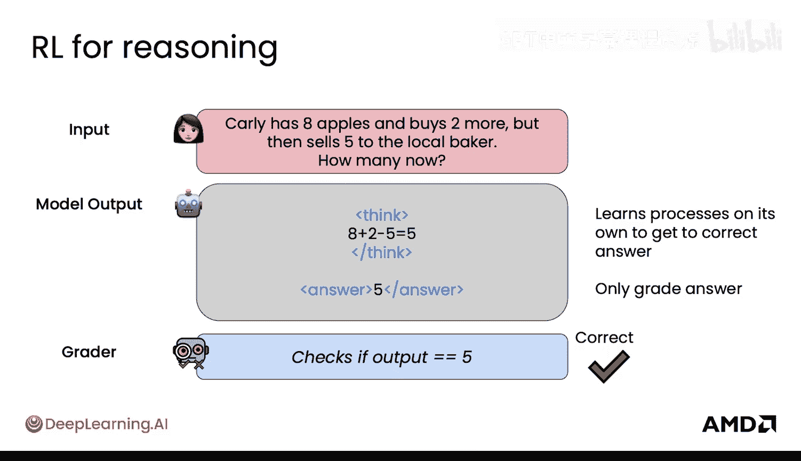
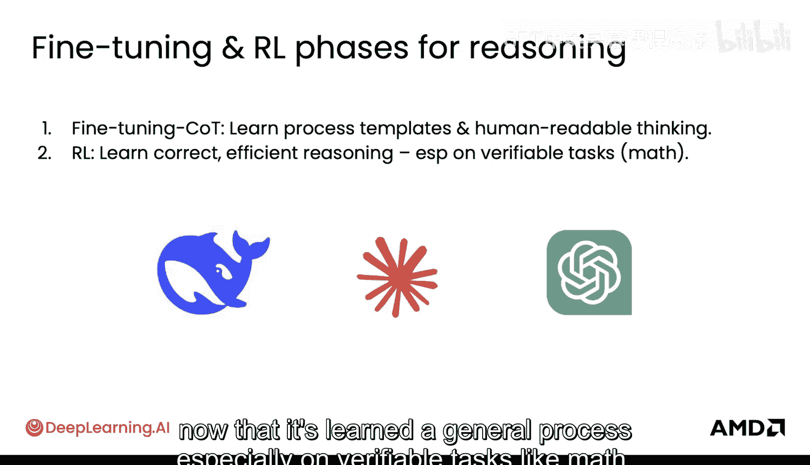
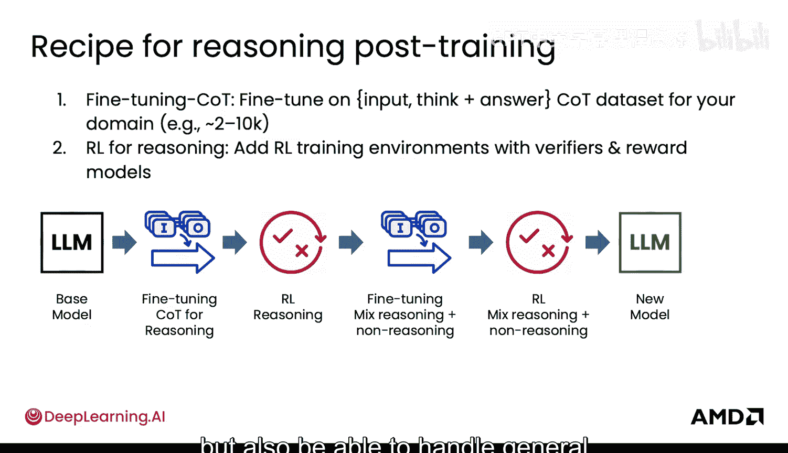

# AMD《大型语言模型的微调与强化学习：后训练入门｜Fine-tuning and Reinforcement Learning for LLMs》 - P6：6.post-training-example-reasoning.zh_en - GPT中英字幕课程资源 - BV1zZy8BcE7z

Reasoning has really taken off in frontier models。 ChatyBt Claude。

 you name it and it's fine tuning and reinforcement learning that have really made these models capable of reasoning。

 So you might have seen thinking longer for a better answer in chattyB or this pondering standby in Cla or basically in frontier models you might see some of these little notes where the model is quote thinking and this is reasoning in these different frontier models and it's become a very popular way for these models actually produce a better answer and what's happening under the hood under one of these reasoning tags is this thinking tokens So essentially underneath what's going on is the models actually outputting different hypotheses coming up with different conclusions to actually answer your question more accurately to do this the model has been using posttraining techniques including fine tuning and reinforcement learning to be able to do this well so you'll learn how both fine tuning for reasoning and reinforcement learning for reasoning will'll get the model to do this effectively。

For fine tuning， what does this look like first you can have you know an input where you have this math problem and you have a target output with just the answer and this looks correct right it learns patterns and answers to similar math problems great。

But when you try to actually do a more complex math problem， the model might be a little bit brittle。

 right It just guesses the answer based on prior patterns of answers。

 that's not exactly what you want it to do。 So instead what you can do is teach it a target output that's a bit different that actually has the rationale。

 the step by step in there。 and typically we put these into these think tags So where the model is actually thinking these different steps and then an answer tag。

 And this is called chain of font So this thinking part is called chain of font and it learns patterns in the process not just patterns in the answer。

 this is really important because it helps the model actually reason more effectively。

 So now when you ask it this more difficult multistep problem。 it's able to get it correct。

 So essentially you can use LLM to help generate even these process templates to then use for fine tuning for reasoning。

 So this is very， very powerful， you can scaled this out as well。

 And that typically has been shown to be very effective in getting the model。

To reason more effectively All right so that was fine tuning Now for Rl for reasoning。

 what does that look like So you can have the same math problem and here you will have a math checker and in this case。

 it's gonna to check if the output is correct the outputs 5 and the answer is So what's interesting with R is it doesn't matter what goes on in that think tag it could be anything as long as the answer is5 It's gonna to get graded to be correct it can be say so Carly Carly Carly how about that with Apple so it can be a little bit crazy in there and it's still able to get the right answer it's able to output Icelandic Mongolian and do math and Latin and still be able to get that answer correct now this is harder for a person to be able to understand but the model actually was able to learn this new way of doing this math problem and get it correct So ultimately we still give it that correct reward it can also learn things that are better than what was shown then what a person might do it can learn something more efficient like this here。

More efficient than a model that was only fine tune on the exact type of process and steps that was more verbose。

 So that's really powerful。 Now to understand this a bit more。

 one thing that I found really interesting is this deepse R10 model this deepC R10 model learned reasoning from reinforcement learning only without any fine tuning and it learned with only these types of math checkers in a format checker to see if those think tags were there。

 it was really using only very simple ways of grading the model and the model is able to do quite well。

 however， it did encounter some challenges such as a lot of endless repetition poor readability in that language mixing issue as well。

 So ultimately for these frontier models， they do two phases。

 one is fine tuning phase typically with chain of thought to learn this process templates and human readable thinking so not mixing those languages for example。

 and then a reinforcement learning step that learns correct and efficient reasoning better ways to actually answer a question now that it's learned the general process especially on verifiable tasks like math。

And realistically what this looks like is a recipe like this。

 so you have that fine tuning chain of thought data and you fine tuning on that maybe it's like two to 10K examples and then you do RL for reasoning and that's when you add those RL training environments with verifiers and typically also reward models which are models that actually learn the reward beyond just those verifying checks and typically there's multiple rounds of this for a frontier models so you're going to do first fine tuning for reasoning only then R reasoning and then you're going to do another round of fine tuning and another round of reinforcement learning and what you'll see is that in the final rounds for this model in particular this is deepCR1 you're going to mix that reasoning and non-resoning capability so that the final model that you get is able to handle both reasoning tasks on math and coding but also be able to handle general talking and dialogue with a person now that you've seen an example of how fine tuning and reinforcement learning help with reasoning in these language models take a look at a second example。

Of getting the models to produce harmless， helpful responses。

