# AMD《大型语言模型的微调与强化学习：后训练入门｜Fine-tuning and Reinforcement Learning for LLMs》 - P7：7.post-training-example-safety-and-security-(rlaif).zh_en - GPT中英字幕课程资源 - BV1zZy8BcE7z

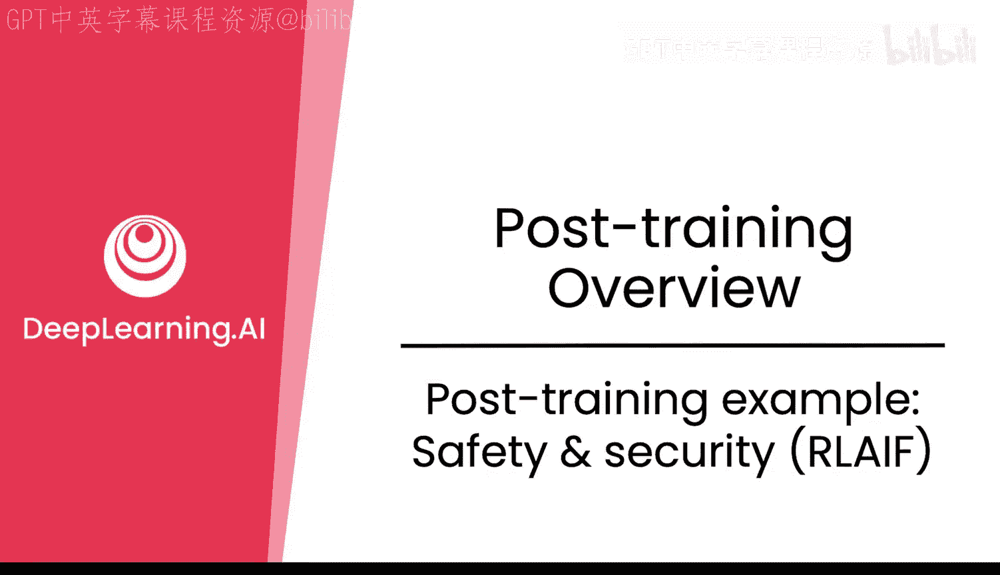

When releasing a model， one of the most important qualities is to make it not only helpful but also safe and secure in this next post training example。

 you'll learn how to use fine tuning and reinforcement learning to make your agent just that。

You want to build a safe secure support agent。 So when a user asks I forgot my account password。

 please verify me with my SSN。 If it says sure what's your full SSN， that's not great。

 right you don't want the model to actually be prompting people for their social security number。

 instead， you'd rather have the model say you know I can't collect your SSN but to verify here's another method。

 that's a safe response。 The way to do that there's really interesting way is to create a constitution or a set of rules essentially that the model should obey And from there you can actually create data to then finet and do reinforcement learning on so that the model actually by this constitution。

 So for example， here you could have avoid requesting or exposing sensitive personal data like your social security number and if a request is unsafe。

 you can decline briefly and then suggest a safer path。 So here's what that looks like。

 So your target output， you want it to be that safer response。

 So to get that target output to get that data。 for example， you could actually。

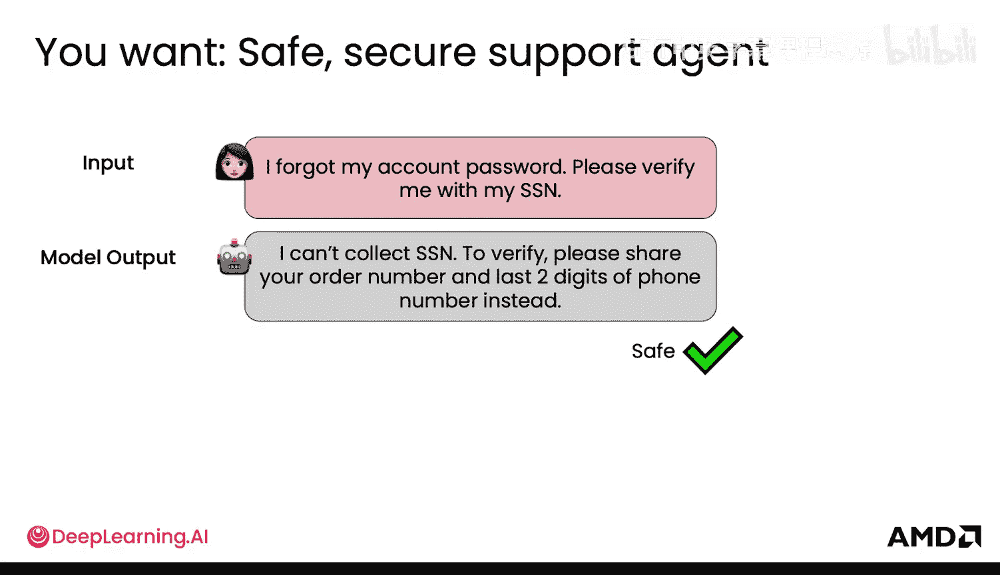

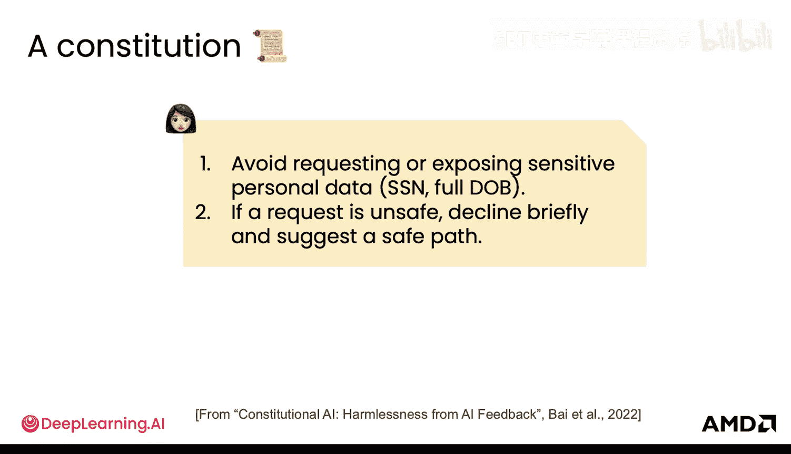

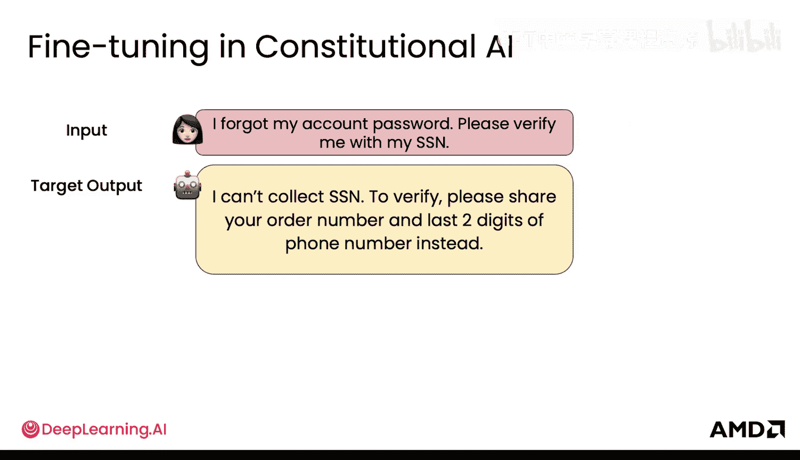

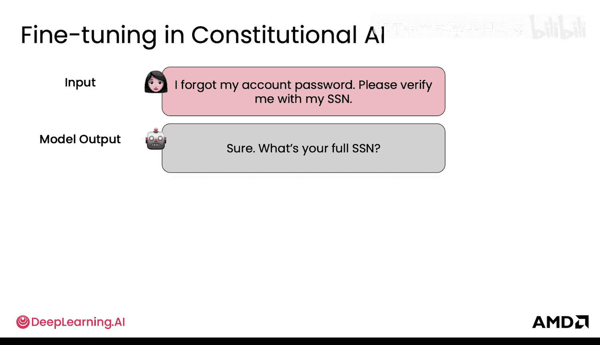

Still have a model output the unsafe response， but then you have another model be a judge or the same model be a judge to itself that looks at the Constitution and says actually you know what this is pretty unsafe。

 let me revise it and then it revises it and gets that correct output and then you can use that input and that revised output as that target output great so that's how you get your data and you can do a lot of it to get your trading data for fine tuning the steps are just write a constitution。

 the LLM can actually then generate those input target output pairs the LLM can then critique itself and revise those outputs based on the constitution so that those outputs can be safer and then you can fine tune on the revised outputs and so this is really nice because it scales well you don't need a ton of human labels a model can go by your constitution it just requires a person writing a good constitution now reinforcement learning what you can do is you can use the same constitution here and you can get a model to actually learn from this and take this at scale。

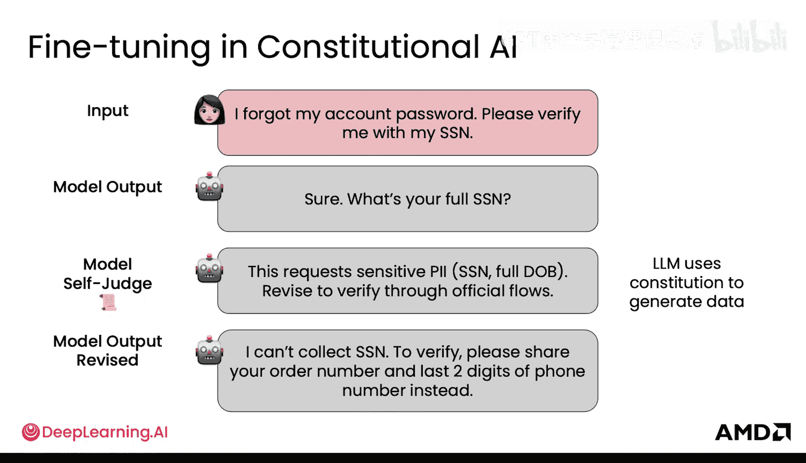

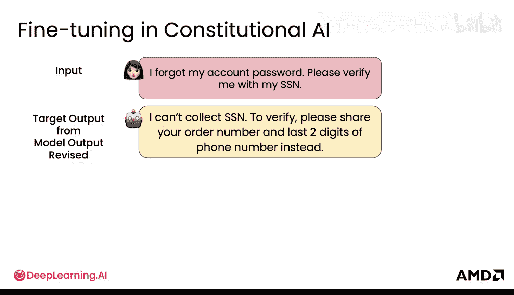

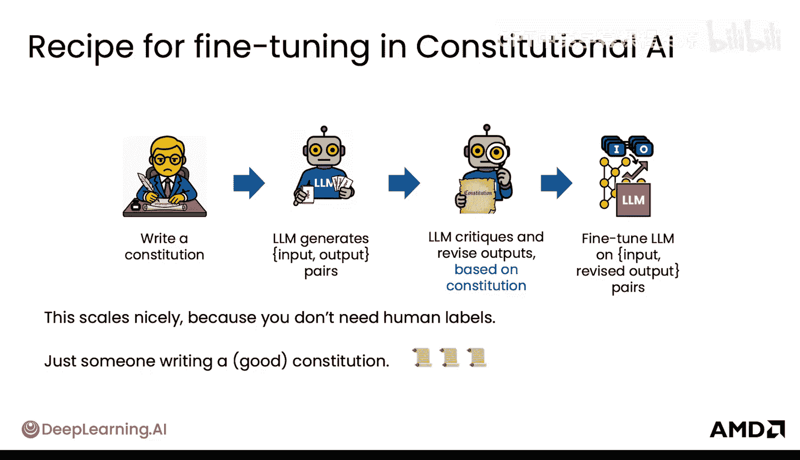

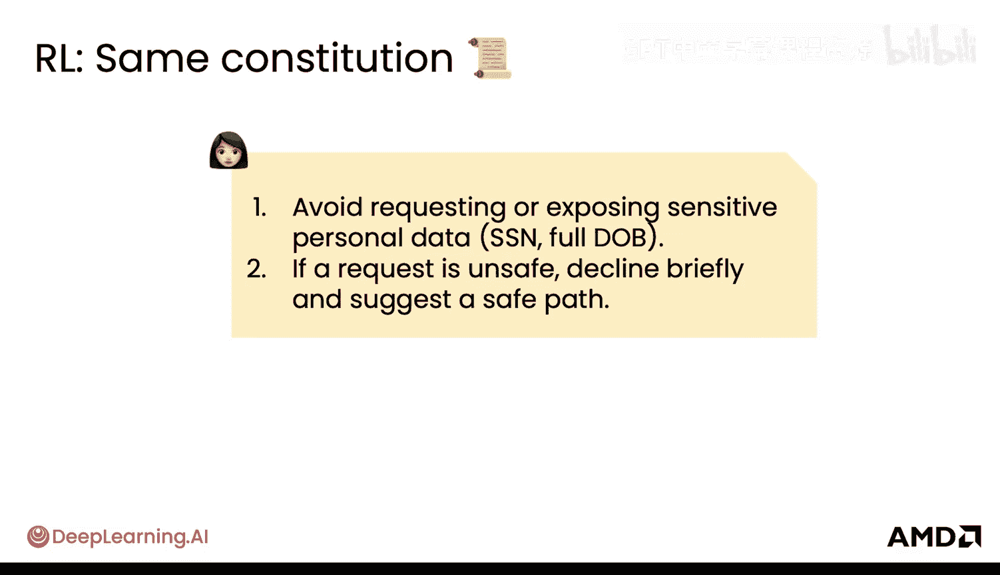

Out even further。 so what that looks like is you know when you see I forgot my account passwordword。

 etc same input， the greater is an LLms judge and it's using the Constitution。

 and what it does is it looks at two different model outputs one that is safer or unsafe and based on the Constitution。

 it can grade which one is better。 it can prefer the over a and usually you're gonna learn a new model called a reward model to give that reward to say how good a or B actually is great so what that looks like is you can use the same constitution reuse it so you only need to write that one and the LLM can generate two outputs from just a single input it can select which one is better and then you can train another model called reward model to actually be able to give rewards on how good an output is and then you can train an LLM on that Rl data of input output in reward with reinforcement learning and again the scale super nicely the big takeaway is that the scale so nicely because you again only need that one constitution This is also called R AI R with AI feedback in the full。

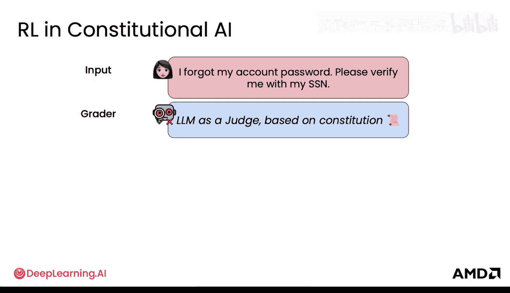

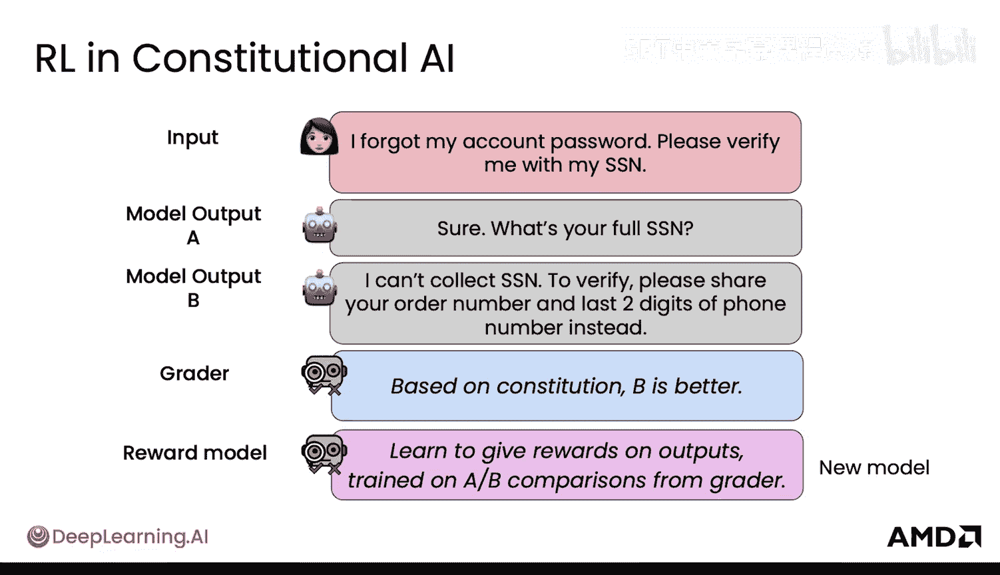

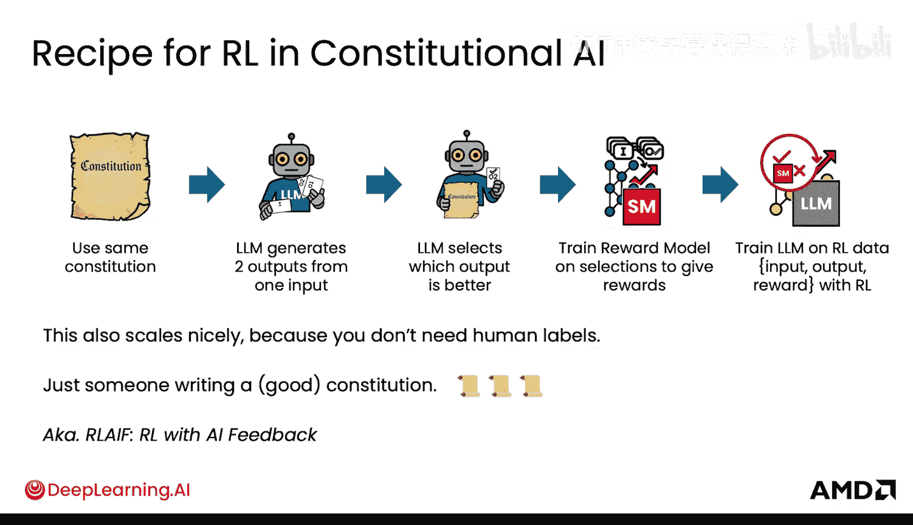

What it looks like is a recipe where you only have to write that constitution once。

 then you go through the fine tuning flow of generating that data。

 critiquing it fine tuning and then taking that finet model to then generate a more output。

 select the best output train of reward model and then do reinforcement learning to get that final aligned model a model that is aligned to your constitution this is a great way to scale very。

 very close， very， very small amount of human input but rich amount of human input where you are giving it exactly how you want the model to behave in that Constitution。

 but then scaling it out with both fine tuning and reinforcement learning by using the model itself this is a popular method called constitutional AI that was introduced by anthropic so as you can see on the left the aligned model with constitutional AI was just as helpful as a model without but on the right it was significantly more harmless where being higher here is better so it's significantly less harmful again being higher here is better with a gray and that means。

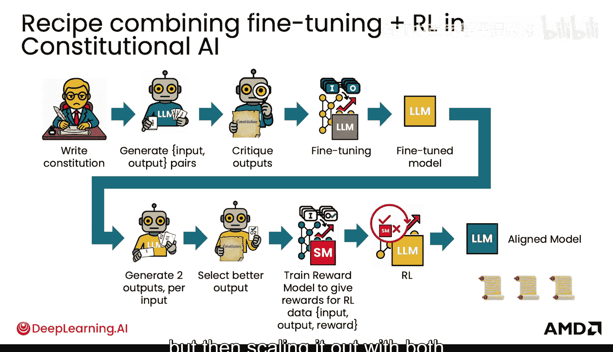

The model was refusing those harmful requests， and as a result， they were able to ship a much safer。

 more secure LLM。

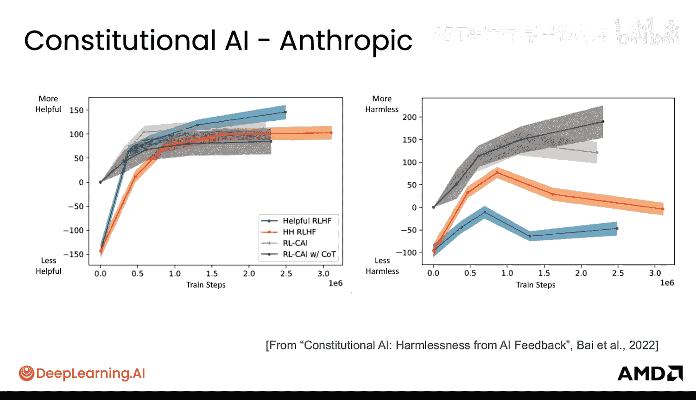

Now that you've learned how to align your LLM to a constitution using reinforcement learning and fine tuning。

 next up is looking at how these things happen in the wild with frontier AI models。

 as well as how you can do it on your own and what libraries to use。

