# AMD《大型语言模型的微调与强化学习：后训练入门｜Fine-tuning and Reinforcement Learning for LLMs》 - P8：8.post-training-in-the-wild.zh_en - GPT中英字幕课程资源 - BV1zZy8BcE7z

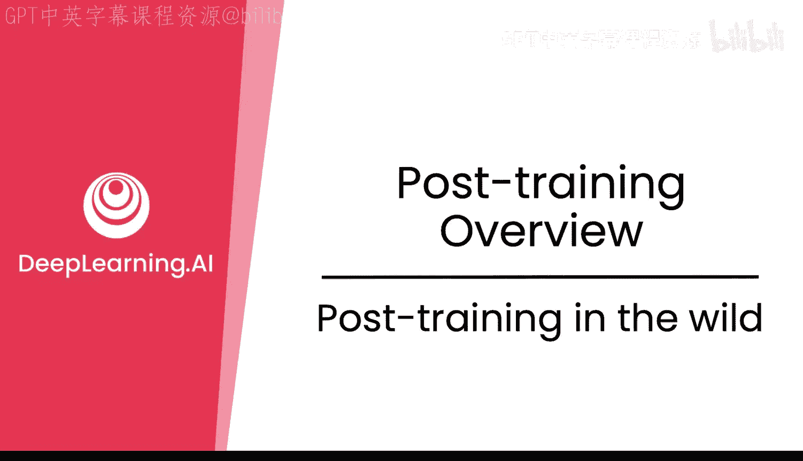

So you know that fine tuning and reinforcement learning are used to produce these frontier models now take a look at how these frontier labs use them precisely and how they actually pipeline them together also take a look at how you can do post training on your own。

So you saw before that frontier labs will combine the best of both fine tuning and reinforcement learning。

 and they'll use both to get a better model， and they'll probably use both multiple times to dive deeper into exact modeled posttraining processes。

 we can take a look at deepse R1。 So this is a very popular open source model and essentially what they did first is they took that first base model that they had pretrain model then they did fine tuning on long chain of thought data。

 So a few examples there。 and then they did reinforcement learning on top of that for reasoning and then they actually use that exact model to create more data for reasoning。

 include that with non-reasoning data， finetd again and then did reinforcement learning on top of that model to get their final deepse R1 model as you can see it's more complex and you can actually use the models at different checkpoints to actually create data for the next checkpoint。

 Quinn also is use fine tuning and reinforcement learning multiple times so you can get a base model than do that chain of thought fine tuning for reasoning。

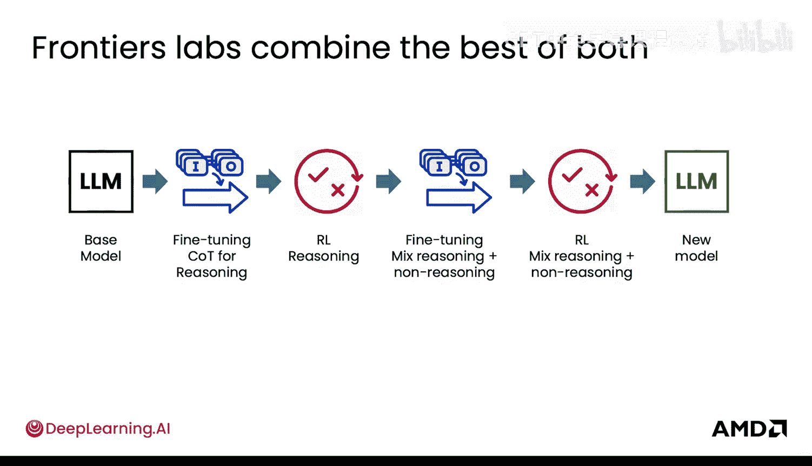

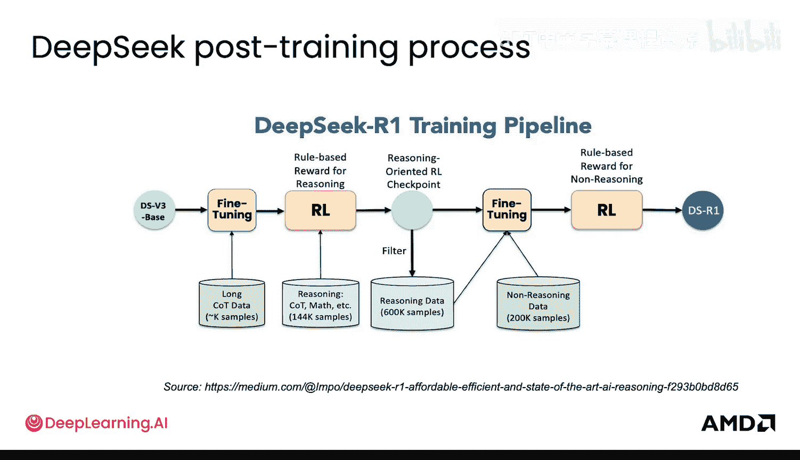

Reing Rl then another fine tuning step and then general Rl to get thatquin model Lama again uses multiple steps of bolt reinforcement learning and fine tuning。

 which is what SFT stands for it's supervised fine tuning which is the type of fine tuning that you're doing here with language models and essentially you can see here something really interesting the reward model that is used in reinforcement learning is also helping to something called rejection sampling which you'll learn later but that's essentially the model generating a ton of different data and then rejecting most of the samples only to pick the best one for then that downstream fine tuning data that is higher quality to then finet that model get specialized per capability fine tuning data and then go on to do reinforcement learning using in this case in algorithm called DpoO and then pick the best model from previous rounds and continue doing that actually using that final model to then continuously help that fine tuning pipeline of that data So it's a very iterative process here and it's not just the one。

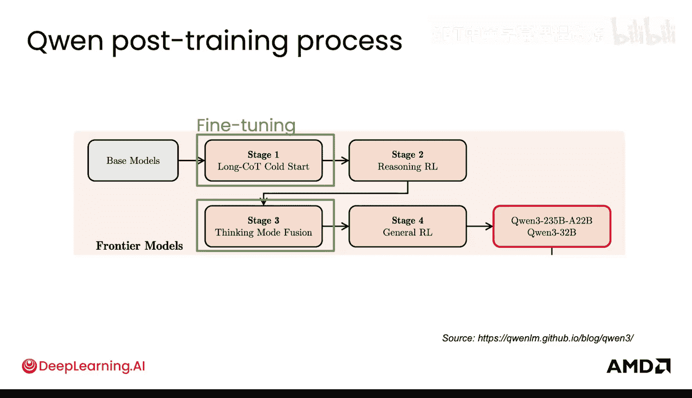

One step fine tuning one step reinforcement learning to get the best model。

 So where post training has fit in。 you've seen pretrain， the midtrain， then posttraining after that。

 it can be deployed to a hosted model API such as ChaCBT or Clade it can also be open sourced so deeps R1 or thequin models are all open source models and then on top of both of these。

 this is where you're building your agents， you're doing rag and you' building your SaS applications。

 And after you get your open source model， you can continually do posttrain。

 you can continually do fine tuning and reinforcement learning on top of that doesn't need to have been in that previous posttraining step。

 and that's exactly what the community has done， it's taken thesequin models it's further done posttraining on top of it for cogeneration for very long context of a million tokens in context for medical text processing just to name a few and the community has gone actually quite quite crazy in a good way for Lama variants。

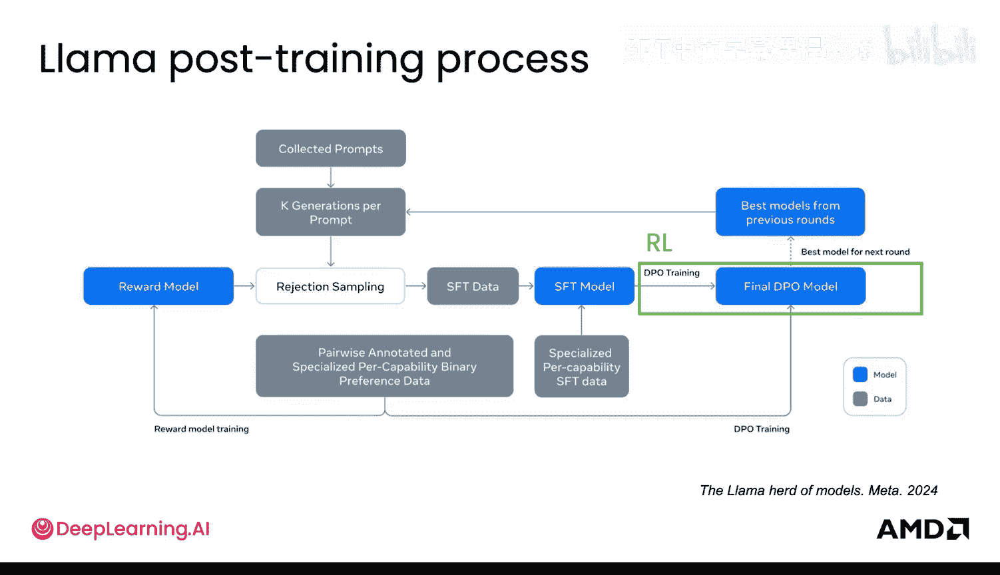

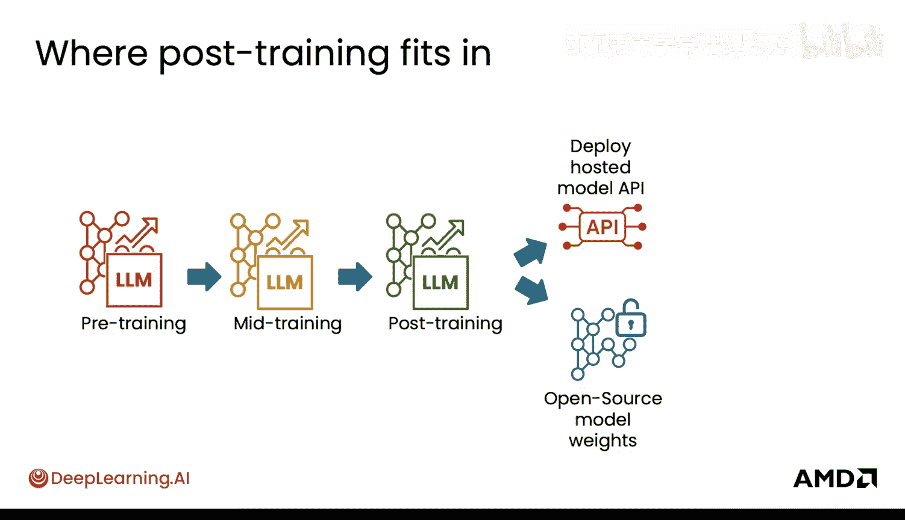

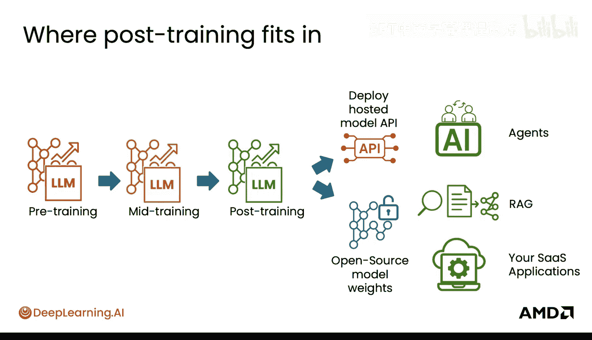

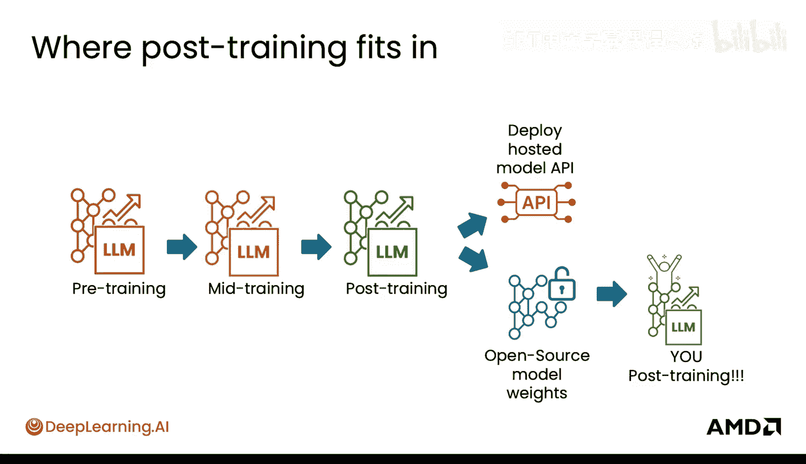

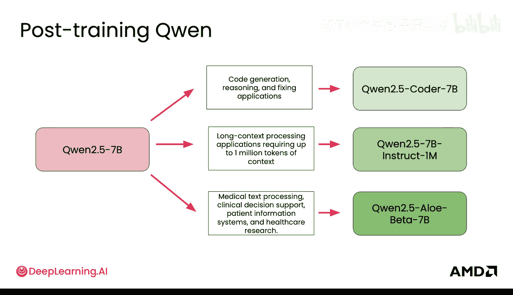

This is just showing just how many Lama variants there are when a player like metata releases an open source model like Lama and the whole community comes about and tries to basically fork it into different variants you can use a lot of libraries to do that yourself so you can start contributing one of those variants yourself and these will range and you will see some of these show up in your labs and then finally this is you posttrain this is so so important that you're taking these models and you're able to adjust its behavior to what you want it to be but of course the changes are going to be either dramatic where you need heavy compute or very light on you know your local machine and AIPC for example and you'll be able to explore that in the next modules。

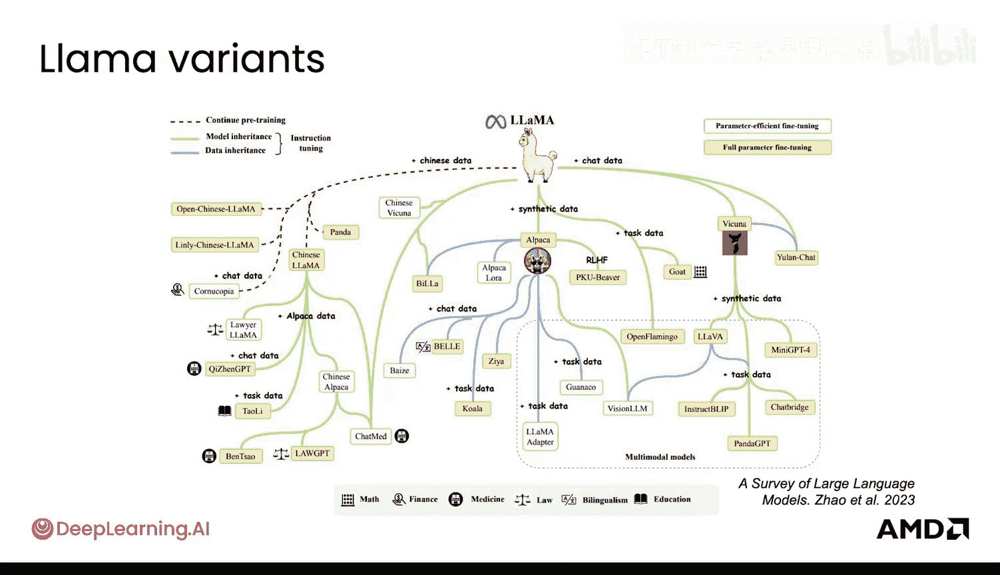

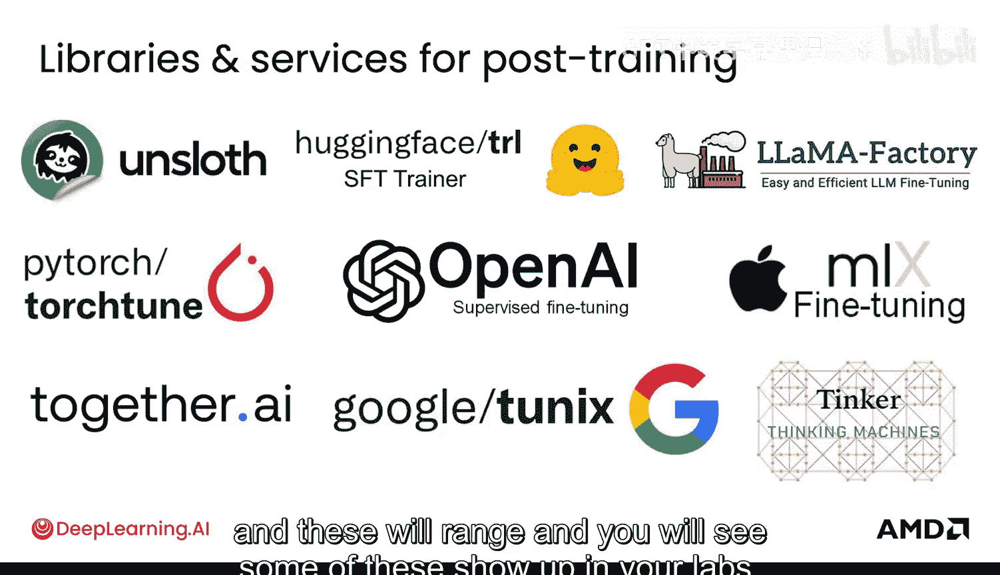

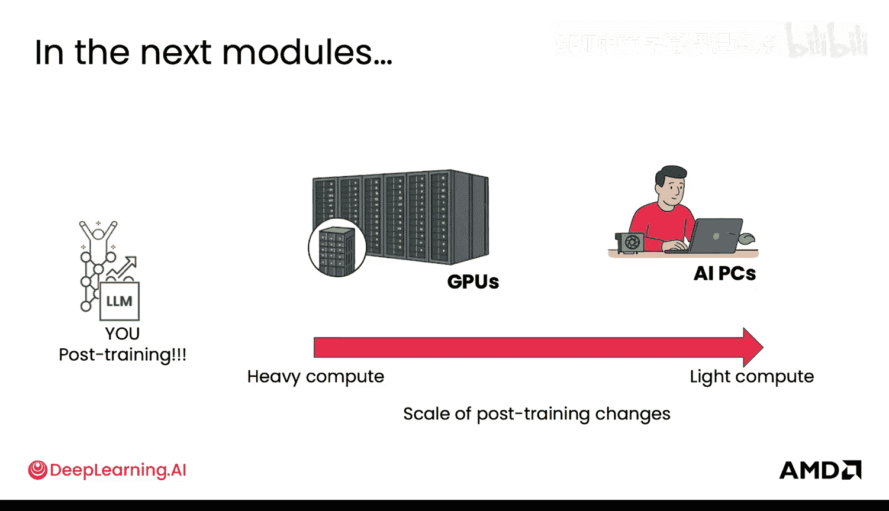

Congratulations you've learned how very powerful posttraining techniques like fine tuning and reinforcement learning work and the intuitions behind them and how they come together for frontier models Next up you'll deep dive into the mechanics of how each of them work and the exact math behind it and how they really help shape model behavior。

