# AMD《大型语言模型的微调与强化学习：后训练入门｜Fine-tuning and Reinforcement Learning for LLMs》 - P9：1.data-what-you-need-and-how-to-prepare-it.zh_en - GPT中英字幕课程资源 - BV1zZy8BcE7z

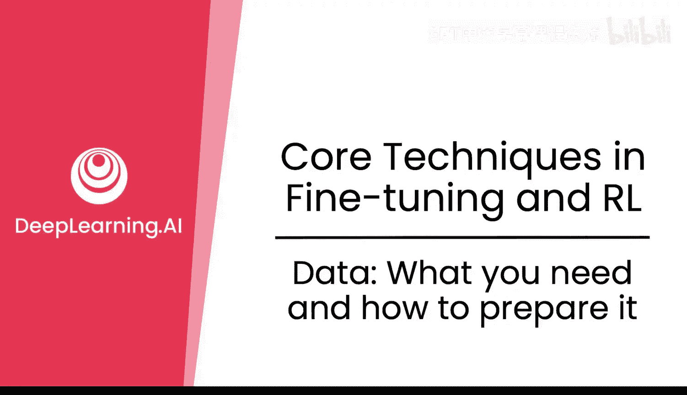

Data is one of the most important cornersstoneance of posttrain。

 both for fine tuning and reinforcement learning。 Take a look at an overview of the data for both and then also take a look at how you prevent leakage across different splits of data for both of them so that you can trust your LLM in the end and how it does So not to be dramatic but posttraining does live or die on your data and your data matters a to So for fine tuning what that looks like is that pair of input and target output or for reasoning know that target output has those thinking tokens and your answer So just to go through some concrete examples quickly。

 you can have the input be know Alice has three apples and why two more。

 how many now the target output is5 with some thinking So for reasoning then you can add these think tags and be able to put that reasoning in there within final answer of5 between those answer tags for Rl data。

 what this looks like is twoples of input， the model output and the reward from the environment so you have those graders giving that reward and you're preparing those list of input。

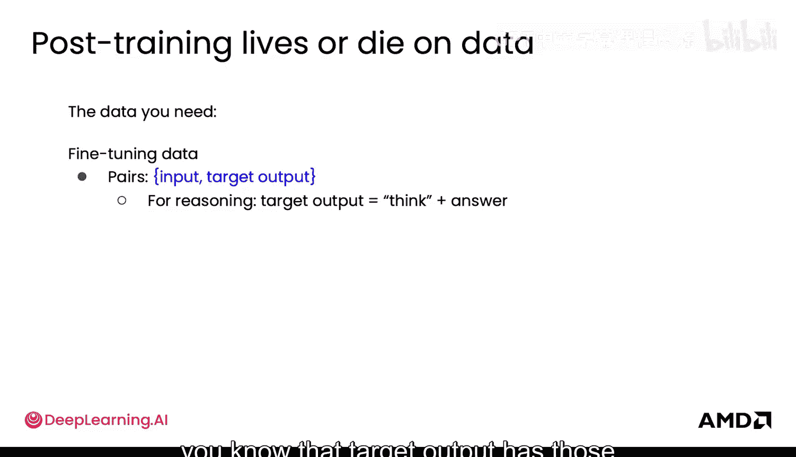

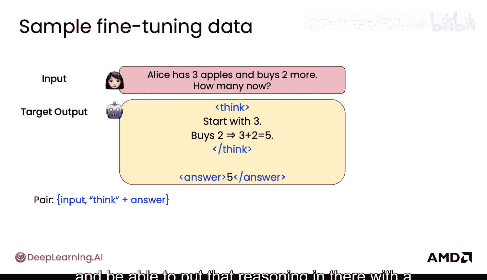

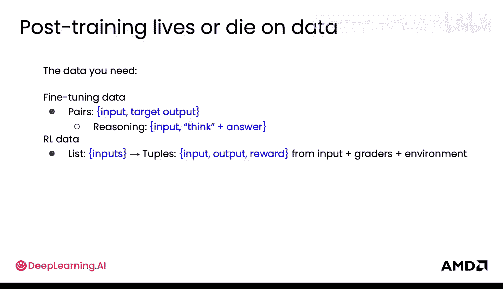

And then the models are producing the outputs and reward So essentially this is what a sample R data point might look like so you might have that same input and you might have the model actually give that output of that thinking and then that final answer and this is called a rollout so the model is kind of rolling out is response there and then there's a reward and the reward can be given by some kind of checker here for math or it can be another model called a reward model to give that a score for how good that rollout went and this final tuple of input model output in reward is called a trajectory another thing that is optional if you're using a reward model is a tuple of your input as well as two model output like output a and B and a preference for which one is better for the reward model so what that looks like here is you have that same input and then maybe you have a model output that has the thinking and the answer and then second model output that just says high so obviously the preference is a so that one's better and that can be labeled by a person or another LLM but essentially you get this final。

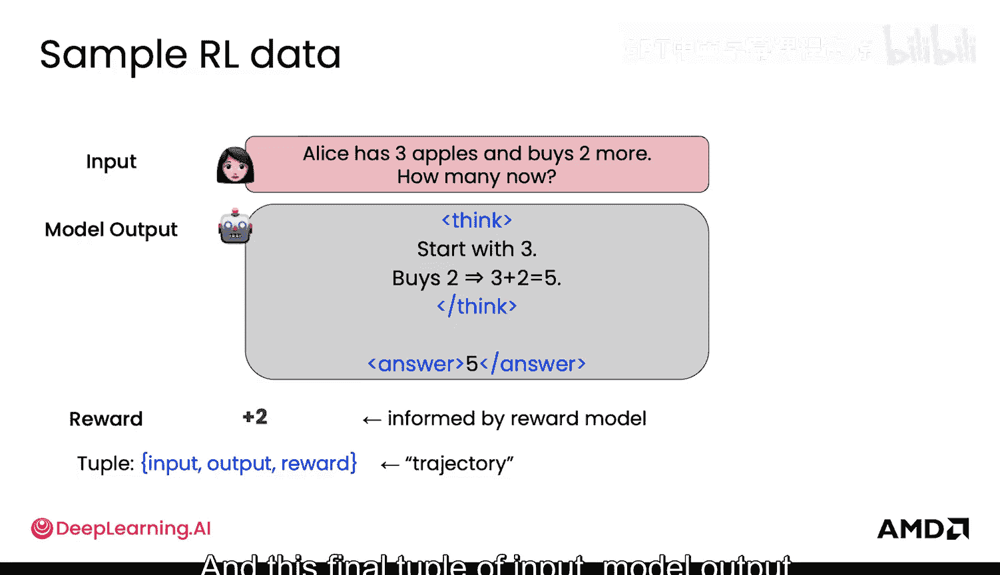

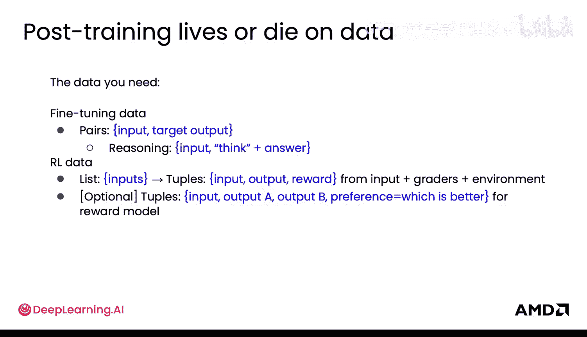

Tupple of input， output A， output B for the models and then a preference。

 So that's all your data just laying that all out there。 Now the next step with your data。

 one of the most important steps is to split your data so that you can actually trust that your LLM is actually doing well and for fine tuning。

 the typical split looks like your training data So what you're actually training the model on this is gonna to be your biggest set next is a validation set that is where you are doing some hyperparameter tuning which you'll see later on exactly how to use that for that and then there's this evaluation set or test set and this is really held out really held out you're not using it for hyperparameter tuning you're testing the model at the end so that you can see how well your model has actually done in your code what this looks like you can load your data and in hugging face at least your training data and test data are separately specified and in your training data a random subset will be chosen for validation by default for your reward model a very similar thing can happen here so you can also do your training data and your test dataset you can。

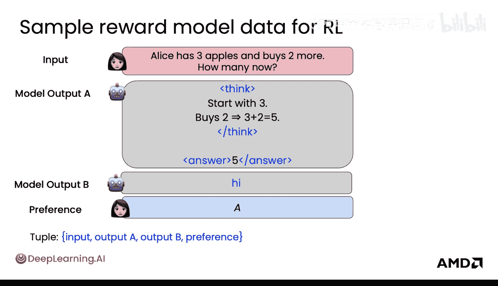

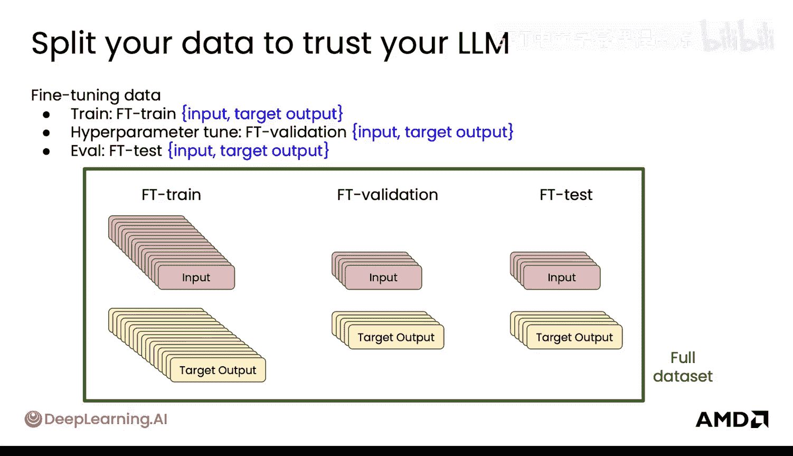

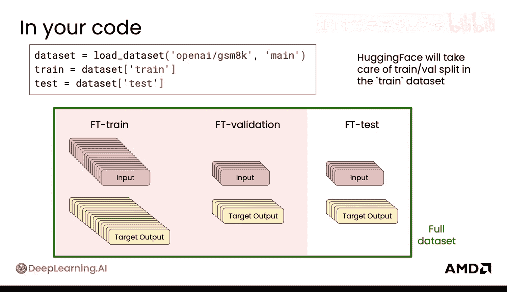

So have that validation data set there inside of your training data set。

 but essentially instead of just input and target output pairs。

 it's that input two different model outputs and then the preference for your RL trajectories you will also have stuff for training versus test and the way to kind of divvy that up here is for training you have your reward model and your verifiers essentially checkers like a math checker giving your rewards but for your test instead of using the same reward model when you need to be really careful about is to use a new reward model trained on different preference data if you are using a reward model otherwise the model can game it and can see stuff in test where it already saw in training and so that's a form of leakage and and spillage which you'll see soon Finally the last piece of evaluation that I highly recommend is to even beyond all of this evaluation test sets that you've held out that youve spent a lot of time curating is an additional evaluation set where these are strictly unseen your mix in kind。

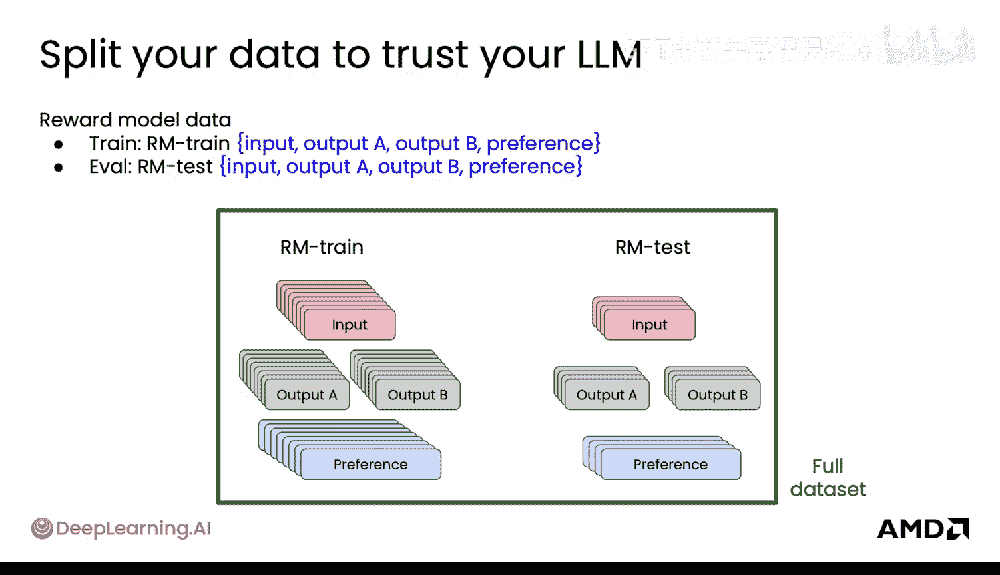

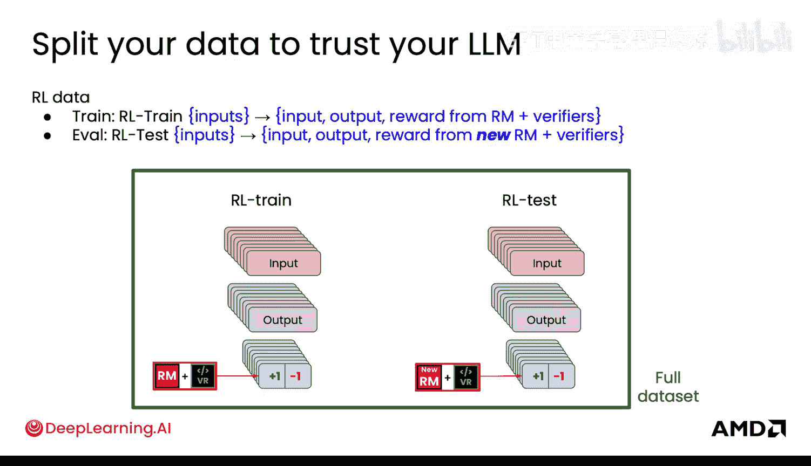

Inputs that the model will almost never have seen in your original set and you're mixing in these long tail inputs and these out distribution inputs and just to see how the model does on them and if it's able to handle it correctly exactly as you expected so finally just to keep stock here before we go ahead and take a look at what leakage across these data sets look like there's your fine tuning data。

 your reward model data， your Rl data rollouts and trajectories and then your final evaluation data of inputs that you'll need for all of these steps so what does leakage really mean and how do you prevent that from happening so leakage can even happen not with just identical examples。

 but even similar examples anything that is similar in distribution it can ruin your splits and so you can control this by doing a lot of deduupplication people in frontier lab spend a lot of time deduoping data sets just to make sure they can trust that the model can generalize to that test set correctly and so Dduop is a really important step you can use。

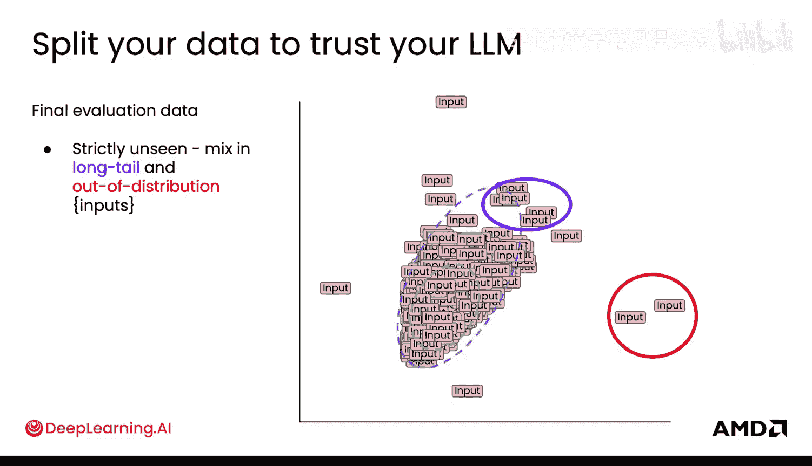

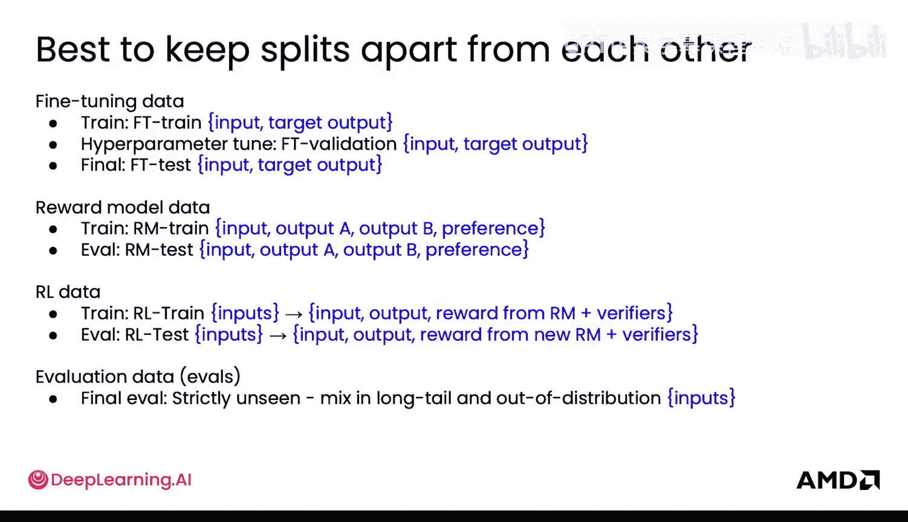

Example here like binhash， where you can see how these are the same or similar example and continue to be similar example if you even perturb it a little bit you also want to avoid randomly splitting I think it's very tempting to do a random split but that will likely result in leakage because there could be similar things across that split and the finally one best practice just learn about is splitting your data based on time could be really interesting and at first you might think oh maybe that's not fair but you want your model to be able to generalize over time you want your model to be able to handle in this case coviId if it was trained on 2019 data still be able to handle certain types of scenarios in 2020 with coviId even though it hasn't seen it and so if you care about your model generalizing into the future this is a way to split it and a way to kind of avoid some of the biases that may have snuck in by accident when you were collecting your data in the first place just to summarize get really paranoid about data splitting and contamination this is a really really important part of。

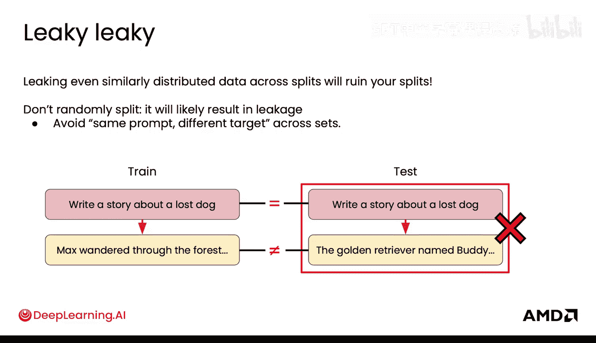

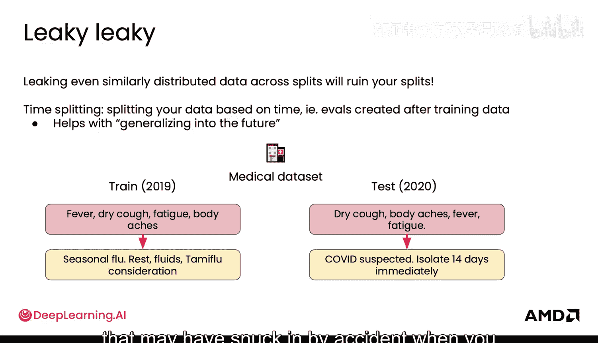

You being able to trust your model and trust that the results you're getting from your model are truly good and it's something that you can then deploy into the world。

 So this is why data preparation is such a massive effort it is a huge set of teams inside of these frontier labs that is working on just data and there's been some really interesting heuristics that have come out that labs will use only like 1% of their data because that is the cleanest mostforrist data and using any more of that 99% will actually degrade model performance So getting your data to be really good is super important in the next modules you'll take a look at how that held out evaluation set or all of those evaluation test sets and Rl test environments come into play and help you actually avoid over 10 times more experiments and actually get you to a better model so this is a very。

 very important subset of your data to get right and then you'll also learn how much data you'll actually need like really how much do you need to get to the next good model and how much is it worth it to actually get it to that next model and next。

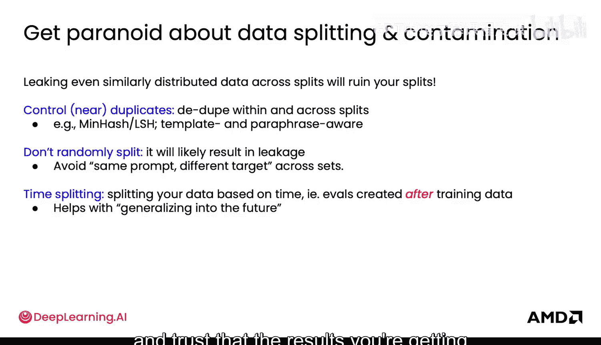

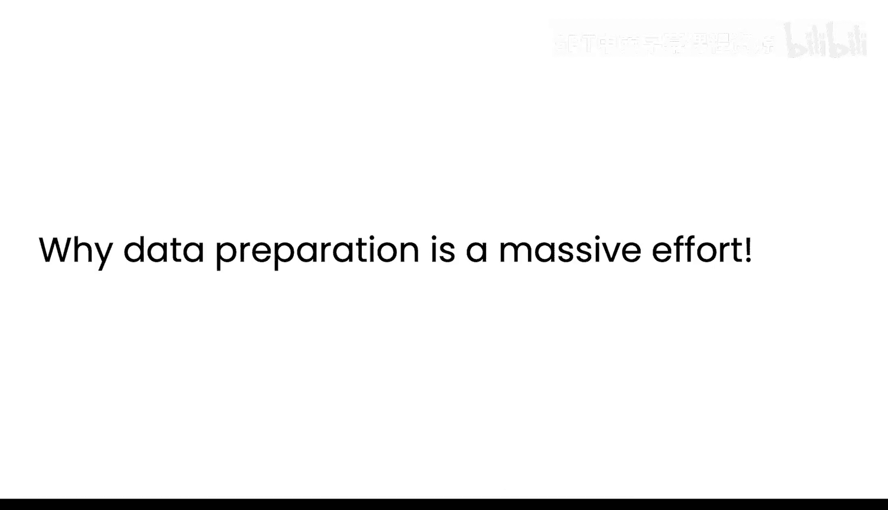

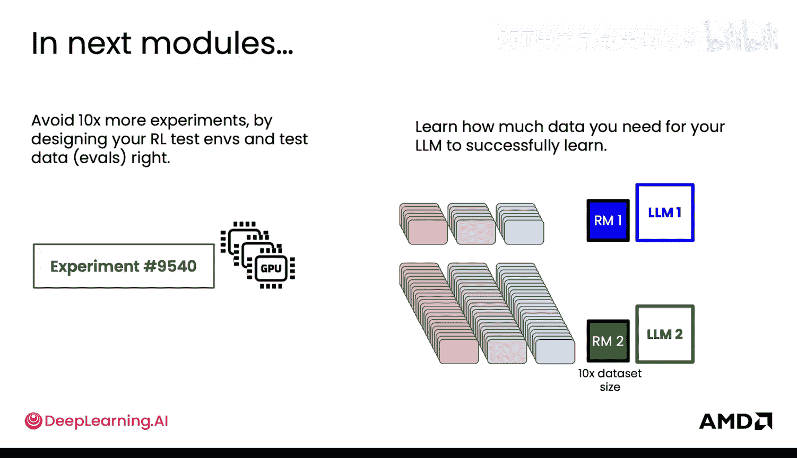

Task and next frontier that you want the model to learn Now that you learn how to prepare your data。

 take a look at how to take that text data and turn it into tokens。

 which is something that your model can actually process。

