# ASU《强化学习2022-2024｜cse 691 Reinforcement Learning Course at ASU》中英字幕（deepseek - P10：[01]Lecture 10, 2024; GPT, HMM, and Markov chains_ Rollout variants - GPT中英字幕课程资源 - BV1zcfVYdErD

Okay， so let us get started。嗯。Let me welcome you to this 10th lecture of our course on Pre reinforcement learning at ASU。

 I'm going to share this lecture with you Co Lee。And it has to do with some work that we have been doing over the last month that relates very closely to。

Conceptts and algorithms that we have been using in this course。But it has to do with ngrams。

Of which I talked in one of the first lectures， Transist like GT， chat GT。

Another large area of applications is involving hidden Markov models。Abbreviated H M M。And also。

 more more， more generally about。About Mark of change。

And how do you generate most likely sequences within these structures？

And we have a paper that has been submitted to Archiv that you can consult。

嗯。So here's my outline。First， I'm going to do some review on ngrams and also be described loosely the problem of generating the most likely sequence。

I'm going to discuss this in the context of dynamic programming and also suboptimal policies like greedy and rollout and so on。

 and then I'm going to make a connection with a vast area of applications。

Which is inference in hidden Markov models。State inference inferring a sequence of states that are hidden from us。

 but we obtain some data which relate to those states and we can try to and we try to infer the sequence of states through statistical methods which however relate to dynamic programming very closely in some of the algorithmic ideas that we have been using in this course it's a famous algorithm in this context called the Viterbi algorithm which is used in very large number of applications。

And we're going to discuss the principles on which this viia algorithm is based。

 but we're not going to go too far too deeply into it。

We're going to stick primarily to a Markov chain framework。

And we formulate our problem of most likely sequence selection as a dynamic programming problem identify states。

 controls policies， and so on objective function， the objective function is to maximize the probability of the generated sequence。

嗯。Like。Other dynamic programming problems that we have discussed the computation is intractable。

 so this a this motivation to use subopmal algorithms and we're going to focus on。

Or all out algorithms that are based on some kind of greedy policy that I will describe。

The rollout algorithms improve greatly the performance and we will show you computational results that they achieve performance close to the optimum。

With the benefit of tractable computation。And。We'll take a break here and U Chao is going to take over and discuss the computational experiments。

 some computational experiments with Markov chains。

And then other computational experiments involving a GPT that we have trained and it' large scale and we have some computational results with that as well。

So let's talk about engrams。You recall that。An engram generates a sequence of text strings at the cave time it has a sequence of a string of it has a text string of n words。

And it generates a new sequence of n words。By adding one new word to the front of the sequence and deleting the word that's in the back of the sequence。

So。呃。This defines a deterministic system evolution with a neck。

And the evolution is controlled by the choice of the next word。Now， an engram。

Does not specify the next word， but it gives you suggestions， it provides transition probabilities。

 code and code。For the next word。And and the bimogram will will give you these numbers。

 It's like in your iPhone， it will give you likely next words， okay， when you're texting。

So these probabilities are a suggested local measure of desirability for xk plus one to follow xk。

 so I tell you this world has probability。60%， sorry 60% desirable if you want to use this kind of loose terminology。

Another word has 30%， another one has 5%， another one has 10% in most of the words， okay。

 the English language has like 50，000 words， most of the other words are given that have zero probability。

嗯。So these are suggested probabilities。Even though your iPhone is not going to give you numerical values。

 they are available to the software internally to the software。And。

You have freedom to select the next word according to a policy of your choice in other words。

You can follow the suggestions of the engram， but you can also choose your own。So think of texting。

 next suggestions， sometimes you follow the suggested words sometimes because you have some other objective in mind。

 some other something else in my you， you choose your own words。

So we're going to focus now on policies that produce highly likely sequences according to the suggestions of the Ngram。

Starting with a given initial state or a prompt if you'd like an x0 so given an x0 the ngram will suggest next words and we want to choose a sequence that will maximize the probability of the overall probability of the entire sequence going all the way to the future。

 so this is a global measure of desirability as opposed to this probabilities made available by the ngram which are a local measure of desirability。

So loosely speaking， this is our problem， and we try now to formulate the mathematical and seek what we can do with it。

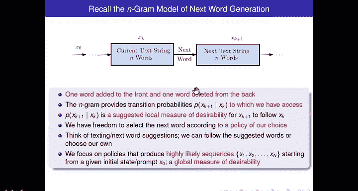

So。We introduce an optimization problem of select finding a selection policy that generates the most likely sequence。

So starting with some x0。This most likely selection policy selects the most likely sequence from beginning to end out of all the possible sequences that can be generated according to the ngrams。

Probability， next word， probability suggestions。So this most likely selection policy is the one that maximizes this probability。

 the probability of the next sequence x1 of the sequence x1 up to xN， given x0。Now。

 Bgramraham has a Markov chain structure， has a mark of property。Whereby the probabilities。

 the probabilities of the next words given the entire history of the engram up to that point。

Depend only on the last on the previous word， on the current word。

 So this is called the mark of property and the。It defines a markov chain where the state of the chain is this xk。

And so that means that we can write this joint probability。As a product of probabilities like this。

And this is。This is a consequence of this markov property。

 but also the multiplication rule of conditional probability。

 how we calculate conditional probabilities in sequential events。

' a fundamental rule you' learn the first couple of lectures in a probability course。And so。

The bottom line is that we maximize a sequence of events each one happening。At each stage。

And we will view this most likely selection policy as being optimal。 That's our optimization problem。

And its advantage is that it plans into the future， it doesn't look too to optimize the next word。

 but looks all the way to the end and find the best sequence possible。

And now we are going to use dynamic programming for this， this is a dynamic programming problem。

But then you're going to say， what is the cost function？In dynamic programming。

 the cost function is additive， okay， it's the sum of stage cost here we have a product。Well。

We have a multiplicative reward here， a multiplicative value because we maximize。However。

 multiplicative value can be transformed into maximizing additive value by taking the logarithm of the product。

The maximum。The problem of maximizing product of rewards is the same is equivalent to maximizing the sum of the reward log。

Take the logarm here， optimm is preserved by taking the logarith and the logarm of the product is equal to the sum of the logariths。

So even though it doesn't look like a dynamic programming problem。

 it is dynamic programming problem and it's just a matter of translating the dynamic programming algorithm by introducing log algorithms。

 but we're not going to do that， we're going to work directly with products。On the other hand， like。

The dynamic programming algorithm that we have seen， they require intractable computation。

 so this is an issue here。So this is the problem， this is the approach we're going to follow。

 and this is why we want to look at suboptimal policies。

 particularly in the law rollout algorithm that has been a workforce for this course。

So are there any questions？Yes。A。What does intractable computation mean。

 more computation that you will ever live to CV and result？Okay， intractable can be arbitrarybit。

The intractable stuff that we're going to talk in this lecture， you haven't seen before。

 it's more intractable than you've ever seen before， okay， and if I'm wrong。

 you can tell me at the end。诶。So Intertractable means exponential computation。

In certain of the parameters of the problem and so on。就S。By。Srrd and brown。Our stage is Xk at stagek。

For the end grant， yeah， right， so just to。To to。To exclude。

To explain that a little further in an engram。We have a vocabulary， right， the number of words。

 number of words in an English language are 50，000 in the York tens of thousands， right？

And we're going to and we are going to so the almost possible next words are 50，000。

And the combinations of n wordss is 50，000 to the nth power， okay？

So we're talking about something very， very big。Okay， the is how reasonable is model progress。

Hingground1 and next and pass one ground depends on the。Yeah。

It it's reasonable in the sense that the engram， like a GP。Will give you these probabilities。

That's all it gives you， it doesn't give you any other probabilities， that's what it computes。😡。

So we're trying to make use of whatever it gives us， right？Okay。Have a question？哦。你说 so啊。

Here then which was the next word we have we depend on the previous word。 That's what the part right。

 depends only on the previous word， not on the words before the the history's we write English the depends on maybe words before it has not just the previous word when we write English。

The land also depends on getting two of the events before。

So we defend the previouss to the previous annual。You choose the next word。

 this is the just suggestions， and that's what the Ngram gives you。If you would work to give you。

 if it were more sophisticated and would give you other probabilities that would change your problem。

So we look at situations where we have。So we have。We have to assume a mark of change structure because that's what the end。

Problem problem context gives you now when we talk a few slides。Forward in HMMs。

 then this is more clear there are calculations involved that support this Markov change structure。

Okay， so this is our optimization problem， roughly this is what we're trying to do we'll formulate all this mathematical a little later。

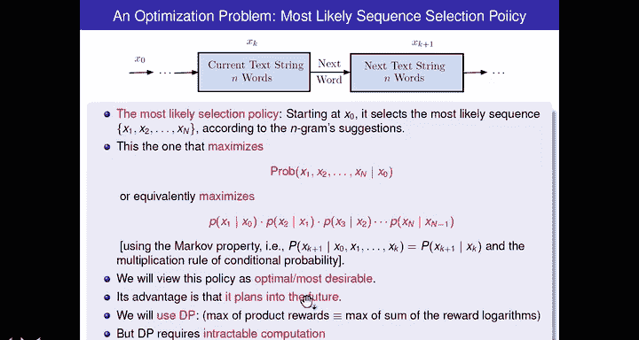

And because of the interacttractability of the dynamic programming algorithm。

 we are motivated to look at suboptimal policies and a common suboptimal policy， in fact。

 a variation of that is used in childCT is some kind of a greedyelection policy。

 whereby we select at each case， the next word that maximizes the next word probability。Okay。

TdGT also random miles over V when it generates all the beautiful stuff it generates it randomized over the next word。

 but we're going to consider this greedy selection policy where we generate deterministically the next word according to maximum probability。

 that's the greedy policy。Looks reasonable， okay， we're trying to maximize probabilities from here to the end。

 so we can't do this easily so we just look one step forward。Now。

 the rollout selection policy uses the greedy as base policy。Whereby at state Xk。

It selects the next word xk plus 1 that maximizes the greedy Q factor。

Where the greedQ factor is the probability of the sequence。我。Choosing as next word Xk plus1。

And then using the greedy policy， the greedy sequence starting from xk plus 1。To the end okay。

 so first step optimization greed after that， that's the Q factor and the Q factor which we maximize and we get xk plus one。

We each escape less one， we do the same and so one。As you have seen multiple timess in this course。

And there are also variations of rollout multistep look ahead。Tranatedated roll loud。

 simplified combinations and so on， we'll talk about that in a few within the next slides。

Another suboptimal algorithm that we're going to use is double rollout。

 which is rollout on the rollout。In other words， it' the rollout algorithm。

 but using as based policy， not the greedy， but using the rollout based on greedy。

So if rollout is one policy duration， double rollout is two policy durations。

 and then triple rollout is going to be three policy durations and so on。So。

Now the thing to note is that the engram itself is a very simple deterministic system and these policies are deterministic policies。

 the problem that we have deterministic and as a result。

We can use sophisticated variants of rollout involving multistep look ahead。

 involving incremental rollout， some of the sophisticated multi stageage search algorithms that we discussed back in lecture six。

 and they're also in your textbook。Okay， so now let me give you an example just to get you into the mood。

 this a very simple example has no significance it's already simplified。

It involves a one gram with this vocabulary。So the Markov chain involved has two states。

 zero and one， okay？Is n gra if it were two gram， it would have 0，0，0，1，1。

0 and 11 it have four states， if it were a three gram it would have eight states， okay？

But this is our one gra and it involves these two states and we're going to start at state zero。Now。

 the probability suggested by the ngram is what you see here。At zero。

 it suggests that you go to zero that you select zero with some probability P that's larger than1 have and the complementary probability to choose one。

At state one， it recommends that you definitely go to zero， okay？

So that's the structure it's all artificial just as an illustration。

So what's the greenish election policy？Starting here。

We use the next the maximum probability next selection。

 which is zero because p is larger than1 half and one minus p is less than1 half so we go here we go so from here again we choose that and so on。

 so the greatest election policy starting from zero produces this sequence zero a sequence of zeros。

 right。Now， what is the most likely selection？The sequence that has the maximum probability。Okay。

 so let's suppose that。That Pete。Is。Is like。P is like one close to one half okay so1 minus p is is close also to one half。

 but p square is going to be close to one fourth okay so so。

So this sequence is less likely than this sequence。

And then we got to where we started and continue this reasoning and we see that if p is close to one half in particular p squared is less than 1 minus p。

 the most likely selection is0，1，0，1，0，1 and so on。Okay。

 and this is the calculation what you compare the probabilities of the two possible sequences。

And otherwise， if P is close to one， then。Okay， p squared is greater than1 minus p。

 and the selection is 0，0，0，0。Okay。Now how do you calculate the rollout selection？With one step。

 look ahead， starting from x0。We calculated two Q factors。

 one Q factor correspondinging to this election， one Q factor correspondinging to this election。

So we go here and then we use the greedy， which is zero， okay？

And that's once you factor the probability of this。This sequence。

And we compared it with the other key factor， which is to go here and then use the greedy。

 which takes us here and here continuously okay so basically we have to compare this。

 the probability of this sequence and the probability of that sequence。

 which is exactly what we compared with a most likely selection policy。

But all loud selection is the same as the most likely selection。Regardless of the value of P。

 the rollout is always optimal here， the greedD is sometimes optimal， but sometimes it's not optimal。

Okay， this just to give you the idea of what we're doing here， just to give you some context。

 of course， the example is very， very trivial。Are any questions here？Okay。So。

Like I mentioned earlier， an engram with its suggested probabilities defines a markov chain。

Where the next state， the probability of next state depends on the past states history only through the current state。

 this is a markov property it has to do with。Chaing adding just the one word at the front and deleting one word in the back。

Now notice the dimension of the state space， you have an ngram with a vocabulary consisting of two different words that involves Q to the n states。

 okay？So the state space can be enormous very quickly it climbs to enormous levels。

So that's the kind of situation we have， a very simple system。

 but very complicated computations because of the intractability because of the exponential growth exponential growth of the state space。

So now let's just make a few comments about。A related context which involves a huge class of applications。

Influencing hidden Markov models。And。The inference problem is mathematically equivalent。

To the most likely sequence election， except we have to。

To choose the probability transition probabilities properly， taking into account the data。

We have again， a。Multi stage transition process involving states， x0， x1， x2， and so on。

 let's say up to a finite number capital n。And we are given data。

 some kind of data about the transitions that go on here， okay？

And we want based on this data to guess。Which is the transition that's most likely what to have happened。

Okay， we don't know the actual transitions， but we have data about these transitions。

 we know the structure of the chain， and we use the data to calculate code unqu transition probabilities modified by the data to calculate the most likely sequence。

Within this multistage chain。So that's the problem。

 finding the most likely path condition on the data， given the data。

 the probability transition probabilities are modified by the data。

 so it's something like what you see here， the joint probability of the next state and the data that you have observed given the current state。

Now the range of applications of this inference problems is very large。

Speech recognition is based on HMs， language translation that used widely in computational linguistics。

 the Btubi algorithm and this area started with coding and decoding and error correction。

There have been many uses in bioinformatics and all of this is very well established。

 there's a lot of information on the internet videos and so on that you can watch。

In speech recognition， basically you're given a sound sentence， a sequence of phoneoms。

 what's called phs， and you would like to infer the phrase that was spoken， the words。

 the actual words。So the states are the words， the data are the phoneonoms。

 and you try to find the sequence of words that corresponds best to the sequence of phoneoms。

 to the sound that you have heard。Language translation。

 you have a phrase in English and you want to translate it into French。

 let's say the English phrase is the data， that's the data and the hidden sequence of states is the French sequence and you would like to have find the French sequence that corresponds best to the English phrase using a framework like this。

嗯。Okay， from linguistics， computational linguistics， there's a problem called the。第。Tging problem。

 P tagging， parts of speech tagging。Whereby you're given a sentence like this one， here。

 you saw a beautiful fish of the water。You want to label each word， whether it's a noun， a pronoun。

 a verb， what kind of part of speech it is， an adverb， a determinant， and it's not clear what it is。

 there are probabilities， of course， we know that beautiful is' most likely an adjective right。

 we know that fish is likely a noun， but it would also be a verb right， you go fishing。

Saw is likely named， but the。I'm sorry， it's currentlyly。A verb like we saw， okay， but it could be。

It would be announced like like in chainsaw， okay？Or it could be a verb that means we saw something。

 but I even see it with our eyes。Water， okay， it could be water could be I water plant。 Okay。

 so all of this， this this problem deals with recognizing inferring。What is the tag。

 the label of each one of these words in the sentence？

And here the data is the sentence and the chain has to do with the states。Are a few different kinds。

 non pronoun verb and so on， transitions from noun to verb， okay。

 have chi likelihood than noun to to the a determiner like V。So and then of course。

 there is data having to do with relating， there are probabilities that have to relate with the data with transitions of between different parts of speech。

So all of this can be formalized and。This waits on the。Transitions can be calculated。

 They are like modified transition probabilities。 and we're looking to to find a sequence that maximizes the product of these weights。

That's the。In a nutshell， be inference problem in hidden Markov models。

So if there be algorithm dates to the 60s， it was developed in a coding communication context。

And for large state spaces， the exact solution is intractable， finding the most likely path。

And subop。Shortest path type algorithms have been used。

 but the vibi algorithm is used in many cases because the state space is relatively small what we're looking for here is。

Is chains that have very large state space for which using the determining algorithm or or。

Or simple modifications it totally intractable， completely unthinkable to use that we need more systematic suboptimal algorithms。

 and that's what we're going to try to do with this rollout ideas。

So I'm not going to talk about HMs in the。In the next few in this lecture anymore。

 but the overall allowed algorithms that I'm going to discuss fully apply to HMs。And like I said。

 transition propertiesbil are replaced by data dependent or and time dependent also weighs。Okay。

 I have any questions。Okay， so now let's go into a dynamic program in formulation of the most likely sequence election problem。

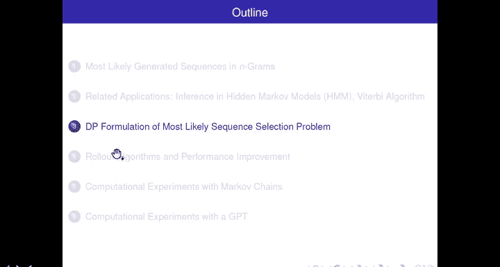

So the starting point is a Markov chain with transition probabilities we turn now to a mathematical model。

 forget about ngrams， forget about HMs， we're talking about now a mathematical problem involving a Markov chain with given transition probabilities。

A selection policy pi is a sequence of functions。Like we have considered so far in this course。

Which given the current state of the macro chain determines the next state according to this function。

So these are the bonuses。And given a policy pie， which maybe be。Time varying。

And the starting state X at time， okay？The future states are completely determined by the policy。

And they are also denoted by this expression here， what is that？Given X and given the policy。

At state at time K， this is the state at time M， Okay， state at time M， starting at x and using pi。

So look at this diagram here。His time and his state。At time K， we start at state X。

And the first date is this Y k plus 1 k x of。Depending on x and pi。

The next stage is going to be this one and so one。So this is the trajectory starting at x at time K。

And we have the probabilities of this， so it involves k minus M N K transitions and we have the probabilities of this。

And the probability of occurrence of the entire sequence starting at K using this policy and starting at this state X is the product of probabilities。

 That's what I have here。The product of the probabilities， the probability of the first transition。

Times the probability of the second transition。Third transitions and so on up to the end。Okay。

So that's sort of like the cost function of a policy pi， okay。

 it's like JK pi starting at state X if you remember a dynamic programming notation。

 except here that we are maximizing rather than minimizing。

So this defines the problem and we can go and go ahead and ask for the optimal policy。

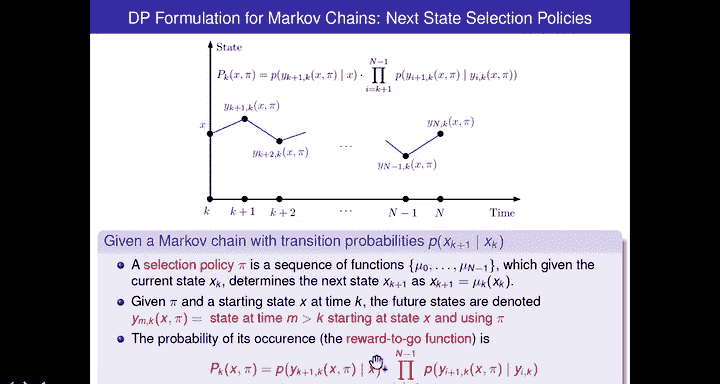

And the optimal policy is the most lighting selection policy， the one that maximizes。

The reward function， which is the probability of anti sequence。

We denoteed by pi star in the usual way， and it's the one that maximizes overall policies。

 this probability to go from time k as state x。And we want to find that for every initial state and time and we denot it by Tk star of x。

 this is like Jk star of xk except that is obtained by maximization rather than minimization。

And there is a dynamic programming algorithm for finding these probabilities to go。

 optimal probabilities to go。So here's the algorithm。What do we do in dynamic programming。

 we go backwards， which is the offline training part， and then we go forwards。

To obtain the optimal sequence of actions。And that's the online play。哦。So similarly。

 here's the offline training。This is the dynamic programming algorithm。

 but with multiplicative costs。Starting from this。Initial。

From its terminal condition and going backwards。So here。

 given this probability at time K plus one for every possible state。

 we calculate this probability for every state at time K by maximization of something that involves。

The next， the current stage probability。And why is the action here？Times the。

Probability of the remaining sequence starting from the next state y all the way to the end。

But it's a product rather than a sum that you're used to。

 but it's equivalent to a sum if you take longer difference of both sides。Okay and remember。

 taking logariths of a product is the sum gives you the sum of the logariths and optimal is maintained。

 whether you maximize the logarithm or whether you maximize the probability itself is the same thing。

So I've transcribed the dynamic program algorithm in terms of probabilities。

 I could have everything in the usual way in terms of log， but this is simpler and more to the point。

Similarly， once I have this optimal probabilities to go。For every K and every x。

 I can generate forward the selections according to this formula， star x0。

Then select x1 star by maximizing here， then select x2 star by maximizing here and so on。

So it's the same kind of calculation， same kind of difficulty。

It's equivalent to the usual dynamic programming for multistage additive costs after we have taken logs of the multiplicative expressions that define these probabilities。

P policy probabilities。And what's the greedy policy here， this is the optimal po。

 how you obtain the optimal parts。The greedy policy。Is this new bar？

It produces the next state by maximization of the transition probability over all next states。

 in other words， instead of looking at the next stage probability。

 next state probability and multiplying it with the probability of the remainder。

 we forget about this P star， we set it to one， and we just maximize the next word probability without worrying about this other stuff。

This does not require any offline training we just go to online play and it's pretty simple。

And for mathematical reasons， we impose the requirement that ties are broken and according to a fixed rule。

 because we want this greedy policy to be sequentially consistent in the context of the rollout theory that we have developed。

So we have problem states， actions， policies。The problem is deterministic， okay？

We have a dynamic programming algorithm to generate the optimal probabilities to go and we have a greedy suboptimal policy that's pretty simple。

Any questions？Okay， so now I'm going to go into the rollout algorithm and why it improves performance。

You've seen these diagrams before。There's a one step， look ahead。

 roll out selection policy that operates as follows。

You start from the initial state and after you have calculated a number of states and you are at the current state Xk。

 youd look at all possible next states。And you run the greedy algorithm from each one。

And you calculate the probability of this branch， the probability of this branch。

 the probability of that branch。These are the Q factors of the next state selection。

 these are given by this formula here， right？Probability of the next word given Xk。

Times the probability obtained by the greed electionction。 Remember。

 pi bar is the greed electionction that。Okay。So this is the one step look I had the selection policy。

And I'm showing here the two step look ahead selection policy。

And would be generally L step look ahead。It's what you have seen before。For two steps， look ahead。

 we look at all the possible states， two steps ahead。And then run the greedy policy after that。

And calculate the probabilities of all the paths。And select the path that gives you the maximum probability。

Move to the next state according to this path and then when you get to the next state。

 you repeat the calculation again。And the Q factor that you look at are two stage Q factors involving xk。

And the next two selections， Y1 and Y2。So we maximize over y1 and y2 over all these states that are two steps ahead。

 find the optimal cu factor and go accordingly to the next state。And now， clearly。

 there are also truncated versions of these algorithms whereby instead of。

Calculating the greatest election all the way to the end， you go only a few steps ahead。

 but rather went through the end of the horizon。The simplified variances whereby we don't look at all the possible next selections。

 but we just look at the most promising ones， for example， the ones that have。By。Next。

 high probability， high conditional probability is given given X。

So all of these games that we have seen in the context of rollout can be played within this context as well because it's entirely a similar context。

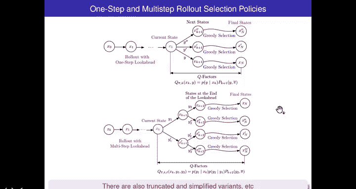

And now this rolledout algorithm has a performance improvement property。

We've talked about cost improvement as being the defining the important property of rollout。

There's here a performance improvement property whereby we show that the rollout algorithm gives you a higher selection probability than the greedy algorithm。

Okay。And with the way we prove that is entirely similar as for the what we have seen before by induction。

And the。The result holds because under the hood， there's a sequential consistency property。Which is。

which the base heuristic has， which the base heuristic the greedy heuristic is a policy itself。

 okay it gives you consistently the same selection when it finds itself at the same the same state at different times。

 so it has the sequential consistency probably and that's the key why this performance improvementr in property holds。

So I'm going to run through the proof and the argument， like I said， we have seen before。

So we want to show that for the greedy policy pi bar and for the rollout policy pi tilde。

 you have this inequality。The rollout policy performs better in terms of。

Probability for any starting at any time K and at any state X。

And this relation holds because for k equals n， these2 are equal to1 by definition that of the dynamic programming algorithm。

So let's assume that this property holds for k plus one， for stage K plus one。

We will show that it calls for stage K。And this is the proof。

And it's exactly the same proof as for the case of cost improvement for additive cost rollout algorithms。

Except it's simpler here， okay， it impose less complicated equations。🤧Oh。

We have we want to show that this is greater than that。

 so we're going to start with this and we're going to show through a string of inequality that's greater than this。

At the first step， we write the dynamic programming algorithm for the rollout policy。Which is P K。

 the probability of of。The sequence generated from。

T k from state x by the rollout policy is the next word probability。

 which is this is the next word times the probability to go from that next state that next state to the end using the rollout policy。

Now， this part here is greater than this part， the corresponding probability using the greedy policy by induction。

 the induction hypothesis， right？This part， this is the same as this， this is greater than this。

 so this is the way the inequality goes。And now we use the fact that to compute this rollout。

Selection， we maximize。The Q factor corresponding to x and the next selection。

 one of these possible next selections is the greatest selection。So。

By definition of the rollout selection， which maximize the GQ factor， we have this inequality。

And then。By the dynamic programming algorithm for the greedy policy， we have thisequ here。

So it's very simple and easy to understand。Questions。Now， this guarantees。Probability improvement。

But does not tell you how much the improvement is。Experience with Ro algorithm has has taught us that the improvement can be very。

 very substantial。 This is due to the underlying new step in going from。

Base policy to rollout policy the Newton step is inherent also in approximation value space as well as policy duration rollout is one iteration of the policy duration algorithm。

 and it is a Newton step。And even though you cannot tell ahead of time how much performance improvement you're going to get。

 typically the improvement is very， very substantial and if you're close to optimal。

 it becomes even larger improvement in the relative terms。Now。

 the computational results that yousha always going to show you shortly。

Suggest that this improvement is is very high。 You recover。

The optimality loss in going from optimal from optimal， going to greedy。

 you recover that optimality loss by a amount of 80%。90% things like that。

 and the more sophistication you' introducing to the rollout algorithm like multi step Look ahead or double rollout。

 the better results you get。So that is going to be seen from the results that Yuqo is going to present shortly。

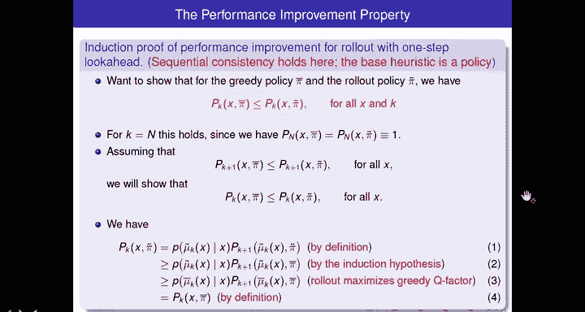

And。Let me say something about this double rollout。

Remember the relationship of rollout with policy duration， you start with some policy。

 you evaluate it， basically you evaluate its Q factors in this case by forward world propagation。

Through the Mark chain， and then you improve the policy by maximizing itsQ factors。

That gives you the rollout policy。Now this is let's call this single rollout rollout with the greedy as base policy。

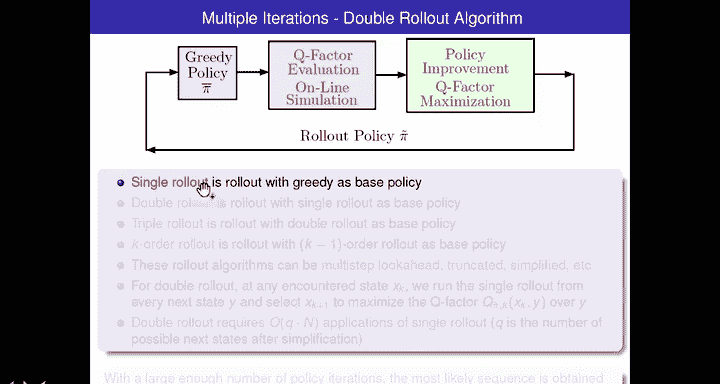

Now take this roll out and put it in place of greeditty policy as the new base policy。

You get double rollout， double rollout is rollout with single the rollout as base pointss after this has been put in here。

Triple to rollout is rollout with double rollout as the base policy。

 and K order rollout is rollout with k minus1 order to rollout as base policy。

And all of this can be done recursively in a loop， of course， the more the higher the order。

 the more computations is involved here， but we have been able to do double allowed with no problem and with significant improvements。

And triple the rollout， it's possible to do it and part of the reason that you can do this double and triple the rollout and so on is number one that the system is deterministic。

So the calculations are simplified and you can do truncation。

You can use trunccate that rollout or simplify the rollout。

 you can use all the tricks that you know about multidepo， look ahead optimization。

 and that can simplify the calculation。So。Theoretically， with every additional layer of rollout。

 there's an amplification factor of q times n n is the horizon and  Q is the number of possible next states。

 but after simplification， in other words， there may be 50，000 possible next states， 50。

000 next words， but if you look at the next 10， then q is 10， not 50，000 okay。And finally。

 a theoretical result that it relates to policy duration。

If you do a large enough number of policy iterations， then you are going to obtain the optimum。

 the most likely sequence， but of course we don't know ahead of time how many iterations you need for this to happen。

 it could be large。But you get very quickly after one or two。

 you get very quickly to the optimum according to experience。So we ready to take a break。

Are there any questions？So let's break for 15 minutes， let's start with。At the。5，43， okay。

And we're get into computational experiments。All right， let's get started。呃。

Now I showed our algorithm in action and present some computational experiment we conducted。嗯。First。

 I will show the computational results for our method apply to small scale Markov chains。

 where dynamic programming is still feasible and we can compute the exact optimal most likely sequence so that we can access accurately how well our algorithm perform。

 then I would go to explain how we apply our method for inference。

Generating the most likely text string from a fine tuned GT。

 where computing the exact solution is not feasible anymore。

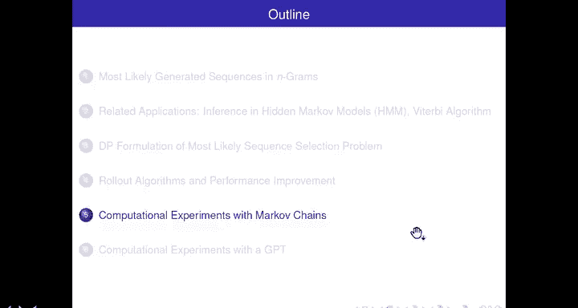

For the Markov chains that we have applied our method。We consider。With length up to 100。

 most likely sequence from set for a set of c of markov chains involving 100 states。

 and for each state X， there are five states y from which to which the state can have non zero probability。

So conceptually， you can think that the transition probabilities are given as a lookup table。

If we look at it here。It's a lookup table square lookup table with both row and column indexed by the states。

 and we stare at the second row， then the elements of the transition probability from x to all the states in the state space。

And for this problem。Dynamic executing dynamic programming is possible， and that's what we have done。

And because we have access to the optimal。Policy and most likely sequence。

 we measure the performance of rollout by what we call percentage recovery of Op loss of the greedy policy。

 given by this formula。So this term is the geometric mean or the average transition。

Probability under the rollout policy。And this is the average transition probability under the。

Grey policy， and similarly， this is the most。The most likely sequence。

And we compute is every transition probability and how far the。Grady policy is from the。Most likely。

 sequence would be the deluminator， so。Using this metric， we measure how well our rollout method is。

嗯。😊，Let's look at the percentage recovery by rollout。As mentioned earlier。

 because even though we are considering Markov chain， but the problem itself is deterministic。

 We are computing most likely sequence。 Therefore， everything is deterministic。 As a result。

 we can contemplate some more sophisticated variants of。

Rollout that would not be possible in stochastic context。 In particular， we applied。

Both the rollout with one step look ahead， as well as multi step look ahead up to five steps without our truncation。

 So the simulation go all the way into to the end of of the sequence lens。

 So record that sequence lens is 100。 So even starting from the very beginning。 when we run rollout。

 we run all the way。We run the greedy euristic all the way till the end of the horizon。But。

 we also tried。Rollout with M step truncation， where M only equal to 10。 So it's。Relatively short。

 it about 10% of the entire entire sequence。 So we want to see how well it performed。

And this is the result we get， which is。Average over 50 randomly generated Markov chain。

Some general observation we can see from this figure is。Regardless of what variant we have tried。

 rollout leads to substantial improvement over the greedy policy in all test cases。

And second thing is longer look ahead resulting improvement on average。 So with longer look ahead。

And the percentage recovery is larger。So up until five steps at this point。

There is only less than 10% of the gap compared with the greedy policy。I recall that。From each state。

 there are 100 state in the state space。 There are five。呃。Next， state with non zero probability。

 So in one step pad， we compute5。 the tree have five leaves。 We compute five times。え。

Complete trajectory in this one step look ahead non truncated rollout， whereas in this case。

 we compute。5 to the power 5。Much larger。 I cannot calculate the。没有。Answer in my mind， in my head。

 So much larger number to number of rollout need to be down。 Therefore。

 it's even more significant to。Think about applying。啲。Tncated version。 And luckily。

 what we have seen is that performance seems unaffected by the 90% truncation of the roller horizon。

 So with longer look ahead。There are more。Leaves， you need to run simulation starting from。

And in this case。啲嘢。Positive， encouraging result we get。

 encourage us to try longer look ahead because this is a significant computation saving saver compared with untrunncated。

Any questions to this point？Is the on text generation or what is the Okay， the question is。

 what is the application here， The application is now or or I should say this is academic example I going to show next the text generation example。

 So in this case， it's you can just think it's。It's Markov chain and with 100 states and each state can have non zero transition probability to。

5 different states， or probably including itself。 and next the next computation example would be a tax generation example Yeah。

 but this is for illustrating purpose to show the to access assess accurately the performance of rollout。

 because in a next example。Unfortunately， yeah， you cannot evaluate。

 You can only see the improvement， but how far away from optimal。We don't really。Yeah。

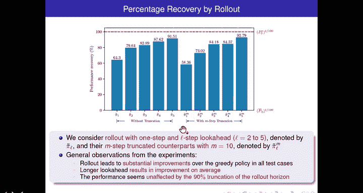

ok。So let's look at some typical patterns occurred in our computational study。嗯。

Every figure in this slide and next slides represent one markov chain。 So in the previous figure。

 the bar graph is average over 50 randomly generated mark chain。 and in this context。

 every figure represents one markov chain。And the X axis is different states。

Inindexed by  one to 100 was0 to 99， don't remember precisely。And Y axis is similarly。

The average transition probability。But。Only average over the geometric mean over the。

Ls of the generated sequence。In this case， it have not average over the state space because different states。

 so because we want to look at the different patterns over different states。啊在。

Commented a moment ago， in this case， we can compute the optimal， most likely selection policy。

And that is show as dotted。Dot。😡，bl。呃。Curve or blue figure here。 And this is the。

Optimal selection policy resulted average transition probability calculated by the geometric mean starting from。

 let's say， starting from stage zero。And using the optimal selection policy。

 you generate the entire sequence。And you compute the geometric mean of that sequence according to the Markov chain probabilityities specified by the Markov chain。

 and that would be the。And this orange figure。一。On truncated rollout with one step cut。And similarly。

 this blue figure is。Un truncated rollout with two steps ahead。嗯。

The red one is with three steps look ahead， and one on the bottom purple is the greedy policy result。

As you can see from those two figure。😊，What is common in those two figure is that。

Both have substantial improvement from the greedy policy。

 The all the all the rollout policy and this variance have substantial improvement over。

The greedy policy。 But the difference lie in。How much。The increase of look at， contribute to。

The improvement in terms of transition occurrence probability。And in the first figure。Well。

The improvement。Starting from the one step to two step and three steps。

 they all have some improvement， but some would they start。At a rain， that is still slightly。

Have a slight difference for distance from the optimal。Whereas in the second Markov chain。

At the first， the rollout was one step look ahead。It's already。Fairly close to optimal。And。

With two step look ahead。 So。Increase one step into the future in terms of look at the minimization。

 This blue part is already overlapping with optimal in the majority of states。

And what is kind of rare in our computation study in this figure is that three steps look ahead actually makes things worse in some states。

 As you can see， this radical curve somewhere。Kind of。The average。Occurrence probability decrease。

 and you may recall in the textbook one the textbook。 there is an academic example。

 also in deterministic context where increase look ahead。Actually。

 results in the performance degradation。 But I should stress that。

Those two cases do not occur in our numerical study in equal proportion。

 So this is kind of a rare case， but it's。Is representative or class of situation。So similarly， or。

The pattern represented by this two figure are a bit more common in our numerical study。

 The first case。You can see there is a substantial improvement from the gridty to rollout with one step pad。

But then there is almost equal amount of improvement for the second。Look how a step。And then。

 the third look。I mean， with two steps look ahead， is's almost。It's very close to optimal already。

 and the third step make it even close。And。Slightly different pattern here is。

The three look at steps bring in almost equal proportion of input。

 So those two kind of situation are more common in our numerical studies。

 But what is common across all the test cases， which is consistent with the the theory that。

Rollout and its multi step ca all have improvement and the improvements are all substantial over the grid。

Yes。Yeah。So all those things are look the Markov chain are specified by the lookup table with 100 states and so on yeah。

I'm curious about when， especially in the previous slide。

 like theres one significant slide for the gring policy here。

 how you likevariably interpret that deadline or specific state like any policy can achieve the best performance at？

Well， not， certainly not any policy。 I mean， you can purposely choose at every state the smallest probability and just。

 I mean， do the opposite of what greedy is doing。 And then the performance would be bad。 Yes。

 it's correct that in this case in this particular case， actually。

 greedy policies for this particular state， the greedy policy is optimal。

 So how we generated the Markov chain is essentially with 100 state。

We use uniform distribution to select for each state with uniform distribution to select this candidate  five different states。

 which we assign nonze probability。 and then for this probability。 Again。

 we use uniform distribution to assign some numbers and normalize and make it a transition probability。

 So it could occur in some situation for some states。 It's。The grade is optimal， and。

I don't really have more to say than this。Yes， on the number of conditions。

So basically we've tried from in this case， the number of states from each state we have。

No zero transition probability is 5% right， and we tried from 1% or 1% in this case is trivial because everything is deterministic。

Up to 5% and we tried states from 100 up to 1000， and it's pretty much consistent in terms of pattern we find and in terms of bar graph we see so and we mostly have focused on the case where the number of states from each states it have nonzero probabilities relatively small because and fixed because we want to we want to focus on markov chains that resemble the engram applications we have in mind。

And here the number of non zero transition probability would be the number of states where you have nonze transition probability would be the vocabulary size in the context of language text generation。

ok。

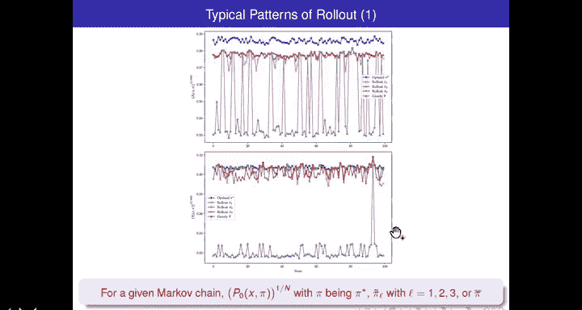

Now， let's get to。A more sophisticated version of rollout， which is the double rollout。So。

As I mentioned earlier， because the problem is deterministic。

 we want to compute the most likely sequence and with a probability specified by the Markov chain。

 everything is deterministic so we can actually run double rollout with one step look ahead and multi steps look at or again。

 the lookout steps are from two to five。Which are didnoted by hack here。So， we try the。

Rollout without truncation and with truncation where the truncation M number is 10， which is。

The same as the previous case and the green bar here show the results of double rollout and we put the single rollout result with one step we had here for a comparison。

Some general observation you can see from this。Our graph is that double rollout and this variant lead to significant performance improvement。

Overpo the greedy。Policy， which is here， which is the zero bar here。

And the single rollout with one step ahead。 So once you apply double rollout。All of a sudden。

 you have another。20 plus cent。Optimality loss， recover。It。And another。Significant。呃。

Or another exciting result is that。The truncated version。

 just as in the case of single rollout remains effective and okay。

 there are performance degradation as you might expect。

But it's relatively small and quickly recovered by longer look， so。And。

Recall this is m equal to 10 and capital n is 100。 That means we only simulate 10% of the trajectory and you get performance improvement this much。

Which is which encourage， which is encouraging news。

 because we can apply longer Look ahead to improve performance even further。Any question here？

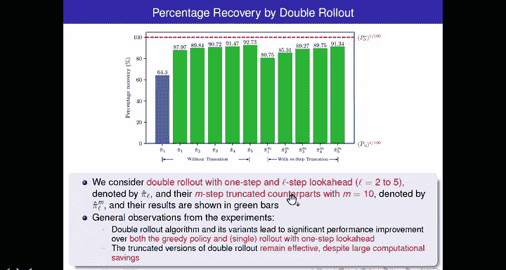

ok。Let's get to the next topic， where。Unfortunately， computing the。optimalim is not。

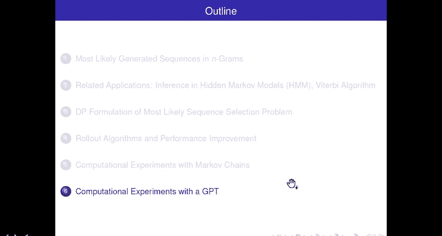

Feasible anymore intractable， which is。Applying our technique to generate pretraining transformer known as GT。

Transformer architecture improve important ways on earlier neural networks by using the attention mechanism。

 which is。Well known nowadays。 but I would gloss through some。P ideas there。

And sectionuction neural networks are often pre traineded with a lot of general purpose data before they are further trained or fine tuned with special purpose data。

And owing both to the architecture of the transformer， as well as the ability to be pre trained。

The resulting neural networks are often generative。

 being able to create new content or to perform open ended tasks。Which bring a lot of enthusiasm。

And there has been tremendous amount of applications。Natural language processing， computer video。

 image and music generation。 In fact， this figure is generated by a GBT architecture。I just ask。

 I just use the prompt， generate a encouraging figure for inspiring figure for GT application。

 and this is the vibrant figure it created。But we're going to focus on tax generation and view G as an angle。

Alright， so at the core of the P transformer is this。Attention mechanism。And for this。

 let's consider this text strain。 Reinforcing learning is found。 Okay， as the input。

The GT we used view this text string as six different words。And the unit are also known as tokens。

And as you can see。It's divide words in unusual ways。 It's not the world unit we consider。

 So a divide reinforce reinforcement as three units， three tokens。R E Ying enforcement。And then with。

Learning， but learning coming before the word with this special。哦哦。

TheSp symbol that represents why space。 So with the same word're learning with or without why space are two different。

Two different tokens。And then， then comes。Ease and fun。So。For each all。Ordered word pair。

Like Ying and RE or forcemen and Ying and so on so forth。It calculate。A number called attention。

Which measure？The affinity between those two words， how strongly they are related。

If we look at this sentence again， reinforcement learning is fun。 So for the。It will calculate。

The tensions score between enforcement and ying and between enforcement and R。Enforcement and itself。

 this is what we mean by feasible other words， at least in the application we have applied。

So this kind of implied this。Causal。Architecture of text string that when generating the next word。

 it can only depends on the previous words， which is precisely the mark of property we have。So。

Then a compute， this。3 numbers。 And you can see from this hit map that。

It's mostly connected to itself， which is common， but also。Strongly connect to the first unit R E。

 So this is。This is the。Numbers it compute。 And eventually for this input。

 reinforcement learning is fun。It generate this heat map， this part， triangular part。

And this affinity score or attention， affinity score would。

Would demand attention of the neural network。 So the neural network would pay attention to the connections with higher school。

And of core， this is called the。How the。Attention mechanism works and this。

Affinity score is generated using the ways upon which we find tune our model。

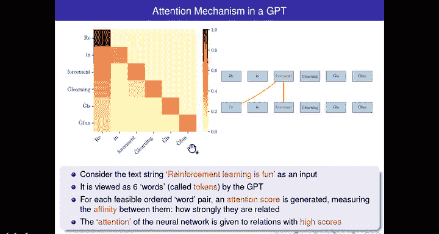

So。If we look at how they are trained。Again， using the text string reinforcement learning is fun。

This simple text string actually correspond downs to5。Training data pairs with input and output。

 input and label。So， starting with R。Which is the input。 itss label is ying。

And starting with R and Ying， which is the first two tokens or what you need。

Its label is enforcement。And so on and so forth。So， the input would。

Feed into the GT that would generate output of its own prediction。And how the output。

 the output would be the probability distribution over the vocabulary。

 which I'm going to go to shortly。And then the label going to go to the training algorithm。

 and based on the label and the output of the current GPT， they're going to modify the weights。

So this is the in a nutshell， the training process。

And what is unique or different from the conventional。label data到。

We have seen in previous era machine learning application is that the text stream for training does not require explicit data labeling procedure。

 which is intense human labor。You can see8。Once it automatically divided into units or pieces。

 the input and label pairs automatically generated。

This automatic generation of label data from unlabeled data for training enables the pretrain with large amount of general purpose data because。

You just need to feed it， feed。Huge amount of text strings。

 and this input and label pairs can automatically generate it。

 and you have plenty of data to train the neural network。So this。

Label data generation and training process are collectively known as self supervising。

The training algorithm we used for GT of the shell software which the core scale versions of stochastic gradient descent and some of the key concepts and ideas we can touch upon in the next lecture。

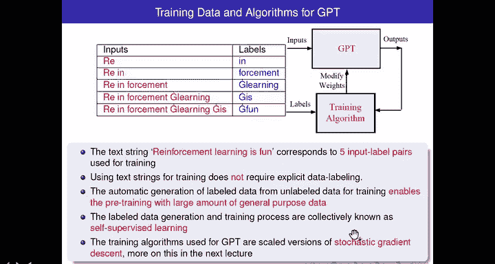

As I mentioned moment ago， the output of the GP is a distribution over the vocabulary。And once。

After we find tune a。TheGPT， we use it to。Generate text stream。With length 200。 and the。

The en model we use to view。The fine tune GT have small and equal to 1024。So。

This is how the output looks like， given an initial text stream at zero， which we view as prompt。

Go to the fine tune GT， then the output would be。A distribution over the entire vocabulary。

 And here I show the top 10。 This is the output from our fine tune GT。

 and the input is a complete sentence。And as I mentioned a moment ago。

 this special symbol represents a Y space， which is。Reasonable。

 because I gave it a complete sentence。And it predicts the next most likely token word is white space。

Actually， with overwhelming probability twice over。Award， so。Yeah， this indicates how。

 how how it works。But unlike the previous example， where the。

Transition probability of the underlying Markerov chain is lookup table。 This time。

 we cannot draw lookup table。It's actually generated by this piece of software。

 which is the fine tune GT。Let's go back to the topic of intractability。Now。

To store this lookup table， to store the transition probability in a lookup table is not any more tractable because the vocabulary size is 50000。

And the context window。Some would call the small N is in the ngram is。More than 1000。

 And this is this many。Stayates in this en we study， which is。Enormous， so。

It's not even possible to store。😡，As integers。For each state。

 so this is way too large and stop possible compute。And what is worse is this large vocabulary size。

 50，000。Also leads to excessive Q factor computation。Recall that。

How exact rollout works is at the given state。They're going to compute Q factors with one step pad。

 They're going to compute Q factors。 Each Q factor representing one feasible next state。

 and each feasible next state represents corresponds to one。Element in the verocabular， right？

And this would mean if we execute exactly rollout with one step of head。For each decision to make。

 we need to calculate 50000。Trajectory Q factors and run that many。Complete solutions。

 which is invisible physical。So what we have done is instead we apply sified rollout and its truncated counterparts because we look at some of the output transition probability we see。

 okay， top 10 have overwhelming probability collectively。

 more than 99% remaining ones are just highly unlikely， we probably。Can safely discard them。

And what's more is， as you know， the modern day language model。In their training phase。

 heavily rely on the parallel processing power of graphical processing units and rollout can。

Fully harnessish this power， because all the simulation you have can run simultaneously。 and。

 in fact。Based on the hardware you have， let's say you have a hardware which is support 50。

Paraleel computation to run。 Then you can just instead of having simplifyplified rollout with 10。10。

 look at with 10 control to consider。 You can have 50， or you can try with 5。Or let's say， with 7。

Top 7 words for one step Look ahead。 and then top 7 for the next stage。 So in total 49。

 So it would be two steps look ahead， but with simplification in terms of this minimization。So。

And we have only tried with one step look ahead， but the result has been encouraging。

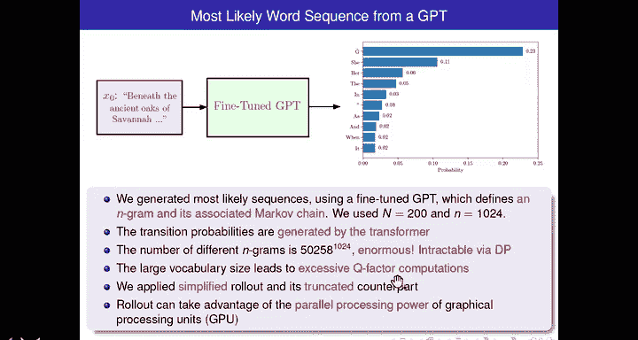

So let's see we applied two simplifications in our techniques。

 one is that computing only 10 Q factors corresponding to top 10 most likely next words。

 this is simplified rollout with one step look at。But in addition， we also tried。

Tronating the simulation after 10 steps。 This is M step tru。From this figure。

 your general observation。 Okay， so this figure represents。20 different test cases，20 different x 0。

Compared with the previous 100。State Markov chain example。

 I cannot possibly plot all possible initial states， right， That's 50000 to power  one south。

 So I sampled 20 different initial states。 How I did that。

 So basically from a GT pre train G pre train G。 Some of you might be familiar。 This is G 2。

 which is easy to。Relatively easy to handle and we can modify according to our need。

 and we load the weight that is available and we fine tune it with and writers writing missioners writing and for the initial states。

 we basically as G4 with the prompt provide us with 20 different opening sentences in the style missioners writing。

 So G4 give us those 20 different。Opening sentences， which we view as initial states。

 so that's2 different x zeros。Then， those sentences would。

Ex strings would be used as input to our fine tune G。Conceptually。

To make those sentences also en gram。We need to。Add additional。

Placeholder elements to to field it up to 1024 length。

 because those initial sentences can be different length。 And if we view it as engram。

 we need to add。They place holder。Word into into the text string。

 So it become an ngramm or 1024 gram。But basically。

 we try those 20 different input and compute its average transition problem the average。

Occurrence probability for the generated text stream。And this is how it looks like。

 where this blueer。Be figure is Simplified rollout。And。The orange one is， it's。Yeah。

Cranated counterparts。Were up to， I think，10。So the truncated simulation is 10。 things like that。

 Yeah，10 steps。And the observation we can see here is simplified rollout still have substantial improvement over gridding policy with modest computation increase。

And the truncettic counterpart still improves upon the greedy policy in all our test cases yes。我呢个电台。

Next slide。Oh， here。系 yeah still。哦， so。As I said， since this is a this GP。

 we have access to its trans probability like this figure， we have all those。

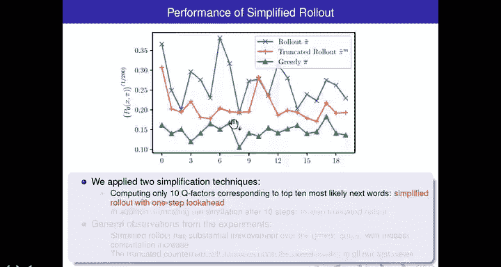

Numbers available once we feed into this text string。We have all those numbers available。

So all those transition probabilities are available and we basically just record those transition probability and。

And then multiply them together， similar to the Markov chain case。The only difference here is， okay。

 it's not a lookup table。That we have all at once。It's computed on the fly whenever we put a text string。

 generate stuff and for each。Each word or token generated， we also consult。Under the hood。

 what is the probability corresponding to this token award selected by our rollout policy recorded。

 and then for the next token selected by the rollout policy， we record， record the。

Crossboundunding probability and so on so forth， and then in the end。

 assemble them multiply them together。

And another thing is， yeah， truncated counterpart still improves upon the greedy policy in all our test cases。

Yes， please。把，那边搞。Sorry。So the cost function here is， again， since we only consider we。

 the subject we consider is generating most likely。Sequence， right， So we want to maximize。

The occurrence probability of the entire string of engrams。

And the cost function could be interpreted as。Minus of， of the transition probability。

 the collective probability of this string of engrams。 And if you want the additive form。

 you take a look。 So this is the cost function。 But if you remove that minus it's a reward function。

 And you want to maximize the probability。Right， yes， I开了， I kind a deal I。When you do this。

 you're kind of embracing the biases most likely that is generative or modeled in the training process of the。

 You have like an empirical example between the reading policy and the。Okay because。First， sorry。

 let me try and make it clarify for myself， the zero to7 18 starting is like 18 paragraph， right？

Like 18 paragraph or 20， Yeah，20， Yeah，20 paragraphs of 1024 Yeah tokens yeah so。

Do do have like a completed version of actual text for comparison。会真好嚟嘅。I know that right out。

 after rollout， you can calculate the probability together。ThatDoes it really read Okay。

 so that's a completely different subject and in fact。In terms of evaluating the quality of the。

Of the generated text stream。Since that's not the purpose of rollout。

 so the rollout only do what it is instructed to do。

 which is compare numbers and find a large number and choose the control that corresponds to that large number。

 so it only compute probabilities。And have no regard whatsoever about the quality of the generated X。

But there is not even a。Subject or objective definition of quality of the text stream the。

Observation we have seen is that。Because how we view the problem and。How the。

Transformer the G we have。 We find that so in the vocabulary of the G2。

 there is this special token called end of text。 So basically represents the previous stories over。

And we find。Once that token appear， all the subsequent transition probabilities would be fairly high。

 So our。Mester computed text tend to be very short， so。

Very short and try to find that extreme and that's it。And alternatively， there could be other。

Problems to consider like instead of calculating the most likely overall sequence with fixed lens。

 you can consider computing most likely sequence with average transition measured by every transition problem。

But what you mentioned， whether or not all those things translate to the quality of the generated text string that's completely different。

Problem。I can imagine several other situations where the policy are more easily yes measured yes。

 for example， like currently tragedy like when you ask them several questions。

 you can give you like several format of basically the same answer Yeah I assume that in those situations if implemented through online rollout you can just use the different model basically measure how formatted or in some other situations how pay this passage are generated and then you can generate different。

Yeah， I think there are ongoing research about this kind of topic and what we find difficult。

 at least in our experiment， is that when we compare the quality of generated text。

Even G 4 provides wildly inconsistent result from one run to the other， and。It performed。

Not consistent and not coherent， which make。It to to be used or this quality to be used as a value function or as a measure of of how well it performed become very difficult so。

 but on contrary， the the metric about probability and so on is clearly defined and understand what you mean that okay it's biased towards this trend。

 but。From our conceptual point of view， it's a Markov chain。 and it's defined by this fine tune G。

 Okay， another related， somewhat related subject is， you know， in training and actual operation of G。

There are also some additional intermediate parameters and stuff you can tune， like， for example。

 to suppress the generated text to be repetitive。 You can install some filter to。

 to prevent it to say topics that completely。Beyond the context。

 you can include include some other stuff， but。All those implementation are done is doing is to modify this output transition output probability。

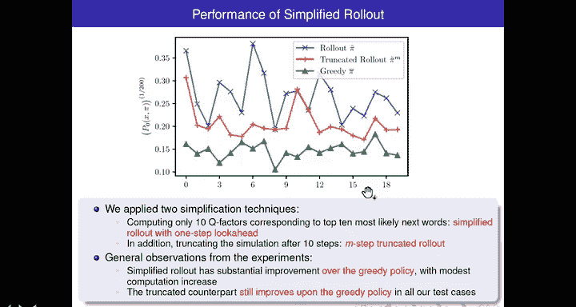

And what is important in from our point view is once the weights are fixed and once all those parameter are set。

 we are given a markov chain， which is。Which is what we're going to operate on。Any other questions？

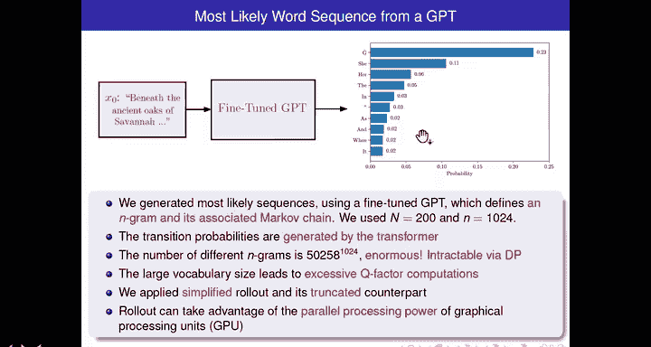

诶 sorry系交晚冇。Al rightThe simplified rollout is saying that you don't want to do 50000 new word Yeah so you choose the max like that max 10。

Why don't you like choose this scastically like see it as a distribution， Okay， so recall that。

To half。Rollout。Performance guarantee。You need。Deterministic， right， You need to have。Okay。

 this get a little bit technical。 So for。For rollout to have performance improvement。呃。

To have the proof go through。

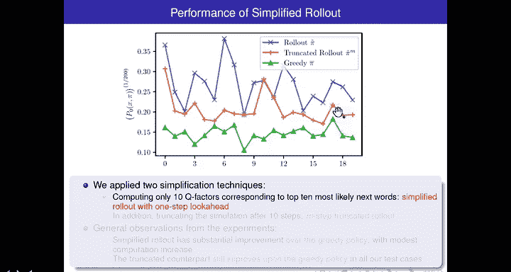

You need to have this。 Let me go to this place。Essentially， it's dis inequality。Right。

You you would like to have the performance rollout improve upon the greedy policy。

And one key step is dis inality。Let's say this in quality。To have this inequality。

 that means you need to have the control you。Selected， control You choose。

Better than the greedy policy in this formula。But if the greedy policy is not even one among the ones you choose from。

You don't really know whether or not you improve upon it。On the other hand。

You might consider using some stochastic。Pice heuristic， but essentially means。

You are doing something different that。All those deterministic simulation and so on are not。

Not valid anymore。 You need to run many samples， average them over and so on so forth。

 And that's a completely different topic or a different choice from theoretical point of view。

 it would still hold if you run Monte Carlo simulation and average them over with performance improvement and so on。

 Yeah， but that's different yeah。

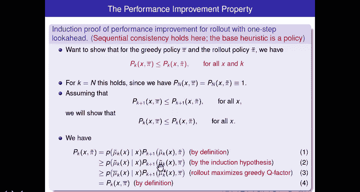

Okay。So in the next lecture， we're going to talk about other neural network and approximation architectures we're going to touch upon offline training。

And the use in RL context。 So this part of the materials covered in the chapterpt 3 of the textbook。

Alright。嗯。Thanks。

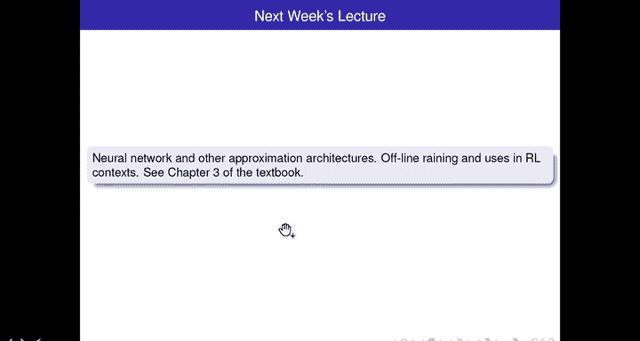