# ASU《强化学习2022-2024｜cse 691 Reinforcement Learning Course at ASU》中英字幕（deepseek - P11：[38]Lecture 11, 2024_ On-line training, neural networks, - GPT中英字幕课程资源 - BV1zcfVYdErD

All right， let's get started。Let me welcome you to today's lecture。Ppics in reinforcement learning。

And up until this point， we have mainly focused on。Online play algorithms， in particular。

 approximation in value space and variant of rollout is application to stochastic problems。

 deterministic problems and so on。 And we also talked about a few applications and case studies。

This lecture， we're going to shift gear and start to talk about offline training algorithms。

 which is also an important component in our essential architecture。

As well as some other parametric architectures。

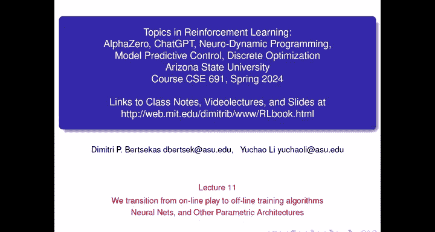

Here's our of today's lecture。 First， we're going to give a short review of what we have done up you now and also talking about。

Our plan for the remaining lectures。Then we're going to talk about parametric approximation architectures for offline training。

And this mainly includes some classical architecture。

 like piecewise linear function and feature based linear architecture， as well as neural network。

Then we're going to talking about how to train those architectures。诶。And after that。

 we're going to take a break。And then after the break， we're going to talk about more generally。

 some incremental optimization methods。For optimizing some of a large amount of some of differentiable functions。

And within that context， you can see the training of architectures would be a special case where all those differentiable functions are the functions of this parametric architecture。

And after that， we're going to talk a little bit about your networks and connect them with the previous incremental optimization algorithms we're going to also cover or。

Talk briefly about some key innovations that enable the training or the use of deep neural network。

All right， let's get started。呃。Here is the。Essential of the key architectures that we have go back again again。

 and this is the alphapha 0 or MPC architecture。Which is our starting point。

It is composed of two essential elements。Which we refer to as offline training and online play。

 and they can be designed or implemented to a larger extent independently。And there is a lot of。

Flexibility to modify this architecture by including some additional ingredients or remove some of the components and so on so forth。

So呃。There are some key or essential difference between the offline training and online play component。

To start with， offline training is done as its name suggests offline。

And the goal is to train or obtain some terminal cost approximation or policy。

Some policy that we have access to。And it is。It is done with the goal to approximate sufficiently well for almost all。

 if not all， states。 So when training。We try to cover as many as possible the states。

 So we would like to have。Terminal cost or a policy that approximate well。In a lot of states。

 at least the states that we anticipate were going to visit in our real time operation。

On the other hand。All play part。This operation is only done for states that we actually encounter in real time operation。

 So this is one of the key difference。And the other difference， which is conceptually。第一。

Online play Party is more important， and there is a subtle difference between the first step and future steps。

So in this figure， it's。The online play part involves two steps to look ahead。

And starting from all the leaves of this lookca tree。

We run rollout with the base policy supplied by offline training。

 offline training that give us this policy network up to certain depths， and then。

The additional cost is supplemented by using the terminal cost approximation。

 which is given by a value network。And in this the whole process need to be done in real time online。

And。The first step is conceptually the Newton step for solving Belmans equation。

 Here I have a question。 So if we look at this online play， multi step， look at minimization part。

 basically， we're going to minimize over。UK and UK plus one。

 all the combinations of UK and UK plus one starting from Xk。

So if we look at this minimization formula。Minimize UK and UK plus one。Why is it different that UK。

 What make UK different from UK plus1。Conceptually， the first step is Newton's mess。

 and the second step is not。 So why。Those two are different。

Because no matter how many steps you have， you look ahead， you' only choose the first action。

That's absolutely correct。 So the difference is you actually use UK that you selected during this minimization operation。

 and you throw away。All the future steps in this multi step ahead。

 so this is where it makes the difference。Okay， so。In the first four lectures。

 we start with an overview and kind of big picture lectures， which is chapter one of the textbook。

We set forth this offline training and online play Newton step interpretation framework。

 conceptual framework。And after that， we cover。Some exact dynamic programming content that applies to deterministic。

 stochastic， finite and infinite horizon problems。 The goal is not really to。To cover。

 to a large extent extensive theory about those topics is。

More about set the stage for you to understand the approximate method that we cover later on。

 and also in this stage you already seen that， for example。

 this traveling salesman problem that in your exercise really make little sense to solve it using dynamic programming to get the exact solution。

 but it makes a lot more sense when you want to solve it approximately using rollout or approximation value space。

After that， we cover。The main workhor of this course， which is appximating value space and rollout。

And from a practical matter。When you are presented with a practical problem， you need to if。

the methods of this course applies。 you need to translate that into a mathematical problem。

 So we talked about problem formulation and transformation， how you can given a practical problem。

 how you can formulated as a dynamic programming problem with sequential structure that you can address using the tools you learn from this course。

 This includes state augment and and terminal state problem， For example。

 the stochastic shortageest pass problem problem involving multiageent architect structure and the pump DP problem where some states are hidden and you need to infer。

Another topic that we cover briefly is adaptive and mode pre control。These are vast sub subjects。

 and they are。Perfectly。Hhole courses in their own rights， and we cannot cover everything， but。

Those methods share conceptually similarity and in fact model predictive control use exactly the classical formulation。

 model predictive control use exactly the architecture we have presented just a moment ago。

Then we focus on the online play algorithm， which is the chapter two of the textbook。

And this includes rollout algorithm for deterministic and stochastic problems， their variations。

 for example， fortified， simplified， constraint， model free and variance reduction ideas。

We talked about multi step lookhead search for deterministic problem。

 this involve pruning and double rollout in particular。

 double rollout we have presented in the context of most likely sequence selection problem。

And we also talked about Mai's step look ahead for stochastic problems。

And here we might need to use certain equivalentvalence， approximation and Moncolo tree search。呃。

After that， we talked about multi agent or multi component control problems and their variations。

 including variations involving signaling and even problems with nonclass information pattern。

And in the last lecture， we covered Bay optimization。

 whereby we transform the problem or review the problem as a pump D P problem。 and it includes。

A special case sequential estimation and adaptive control as well as where we can use rollout。

 and we demonstrate a case study。Of。Wordle application using rollout。

So having summarized what we have covered up you now， here's the plan for our future lectures。

 which is the chapter three of the textbook。We will cover。In some depth and detail。

 approximation in values and policies during neural networks and other architectures。

We'll talk a little bit about training of。Approrxiation architectures with incremental gradient methods。

And after that， we're going to talk about approximate。

Value and policy durations with approximation architectures as well as aggregation methods。

 which is also a broadcast class of method and have sound theoretical guarantees。

And in this core lecture， I can talk about the first two ideas。

 the remaining two ideas will be covered in the next lecture by James。Notow that。

We have left out a lot of ideas or topics that have been covered to a larger extent in previous offering of the courses。

 as well as the textbooks in 2019 and the theoretical monographs on dynamic programming。

This includes a lot more theory。Of infinite horizon problems。You may not notice that。

Mostly in the course， we have focused on finite horizon problem。

 except in the context of linear quadratic problem where we aim to illustrate this Newton's method interpretation。

 that one is infinite horizon， but mostly for the most part of the course。

 we have focused on finite horizon problem and finite horizon problem is intuitive and easy to digest。

In comparison， infinite horizon problem have a lot more theoretical difficulties and。

In the artificial intelligence and reinforce learning literature， you often see。

The framework that people often use is。Problem involving finite state and finite action and discount on the cost or reward。

And given this。Kind of setup。That class of infinite horizon problem is quote unquote easy in the sense that a lot of mathematical complication disappear。

On the other hand。There are more challenging type of problems where。

 when this discount factor disappear。And。And there might be some state that once you get to。

 you cannot escape， this is called absorbing state or termination state and this type of problem have a lot of mathematical complication and involve a lot of theoretical problems need to be addressed carefully and those things we left out and for those of you who are interested and you might consult to this monographs。

So another subject we have left out a lot of details is sastic training method for approximation in value space。

We're going to cover in this course just a very high level overview of some May ideas。Of training。

Architecture， your networks and so on， but there are other kind of training method or one might view them as stoastic approximation method that include TD Lada and other TD methods for policy evaluation。

 for example， Q learning。This kind of method have a lot of have imposed a lot of interesting mathematical problems that intrigued a lot of mathematician to worked on it since the 90s。

 and for example， the。There is a。Elegant， famous。 Also famous。Proof for kill learning。

Which is done by professors coauor of this NP book New programming book， John Siyss。

 and it's a lengthy proof why Q learning works in the case where it does not involve any approximation architecture feature。

But rather， suppose that all the states can be。Can be enumerated as lookup tables， so。

There are tremendous amount of literature on those mathematically for those mathematically oriented students。

And there are also specialized methods for approximation in policy space。

 Those are policy gradient methods and random search methods。

So we have not covered the policy gradient methods。

 and this type of method can be viewed more generally as solving some sort of optimization problem。

 It may be viewed within the dynamic programming context， or it may be viewed as。

Outside of the dynamic program in context by simply regarding it as a gigantic optimization problem。

 so those are things we have not covered。Now let's go back to this fundamental architecture。

 approximation in value space for online control theele。Recad that。

In the case of one step look ahead。It involve three major approximations that we can play around。

 play with。 So the first is。Approoxmating this cost to go by using。 So if we have access to J star。

That's great， but most likely we don't。When we came across some practical problems。

 we use some function that we can compute called J tilda in place of J star。 And there are a lot of。

Md we have covered problem approximation， rollout model predict control， and this course。

 we're going to cover parametric approximation and neural nets and the next one going to cover aggregation method。

Another place we can approximate is this expectation。 In most cases， we don't have。Either。

 we don't have。Exact formula that we can play with regarding the distribution of this WK and some other cases is that it's way too complicated to calculate。

 So instead， we might want to do some simplification by using certain equivalentence。

 adaptive simulation and Mon colorlo tree search so。

So the third one source of approximation is this miniization optimization whereby minimization operation。

 whereby in the case where their problem have multi agentent architecture or structure where UK is composed of several component。

 we may optimize them one after the other。And we have case study in the previous lecture that show the effectiveness of this kind of。

Operation。呃。Apart from one step look head， there is on also multi step look head。

Whereby instead of optimizing or minimizing only the current control UK。

 we also optimize the subsequent L minus-1 stage policies。

 Not that there is a big difference that for the first step， we optimize UK， which is the control。

 And the reason is that we know precisely what our current state is。 Xk。But after the first stage。

 we don't know what the next stage is because it's stochastic， there is uncertainty involved。

 so we need to optimize over policies and this make this problem， for example。

 even this L is only too that doesn't mean the solving this problem is twice as hard as solving this one actually most often is way more challenging and that makes certainty equivalence type of idea even more relevant in this context。

Now let's cover the parametric approximation architecture used for offline training。

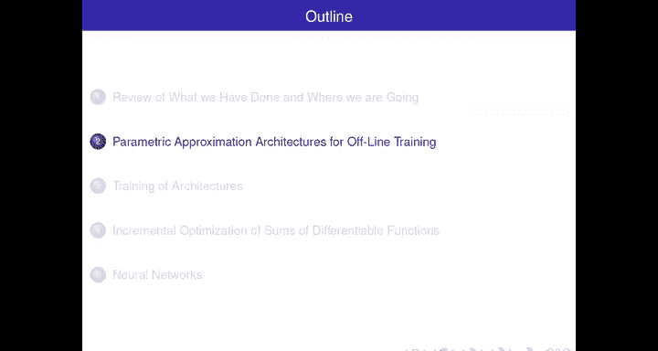

There are two types of offline approximation in reinforcement learning。

One is cost function approximation in finite and infinite horizon problems。So we me。Approximate。

The optimal cost function， J K star or J star。 So J K star means in the finite horizon context。

 So for different stage， we need to have a different。Cost function approximation。 And J star is。

infinitefinite horizon context since different stage does not change the optimal cost。

 So we have one cost function proclamation。And we may also approximate the optimal Q function。

 which is Q star K and Q star。Another fi object we may approximate is host function of a policy。

Which is J pi or J mu of certain policy or their respective。Q function。呃。

In some context of finite horizon problem。You may transform it to a。

Infinite horizon problem by aggregating。The state with stage so that you have one ametric approximation to cover all cost of function approximations。

So this is what happened being orphaal and of a zero kind of context。

Another type of object we would like to approximate is policy approximation。

In find at an infinite horizon problems， whereby we would like to approximate either the optimal policy。

 mu K star or mu star or a given policy， mu K。Or mute。

So if we have access to the optimal cost function or the optimal policy， of course。

 that is a better object to approximate， but most often we don't have access to that so。

We need to turn to certain cost function or certain policy。To approximate。And in particular。

 we will focus on parametric approximation。Architectures whereby。Either the cost function。

 approximation or approximation policy approximation would be。

Is parametermetricized by some parameter or and in the context of neural network。

 this would be referred to as waves。And so， we don't consider。

The modification of the architecture or the modification of the。Of the appromator， for example。

 how many layers and so on。 We suppose those are given。 And our goal is to。

Optimize or find the parameter that fit the best the data we are given。

And an example is the neural network where R is a set of weights。

 and we would give a specific example shortly。So any questions to at this point， yes。

 please have question。A or state step number does it does the cost function depend on the step number or can we have like universal cost function people find it but not just as。

So， for example。In many of these finite horizon problems。The state that you。Occur in different stage。

Are different。Let's assume that we have a finite horizon problem。At x 0。

 you can only have state one and have。X1， the first stage you have state1 and2。

And then three and four in the third stage and so on。And if。The states are distinct。

At different stage。Then it doesn't hurt for you to use one parametric architecture to approximate the entire thing because the same state cannot appear in different stages。

So。Given the state， you know precisely which stage you are at。 Then it's fine to use。

The same architecture。To approximate the whole thing。

Is it saying that let's say we already use like a neural network to approximate the cost。

 like in under what certain circumstances， you need to use， let's say， more than one neural network。

For cost function。 So suppose。You are solvingbbing。A shortest pass problem。

 And you formulate this shortest pass problem as a finite horizon problem。 Okay， technically。

 given a shortest pass problem， it's more appropriate to formulate it as the infinite horizon problem。

But for the sake of this example， let's just say it's formulated as a finite horizon problem。

 suppose there are five nodes in this graph you want to compute the shortest pass to certain node。

And you know。The longest distance， the shortest distance can involve at most five nodes， right。

 then the capital n you choose is five。 We formulated this as a finite horizon problem。

Then this node one can appear。In first stage， also in the second stage and the third stage and fourth stage and fifth stage。

 you don't really know。Suppose you supply the neural network with this node1。

How the neural network can recognize or distinguish whether or not this is。First stage。

 second stage or third stage， right， in this case， either you augment this node number with the stage。

Number to make it。For the same node， different in different stages or you just use different networks and this is just a trivial example。

 but give you a hint about how to deal with this sort of things and typically in context of gains and so it's more appropriate to formulate as shortest past type of problem which make it infinite horizon so you can use one architecture to approximate but in the case where you have a finite horizon and the same state appear in different stages and you have no way to distinguish which stage it is then you need to augment it with the stage or yeah use different separate neural networks。

ok。Yes。😊，对。Yeah， by horizon， I'm referring to finite horizon I'm referring to there are finite number of stages and after reaching that stage everything is completed over so on。

我。There's。对不起。Infinite number of state possibility， but stage is finite。

 right then it it doesn't make any difference。 I mean， if it's infinite number of。States。

Then either if this infinite number of states。 So the key is whether or not in the context of finite horizon problem。

 whether or not your current formulation， whether or not the same state appear in different stages and whether or not your neural network can distinguish the same。

State in different stages。 And if you can distinguish。I mean。Technically， it cannot。

 because the same thing you present。 Okay， X， K X equal to 5， you present to the same neural network。

 is gonna to output exactly same thing。 So you either need different neural network or you need augment。

 explicitly tell。The parametric appator that， okay， this appear in different stages。Okay。All right。

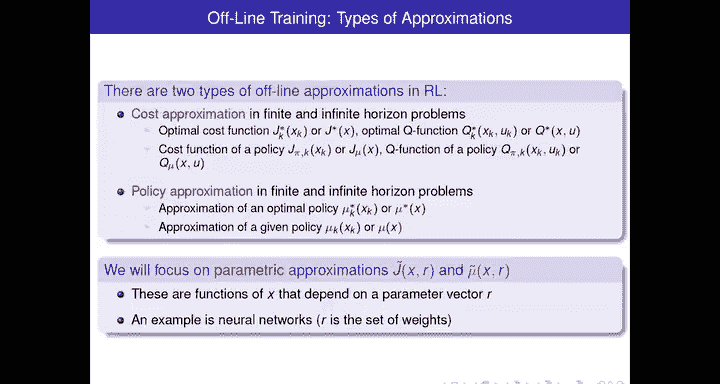

So let me give you a practical。The illustration of parametric approximation。

When we would like to approximate a target cost function。

Suppose this is some target cost function we would like to approximate。And the first step is。

 we collect a lot of training data。This data are state and cost pairs where Q can be a large number。

And we designed this approximation architecture。And once this architecture is fixed。

We would like to find this parameter or such that the function defined by this architecture and this parameter。

Is close enough to this target function that we would like to approximate。

So this process is called training the process of。Finding this parameterid R is referred to as training and can be done with specialized optimization software such as gradient line method or other listqua methods。

 and we're going to cover some basics of them。And note that each of those steps can be time consuming。

 for example。The process of collecting training data and the process of training the bar and will give。

Give you a flavor how。

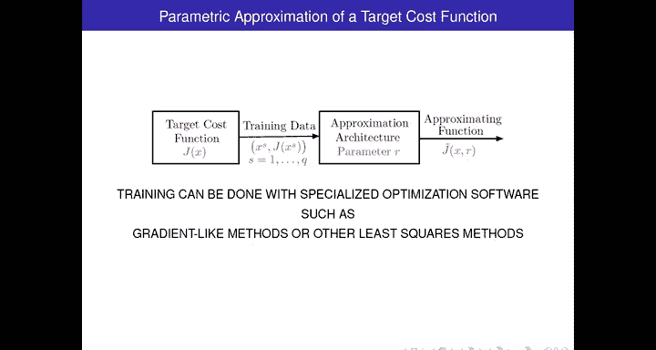

How those can be done。Unlike the case where we approximate the cost function。

 when we would like to approximate。The policy， especially when the number of possible control is finite。

诶。Things a little bit different。 So if the control have continuous or real valued components。

 the training is similar to the cost function case。On the other hand。

 if the control comes from a finite control set from U1 to U M。

 an alternative approach is possible and is also commonly used。That is。

 we view a policy mu as a classifier， it is a function that maps X the state to a category。Mu X。

 mu of x。And if we look at this。Smatic illustration， given that we have a target policy。

 we would like to approximate either it's some given policy or the optimal policy we computed for a limited number of states。

We collect a lot of training data， which is the X S and mu X of S pair。And this classifier。

The parametric policy approximation essentially is to assign the state X to a class。

 which is one of those M different classes。By。With once we fix this parameter R。So。After the trainee。

We have the freedom to either use。Just sample from this。呃。So in some case。

 the trained classifier can be randomized。And then we may simply use this randomized policy。

In other cases， so basically， the output most often is a。Control probabilities。

 That is a distribution over the control space。And in most cases。

 we would like to just take the max operation。And use the control that corresponds to the biggest probability。

So some classifiers have the randomized policy， as we mentioned in the last lecture。

 this G application。And。The output of this classifier would be the control probabilities。

Know that there are extensive。Open source software available that you can use for training such classifiers。

And randomized policy have the continuous components。This helps algorithmically。

 So suppose that we have M different distinct control components。

 Then the random bias policy would would be a probability distribution， which is a continuous number。

Defined over this M dimension object。 and this helps the training process。

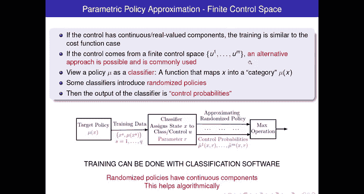

Recalld that in the previous in the last lecture， we talked about rollout application to GT。

 whereby we view GT as a Markov chain that define。Dine the transition probability between different states。

But it's clear from that course。For a given GT。It can also be viewed as a policy。😡。

If you have some problem where。The state is well defined and the control is also well defined。

 you may use a transformer train the transformer， then the output of that transformer would be the distribution over its control space。

 which in this context would be its vocabulary。And in this case。

 the GT can be viewed as the classifier with the output being the control probabilities。

And quite often in this context， randomized policy are often used。So。

As we seen in the previous lecture， it outputs the distribution over the entire vocabulary。

 but you may modify the output by imposing additional constraints。

 and that has been done in practice to suppress the repetition of the text generated in the previous string and so on。

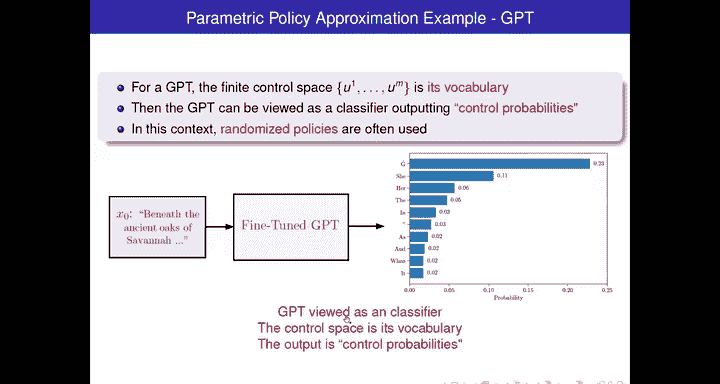

Now， let's go back to the。Cost function approximation。So cost function。

 parametric approximationclamation have。We start with a class function J2d that depends on X and on a vector R。

 the M dimensional vector， which at tuable scalar parameter。

 So each one of them is at tuable scalar parameter。

And we adjust R to change J tilda so that it matches the training data from the target function。

Again， we live aside how we get those training data and so on。 those can be quite complicated。

 and there are some。Subties or techniques involving what is the good training data to。

To collect and what is not and it involved this fundamental trade of exploration， exploitation。

 and so on。呃。But we just focus on how this training process and architecture is modified。

So the training algorithm is the algorithm that chooses R。Typically， given the。

 given that we have obtained the pair of state and cost function and this training process would be a regression type of process。

Depending on the architecture type。We call the architecture linear or nonlinear。 So if。

It's linear in R， then we call it linear if。The cost function depends non nonlinearly in R。

 then it's nonlinear。If there are。Explit feature。That we have relied upon。To build our cost function。

 then it's called feature based。More specifically。If the cost function approximation JQ的。Of X。

Is dependent on x role independent。Indirectly， through the use on feature vector。

Then it's called feature based。So。Where Jhad is some other function。

And the intuitive idea here is if the phi of x captures the most dominant nonlinearities。

Hopefully this JHd can be relatively simple function with respect to fire webs。In particular。

 a linear feature based architecture looks like this。Given a subtle feature。

Said M of feature Phi of L。 The cost function looks like this。

 which is the linear sum of the features where the way where the parameter or L is the。

Is the parameter we aim to train and can be viewed as inner product of two vectors， R and5 x。

Where R L and Phi L are the else' product component of those two vectors respectively。

So when applying this linear feature based architecture。Given a state。

We first construct its features by going through this feature extraction mapping。After that。

 we obtained this feature5 x。And this5 x。Should capture some key characteristics of the state。

And then we linearly combine those feature components to get a linear cost approximation or prime5 x。

A simple example of a linear feature based architecture is this piece wise。呃。Constant approximation。

 whereby we partition the state space。 In this particular example， the state space is a。

It's a line is one dimensional。 we partition the state space into subsets。S1 Q S M。

 and the elses feature is defined by the membership in the else set S L。

 So it is defined essentially by this indicator function that if x belongs to this subset。

Then this feature is one。 And if it does not belong to this set， then this feature equal to 0。

Recad that partition means that we divide the state space into different parts that。

Collectively exhaust all the state space， but there is no overlapping between each other。

 So each state can only belong to one and only one must belong to one and only one subset。

And given this feature， then its correspondinging linear linear feature based cost function approximation would look like this。

 whereby we combine the weighted sum of those linear features for all the states that belong to this subset SOL SL。

 then it's。Cost is determined by the else component of the parameter。

 So it's piecewise constant and kind of stair taste。 So this。

Sort of architecture is fairly powerful in theory and can approximate a lot of。

Complicated cost function。But the problem is。When the cost function is。Complicated。

 you need a lot of。Carefully designed subset to partition the state space。

And this example is one dimensional， and it can be once it get into high dimension state space。

 it would be way more complicated。Another thing you yes， please。How， how， true。Sorry。这是个。对。No。

 this is the cost of function approximation， its state。Well， not necessarily true， for example。

 let's say the the I'm talking only about integers on this line and integers up to some number。

 let's say50。 Then you can still partition them into distinct distinctjo groups， right。So it。呃对。

Very open。Okay， we have not talked about open and。close陈述完毕。

The main point is it just have to be a partition of the state space that each state belong to one and only one subset。

 and that's enough。ok。So one。嗯。Additional property you may notice is that if I change。

The value of a particular component or L。Let's say， this number。If I change this number。

Then the cost function of all the states。Does not all the other states does not change。

 except the states that belong to this S L subset。 So this is kind of the local。

Localality of this sort of cost function proation and the one we're going to see next is the opposite whereby you change any component of the weight that you're going to affect the entire cost function。

For all the states。

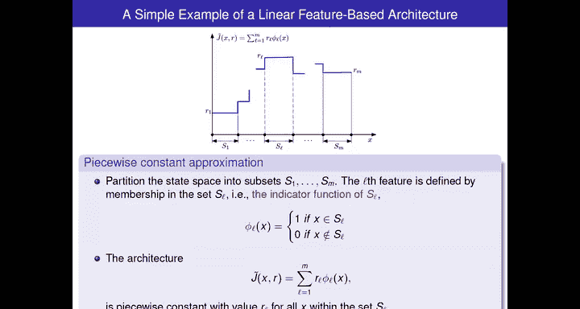

So another type， which。Is commonly used is generic polynomial architecture。

 And we focus on a quadratic polynomial approximation。

Given that we have an X with n different components。

Its features can be viewed as those combinations where。It includes a constant shift。And also。

 individual components。And products of two components。

Then a linear feature based approximation architecture of this。

Of those features would be one weight associated with this constant。

And each way is associated with one individual components and one way for each。

One parameter for each combination of product。And the parameter vector R has components or0 or I and R IJ。

Generally。We don't need to stop at the quadratic terms。

 and we can have higher order polynomials in components X1 until X M。

And even more general architecture is in place of x of I。 we may have。Instead of directly use X1。

Q X N， we may construct feature vectors。Phi1， phi2 and phi m。

 and we use polynomial terms of those phi。In place of XI and Xj。

 and typically this architecture should be more powerful。

 but the choice of those features are also important。

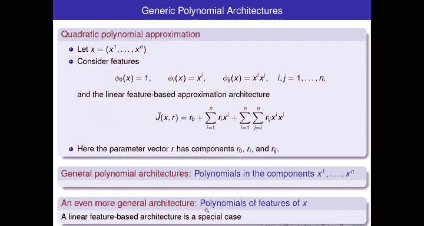

Let's briefly comment some features used in some case studies， for example， the application of chess。

The feature extraction module typically would take the material balance mobility of。

The mobility and safety of king， for example， and those features typically would be recognized as important for a chess player。

And for the application， a set of important features。 Okay， so I suppose all of you know pat。

And briefly， it's you are given a board and。And。You would like to fill each row of the board with with those blocks and once a line is filled。

 you get one score and that row is removed。And the goal is to maximize your score up to certain stages or indefinitely。

So in this context， the typical set of feature that are important is So once if if。

There is any road that reach the sailing of the board。 Then the game is terminated and is finished。

 So the typical set of。Feature that is important includes the height of each row。

And the relative height of each row， for example， the the adjacent difference。

Between different roles， between adjacent rows。 And typically。

 we would like the height of the rows to be more or less balanced。 We do not like the case where。

Certain part of the row are very high and a certain part are very low。

 So those are the typical features that indicate how well the situation is and other features includes the the maximum height of the different roles。

 as well as the number of。Hs， because if there is a hole。

 then you don't have access to that particular position。 and you cannot remove that one。

 So those set of features are widely used and。Since 90s。

The points of of method that obtained using reinforcement learning method or related method have starting from hundreds and at current stage can score billions of points。

 So there has been tremendous development in this direction。

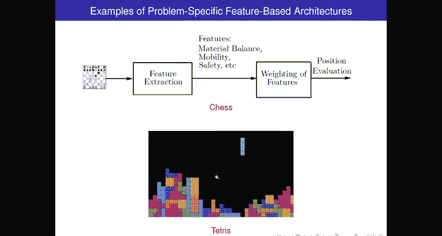

ok。We talked about partition of the state space。And a straightforward way to partition the state space。

 as illustrated in the previous example， is just cut the state space into pieces in that scalar example with different intervals and so on。

 But another simple method to construct。Relatively complex approximation architecture is to partition the state space into several subsets and construct separate cost function approximation in each subset。

 so。呃。In this case， for each an individual subset， we construct a separate cost function。

And an important issue， practical issue to deal with is that once you partition the state space into different parts and use different cost function to approximate different parts。

The states that are close to the boundary of the partition need to be coordinated in the sense that。

When the states are shifting between or transitioning between different parts of the states。

If let's say they are geographically closed states and if different。

 but they are belong to different partition subsets and if they are shifting from one part to the other。

 this kind of shifting，Issue need to be dealt with so that for example。

 for states on the boundary or close to boundary， there are special。

 you need to pay special attention。And one， it is often a good idea to use feature to generate partition。

Again， as I mentioned a moment ago， that in the previous example。

 we simply partitioned the state space into different parts which are regular in the state space。

But a different idea is that。We use sound feature。And。We look at states through feature extraction。

 and we do regular partition。Of the feature stays。Feature space。

 and then we map it back to the state space so that， for example。

 states belong to the same subset of the feature space should be grouped together in original state space。

And intuitively， we would like to group together states with similar costs and as you may recall。

 feature typically capture the majority characteristics of the non nonlinearity of the cost function so ideally states close in the feature space should have similar cost function。

 We hypothesize that states with similar features should have similar cost and the manifestation of this idea arise in feature based aggregation which we're going to talk about in the next lecture。

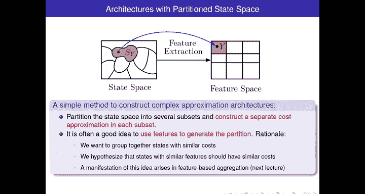

Okay， so up to this point， we have talked about the features that we manually construct in those two case studies。

 chs andte。But a more popular architecture nowadays that construct feature for ourselves。

Is neural network， it is an architecture that works with no knowledge of features。Of course， it。

It may still help。Do some state encoding that is given the state that defines the problem。

 We may use some architecture， which we refer to as state encoding。To construct some states。

 which is the mapping from X to Y。But regardless of the presence of this layer。

A single layer neural network is composed of a linear layer where this y of x is multiplied with some matrix a。

And then add a bias term， B。And each and every component of this linear layer output would go through a nonlinear layer。

And with their values to be。callled p five。Of X and V。

And then those features are combined by a linear weighting parameter R。So。Conceptly。

 this part can be viewed as the feature that we constructed in the previous examples。

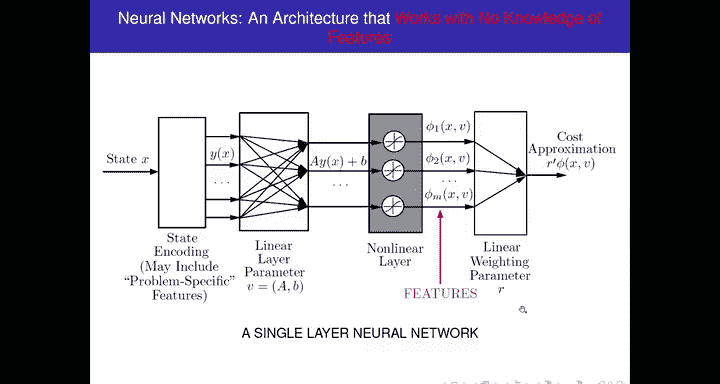

Let's briefly talk about the training of the architectures。Typically。

 in the context of approximating the cost function or approximating a policy with continuous component。

 it can be viewed as least square regression problems where we collect a set of state and cost training pairs X S and beta S where。

The number of samples can be large， and bit of S。Equal to the target cost function evaluated at X S plus some noisester。

And the weight R is determined by solving the least square problem。Whereby we would like to。

 we sum up the quadratic difference between J tilda and beta S。Smed over all the samples。

 and minimize。The weight or parameter R。Sometimes a quadratic or regularization term。

Beta times the norm of or is added to the least square objective to facilitate this minimization。

And there are numerical reasons I'm going touch upon in a moment。

 but another important reason is that it helps to avoid the issue of overfiing。On the other hand。

 nowadays， overfitting in the context of deep neural network turns out to be a good thing， so。I mean。

 things change over time and mean back in the days overfiing is a horrible thing。

 but now it become a blessing。All right， so the training of。Linear feature based architecture。

Actually， is。Qu unquote the easy case because it can be done exactly。By which I mean。

 we have formula to compute it。So if this J tilda。Equals to R prime 5 x。

 where 5 x is the m dimensional feature vector。 The training problem involves quadratic minimization and can be solved in close to 4。

And this closed form formula is given by this。Equation where it involved。This inverse of matrix。

And then multiply this factor。Even though it looks。Reasonably innocent。

 but it can be quite challenging because when the M is large。So， suppose that。

Note that this5 x is a vector， M dimensional vector。

 column vector and phi prime is M dimensional row vector。 Then this is M by M dimension。Matrix。

 so you compute this matrix。You add Q different matrix together。

And you compute the inverse a little bit。And any one of those operation， especially inverse。

 can be quite challenging if the M is large and Q is large。

 and there can be numerical issues arise if this matrix is near singular。

 then computing the inverse can be quite challenging。And in this context。

 adding this regularization term can be helpful because with this regular term。

 there are going to be one additional term added。In the brackets to make the inverse operates more easily。

So， but practically。It require a lot of computation for large M and data set。

 therefore it may not be best。So。More generally。We have a non architecture， and。

How can we exploit the structure of the training problem of this minimizing a large number oftic terms？

嗱 key。Characteristics of the training problem。It's possibly non convex with many local minima and can be horribly complicated graph of the cost function。

😡，Especially true when the neural network is used。There are many terms in the list square sum。

 where Q is very large。This make standard gradient and uin method essentially inapplicable。

As a result， incremental iter methods that operates on single term at each iteration have worked well enough。

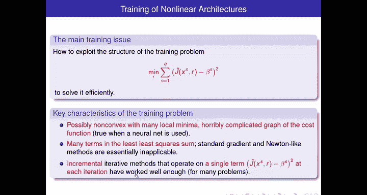

For a lot of problems。Okay， let's take a quick break here。And we get back in。10 minutes。49 or 50。

All right， let's start with。Next topic， which is incremental optimization of some of differentiable functions。

两都。The training problem， training architecture， we touched upon a moment ago would be a special case of。

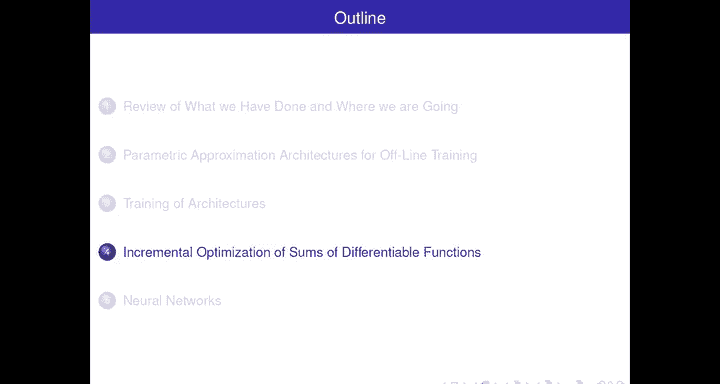

The more general problem addressed here。Where we would like to talk about incremental gradient methods invented in the 80s and。

But it has been analyzed and extended in the 90s and is still a important research topic to the present。

So we're going to focus on this generic sum of term optimization problem。

 whereby we would like to minimize F of Y。Which is the sum。Of component functions。F I of y。

 where each F I is a differentiable scalar function of the n dimensional vector。 Y。

 this is a parameter vector in the context of parametricic training we talked about。So。

More specifically， if we consider the problem of neural network training then each。

Component would correspond to one。Sample data point with with the state， let's say。

 if it's cost function approximation， then every component would correspond to one state and cost pair。

And the ordinary gradient method。Is。Generate a sequence of。Pmeter。

And dimensional vector Y from Y K plus1 generate a plus 1 from Y K， according to this formula。

Which is changing Y K。To with with this term， which is。呃。The opposite of gradient， evaluated at。

Y y of K FY K。Scaled by gammake。And。Given the function Y F of Y， which is the sum of the components。

Then this gradient would be the sum of the gradients of individual components。

Where the gama K is some scalar bigger than zero， it's called a step size parameter。

This method is origin region is attributed to this French mathematician called Kohi。From 1850s。

 So it's a old method。And there are extensive theory， which show。

The validity of this method in some ideal scenario， we can。

The obtained why the limit of the sequence would end up being the one we are hoping for。

But as we mentioned moment ago， in the context of training this M。Can be enormous。And computing this。

Some is very expensive。And the incremental gradient counterpart of this ordinary gradient method is simply choose some I IK index IK and iterate according to this formula。

And compared against this one， this essentially mean that instead of summing over。All component。

 we just choose one index and compute。The component functions gradient and use that in place of this one。

And this seems to be a remarkable saving of computation。Even that M can be huge。But one might ask。

 why does this work？

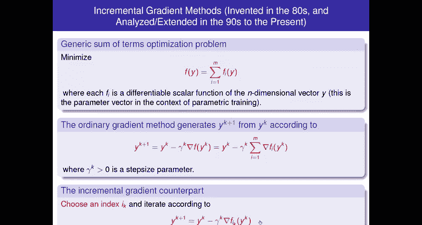

Well。Actually， intuitively， it there is an elegant explanation。

Suppose that this function F of Y is the sum of square。Which is C times y minus B squared。

And we would like to compute why such that this function is minimized。And again。

 if we go back to the training cost function type of context。We may consider this function。Actually。

 is we have some linear function。C why。😮，And we would like to compute why。

 where y is actually the parameter。 We would like to compute Y， such as that this function。

 Y times C approximate some。Function B， well。And then， we collect。State and cost pay， where。

C would represent the state， and B would represent the cost， so。Essentially。

 this is the difference between the linear cost approximation we have and this is the cost。

From the training data we have， and we would like to minimize the sum over all the sample data。

And compare the ordinary and incremental gradient method in those two in two different cases。

 Start with the place where。Let's say where y is far away from this middle portion。

 which is referred to as region confusion and the part that far away from this region would be referred to as far out region。

One can show for this example。The true optimal lies in somewhere in the middle。

Defined by this interval， that is a minimum。Of。The optimal for individual components。Suppose。

 for example， let's consider C 1， Y minus B1 square。 We can compute is。Minimum point， and is optimal。

By simple calculus。And the minimum among all those ys and maximum of all those ys defines an interval。

 One can show that the true optimal actually lie in disclosed interval。

And the region beyond this region is called beyond this closed interval is called farl region。

 and this interval is called region of confusion。So when far from convergence。

Which is in somewhere here， the Farl region。The incremental gradient is as fast as ordinary gradient with1 over M amount of work。

How so， So I suppose。The current Y taste somewhere here。Then regardless of the IK。

 you choose to evaluate the gradient。It all point to the same direction。😡，That， okay。

 you need to move to the left in order to have the cost reduced。But of course。

On contrary to ordinary gradient method， you only compute the gradient of one component， which is。

A lot of computational safety。On the other hand， when close to convergent。

 that is if it's somewhere here。Somewhere here。The current YK。

Then the direction for the update depends on the component you choose。

 If you choose this particular component， it're going to tell you to move to the right。

Whereas if you choose this component， it' going to tell you to move to the left， so。

Once it gets into this region， it's going to move left and right without knowing what is the right direction to go。

So呃。But theoretically， there are ways to avoid it and that is。

You can design the step size to be diminishing so that it can convertverge properly。

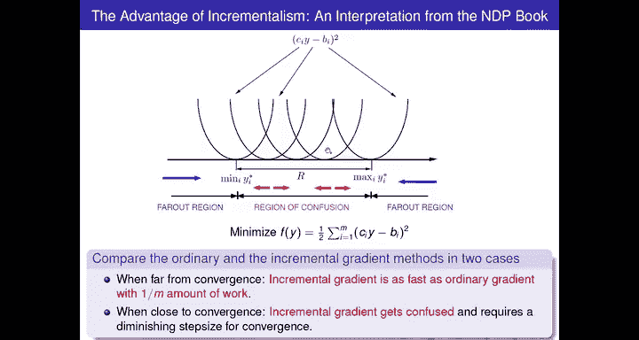

So there are also variants of incremental method， which is called incremental aggregateating method。

That should accelerate the convergence process， evaluate the gradient of so the。

The incremental gradient。Md evaluate gradient of single term at each iteration。

 but use previously calculated gradients as if they are up to date， so。

But that means you need to have a memory to keep track of the previous。呃。

Round of calculated gradients and you sum them up。And it have。

Theoretical and empirical stored and often preferable。So in the context of training your network。

 you hear a lot about stochastic gradient method。Also called stochastic gradient descent or SGD。

They apply to problems of minimizing a function， which is the expectation of some component function。

Where W is a random bear。And in this context。で。Algorithm have this form where the。Starting from Yk。

 it compute the gradient of F。Proorsponding to a particular random variable value。

Is the sample of the so WK is a sample of the random variable and the gradient of F with respect to Y know the gradient F okay。

 gradient of F with respect to Y is the symbol。And。

The incremental gradient method with random index selection is the same as SGD。

If we if we select the random index according to uniform distribution or uniformly。

 then it convert the sum of component function to an expected value where I is random。

 so the I would be this W with uniform distribution。

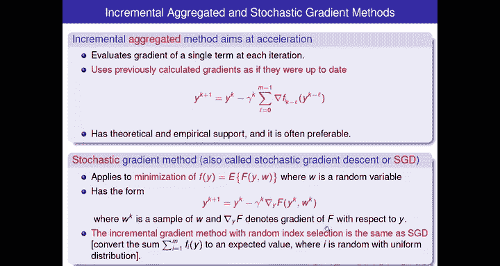

So there are some practical issues。For implementing incremental method。

One is to how to select the step size gamma K， as we alert to a moment ago that when it's closing to the region confusion。

 one might like to have diminishing step size to ensure convergence。

 so the typical choice would look like this where gamma is some scalar。And with the increase of。

 of the iteration， the step size diminish。Another issue is how to deal if at all with the region of confusion issue。

 that is once。The Y K。Enterters the region confusion。

 We would like to start to use the diminishing step size in order to convert to the right value and when it's the outside the region confusion。

 we there's no real need to use the diminishing step size So detecting the region confusion and start to reduce the step size this is another issue need to deal with and otherwise how to select the order of terms to iterate recall that in the incremental gradient we select at each state at each step IK a component and compute its gradient。

 then the question is how to select that IK one way is to order the component in certain way and just circle through。

Those couple。And the other way is to do random selection and at each step。

 select randomly according to a uniform distribution。Whatever the selection approach is。

 the important thing here is you need to make sure the selection process corresponds to the uniform distribution of all the components。

 for example， if you select。Let's take the extreme case Every time you select the minimum index。

 Okay， you always stick to the same component all the time。 and you put huge biasers on this。Data。

 and that is not ideal。 So important thing is to make sure that you cover and you give equal attention to all the components。

And there are other method such as diagnostic scaling。

 essentially this means a different step size for each component of why recall that y is in the context of training your network。

 for example， each component y is one particular weight。

 so it's very high dimension and you may use different step size for different component。

Alternative methods includes incremental Newton method extended Car filter。

 and those discussed both in the course textbook， as well as references。Okay， any questions here？呃。

Can you reiterate how you would So there。Here is slide by where you do C I and BI。

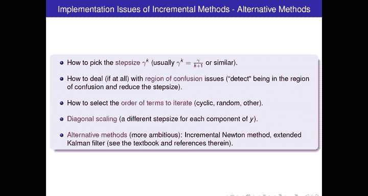

And这个。Oh， okay， this one。 yeah， I choose C and D and。So those those are parameters， right。

 so this problem。Is the true is the sum of components。

And we would like to minimize and F would be the function that C times y minus B squared。

 So this is this is each I corresponds one component and C and B are parameters and we would like to find why that minimize this entire function and if I use the metaphor of training。

 some cost function approximation， then that cost function approximation is linear in this case。

And the state would be the sea。And the weight or the parameter would be this y。

And this BI would be this cost function we get from the training data。 So this is the X。

 This is the J。Basically is vector why in this particular case is scale。

 but this metaphor carries through two high dimension examples as well。Yeah。

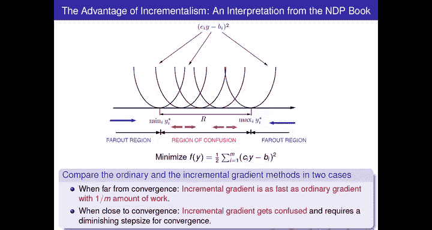

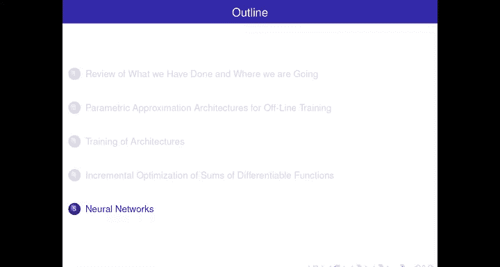

Okay， let's get to some basics of your network。As I alluded to that neural nets are architecture that automatically construct features。

And here is an example of your network with a single layer。And if we connect。

Neural network with the training example， training algorithm that we have discussed。

 then given a set of state and cost training pairs， x S and beta S。

 where each S corresponds to one sample training sample。

 the parameters of this particular neural network。Obtained by can be。

Optimize alert by solving this training problem。Where for each sample。We try to minimize。The square。

Of the difference between the output of this neural network again， record that for starting from x。

 we go through state encoding process to have y of x and then go through this linear layer。

A times Y x plus B。 And then each component goes through this。No linearity layer。

 and then they are combined linearly by this vector R to have a single number that approximate may cost function。

 value， evaluate it at this state X and we take the square of this term and try to minimize the sum of all the terms。

So for this problem， incremental gradient is typically used for training。And。What is？

Idal is that theoretically， there is a universal approximation property。That states。Your network。

 even with one single layer。Can approximate any target function。

Of arbitrarybitrarily well with sufficiently large neural network size。 So as long as。

The number of non nonlinearity in this one single layer is large enough。

Whatever continuous function you have。As a target， this neural network can approximate。

But the question， the practical question here is。How many those nonlinear layers。

 nonlinear nonlinear units exist in this nonlinear layer。 and sadly， this is where the theory。

The correct theory makes things worse because when this universal approximation theory is out and everyone start to work only with shallow neural networks and people feel。

It seems。It seems ridiculous or really not so smart to still work with。Ne networks was。

More than a few layers given the presence of the theory。But。The theory。Intuitive。

 but is misleading in the sense that。Okay。Perhaps it's not fair to say misleading but。

It never answered the question how many the nonlinear units are needed in order to approximate certain function。

 and as it turn out， the opposite is having deeper neural network is a better way。

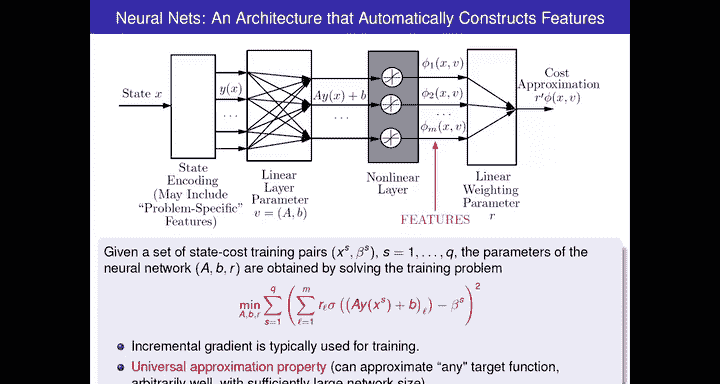

So before we go to deeperen your network， let's look at what are the typical nonlinear units。

That are used。 And those。The one two on the top are rectify linear units， gulu and。It's simply0。

For number that is smaller than0， and then a linear。Lie。For whatever number that is bigger than zero。

But as you recall that， I have mentioned。All the time that the training problem and so on。

 they are dealing with differentiable functions。 So people have used。A smooth version of dysfunction。

Using this form。So that we have a function that is differentiable and efficient training algorithm can be applied。

And those are more modern activation functions that is used。 And however， the。

Present GT applications and so on。 They use a slightly modified version of。

This smooth version of rectified function。 know that here the smooth part is above0。But the G 2 and。

Rumor habit 3。5 and so on use Ga where the smooth part is below zero。 So this is a slight difference。

 and there are empirical studies that show why this is chosen and so on。In know days。

The symoid function smoid units are more preferred。

 and those are hyperbolic tangent function where not only value below zero is saturated。

 but beyond certain range， it is going to also saturate around one， so the logistic function。

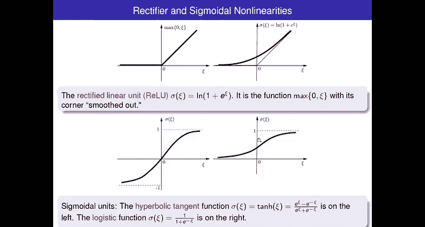

Looks similar in shape。Now， as I mentioned a moment ago that this universal approximation theory tells us。

All you need to do is to have one nonlinear layer and have the number of nonlinearly large enough you can approximate whatever continuous function of your desire。

And。But in recent years， we all know that。The tremendous glory road to。

Your network is by their deep counterparts。Whereby starting with。State encoding。

 It goes through a linear layer and non nonlinear layer。 and then。

This linear and nonlinear layer is repeated。After tremendous number。

Before we finally settle with some linear weighting function。And。

The practice has shown this form is way more powerful and extensive research has gone into explaining why they are more effective than the shallow neural nets for some problems。

And one key observation from some recent research suggests that over parameterization。

Is the main reason that is you have more parameters than data。Generally。

The ratio between the number of parameters or weights over the number of。

Data points affects the quality of trained architecture。And this number we denote as all。

And we call it over parameterized if R is bigger than one。If or is。Approximately equal than one。

 the architecture tends to fit very well with the training data。

And this caused the problem of overfiing， but do poorly a state that outside of data set。

This is a horrible thing to do in old days。But now。With R that is much larger than one。In practice。

 it showed that。The overfiing problem actually is overcome。

So here is interesting exercise for you to try。In some current state of the art。

 open source language model。They publish a number of parameters。The number of weights。

As well as the data set they have used。Not precisely， the data set。But。The size of data they used。

 So it' suffice for you to have an estimate how many。Data points they have used for training。

Those large language models and Gs and so on。And。Given those information。

 as well as some other parameters like the number of ngram， the number of n。In that context。

 it called the context window and so on， you can actually compute。The ratio between the number of。

Parameterters and the number of data points。 So if any of you interested， you can try， for example。

 this language model from Lama。They have。Uublished。The training parameter。

 the training data points as well as the number of data， as well as the number of ways。

 and you can compute there are to see whether or not it's over parameterized。

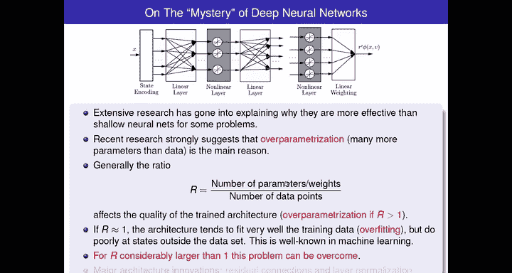

Anyways， apart from the attention mechanism that we discussed before that。Apparently， bring。

Deep neural network to newH， there has been main important milestone techniques or designs that enable the use of deep neural network and we're going to cover briefly talk about two key ideas and one is residual connections and in the other is layer normalization。

So。Recal in the previous figure after static encoding and so on， there is a linear layer。

 and then there is non nonlinear layer。 It may be repeated and may the output here may be weighted and sum together as act as output。

But呃。Around 10 years ago， researchers have find that with the number of layers increase。

 then it seems the performance increase saturated。And even perform worse than shallow neural network or their shallower counterpart。

 then why might ask how so why it is saturated and。An interesting idea。

 a very insightful idea that come out is how one can design architecture so that it is guaranteed。

The deeper the network is it is guaranteed to at least not perform worse than their shallower counterparts。

So they came up with this basic building block architecture， we're starting from a linear layer。

And then go through a another linear layer and then another linear layer。

And what is interesting is that all the input layer。Is being added together with。

The output of this last linear layer， and。This is used as output of this building block and this building block can be repeated。

 connected one after the other to construct deeper neural network。

And what is nice about this building block is that when the ways are selected。

 such that y tilde here are zero。Then this building block is essentially skipped。

 which means we have constructive ways。To。Design a shallow network out of a deep neural network using this beauty block。

So a deep neural network can reproduce the output of its shadower counterpart by skipping its additional layers。

And this turned out to。Or intuitively， this implies adding more blocks is likely to improve the performance and turn out to be the truth and is。

One of the cornerstone of the。Current state of order。

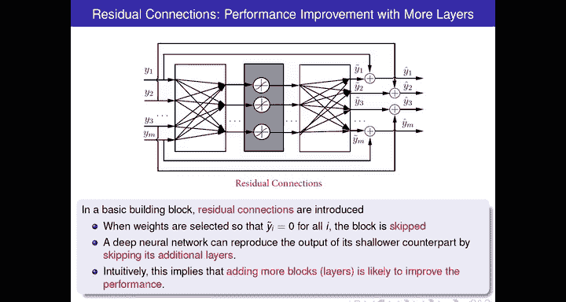

Successful in your network application window。Another idea is called the layer normalization。

 which facilitates training。So after the linear layer。

 the output goes through the nonlinear layer and where you have phi1 until Phi m。

But instead of directly going to another linear layer。

 there is a linear layer normalization block that take us input all those fileshis and then output fileshis of the same dimension。

And it involved this calculation， which compute the empirical means of all the fileshis。

As well as the empirical variance of all those phis and then normalize those phi I using this formula basically shift。

All the fives around zero and then divided by the variance where epsilon is a small fixed number。

So that。The P hat are on average， are around  zero。 There can be some scaling。

 additional scaling or bias term added。For all those。

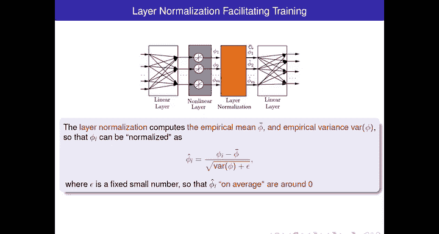

Fi hat。Why oneang would like to do this。Intuitively。

 one can think that after this layer normalization。Fi hat would be。

The empirical distribution would approximate this standard normally。Distribution。

And recall all the trainings。All we have done is manipulating the gradients and so on。

 and if the number are far away from zero。Then the gradient going to be around 0 as well。

 And one would like all those numbers to be concentrated around 0。 So that the gradient。

Can be computed， the meaningful gradient can be computed。数。

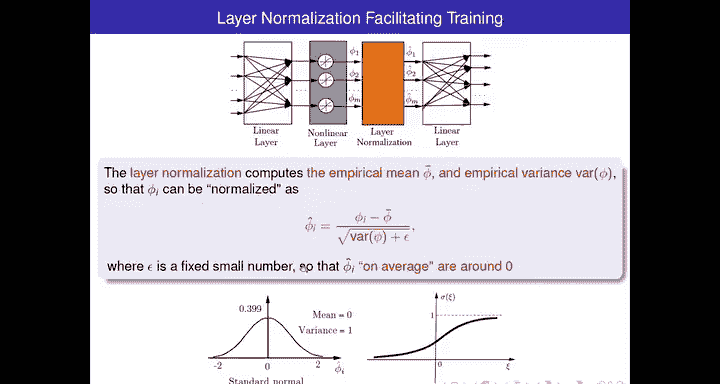

That's all the content for discourse and in the next lecture we going cover value and policy duration using neural network。

And introduce the aggregation method。

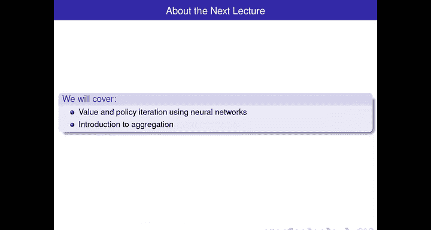