# ASU《强化学习2022-2024｜cse 691 Reinforcement Learning Course at ASU》中英字幕（deepseek - P12：[39]Lecture 12 2024; Off-line training with neural nets for approximate - GPT中英字幕课程资源 - BV1zcfVYdErD

Okay， let's get started because like garden members are dwindling a little bit。嗯。

Maybe they're still coming。Okay， so welcome to Le 12 of topicss and reinforcement learning this week we're going to extend UCo's lecture from the previous week by looking at more on offline training and how to apply it to the techniques that we've seen in class so far。

So we'll look at more on offline training， parametric architectures and their use in approximate value and policy iteration。

And then we're going to shift gears a bit and look at the。

Concept of aggregation or how can we take a problem and make it simpler and use that as approximations？

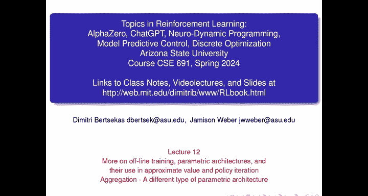

Okay， so first we're going to do a review of offline training with parametric architectures that UC covered last week。

Then oops， the next topic， we're going to look at offline training in the context of finite horizonoriz dynamic programming problems。

Then we are going to switch gears to infinite horizon problems and look at the approximate policy iteration algorithm in this context。

Then we're going to take a break， then we're going to introduce the concept of aggregation。

And then we're going to look at a special case called aggregation with representative states。

 which can be viewed as a form of discretization and interpolation。At the end of today's lecture。

 I'm going to give you an overview of logistical information that will carry you to the end of this course and hopefully answer some of your questions about deadlines and expectations and so on。

Okay。So first， let's do our review of offline training with parametricic architectures。

So this is the standard figure that we've showed you that summarizes approximation and value space here we have the right hand side of the Belllman equation and as usually before our minimization over the control set and take the expected value of the immediate costs plus the future costs。

And approximation and value space involves introducing approximations over the various objects in this equation。

 including minimization， which we looked at multiagent problems to simplify this minimization operation。

 we also looked at ways to simplify computing the exact expectation in the form of certainty equivalentvalence and Monte Carlo research。

 and we've also spent considerable time approximating the cost to go JK plus1 Tilde through the use of rollout and model predictive control and many other methods。

Today we're going to focus on approximating the costs that go using parametric approximation and in particular neural nets and then towards the end of the course or the end of this lecture。

We're going to talk about how to use aggregation to approximate this JK plus1 tilde。

And then below here， I just have the corresponding multi step look ahead portion of the figure。

 and I won't go into the details of this again， but you know it well。

Okay so here is a diagram that shows parametric approximation of a target cost function there are two possible functions you would want to approximate and reinforcement learning one is the cost function J and the other is some kind of policy function that maps states to actually controls。

 but this one in particular is about cost functions， so we have this target cost function J。

And somehow we obtain a set of training samples of this form， so for a state XS。

 we have a correspondingent cost JxS where this represents some ground truth cost。

And we obtain Q of these samples。And we feed them into this approximation architecture that's parameterized by this vector R。

And then we tune these parameters via training and obtain an approximating function， J Tilda Xr。

This training can be done with specialized optimization software。

 including gradient like methods and or other least squares methods。

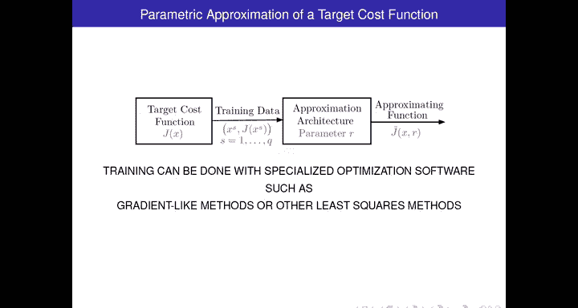

Okay， so in a bit more detail， we're going to select so these are some generalities。

 we're going to select a class of functions J tilde Xr that depend on the state x and the M dimensional parameter vector R of tunable scalar parameters。

Then we're going to adjust our to change J Tilda so that it fits or matches the training data of our target function。

An architecture may be either linear or nonlinear， depending on whether it is linear or nonlinear in R。

And architectures are feature based if they depend on x via a feature vector 5 x that captures the major characteristics of x。

 so J tilde Xr would be equal to this function J hat。

 which is a function on the features and the parameter vector R， so Jha is just some function。

And the intuitive idea is that these features will capture the dominant non nonlinearities of this function that we're trying to approximate。

A linear feature based architecture。Has this form， so the approximately optimal cost that state x with parameter vector R is given by this convex combination of features and the parameter of vector R。

 so this is just the inner product of these two vectors and yeah so this is represented in summation form and Rl and phi L are represent the e components of the corresponding vectors。

So this diagram here， we have the state x， we have some sort of method of extracting features to obtain this feature vector at phi of x。

 and then we perform this linear mapping and we ended up with the inner product of the parameter vector and the feature vector as our approximate cost in the end。

Are there any questions about this so far？Okay。呃。So now it's focus on neural nets。

 neural nets are nice and that they automatically construct features for us。

 so it may be the case that it's hard to come up with features for a specific problem。

So you can just resort to neural nets to extract the features for you。

So you have some kind of you have a state and then you apply some sort of state encoding。

 which may include specific problem features， for example。

 if you know of some features of your problem that you happen to know are important。

 you can include this in the encoding of state X， which is represented by y of x。

Then you pass it through this linear layer that is parameterized by V。

 which consists of a matrix of weights A and a bias vector B。

And you perform this linear combination of the state encoding with the matrix A。

 and you add the bias V to obtain a new vector。Which gets fed into this nonlinear layer where a activation function。

 a nonlinear activation function is applied element wise to this vector here。And from that。

 you obtain this M dimensional feature vector phi。Once you have the feature vector。

 you perform this linear combination with the linear weighting parameter R to obtain your cost approximation R transpo file。

So given how do we how do we train these parameters。

 so given a set of cost state cost pairs of this form access and beta s excess is a state and beta s is some ground truth cost for that state。

We take Q of these samples and the parameters of the network， which are given by this triplet。

 A A B and R， are obtained by solving this training problem so this is a a squares least squares regression。

So looking at this a little more carefully， we have the state encoding of excess， which is Y X。

We perform this matrix vector multiplication and add B to get another vector。And then。

We take the inner product with。Parameter R。And subtract the ground truth， square it。

 And then we sum up all of the different。Samples and we minimize with respect to A B and R so this is a least squares regression。

And to perform this， we can use so I mean， this is generally quite intractable。But。

Incremental methods allow us to。At least suboptily， perform this minimization and in particular。

 back propagation and stochastic gradient descent play a critical role。

I also wanted to remind you of the universal approximation theorem。

 which states that with large enough size， we can approximate anything。

 so if you have a three layer neural network， the theorem states that in the middle layer。

 if you have a sufficient number of parameters in that middle layer。

 then any function can be approximated， which is maybe not so useful in practice because it doesn't tell you anything about how many parameters you need。

On the other hand， we've seen the last like five to10 years or so that deep neural network architectures give a massive advantage because of this idea of over parameteraization。

Where you have many， many more parameters than you have data points， if you do this。

 then it tends to fit the data points that you have quite well。

 while also generalizing to new data points that you have not considered。

So that's called over parameterization。Are there any questions about this slide？

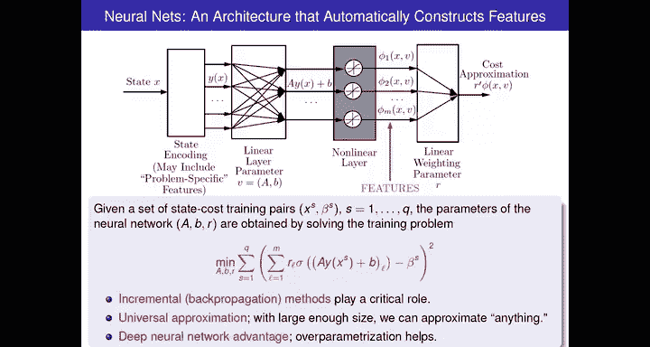

Okay， so that was our review of offline training with parametric architectures。

And now we are going to see how we can apply this offline training。

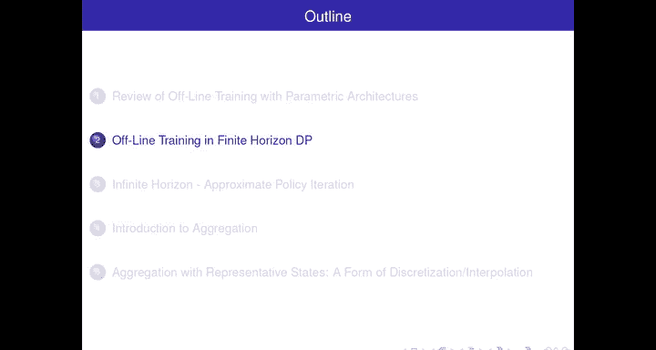

To finite horizon eyes on dynamic programming problems。Okay。

So I'm going to describe to you an algorithm。Called fitted value iteration that applies to this finite horizon sequential dynamic programming approximation case。

And it involves performing a parametric approximation at every stage of the dynamic programming problem。

So we are going to train。N plus one parametric architectures in in decreasing order。

 so going backwards sequentially， so we are going to have some initial data points to a train a network at JN Tilda。

 which is going to approximate our terminal costs。

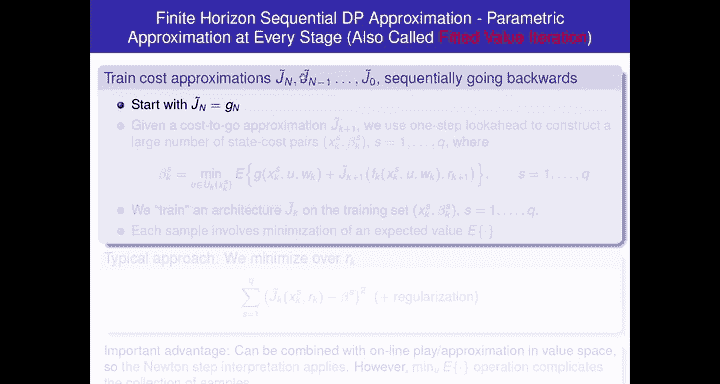

And then we're going to use J N Tilda to generate new data。

Which we will use to train JN minus1 tilde and so on until we get to J0 tilde。

So we start with our terminal cost function approximation J and Tilda。

And then given a cost to go approximation JK plus1 Tilda。

 so this is an architecture that we trained in the previous step。

We use one step look ahead to construct a large number of state cost pairs of this form， XkS。

 beta Ks。We'll generate Q of them。And the corresponding ground truth cost is going to be given by this bellman equation。

 so we're going to minimize over you。And take the expected value of the immediate cost of state XKS。

 and we're going to add the cost to go of the next state。

 but we're going to use the parametric architecture that we trained in the previous stage to estimate the future costs to go here。

 so this is involves architecture JK plus1 tilda， which has parameter RK plus1。

And we're going to do this Q times， we're going to generate Q samples in this way where we pick the state and then we generate a cost。

We're going to train， okay， so once we have all of these samples。

 we're going to train architecture JK Tilda。On this training set。

 all of the samples that we've obtained at stage K using the architecture from K plus1。

Notice that each of these samples involves a minimization of the expected value。

So I'll talk about this a little more， but at least for now。

K knownow that this makes things a bit complicated。Because computing an expected value。

 an exact expected value can be substantially expensive。

So let me leave that for now and I'll come back to it but。Okay。

 so once we have all of the training samples， we train JK Tilda as such where we're just doing our normal least squares regression。

 we're going to minimize over RK， the difference between the the predicted costs and the ground truth that we computed and possibly some regular regularization term and we minimize this sum and we fit JK Tilde。

So an important advantage this has is that once these networks are trained。

They can be combined with online play and also approximation and policy space ors yeah sorry approximation and value space。

 so the Newton step interpretation can apply here。But as I alluded to before。

 having to compute the minimum of an expectation complicates the collection of samples。

 so computing this expected value is quite expensive。

 but notice how many times you have to do it for just that single sample。For a single network。

So you have to for one sample， you have a lot of computation in the form of this expectation。

 but then you have to repeat this Q times， and then you have to repeat that again n plus one times for each of the architectures that you produce。

 yes。That have two questions， first of all， is are there1 plus one like single let's say very basic new pocket second question is we have know the stay transition function there in order to match up like to use which J so how do you that this stochastic so。

So that is an issue so in the next slide we're going to look at a variation of this method that involves learning Q factors and if you do it in this way。

 it allows for a model free approach where you can use like simulation， for example。

 to estimate the costs and the transition functions。Okay。Okay。All right。

 so how do we deal with this minimization of an expectation？Well。

 we're going to look at a variation of fitted value iteration that uses Q factors。

 and I'm going to explain how this kind of formulation extends to being able to handle the model free case for when the cost function and the transition probabilities are unknown。

So consider the sequential dynamic programming approximation of a Q factor for parametric approximations。

 so this is just the usual Dlman equation， so the Q factor at state X and with applying control U parameterized by vector R。

Is approximately the expected value of the immediate costs plus the cost to go。So， this cost to go。

Just comes from the definition of JK plus1 tilde， it involves a minimization at stage K plus1 over all of the possible controls and we consider each Q factor and choose the minimum。

 so this is equivalent to JK plus1 tilde。And we obtain QK Tilda by training many state and control pairs in a similar way that we did to the previous slide。

Where this beta KS is a sample of the approximate Q factor。

 which is given by a state and control pair。So here is the advantage of doing this。In this way。

 the expected value and the minimization have been swapped。

 so instead of having a minimization over the controls at stage K on the outside here。

 we focus on the Q factor， which at stage K has a fixed control。So then。

We have the minimization applied to the next stage k plus1。Which is equivalent to JK plus1 Tilde。

So if we move the minimization to the next stage。In Sage K plus1。

 then we've effectively swapped these the order of these operations here。

And this is a mathematical trick， and it has an advantage。

And the advantage is that while computing the minimum of an expected value is something that can be really challenging to do。

 it may be hard to get a good approximation of that。On the other hand。

 computing the an approximate expected value of a minimum is much easier because you can just do it with samples。

 you can even a single sample would be an approximation of an expected minimum。

 so the order that you apply these operations matters with how difficult they are going to be to approximate。

Are there any questions about that， that mathematical trick？Okay。Okay。

 so now I want to talk a little bit about。How this can handle the model free case。

So we will claim that the samples beta KS can be obtained in a model free fashion。

So it's sufficient to have a simulator that generates state control cost and next state random samples。

 so Model three doesn't mean that you don't care about the model anymore。

 it means that you can use a simulator to approximate it so what are these samples we get a state and control pair or we just choose a state and control pair。

And we use our simulator to produce a cost for that state and control pair。

 and we see where the next state is that the simulator takes us， which is X K plus1。

And if you collect samples in this way， you can approximate the cost function and the transition probabilities。

So， okay。Once you have computed RK。So for QK Tilde， the parameters areK。

The one step look ahead control can be obtained online in this way。

We minimize over the set of controls at state Xk。And we just pick the control corresponding to the minimum approximate Q factor。

 And this will be our approximately optimal policy。At state X K。

And you don't even need a model for this or and also you don't need to explicitly compute an exact expected value。

 which as I mentioned， can be expensive and you need to know probabilities and things like this。诶。

This has the important advantage that the online calculation of control is simplified。

 so compared to the Bellman equations， all we're doing is evaluating size of big UK neural networks and we assuming you don't have too many controls。

 this can be computed efficiently online。However， the Newton step property is lost。

This way of choosing a control does not match the the structure of the bellman equations anymore。

 this is just an approximation of the Q factor， but it doesn't involve observing an immediate cost or minimizing it doesn't involve using immediate an immediate cost and then adding the cost to go it doesn't match this structure anymore。

 so the Newton step proy is lost。Moreover， online rep planning is lost if if the if the parameters of your problem are changing over time and you've trained these cu factor networks based on a specific set of problem parameters well。

 if those problems change then。These networks might not be worth much in an online setting。

On the other hand， if you have to address actually both of these issues。

We can just use approximation and value space where the cost to go JK plus1 Tilde is just given by this minimization here。

 so we take the immediate cost。And we add the cost to go， which involves this minimization。

 and we have on the outside that an expected value and we compute a minimization over the set of controls at stage K。

So this is just used as a。Future cost approximation JK plus one tilde in approximation and value space。

 then you can recover the Newton set property and you can make it more robust to online replanning。

Are there any questions about this slide？Yes。是。对。In。You mean on this slide？Or。支付。Yeah。因为。

The difference is with this swapping of the expected value and the minimization。

 this can be computed much more easily and it can be done without a model。Yes， what do you。Yeah。Yes。

 because you need to compute this expected value exactly， which requires a model。

With that the differences。It comes with the difference is that you kind of push the minimization part of it into the next stage so that you can just focus on computing expected value。

InAt the current stage the controls selected for at a particular Q factor。

 the control and the state are fixed， so there's no minimization on the outside here。

 so pushing this minimization into the next stage allows us to do this swap and we can compute this expected value approximately and we don't need a model for it。

Yeah， think the last。But Jane T a panic， can you explain how？ingOver factors for example。

 youre talking about down here， so you take your okay， let's go back。myOkay。

 so here's the usual diagram for approximation and value space。

I take this and I put in that minimization over controls at the next stage over all of the Q factor architectures。

That's what Jay have on the last stage of problem like how you practicing that。

So we assume that you have some kind of data that can produce at least an initial terminal cost approximation。

对。And kind of what kind of what is the information loss out there and you just drop the GA turn？Well。

 I mean， depending on how many samples that you produce can affect the quality。

 I mean that there's training issues involving neural networks right。

 like you need a lot of data like you may need to produce a lot of samples and even then depending on what your problem is。

 the accuracy may or may not be good。But I mean， quantifying the information loss is sort of like a。

Fundamental question and like machine learning， right， Like it's。

 it's very problem dependent problem I'm using the。The inapp appropriateate logic artwork word here。

 but I'm just asking， so simply draw the G there。And then you can replan that because you're using the same brander but what about that problem little bit so in order to have the。

Newton's step interpretation。It applies to a it applies to this， it applies to the Bellman equations。

 right？But when we're selecting controls online， we are just evaluating all of our Q factor approximations and picking the minimum control and we're not doing anything to observe the immediate cost or computing this expectation or anything like that。

 it does not fit this format， but it can be made to fit this format。By using。

These architectures to approximate this cost to go in the future。

And then you consider the immediate costs and this expected value， et cetera。

 because I remember that can from the fact that you calculate the current costs in accurate action that's why right get the guarantee you should improvement in approximation right but right now when you drop the the GK its sort of you definitely are not calculating the current costs and that is the case with。

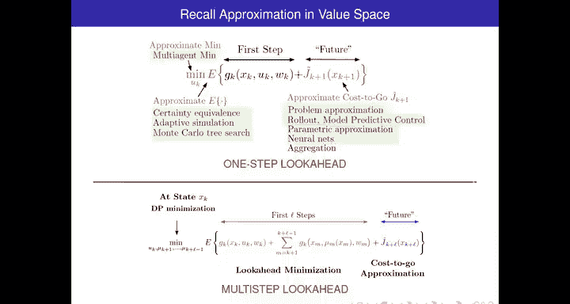

With this equation here。Right。Yeah， we are not doing that here。

And therefore Newton said property is lost。O。これオッケーごります。All right。Okay。

 so here's a question that we've addressed in the past。

And it's should we approximate Q factors or Q factor differences？

So this came before in the context of stochastic rollout。

 where we were trying to learn Q factors via simulations of trajectories。

 we generate some random trajectories and take an average and compute an approximate Q factor。

And what we saw before was if we considered learning Q factor differences as opposed to Q factors directly。

Then you could reduce the variance potentially substantially。

So this is a method for reducing variance。Now， let me show you an example of what can go wrong if we try to approximate Q factors directly as opposed to these cu factor differences。

So let's look at a linear dynamical system with a quadratic cost function that is meant to approximate a continuous time problem。

So in in this system equation。The difference in the state Xk to xk plus1。

Is going to be represented by the control。So the control tells us how we're going to change this state。

And we have it multiplied by this parameter or this yeah， parameter Dlta， which may be very small。

And if Delta is really small。Then this control UK approaches the instantaneous rate of change for the state with respect to time。

 so here UT in the continuous time case is going to be the derivative of the state with respect to time。

And similarly， you have cost a quadratic cost function that is。Proportal to Delta。

 And so this sort of represents。The instantaneous change in costs with respect to time。

So this is sort of similar to like Ouler's method， if you've seen like a numerical methods course at some point in your past。

 but this is just like a kind of an obvious way of discretizing a continuous time problem。

 it's a way of discriretizing time。Okay， so let's consider a linear policy mu of x equal to negative 2 of x。

Then。We can use therickcottti equations to compute the cost of this policy mu so remember from before。

 so if you work out the math we see that the cost of policy mu is quadratic in the state and it's also proportional to one plus delta and also this。

Extra term。 That's quadratic and Delta。But remember， Delta is really small。

 so this term doesn't really matter。Also， if Delta is really small since the immediate costs are proportional to Delta。

Then this cost is also very small。But this part of the cost function。

It's proportional to1 plus delta。So it's going to be at least 5 x squared over four。

 so this whole cost function。Or the whole cost of this policy is really large compared to the immediate cost at state X and control of U。

嗯。It's Q factor。Can be calculated be this， so the way we obtain this is we take the beman equations。

 we put in this as the immediate cost， and then we use the system equation to determine the next state and we plug this next state into the cost function of the policy and then we want to take the expected value or I guess in this case it's deterministic。

 but then we also want to minimize the controls with we want to minimize with respect to the controls。

So if you do the math， this is the argument in the beman equations of that minimization with respect to the control。

 so this is what it looks like before you perform that minimization。

And this can be viewed as one of infinitely many Q factors。Okay。

 so this is an expression for the Q factor， X U。Now the important part for policy improvement。

Is anything that's dependent on the controls， why because every in every single Q factor。

Any term that is not dependent on a control。Is going to be common whenever the state is fixed。

So if we have a fixed state x and we consider each of these Q factors。

 I know there's infinitely many， but suppose we can。Then this term。

5 x square over4 is going to be in every single one of these Q factors。Likewise。

9x squared over four times delta is in every single one of those Q factors。So it's this part。

 u squared plus5 hals xu that matters for policy improvement。

But when you're trying to approximate QM directly with QUildom。Then this part here。

 because it's proportional to Dlta is just sort of noise in that approximation。It doesn't。

 it kind of just gets washed out when you're trying to train this network。

Because because it's dominated by this 5 x squared over four。This part here is just sort of lost。

On the other hand。If we approximate Q factor differences。

 this problem does not arise because these terms， these common terms that are not control dependent will just be subtracted out。

And we'll focus on what really matters， which is this part here。

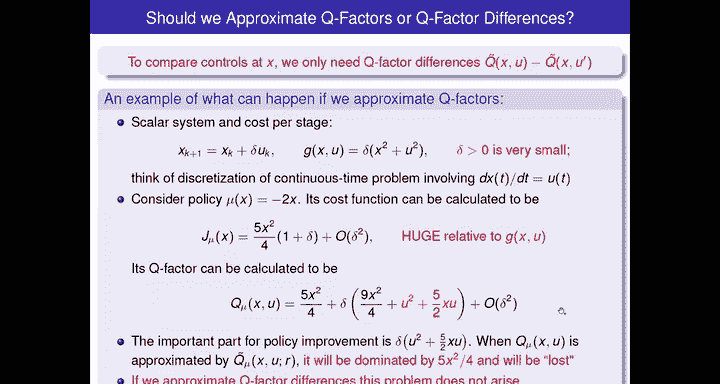

Are there any questions about this formulation or anything I've said on this slide？Re place clear。O。

So this raises a more general issue。About disproportionate terms and cu factor calculations。

And the general remedy for this。Is to subtract state dependent constants from Q factors。

 which we refer to as baselines。And the constant subtracted should affect the offending terms。

 they should in some sense cancel them out or render them very small。So for example。

Consider a truncated rollout with a policy mu with a terminal cost approximation so that J Tilde approximates JM。

And as usual， at a state x， we want to minimize over U this expression here。So the question is。

 how do we deal with an immediate cost being relatively tiny to the cost to go。

 as we saw in the previous slide？So this happens when we time discretize continuous time systems。

And another case is when costs in general are sparse。

 meaning that all of the costs incurred upon termination。

 as is the case with like combinatorial optimization problems where you require the complete variable assignment to assess the costs。

So if。This cost， this immediate cost is close to zero or is zero。

And this approximate cost to go is not very accurate。Then you're sort of dead。It's bad news。

So a remedy would be。To subtract J tilde x from J tilde of the next state and to focus on the difference between the approximately optimal cost instead of。

Instead of this full approximately optimalimum cost。

There are some other possibilities that you can read about in your textbook or yeah， your textbook。

One is to learn directly the cost function differences。

 so we define this difference between two states under specific policy。

Just to be the difference in their costs and we approximate this using using an approximation architecture。

This is called。Differentential training。There's this other class of methods called Adv updating that work with relative Q factors。

Where we subtract this baseline that's given by the minimum Q factor and we subtract it from the ordinary Q factor and consider that。

Okay， sense。Okay， are there any questions about this？对。

So now we're going to move into approximate policy iteration in the context of infinite horizon problems。

 so approximate policy iteration is an important algorithm in this context and we haven't really discussed it yet in much detail。

 so we'll do that now。

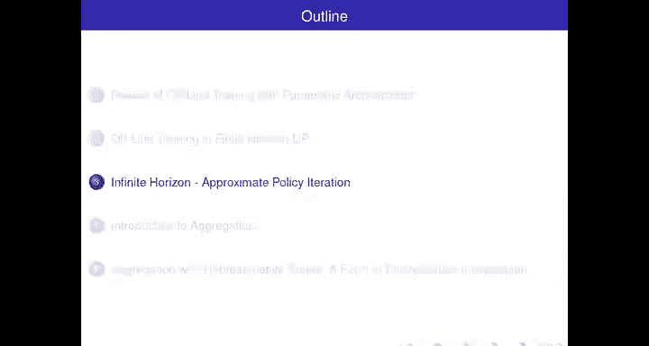

Okay， so approximate polyse iteration applies to the alpha discounted finite state problem case。呃。

Exact policy iteration works well in this space and it can be applied in the case where you do not have finite states but finite states。

 but in that case it's unreliable， although some believe that it。Is reliable。

So let me first remind you of what exact policy iteration is。

So here we're going to use the finite state transition probability notation to expand the expectation because it's convenient。

So exact policy iteration involves two phases。There's the policy evaluation phase where we compute the cost function J mu of the current policy mu and its Q factors。

 so for each state and for each control at each of those states we compute the Q factor in the usual way。

As the sum of the immediate costs plus the discounted costs to go。

 and then we take the expectation with respect to the next state。

So we evaluate these Q factors every possible one。And then we move on to the policy improvement part。

Where we compute a new policy mu bar as such， we look for the control corresponding to the minimum Q factor after we've computed it under the specific policy mu。

And then we update it and get a new policy。Then we repeat this over and over。

 we evaluate the new policy in view bar， and then we make another improvement and it can be shown that in the limit in these finite state problems。

 this will converge to the optimal policy over time。However。

 it could be quite expensive to do because notice that you you have in each iteration。

 you have to iterate over the entire state space and also the entire control space。

 which may not be possible for your specific problem， might be intractable。

So that brings up the idea of approximate policy iteration。

Approxximate policy iteration also involves two phases and at each iteration of approximate policy iteration。

We will be training a new parametric architecture and so on， so let me explain。

The first phase is the approximate policy evaluation phase。We introduce a parametric architecture。

 cu Muilda。And we determine the parameter R by generating a large number of training triplets so we need a state。

 we need a control， and we need a ground truth cost。

Then we perform our usual least squares fit over the entire data set where we subtract the ground truth from the predicted cost。

 some over all of the samples， and we minimize with this with respect to R to obtain a new parameter vector R bar。

Once we have our bar， then we move into the policy improvement phase。

 which is very similar to exact policy iteration。We compute the new policy utilda according to the minimum Q factor based on our trained architecture。

And we do this for all states， and then that's an entire iteration and we do this over and over again。

Now will this converge not necessarily， and we'll talk about that on the next slide。

Are there any questions about this slide？

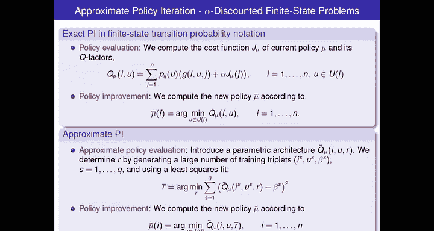

Okay， so here is an overview of the implementation issues in approximate policy iteration。

There are some really big challenges here。If you have like some hard problem。

Then don't fool yourself into thinking that you'll just be able to implement approximate policy iteration in a week or two and expect some good results。

It's incredibly challenging and implementing rollout by comparison is an absolute piece of kick。

So what are these issues？Well， the first is architectural issues if you want to use a linear featured based architecture。

You have to have good features， which means you have to have some domain knowledge and it may not be obvious at all。

 even if you do what constitutes a good feature？Well， you might say， well。

 we'll just use the neural network， you can do this。But as I'm sure most of you know。

 training on neural network itself has its own issues and can be very difficult to get to work well。

Moreover， for problems with changing system parameters， you may need online repplaning。

 which may affect the architecture or waste your offline training effort， as I mentioned before。

 if the parameters of the problem change， your neural networks may be absolutely useless。Okay。

 so the next is maybe a bit more interesting and it involves inadequate exploration issues。

If you have a policy mu， then in order to evaluate it， you have to simulate it。

And when you're simulating it， it's going to。Bs your samples that you collect towards ones that are visited frequently by this policy mu。

 you will disproportionately sample states that muu tells you to go to and it may restrict you to a region of the state space and you will unders sampleample other states。

So yeah， so this under representspresents states x that are unlikely to occur under policy mu。

And this can throw off policy improvement if you don't have a balanced status。

There are imperfect remedies to solve this problem。

So one idea is to simulate many short trajectories at a lot of different starting states in a sort of effort to。

To cover more regions of the state space or more areas of the state space in your simulations。

And you may even occasionally sample what's called off policy。

 meaning you do something that the policy does not tell you to do in an effort to add more exploration。

So some policy other than mean。In practice， I mean， in the literature。

You may see a lot of papers that use off policy methods and there have been some successes but what you don't see is the enormous amount of failure that people go through with off policy methods。

 they are notoriously flaky。And so just be aware of that if you ever plan to use off policy methods。

Okay， so the third major issue in policy iteration or approximate policy iteration。

Is oscillation issues。So when you start out with your base policy and you continue to iterate。

 what you'll typically see is some sort of initial improvement。

Up to some baseline and then at this line， what you'll see is the policy quality start to deteriorate so it'll go down and then in the next iteration the policy will improve again and it'll just sort of oscillate in terms of quality over and over。

And these oscillations can vary wildly with respect to the optimum， so it may in other words。

 it can be difficult to get approximate policy iteration to converge even to a specific value because the oscillations may be so wild。

Another problem that's sort of fascinating that。Maybe in principle， it's sort of devastating。

 but in practice doesn't show up so much。Is this idea of chattering？

Now chattering is what happens when so what's been observed is that you may have convergence in the space of parameters。

 meaning from one iteration to the next， the value。

 the parameter vector R may not change very much and they will sort of converge to certain parameter values for your architecture。

But you still may be seeing oscillation。With respect to the quality of policies。

 which seems strange like your， your parameter vectors have converged。For the neural network。

But you're still seeing like policy oscillation。And this is a bit mysterious， but at a high level。

 the reason is that a。A finely tuned neural network may correspond to multiple policies somehow and this is。

This is an interesting problem。But as I mentioned， you don't see it so much in practice。

 it's something that applies to。Usually， very small problems。

And there are sort of toy examples where you can see this happening。

But it is interesting nonetheless。But these kinds of oscillation issues do not show up。

In the aggregation method。Exploration issues show up with aggregation， but not oscillation。

 and we're going to see that soon。But first， we're going to take a 15 minute break。

So let's meet back yet。5，40。Okay， let's get started。Okay。

 so next we're going to cover an introduction to aggregation in a couple of slides。

 and then for the rest of the lecture， we're going to look at a special case that aggregates representative states and I will show you how this can be used as a form of discretization for continuous space and continuous control problems。

There continuous state space and continuous control space problems。

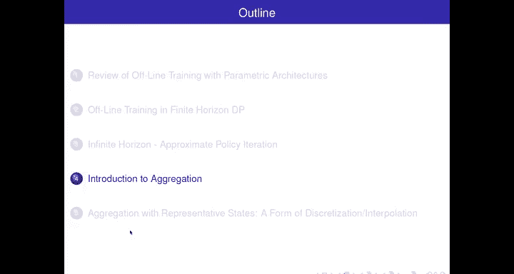

Okay， so back to our usual figure of approximation and value space this time with the expected value expanded like this。

Here we are focused on approximating the future costs again。Except for now。

 we are going to use this aggregation technique。So what is it aggregation is a form of problem approximation。

We're going to approximate our dynamic programming problem with a smaller or easier version of the same problem。

 and then we're going to solve that problem optimally。

And use the optimal solution to interpolate an approximately optimal solution to the original problem。

 J Tilda。So this is related to the feature- based of parametric architect approximation parametric approximation。

 for example， where J Tilda is a piecewise constant and the features are zero to one set membership function so last week U Chao showed a figure in a one-dimensional state space where there is a partition among the state space and over each part of the partition the cost of that state did not vary within the partition so it's a constant piecewise function。

 so I'll explain how this relates shortly。There are several versions of this。

 it can be adopted for finite horizon problems， multi step look ahead or multi agent problems and many more。

And it can be combined with parametric approximation such as a neuralNe in two possible ways。

Either we use a neural net to provide features， for example， for the states。

Or we can add a local parametric correction to a J Tilde that is obtained by a neural network。

 So for this latter case， I'll just refer you to the course textbook。

 but we'll focus on this former case where we're using a neural network to generate features。

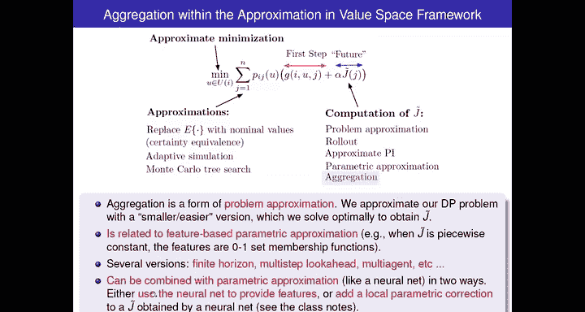

Okay。So here is a simple illustration of what we mean by aggregation。So we have this fine grid。

 which represents states， so the intersection points of these grids are states and the edges of this grid correspond to state transitions in a very kind of abstract way。

And what we're going to do is find a set of representative states， which are also original states。

And we're going to form a course grid over this fine grid of states。

 so we were going to do this mapping of states in this fine grid to states in this course grid。

So we introduce a small set of representative states to form this core grid。

And we approximate the original dynamic programming problem with a course grid dynamic programming problem。

 which we call the aggregate problem。Okay， so we have our original state space of the original problem and given some set of representative states。

 what else do we need， well， we need transition probabilities of going from one representative state to the other。

It's not obvious how to do that。And we also need the cost of being at a certain representative state and applying a specific control。

So then we're going to solve the aggregate problem using exact dynamic programming。

 so we're going to assume that this aggregate problem is easy enough that it can be solved by some exact method。

Then we're going to extend the optimal cost function of the aggregate problem to the original grain fine grid dynamic programming problem using some kind of interpolation。

 which I'll explain。For example， we can extend the solution by a nearest neighbor peace wise constant scheme。

Suppose I pick a state from the original problem。 Suppose it's this one right here。

Then what I'm going to do is approximate the cost of this state here by the optimal cost of its nearest representative state of the solved aggregate problem。

 so the approximate cost of this state here is going to be the cost of this state here。

That's been solved optimally。So that's one way to do it。

 this is the nearest neighbor peace wise constant scheme。

Are there any questions about this slide so far？

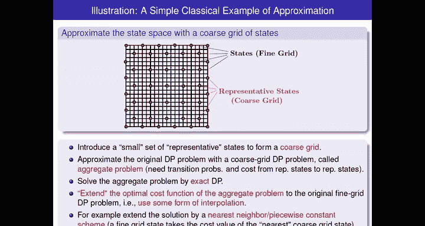

Okay， so that is an introduction to。Aggregation， in general。

But now we're going to focus on aggregation using representative states。

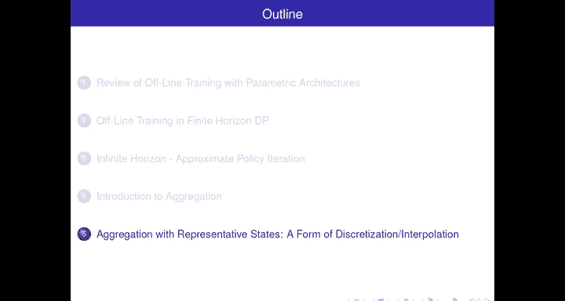

Okay， so let's get a bit more。Riggorous， so we're going to introduce a finite subset of representative states。

 which is denoted by the scripted A。And we're going to assume that the underlying state space。

 the state space of the original problem。Has n different states。

And we're going to denote the representative states by x and y and corresponding subscripts。

And the original system states we're going to denote as J， which may be subscripted。呃。

And these original system states J， are related to the representative states y with these things called aggregation probabilities。

So these are weights that form a probability distribution。

 so it's sort of obvious how you could what the transition probability should be if you're going from one of these red states。

 which are the representative states to one of these black states， which are the original states。

Because you can just use the transition probabilities of the original problem to do so。

What's not so obvious is how do we get from a red state to another red state？

You could say well if I transition to this black state。

 I can just use the probability of going from this black state to this red state， for example。

The problem with that is is that you might not have a probability distribution over the red states。

 so the the probability distribution coming out of this state say J1 it may go to all other states and therefore you need some sort of。

What you need ideally is some sort of probability distribution over the red states only and not the black states。

So we need these weights somehow。And these aggregation probabilities should express similarity or proximity of the original to the representative states。

And these can be viewed as interpolation coefficients， so for example one。

One good probability might be you put a heavy amount of weight on the nearest representative state。

 but it's important that these weights form a real probability distribution over the representative states only。

So what does that mean， that means that they're all non negative and the sum of these probabilities overall of the representative states is exactly one。

Okay。So then once you have your representative states。

 the control space is the same as the original problem， we can we need two more things we need the。

The probability， the problem dynamics or the probability the transition probabilities。

And we also need the cost function for this aggregate problem。

So the aggregate problem dynamics or the transition probabilities between representative states。

 x and y are denoted by this P hat going from x to y。

And it simply comes from the law of total probability here。

 we compute the probability using the original transition probabilities of the underlying state space。

And it's the probability of going from state X to J。

Times the aggregation probability of going from original state J to representative state Y。

And then there are many possible states J that this can happen with。

 and so we sum over all of J to get the total probability of going from representative state X to a representative state y。

So this is how we define the transition probabilities。

Are there any questions about how this works here， about this equation？

It just comes from the total probability calculation。O。And then for the cost function。

 which we're going to denote as G hat。So the cost of a representative state U or sorry x and a control U is just given by the original cost function。

 but we take the expectation using the original transition probabilities over all possible next states that you can go to so we sum this out and we get a cost for being at representative state X and applying control U。

So this is our cost model for the aggregate problem。

And now we have all of the ingredients that we need for a dynamic programming formulation。

Which means that we can apply whatever exact method we would like for solving this dynamic programming problem。

Okay， so this is a figure that sort of summarizes what I've said on the previous slide。

 you have these original states may represented by I andJ that have these original transition probabilities。

 PIJ and these original costs。And then you have these overlying representative states。

 which is a subset of the original state space， so here， for example。

 state I is both an original state and a representative state。

And the transition probability going from a representative state x to y is given by this P hat expression that we discussed and which may involve in which may involve this intermediate state J。

From the original state space， and then we have the cost of the representative state given by the expected cost of the original cost function with respect to all possible next states。

Okay， so。Let's denote R x star for a state x in a， a representative state。

As the optimal costs of the aggregate problem。Then we're going to approximate the optimal cost function of the original problem。

Like this， so we're going to so if our star is the vector of all optimal costs for the representative states。

Then。We take this inner product with Phi and R star。And we can interpolate the。

The approximately optimal costs of a state J in the original state space like this。

 this is just a convex combination of the aggregate probabilities and the optimal costs computed for the aggregate problem。

In the case of hard aggregation， which we define like this。 So basically we say that the。

Agreggate probability of going from state original state J to representative state Y is0 or one。

 So in other words， all of the probability mass of。

At a state J is concentrated on exactly one representative state right so in other words。

 every state in the original state space will map to exactly one representative state。

Then J tilde J is piece wise constant， and it is constant over each of these sets。

 so we'll define S Y， which we're going to call the footprint of a representative state y。

As all of the states of the original problem， such that the aggregate probability is equal to one。

And because of the way these probabilities are defined。

 this is exactly going to form a partition over the original state space。诶 ok。

So are there any questions about this slide or about this approximately optimal cost for the original problem？

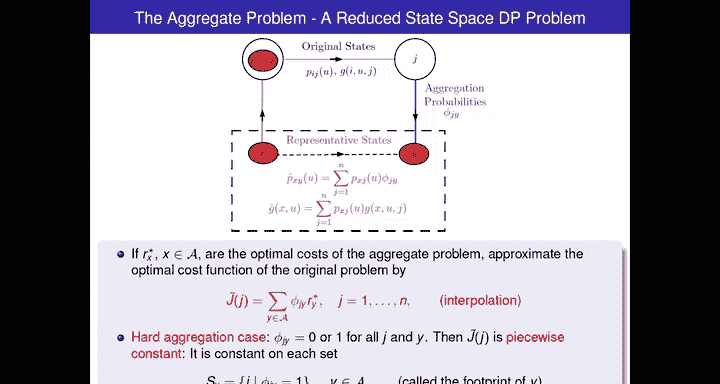

Okay。So， okay。So let's continue to focus on the hard aggregation case。

 and I want to show you how the approximately optimal cost function J Tilde approximates the optimal cost function J star for the original problem。

So similar to what we saw before， we have this one dimensional state space and as I mentioned in the hard aggregation case。

 these sets SXL。The footprint sets form a partition over this state space。

And within each part of this partition。Because of the way it's defined。

 the cost of a state in a particular part corresponds to the optimal cost。Of the aggregate state。

 given the solution， the exact solution to the aggregate problem。

So every state and a apart maps to exactly one cost。

 which is given by the solution to the aggregate problem。Okay。

 so we can actually compute an approximation error for the peacewise constant case and the hard aggregation case。

So we're going to consider all of these footprints and by the way。

 so this green function here is a J star and this red piecewise function here is J Tilda。

And you can see that。If in a particular footprint set， if J star doesn't vary， very much。

 then this fitting or this comparison of J Tilda de Deche Star。Is pretty close。

But it can be challenging。To。To figure out exactly which states should go into which part it often requires some intuition。

Or you might even use a neural network to extract features for the states to figure out which bucket they should go into。

Okay， so back to the approximation area。So we consider the footprint sets for each representative state。

And。We can compute the error。 So J star minus J Tilda。

And this error is small if J star varies little within each SY， so in other words。

 if S Y only spans a relatively flat portion of J star。And in particular。

 the difference in the error is bounded by this。Epsilon over1 over alpha or1 minus alpha。

And epsilon is just the maximum variation within a particular。Footprint SY。

 so it is the maximum difference in this particular set。

 and then we take the maximum over all possible sets and we can bound the total error in this way。

Are there any questions here？Okay。

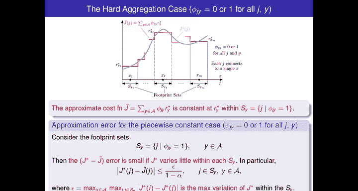

Okay， so this is just sort of a summary slide。So。For the aggregate problem。

We have these following components that we discussed。

 and then we have some interpolation function that involves the solution to the aggregate problem。

Once the aggregate model is computed， once you have the transition probabilities and the cost per stage。

 you can use any exact dynamic programming method to solve the aggregate problem。

 including value iteration， policy iteration， optimistic policy iteration。

 or even linear programming。This can also be extended to model three scenarios via simulation so if you have a simulator for your original problem。

 you can use it to obtain a simulator for the aggregate problem。

And then use an exact or model free method to solve the aggregate problem。

 so there's a way to extend this if you do not know the cost function or the transition probabilities in the original。

Problem。Yes。Its number。对。Re space like my。

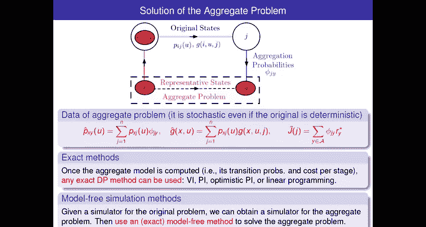

So in order to make this approximation good， the challenge here is defining these footprint sets。

 which representative state should each individual state of the original problem map to。

 and this can be challenging to do。If you have some intuition。

 it can help make these sets and if these sets are well made。

 then it will very closely approximate the true cost J star and the error is bounding on the other hand。

 if you don't know anything or if you don't have an intuition。

You can extract features of the states using like a neural network and I have a slide about this coming up。

And hope that this will make a favorable partition with respect to the true cost function。这一块。Yeah。

 so this epsilon is given in very general terms and these differences could be big if you are not careful about how you compute these representative state。

 these footprint sets。Like。It stay。你是。电设定一。Thank。Can you repeat the question？Yeah， yeah。

It may take some I'll discuss some challenges in a minute。

 but just finding the representative states good representative states that can be a challenge as well。

There may be like an obvious way to define the aggregate probabilities， like in the case of the。

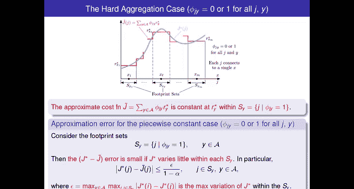

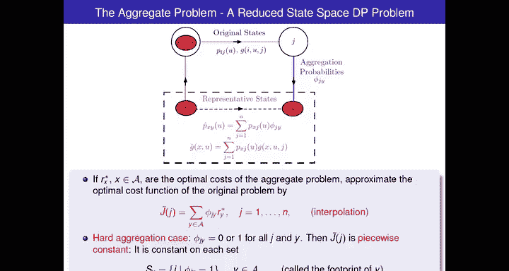

Yeah， the the hard case。呃。But you could potentially use something more complicated too。Yeah。

 any common it that I'm aware of a computational study。

Oxford on beach its complicating some routeing problem and so on practical。Right。

Take someone be relatively be very proud of。It the crap and then all the other smaller ones aggregate the big boxes。

 So in this case there are。Obviously one and you can quantify those tax， so on， even the business。

Oh so。Of the other places。It's hard to say generally， you know， but yeah， part of the。在。在。

So some parts of this are art， right。Okay， any other questions？Okay。

So let's discuss how we can use this approach to discretize continuous state space problems and then we'll talk a bit about continuous control spaces。

With respect to state space。I'll focus a little bit on Po DP discretization， which as you know。

 are very challenging problems。So in the continuous state space case in this model where you have some kind of discounted or bounded cost per stage。

 the representative。Sts approach applies with no modification。

 so before we had some finite state space， we chose we selected some subset of the state space somehow to represent our representative states。

If the original state space is continuous。Well， then you're just selecting like a finite subset of an infinite subset or an infinite set and there's no problem with that we don't need to introduce any further modifications there。

But the representative set of states needs to be finite。呃。Also。

 a simulation or model free approach may still be used for this aggregate problem。

And we can use this aggregation method to obtain a general discretization method for continuous spaces。

 state spaces， or in actually any space， for discounted problems。This also can extend。

 although it's more mathematically complicated to continuous state stochastic shortest path problems。

Remember， a stochastic shortest path problem is this infinite horizon problem that's not discounted the discount factor is one。

But you have some kind of absorbing state that's cost free that once you enter this state。

 you can't exit it and this prevents the costs from blowing up to an affinity。

 whereas in the discounted case， you can show with you exact policy iteration that it actually converges。

Okay， so let's talk about palm DPs with the belief state formulation。So in your palm DP。

 you have a finite state space， but the belief state。

Represents a distribution over the original state space。

So the belief state space is the space of all probability distributions over your original state space。

 and that space is infinite， there's an infinite number of probability distributions that you can apply to a set of finite objects。

So discounted Po DP models with belief states fit neatly into this continuous state and discounted aggregation framework。

 we can choose representative belief states for our Po DP。Then yeah。

 so then once we've selected these representative states。

 the aggregate problem of this PoDP becomes a finite state Markov decision process。

 it's fully observable。And we can solve for our star with any exact model based or model free method。

 including value iteration and policy iteration。So we make the problem much simpler。

Then the optimal aggregate costs， or star yields an approximate cost function in the way that we discussed。

 this is the interpolation function that I described to you before。And so J。

 Tilda defines a one step or possibly a multi step look ahead subop control scheme for the original Pom D P。

So that's how we can simplify palm DPs and come up with。

Approximately optimal costs for these belief states。Are there any questions here？Yes。88。I'm sorry。ペス？

Yeah。S space， like the list you of the things。 that is still damage。different values。

So assuming we have a model， we can evaluate the cost of a specific belief state in that space， okay。

 so the idea is that we're choosing a representative set of belief states and this collection of states is just going to form a finite state Markov decision process。

We know how to compute the cost of a particular belief state， and if we have a model。

 then we can just use those probabilities to compute the cost of our representative state like this。

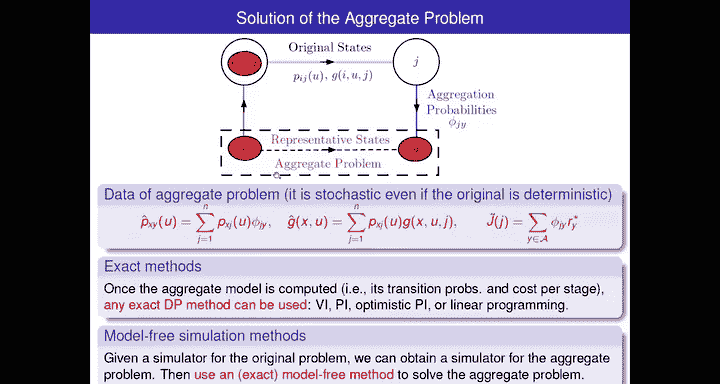

Okay。Let's talk about continuous control spaces and how we can discsretize them。

So here's an example of discretizing continuous motion。

We have this self-d car that wants to drive from point A to point B。

 and there may be obstacles in its way in a continuous control space。

 this car can just choose any direction that it wants to go， the controls are real valued。

 they represent angles。And we're also going to assume。

That the car's speed is1 meter per second in any direction。

We can discretize this space with this fine square grid。

 so suppose we restrict the control space to being one of four possible directions you can go north。

 south， east or west。So it's， yeah， we restrict it to the directions of horizontal or vertical。

Then we can solve this discretized shortest path problem as an approximation of the continuous shortest path problem。

So here's an approximation of it。Am I question for you。iss this a good approximation？

We'll let you think about it for a couple minutes and then maybe somebody has an opinion on whether or not this approximation is a good or this solution is a good approximation of this solution here。

这还你不让他。What is that？说。I mean， first of all， it's in your slides。

 but it's simple but you're actually going quite a stopped。

Whereas if we take the do and you' primary less distance to understand so。好。

It's like so it seems like you talked with a guy of right。1810。Translate that into the local control。

Maybe does anyone have another opinion？天四。The fact what you're doing isn notous thanks listening along like you too。

Yeah， like。Does it even matter like as long as I'm taking like a shortest path from A to B。

 if you just like。The distance， okay， so I have this path here， right？It has some length。

 actually it's 2000， it's the Manhattan distance between point A and B。What if I went like this？

Like just along the edges。That's also a shortest path from A to B。

 and it has the same length in fact， every shortest path from A to B has the length of 200。So so。

Yeah， so okay， so it turns out this discretization is very flawed and I'm told that even experienced mathematicians do not notice this right off the bat。

So assume that all motion costs incur unit cost per meter so every time you move one meter you get this unit cost and we don't even have to care about obstacles here。

 so just assume there aren't any。The continuous optimal solution is just a straight line from A to B。

 and it has a length of root two kilometers。The discrete optimal solution has a length of two kilometers。

 regardless of how fine this discretization is， so we can continue to discretize this state space so here the states will represent a position in this grid world right and I can make this state space as fine grainined as I want。

It doesn't matter at all because what matters here is that the size of the control space is not changing as I further find grain in the state space。

So that's the difficulty， the difficulty here is that the state space is discretized finally。

 but the control space is not， so in order to get a better approximation of this curve here。

 I need to add more controls， for example， I need to be able to like move diagonally across like one of these squares and that would give me a better approximation of this curve here。

In fact， if I could move diagonally， I could get the exact optimal solution。

One thing to note is that this is not an issue withO DPs because we assume there that the control space is finite。

Are there any questions about this example？Right。

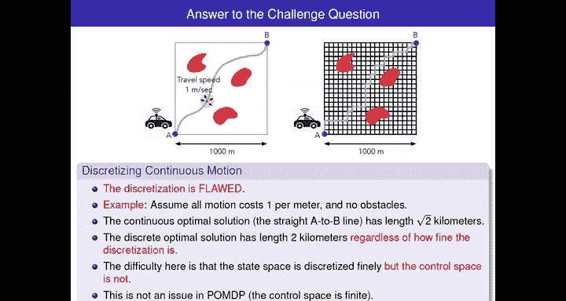

So I have one more slide of content that talks a bit about how can we extract representative features from the state space。

 so the main difficulty with representative states and discretization schemes is that it might not be easy to find a set of representative states that that correspond well to this piecewise constant or linear functions that approximate well J star that can be difficult。

In fact， in order to do so， it may require a lot of representative states like a prohibitive amount that makes it so that you cannot solve the aggregate problem optimally。

So it might yeah， so it might be required to have a lot of these representative states for good approximations of J Tilda。

But suppose we had a good feature vector F so we can discretize the feature space in this way。

 so we introduce these representative features that span adequately the feature space over the states。

And we aim for an aggregate problem whose states are represented by the features。

 So we try to make these footprints contain states that have similar features。

This is a bit more complicated， but it also has a more flexible construction and you can find more details about it in your course textbook。

Okay， so that is my last slide， I have some logistics to talk up。

 but before I do are there any questions at all about topics from this lecture？

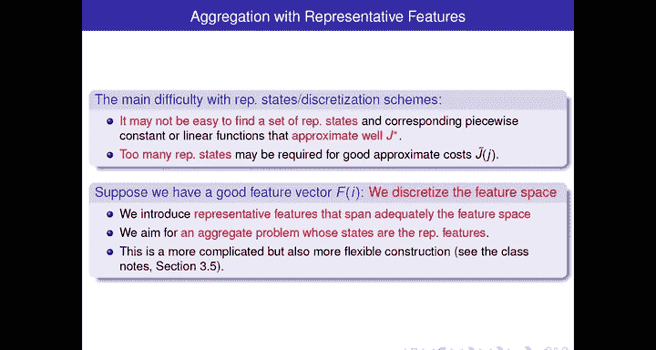

Okay， so I wanted to share this slide with you， this is some information that you'll need for the rest of the course。

So the first thing is is that there will not be a lecture next Wednesday we're giving you this time to work on your courses projects and hopefully you can make use of it。

 but it's up to you。There will be one final lecture of course material。On Wednesday 417。

And in this lecture I'm going to be giving you an overview of approximation in policy space and we're going to discuss policy gradient as well as random search techniques。

 including。possiblyss genetic algorithms we haven't fully。

Decided what's going to go into this lecture again。诶。Okay， so regarding your project。

Your report will be due Tuesday，423。By midnight。If you're doing a mini research project。

We're going to ask that you submit the slides for your presentation via email to us by April 21st。

And so once you have your slides done， please email Professor Bezes and CC you challenge me。

And if you're doing a mini research project， but you failed spectacularly and you wish to switch to a read and report type project。

 please let us know by April 21st， you can just send us an email。

Then April 24th will be our final meeting as a class and we will have all of the people who have done many research projects will be presenting their project。

And depending on how many presentations we have。We're going to try to allot 15 minutes per talk if there turns out not to be many presentations then we may extend this time a bit。

 but we're going to watch we're going to see all of the progress that you guys have made if you're doing a mini research project if you are doing the Read and report type project。

 then there's no presentation associated with。Lastly。

 I'll get around to homework for sometime source。Are there any questions？

So I'm going to put all this information in an announcement in Canva so that you have a reference。

Is there a community research priority？要是可以。Should to。

 so when you submit when you submit your slides on the 21st。

 you Chao and I and Professor Bss are going to look at them。

And if we determine that they are indeed garbage。Then we will politely ask you not to present。

So okay， does that answer your question okay cool。Poy。嗯。It may okay。

 it may not be the case that they are garbage， but we're looking for presentations that are appropriate for。

For this class， meaning like if it's not super relevant to the course material。

 then it may not be so helpful to you guys to like see the presentation。嗯。But historically。

 we I don't think we've ever like rejected a presentation so but we'll still just reserve the right。

 I guess。All right， well thanks guys have a good night。

 I'll see you in two weeks so don't come next week。

