# ASU《强化学习2022-2024｜cse 691 Reinforcement Learning Course at ASU》中英字幕（deepseek - P13：[40]Lecture 13 2024_ Approximate LP. Approximation in policy space, - GPT中英字幕课程资源 - BV1zcfVYdErD

Okay， I think we can get started。How are your guys's projects going？嗯。Okay。Just as a reminder。

So the projects are the reports are due next Tuesday by midnight on Canva and if you're doing a mini research project。

 we're asking that you submit your slides via email to us by Sunday night。

And if you are doing a mini research project and you wish to switch to the Read and Report type project。

 please send us an email by Sunday night as well， saying that you've given up。

When you're doing the reading report type pressure， that's totally fine。Things happen。Okay。

 so let me welcome you to this final lecture of our course。

 remember next week will be project presentations。In today's lecture。

 we're going to discuss a little bit more on techniques for approximation and value space in the context of approximate linear programming。

 but the majority of this lecture is going to be focused on approximation and policy space。

 which is a method of app that does not rely on approximating cost functions directly。

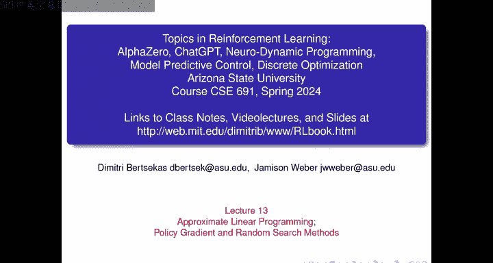

Okay， so first we're going to look at linear programming。

which can be viewed in itself as another approach to exact dynamic programming。

 there's three main approaches， there's value iteration， policy iteration。

 and then there's this other approach that's based on linear programming that we haven't really discussed much in this class at all。

 but then so I'm going to describe that to you and then ways that we can perform approximate linear programming to do approximation in value space。

Then we're going to broadly discuss approximation in policy space and discuss some motivation on why you would want to do this。

And then we're going to focus on。Two major techniques in approximation and policy space。

 The first one is called random search optimization。

 and then the second one is called policy gradient。

 so before the break we'll discuss random search as a method for approximation and policy space and then after the break we will conclude the lecture by just discussing policy gradient for the rest of the time。

Okay。So let's get into linear programming as an approach for exact dynamic programming。

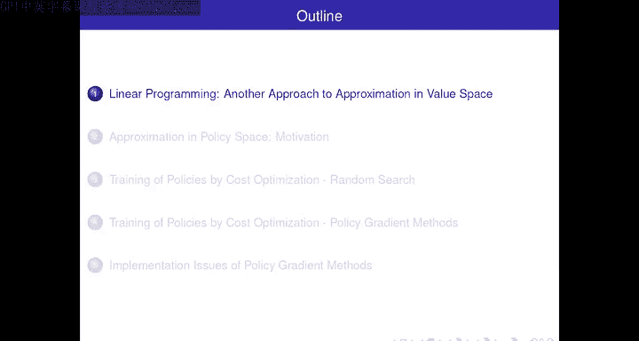

Okay so what is linear programming I'm not sure if we've stated it explicitly in this course。

 but you have some set of variables and associated with those variables is an objective function which you're trying to optimize in some way and the objective function should be a linear function on these variables also you have some linear constraints they are linear inequalities that associate the variables。

And the objective is to find a variable assignment that either maximizes or minimizes the objective function depending on what it is。

 subject to the constraints that are given by the problem。

And we can form any dynamic programming problem， we can formulate it as a linear program。

So we're going to consider a vector J as a vector of variables， one component for each state。

 and each component will represent the cost of a state。

 So J is a cost vector that has the length of the number of states。

And we are going to try to maximize this function， just the sum of all the costs of the individual states。

Subject to this constraint， each cost is at most this expression that you recognize as the right hand side of the Belllman equation。

So we have a variable for every state and so this sum involves a summation over all of the states。

 and also we have these constraints， we have exactly one of these constraints for every single state and control pair。

So let's take a look at a two dimensional example， so a two state example that has also two controls。

So when you have constraints in a linear program you can take a look at the space in which the variables can exist in this case it's a J space。

 what are the different values that J may assume， and a constraint is going to form a hyperplane in this space so it has equations that look like this。

 this is a linear constraint exactly at quality and these constraints are going to form a region called a polyhedron。

And within this polyhedron in the green region here defines the set of all points that satisfy these constraints。

Anything outside of this region is violating the constraints in some way。

 so if you look at this particular line， this corresponds to the constraint for state2 with control u1 and it's exactly this formula here and as you can see that this constraint is linear in the states which are the variables of this problem。

So I've formulated the dynamic programming problem here as a maximization problem。

 but you can also formulate it as a minimization problem here， we're trying to maximize。

 we're trying to find a point in this space that maximizes this function here。

 which we're going to call J star。And we argue that there is exactly one point that satisfies that。

 and it's in the upper like the northeastern portion of this space where both components of this vector are as large as possible and at this point here。

 J star is where you have a here for all of these states and we know that that is the solution to the Bellman equations。

So what is the proof of this while we can turn to value iteration to find the proof of this。

 we generate a sequence of cost vectors JK using value iteration。

 we start with some initial cost vector that satisfy these constraints and then we apply this thing over and over again called the Belman operator we have not really use this notation in this class so far。

 but the bellman operator an operator you can sort of think of as a function that you can apply to a vector that does this elementwise transformation on each value of the vector and the bellman operator is exactly what the beman equation does it does this minimization over the controls takes the expected value of the immediate cost plus the cost to go。

And so this operator is just saying apply the bellman equations to each component of this vector。

Repeatedly， so we apply it k times to this cost vector and we know that from value iteration that this converges so every time you apply this beman operator this invariance sort of holds the each component of this cost vector J is going to be no less than what it was before you apply the Belman operator and so each of these vectors is non-deecreasing。

And it approaches this point， J Starr。And the point J star is a fixed point of this Belman operator。

 meaning if you apply the Belllman operator further， it's not going to cause any change。

 any further change to that vector because once you're at the optimum point。

 you can't get any lower by definition of or any higher in this case， by definition of the optimum。

Okay， so we can formulate。An exact dynamic programming problem as a linear program。

Which we could potentially use commercial solvers to solve directly such as like Cplex or Garrobi。

Now we know， well， maybe you don't know。Linear programming in the case where the variables can take on any real value。

 those types of linear programs can be solved in polynomial time。

But what might be the difficulty here， like if I take my arbitrary dynamic programming problem and I tried to shove it into a commercial linear programming solver。

 what kinds of difficulties might I have？What's the problem here？By the way。

 there's going to be more discussion today because it's the last lecture and I want you to talk。

What's the problem？Yeah。Yeah， so so this involves a sum over the state space and we have a constraint for each state and control pair。

 so the size of this linear program is going to be you know exponential in size if your state space is extremely large for any practical problem that you would care about it probably is so solving this exactly is not generally an option。

So what can we do about this？

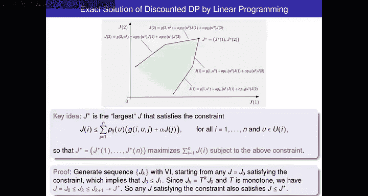

We can introduce approximations so we can do approximation in value space。

 so the difficulty for exactly linear programming for large problems is that there's too many variables。

And there's too many constraints we talked about this。So what can we do？

We introduce this linear feature based architecture， J Tilde I of R。

 where R is this parameter vector as we've seen before。

 and this is meant to approximate the optimal cost。

And this is just given by this linear combination of features and the parameter vector。

So we're going to replace JI with J Tilde I。To reduce the number of variables now， instead of。

There being a number of variables equal to the number of states we're going to tune the parameters directly。

 so the number of variables is going to be the number of parameters。

Which is much less than state space size。Then we're going to introduce this technique called constraintstrain sampling to reduce the number of constraints。

 and this is going to be related to the aggregation lecture that came a couple times ago or whenever it was when we look for representative states。

So let me just define some notation here， then I'll explain this equation。

We're going to define a set。I Tilda of representative states。

And a corresponding control set of representative controls。

 so we're going to limit the number of controls and states that we're going to consider。

And then we have a new linear program， which is to maximize the sum of all of these linear combinations over all of the representative states。

 so this is all of Iilda。subject to this constraint。

 so this is the approximation of the Belllman equations using this parametric architecture instead of the optimal cost。

So now we have a much smaller linear program and provided that we've chosen our representative states and controls well。

 this is a linear program that we can solve directly using commercial solvers。

So an issue here is let's see， how do we generate the representative states and controls typically we do it with we take some suboptimal policies that are known。

 and we sample according to the policies that these generate and we look for the states and controls that they produce and we add them to our representative sets and if we're getting good results then maybe this is a good sample if not we can progressively enrich this subset by adding new trajectories。

 new data for this problem。So this approach has been much less popular。However。

 there have been some successes on substantive test problems。

 so I can refer you to Van Roy and Defaus's work， so there are some examples of it working well。

 but in general the approach has been less popular。

And it has the advantage of capitalizing on the reliability of large scale LP software。

 so once you have your representative states and representative controls figured out。诶。

You take your Cx or Garrobi software and it's a piece of cake to kind of plug all of this stuff into it and you can just run it and it spits out a parameter vector。

So that's nice， but it involves some work to figure out what good representative states and control should be。

Are there any questions on linear programming or approximate linear programming？Okay。

So that's all I wanted to say about approximation in value space for this course。

 so that's it the rest of the time we're going to talk about approximation in policy space。Okay。

 so let's start with some motivation。

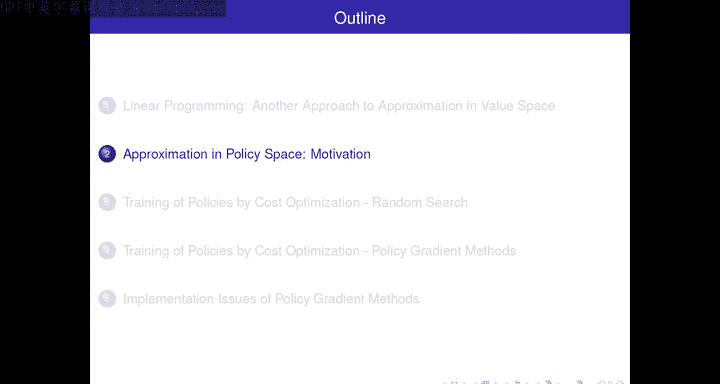

So here's a general framework for approximation in policy space。

We're going to parameterize stationary policies that is policies that do not change every time。

With a parameter vector R。Which will denote by mu tilde of R。And it has n components。

 one for each state。So each R will define a specific policy on how to transform these states into controls。

The parameterization might be problem specific， it might be feature based。

 or it may involve a neural network， we're going to look at examples of all of these。And the idea。

Is to optimize some measure of the performance with respect to this parameter vector R。

So here's an example of a problem specific or natural parameterization。

 and this comes from the world of supply chains and inventory control。

Suppose you have this retail center that carries some item。

And there's some kind of demand that for this item they get sold and then the stock depletes。

 and we need to replenish this stock somehow to keep up with demand。So if the stock is low。

 the retail center may place an order to this production center to produce more stock and refill the inventory。

So there also might be orders in transit， it may take some time for orders to get from the production center to the retail storage and also the demand and even the delay。

 those things might be stochastic。So we can formulate this as a dynamic programming problem by making the state the current stock and orders in transit and possibly some other factors as well as needed。

And we also know what the controls are， do we order more。

 do we not order something related to refilling the stock？

But this kind of formulation can be very difficult to solve exactly。But intuitively。

 and this has been done in practice in real companies。A near optimal policy has this following form。

When the retail inventory goes below a threshold level， R 1。

 this is often called this the safety stock in the real world。

We order an amount r2 so r2 is this replenishment amount and。Yeah。

 so so's just this whole problem can be reduced to two values and we optimize over this parameter vector。

 which consists of both of these values。呃。ok。And this can be extended to multiple resource retail centers。

 multiple production centers， multiple items， it just makes this parameter vectors more complicated。

 but in principle it can be extended as well。Are there any questions about this example？Okay。

So here's another example。嗯。This is policy parameterization through value parameterization。

 and this is an example where we may know of a natural approximate cost function。

 as I'll show in the case of Tettriris and once we have this natural approximate cost function。

 we can use it to derive a policy so suppose J Tilde IR is a cost function parametric approximation that we've figured out in some way。

J Tilda may be a linear feature based architecture that is natural for the given problem。

And I'll explain what I mean by that。Then we can obtain a policy directly from evaluating the approximate Bel equations as we're used to doing。

So this is useful when we know of good parameterizations and value space。

 but we want to use a method that works well in policy space。So here's the Hetriris example。

So over the years， people have studied Tetriris a lot。

And they have figured out maybe 20 or 30 really good state features to approximate the cost with。

So it is known that like， for example， the tallest maximum column or the maximum height of a column is a useful feature to consider。

 it's also useful to look at the relative heights between two adjacent columns。

 it's useful to figure out how many holes are in the system and by that or in the state and by that I mean like this where it can go straight through。

And these are known features， features that are known to work well under parameter settings that may not necessarily be systematically tuned。

 but they may have an intuitive way of assigning these parameters if， for example。

 you have some intuition about how important one feature is relative to another feature。

 it doesn't need to necessarily be learned in a systematic way。

So using this intuitive or natural cost function approximation， you can obtain a policy indirectly。

Just by evaluating the approximate Belman equations。

So this has achieved a lot of success and practice by this indirect。

 so we call this an indirect approximation in policy space because it still involves a cost function。

Okay， so there's two examples。

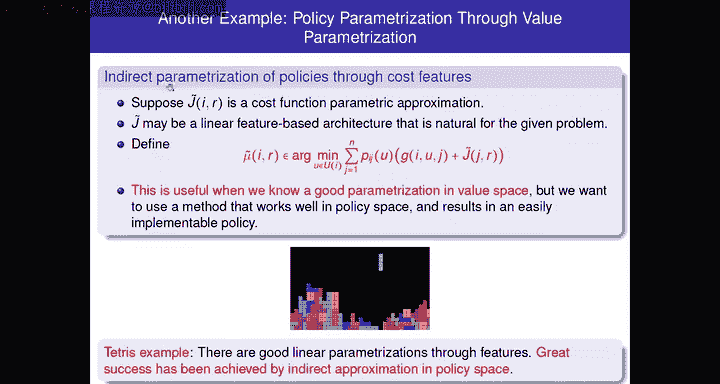

So I've titled the slide Work break， but it's not really going to be a break。

 it's just going to be a list of contexts where you might want to use approximation and policy space and why。

So okay， so we're going to think about six contexts where approximation in policy space is either essential or helpful。

 so we've talked about these first two problems with natural policy parameterizations and also problems with natural value parameterizations so that was the supply chain and the Teetris problem。

But let's focus on these four here。So the first one。

Is approximation and policy space on top of approximation and value space？

Suppose I'm given a good cost function approximation。

Why might I not want to use that cost function of approximation to generate controls online what are the sort of the drawbacks of this why because you have to simulate and compare it well maybe so suppose it's like a parametric model right like so it involves valuation of like a neural net or something like that and you you give it a state and it produces a cost what are some maybe the other drawbacks。

That don't necessarily involve simulation。The minimization， yeah。

 so the minimization can be problematic， we've seen that in the past。

Another thing is computing the expectation exactly can often be a nightmare。

The other thing is you have to know a model in order to compute the expectation。

 you have to know what those probabilities are， which may not be available。

So we're going to talk about a technique of how to combine approximation and value space with approximation policy space。

 but let's just go through the rest of these no， probably not Okay。

 what about learning from a software human expert， why might you want to do this？啊。I think。边。

Fat up the learning process a lot like。对。S mutation patient learning when you use it on robotic controls that directly give you sort of yeah。

 but what if I have to like what if it's a person I have to ask them stuff like is that faster？

Yeah I do。So。So if you don't know the cost function。

 you may have to rely on like a human or software expert to like like you give them a stake and they tell you I would do this at this state。

 I would take this control。There's these last two points here which are somewhat related。

 you may have an unconventional information structure， for example， if you have limit limited memory。

 the conventional dynamic programming structure can break down。And a special case of this。

Our multiage systems with local information restrictions， which we talked about a lot in this course。

 where informations do not share information with other agents， we'll talk about this。

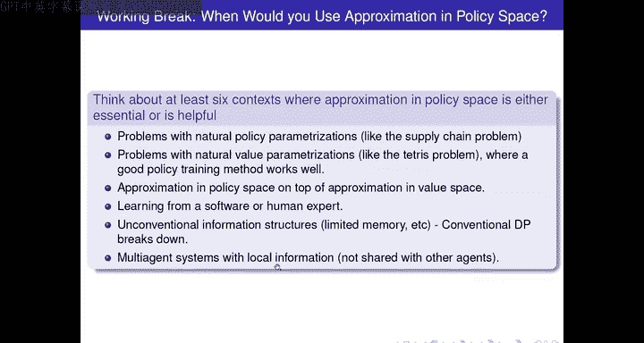

So let's look at approximation in policy space or policy approximation on top of value approximation。

So let's suppose J Tilda is an approximation architecture that gives us the approximate cost to go。

 and we obtain it using some approximation and value space technique。Then。

Once we have this cost function。Of course， we can use the approximate Belman equations here to obtain a corresponding suboptimal policy mu hat。

 and there are also multi step look ahead versions of this as well。But as we mentioned。

Computing this policy online or figuring out what the control should be from the cost function can be expensive。

 the minimization can be expensive， the expectation can be expensive。

 and also it might be very problematic if you don't even know the model。So。

 and it's even worse with multistep look ahead。So one thing you can do is approximate mu hat using a new function。

Which we'll call mutilda。So we approximate U hat， mu hat。This one。

Using a training set consisting of a large number of samples number Q of sample pairs。

 so these are state and control pairs。Where given a state。

 we obtain the corresponding control off line。Using this formula here。

So we obtain a limited number of these samples。And then once we have the samples。

 we can make a new network a new parametric function mutilda， which is given this parameter R。

 and we're going to do this least squares regression where we try to fit our sample control sample controls obtained from the beman equations here and。

We want to minimize the difference between those controls and the ones that are network outputs。

 so we sort of approximate this with a neural network or some kind of parametric architecture and the advantage here is that this can be this mutilda can be evaluated quickly online and it doesn't involve a minimization doesn't involve an expectation or anything like that。

Are there any questions about this approach？So this follows the previous slide where it said approximation policy based on top of approximation and value space so the reason is to up。

Online speed up， yeah。I forgot exactly what you said yeah yeah I said。

 is it for speeding up the process？As you said like you cant also use maybe I maybe I misundersod what you said。

 it's okay， let's leave it in the past where it belongs。Okay。

 so that's a policy approximation on top of value approximation。

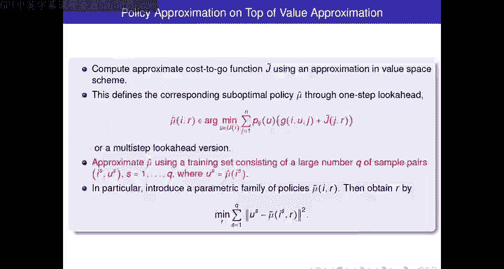

And now let's talk about learning from a software， a human expert。

So suppose we have a software or human expert that can choose a good or near optimal control US。

 given any state US or IS。So again， we form this sample subset of representative state and control pairs。

 and we introduce a parametricic family of policies， mutilda。

 and we obtain an approximation using this same least squares regression。

So this approach is known as expert supervised training。

And the idea here is we get an architecture that based on expert input。

Can just output a control that tries to fit that input？So this has been used in various forms。

 including in backgamen and chests。And it can be used among other things as an initialization for more complicated methods。

 I believe this was the case with Alpha go， it started with a network that was trained by an expert and then they improve upon it from there。

ThisIt serves us as an initialization。

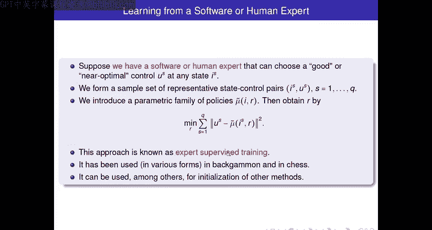

Okay， so that's learning from a software a human expert。

Let's talk quickly about unconventional information structures。

So approximation in value space is based on a dynamic programming formulation。Which we assume。

That the controller has access to the exact state。That state may be fully observable or it might be partially observable。

 but the controller can see the exact state if it's a belief state or not。ok。But in some contexts。

 this might not be true。And in this case， there is a dynamic programming like structure。

But the full state or belief state is not available， and so this structure sort of falls apart。

 it sort of breaks down。So one example of this is where a controller can forget information or it has some kind of limited memory。

Another example is sort of similar to this multi- agent example that we keep pointing to some control components may be chosen on the basis of different information than others。

 so we may seed the full state or the belief state。

 but the controls we choose kind of view the belief state or state in different ways and we don't have the same outcome。

So the most tangible example of this is in multi agent systems with local agent information。

We suppose decision making and information gathering is distributed among multiple autonomous agents and each agent's action depends only on his or her local information。

And agents may be receiving delayed information from other agents or maybe not at all。In this case。

 the conventional dynamic programming breaks down and much of the approximation in value stress methodology also breaks down。

But here we can still use approximation in policy space。Why， because we can for example。

 train a parametric architecture that takes sort of local information and transforms it into a control once the architecture is trained。

 we can equip each of these agents with that architecture and they can just look at their local state and figure out what their control should be。

Are there any questions about this？Okay。All right， so that was an overview of approximation in policy space and its motivation and now we're going to get into more kind of gritty details on two different techniques。

 the first one we're going to look at is called random search optimization。Okay。

 so here is the dynamic programming setting that we're going to use for approximation in policy space in approximation in policy space。

 we're going to be we're going to assume。That we have a stationary policy or a family of stationary policies。

 mutilda， that's defined by some continuous parameter with n components。

And then we're going to search around this parameter space。

 and we're going to evaluate points somehow。So when we evaluate a point。

 we're going to basically generate a trajectory， so starting from some initial state。

 the system environment will give us a state， the controller will take this state and produce a control and from this we can get the cost of this state and then also the environment may be stochastic and we continue this process for evaluating a trajectory or evaluating a policy。

Okay， so each R will define a stationary policy and we determine R through this minimization。

 which is dependent on an initial state， so we want to minimize the cost of policy mutilda with respect to R starting from an initial state i0。

You could have multiple trajectories and provide a distribution over many initial states。

 in which case you would want to minimize R with respect to this distribution over the initial states。

So this is the framework that we're going to be using in approximation and policy space。

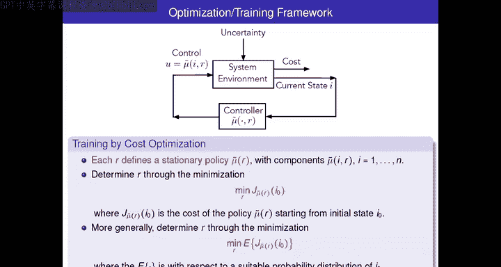

O。So let's talk about random search。So random search methods apply to this general minimization。

 so this big R is some constrained set， and we're looking for vectors in this set that minimize this generic cost function F of R。

And the way random search methods work is that they're iterative。

 they generate this parameter sequence a， aiming for cost reductions。

 meaning we're hoping for costs later in the sequence or less than costs that come earlier in the sequence。

 which may not necessarily be always true。Given acade。

A point we look at points that are chosen in some random way in the neighborhood of our case。

 so we're going to look at nearby points， which is defined somehow depending on the context。

And we choose some new point RK plus one within this neighborhood。So this is very general。

 but in theory， these sorts of methods have good convergence properties。

 but in practice they can be quite slow， especially compared to a gradient methods。

But they are not as affected as much by local minimum in these random search type algorithms。

Are able， in many cases， to make sort of large jumps within the parameter space。

Whereas with a gradient method。If your step size is small， for example。

 you may get caught in a certain portion of this space and not be able to get out of it。

 you may settle in a local minima whereas random search methods have the ability to move farther in parameter space some of the time。

The other thing is in the random search method case。

 we don't require a differentiable cost function and they can apply to discrete as well as continuous minimization problems。

And there are many， many examples of random search algorithms。

I've listed a few here there's an evolutionary programming which uses or is inspired by ideas from evolution obviously the most probably famous subcase of this or is genetic algorithms genetic algorithms will sort of maintain a population of parameter representations and then it performs these things called genetic operators which ends up maybe randomly perturbing these individuals in the population or even combining them in some interesting way。

 and then it applies this thing called a fitness function which sort of evaluates the quality of an individual and then it keeps the individuals with high fitness in the population and dumps the rest and what you get is this guided search over many generations through the parameter space so this is an interesting method and there's a ton of literature on this type of approach。

Another approach that's used a lot in industrial engineering is the so called taboo search。

 it's a search algorithm that makes efforts to avoid points in space that it has visited in the past。

There are also approaches that are inspired by statistical mechanics that involve energy functions and the idea here is that if there's a high amount of energy in the system you'll make larger jumps in the parameter space and then lower energy corresponds to smaller movements and you have this thing called a cooling schedule whereas the temperature decreases。

 you end up settling in some minimum。There's also a statistical mechanics approach called the Metropolis Hastings algorithm and for this algorithm。

 you provide it with a distribution of your choice over the entire parameter space and that algorithm will output the probabilities that you would need for a random walk over a bias random walk over this space and you can run it for a certain amount of time and you can show that if I run it for this certain amount of time。

 it will come within some error of my target distribution and that's another method that's inspired by statistical mechanics。

There's also the cross entropy method， which I'm going to go into more detail about on the next slide。

 just to dive in more deeply into one of these。Okay， so what is the cross entropy method？

So it's another iterative method at a current iterate RK so RK is a point in this space。

We're going to somehow construct this ellipoid EK that is centered at RK。

This ellipsoid is going to define a neighborhood around this point。

Then we're going to generate a finite number of random samples within this region。

And we're going to evaluate each one of these， so each one of these is a parameter setting。

 and we're going to evaluate these parameter settings by doing some kind of simulation or generating trajectories。

Now some of these points， so this black point is a sample point， the screen point is a sample point。

Some of these may be better than others， may return better costs。So we find a subset of these。

 which in this figure is depicted by these green points here。

 and this is a subset of the sample points that have good costs， whatever that means for you。

Or low cost， rather？And then we let RK plus 1 be the sample mean of these good points。Okay。

 then we use these points to construct a sample covariance matrix。

 which we can use to define a new ellipsoid that wraps sort of tightly around these points。

Now what we would not like to see。Is our ellipsoid getting smaller and smaller over time that would be bad because it would limit our ability to search so using some heuristics。

 we take this ellipsoid here and use the heuristics to make it larger somehow so it looks like this。

And this is now EK plus1。And we just repeat this。So this is the cross entropy method。

So there's some theory here that has limited convergence rate guarantees。

 and success often depends on domain specific insight and skilled use of implementation heuristics。

 how we expand this ellipsoid into EK+1 is crucial here。

But it is simple and well suited for parallel computation， why。

 because we can look at each of these points and we can evaluate them individually in parallel。

 they're sort of independent of each other。And then we can use that to find the good points and then continue this process quickly。

Now it sort of resembles a gradient method， maybe somebody can explain why like maybe why does it remind you of a gradient method or what's the relationship？

Okay。Each time step your next parameter。Yeah， so like you're moving in some direction in this space and the direction you're moving in should be a good direction。

Now in the case of a gradient method， what a good direction means is determined by the gradient of the function。

 whereas here what a good direction is is determined by the evaluation of these points in these randomly sampled points so it sort of has this feel of just moving around in this space yeah but I assume that this is based on the fact。

That you have a fairly good approximation in space no this doesn't rely on approximation and value space at all evaluate we generate sample trajectories and we observe their costs Okay so there's no you sample till the end Yeah so I mean obviously the more sampling the better as long as you're able to observe the costs and evaluate a parameter point in some way。

 you can distinguish which of these points are good and which are not good。

There's no cost function approximation here at all。Okay。

 so are there any questions about random search methods， is all the slides I have for random search？

是。

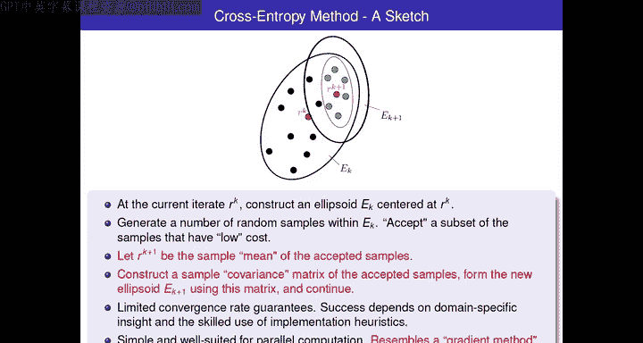

Okay。So I sort of have a break scheduled here， let's take a 10 to 15 minute break and then we'll talk about approximation policy gradient。

And then we'll wrap up the course。Okay， let's finish things up。Okay。

 so now we're going to focus on policy gradient methods。Okay， so。

Let'sFirst discuss the policy gradient method for deterministic problems。

 So we're going to consider the minimization of the cost of a policy mutilda parameterized by R。

 Given this initial state， we're going to minimize over R using the general gradient method。

 So given a certain parameter setting， we're going to。

Increment this parameter by the negative gradient of the cost function starting at some initial state i0 and then here this gamma K is a step size or some people call it a learning rate。

 so this is the gradient method that most of you will be familiar with。

And we assume that this cost function J of mutilda R is differentiable with respect to R。

 so we can do that if this is the case。Now the difficulty here is that the gradient of this function。

 J Utiilda R， it may not be explicitly available。Well。

 we have to in order to determine the cost of this policy neotiilda。

 it requires some simulation of trajectories and it may not be possible to compute the exact gradient of this function。

So the gradient must be approximated by finite differences in the cost function values of J Mu Tilda ArK so you can make。

Perturbations， small finite perturbations in the components of R and compute the resulting costs and then take the differences to get an approximate gradient around a specific point。

If the problem is deterministic， then this method may work well。On the other hand。

 if the problem is stochastic， the cost function values may be computable only through Monte Carlo simulation。

 so remember to compute the cost， we need to compute an expectation in the case of this stochastic problem and it may be only possible to do that using Monte Carlo simulation。

But this can lead to very inaccurate gradients because taking the gradient of an expectation using Monte Carlo samples can be wildly inaccurate。

 like this often does not work well at all in practice。

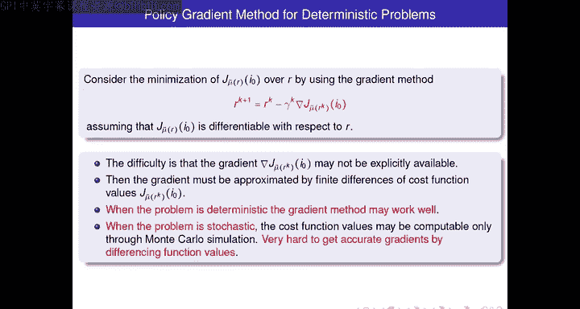

Okay， so what can we do about this？Okay， so here's a new approach。

 I'm going to describe this very generic optimization problem。We have some set Z。

 and we're going to minimize over this set， this generic cost function， f of z。

And we're going to take this unusual step， so this minimization here is deterministic。

We're going to take this step where we convert this deterministic optimization into a stochastic one。

 so we're going to convert this problem into a stochastic optimization problem。

And here is the stochastic version of the problem so what are these elements here so Pz is the set of all probability distributions over this set Z。

 so we're going to minimize over all of the possible probability distributions over Z and this expectation with respect to p is the expected value given this probability distribution so using these probability this probability distribution of F of z so in this kind of problem Z is viewed as a random variable pz is a set of all probability distributions over Z and a specific p denotes a generic distribution it's some probability distribution over Z and this expectation denotes the expected value with respect to that specific distribution P。

Now， I want to argue that the result of this minimization here。

Servees as a lower bound for the result of this minimization here。

And maybe I'll ask you one more question just to think about why that might be true。

Since we have a lot of timeline， okay。Whatever the result of this minimization is。It is no more。

 so it's a lower bound for whatever the result of this minimization is here。That's my a claim。Okay。

 I can explain it， it's fine。Okay。So this is the set of all probability distributions over Z。

There's a very special probability distribution called the Dirac Delta distribution。

And it applies the entire probability density。 It concentrates it to a single point in this space Z。

 This is some people refer to this as an atomic distribution in the case of a discrete Z is just like the probability of this specific point is one and everywhere else it 0。

Okay， so if we restrict this set to be the set of all D rock Dlta distributions or atomic distributions。

 each one of those is going to correspond to a specific value in Z。

And the expectation over a distribution that has all of the density concentrated at one point is just that point。

 so this goes away。And so contained in this set implicitly are all of the values contained in this set。

 and since P of Z is strictly larger than Z。The actual minimum here could only be smaller than this minimum here。

Does that make sense？好。You have a question？Okay。O。So that's my claim。

 you can think about it offline if it doesn't make sense to you。But this is a lower bound for this。

All right， so how does this relate to our infinite horizonor dynamic programming problem？

So for this framework to apply to the schastic DP context。

 we're going to enlarge the set of policies to include randomized policies。

 so sometimes these are called nondeterministic policies。

 they take a state and they output a distribution over a set of controls available at that state。

 so given I you have a probability distribution over UI。

 this is a randomized or a nondeterministic policy。

So if we're going to search this space of randomized policies to find a good deterministic policy。

As a theoretical note， the optimization over randomized policies gives the same results as the optimization over ordinary non-ranized policies。

 so you can show this and basically what this says is that the best deterministic or sorry the best nondeterministic policy is a deterministic one it's one that picks exactly it concentrates the density on exactly one control so it's I mean it's technically a non-deterministic policy but all the density is focused on one control exactly。

Okay， so this sort of generalizes this space。And I'll just repeat that you can show that the best policy in a non deterministic space is actually a deterministic one。

And you can kind of think about why intuitively that might be true。I mean， there's less noise。

 like certain more certainty is better。🤧Okay。In the dynamic programming context。

 this value Z is going to represent a state control trajectory。 so starting at an initial state。

 we apply a control U0， and then we get a new state and then apply another control and so on。

 So Z is going to be a control trajectory。Okay。Are there any questions about this slide before we continue？

系可。These is what your inequality is strict。You mean this inequality here？Yes。

 so it turns out that the best one is in fact a deterministic policy。

 so this is a lower bound and it's also tight。嗯。So like if you choose a probability distribution over Z。

That's actually not。Non deterministic。What this sentence here says is that you can show that it's actually not going to be any worse than a not than a deterministic policy yeah like you're thinking in the sense that they're going to be yes but because he' your。

Yeah。Okay。

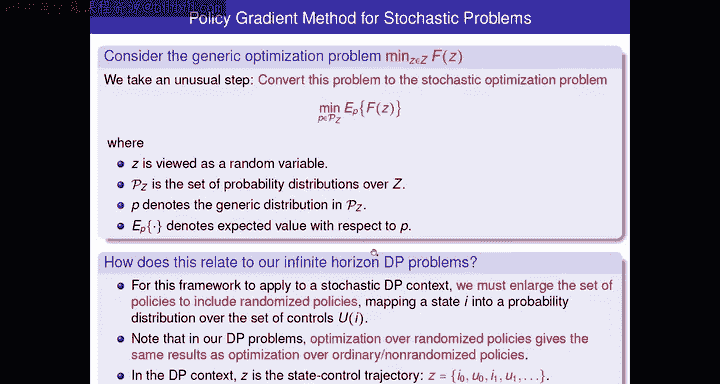

All right， so let's continue。诶。Okay， so using this approach that I've outlined here。

 what are we going to do specifically？We're going to introduce a parameterization of probability distributions we're going to consider this subset of PZ denoted as PZ Tilde。

And we're going to restrict our attention to this parameterized subset。

 And this is going to be the set of all probability distributions。

 P Z R that can be represented by this parametric approximation。

So it's some subset of all of the distributions that can be represented by this continuous parameter R in this architecture。

ok。So in other words， we're going to approximate this problem min Z and z of F of z with this restricted problem and it's this。

Expression here， except for we are going to minimize R with respect to all of the distributions that PZR can represent。

So this is the problem that we're going to try to solve with policy gradientding。

Then we use the gradient method for solving this problem。

 we just subtract the negative gradient of this exact expression here to find a minimum r that will satisfy this。

Now， how can we compute this， this is the question。

A key fact here is that there is a useful formula for the gradient。

 which involves the gradient with respect to R of the natural logarithm。

So introducing this logarithm to the probability distribution ends up being extremely convenient algebraically。

And we'll see that on the next slide， so we're going to consider the log of the probability。

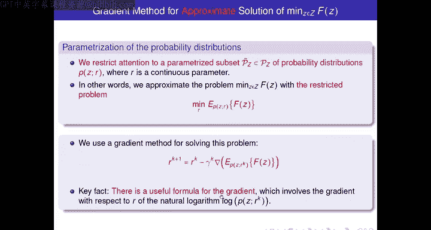

Okay， so this is the value that we want to compute and we're going to do this trick。

I mentioned trying to compute the gradient of an expectation when the expectation is computed using Monte Carlo sampling。

Can be very inaccurate。On the other hand， if you're trying to compute the expectation of a gradient。

 that's not so bad， you can do Monte Carlo sampling after the gradient is applied。

So that's what we're going to do here， we're going to introduce a trick。

So let's assume that PZ given RK， this is the probability of a trajectory given parameter setting RK。

Assum it's discrete， it applies to continuous distributions as well。

 you'll go through here and every time you see a sum we'll change it to an integral and in all practical applications this is a legitimate exchange even in continuous spaces。

Okay， so what do we have， so this is the quantity。We're going to expand this expectation just like this and once this expectation is expanded。

 we swap the gradient and the summation。To obtain this expression here。

And then we're going to do something a little bit interesting。

I'm going to multiply the top and bottom of this expression by Pz given RK。

 assuming this is non zero。And I'm going to argue that this expression here。

 this ratio is the gradient of the log of this probability here。

 so if I have a function log of p of x the derivative of that is1 over p of x times the derivative of P with respect to x。

That's exactly what this expression is here， so the derivative of log of p of z given RK is1 over p of z given R times the gradient of p of z given RK。

So these two things are equal。Then I collapse the expectation again。

 and I arrive at this expression here。So we have the expectation with respect to this parametric distribution of the gradient of the log of the parametric distribution。

 multiplied by the cost of the trajectory。So what can we do with this？So we're going to sample。

 this is going to be a sample sample based gradient method for parametric approximation of this expression here。

So we have this expression， one thing we can do to approximate the expectation here is just do Monte Carlo sampling。

So this can be done with as few as just one sample。So at RK， we obtain a sample Z K。

 according to this distribution。Then we compute the sample gradient。

 which is given by this expression here。And if you want。

 you can obtain more samples and compute an average of these samples bit like a batch method。

 essentially。And then use it to iterate according in this way。

 we're going to subtract this gradient that we've computed。

 multiply it by our step size and subtract it from the parameter vector RK to obtain a new vector RK plus one。

Okay。Are there any questions about this slide？Or about any of the math that we've done here。

hopefully it makes sense。

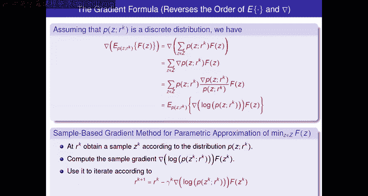

Okay， let's talk about policy gradient in the context of discounted problems。So again。

 we denote Z by the infinite horizon state controlled trajectory。

 so this is an infinite sequence of state and control alternating pairs。

And we consider a parametricization of random policies， P of U given I and parameter R。

So this thing here defines a non deterministic policy。 It takes a state。

 and it outputs a distribution over the controls。 This is how he defined a non deterministic or random policy。

 and it's parameterized with parameter R。So that's what it says the control of state I is generated according to this distribution P of U given I over the set u of I。

Then for a given R， the state control trajectory Z is a random trajectory with probability distribution denoted as such the probability of Z given R and the total probability like computing this requires this probability here and it also requires the transition probabilities of your problem。

 so if you the full the full probability of a trajectory is the infinite product of these probabilitybabilities here multiplied by the probability of going from a specific state to another state given the selected control。

I can explain that a little bit more。But that's how this is computed。

The cost of the corresponding trajectory of Z is as we've understood it in the past。

 it's just the sum of all immediate costs discounted by this discount factor。

 so this is a convergent series。And the problem is going to be to minimize this cost with respect to this distribution。

 P of Z given R， and we're minimizing over R。And so here is how we can compute the gradient needed for this gradient iteration。

So this expression here is what we derived before。But this can be simplified even further。

So the I mentioned that the probability of a specific trajectory is that total probability can be computed from these probabilities here multiplied by the actual。

Transition probabilities of the problem， but since we've taken the log。

 we can take this product and break it up into sums。

One of these sums will contain all of the transition probabilities。

And the other sum will contain all of these things， all of these。

All of the probably distributions for the randomized policies for a specific trajectory。

Then we take the gradient of that expression。And because the transition probabilities of the problem。

 they're completely independent of R， they're constant with respect to R。

 and when we take the gradient， they disappear completely， they're just constants。

And what we're left with is this expression here。The other sum cancels out and we just have this sum here。

The log of the probability of a control given a particular state。 And if I evaluate this gradient。

 I again get one over this probability times the gradient of this probability。

And this probability here can be seen as the non deterministic policy itself。

So this expression here represents what they call the policy gradient if that makes sense to you。

Are there any questions about this slide？🤧Okay。

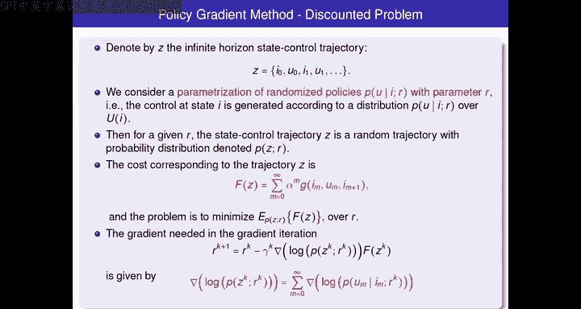

Well， hopefully that all made sense。嗯。

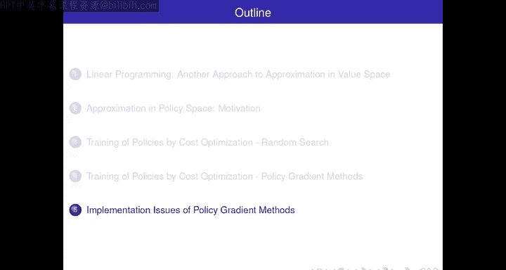

We're going to talk about implementation issues， but I wanted to point out a couple of things。

I shall' do it on this slide。So。At no point in this policy gradient calculation did we actually directly compute the gradient of the actual cost function here。

 we've done away with that completely。So it involves the cost function of a discounted problem。

 but not its gradient。So we have the cost function， but we don't compete its gradient。

And it allows for the cost per stage to be non differentiable。In addition。

 because of the gradient calculation， all of the transition probabilities of the problem went away。

 they disappeared。And so you don't actually even need to know what your transition probabilities are it sort of a model free type approach。

 what you do need to be able to do is simulate a trajectory and observe its cost。

Then after you're done， once RK converges to some specific parameter set R bar。

 you get a randomized policy。This can be converted back into a deterministic policy just by taking the maximum over the probability distribution。

 whatever control corresponds to the maximum probability。

 now that's your policy in the end after r is converged。Okay。

 so let's talk about some implementation issues， are there any questions about that？

So it's a model free approach that does not involve computing the gradient of a cost function。

We obtain it from simulating trajectories， many trajectories in practice。🤧Okay。

So some implementation issues。How can we collect trajectory sample Z K to strike a balance between convenient implementation and exploration course evaluating these trajectories can be expensive and the more you do of it。

 the better， But you want to make sure that the trajectories that your。

That you're evaluating or exploring this space enough， that's an issue。

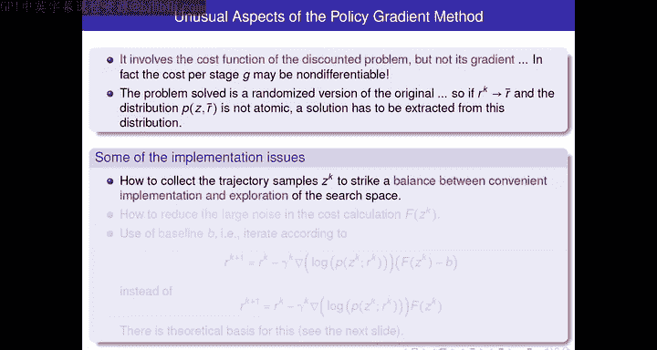

And then the other issue is when you。Compute the average cost of your're computing trajectories via Monte Carlo sampling of these trajectories and as we saw with fitted value iteration a couple of lectures ago。

 this can have the effect of producing a lot of noise unless you've taken a ton of these samples。

 which you may not be able to do。So that is a concern as well。

The way we addressed it in fitted value iteration using Q factors， in fact。

 was we use this concept of a baseline， we were able to deal with large costs by subtracting these state dependent baselines to make sure that the information that we care about is related to the selection of controls and such。

So。Here's's the same kind of approach， so we use a baseline B and iterate according to this here。

 where we subtract this baseline cost from the actual cost of the trajectory。

And this can have the effect of reducing noise， and we'll talk about this a little bit more on the next slide。

So this is the cost shaping technique， it involves the reduction of a baseline like I just talked about。

And the idea here is we're going to introduce an equivalent variational problem。

So this is a technique that's been known since the 1960s and here is the approach。

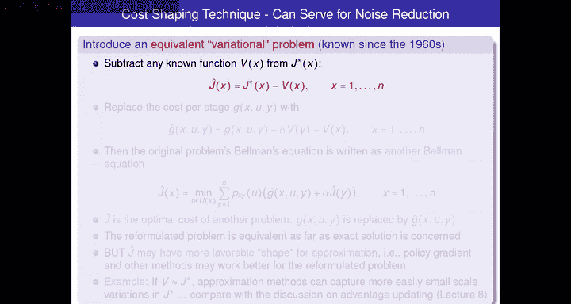

So we have J star and we're just going to subtract any known function Vx from J star to get this new cost function J hat of x。

 so we subtract this baseline for all of the states。Then we replaced the cost per stage。

 so GXUI was the cost per stage。With this new expression， G hat。

GhaAT involves the original cost per stage of the original problem。

 and we're going to add alpha times v of y and subtract V of x for all of these states and I'll explain why we're doing this。

Then the original problems to Belman equation can be written as a different Belllman equation。

 and this new Belman equation is going to have different immediate costs。

So we're going to claim that J star or J hat is the optimal cost of another problem where G of X U Y is replaced by G hat。

And the reformulated problem is equivalent as far as the exact solution is concerned。

 Why is that we can do some substitution and prove of it to ourselves。 So J hat， Well。

 we have a definition for that。 It's J star minus V X。 So I'm going imagine that's right here。

G hat of X E Y。Well， that's the original cost。Plus， alpha times v of y minus v of x。And then， J。

 Hat of why。Times alpha is alpha times J star of y。And then minus alpha times v of y。

So what we see is that the alpha v Ys， these cancel out the Vx minus Vx on the outside here cancels out with this one in here。

 this Vx inside this minimization is actually completely independent of the control so I can pull it out of this minimization and it will cancel and what I'm left is with G of x plus Uy plus alpha J star of y so you can do this yourself to convince yourself but when you do these substitutions you get a formula that is exactly equivalent。

 but the immediate costs are different。These immediate costs， GhaAT。

 may be more favorable in reducing noise。So in other words。

 the cost function may have a more favorable shape。

 so this is where the term cost shaping comes from。

And it's going to have a more favorable shape with respect to noise generated by these trajectories。

And policy gradient and possibly other methods may work better for this reformulated problem。

Now I told you to subtract this function v of x somehow I didn't say how to define V of x。

 but if V happens to be close to J star， then the approximation methods can capture more easily the small scale variations in J star so we discussed this a bit when I talked about advantage updating in fitted value iteration。

And what you'll see if you look up policy gradient。

 a lot of the policy gradient literature is focused on designing good baselines。

 it could be from some known policy that's good， there's just a lot of research that has been done in this area of baselines with respect to policy gradient。

Are there any questions about cost shaping？I think I have one more。Slide of course content。

 And then if you'll bear with me， I have two final slides that kind of wrap up the course。

So let's talk about the robustness of policy gradient methods。So by the way。

 getting policy gradient to work is a pretty challenging thing to do。

 although like the formulation of it seems like it would be simple to program。

Getting appropriate samples and exploring the space enough is a significant challenge。So。

What can we say about policy gradient？So it's entirely done offline it's all training there's no online play involved in policy gradient this could be very good or it could be very bad。

 why could it be good， but once the training is done and you have your architecture。

 you can quickly evaluate states online and produce a control fast just by evaluating the network。

On the other hand， if your system parameters are changing over time， this could be extremely bad。

 your policy network might be absolutely useless in this case。

So it does not adapt to changes in the problems parameters。So yeah。

 so approximation and policy space may not work well in the context of adaptive control。Also。

Because it's just a neural network at the end of the day or whatever architecture you have。

 it does not yield the benefit of online look ahead and minimization rollout and in particular the connection to Newton's method is gone with policy gradient you're just evaluating a network online。

And so because of this， approximation in value space and in particular rollout may work much better in practice。

 for example， in alpha zero。On the other hand， there is a way to think about approximation and value space or sorry policy space as having a more subservient role to approximation in value space。

 at least empirically what we've seen in papers time and again is that approximation and value space appears to be dominant in terms of producing good solutions。

诶。But an alternative use of approximation and policy space。

 including policy gradient is it can provide a base policy for use and rollout， possibly truncated。

 or it can be used to generate trajectories quickly online for Monte Carlo research。

And this is what is done with alphapha zero。So we started this course with Alpha zero and now we're going to end it right on alphapha zero right here。

And this is the last sort of technical slide I have are there any questions before we wrap things up？

Okay， so bear with me for a second， I'm going to change my slide deck。Okay。

 so I wanted to conclude the course with first just a list of generalities or takeaways that you can take with you in the future。

 things to remember at the end of the day。And I'll start just with some words of caution here。

There are challenging implementation issues in all approaches that involve offline training。

 so in the last part of this course in particular we've spent a lot of time talking about training policy networks and doing approximation in policy space it can be extremely difficult there are a lot of enormous challenges to this kind of approach and there are no foolproof methods。

Problem approximation and handcrafted feature selection often require domain specific knowledge。

 as we saw in the case of Tetriris。Another point is that training algorithms are not as reliable as you might think by reading the literature in the literature you sort of have this bias towards all of the successes people don't publish their failures so it's hard to get a sense of just the Mount Everest sized amount of failure that that accompanies this p size of success I don't know if that ratio is exactly right but。

That's the point I'm trying to make here。So be careful。

Then approximation policy iteration and approximation and policy space do not deal well with online repplaning。

 so we've sort of hammered this point over and over again and in particular approximation and value space does handle online rep planninging well and it involves a new step whereas approximation and policy space does not and so there's some。

A lot of intuition actually， to think that approximation and value space is a superior choice。

Another point is that recognizing success or failure can be a big challenge。

 you may have a list of benchmarks and your method may improve maybe。

A little bit or maybe a lot over some set of benchmarks and then before you know it at some point in time in the future somebody comes along with a new approach that blows yours out of the water and you figure out that in retrospect that your success was actually mediocre so it's hard to recognize this at the time until you see the advances in the future so this is a challenge。

Another point is that the RL successes in game context are spectacular。

 as in the case of alpha go and alpha0。But they have benefited from perfectly known and stable models and a small number of controls。

 Sos right， I think chess has something like， I don't know，30 controls。

 I'm not sure what the exact number is， but it's it's somewhere around that order。

And the successes here have benefited tremendously from that more complicated games。It's hard to say。

And then lastly， problems with partial state and observation still remain a big challenge。

Which I think we have demonstrated。On the positive side。

 approximation in value space and rollout are relatively simple。

 and we've shown that they're reliable， they can perform well in many different contexts。

And recently， the massive computational power and distributed computation are an increasing source of hope。

 although maybe the limitations of this are approaching quickly。

And the silver lining is is that we can use these techniques to begin to address problems of unimaginable difficulty it was a sort of unheard of until recently that the problems like that Chad GT can solve。

 for example， this is kind of science fiction until if you would ask somebody like 10 years ago。

 for example。But these techniques and the development of these techniques have been。

Itve been constantly surprising over the course of history about what types of problems that they're able to solve。

And there's still an exciting long journey ahead， assuming climate change goes well for us and all that。

So with that minor caveat， okay。So then we wanted to just leave you with some quotations。

 some words of relevance， so this first one so these are some old quotations first this first one is from Galileo。

 it says the book of the universe is written in the language of mathematics and what this is trying to express is that to have a deep understanding of our world or of our problem that I believe necessarily requires a mathematical understanding of the world of our problem。

Now we've seen a lot of interesting tricks， we saw one today with policy gradients where we swapped the sum and the gradient。

But this kind of thing is not obvious at all and it requires a mathematical understanding in order to provide these tricks。

 so it's not enough just to live completely in the practical。

You need to have some mathematical foundation in order to produce good and interesting ideas。

Next is a quote from Confucius that says learning without thought is labor lost and thought without learning is perilous。

Now in Confucius's time， learning was approximately equivalent to obtaining knowledge and the idea of thought can be thought of as ideas on how to do things。

So to translate this correctly。You could say obtaining knowledge without ideas on how to do things is a waste of time。

On the other hand， ideas on how to do things without knowledge is perilous or dangerous。

 You need some sort of foundation to implement your ideas。Okay， here's a quote from Plato。

Many arts have been discovered through practice empirically for experience makes our life proceed deliberately。

 but inexperienced unpredictably。This quote is appropriate for the context of our course because we understand much of reinforcement learning empirically。

It requires a hands on experience to fully understand everything。Or have a good understanding at all。

 it's important。Now we have a quote from Deng Xping that says white cat or black cat。

 it is a good cat if it catches mice。A lot of this field is sort of whatever works if it works。

 then it's good and if it doesn't work， then it's bad。

 you may have a lot of beautiful theory to accompany your method， but if it's。

Not useful then your paper gets rejected， and that's how it works。

Okay and let's just take a look at a couple of more recent quotes。

 Andrew Iing said that that machine learning is the new electricity。

 so electricity changed how the world operated it upended transportation。

 manufacturing agriculture and healthcare and it's clear to most of us that AI is poised to have a similar impact I mean who knows if any of us will have a job in 15 years we don't know。

We may be completely useless， but。So you can imagine what you're going to do with your universal basic income now and it's okay。

One more quote。Okay。Last quote is from Ali Rahimi and Ben Rech。

 these are former students of Professor Grcis and they said that machine learning is the new alchemy。

So we don't know why some algorithms work and others don't。

 nor do we have rigorous criteria for choosing one architecture over the other。

There's all these combinatorial optimizations of architectures and different methods of doing things and most of the time we can only provide some empirical results on a narrow study and it's difficult to explain or understand why they work well in some contexts and why not in others。

And that's pretty characteristic of machine learning in general。Okay。

 so I wanted to thank you all for your attendance， those of you who still made it to the final lecture good luck with your term papers and projects remember next week we are going to I'm not sure exactly how many presentations there will be。

But that is going to be our final meeting next Wednesday。

And there's not going to be any further course content presented from this went on so thanks all for coming thank you。

All right， well'll have a good night， guys。

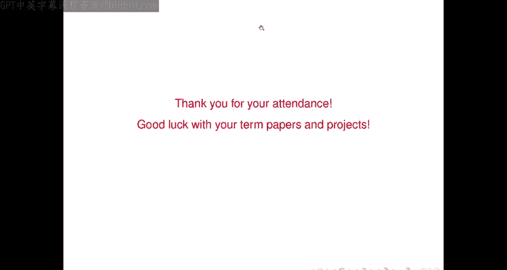