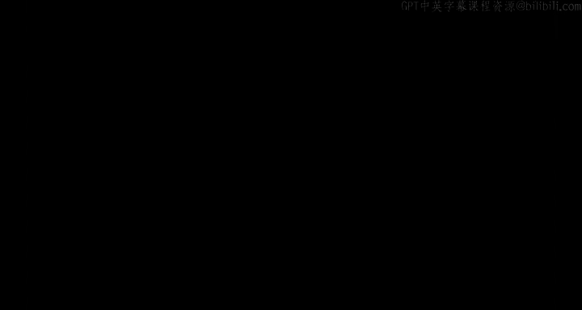
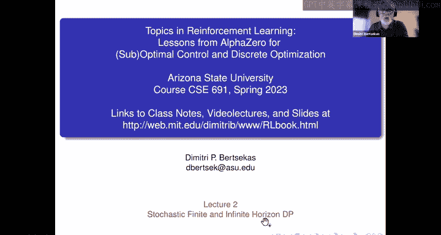
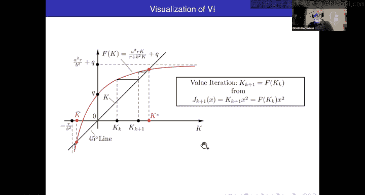

# ASU《强化学习2022-2024｜cse 691 Reinforcement Learning Course at ASU》中英字幕（deepseek - P15：[23]Lecture 2, 2023_ Stochastic DP for finite and Infinite horizon, - GPT中英字幕课程资源 - BV1zcfVYdErD

Okay， let me welcome you to this second lecture of I class on reinforcement learning。

Last time we talked a little bit about deterministic dynamic programming problems and their exact solution。

And this lecture is going to be devoted to stochastic dynamic programming problems。

With both a finite horizon and also an infinite horizon。

So we are going to do a little bit of review of the dynamic programming of for deterministic problems。

And also discuss methods of approximation in value space。

Then we're going to go into the stochastic dynamic programming algorithm。

We are going to apply to the exact solution of an important class of problems。

Linear quadratic problems involving a linear system and a quadratic cost function。

This is an important special case， but also it's a very favorable case because it has an analytical solution。

 which is going to be also useful for us。In constructing visualizations of various methods that we're going to be interested in。

Then we will discuss approximation in value space for stochastic problems。

And then another class of methods， approximation in policy space。which。

Is receiving a lot of attention， but as far as this course is concerned。

 we're not going to spend too much time on it。And。We're going to。

But if we outlined the ideas behind it in this lecture and then near the end of the course。

 we're going to discuss methods for constructing such approximations。

Then we're going to go to infant horizon problems， we're going to overview their theory and their algorithms。

And then discuss the application of the infant horizoniz theory to linear quadratic problems in infant horizoniz。

 Let's start with the。Finite Hizon， deterministic Pro and R review。In the previous lecture。

We define this problem。It is it involves end stages。呃。

And the state of the system at stage gate deed by Xk。

 the control of the system is deted by UK children from Sun that depends on Xk。And a the stage。

The state is xk， we apply controlled UKk， and we move the state Xk plus one。

 according to this equation。And we also incur this cost。And we do this for end stations。

The cost function is the sum of the course over the end stages。

 plus a terminal course at the end involving the terminal state XN。Now。

 the control variables moves are UK， and there's a sequence of n of them。

And we want to minimize the cost。Over these sequences of controls for a given initial state x0。

So this is the expression corresponding， the expression for the course corresponding to。

State X0 and the。Sequence of controls U0 to U minus-1。And the optimalim cost function。

Is obtained as the minimum over the controls of this expression。

 and it's a function of x0 we didote by J star。So this is the optimal cost function。

 but a problem as a function of the initial state。And the dynamic programming are for this problem。

Involves。A backwards computation to compute the optimal cost Jk star of Xk。Of the。

Saale sub problems corresponding to the state's X。啊。Okay， so。How do we do this。

 We start with the final the terminal subpro。And this is the initial condition for the computation。

And given Jk plus one star， we compute Jk star for xk by adding。The cost of the egg stage。

Adding the optimal cost of the tail subpro from the state where we land and minimizing over all UK this is dynamic programming algorithm it goes backward from JN star consists JN star minus1 J star n minus1。

 JN J star n minus2 and so on， and the last step we obtain the optimal cost function of the problem。

 which is J0 star of x0。Now。This computation is quite substantial。

 it can be viewed as offline training when we want to choose controls online， we go forward。听。

And the way we do this is at the initial state， we do this minimization and obtain U0 star。

 go forward one step， obtain x one star， and continue this way to obtain all the controls in sequence from U0 star to U minus1 star。

This is what you would apply online to compute the optimal control sequence after you have computed all the J stars。

Now， the dynamic programming algorithm。Can also be written in an alternative and equivalent way by using Q factors。

The optimal cu factor corresponding to a pair。Xk you day。Is given is defined by this expression。

In other words， it is the cost of the stage corresponding to Xk and U plus the optimal cost to go from the next stage for U line。

 It is， in fact， the expression that appears in the right hand side of dynamic programming。

So this is the definition。And now the optimal cost function Jk star can be obtained from the optimal Q factors by this expression。

 this is just a dynamic program minimum of this expression to obtain Jk star of xk。So， now。

We can like。The dynamic programming algorithm in terms of Q factors by combining the two equation。

This two factor here is given by this。And its given by， and we have to add this。

 which is the minimum over U take plus one of the Q factor at the next stage。

So for is dynamic programming algorithm operationss on optimal force functions forced to go。

This alternative algorithm operates in terms of Q factor。

And there are reasons in the reinforcement learning why we want to consider two factors。

 and this will become a apparent as we go along。However。

 this alternative dynamic programming algorithm。ItCan be hugeed。As another way to do approximation。

And approximate forms of this type of algorithm and related algorithms。

Inform a class of reinforcement learning methods， which are known as new learning。

We will revis it to learning later， but're going to focus primarily on cost function。Okay。

So now approximation in value space is the principal methodology that we are going to consider this course。

一。Yes。Tice to alleviate the problem， the basic problem of the dynamic programming algorithm。

 which is over 120 computations。By replacing Jk Jk star with an approximation J killedilda K during online play。

 the main problem here is computing this Jk series， which can be very， very difficult。

So suppose that we have some approximation and we're going to discuss methods for creating such approximations。

 then we can do online play and generate online subopal control sequences by going。

Start from the beginning， compute U 0。Pilder， by minimizing this expression where J1 star has been replaced by J Tilda1。

Go one step forward。And then sequentially go forward to calculate the remaining。

Controls in the sequence。说。An evident question is how do we compute this J tils and this is one of the principal issues in ArL that's going to be occupying us for most of our course。

There are many different ways to do it。And let me just summarize the principal categories。

One possibility is to use offline problem approximation。

Suppose we have the original problem and a simpler version of that。

And we solve it exactly by dynamic programming， then we can use the optimal cost function of that simpler problem as Rj tilde for this approximation in value space algorithm。

That's one possibility。Another possibility。第生。To do online approximate optimization。F theby is。

Solve online a shorter horizon problem。By multi step look I ahead minimization and a simple terminal cost function。

 In other words， our problem， our religion problem， we have a long horizon。In this。

In this type of method， we consider a version of the problem。Over a shorter horizon。

 And then perhaps use some。For multiple steps perhaps and also use a terminal cost function approximation at the end。

And this is the principal type of method that's used in MPC， model predictive control。

Here's another possibility。Obtain his jailillders by training。Approximate them。发了卖这肯定。

Introduce a parametric class of functions。Which involve a parameter R， which is tunenable。

And then Q Q and R by training， using data and perhaps a neural network or some other approximation architecture。

So this this has to be done offline， of course。And basically。

 we use neural network ideas to calculate from data this JTilde。

 that's a challenging type of methodology， but it's one of the principal ones within the landscape of reinforcement learning。

Okay， the fourth type of algorithm， an example of how we compute J fieldilda is by doing it all loud byistic。

 and we will explain this in the next few slides。电呢。It all loud。

We calculate J Tilda by using auristic。From the next stage， in particular。

We generate a single system trajectory one state at a time and with the typical state upon reaching the state Xk。

 we compute。We consider all possible controls。 we compute the corresponding next states。And。

From each one of these next states， we ran the heuristic。

 some heuristic algorithm which is unspecified at the moment。

 it generates a trajectory all the way to the end and also a course Now the cost of the heuristic is denoted by x H of x k plus1 x K plus one。

And for each one of these controls， we calculate this expression。

 and then we choose the control that minimizes this expression。

So it is approximation in value space with H k plus1 taking the role of J tilda K plus one。However。

 bi heuristic is that is applied online through some kind of simulator or some kind of analytical calculation。

And this is done for all possible values of the control。So for next day， we generate the next day。

After chose choosing do decay and we repeat， and one by one we get to the end of the computation。

This is the roll out algorithm for finite state deterministic problems with one step look ahead there multi step look ahead versions also。

说呢。Let's give an example of this algorithm。And incidentally。

 your first homework is a more difficult version of this example。

It involves the traveling salesman problem that I considered in the previous lecture and gave a problem formulation and an exact solution。

Okay， what is the problem？We have a number of cities for in this case， which are didote by A， B。

 C and B。And we want to start with some city and go to and visit all the other cities once and only once。

And there is a travel cost in going from one city to the next， given by this matrix here。

So to go from C A from a to B， X equal costs you5 to C costs you1 to D costs you 20 and so on。

 This table here， this matrix gives you。All the intercity travel costs。

And we want to find the sequence of four series with no repetition that starts at a and goes and returns to a。

嗯。To formulate this problem， we did this last time we have to introduce states and the states are partial toolss。

So the initial state is CDA。Partciial tours of length2 starting with A are A B obtained by visiting state city B from A。

 A C and A D。And then。At this this stage here， we add one more city that we have not visited before and then one more city at this stage。

 and then we have to return to city A。Now the travel costs are the black numbers that I have put in along those branches。

 Okay， you can check A to B5， A to D 20 and so on。And the dynamic program in Albert。

 we did this last time。Starts from the federal state。And goes back one step。

And gives you this red numbers here and then goess back once step。

 gives you this red numbers here also。20 plus 1。1 plus  three， which is 4。 and so one。

Now in this last three two stages there is no choice to be made at this stage we have a choice between two different cities to go and the dynamic programming algorithm compares this branch and this branch takes the minimum after adding the corresponding travel costs so。

So if you take this branch is 21 plus1 equals 22， take this branch is four plus four， which is8。

 that's where this8 came from is the optimal cost to go from this city。

And so one we do this from all cities and we reach the initial state and we compare。5 plus a。

 which is 13，1 plus 27， which is 2 a and 20 plus 25， which is 45，13 is the smallest。

 and this is the optimal first choice go from a to B。And then we do the same thing。

 online play going forward， and we construct the optimal sequence， the optimal solution。

 which is go to B and then to D and then to C and then back to A。So this is the optimal solution。嗯。

冇有。We want to apply orola。Remember in the rollout。At every state that we land。

 we consider all possible choices and then the base run this tourististic。And we're going to choose。

 for this example， a common heistic， which is called the nearest neighbor heistic。Basically。

 it goes from a given partial tour from the end of a partial tour。

To the nearest neighbor that's eligible to be included in the next tour。So for example。

 at this partial tool here， we consider that the two possibilities and we go to the take the possibility of the smallest cost like this one。

So thiss some kind of a greed he。And let's see how it works， starting from the initial state。So。

Here we look at all neighbors。And the nearest neighbor is C。

 which has a one here we look at the two neighbors， the nearest neighbor is three is D。

Push cost you3。And then there's no choice at this partial tour。 We have to choose B。

 and then we have to choose。So this is the trajectory generated by the nearest neighbor tourist。

Between the violences of rural life， we go to the base shoots。

And now we are going to discuss how the rollout algorithm will work。Are there any questions so far。

 is this figure understood？Okay。So。Remember， a。It goes forward， starting from the initial state。

If consider all possible choices。And it runs the base heistic from each one。

So it goes over here runs the nearest neighbor heuristic。Which is one， we go here。

 we go here and here， okay。So。This gives me five plus one plus 1 plus 20， so that's 27 okay。

So that's what this blue number here is， 27。嗯。And then we consider the other option。

 which is to go to CDC。Then we ran the base heuristic from there in this one。

And it gives you a cost of。One plus 3 plus 4 plus 20， which is 28。And then I consider a third option。

 go to CDB and we run the nearest naval heuristic takes me here， here， here。

 so this gives me like 63。So the best possibility is this 27 and the rollout Albert is going to move to this partial tool going to choose B。

And then， it's going to。Again。ran the all our routine。Consider all possible options。

 this one and this one and run the base heuristic from there now okay the base heuristic is only one choice。

 we can see it here and if we compare the numbers。1 plus  one plus 1， yes 22，4 plus 3 plus one is 8。

This one wins。 So after the movie here。We change course instead of going here。

 we'll go here and then there is no choice after that。

 so the rollout algorithm is going to generate this red sequence。

Whi'ch incidental is optimal in this particular case。So。That's how the algorithm works。

And notice that there is。There's something about it that's interesting and generalized。

We started from an initial trajectoryor， an initial solution generated by the base tourist risk。

Then the rollout algorithm generated another trajectory。

It E1 trajectory which has smaller costs from 28 where you went to 27。

Then it changed course again and followed this branch here。Which has a cost。

 a total cost of one plus 3 plus 4 plus 5， which is 13。So the Wil has a cost improvement property。

It looks forward all the way to the。Not like the nearest neighbor heistic。

 which is greedy and looks only one step ahead。It looks all the way to the end and generates trajectories that are improving at every step。

 improving or。Of equal cost。Decided with this trajectory。

 generated this trajectory and then generated this trajectory。

That's the important property of rollout on which we are going to expand quite a bit as we go along。

It provides you with cost improvement， a better solution than the one provided than base heistic。

And this is an example， and we have seen an example of that。

have any questions about the allowed algorithm for this example？Profesor。Yes。

Does roll out Gar an optimal solution or does it only improve the base heuristics？啊。In this example。

 it improves the previous solution， not just the basic characteristicsistic。

 we start from the basic characteristicsistic get a better trajectory and then a better trajectory after that and so on。

So from 28， we went to 27 to 13。Of course， I should tell you that some conditions are required for this。

Generally， it is true when the basicistic is greedy， okay， of the greedy type。However。

 we're going to be more precise as we go along， probably three lectures from now。

Professor I have a question from a student in the room。That okay。Hello， professor。Yes。

 this is a bi I have a question like say the travel cost from CT D to CTA is taken as 20 So if we take that cost as 21 then we might not get the optimal solution with rollout like we will then get the solution from CT A to CTAC then that path will be followed maybe like rollout will give improvement from the best heuristic but means。

How good it is from the optimal like is there any guarantees for rollout or like what conditions should be followed？

So that we could right the algorithm is don't guarantee to give you the optimal solution。

 so not suboptimal solution， which is obtain much cheaper， that's the philosophy behind it。

How well does it work？我要。It's difficult to quantify the cost improvement。

 however one can get insight about how this cost improvement comes about。

And this is through the mechanism of Newton's method we're going to discuss this in the next time。

 you can view rollout as a one step of policy， the method of policy duration and also as a one step of news method。

Starting from。The cost function of the base heuristic。So the Newton step。

We'll give you an improvement。And also。If you're sufficiently close to the optimal。

 it will guarantee you a very substantial improvement。

And we're going to see this in various examples。However。

 it's very difficult through analysis to quantify just how much improvement we're going to get。

But we're going to be getting a lot。Depending on whether we are within the sweet spot of Newton's method。

 that's basically the idea。Thank you。Okay。Any other questions？Okay。

 so now we're going to go into stochastic dynamic programming and we're going to go from exact to approximate and so on。

So in satorcchastic problems， when you transition from a state to the next state。

 the transition involves some randoms。If you choose even if after we choose the control。

 there is no guarantee that you're going to land at any particular state。

 there is a probability distribution over the next states， which is determined by a random parameter。

 which we generically call disturbance， this WK。It has a known probability distribution。

And it could take the character of any of a number of things， depending on the application。

 it could be physical noise， it could be market uncertainties in a financial type of problem。

 it could be demand for inventory， it uncertain in a supply chain type of problem。

It could be unpredictable malfunctions， like in a machine shop。

 some machines may break down or some robots may break down。There is this disturbances。

Which makes the problem more complicated。The random course affects the system equation。

The random variable WK affects the system equation， and also it affects the cost of the transition。

Which now takes this form here。Now for a given sequence of controls。Well ready to get。

A total cost that's given by this expression， like before。However， this cost is random。 It is random。

 because involves the。But I the variables WK。So to obtain a number。

 we're going to take the expected value of that， and we're going to call this the cost of a sequence u0 up to UN minus1。

However， here。We will not optimize over sequences of controls。Instead。

 we're going to optimize over feedback policies or closed loop control logs。啊。

Part of the definition of this problem is that when we land at a state Xk。

 we get to observe it perfectly。 that's the meaning of perfect state observation。

When making the case decision， we know the current state。So we can use that， and we can。

Adopt our decision based on what state we observe thatquare in。In this way。

 we don't have to stick with a decision that we choose if we choose a sequence of controls at the initial stake。

 we are not bound to that， but rather we are free to observe the current state and choose appropriately our decision。

So。The object of minimization is something more complicated now， it's a sequence of functions。

 not a sequence of controls， each one of these functions new， let's say。

 maps the current state Xk into a control to apply at Xk。It can be viewed as's a look up table。

 a table that tells you if you land at Xk， you are going to apply Uk。

 another table for for stage K plus1， if you land at xk plus1。

 you are going to use new K plus1 of xk plus one。There are these end tables that characterize this feedback policy。

嗯。For close look， we're going to be polish。So here's an important point， using feedback。

 choosing controls with knowledge of the state is beneficial in view of the stochastic nature of the problem。

 we overcome the uncertaintyty by choosing controls while incorporating our knowledge。

 our state of knowledge， we know that the states that we generate。

 we adapt our controls appropriately。And we optimize overall the possibilities。

And now let's define the cost function。Given an initial state。And given a policy pie。

 the cost of that policy is given by this expression。

We plug the news of the policy inside the course and we get a random number， a random cost。

 random because there's Wk here。We take the expected value of that。

 the weighted sum of all this costs weighted by the corresponding probabilities of the W。

And that gives us a number， not a random variable， a number that depends on the initial state and on the policy。

we minimize overall policies， and that defines the optimal cost as a function of the initial state。

And an optimal policy is one attains。This optimal cost。

 and we're going to see that the dynamic programming algorithm will give you a policy that's optimal for all the initial states。

So let's get into a stochastic dynamic programming algorithm。Similar to the deterministic case。

 it produces the optimal cost of the tail sub problemsbleence that start at the different states。

And we use the same notation for this。嗯。😊，The way you derive the algorithm is by some kind of a principle of optimalph type of argument。

 not quite the same， but it's inspired the algorithm the mathematical argument is inspired by the principle of epi and it's given in your notes。

 we're not going to go through the mathematical argument here， but the。A itself is very intuitive。

It starts with the。第win no。There is sub problem and then goes backward。And it uses。

The same type of calculation as the deterministic case involving the cost of the current stage。Plus。

 the optimal costs to go from the next state where we land。However， this expression here is random。

 so we take the expected value over Wk and get a number for every Q for a fixed x and for every view we obtain a number。

It is also the Q factor。 Okay， what we call the Q factor。We minimize overall view。

 and that gives us the optimal cost of the case， sub problem of the。Of stay stay。

So it's the same kind of algorithm algorithm' worked as before。

But it involves this values and this expectation。And the optimal course is obtained as the last step。

The last。Function of D J zero study is， the optimal question。Moreover， from this algorithm。

 we can obtain also。要么关利些。And of the optimal policy component UKK star can be constructed simultaneously with JK star on this calculation and consists of the minimizing UK star here。

So we do this minimization for every X， we obtain optimal controls to apply at each。State。

 and we put them together into a policy component， UK star is the table of controls to apply at the different states。

So the dynamic programming algorithm give us both the optimal course and the optimal policy。However。

 there's another way to obtain the optimal policy or to implement the optimal policy that does not require storage of these UK stars。

Suppose that we have computed all the J stars and now you want to implement online the optimal policy。

We sequentially go forward。For every stage we observe the current state and we apply the minimizing control remember we have this J stars we assume here and given the state Xk。

 we minimize overall Q， obtain the control you can start to apply。

 observe the next state Xk plus one， do this calculation again and go forward。

So these two methods are equivalent， this one requires a priority storage of the optimal policy。

 this generates it online， assuming that we know the JS。

But the flying the or here is that there's a lot of computation still。We need to know the J star。

Even if we know the J stars， there's an issue with computing this expected value。

Depending on the problem。你说。Computation of the expected value can be quite time consuming。

 And remember， it has to be done for every year。And then we have to also minimize overall gear。

 which is also involves some computation。So all in all， this algorithm is very。

 very time consuming for any kind of challenging problem。However。

 there are some nice problems for which this algorithm works nicely， analytically。

 it can be used for analytical solution of the problem。😊。

And this is the favor of a case of linear quaraic problem。

It's very important in control theory and it's going to be very useful for us。

 both in terms of its applications and also in terms of the visualizations that can can it can。It。

 it can provide。Okay。We're going to consider problems involving a linear system in a quadratic cost function。

And for simplicity here， were going to focus on one dimensional problems。

For of a state is just a scalar， okay， xk plus one is generated linearly from the preceding state。

 the control that you apply， and also there's an additive disturbance。

 random disturbance to be added。啊。And A and B are given scrs。So this is the system equation。

And the course of stage J is this expression here， it's a quadratic in the state。

 quadratic in the control， and Q&R are given scals which are positive。

And there's also a quadratic terminal force。So that's the system equation。

 that's the plus function and what's the dynamic programming algorithm。Well。

 it's the out I gave in the previous slide， it starts with a terminal cost。

And generates Jk star as a function of xk by using this computation。

Current stage cost plus optimal cost to go from the next stage。

 expected the value of that will be done。And minimization over you。

So we have applied the dynamic programming algorithm。To this linear quadratic problem。

And the nice thing about it is that it can be carried out in closed scores。

 it's a very easy computation and it kills。That the optimal cost to go is a quadratic function。

Of X day。Kk is a scalar that we can compute with a simple algorithm。

And the constant here is something that does not play at all because if you add here。

 constant doesn't matter so effectively the。Optimal cost to goal is quite value。And because。

This minimization here involves a quadratic， it gives you a linear。

A function of the state as the York control。We're going to show also that the optimal policy。

Is equal to a linear。For efficient LK multiplying the current state。

 and this LK can also be computed in by an easy algorithm simultaneously things with KK。

So this is the nice analytical solution of the linear pedratic problem。嗯。呃呃 for。

For the one dimensional case。There's another interesting fact about this。This problem。

The optimal policy does not depend on W does not depend on the distribution of W does not depend on the on the。

On this values higher moments， whatever。As long as these because they don't me。

I forgot to mention here that we assume that WK has zero me okay， if it has a non zero mean。

 then a similar kind of calculation applies。And what is true is that the optimal policy does not depend on the distribution of W just on its mean。

 which is zero in this particular case。And this is known as the certainty equivalentvalence property of linear fiity problem。

It says that。You can pretend that WK is not stochastic。

 but rubber is deterministic and fixed that is mean。

 and you are going to obtain the same optimal policy。

So you can click the problem as if it word determin。😊，然好。For other problems， this is not true。

 on the other hand。It is a common approximation idea to use in the reinforcement learning。

Simplify the problem by fixing uncertain quantities which give us trouble by fixing them at their expected values or some other typical guide。

Okay， so。re goingI'm going to go into the next slide and give you an outline of the derivation of this result。

However， I want to note here that all of these results generalize to multidimensional linear quadratic problems。

Where x stays an m dimensional vector， u stays an m dimensional vector。The scaleless AB， Q andR。

Are then replaced by neces and the same typeide of calculation goes through。

Except that we need to use linear algebra to do that derivation in our。In this lecture。

 I'm going to be focusing on the。OfI'm going to be focusing on the one dimensional problem and and。

I'm going to give you the derivation to the next slide。Okay。

 before I go into any this long calculation， are there any questions？

The calculation seems a little bit overwhelming， but's a standard calculation。

That it's also an easy calculation to understand， does not use use a long formula。

 but not difficult pattern。Okay， so what we want to do is execute the dynamic programming algorithm and verify that we obtain the formulas for the optimal cost function and the optimal policy that I gave in the previous slide。

So how do we go about it。We start with this terminal condition， the terminal cost。

And write the dynamic programming expression。Minimize overdue first stage。

 the current stage cost plus the cost to go as given by this pgadic expression。

So we substitute this expression here， we write this so。And then。

We have this quadratic expression and we expand it， okay， using the quadratic corless。就。

It's at a square of this。m here。Then the square of。Of wn-1 expected value of that。

 But this is just the variance of of Wn-1。 because remember wn1 is assumed to be is you what mean。

And there's also a cross product term involving this and that is its expected value and now this is zero because the expected value of wn minus-1 is assumed to be 0 if it were not zero。

 we have to modify this calculation。So collecting terms and taking。This。

Think here out of the minimization does not depend on you。

Takating this thing out of the minimization。Because it doesn't depend on you。

The terms that depend on you are what you see here， and we have to do this minimization。

Now notice that this is a quadratic minimization over you and it can be done easily。How to do this。

We minimize by setting to zero the derivative of this expression with respect to you that the derivative is equal to this。

 So we solve for you now and we obtain。A linear function。Of x and minus-1。This linear function。

But L n minus1， the linear coefficient is given by this expression here。

 very easy to see this calculation。So now we have the mini control and we can substitute in here the mini control。

哎，不对。In here， for example， and then obtain after some calculation。

 obtain Jn minus1 star of xn minus1 as a quadratic。Plus， a constant。the constant comes from here。

 the quadratic is obtained because u is a linear function of x。 So this is a quadratic function of x。

And we add the qua function we update。A quadratic function that has this particular form。

A N minus1 is given by this expression P involving A， B， odd， and Q。

So we are done with the first step of dynamic programming。 and law and behold。

 we have obtained a nice form of。😊，Opttiimal cost to go。 It is quadratic。Like this one is。

 so we can repeat this calculation。Using this， instead of that。And going backwards。呼浴机。

The final result， I'm not going to go into details。

 evident them from this calculation that it can be repeated all the way going backward。

It has the form。Okay， the sequence of k k of k capital K of K is given by this expression here。

From K K plus1， starting with Kaan was K， I'm sorry。啊。不懂给呃。K plus one， will obtain， K， day。

 So this recussion goes backwards。And simultaneously。

 we can compute the linear cost coefficients of the controller， which is given by this formula okay。

 so the a generalization of this formula K plus1 replacing Q。

So that's the complete solution of the linear pratic problem。Assuming zero mean disturbances。嗯。一律是。

It is a very easy calculation to do essentially the result is obtained in close four。

Havere there any questions about this slide？Okay， we're not going to be doing calculations like that。

 I wanted to give you this one because it's important and also。

What we're going to be using in the future is the fact that this is the form。

Of the genetic form of the optimal solution， and there's also a version of this for infinite collision problems that we're going to come to in a few slides。

So let's make some comments about linear quadratic problems in general。

The first one relates to certainty equivalent。The solution does not depend on the distribution of WK。

 only on the mean of WK， which is zero in the previous calculation。

And this the effect of this is that the stochastic problem can be replaced by the deterministic problem。

 an idea that's going to be used with。It's going to be useful。

 more general problems in the reinforcement Learn Con。As I mentioned earlier。

 it's generalized to multidimensional problems， non zero mean disturbances and so on。

It generalized on an infinite horizon。 we're going to discuss this。

Essentially by taking the limit in the solution of the finite collision problem。

As end through infinity。Now， here's a major generalization。So far。

 we have assumed in our stochastic dynamic programming context that the state is observed exactly perfectly。

However， there are important press of problems that involve perfect imperfect state observation。

 partial state observation。Effectively， instead of observing the exact value of state。

 we obtain some measurement。W are linear in the context of the linear quadratic problem。And。

The optimal policy involves again， can be obtained analyticalant。

 and it involves an extended form of certain equivalence。Where again。

 the optimal control to apply is a linear coefficient。

 the same linear coefficient as for the deterministic problem times the expected value of the state given the measure。

When we observe the state exactly that this is equal to xk now in this context of partial state observation。

 we don't observe the state， but we can compute the expected value of the state given the measurements through some kind of an estimation procedure。

Calman filter are used in this context for not going to discuss them， but it's it's。

One well knownness。To calculate this expected value here。Again。

 this is an idea that is used in the way of approximation。More general content。

 replace unknown or imperfectly observed states with their expected values provided by an estimator。

So linear assistance to quadratic across our a starting point for other lines of investigation approximations。

 this is a very， very， useful line of very useful approach in design controllerrollers。啊。

One class of problems where linear quadratic formulations play an important role is model protic control。

 most of the applications of model peric control involve a linear system a quadratic course。But also。

 additional constraints。In our formulation of the linear quadratic problem。

 it is important that there are no constraints on the control and no constraints of the state。

In in many realistic control problems， there are state constraints。

Like a cautious stay within their own。Or the velocity cannot exceed a certain bound because otherwise the car is going to go off the road on a third。

Then other constraints are that there may be obstacles that the car has to be able to navigate through。

So all of this imposes state constraints and control constraints。

 which are part the par of many of the model predictive control problems。

And require an extension of the lineara quadra cor， which is quite substantial， but。

Still living a quadratic firm relationship and the results play our own。

So similar with state constraints or control constraints， again in bulk release control。Also。

Problems of adaptive control。Where the system involves unknown or changing parameterss。This happens。

 for example， in self drivinging cars， robots， the environment changes， the system parameters change。

And。Certainty equivalentence ideas from the linear for problem apply here in adaptive control。

 and we're going to discuss those。Probably in the next lecture。

So this is an example of an exact solution of a stochastic dynamic programming problem and let me say that there are very。

 very few of those that you can solve exactly， usually the solution is through computation and the computation can be overwhelming because of the computational requirements of the algorithm and program now。

So this leads us to the idea of approximation in value space and the reinforcement learning Act。

Are there any questions from the linear but problem？O。This is a busy figure， but an important one。

It outlines the approximation in value space framework。Where we replace the J stars with J tildades。

 okay， and when we land at a particular state， we do this minimization online and we go forward to the next state。

So this minimization is like the dynamic programming。我没来。

Except that J Tilda is used in place of J star。And there are three approximations here。

And they are more or less independent， they can be designed independently of one another。

One is the cost to go approximation。Finding J Gils， okay？Another one is this minimization here。

 which can be very difficult。Simimpplifying the minimization is an important idea that in reinforcement learning in approximation in graduate space。

The third approximation comes from this expected value， which again， can be。关啲。喂。

W it's hard to compute。Even though it involves only one state。

Only one stage in one random variable this year， this expected value computation has to be done for all controls。

So it can be a difficult computation。And we're going to see ways of approximating this expected time。

So the three approximations and each one has to be can be done in a variety of ways and the choices can be combined in a scheme。

 in an approximation graduate free scheme。And that's some guidance of this。This structure here。

 One is to use multi step look ahead instead of one step look ahead Here， we look ahead。

 we look ahead only one step and then take the cost function approximation multi step look ahead。

 we look。Forward multiple steps and then take the。Plus functional approximation。

Another possibility to simplify the minimization is when you have。嗯。

Multi Asian problems involving multiple components。

 And then there are ways to simplify the minimization which can be very。Much very。

Very useful and save a lot of computation time。We're going to look at multi Asian problems in the next lecture。

 but now I want to give you a figure for summarizing multi step look ahead。

So I mount step overhead ahead。We look instead of one step and then the cost function approximation。

 we look at L steps。Minimization。And the terminal cost function approximation。and we。

We minimize over。The view of the current stage plus。Re。

Policies that we're going to follow for the other L minus one stage。

So what this is is a dynamic programming computation involving L steps， relevant end steps。And。Again。

 we have the three approximations， miniization， expected value， cost approximation。

 cost function approximation。And after we do this minimization at the current state。

We use beauty and throw away all the music。So this is now step look ahead and it tends to perform better than one step look ahead。

However， it requires also a lot more computation per stage。

 so there's a tradeoff involving performance and computational overhead。

And the trade off is something that we're going to be discussing。In our future lectures。

And we're going to quantify what is involved in this type of trade。Okay。

 so here's a complementary figure。How do we construct approximations of different types？

There are many different ways to construct cost to approximation。We mentioned one of them。

 certain equivalents to pretend that the problem is determin。By fixing the random variables。

 the random disturbances is at some typical value。And then solve it in one way or another。

 certainly there's a big simplification。Another possibility is problem approximation replace J star by the optimal cost of a simpler problem and use this as J childrenil。

Rllout is one possibility， an extension of the deterministic rollout that I gave in the previousview。

In the in deter for determinative problems。Models predictive control can also be fluly reviewed in the context of raw line。

Then another major class of approximations is through neural networks and approximation architecture。

We find a J filterza by traininging with data。And the branding and neural network。

In ways that we're going to discuss in future lectures。So that's one major possibility。

 another possibility also is aggregation where we consider a smaller problem where groups of states are aggregated in think states which can disagree aggregated problem can be solved more easily than original。

 it has a connection also with problem approximation。So all of this is a very， very big chunk of。

What enforcement learning。And we can't cover everything， but we're going to。

You nibble around various possibilities。Okay， how do we approximate this minimization？Well。

 the minimization here could be potentially be over a very large number of controls。

Or an infinite number of controls。So how do we make this， how do we make this track move？Well。

 if we have a continuous sir。啊滚定是。Control space and one possibility to discretize it。

And that will simplify this minimization。Another possibility is selective minimization。

Whereby we have a large control set。But we。We select out a subset of promising control。

 by means of some heuristic。We reduce the control constraints to something that's smaller。

 and that proportion proportionateally。Decrease the amount of computation needed here。

We're going to discuss possible along this line as we go forward。

How do simplify the expected value calculation？Well， one possibilities is。

Instead of full blown Monte cargo simulation in situations where we cannot do this calculationiv analytically。

Have to use simulation instead of doing full blowning Monte cargo simulation。

 we can do selective simulation。Whereby we simulate more accurately controls that are more promising than controls that are sort of。

Not dont seem very good on the pace of preliminary calculation。

And this is the idea involved in medical College research。

Not the color of research is a method for doing adaptive simulation and reduce the calculations of this expected lab。

And it can be used both in the process of offline training as well as online play。

 and it's a very big part of the successive alpha zero by the way。

Because alpha zero requires very deep calculations for which exhaust simulation of all the possibilities is very hard。

 and this tends to reduce the amount of。Compplication efforts that goes into simulation and。嗯。

And so this extra time can be used for other things。Improving this approximation to them。

So all of this is part of our future。嗯。Future。Algothmic possibilities that we're going to discuss。

 And by the way， there are corresponding possibilities for multi step look again。

 I'm showing here only the first only the。Once I look ahead。

Let me give you the general structure of Ro， this is a possibility for approximation of the terminal course。

Here we use a base policy， like in the deterministic version of rollout and some terminal cost function approximation。

At a given state， we consider all possible controls。And also。

All possible states that you may end up with， which means that we have to consider all the possible bad as well。

And from each one of those， we run the base policy for a number of steps。

 M steps or all the way to the end of the horizon， but if we don't run to the end of the horizon。

 we use a terminal cost function approximation for the stages beyond plantation。

And then we calculate the Q factors that correspond to each of these controls。

 and we choose the control that has minimal Q factor。

Are there questions on the general structure of approximation value space for stochastic problems？

I have one question from a student here。Okay。What is the question you said you had one question。Yeah。

 professorfesor could you go back to the last slide。So my question is， is the J tta Z fix the number。

It the depends on the next day。 Okay， it's a function， right。O。So it involves uncertainty。

 it involves also uncertainty it's part of the expected value。Okay， I see。

 my initial thought is because this is a train offline， so I suppose。When we know the X K plus 1。

 it should be a fixer number。The functional form of J Tida is fixed。

Like it may be a quadratic function， but it may be the output function of a neural network。

 the functional form is known， but the argument Xk plus1 is not if this would are represented by a neural network。

 you would have to to feed into the neural network Xk plus1 before it could give you a number at the output。

ok， thank you。So。Let's talk a little bit about approximation policy space and then we'll take a break。

Approximation in policy space is the major alternative to approximation value space。

The philosophy is different， very different than the approximation magnet space。😊。

What we have here is a system that has a state that we observe。

And we apply a certain controlhood using some points。And then we keep going forward。Now。

 calculating the optimal control is very， very difficult， but we can consider a parametric class。

 a restricted class of pro。😊，Such as those provided， for example， by a neural network。

For some other type of architecture。And this is a parametric class involving some parameter。

 once you fix this parameter R， then this controller is determined。But how did you find art care？

Well， you do this by optimization。Over in the paradigm space。

And this minimization may involve training data。May involve some measure of performance。

 We'd like to find RK that needs to。Low cost。 Okay。

 so it may be an optimization over our to reduce the cost of the。

Of the problem done from some initial stage or from a subset initial stage。So that's the usual。英雄啊。

L of controller paramedic family。4 for our of parameter。And the methods used for optimization。Our。

Guarding variety of optimization methods， random search。Graient type of methods。

 policy gradient methods course。And also methods that are used for in machine learning or classification。

 as we will discuss。Shortly。This is a large variety of methods。And呃。

There's an important advantage to this methodology。呃。Once I have compute the parameters。

 usually offline。Then I have a fixed controller。Wwhich can compute controls in response to given states very quickly much faster I don't have to do approximation value space。

 minimization， expected values and so on and so forth。 This is a very costly computation。

With approximation points space。This computation is very fast。

 A lot of the computation takes place offline。To compute the parameters。

 but once these parameters have been computed， online controls are generated very quickly。

There is also an important disadvantage。Once we compute a controller offline。

 we are locked to a particular system environment。The particular model。

If this model changes over time， the parameters change over time。Then。

We are locked into this controller， we can't add that。😡，For yes an approximation in value space。

 we can do online requirement。Which means that we do the。

Look ahead minimization based on the new model of the system。

 the new conditions within the environment。There is also another disadvantage to approximation in policy space。

 which will become apparent when we progress later。It does not involve a you step， and it loses the。

 the quality of approximations that。Bookooks mission and valuespace provides in other words。

There are performance limits that you can obtain with this methodology。

 even if there is no need for online planning， and this is due to the fact that。

This the cor of Nuton method does not apply to this method damage。

Now here's another important difference between approximation value space and policy space。嗯。V。

Approxi byspace is primarily an online claim。You compute offline this。

 but online you have to make this computation。Offline training is used optionally。

To construct cost function approximations here。我呃。For the one step and multi step of airport policies。

For this middle portion of rawland。On the other hand。

 approximation in policy space is primarily an offline planning method。

Which may be used optionally to provide a policy for online rollout this middle portion of the approximation in value space architects。

So。We have made the point in the previous lecture that it is very useful。

To build online play on top of offline train。However。

 approximation in values in policy space does not allow that does not take。

It does not allowed you to take advantage of online play on top of。嗯。offline drain。So。

Approxiation in policy space。其他粉税额。Would give you a mediocre layer。Whereas。

 if you take that mediocre player and harness it within。This offline。Otain approximations。

 then you obtain a much stronger chest plane。Okay， it's also possible to combine approximation in value space with approximation in policy space。

Remember， the approximate cost of go function J tilda。

 the J tilders that define the one step look ahead policy u to decay K。

What the most step look ahead point。嗯。呃。lead to a computation that's quite substantial。

How do we simplify this computation？Well， one possibility is to take this。

Tbotimal policy and approximated by approximation in policy space。And here how this is done。

Will use approximation false space to represent the policy obtained by。喂。

One step or multi step look at minimization in particular。We have this J filled。

So we can do a lot of these minimizations。Offline to construct a training set involving sound repairs。

Plug in different Xk values okay， different UK values。And do this for a large number of states。

 let's say a million states， we do this calculation， we obtained a corresponding1 million controls。

 and we have constructed a training set involving 1 million samples。Now。

 once we have this input out space， we can fit some kind of an approximation architecture。

 some kind of a neural network。Do this training said。Often， by using E squares。So in particular。

 we can introduce a parametric function of policies。不请播个 parameterK。嗯。

It may come out from a neural network formulation， other formulation。

 and then we estimate the parameters by fitting the architecture to the training set that we have here。

So look at this minimization， it involves the squared  errors。Between。喂你。这珊瑚。A we given states。

And what the。The architecture gives you as a function of R。

So this is a measure of fit of the architecture to this training set and it involves a summation of all the errors over the training set。

 one million samples， this involves a summation of 1 million errors here。

And we find the parameter that gives you the best state in the sense of least squared error。

Now this is a type of methodologist thats used very frequently machine learning。

 people know how to do it， in particular it's used in classification methods。

Where policies are identified the classifiers， we're going to discuss this later。

Let's put that the point I want to make is that。This type of。Ts of representation。

Of the one step Look ahead policy。诶 by。In policy space involves algorithmic ideas that are very well known。

 and very well practiced in the field of machine learning。

So these are the two major approximations in them。In early enforcement learning。

Approximation value space on which we're going to focus approximation policy space that we're going to。

Use you going。We're going to discuss much less and mainly from now on。

 only at the end near the end of the course。And。Let's take a 15 minute break。And。When we come back。

 you may think of your questions。And then we'll continue with infant fluiz problems。

So we'll meet in discuss in minutes exactly。说。Are there any questions about。

The first half of the lecture。We talked about。The Minister and the。Santastic problems。

TheFin horizoniz。And outlined the methodology of。Of observation by space。

With a little discussion approximation。In policy space。

Now we're going to go to infinite Hiz governance。And expand some of the ideas of approximation in value policy in value respect。

So you can horizon problems are similar to find the horizon of problems that involve a random system。

 random transition。Described by a system function。And random course。

Min difference is an infinite cor， there's also one more difference。

The system equation and of course， does not depend on K。We're dealing with a stationary system。

And a course that is non stationary， it involves alpha to the K Al is sum number。

That is between 0 and1。 It could be one。If， however， it's less than one。

Then it's called the discount factor and the problem is called discounted and the meaning of alpha lesson one is that cost far into the future counts was less than cost in the near term。

And。为。The factor， the discount factor alpha enters into the cost function here and has an important mathematical effect。

It keeps this expression bounded as n goes to infffinity， particularly if G takes bounded values。

Because then this expression is it cannot blow up， it involves a summation or a geometric progression。

And mathematically， this is important because as we take the limit of the course over an increasing horizon。

 we don't want this cost to blow up and the infinity。So。The presence of a discount factor。

Has the effect of making this cost tractable and mathematically mathematically。😊，系咪啲诶。嗯，过来。

So for a given partnership， which now involves an infinite number of food。放身。

This is random variable again， we take the expected value。For a finite horizon。

 And then we let the horizon code infinity。 And this is what we call the。

Infinite correction cost of policy pi corresponding to initial state x0。

And the optimal cost functions of paying by minimizing overall cost。And then。Discounted problems。呃。

T to keep this。This this caused finite because of what I mentioned earlier。

 this becomes the sum of geometric progression involving geometric progression。However。

 problems where alpha is equal to one are also interesting。But in order to keep this course finite。

 they typically include a special termination state。

 So basically these problems are finite cor has some problems except that the。

The determination state and the determination time is random and it's not the determined of coy so the horizon itself is kind of random。

And in these problems， the objective is to reach or approach D at a minimum minimum expected cost。

So for example， games involve at de state clear of the game ends。And other problems involve。

States where once you reach， you stay there， for example。

 linear quad problems of the type that we have discussed involve state zero at state zero。

 it a termination state， and that tends to keep the cost up。Fine， even even when alpha is equal to。

呃F is equal to one。So this is the framework。The event variation cost is the limit of。我说法院说了什。

And the theory of infant horizon problems also revolves around the relation。

Between the infinite correlation， the results and the finite correlation results。In particular。

 there are three forumorems。In imping correction problems。That you aim to。

The attempt to hold in each in for each type of problem。

They hold certainly hold the case for the easy cases which are discounted problems the finite number of space。

 but they also hold in modified forms for other types of problems and the three theorems are of this slide。

The first few item says that the case stage is optimal course obtained by finite horizon dynamic programming as you increase the horizon to infinity。

Approaches the infant horizoniz optimal。Mathematicically J starss of x is the limit of J k sub x。

Where JK of x is the K stages optimalco dox， which is generated by this recursion。

The zero stages optimal cost is zero， going to one stage， two stages and so forth。

 there's a sequence of costs involved here。And this is really the dynamic programming algorithm for finite for some problems in disguise。

😊，And to see that， okay， how you derive this equation from finance versus dynamic programming？

Let's call。Vn minus k x， the optimal cost to go， starting at x and going forward for K stages。Then。

 by。The final horizon dynamic program is given by its expression。Of course。

 with case stages to knowledge of thing with。From cost in K with K1 stages to go。

 plus the cost of the。Or stay1 minus k。So this is exactly the final par dynamic program in algorithm。

😊，And now if you divide this expression。By n minus k。And define J case of x to be that。

Then you obtain this formulala here。So。Oh， this is。嗯。

This is the formula for generating external this case that cost is really the dynamic programming algorithm in sky。

Now， this leads to an algorithm push we're going to discuss in the next slide is called value duration。

There's another。Important results here。It says that a star satisfies Belelman's equation。

Which is this equation here。There's one equation like that。Whatever every X。And to get the。

Get a sense of why this should be true。Look at this formula here。

 take the limit as k boostster infin， you get J star over here， J star over here。

 and here is the Belmon equation。The balancing question is very fundamental。And。It is。

All of the analysis systems that you mean for the collection design programming that revolves around it and。

And either it properties or how do you compute J star or how you approximate？

Note that there is one equation for every x， so if there are a million states。

 there are a million equations here。😊，It's an infinite number of states。

It's an infinite number of corresponding equations in government equation。And。

The third result is that。衣服。You obtain a policy by minimization in this Belllman equation。

In other words， if you starts of xing the minimum， the Belman equation for every x。

Then the policy that you're paying in this way is often。It kind of humanity condition。

Notice that this is a special type of funds。It involves the same new start at stage zero。

 as at stage one as at every stage。This kind of policy is called the station Act。

And it makes sense because state at stage zero and a stage one。

 you're essentially faced with the same problem， you're looking forward for an infinite number of stages。

So it would make sense that you would do the same things at the same state。

Whether you are at state zero or stage zero， stage one or stage K， any state 100 or whatever。

So these are the three analytical results associated with the if corizal problems。

And there are some other of course sometimes special in particular types of problems and so on。

 but these are the major results。And there are also two major algorithms。

Falue it and policy iteration。Value duration is the formula is given by the formula during the previous slide。

 generate the case stage course except for one thing。😊，J0 is not necessarily of zero。

 but it can be out of it bad。And I put a question mark here because arbitrarybit why a mathematical qualification。

This is true for many problems， most problems， certainly for discounted problems。

 but not for all problems。So， but generally， you expect this algorithm to be valid。

And to in the limit to generate， we opt more questions。The second major I is policy it。啊，活力是。

This value duration generates a sequence of value function or cost functions。

Poolice generation generates a sequence of policy。Starting from some new zero that's more or less arbitrary with some mathematical qualification here。

So from mu0， get U1， mu2， and so1 and a corresponding cost function。For our policy new。

 we call J U the cost of the policy rather than J P， okay。Gerates a sequence of stationary reform。

Stationary policies had been noted by just the single common policy component。

So how does this consideration work？Well， the typical iteration starts with a policy new and generates a new policy new to them with two steps。

One is a policy evaluation step which computes the cost function J U of this policy。This like a base。

Now， the policy improvements step。Uses the JU of the base policy to compute an improved policy。

 which we might use as a rollout points。A mute Joseph。Using one step look， I get minimization。

So policy evaluation of the current policy。Policy improvement。By this one step。

 look ahead minimization。Where J Tilder basically is replaced by J New， the course of the base point。

So this is the means of rollout and indeed a single it of the policy duration algorithm is the rollout algorithm for infinite cor problems。

Now， a question that arise is here is。How do you靠起来决病。There are several possibilities。

For for computing J。1 is to solve。The Belelman equation， corresponding to mu。Okay。

 Belmon equation involves a minimization， but if we restrict attention to a single policy。

 we obtain this this equation， which is Belmon equation or restricted to the policy new。

How do you solve this equation well， you can use value duration to solve it。

 it's an easier value than because it does not involve the minimization。

Or you can use some other method。One thing that helps very much。

The policy evaluation is that this is a linear one。Okay， what does that mean， is Lia and Jane U。

U J U as a vector。 Think of the case of a finite number of states， say n states。

 So JU is an n dimensional vector。One value for every mistake。Now。

 if you write this equation for that vector， it's a vector equation that is linear。你 why is linear呢。

Because the J new components are here and we take the expected value of those with respect to WU。

And the expected value is a weighted sum。Weed with the corresponding probabilities of W。

 So expected value operation。Maintains the linearity。Of is a linear of age。

So this is a constant component， this is linear in Ju， so the right hand side is linear in Ju。

 so we have a system of linear equations with an equal number of unknown。For the case of N state。

 it's a system of n linear equations with n unknowns that you can solve with。

Gauussian elimination or any method that MAlab gives you for solving linear equation。Of course。

 when the La of states is very large， this is a very large system of equations。

 which is why we may want to use approximation in value space for something similar。

 some kind of approximation level。To saw this situation approximately。Another possibility for。

Solving this equation is using special type of algorithm that are relying on simulation。嗯。

For a given state， we can evaluate this expected value by Monte Carlo simulation。

And then we can use an algorithm that solves。For that solves the corresponding linear system。

There are also a special stochastic hit of you algorithm。For solving this equation。呃。

An important class of methods of this site is temporal difference。

 and there's a famous method called TV Lambda。That belongs to those。

We are not going to go very far along this route， we're going to discuss simpler and more understandable methods for policy evaluation。

As we consider approximate implementations of consideration。And we can。我 can啊。

Consider exact vers of polyation and approximate ver。Okay， here you schematic for。I'm exactly。

Version of policy duration。Remember that it generates a sequence of funds。

Starting with a base policy， it produces our all output。

And then it it replaces the base policy with the rollout policy。 and that's is look again。

 and again and again， that's policy duration。And there are two steps that you have to do at easy generation。

Is policy evaluation。To obtain the cost of the base policy， the cost of your base policy。

And policy improvement， which involves okay。The Belman equation minimization。

Jay Neil in place of J S。The form this I gave in the previous slide。And。

A general property of consideration is that it's a sound algorithm in the sense that it gives in the limit an optimal course。

And I have a question mark here because there are some exception。

It's quite a bit of mathematical analysis that goes along with this statement， but on the whole。

 and particularly for the type of problems that we're going to consider。😊。

Policy duration is a convergent algorithm in its exact form。

Another important property is that policy duration is much faster than value duration。😊。

And this can be traced to the fact that it can be viewed as Newton's method for solving the Belman equation。

What' value duration like a first order type of method。And far more slow。Than than policy iteration。

On the other hand， policy duration involves a lot more overhead in carrying out this computation。

The third point I want to make is that policy duration can be limited approximately。

 there are many different deploymentations。😊，And these approximate police duration methods are very central to reinforcement land。

I mentioned earlier that Alpha0 and T camera use forms of approximate consideration。

And this can be done using a value network and also perhaps in some cases， a policy network。

You may recall that Alpha0 uses both a value network in see the gamma use on the value。

And the schematic for this approximation， approximationpoli duration。

 it should be compared with the exact version。Again， you have a sequence of policies generated。啊。

Starting with a base policy， we generate a rollout policy。

And then we use the roll alpha policy in place of the base policy and we continue along this loop。

And the policy evaluation is done approximately here using a value network。In other words。

 we obtain state cost pays associated with a base policy。

A training set associated with this based policy， and we fit some kind of an approximation architecture。

 like a neural network。This is one possibility， other possibility results。In Alpha0。

 this is what is done and except that， okay， there are some variations， but that's the main idea。Now。

 once you have an approximate value function， an evaluation， an approximate evaluation of J mu。

Then you can， perhaps。啊。Due approximation in。呃。Do a policy improvement and then an approximation in policy space by using a neural a policy network。

And however， you don't have to do that， you can go straight into policy improvement。 So this， this。呃。

This box can be exact or it can be approximate if it is approximate。

 it involves approximation in policy space and taking the corresponding one step look ahead policy that's obtained by policy improvement。

 construct a training set and then construct a policy network in the manner I gave towards the end of the first half of the lecture。

All of this involves data， self generated data， other was data from the system itself。

 the of the simulation of the system itself。So sometimes this is called self training or self learning。

And many， many different methods of this type， which we're going to discuss to some extent in this course。

However， in this course， we're going to focus on just one loop of this。Of this approximate。

Considerration， or consideration gender。And a single duration of of the first generation of the false generation algorithm is a all loud algorithm。

That's how neuro loud gets into the picture in the context of infinite corage。

It is a single it of the policy duration map。Have any questions here？O。So， now。

Let's talk about the linear quadratic problem， revisit the linear quadratic problem in an infinite cor setting。

 again it admits。诶。An analytical solution。And as we will also see that misadventgelualization that' going to be particularly useful for us。

So we have a linear system， and we're going to assume that's the term。

 the reason is that we don't want to involve any discount。Factor and to keep the cost finite。

 we over a infinite variation， we need to drop drop the uncertainty of the WK。 However。

 the results that we're going to obtain are relevant also， as we would see。Do。

To stochastic problems by means of her the idea of certain。So this is assistive。

This is the quadratic course A， B， Q and R are given。Delman's equation is given by this expression。

So if you can find a J that satisfies this equation， then it's likely the optimal cost function。

So how do we solve this problem？We may use the ideas of value iteration and take the limit。呃。

Of the end step horizon results。It say that the sequence of generated k quadratic cost coefficient converge to take the limit of that they converge to some K star and this Lk converge some sub star。

And this suggests。That the optimal cost function over anything anything horizon horizon。

Is of this form。 It is a quadratic。Involving a scalar K star to be determined some positive scalar。

 but quadratic in X。And the optimal policy is linear of this form where L star is again， some scalr。

And to characterize， to verify that indeed this is true and to characterize K star and L star。

We plug in J star。Of this J of this form。Into the Belmont equation。And we see。不 k。

What are the solution from that关。The Belelma's equation takes thisord here。And now。

The nice character of linear quadtic problems emerges in the sense that this minimization invoked a quadtic in you。

So this quadratic can be done in close4， in fact， the same calculation I gave earlier for linear quadratic problems。

And after you do all the calculations here， take the derivative of this， set it to zero。

 plug in and so on and so forth。😊，It gives you。This minimization is equal to this expression here。

 a quadratic expression involving this scalar that depends on K F of k。Given by this formula。Now。

 if you go back to the calculations for finite corizal linearequ quadratic problems。

 you will see this expression coming into the value the dynamic programming algorithm。走。

This a cult and。I think it's in your nose and I'm pretty sure it's in your nose and you can check it there。

啊。And。Now。Moreover， when you do this minimization， the minimizing view turns out to be equal to this。

Okay， so this a quadra you。 and it is And when you take the derivative， it is。It is linear。

 in X and nothing is solved， the obtain that are minimizeizing used given by this expression。

So this gives you。K star as the solution of。Of this Belman equation and new star has been equal to this。

 which means that L star is equal to this linear coefficient here。So at the appshot。

 here are the results。The Belmon equation is solved for j star equals k star x squared with k star being the solution of this equation here。

K K equal to Fk。This equation is famous， has a name called the Ricarddi equation named as the Italian count from the 17th century。

We invented the Rikati the financial equation and this discrete version of thiskadi equation from the financial equations。

And it's a very famous equation in control theory。And it gives you when solve， it gives you。

The coefficient of your optimal cost function， this case star。And the second result is that。

The optimal policy is linear of this form， with L start being。What you see here。

So this all comes by arguing in terms of the infant corsal Bell equation。And。

It tells you tells you what you have to do。 You have to solve the attack equation。

 And that's when you solve it。 You just plug in the result in here and get the optimal phone。

So let's look at these issues， how do you solve the kind equation？

Are there any questions here on this slide？O。For one dimensional problems。

 we can solve the riad equation graphically。For multidimensional problems。

 we can solve the cardiac equation analytically。Gotta good it。

And but the G code solution is going to be particularly interesting to us。

 Therivations are more or less to say， but we， but the one dimensional result in its graphical representation is very insightful for our purpose。

Remember theicaddi equation， it says that day。Must be equal to this expression here。Right。So。

We've plot this expression。Is F of K。 It's this red curve。And it is a function of K， right？

It's a nonlinear function because it involves paying the denominator as well。

It turns out that it is a conca function。对。Goes like this。Has a negative secondary derivative motive。

Moreover， it approaches asyths， Okay on the horizontal。It approaches on third。When个。

K goess to infinity。 Okay， you can calculate the acid code from this expression。And Hutei。

 and also there's another acid。When the denominator here goes to zero， okay。

 when the denominator approaches zero， which happens for the value of k。

Equal to minus auto v squared。Then the graph of the。And I can side everybody the equation。

Goes off to minus thing。So this is a form。Now this is genetic and crosses the。你。

The vertical axis at this positive number here， that a a realistic picture。Now。

 how do we solve graphically the development equation？

We have to make the graph of the right hand side， which is the red curve。

Meet the graph of the left hand side， which is this 45 degree line。

So this is a solution of the re equation。 There's a positive solution right here。

There's also a negative solution， but the negative solution doesn't is not of interest to us because we know that the cost。

 the cost function of the。Of the problem is a positive definite quadratic。

 so only the positive solution is relevant。So this is case start。

We plot the graph of the but I can side the riard equation， intersected to the 45 degree line。

 and we get the solution of the riad equation。Now， how does this relate to Belmon's equation， Well。

 you can view the Ricard equation as the restriction of Belmont's equation。

In the space of quadratic function。T many equations defined over a very。

 very broad class of functions， every function is potentially a solution。

But if we focus attention on the quadratic functions， then we obtain the recovery equation。

 so that's the connection。The ri equation is a restrict of development's equation。

 it says the same things as be equation， but only along a subspace of interest。

 which are a quadratic function。Okay， are there any questions about this graph。

 which we're going to be using a lot in the next lecture？Okay， so now let's visualize value donation。

In terms of this ri equation graph。valueue duration。As this form。

 Jk plus one equals to something that involves。Jk， okay。

 the Belman equation involving minimization involving Jk in place of J star。

 So it has this form here where。Jt plus1 is the cost coefficient of K of Jt plus1 Jt is the cost coefficient of J K。

And now if you cancel on both sides x squared， you obtain value duration as a ri equation operation。

Start from some K0， ten K1， K 2， K3， and so on， each time using the ri function F。So。

In value direction， we start from some k 0， some quadratic from perhaps k 0 equals to0， okay。

 perhaps something else。And a a typical design。We are at K specifically that， and we want to find。

K K plus one， the next either。How do we do this？We have the graph of this concave function like this。

We are a FK， at K K。We calculate f of Kk， which is this point here， right， this is F of Kk。And now。

We reflect this over the 45 degree line over here， and this is K K plus1 K plus one is this level。

This is a 45 degree line， So this is K K plus1。Now we go up again。

 we calculate f of kk plus1 and kk plus2 is this and so on。

So value duration is a represented graphicallyly。By doing。This is spec by。

But with this stacase concept， God and here we go here， that here， that here， then here and so on。

 and we convert this way to they start。We can stock also on the icon side。And then we go over here。

 go down， over here and so on。 notice that if you start from above。

 the convergence seems to be a lot faster。But it converges from any certain。

Even from negative values， actually。This third case construction converges to case star。

So this figure immediately gives you。Visually。The verification of the convergence of value de。

And it gives you also an idea of how it works。'A very insightful figure that we are going to use in the next slide to get one more to get。

嗯。🤧YouGet further of our insight and we're going to use it。We're going to use a similar figure。

For policy duration and also for RoA and also for approximation in value space。

All of these methods that I have been talking about in summary in a somewhat of an abstract way can visually be made very transparent using this type of graphs。

It which are very insightful and suggests also modifications and alternative methods。

So all of this is going to be for next the next lecture。Havere any questions about this figure？Yeah。

Okay， so let's input for the next lecture？We're going to start with linear quaratic functions。Again。

 quadra problems and the discuss visualizations in particular。Interpretations of the Newton step。

 in addition to we're going to interpret policy duration。As also as a。As a new method。In particular。

 approximation value space will be viewed as a newton step for solving verykadi。关sure。

Now here we make a connection between the exact theory of linear quadra problems and reinforcement learning method such as approximation。

InB the space。We're going to view it all out as I mut the step。

Starting from the cost function of the base。And again。

 we're going to use the ri equation graphs to make this interpretation。

Then we're going to interpret consideration as a repeated rollout and therefore a repeated neutral steps。

So this is the initial part of the next lecture。And then we are going to take a broad swipe what the various problem types that we are going to that are common in reinforcement learning。

The first question is， how do we formulate the dynamic programming models for practical problems？

Then we're going to discuss。Problems involving a terminal state， which I going to call。

Sttochastic shortest path problems。These problems when they are deterministic。

 they reduce the shortest path problems， but we're going to talk about storcchastic pushsastic shortest path problems that involve a term state。

Then we are going to talk about various reforms。In。Correlations between random disturbances。

 delays in the system equation forecast。 How do we formulate the。

A problem into a dynamic programming problem if the basic assumptions of dynamic programming are not satisfied。

 there are reforms which also lead to the view that dynamic programming can be used to model everything it also a matter of reformulating the problem by using some form of state augmentation。

In particular， problems involving imperfect state information。Remember， we made a distinction。

 we have talked so far about problems with perfect faith information。

A thments of imperfect state information， which are also called in the Li called DEP。

Are very useful in practice。And we're going to be able to reformulate them。

Into problems of perfect space information so that the dynamic programming。

Ideas and the approximation in value space ideas that we have discussed in this lecture apply to them as well。

Then we're going to talk about multi Asian problems and see how we can fruit model them as single agent with single agent type of dynamic program。

😊，Finally， we're going to talk about adaptive control problems where the system is either unknown and we have to estimate its parameters or the parameters are changing and we have to reest them as they change。

So we have a lot to cover next slide。And。Please read your class notes。

 your class notes have been updated from last week， they are now more polished， okay。

We're going to be polishing the notes even further and also chapter two and three of the notes are posted now。

 please try to read the notes as carefully as you can and also if you find any points where they aren't clear or they have clauses or five typos。

 you may bring them to my attention。But try to read as much as you can in preparation for the next lecture。

And also， as I。Have sent out an announcement， your first homework is due in one week。

Before the beginning of next Wednesday's lecture， your homework is due。And it's exercise 1。

1 of the class nodes， so the first chapter of the class nodes。Last time， I also noted the the。

The road that govern the homework。 You're free to collaborate。 Youre free to。Look at the solutions。

 however you have to write your own solutions。And you have to write the your code。嗯。

And submit it to us to check it that indeed。OK用单独问。Have any questions？

On this lecture on this or about the next lecture。One question from a student a second。One second。

And there for the homework， it looks like A， B and C。

 we got a little graph that talked about how the one step rollout works out。

 and then we'd add two separate rollout so。Is the homework。

Implementing this in code and then implementing each one of the ABC DE problem ABCD problems encode and kind of analyzing it or is it drawing the graphs or what kind of format are you looking at？

嗯。Okay， this problem actually can be solved by hand， okay， you don't need to write a code。

 it can be solved by hand。 It requires a lot patience， but it can be solved by hand。

 so we want to see your hand calculations。And then can you're free to do paper and pencil type of solution。

😊，嗯。So yeah， you can do that。Sounds perfect， thanks。Okay。Some of you are more comfortable with code。

😡，But there's something to be said about a paper and pencil solution if it is possible， of course。

This is an easy homework， Okay， subsequent， just to get you。Yes sort of your street web。

Subsequent homeworks are going to be a little bit more challenging， but。

But not that much more challenging and they're going to have the same format。

 some analysis are given problem， problem formulation。

 some analysis and some computation that's the general structure of for the homework for this course。

Any other questions？Okay， guys。I'll see you next week， but I'm also anxious。You see you use the。

The slacklack forum that Jamieon has implemented。I hope you'll take advantage of that。

 I hope that you'll be talking with each other。You have an opportunity now since a large number of you are in the same classroom and so you can see faces。

But you can also， I'll be pleased to see you that up through Slack and I look forward to getting involved as well。

So'll see you next Wednesday。