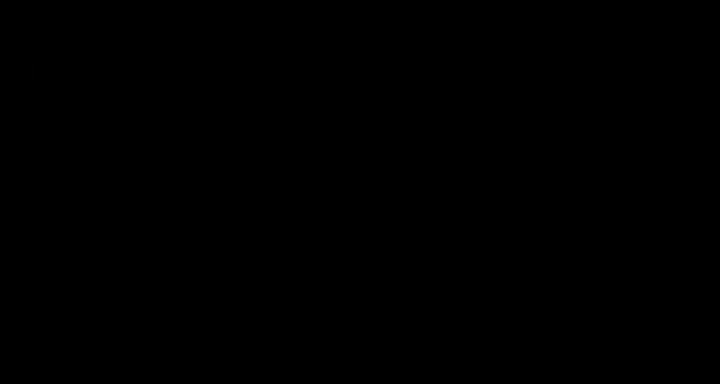
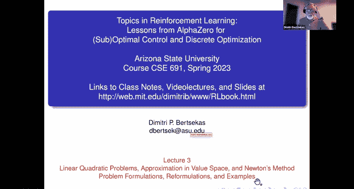
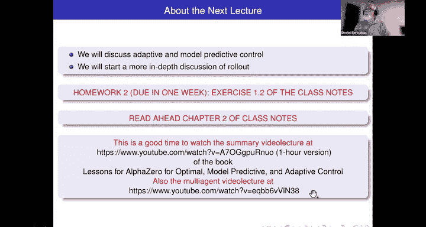

# ASU《强化学习2022-2024｜cse 691 Reinforcement Learning Course at ASU》中英字幕（deepseek - P16：[22]Lecture 3, 2023_ Approximation in value space as Newton step. - GPT中英字幕课程资源 - BV1zcfVYdErD

Okay， let me welcome you to this third lecture of our course。This lecture is going to have two parts。

 one is going to be on linear pathtic problems。A continuation of what we were doing at the end of previous lecture。

 one dimensional linear quadratic problems。The solution via riad equation。

And then we're going to discuss approximation in value space in the context of these problems。

And how Newton's method can be used to visualize the relationship between online training and online play。

Then in the second half of the lecture， we're going to discuss issues of how you formulate problems。

 practical problems as dynamic programming problems。How youd them to fit the canonical format。

 and we're going to give some examples of formulation。

So。Here is the outline， we first review infinite horizon linear quadratic problems and we are going to focus on visual representations and visual interpretations。

Then we're going to go into approximation in value space in the context of this linear aquetic problems。

First， with one step， look ahead。Then with multi step look ahead and trancate the rollout。

 it is a little bit more complicated。And that's going to be the end of the first part of the lecture。

 we're going to take a break here。Then we're going to come back and discuss problem formulations by dynamic programming and give some examples。

There is this technique of state augmentation that's going to be important its a very。

 very useful techniques across the board and we're going to illustrate this in terms of a couple of examples we're also going to talk about some other reforms。

Particularly， we're going to see how multi agent problems can be fruitfully reformulated。😊。

And then also partial state observation problems， what we call form DP can be reformulated in terms of our dynamic program。

So let's go into linear epipotic problems。Now you remember we were discussing。

One dimensional deterministic linearpodratic problems。For the system to India。

 X stays a stage a scalar。And UK is a controlled stainer also an AAB unknown sters。

So this is our linear one dimensional system。And the cost function involves quadratic course。

 a quadratic course on the current state and the quadratic course on the current control。

 Q andR our course in members and express our desire to keep the state near zero and to keep the control also near zero。

And。The donman equation。For this problem is what you see here。We minimize on the right hand side。

 the one stage cost this。Plus， the cost to go from the next state。What do we learn？

And when the right si is equal to J sub x x， we have that's the equation that corresponds to state x。

Now X scale it takess an infinite number of values， it scale。

 there is an infinite number of these equations， a functional equation。But if we solve it somehow。

 then we're going to be able to get the optimal cost function。

Now there's also another Belman equation for responding to a linear policy。

New so equal Elec linear in the state。L is the linear cross coefficient。

And now this equation has this score。And it's simpler than this。

 because it does not involve minimization。It is like。Thereillman equation for a fictitious problem。

 but we only control available as state x would be just L x。So plug in Lx in place of here。

 we get L squared x squared， that's where this term comes from。And plugging here Lx in places view。

 that's where this experiment comes from。And now this equation is simpler because it does not involve minimization。

 and we're going to simplify it even further。So these arebdom equations。

 can we make a guess here with rightporatic solutions。Jays， which are aquatic。啊 quite了。Of the state。

 with they being the coefficient before that。So we drive this kind of solution in here and this kind of solution in here。

And then what happens if we， let's say， take this and plug into here？This becomes quadraic in you。

 okay， and this minimization can be done explicitly in close four。

By taking derivative derivative and so on， and we can calculate the U that minimizes plug it in。

 And then what we're going to get is a quadratic boundary。😊。

On the left side and aquadratic on the other side was given by this form through this minimization。

 and by canceling out x squared on both sides， we get this equation here。

This is called veradti equation， and it is basically this Belelmon equation restricted on the subspace of quaratics after we also cancel out x to。

If we do the same thing on the L Bellman equation for a given L plugging this in here。

 then we're going to get a linear equation。点啊。给。Which is this one here。

 Okay calculations are standard， you can do it as in fact， I think we also did it last time。

So Belelman equations。And the Ri equations。Which are restrictions to cadratic functions。And now。

If we can find a solution to this equation。Which is positive。

K star solves the main recovery equation。Then。We have a solution then we have the optimal cost。

That's part of the generalist theory。That the optimalquest function solves Belelman equation。

 turns out it's a unique solution that's positive here。And we also。Given K star。

 we can minimize in the right hand side of Belelman's equation。And obtain the optimalpoli。

 new stars events。And you can see here that it is on the right hand side is quadratic。

 the minimizations over quadratics inbu can be done again in closed score。

 and after you do all the calculations， you find that the optimal policy for this calculation is L stars of F。

 it's linear。And L style are coefficientficient that's given in terms of K start by this formula。

These are standard formulaless and linear for added problems。And incidentally。

 the name linear quadratic refers to linear system and the quadratic cost function。

But it also refers to what that cost functions。J star quadratic and optimal quality linear。

 so linear quadratic in two ways。Great convenience。

And that explains in part the popularity of the the fundamental level of linear magneticatic problems in pphia。

😊，嗯。Now， okay， so one possibility is to solve this Belelman equation。

 but there's also algorithmic possibilities。And we have discussed last time two basic algorithms for infiniteor problem。

One is value。And what it does is basically iterates using this recursion here。

And starting with a quadratic。The value there is are quadraic also of this form。

So K0 is a starting for that K k is the K infinite it， and it's generated by this form like here。

Which is equivalent to this。Gelmon equation。So that's the value direction now then and we'll come back to it shortly。

And there's also the policy generation algorithm。And it turns out that starting for my linear policy。

It generates linear policies through a cycle of a linear policy has quaratic cost function。

 which generates by minimization a new linear policy and so on and so forth。Okay。

 we'll come back to police generation later。But for the moment。

 we want to interpret graphically the Belelman equations。And the equivalent form the riaddi equation。

 which is given by this。Which is the vvelon equational space of Que country。Okay。

 this red hand side here is given by this red curve here。 F of K is this expression。Of给。It is。

No linear but concaagege， you can verify that this concave analytically geographical graphically。

And it has the form that I give you here， it has an asintote at this horizontal asintote at this level。

A third asset at this level。And now let's go to the solution of this regard equation。To solve it。

 we have to find a point where the right hand side is equal to the left hand side。

Now the right hand side is this red turf here。The left hand side is linear。

 it's just a 45 degree line。And at the point where these too， the red of black meat。

 we have solutions of the ricard equation。And we're looking for a positive solution。

Which is the optimal cost the coefficient， the optimal cost function is case size。

 So this is a solution that we' are looking for is another solution here that's negative that do not concern it because we know that the optimal cost cost。

So graphically， this is the solution of the Riad equation and we are going to interpret。

All algorithms and all operations， including reinforcement learning and the approximation in value space on this figure here。

But first， we want to give a graphical interpretation of the L Belelman equation。😊，Okay。

 so this's a little bit more complicated。We have the mean ri equation。

 which is this red has right inside this red curve。And we have the L recovery equation。

 which corresponds to a linear policy。N equals mu of x equals l sub x。And then。

It is given its right hand side is given by this expression as a function of L， okay？两个。

We all the equation。Wants to make that I canc side。Equal to the left hand side。So the coefficient。

 the solution of the Alabama equation and the coefficient of the corresponding cost of the linear policy is what we see here。

 right， the place where the green curve meets the black curve。你你。

Mis the green line meet the black line。啊。Now。Notice that this figure is valued。

If a plus B L has absolute value， that's less than one。Why is that？Well。If in the case where。

If this is true， then this green line has a slope that's less than 45 degrees。

And intersects the black line on the right side of K star。E on the other hand。

A plus BL is greater than one then the slope is greater than 45 degrees。

 and the intersection is somewhere else， which is not of interest。So what's going on here？

If you look at me。Close look linear system when we use as policy as as the drop policy the L times x。

So the closed loop system looks like that。😡，And if a plus BL。Is less than one。Then。

Absolute value less than one then x state less one。Goes down asymptoically towards0。其他的我。

The corresponding closed book system is stable。Because either like that or like that， okay。

 asymptically to zero。And and on the other hand。If a plus BL is something greater than one。

Then the state of the system。Those explodes。Either like this or like that。And the cost function。

Is infinity。For all X except for zero。And in this case。

 we say that the closed loop system is unsstateed。But there's an important distinction here between。

Stable linear policies and unstable linear policies。And this is what you see here。On the other hand。

 the green line always lies above the red the curve here。Because it's okay， you can verify this。

 this corresponds to minimization over those。And this picture is realistic and for a slope less than 45 degrees。

 it gives us the cost coefficient of the corresponding to a linear cause。

Are there any questions about this figure here？ok。So now let's go further along this line。

We can't create。Min Belman。mean ricard equation given by this red curve。

 and we also have this elder ricard equations， which all of these lines。Which always lie above。

The red curve。🤧Now， it turns out。That the red curve can be obtained as the lower envelope。

 In other words， if the area underneath the red curve is the area underneath all of these。Blue lines。

And these lines come down to being tensioned， they can be brought down to being tension to this red curve。

 and that's what we mean that the mini copy offer is a lower angle。

Of the elderly or the min cutting graph is the lower envelope of the elderly cutting graphs。

And how do we see that？Okay。So if we plug in a quadratic cost function into the development equation。

 this is what this is how we calculate f of k， minimization of view of this quadratic expression。

 let's break down the minimization in two first minimize over linear。Busees and then minimize over L。

Now if we minimize over u equals l of x。Then what we get is。

To stand through the standard calculation for riad equations， we get this。粉 here。Okay。

 I have reverse the order。And this is just the expression for the L equation。

So the upshot is that f of k， the red curve is equal to the minimum of these blue lines。

 that's what this says。With F M of gay being this。And moreover， there is。嗯。

This blue lines come in engine。To the red curve。 And for a given K， for example。

 there is a tension here and it is tension because this a concave function。

 If it for another concave function， then it would not be tension。It would be okay。

 it would intersect multiple points and so on。So now from here。

We're going to go into the interpretation in terms of Newton's methods。

So let's look at the approximation in value space。And actually remember our basic figure。

I'm showing here approximation value space with one step look ahead and no all line Okay。

 this is the alpha， this is a simpler version of the alpha zero architecture。There is online play。

 there's offline training， the offline training is in the form of a cost function approximation。

That involves a quadraity cost coefficient。And。The online play consists of at a given state X。

 we consider minimization over those and then。我。includingncluding the one stage cost。

 and then we add the optimal cost to go as quantified by the terminal cost on traffic measure。

Now I want to claim that this is a newton step。For solving the riad equation or equivalent development equation after。

After X has been cancelled out。🤧嗯。So that's where we're headed。

And were going to do a visual interpretation and proof of this。Okay。

 you're supposed to know about businessance methods because you've learned it in calculus。

 perhaps even some of you learning it in high school， but I'm going to remind you。Remember。

 we want to solve this equation， theab equation， So we're going to look。啊在前那的。呃。

Equation of this form G is a generic， defiable function。

So here's a graph of G and we want to find a solution of this problem and the solutions of pain at the point where the right hand side meets the left hand side。

 this there's another solution over here also。How does usage method work？It's an iterative method。

 starts from some y0 generates by 1 and so1。At the typical。Iteration， iteration K。

 we have the current I white K。And what Newton's method does。Is it linearizes。He。

At the current point， linear arises by a first only tail3 expansion。

And the linearization is this using the gradient of G。

And the linearization what exposed to this sta line。

And then Uus methods solves the linearized problem。Which is this。 Okay， instead of G。

 we use the linearization。To obtain the solution， which is Y K plus one。

So this is the graphical interpretation of fu methods at the current Italy it。😊，拎 me your eyes。

And obtain the solution of a linearized problem。At this point。We Lady their eyes again。

Find a solution of the linearized problem。And proceed。And this is a very， very fast generation。啊。

It has for radical convergence rate。Newton's method is a powerhouse of numerical analysis and numerical algorithm。

U method is sort of an ideal。All other methods， sort of。But I become close， as close as possible。

To Newton's method， on the other hand， Newton's method involves some overhead here in multiple dimensions theres a inversion of this becomes a matrix and there is an inversion and so on。

But Newton's method is the ultimate in efficiency and speed of conversion。那。

One of the difficulties here。That you might wonder about。Is that。

This figure applies to differential group functions。On the other hand。

 the recovery equation is differentiable， but in general in dynamic programming。

 we have non differentiable Belman equations， it turns out， however。

 that Muton's metal admits a straightforward extension to non differentiable righthand sides。

And in particular to the case for the righthand side。

 instead of being G the financial group is the minimum of the financialable functions。

This is an easy proof， and you can find it in。In your textbook lessons from Alpha 0。

People have worked out have the details have done a lot of work on this type of non differential methods。

And it turns out that it has similarly very fast concrete properties as the one corresponding to the financial bookcase that you see here。

 and that's more familiar。So。We gave the interpretation of L Belelman equations and the min Belelman equations。

 their relationship and so on， how one is is obtained as the envelope of the others。

 and now we want to go into Nuton method and see how this framework of linearizing at the current Ierate and then reallineizing again how it applies to approximation in value space。

And all the details are really there in the figures that we saw previously in previous slides。做业务要。

We're going to visualize。The simple case。This case here， one step。

 look ahead with quadratic cost function approximation and no rollout。

So that's what we're going to do。And。Okay， so we have the。Meary card equation。

And the L therick operator， the Elati operator， and we argued that。我的基得。Hey， stillda here。做 thing。

The error。The linear policy that attains the minimum。

Which is the minimum is obtaineded actually at this point here， that's what we showed。

And to obtain this minimum， we have to consider this line， look at all the points of interception。

With this。Blue lines and take the minimum of those。So。The many movies are right at this point。

 and it corresponds to tang， a linearization in other words， of the ricard equation。

So the one step look ahead policy correspondinging to tail Kilda is obtained by this minimization going down this line and find the point of transparency。

哎呀。And then solve the linearized problem， which gives you the。

The cost coefficient of the online play pointss， the one step look ahead points。So。Given K Tilde。

 we obtain a one step look aheadphone CM tilde， which is linear and we obtain a swallow。

 we go over here without the tangent and then find a point of interception with a 45 degree line。

 and that gives you the cost function of the one step look aheadphone。

But this is exactly what Newton's method does。So this is the new step starting from offline training。

K Tilda will obtain a policy， an online play policy whose cost coefficientficient is the area buildder。

 It's a mutant step。🤧It includess organized properties of the Newster。It has a very fast convergence。

 rate， particularly when you're near K star。Because when you're far away from K star。

 there are complications that we're going to discuss， but when you're near K star。

 it is very powerful。So that explains also how online play improves on the results of offline pain。

 it's a substantial improvement and it involves a new step。Are there any questions here？Professor。

I have a question。What would happen in case if we assume the cost to be non quaratic would this graphical representation fall apart because we won't have therickcard equations anymore？

Yes， you would have to work open to work with a Belman question。

And there's a similar interpretation for the Belllman equation。

The Belman equation I involves the Belmon operator involves non differentfferenti abilities。

 however the Belmon operator and all of these details are in your textbook for lessons from half to zero。

The Belelman operator involves a concave function like it is here and regardless of what the state space is and what the controlto space is and whether you're working with a continuous problem or a discrete problem。

 the Belman equation is always a functional equation。In other words。

 it admits always an interpretation treatment by means of Newton's weapon。The functional equation。

In other words x may be discrete， but j is continuous and it could be that the Belman equation is differentialable in which case this interpretation would apply。

 if it were nondefferentiable， then a more general type of Newton's method would apply that is useful or nondeffer Belman equation。

So that's what would happen in a that show。Now I'm focusing here on intuition。

 trying to give you the intuition in terms of a simple and relatively familiar special case or linear quadratic problem。

 but everything generalizes in a a remarkably general way。

And this has also been verified quite the by computation experimentation。

Does this answer your question？Yes， thank you。Any other questions？Okay。

 so now let's go back to this unstable policy in terms of and also connect them with the picture for one step look again。

ok。So if we start at K star， okay， approximation value space and start with K star。

 obviously we're going to get the optimal pulse。 This is the optimal policy here。

If we start with the。I came' still there。An approximation that's close to K star to the right or to the left。

 Then we're going to get。A one step Look I get policy that's。Close to optimal。 But in any case。

 it is stable in the sense that。The optimal policy is stable， has a slope less than 45 degrees。

 So other policies also have slopes that are less than 45 degrees out。

As long as the cost function is near the optimal。On the other hand， if you start with K with。不在了。

With that case still there that further out。这个赖。Then you get a linearization that involves an unstable point。

And that is not legitimate， Okay， it has a cost function that's infinite。

You don't get a point of disruptionception。 You don't get。

It's not a Newton's method anymore that aims at K star， it may aim you at something else。

 but not at K star。😡，So there's a certain region of stability that's very important control theory。

The origin of stability relatess。To the K till this。V。没。

Tminal cost approximations does lead to a stable one leg step look aheadphone us。

And they are in this green region here。Demarricated at one end by the point where of a slope of the red curve is one。

 the4 parallel to the 45 degree line。If you start to the left， then you get a stable policy。

 you start to the right， you get an unstable policy So want to。Through approximation value space。

 And that's very bad to drop the early in very bad。In general， okay。

 the failure could be approximation scheme。Now。These kind of questions are very important in control theory。

 they're hardly looked at in the AI version of reinforcement learning。

But in model predictive control and control here， these questions are very， very important。

How far you can go from optimality in terms of approximation and still maintain a stable force。

If you look at this figure here。This regional stability also happens to be the region of attraction of Newton's methods。

The set of starting points for Newton's method that。Vi convergence to the optimal solution。

If Eton's method is started。😡，三冇 here。Then it will work， actually， but it will go to this solution。

 not to that solution。If it started in other example。

 if it started outside this region of attraction， it may never converge to anything。

If you look at your calculus books at the Newton's method。

 you will see I'm sure examples where Newton's method does not converge。

It converges within some favorable region of attraction。

 allowing the solution that you are interested in。And in the context of control theory and reinforcement learning。

 it relates to the region's stability。So the start of the new step must be within the region of stability。

But then how do we know what is the region stability？Okay。Well。

 we don't really know it except to observe that in and in fact it holes in general。

 that if you start with K fieldda to the right of K star。

 then you tend to be in the region of stability。But what happens if you't you don't know K stars。

 so how would you know how to pick K tillil there to the right of that and what if you pick it to the left？

Well。If you don't take it too far to the left， then you're going to be safe within the region of stability。

But it's possible that you pick it over here somewhere。And then what comes to rescue。

 what comes to health is multi step look ahead and roll out。

 we will see that multi step and rollout tends to push you into the region of stability。

And that's one of the main advantages of multistep look ahead。

So before now we go to multi step look ahead， let's look at the visual interpretation of rollout remember the law rollout。

Is simply approximation in value space with J Tilde being the cost function of some days policy。

You remember you did your as former the problem salesphone problem。

 there was a base policy a base heuristic and the rollout is simply approximation by the space with a cost function with cost function between being equal to the cost function of that base policy。

So how do we interpret it in terms of our figures and we are going to say a stable based policy whose line has slopeed less than 45 degrees。

O。So this is the red curve， the graph of the riatti operator， and this is the blue line。

 the graph of the linear base。And the cost function of the base policy is quadratic and given by this point here。

 right？Interception of these two。The optimal， of course， is here。 now suppose you do。

Approxiation in value space with this。using K till there to be the first coefficient of the base force。

Then。The approximation in value space is going to consist of a new step。

 and this is going to be the cost function of the one step look at health policy。

 what we have called all our policy。Well this is your last story。A base policy which is stable。

So for responding costs and then you get the cost of the new policy。

 they all our policy and it is a newton seller。If you what to do。

And additional for all our step that would be similar to go over here and so on。

 this is what policy duration does。But rollout， that's what you see here。

Have any questions about this figure？Profess， have a question from a student here？ok。Once。Just sorry。

Do other question。六。Yeah， so I want to ask with regards to this slide and also the previous slide。

 so when we talk about the safe region to initiate the solution。

 so if you move further to the right do we risk the newton steps becoming like too small because of this idea of a vanishing gradient or that kind of an issue because of the。

嗯，2。Asymptotic nature of the curve。Yes， if we push it beyond the original stability or even if it's close to the edge of original stability。

If it's close， it's within the region of stability but close to the edge。

Then it converges rate deteriorate。Okay， because here the crossing point is going to be very far out to the right okay on the other hand。

 if you are beyond the green region to the left， then the metal will not converge。第。

It will give you take you in the opposite direction。 In this particular case， it's going to take you。

Sos this solution， which is negative and makes no sense within the linear que control point。Yeah。y诶诶。

Yeah ahead yeah so I was saying yeah I understand that and also like what happens if we go further through the right of right hand side in this graph like much to the right is there a issue where the steps become too small because of a vanishing gradient kind of a situation？

No， the steps actually become pretty， pretty big。Okay， look at this here， okay。

Suppose that we take a base policy， that is。Very submal。Okay， but it happens to have a slow。

That is very， very close to 0。 So you start over here some essential， right。

 You have a slope that's very close to。I'm sorry。O。Suppose that you start somewhere over here， Okay。

 then you linearize。And you still are pretty close。To be of my solution。Gman speaking。

 starting far right。Is far more benign than starting far to the left。ok。Right yeah。

 so my thought process was if we are afraid of starting to the left of K style and we want to avoid that at all costs。

 can't we just。Choose a very high value of K to ensure that they are much to the right of aster。

Almost at all， possible cases。Yeah， yeah， generally， that's a good idea。 But it。

 but you should not over do it。 Okay， you should not start too far to be to the。To the right。

 because your approximation， the Ben Newton step is not going to get your close。啊。The concern here。

 as far as rollout dispute， as far as the optimization in viral space。

 generally it's a good idea to start to stay large， okay？😊，When it comes to rollout。

 you need to pick a stable。Base policy。 And that's the key concern。 as long as the stable。

As long as it's stable， then at least you're going to get closer to the optimal solution and substantially closer because the mutant step is pretty effective on this side。

啊。And。So， it depends。dependspends what these。 But but how you understand start。

 If you start with K tillda， then's11。One set of considerations。

 if you start with some base policy and another set of considerations。

When it comes to choosing a base policy to start it all out with。

 then the main concern is that it is safe。Now in the trial sales on problem and in problems with discrete space space。

Usually。The policy disability。Concern and satisfied。On the other hand， if you start with J Tilda。

 not J Tilda， that's necessarily the cost function of certain policy。

 then the problem that you're running into is。Is being on the left。But then again。

It's not so much a big concern， but it is a concern in model predictive control and control problems in general。

And it manifests itself here with linear withla problems。啊。In our course。

 it's not going to be so much a concern。 on the other hand， generally speaking。

The concern of being in the region's ability will be addressed by not a step look ahead in the next few slides。

Okay， thank you。不俾。So let's go to Mother step look ahead and cr and roll out Now the picture we want to look at is this one。

this somewhat complicated picture。What do we have？At the cottage state。

Minimization over multiple stages， in this particular case two stages。And then。After that。

 we do frankly the roll out with a base box。For a number of steps。And at the end。

 we have a quadratic cost function approximation。So if this part here would not exist。Then。

 if you would have a。Approxiation。We space with one step look ahead。 the picture we gave earlier。

 Now， it's more complicated because of the extra。 look ahead miniization。

And those would pracate the robot。But if you look at this picture。What do you see？

At this layer at this stage here。After one step look ahead， all of this thing here。

Can be viewed and be lumped together。Its an effective terminal cost approximation。In other words。

 multi step look ahead， even with out is's just one step look ahead。

 but with a more complicated starting point that is given by faith tillilda acted the upon by trite roll out and act the upon by。

A number of look ahead minimization， a number of steps will look ahead minimization。

But it is still a newton step。And what is。Significant here is to explore what happens。

 What effect the trancated rollout and the extra look ahead have on this。 In other words。

 how the effect internal cost approximation differs from the。对，就的。Terminal approximation。

And that's what I'm going to try to do in the next couple of figures。But first。

 we want to visualize value direction。In terms of our。Fig here and we how we operate。

Now the value duration algorithm is simply jk plus 1 equals to what the Belman equation gives you on the right hand side with the j equal to kkx squared。

So it is equivalent。To operating on the recovery equation。From Kk， the case isn't it。

 you apply that copy operator， you get Kk plus one and so on。So in terms of our figure。

 here is a recardular operator， the averb， the solution face star。And the。Given the case。

 iter to value duration。Ak plus 1 is F of Kk， this level here。

We reflect that across the 45 degree line is K plus1。Now。

 K K plus2 at the next duration is going to be this。You reflected upon the 45 degree line。

 get Kk plus2 here， Kk plus3 and so on。So value duration is simply the staircase construction。

On our failure。This is the case where do you start。To the left of K star。

 if you were to start to the right of K star， then it would go like this till I say a staircase construction。

If you have to start the， even if you suffer some negative values， it you still work， okay。

 it would converse to K style if you start to verify。就。The left beyond this K bar coin。

 then then it will not perverge to case study or perverge to it。

 but it's kind of silly in the context of our problem because we always want to start with a cost function approximation an initial K zero that's positive or0。

But the important point I want to note here is that successive value directions。

Get you closer to K star and successive value durations is what we do in multi step look ahead。

And that's that's the advantage that the multi step Look ahead offers for us， as we would argue。

So this is value duration。And now， let's look at the。Approxiation by space， two step look ahead。

 but no all are。ok。So。Let's say that offline training uses us a cave till there that is is。出 here。

One step look ahead would go over here and then do a neutral step and come down here。

Two step look ahead with first to a value duration， go to this point and then take the step。

If you had three step look ahead， you would go to this point and then。From a closer point to K star。

 you would get a try a mutance step。So with two step look ahead and not it roll out， start here。

 do one value duration， a newton step， and that's what you get as the online policy。

 the one step look ahead policy。So multi step look ahead。

 moves the starting point of the you can step closer to K star， and the longer the look ahead。

 the better， this general rule here that holds for multistep I'm sorry。

 multidimensional problems and so on。Of course， extra look ahead， course time。

 course computational resources。Now this involves neural layout。

 let's look at the casequever also in addition to modern step look ahead minimization。

 is rollout with a base policy。Okay， this is for two step。

 look ahead and three tranccabit rollout steps starting from K Tilde。Okay， we start from Ca tillilda。

We do look ahead minimization for two steps， one， two。

 and then we do truncated rollout with a stable force。Now。

 the line corresponding to statement policy is some linear。

Some line that has slopeed less than 45 degrees。And from this point， we do the three rollout steps。

And we get to this point， if we were to do an infinite number of crncated rollout steps。

 we would approach the cost of the base policy， but since we do only three。

 we end up short of that and that's the study point for the U step。He。或者见。

Mist step look ahead and also truncated roll out with a state policy pushes us closer to the region stability。

From which we guaranteed that a new step is effective。

I understand that this figure is kind of complicated， it affects a lot of insight。

There are all sorts of questions that you would encounter in practice How long should the look ahead be。

 what's the trade off between using look ahead minimization and using。Longer crncd rollout。

All of these。Can be understood and motivated from this figure here。I think its a complicated figure。

 but it impacts a lot of intuition。And I will argue later。

This figure applies not only to linear quadratic problems in one dimension。

 but it applies to linear quadratic problems in multiple dimensions and also applies to far more general dynamic programming problems of infinite storage。

 with discrete state space， continuous state space everything。

 it's very a universal intuition within this context。Okay。

So we said that we interpreted visually rollout。 Now rollout is a single。我 see that next。

Policy duration， what's called self learning in artificial intelligence view the artificial terminology of of。

呃， reinforceport learning。Policy direction is whats called self learning。

Both with the exact implementation implementation。The policy duration is repeated law law。

 startss with a linear policy， generates a roll art policy。

 and then uses that as base to generate a new roll art policy。

And the way this is done is by a two step process。🤧嗯。In the context of linear epipodratic problems。

 the policy evaluation takes this score。The case policy has a quadratic cost function。

 It linear and stable and has a quadratic cost function。And Kk is given by this formula。

But Lk is the coefficient of new T， the linear cost coefficient of new K。So given this policy。

 we do a policy evaluation。And compute KK。 And then we do a policy improvement。

Where we obtain the new policy as a linear policy with a coefficient that can be calculated to be in this sport。

In more complicated problems， of course， policy evaluation may involve simulation may involve neural networks。

 if it's done approximately and so on， policy improvement。

Can be implemented also in a number of different ways。

 including the policy of using a policy network。It is very important to use policy networks in the repeated roll La rolll does not require a policy network for any kind of approximation beyond simulation。

But once you go into multi step go into repeated drug， then the use of some kind of。

Approxiation neural network or otherwise to do the policy improvement is essential。

Now roll up the same with new consideration。And policy duration is a proof flged newton method。

 a multi step newton method asymptoically it solves the riad equation exactly provide that you started within its region of conversionver。

Now there's also an important many variants of police direction。

 including what's called optimistic police direction。Which consists of repeated pancade of rollout。🤧。

In other words。Polic duration does not evolve frankly the drawout， if you introduce in addition。

 tra the draw out in it， then you get this optimistic policy duration。

 which is used very widely in reinforce personalal learning。

YouYour personal learning this policy evaluation is done with a very few rather not an infinite number of it's done iteratively。

 but with a limited number of value duration。And this corresponds to trying the draw lab。

So on this slide， within the slide framework， the zilience of variation。And， and。

Once you grasp the basic guidelines and the basic framework of the methodology。

 then you can implement all kinds of variations and implementations and so on。This is of course。

 all of this of course， is offline training and at the very end you get a cost function of a final policy that you can use for approximation in value space。

In separation now of policyization can be viewed。一。Is the of optimism is it optimistic consideration。

Can be viewed as a new step。For commented by first order iterations。

 what's called the numerical analysis and Newton SOR step and you should SOR stands for successive over relaxation。

😊，So all of this has a lot of。A lot of variations， a lot of details that we're going to get into some of this as we go along。

 but certainly there's a huge methodological framework that includes is based on this policy and your textbooks have a lot of details as well as other textbooks have a lot of details on policy variation。

This is just an overview to， to construct the broad picture within which。On lives。

Are there any questions？Okay， so this is our last slide before we take a break。

I just want to alert you that all of this is very， very general。

The Newton step interpretation is fundamental in approximation value space。

And generalizes very broadly。And your textbook。Is devoted to a large extent to that interpretation。

In particular， it shows how。How you do this， this involves using Belelmont operations in place of Ri operators。

啊。Instead of using Newton's method to solve the minrickaddi equation。

 Newton's method is used to solve the minbelelman equation。Again。

 approximation in value space is a single newton duration enhanced by multi step look ahead。

 if any multi and by fd rollout， if any， again。They all nows a single mutantton generation starting from the cost function of the stable based policy。

While exact policy duration is a full fledged nus method。And finally， as a general。还说这个喽呃。그。

Mulultti step look ahead and plancate the rollout， enhance the stability properties of the policy produced by approximation good value space。

It also enhances the convergence rate， how close you get to the optimal policy depends on how much multi step look ahead you do。

 how much trancated rollout you do。At the same time， bear in mind that。

That multi step look ahead force computation time and trincated rollout also cause computation time。

 the computation time for multistep look ahead minimization is far more than for trancated rollout because here we minimize over all possible alternativeity。

Here we just run a single alternative， the base policy we forward。

So truncated rollout is much cheaper to implement， and yet it achieves much the same effect as multistep look ahead in terms of enhancing the stability properties of policy or reconvergence rate of new spread。

So all of this is the broad picture within this broad picture again design scheme that are governed by your objective。

 how much computational budget you have， what kind of implementations are useful within your context。

 whether the simulation can be done within your context relatively inexpensively with parallel computation or without parallel computation。

 there's a lot of play within this picture， what I want to impress on you is that it is very general picture。

Which applies universally in approximation value space。

Are there any questions here before we take a break？Okay， so we'll be back in exactly 15 minutes。

And you may collect your questions to ask when we return。Okay。

 so let's start the second half of the lecture。Are there any questions about the first part in the visual interpretations using linear a quadratic problems？

Okay， so now let's go into problem formulations by dynamic programming and various examples of winterness。

So in practice， how do you formulate dynamic programming from？Youre typically。Not given。Mathe。

What a presentation of the practical problem。 You're not given the systemic pressure。

 You're not given the cost function。 You not even given what the state and the controls are。

And what the horizon is and so what。最。It is an art on how you pass from a practical problem into a mathematical problem that you can solve using algorithms。

And。This can be approached in many different ways in the context of dynamic programming。嗯。

I cannot give you the range of approaches I can give you。An idea of what I do， okay？

My way of approaching this issue is to look at the practical situation and define first decisions。

You can easily pretty， pretty well figure out what it is with。But you have to decide。Like。

 for example。You're traveling in sales one context。

 what you need to decide is from one city to go to the next city。

 these are the decisions that you make。Then you need to decide what the stages are。

And particularly for a stochastic problem， the stages are demarcated by when information arrives to you。

😊，When new information arrives， that's the time to adapt your policy and to choose the control based on that information。

And the last thing that you would look at is what is the state？And here。

 the someone be good because there are many different quantities that you can consider legitimately a states in a given practical situation。

😊，But generally speaking。It is a good idea to try to define a state。

 something that summarizes the past for purposes of future optimization。那我。

What is significant to know right now for the purposes of making good decisions in the future？

Or otherwise good。The kind of quality that you want to a estate is those that when you know it。

All past information general， that's the necessary information for the future for the future decisions。

And the rationale for this is a controllerola applies action。That depends on the state。

So the state must assume all the information that's useful for decision control。

 that's fairly evident。嗯。And the。Let's look at some examples。In the traveling theres no problem。

You need to include all the relevant information in the state。

Before making a decision of which city to go to。And what might be。

The minimum of that relevant information。Well， you need to include the past cities that you have visited。

As well is the currency before you are。啊。Other information。

 such as what costs were incurred in the previous stages。

Or the order of that you visited the past cities。It's not necessary and need not be included in the state。

😡，Of course you may say I'm going to include it anywhere， that's fine。

 but your state is going to grow bigger essentially。

 and there may be some inefficiency associated with that。

Now here's an important class of problems where what is said is a significant issue。

These are the partial information problems or imperfect information problems。

Where there is some quantity of interest that you would like to produce a stay。I just， for example。

 the position， velocity vector of our moving project。However。

 the problem is that you don't know that， you don't have perfect information of the 20 US that ideally you would like to cause state。

Instead， what you have is noisy measurements。Which of Yk。嗯。

And that's all you have on which to base the control。 For example。

 in the case of a car moving on a straight line。Ideally。

 you would like to know the position of the velocity vector at the flat card。😊，On the other hand。

 you may be measuring the position velocity by radar， which may be。Ierfect， they have noise。

So you don't really know。What。The vector is， but may have a probability distribution of what this vector is。

Now， what would be stake in this contexttex？I's all the information that summarizes the path for the purpose of future optimization。

So it is correct to use IK， namely the collection of all the measurements after time K。

 it is a legitimate state。😊，And it may be useful some too。On the other hand。

 there are alternative states。And a very， very important one。Is the conditional probability。

Distribution of the quantity of interest， given the information that you have collected so far。

 given all the measures。This is called the belief state， but we can view it as a probabilistic state。

And it turns out that it also subsumes all the information that's useful for the purpose of controlled choice。

So that's a common formulation of this imperfect state information problems。

Reformulating the problem as a perfect state information problem that involves a state。

 this belief state， this probability distribution。😊，Of course。

 that we suppose is also if you must have some kind of algorithm。

That estimates this probability distribution， given the measurements and updates this probability distribution as you go along。

So these are some examples of reformulation of state control and。

Of first states and couldgos and so on。那。Go to a general device。

Or that can be used for probability formulation。Thats speak。Deice of state augmentation。

state ofmentation。You have something that appears like would be desirable quantity to view a state。

On the other hand， it may not quite be sufficient to give you the framework that you want in terms of a system equation and so on。

So you are comm it， you make it bigger， you add more things to the state so that it becomes legitimate in some sense in the context of our dynamic programming framework。

And a simple example of this type of situation is when。There are delays。

On the effect that controls and preview states have on the next state。So in other words。

 instead of the next code uncode state。Would instead of it depending on the current state。

 the control and some random disturbments， they may be dependents。Of the state before。

And also on the control before that。And this。Effective manifest itself through a delay of one unit in this particular case。

 there may be delay of multiple units in other cases。😊，It is a common situation in many contexts。

 particularly in chemical process control。For you do something now。

 but its effect on the state does not manifest itself until later。

 like a minute later or an hour later。We change a variable now before and we take some time for the flow of material to get to the point of interestus where it has an effect。

😊，Very common problems with delays。On the other hand， conceptually。

Delays can be treated by reformulation。In particular， in this one step delay。Situation。

We introduce additional state value。Which we call Y K。 Y K is the delayed state。

SK is the delayed control。And we write an augmented system equation。

What x state plus1 is given by this formula with the additional state variables introduced dis stands for that and dis span for that。

And the additional state variables propagate according to this equation。So now we call the triplet。

Of X， Y， and S。The new state， and it enters in the right hand side as X， Y， K and Sk。And。

This equation is of the form。That we know and I can use for dynamic programming。

 it does not involve any delays。So we call this x stillilder。 So this is x stillilde K plus one。Xk。

 Yk， and the Sk is called。It's still that J。UK appears here， WK appears here。

And F t the is a multidimensional version of this equation here， a new equation。

 a new system equation。With a big state vector。原猫。We can work with that。点到。

The dynamic program framework that we know。And the reformably dynamic programming algorithm in terms of this new system。

Takes this form here。On the right hand side， you have the one stage cost。

And you have the cost to go from the next state that you end up with。

 but the next augmented state involves this part。This part。In this part。

If it's still a legitimate dynamic programming equation， we take the expected value of that。

 minimize with respect to U， and then what we get on the left hand side is something that depends on the new state。

 in other words， what xk xk minus1 is UK minus1。😊，It also appear here。So， at that day。

You measure your current state， you have kept in memory once the delayed state。

 you have kept in memory the delayed control the control。One step earlier。

 and then you do this minimization。And of course， you need to carry the exact dynamic programming algorithm or in an approximate version。

A bigger function that involves dependence on three state values。

So you carry if it's backwards starting from this terminal state， terminal condition。

 and you go backwards and you reach the initial state and that's the dynamic programming algorithm that we can use exactly。

Or more likely with approximation。There are many types of state implementation that are along this pattern。

Your plus notes。嗯。Involvever。呃。Give you a number of other examples， One possibility is when you have。

Forecast of future uncertainty， like at the present time where you apply the present control and you get a forecast that the weather is two days from now is going to be so and so。

 okay， and that may affect your decision。Then the forecast has to be included as part of the augmented state。

The other examples like that is I'll let you read the notes and the literature。

Are there any questions here？Okay。There are many problems that have a terminal state。

 a natural terminal state。Which is cost free and absorbing the sense that once we get there。

 we can't move and we don't move and the we cut no cost。On the other hand， reaching。

 we don't know when we're going to reach a terminal state， like for example， in the game of chess。

 there's a terminal state when the game ends， but we don't know how long the game is going to take。

Geneneral speaking， we can view these problems with ten as infinite horizonion problems。

Where once you get to the terminal state， the dynamics of the problem is that you stay there at no cost。

 okay， this is always a possibility。But theres also another possibility to convert the problem into a finite correlation problem。

By introducing us horizon， an upper bound to the optimal number of stages。

 assume human that you know such a bound。And then add a big penalty for not terminating for the end of the for。

😊，In other words， you you try to discourage。呃。The trajectoryject is that that I will be on the end of the horizon。

That will also work for some cases。And let me give you an example of this。

It's a problem involving multiple vehicles。That move within some network of roots。

And the objective is to reach some tasks。And to perform this task。

And that's when you reach the terminal state， when all the tasks have been performed。

Think of delivery vehicles having to deliver products to various places， although there are many。

 many problems from this type。So in this particular case there are two vehicles and that two tasks。

And one possible cost function might be to minimize the number of moves to perform all the tasks and reach the terminal state。

So this meeting was mo simultaneously one step， one step for each stage。And。啊。

How would you formula this is a finite horizon problem？Well， you know that。That。

One possible solution is to take。Iro。From here。就 here。

That's the longest path from being to to this task and the path from this vehicle to this task is 1。

2，3，4，5，6 steps。 Okay， so you can add， you can have a horizon that's 6。And also， have a。

Big penalty for not terminating for。For not termminating after six steps。嗯。And of course。

 the portion was to get。Both of those in three steps and in fact。

 the optimalmost solution is what you see here。But that would be affirm formulations of finite verion from。

啊。Now let's focus on this multi vehicleh routing problem because we're going to look at problems of this type quite a bit later in the course。

How do would you formulate this problem as a dynamic program？Any suggestions？

What would be the states， what would be the proposed？What would be the turn of state。

 the Fer and so on？Any suggestions？Hello， professoror。

 can you hear me hear I guess that the state can just be like the。Position pair of。Both vehicle。Yes。

😊，嗯。And。你在庭呢。And whether it is a like whether that vehicle has finished it task or not， maybe。Well。

 the vehicles are not assigned to task， in other words。

 pushing for this vehicle to go to this task and for this physician to go to this other task。

 where it may be that they both start going towards the same task and then re out。

So what would be useful， the question to ask here， what would be useful？

For the purposes of future optimization。嗯。And given that you are in the middle of the game。

 the vehicles have moved around and they have performed some of the task。

Certainly the position of the vehicle， the federal two position。Should be帮 say。

But also the location of the tasks that aren unfinished would also be interesting， right？

And would guide future moves。So the state。One possible state。

 perhaps the best in this particular context， would be to take。The pair of positions。

 current positions of the Vus and the lists of tasks that have not been performed。

And the controls now， what are the controls by the way？Controls would be the joint moves， Okay。

 so this is one control， that is one control， this and that is another control and so on。

So it's the pair of joint moves， that would be the control space here。Teral state， well。

 the terminal state should be when everything is finished， right。

 absorbing because there is no more cost left in the problem。Certain， the couple of finish。

In the horizon， you can take it an infinite horizon or a finite horizon with as many as six steps or something。

Now， what's the problem size here？😡，Well， look at the bear。我说。哦 possible。Well， look at the states。

 said the whole pairs of positions。Also number of if I'm finished fast， this can be astronomical。

 right？I mean， if I have。Even for problems with the even for this problem here that has only only 12 nodes。

 Okay， these numbers probably node numbers。Still the number of first days， quite substantial。

TheNumber of controls is also substantial。Each vehicle has a number of choices at each step。

 and there are two of them， so it's the number of choices to the second power。

If you had 20 it would be a number of possible choices to the 20th power， or it becomes very big。

So the control space would also be very large。Even for a more modest number of us and V。到。

This type of。Of situation。Well you have multiple components。Of the control vector。

resultingsulting in an exponential growth of the control space with a number of vehicles is a good candidate for a multi Asian framework。

That we are going to talk about quite a bit in this course。

 and we're going to introduce in the next couple of slides。

So what do we mean by a multi Asian problem？Its a situation where we have。

Multiple decision making entities， which we call Asian。In his case there are five agentss。

And each agent has a control vector of his own。And we overall control vectors for the problem。

Is the Car product。 Okay， has as components the。对。The agent。Desion compound。

So if each of these UIs takes even a small number of values， if you have a large number of agents。

The number of these m tos becomes quite big。Now these agents make decisions in spaces。

And they collect information about the environment。And they end either on their own。

Or through information exchange from some computing cloud。And the very。Ts submit to each other。

 they shared selectively with each other。And based on this information， they apply a decision。

 then we go to the next stage， we collect new information， share new information。

 make another decision， and so on。啊。Needless to say that this is on already a pretty large size problem。

 particularly due to the size of the control space。

 but also due to the size of the state space potentially。And the。

Theres a major mass distinction between this problem structure。我 is。

They both have to do with how information is shared。😡，And that is the classical information pattern。

Forvis are fully cooperative。And fully sharing and never forgeting information。

So this is as if they all have the same information and so they can be viewed as one。

And you can write a dynamic program in algorithm for this situation。The more challenging。

Situation is with the agents。啊。How should be sharing the information。

 so they may have different data to go with。And even worse， if they are antagonistic。啊。

Particularly if they have different objectives。This is really a very hard problem。

 but even if they have the same objective， it could be shadding。The only partially the information。

And that is a hard problem， much harder than this one。

Primarily because it is hard to treat by dynamic programming。嗯。Actually， the type of problem is。

Very old。I looked at this problem for about six months when I was a PhD student。Long long time ago。

And。I decided it was。Okay， this case was not very interesting you pushed for just by na program。

The computational issue did not enter into the picture at that time person。

People do not have powerful computers。To use the kind of methodology that's being used today in the enforcement learning。

 So from the theoretical point of view， this was dynamic program， not very industry。 This was the。

This was the most interesting part， but I looked at this for six months and decided was this too hard for me。

And Ill never get my PhD with Pat yet， which was interesting or people。对 attention to。

So I gave up and turned into a different direction。And the。And。

I did the right thing because researching this field went on for quite some time。

Like 10 15 years subsequently and gradually is sort of hiered the way and people reached a point where they could not produce any meaningful results。

But this problem area was revitalized when reinforcement learning came along。

With its powerful computational arsenal and problems that were thought to be impossible to address in the past with reinforceapportment learning。

 they became an approximation。They became more feasible。

So we're going to look at these problems for the wider view of reinforcement learning。

But we are going to focus on classical information patterns to begin with。如 generalize类。

Like we'll start with classical information pattern。

Whereby the agents have exact state information and they choose their controls as a function mistake and they know the same state。

So this is as if there's some cloud here that is a clear0 information。

 it collects all the information of the agents， perhaps collects some further information on its own。

 and it passes some kind of state information as needed to the agent。😊。

So this becomes classical dynamic programming involving。

A system who state some state X in some control U posted the stochastic system。

And the characteristic。AFature of this problem and the most challenging part of the formulation is the fact that the control has M components corresponding to the M agent。

And that explodes the control space， making computations very challenging。

Let me also mention here that。At is just a metaphor here。😡，啊。The important structure。

 the important structure from a mathematical point is that U consists of M components。

These components maybe they correspond to agents traveling in a geographical area like the trucks。

That in a multi vehicle routing problem。呃。That's go around in different。

Different locations and and they get an information perhaps from a central dispatcher or by communicating for some kind of。

Some kind of a channel with each other。But what creations don't have to be geographically separated。

 they can inhabit the same robots， for example， these use may correspond to the actions of different arms of the same robot。

So the important thing is the mathematical structure of multiple components and the computational challenges that it poses。

And the。What we're going to do is reformboate this problem。

For faster computation to address this challenge here。

Of the exponential size of the search in control space。And later。

 we're going to discuss the case where we don't have a classical information pattern。But still。

 we compute this conium and distribute fashion， and perhaps we try to guess what other。

Agents are doing。And things like that this will come much later。

 but let me give you an idea of how we deal with the large control space size by using recomulation。

Okay， so this is a fun example。嗯。It involves spiders and flies。

And the spiders are trying to catch the flies。In this particular picture， there are 15 spiders。

And they move in the four directions or they can stay where they are。

So each spider has five degrees of freedom， five choices at each time step。

The objective is for the spiders to catch the flies in minimum time。And the flies。

Are passive and blind。They may stay still or they may move randomly。啊。However。

 the spiders can observe the flies。 they know where they are at every step。So the challenge here is。

How to。How to select it each stage， a joint move for all the spider。

And there are five to the 15 possible joint moves。Because there are five spiders。

 each there are 15 spiders， each one has five possibilities。

 so the number of possibilities5 to the 5。😊，And with our methodology。

 we're going to reduce the five to the 15 to the five times 15， which is much more manageable。

 while at the same time maintaining good algorithmic property， for example。

 we're going to discuss all out algorithms that work just as well with that many choices as with many choice。

And the idea for that is reform。And change the control space。Hences the problem where。

The control is not a joint， does not consist of the joint moves of spider。

 but rather consists of a sequence of one spider at a tiny move。都在啦。熄电。呃。Moves of that type。

 each one with five possibilities and a total is 75。And okay。There are some videos。

There's a lecture on this material， multi Asian problems and you can find this。

Some illustrating videos and explanation of what I've been saying here。

 elaboration in this artist this link。We're going to do that later class。

But let me give you an idea of how the reformulation goes， how we get from here to here。😊。

Some old idea。Which reformulates the problem， trading off。Conl complexity for state complex。

Introduce more states for less controls at each step。

And the way we do that is by unfolding the control action。You pass for my mistake， to the next state。

We apply the M controls sequentially one at a time。So from this state， we apply control U1。

 get to this state。Here when you apply control you still get to that state。

Here we apply U3 and so on， and after n minus1 steps， we get to states like that。

And then we apply the final control， and it's only at this time that we involve a course the cost of the stage from x to x bar。

And also， we determine the transition。The transitions here are evident。

Transition from here to here is given by the last step。

So now the control space has been simplified a great deal because it involves only one control component at a time。

😊，And the。啊。对。However， what's happened now is that the number of stages has increased。

By a factor of M。And also。The cost functions of the problem。

 the state space has become more complicated and the cost function of the problem involves。

A cost function for this type of state， for this type of state and so on。

 So there are many more cost function。So。Smalder control space， largest state space。

On the other hand， some algorithms， they are not bothered by large state spaces and what's important is the control space and one of them is rollout。

啊。Rollout for this problem here。 the reformulated problem is much simpler。

And this is a kind of algorithm that we're going to study。And。The rollout。

 the key thing is that the rollout is not affected by the size of the state space。😡。

all of care only about。About the number of successor states to each state， in other words。

 the number of controls here， the number of controls here and so forth。

And only one state in successes。 I looked at this stage during the。

During the rollout operation online。And the key fact here is that this is a legitimate pro formulation。

 this is a legitimate rollout algorithm， and it in case the newton step properties of rollout。😊。

And it turns out that with this reformulation， you do almost as well as you do with the other with the original problem where we state the control space is very large。

And you get a complex reduction， the one step look ahead branching factor is reduced from n to the M。

 the exponential increase increasing exponentially。

 it increases linearly where M is a number of possible choices for its component UI。

So we are going to revisit this formulation and problems of his type。In a few lectures。

Are there any questions？Okay， so let's look at partial state observation problems， also very。

 very challenging in class problems and also very useful in practice。Let's start with an example。

Suppose that you have。A car that's looking for a particle space。

Now the parking spaces are on this line， okay， the capital M of them。

And in this simple version of the problem， we assume that the parking space are arranged in a line。

And。The car can go in another direction。If it is at this location， it can go either to the left。

 it can go to the right。And it observes a state of the parking space。

 whether it's taken or is it free once it gets there。So at this point。

 it knows that what the stage of this part space is， and if it is free。

 it can park there or it can continue looking for a better space。

There's a cost for fighting at each once。I each one position。

C1 is the cost at buffer pi at the position，1 C2 and so on。And then once we park。

 we reach a termination state， but we don't know when this is going to happen。So at each time step。

 we move step in one coordinate direction， decide to park or not。At S M。

 if it is free and if you inside the park because it's C of M。And if we have not part like that。

 I am。Thiss an artificial comparison here is a large cost sphere。Now。

 we could have perfect state observation here whereby。The map of the parking lot is known to the car。

 but we don't assume that we assume that the car does not know whether the spaces are free or taken Instead it just travels to a particular place。

And it looks at it and sees whether it's free or not。But to make the problem more complicated。

Not only will you observe the c status of only the sports aquararian。

 but also the participantss sports may change status in the next back step with some probability。

In other words， think of a situation where the other cars also looking for a parking space。

 and even though you've seen a parking space that may have been expensive。At some time。

 and you've gone on to search a different for a different parking space。

You are not assured that when you come back。是在。Partking space that we observe to be free。

 You're not sure it is going to be free。 It may have been taken。

And we assume that each part spot may change status at the current time step at the next time step with some fromability。

So a natural state here would be at the map of the biking lot。

But that map changes all the time probablyally because of the because of the fact that new cars come in and。

Existing parking cars may decide to go out and free the parking。啊，我也没。

The status of the spot can be estimated in some probabilistic sense based on the observation。

 we have observations， we observe some parking spaces and we have these probabilities by which the status of the phase has change。

So we we can construct a probability distribution。For the entire parking lot。

Of free and taken sports。So what should the state be in this context？Well。

It should summarize all the information needed for the purpose of future optimization。

 This provides a guideline。And one possibility， first candidate is a set of all observations so far。

 that summarized all the information we ever got and that's the best we can hope for。However。

 there's another candidate。The belief state of which I talked about earlier。

 naly the conditional probabilities of the free patient status of all the spots。

 so this a probability distribution。With the probability for every spot。 So P1 maybe。

Like one half and one half， one half being free， one half being empty， being taken。Similarly。

 piece of M is maybe one third the2 third being taken and so on。

So this is the delete state of the parking lot condition on all the observations we have so far。

 and this is something that we can keep track of based on the observations that we have and it can serve as a state in a dynamic programming algorithm。

An algorithm that is typical of these problems with partial state observation。

And I'm going to give this algorithm in the next slide， have any questions here？About this example。

 lots of the meaning of partial state observation and belief state。If you guys have understood that。

 then。Then I'm very happy because this is one of the most challenging concepts to grasp in dynamic programming。

On the other hand， this example is kind of。Intuitive。

 and perhaps you find it a good introduction production to this。Partial stadium observation problems。

Okay， a rigorous mathematical formulation。Of this perfect state information problems and also how you construct an equivalent and dynamic programming algorithm。

I long infiious and we're not going to go through that instead we're going to give a dynamic programming algorithm that has an intuitive character based on what we know so far。

So you have to think of here a reformulation involving a new system。

And this is a system by which the belief state the probability distribution。

Over some original state space。This belief status is did not by decay。

You have to think of a belief state system orby the belief is updated in response to controls applied and also observation that you obtain from the environment。

All of these， of course， are probably tied and the observation。

 the stochastic variable that depends on the state。

and the control and by extension of the belief state。

 so we have a probability distribution for the observation based on what we know。

 which is the belief state decayK and based on the control that we apply。Now， this belief state。

Evolves over time。The belief state is perfectly known to the controller。

 the original state is not known， but the belief state is given by this estimator or belief state system。

It's not by the controller which applies a policy， a function of this belief state。

 and this is a controller that we use。😊，一 thank机。So now。

What would be the form of a dynamic programming algorithm？The state here is just unique state。

On the left hand side， we have the optimalmo cost to go。

A stage K as a function of the belief state decay。On the right hand side。

 we should have the immediate cost of the current stage。Plus。

 the cost to go from the state where we're going to land。Now。

 the state where we're going to land is the。this is given by this belief estimator？

It's a function of Bk， U and the new observation。 this is a stochastic quantity。

And we think the expected value of this。Pastic because of Zk plus one。

 Ck plus one plays a all of these femins here。And we take the expected value with expected Zk plus1。

 and the probability distribution of Zk plus1 can be computed on。

The conditional distribution of C plus one can be computed。 It's conditional。With respect to DK。

 given DK and given UK。In practicalical problems。The conditional probability distribution of CT cloud 1 is given。

呃呃。As a function of the original state of the system in UK。

 but you can calculate this conditional probability by using this belief state of matter。

Pro ministry calculations kind of。And that there's also。UK is a control for set at time day。And this。

One stage course is the expected course of stage stage， the expected cost of the original problem。

With the distribution of Xk and Wk determined by the state and the distribution of WK。

 in other words， from this。And the belief that you can calculate this cost。

As a function of Bk and UK， and this is what you use in this algorithm here。So all of this。

 of course， is predicated in having a belief estimator。

 and that may be a challenging part of the problem。😊，And。

The other challenging part is that this algorithm。Even if the additional state space was finite。

This algorithm is executed over an infinite state scale。The space of belief states。

Is a set of appropriate distributions。And that is a continuous space。 It's the simplest。

 the unit simplest， right， That's where probability distribution live。Therefore。

To solve this problem， you need some kind of discrimination or some kind of approximation。

 it's extremely difficult to apply this dynamic programming algorithm back for。

It's only a handful of very， very trivial problems where you can solve this dynamic programming algorithm with Z you have to use a approximations。

And a challenge here is the infinite character of the belief space。

The character of the control space remains unchanged so if you lives originally in a finite set。

 it will still live in a finite set here， and that's very useful from the point of view of Ro。

You apply it all out with is this cortex。Then there's only a finite number of controls that we need to choose from at every stage。

The size of the state space does not matters the size of the control space that matters in the rollout code。

So we will see examples of application of rollout to partial state information problems and overall。

 despite the challenge of these problems， Rooutuse has done very well。Given the。

 given the circumstance。So we're going to touch upon this problem as we go along in various quatex。

And。That brings us。To the end of this lecture。Are there any questions？Okay。

 the next lecture is going to be。We're going to complete our overview of the material of this class。

 we've been going quickly through various concepts because this is just an overview。

Now we' are going to get more deeply into various。3 topics。And in the next lecture。

 we're going to spend some time to discuss adaptive and model predictive control。

We're going to see that this has close relation to the alpha zero architecture。

And we'll discuss the special issues of approximation in bad space in that context。

And then we're going to go into more in depth discussion of Roout。

The cost improvement property that I mentioned in the past。And that。Types of rollout algorithm。

Invovedlving various types of approximation。Okay， there will be a homework。Due in one week。

Exercise 1。2 of the class nodes。好。This is our own outside problem。It's quite substantial。

 you have to do a lot more work than you did for the first homework problem。

The other thing is that even though we give a solid example of this exercise。啊。

The data that you are supposed to use。Or your solution is different。

So you'll definitely have to do your own calculations。

So hopefully the solve example can provide you with a guideline。我。For structuring your solution。8。

After we discuss adaptive and prison control， we're going to be in chapter two territory。

Which starts with the discussion of it roll out。And it would be a good idea to put it ahead。

And it's also a good time now to watch summary video lectures。啊。There are。

There is a one hour version。不说。哦。Of of this summary。I gave a couple of months in。

 three months in row at MP。呃。Based on the book lessonsssons for Alpha Ze。

 it has all these mutantton interpretations， one step look ahead， multi step look ahead and so on。

There's also a multi Asianian video lecture that I gave here that ASU maybe a year and a half ago or so。

W you can， You can look at it here。It tried to correlate his video lectures with the material of the course。

 my lectures and also the lecture notes。And you have what告。So that's all I have for today。

Any questions？Okay guys， nice to see you like you're a real live person in this room with Jameson and like I said I'll be glad to meet you in person and if you sing in the corridor if you happen to be at the fifth floor of the brickyard where I have my office you see the door open。

 just pop your head in and say hello。We'll see you next week。

