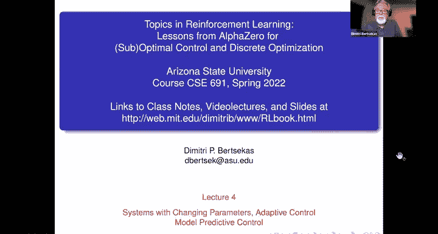

# ASU《强化学习2022-2024｜cse 691 Reinforcement Learning Course at ASU》中英字幕（deepseek - P17：[21]Lecture 4, 2023_ Systems with unknown parameters and adaptive control - GPT中英字幕课程资源 - BV1zcfVYdErD

Let me welcome you to this fourth lecture of our class on reinforcement learning。啊。

We are going to complete the full lecture overview of the course。With two。Special。Control problems。

And methodologies。Adaptive control and that's where we take a break， model projective control。😊。

So adaptive control deals with problem square， the model parameters are changing over time。

 we're going to give some examples of such situations that are very common。

And then we have to do something to counteract the changing parameters because of what we have been using in the way of control may not be effective anymore。

Model predictive control is another major methodology in control system design。

Its architecture is very similar to the alphazero architecture。

And we are going to discuss this methodology in the context of applications in control theory。

Then we're going to take some time to take stock of what we have done so far。啊。

The four lectures that we have gone through， including today's。

 are going to be a platform from which we can go in several different directions。

We cannot follow all of these directions， but we're going to follow some of these directions。

 particularly rollout and some approximation using neural network material。

 there are other directions that we will not cover and we're going to list them here but you're going to be free to follow them on your own。

So let's story into adaptive control。It's a very old the methodology of more than 50 years old。

And it involves problems where the parameters of the problem。The the。

Sysem equation parameters or cross parameters or the constraints may be changing over time。

 and then the controlal has to adapt。As an example， let's look at the。Cruise control type system。

Where will you have to keep the velocity of a car close to some target level。

 which may be adjusted by the driver。Now the state of this simplified version of the problem is just the car's velocity。

 which we call xk xk is the velocity of the color time k。

And it evolves over time under the influence of the propel force。Which is this you here。

And it changes like so and A and D coefficients。A models， for example。

 the friction on the road wind drag that slows down the car。

And B depends on the number of parameters。How far you press the pedal is this UK， however。

 how much force effective force is applied on the system may depend on the road。

 may depend on the weight of the car like the number of passengers in there。

 so all of this may be changing over time in addition to the set target level of the velocity。

A reasonable cost function here is a quadratic one。X bar here is the target velocity。

 we want to keep the state near this target velocity。😡。

And there's a quadratic penalty for deviating combat that the loss。

And there is also a quadratic cost on the control where R is a positive positive number。Fix number。

On the other hand， this is not the usual linear quaratic problem that we have seen before because A B and also X bar may be changing over time。

They may be measured， perhaps with some error， certainly with some cost。

 it's hard to measure this A and B。But you can estimate them with some error perhaps。Overall。

 this problem is far more difficult。😡，As an optimization problem relative to the problem where the A B and X bar are fixed。

So that the type of situation that that people all deals with。

And there are several different approaches。One possibility is just ignore the changes in the parameters。

 just don't bother to estimate them， don't bother to just just pretend that they don't change。

And then design a controller that is robust in the sense that it works， in some sense， for example。

 state， it works for a broader range of parameters and then let it go at that it's the simplest possibility。

 but as you can imagine the least effective。A second possibility。

Is to try to actively estimate the parameters as they are changing。

And then use the estimates to modify the controller。For example。

Once we detect that the parameters have changed， we may do online repplaning。By optimization。

In other words， modify the controller to make it optimal for the new set of estimates。

 so the controller may be assumed to be optimal for the current set。

This is called indirect adapt control in some methodology that who has a long history and a long string and has been successful in practice。

😊，And it's quite popular。One of the principal methods of adaptive control。啊。

Here's another possibility。Instead of going through a re optimization， which can be costly。

And may not be may not be able to be done exactly online。Instead， do it approximately。

Do online rep planning by rollout。Just use roll out to some base policy。

And estimate the cost values that you need for rollout。

 estimate them or compute them by using the current parameter estimate。In other words。

 as the system is changing， the rollout algorithm will also change。

 but not it's not as time consuming as a full blown reoptization。特别是现诉人。The third possibility。

Does not separate between estimation and control， estimation of parameters and control。

 the more principled approach。It formulates the adaptive control problem as a form DP。

Partsionly observe Marovviian decision problem with the unknown parameters。

Which are hidden being viewed as part of the state。😡。

And then after we formulate the problem as our form D， which is very， very hard to solve exactly。

 we try to do it approximately in some of the reinforcement learning methods that we know。

So these are the three different methods and we're going to discuss them one by one。

Are there any questions here？Okay， let's talk about the robust control。

Here we have a system with controlled input and some output here that we can observe。

 and the system may be changing over time。However， the controller is fixed。😡。

And the output of the system is fed into the controller which applies control and we just ignore the changes in the system。

 we act as if it's all the same。Make no attempt to estimate them。

And the hope that this fixed controller will give you acceptable performance throughout the range of the system changes。

So this is a very simple approach。However， does it work， Well， sometimes it works。

Sometimes it doesn't， in general， it is a risky approach。However。There's an important example。

 an important special case， which has proved successful over time。And this is the PID controller。

 a very old control system goes back 100 years。And the PID stands for Proal integral derivative。

And it involves three parameters。Wch are tuned experimentally。Or some kind of hereistic method。

 sometimes manual method。啊。Okay， the output here is a single output。 and this output is the。

Is the deviation of from a some desire out。Some fixed point that you would like to keep this output at and you measure the error between the true output and the desired output。

And the three parameters weigh these errors。The instantaneous error at a current time。

 accumulated errors。That's the integral part and changes in the error over the time。

 this is the derivative part， just three parameters and you tune them in and you don't even know what's in this box at all。

Now the limitation of this is that applies primarily to a single input， a scar control。

 a stellarar output， there have been efforts to exchange to extend the PID control to more general type of situations。

 but that's。😊，That has met with varying degrees of success。On the other hand。

 there's a very seductive aspect of the PID controller， you don't need a mathematical model。

 you just supply this box to your system and then you tune this parameter somehow and you're in business。

😊，然后。It's important before we put down too much this approach of robust control。

 it's important to remember that there's a very successful representative for this approach。

Let's go to the second approach， which is known as indirect data control。

Here the system has parameters that changing。And we get data from the system。

 we observe the system to the extent that we can， and we estimate this parameter。So if the system。

 let's say， moves to some different regime of operation。

 we try to identify that and try to estimate the new context within which we're operating。Now。

 every so often， the parameter estimates of the model are fed into the controller。

 which adapts itself， hence the name adaptive control。So。The controller is recompd。

So that it's optimal for the current set of parameters。

You can view this as an alteration of system identification phases where the system is identified through this parameter estimation box and then a controller optimization part which takes place in here and。

We alternate between system identification， controller optimizationization。

 and this can be done several things。Now， one of the problems of this is that it can be time consuming。

You may have to apply control every two seconds， but your reoptimization may take a few minutes。

 so that's not very good that may be a problem。There are also some。呃。

Interesting and and interesting theoretical issues。

Regarding the possibility of identifying the parameters simultaneously as we control the system。

It may be that the control process may hide some of the parameters of the system from identification。

 and this can cause a problem。Your class notes discusses this a little bit with an example people have been able to deal with that parameter identification or system identification is a very active area of control system design and people have been able to modify schemes to be able to deal with this problem but。

I just don't want you to think that this parameter estimation process is simple， it is not。

 it requires a lot of fun and interesting algorithmic design。But let me give you an example now。😡。

And then you can ask your questions about robust and indirectectductive control。So in this example。

 it's a simple one dimensional linear quadratic problem。Like the ones that we have been dealing with。

 particularly in the previous lecture。It's a one dimensional。

 it's one dimensional x K plus  one equals x K plus b u T， okay？And the cost is quadratic。And。

We want to control the system basically around zero， and we apply want to apply control。

 but's not too large as dictated here by this quadratic penalty。However。

Contrary to our previous treatment of linearphyraatic problems。

 let's assume that B is unknown or its changes， okay。

And let's compare a robust controller with an exactly optimized controller。

I mean indirectect adaptive control。Okay， so first we pick a robust controller。

 which is our nominal controller that's optimal for B equals to two。Here on the horizontal。

 I have the coefficient B and for B equals to2。I find the optimal。Conter。

In the way that we have discussed in previous lectures using theaddi equation， the linear controller。

 and we use this for our range of values of P。The re optimizeized controller。Estimates B。

 and we assume that the estimation is exact。 Now was at any one time it calculates B。

 it has B available B here， be here be there and applies the optimal policy for that B。

So now here on the vertical is the cost coefficient， the ver cost coefficient。In either case。

With a linear or robust controller or would I re optimizeized controller。

 the resulting cost is quadratic and the coefficient of a quadratic cost is stay。

 so this corresponds to higher costs and the optimum cost is for B equals to two is right over here。

And as B decreases， well I need be smaller， so I need larger reviews basically。

 and that adds to the cost of it here and the sort of cost increases as the。As votes become smaller。

没有。This is re optimizeimd。And what you would get with a robust control is certainly bigger。

 but you see that there's quite a bit of discrepancy， This is the loss。

 the penalty that you paid producing a robust controller and not having to estimate B as a change。

So you can see that there is some penalty to be paid。

Is this example clear do you have some questions？Okay。

 so let's now discuss a reoptimization which is approximate by roll and we we'll return to this example after we do that。

So here parameters are changing and we replan by using rollout instead of rot re optimizationization。

So there's a computational and estimation cloud here， which looks at the changing system。

 estimates parameters， perhaps estimate values and other。System parameters are con parameters。

And passes these parameters onto the controller。Now the controller at timexk does not use the optimal policy for the current set of parameters。

 but instead uses its parameters to modify a allout policy。

A one step look ahead for in this particular case。嗯。And we use a one step look ahead。

 a terminal cost function approximation。And roll out to some base policy， preferably a robust policy。

 which is good for a broad set of parameters。However。

 this is not a robust controller because it involves rollout， which is a form of pre optimization。

 pro optimization。Now， this is a。This is cheaper computationally speaking than controller optimization。

Instead of re optimizing that every so often， we just use rollout and which is much less expensive computation。

啊。And。We continue to use the same robust base policy。

 but there's also a possibility of recalculating the base policy in the background and pass it on to the controller once every so on。

So it's not quite as good， perhaps as。Full reopimization。But it is， but it is。

A significant step in that direction。And now I'm going to argue that this is almost as good as being as doing exactly optimization。

The reason is that rollout is very effective and if the parameters are close to their nominal values。

 they don't change too fast。Then theyre all out taxed very effectively， that you optimize control。

So here's the same example I had in the。The slides ago。A linear system for cost。

A changing coefficient B， which is being estimated is passed onto the controller。Now。

 the robust policy。Econgnos the assessment just doesn't use it。The indirect adaptive control。

 exactly the optimization， uses it and recalculates the optimal policy。

And what you see is this curve here。Now， do you think it all out in place of full optimization。

He's almost as good。Only at the edges here， it starts changing a little bit。

And there is no comparison with the Sp more。ive then the robust base policy。Basically。

 from here to here， there's a Newton step and that Newton step is so effective that's almost optimal this particular case。

So I have any questions here？I have a question from a student。ok。This is minor， but to be clear。

 the start points are the re optimizeimized policy， right？The yellow stars。

The yellow stars are the we optimized roll out， is all loud。ok。Yes。The black line is。

The black curve is the exactly re optimizeimd。Alright。It's a little hard to make out here。Yeah。

 they're so close， it's hard to make out。 Yeah， you're right， yeah。Yeah。

 all of them coincide when the base policy。Is when the base policy is optimal for for when B is equal to two。

 remember， the base policy is optimal for B is equal to 2 until we're varying the parameter of the system。

And as we vary， of course。The re optimize is going to give you the lowest cost。

The approximately reopized withdrawalout is almost as good in this， but in fact。

 on this side they're almost the same， very hard to distinguish in them on this side they start to diverge right around here。

But of course， it's a big difference between。这边。对。Performance and performance the baseball。

 This difference is due to the Newton step， the one step look ahead。And。嗯。还是。再说就行。

I have a question so just to clarify if Ilist it correctly so between the robust base policy and the re optimizeimized rollout policy the it's basically the base policy remains the same but the only difference is that one step look ahead and then the difference between the rollout and the exactly re optimizeimd is that exactly re optimizeimized doesn't do one step look ahead but instead it recomputes the controls for the new B at every step is that correct。

Yes， you said it exactly right。We。The base policy stays the same。

And theyre all I simply use this one step look ahead with this base policy for the remainder。

For years theory re optimizeimd doesn't care at all about the base policy。

 it simply finds the exact optimum。Or that particular parameter， which is given by the estimator。

So does this increase the complexity if there are multiple control options at any step in such a scenario？

🤧。Well， you have to take into account that this is an academic example。🤧Excuse me。嗯。

Here everything can be done analytically right in linear quadratic problems。

 the beauty of them is that you can calculate everything analytically。

 you don't have to resort to simulation or approximations or whatever。😊。

In not in a different problem。Then these computations may become substantial， right？

The rollout may be substantial computation， but the exact optimization may be even worse， far worse。

亚出。Okay， thank you。O。So let's go through another approach， which is more principle。

Here there is no artificial separation between estimation and control we first estimate。

 then we control， then we re then wejust the control and so on。

Here everything is done simultaneously together in an optimization framework。Involving a quantity。

Which is of course very hard to solve exactly as we know， as all Palm biies are。So。

We have a system that is deterministic。But it involves some unknown parameter。And for simplicity。

 we assume the parameter can take。A finite set of value， let's say M。

100 different band or 1 thousand different value or whatever。It could take a continuum of values。

 but of course simply it's easier to understand if it the number of values that the paralit can take is。

Yes是 no。We do not know the parameter， we have a probability distribution， a priorityi。或者相分的要你。

On this set of parameters。And then as we， as the system。Evolves。

We update the probability distribution of these parameters， and then we use them for control。So。

Here's a system。It involves a state Xk， a controlled UK， and a parameter of data。

And we assume that we observe the state exactly。呃 then O，然 go。More complicated formulations。

 but here we're going to assume perfect state observation。And we use this as measurements。

To update the probability distribution of the parameter theta。 In other words。

 we estimate the belief。State。We calculate a belief say the conditional probability。

That datata has a particular value from this。3。Condition on all the information that we have collected so far and the information we have collected so far at time K are the states that we have observed the current state in the previous states。

And also， all the controls that we have applied in the past。

In prompt par it called the information that it's all the information that we have collected。

And we assume that we have an estimator that online calculates this conditional distribution。

This may be non trivial， okay， but it can be done to some extent exactly or approximately a given case。

And now we have a formDP。Involving an augmented state。The state of the system really is xk。

 which is perfectly observed and theta， which is hidden。T does not change。

 but we just don't know itss value。😡，So this is the augment state and weulator this as a form Dp and for this form Dp。

 we can write a Dlman equation。😊，In this Belman equation。Has this form okay。

It could be a Belmon equation as a function of the augmented state， but here an alternative。

Which is possible is to have the optimal cost of time They be a function of the current information。

 that's certainly as sufficient sta as possible to argue in terms of dynamic programming with this team at state。

And this is the Belmon equation。Okay。To justify this Belman equation takes a lot of tedious computation。

 so what I'm going to do is explain it in intuitive terms。Remember。

 all Dman equations involve optimization， minimization over the control of the sum of two things。

The expected cost of the current stage。And we expected cost to go。Now， expected in what sense。

 what's the uncertainty here， the uncertainty is this belief state， this belief distribution。

So this part here。The summation， the weighted sum with the be probabilities of the cost。

Gives you the expected post of the current stage。Yeah。Pta I is not known。

 so we take its expected value with respect to the current belief probability。

And this is the optimal cost to go from the next state， which is the next information vector I。Plus。

 the new state， X plus1。Plus the new control UK。So this equation has all the markings of a Belmon equation。

 minimization overview of the expected cost of the current state plus the expected cost to go。

 assuming that we act optimally from this point onward。就。Of course， solving this equation is。

Is totally impossible， except in。In the trivial the most trivial of the trivial examples。

And approximations I'll called for， and what are the approximation methods that we know， well。

 approximation in value space。Well， we approximate this thing。

 which is very hard to compute with something， some approximate thing that makes sense。

And then we minimize over you here with J Tilda at replacing J Star。

So it is convenient here to use approximations that depend just only the。妞。State。

Instead of something that depends on the information， all the past information and the condo。So。

 everything。All the past gets encoded in this shape Hilda through Xk， UK and Theta。

 the carbon parameter value。That's why we have I here。

 in other words this approximation depends on the。We use a different approximation for each value of theta。

 each of the possible values。And then we minimize here review and we obtain a one step look ahead points。

And衣术 them。Calculate either in close form or more likely by simulation， this expression here。

 this is a feasible computation。Now what can we take us J to the I here？

One possibility is to take it to be。The cost function of the optimal policy for responding to theta I。

In other words。Well these are the possible values？Of the unknown parameter。

We act as if we know that value。In other words， this is optimal course under acc ofvoant assumption that we know what pay the I is。

And there are M of those， one for each state， and we use them in here in weigh them with a corresponding probability。

There's some sort of expected value of push to go， assuming the chlorvarian assumption that we know what the theta I。

Another possibility。Is to use as J tilda， the cost function of a known policy again under the clvoant assumption that we know theta I。

 so there's a different one for each different value of theta I and we use some known policy。

 some curiosityistic to calculate this expression for each value of theta I and then we weigh them with a corresponding probabilityities in here。

And this is rollout， this is the analog of rollout for PDP。So。

We're going to look at this scheme in a future lecture。

 and we're going to combine this type of scheme for other problems that cause the characteristics of have unknown parameters。

This type of scheme。You may ask， why do we need to go to this game and not the previous one。😡，Well。

 this scheme is better suited。For situations where。啊。The controller， the control decisions。

May imply the choice of observations on this system。

And it may be that we may want to choose control with the view of enhancing the observation process in the future。

 like use better kind of observations， things like that。Okay。

 we will see examples of this type of situation when we。In the future lecture。

 and there is a section in the two sections， actually in。Chapter 2 of your notes。

 dealing with this sort of。Scheme involving unknown parameters。

What I'd like to do is give you an example that's close to my recent experience。

Are there any questions by the way in this slide before we go to the example？ok。

I guess most of you are familiar with this verbal puzzle。😡，啊。Many people are， many people play。

 millions of people play this puzzle every day because it appears in the New York Times and has become very popular。

It came around more about a year ago and we immediately put the on got the word on fire everybody。

So many people are playing this puzzle every day。And this involves unknown parameters and decisions。

You may surprise you that this is an adaptive control problem。However。

 let me show you a few things about the puzzle， you probably know how it works。

 but I'll describe it briefly。😊，We have a collection of mystery words。

InThe New York Times version is about 2500， two and a half thousand00 mis words or so。

And one of those is chosen every day。And do want to try to guess that mystery word with as few guesses as possible。

And there are guesses that can be drawn from a list of about。12000。Or so。So。TheNew York Times speaks。

I miss that he word。For the current day and you pick just words。So here's the mystery。

 the word is inert。The first yes is audio。😡，And then。If you choose this word， then as a response。

You obtain， you obtain。Information about the commonality of certain letters between the mis word and the current guess word。

Here there are five letters and one letter I is common between the two。

But not in the exact same position in a different position。And these are painted yellow， okay。

Then this information is important， right， it makes you more it affects you it should affect your following guesses。

So let's say in the second guess， we picked this word here。Now， this wood has。

Quite a few letters in common with this one。一开始。E and R are common and in exact same position。

T is common， but in a different position between mystery word and current yes， similarly with M。Now。

 at this point， you've learned all the letters。You have four letters from here and one letter from here。

 so you will know the exact five letters that the mystery work contains。And and then， okay。

You can yes the word it is iner。 So it took here。3 yeses。To obtain the mystery word。

So that's how the problem works。And how special connection with adaptive control。Well， favor。

Is the unknown the parameter， the unknown parameter is the unknown mystery word。

It takes values from a set of。2500 words， which you know。

In the upper prior distribution for the New York Times case。Is the uniform distribution。

Then the way to formulate this problem。Use to US state。The list of possible mystery words。

 In other words， given all the guesses so far。After JK。

 we can construct the list a subset of all the possible mystery words that are consistent with the information that we have gotten so far。

And then， you is the。Actually a mistake here， you is the guessword。

 not the list of possible guesswords。You is chosen from the list of possible guess words。So。

An unknown mysteryward is chosen the beginning this paper， and then you apply to you。

 you apply decisions。And you narrow down。Xk， the list of false advisorary words until it consists of just one word。

So you have all the elements of an optimal control or an active control formulation。Dynamics。

The way system dynamics， the way in particular the way in which the list of mis words evolves over time。

 you have decisions which are the choices of guess words， and you have a cost function。

 the cost function， you pay one unit for every guess that you make。So。You can view all this。

 you can write equations， you can set in the formulation that I gave in the previous slide。And。

And the theta here is part of the augmented state， which is in partiallyly observed Xk is fully observed theta is is。

Is partially observed through the results of the guesses that you make here and you update the correspondinging beliefs and the very nice thing about this problem is that the belief distribution is actually uniform over the list of course of mystery words a more difficult version of this problem is when the probability the initial pro distribution of the guess of the mystery words is not uniform and becomes considerably more difficult。

Now， it is possible to solve this problem exactly by dynamic program and people have done it。

For each different initial mystery word， they have calculated by dynamic programming the。

The optimal quality。啊， that takes。According to one report takes days of computation using a lot of parallel computers。

So it's a highly non trivial computation， it's a gigantic dynamic programming computation that's aided by the special structure of this problem。

😊，Now in。An alternative approach which we have applied with the two of ASU students。

I to use rollout in the way I described it in the previous slide and user a space policy。

 one of several basic heuristics that have been used。

 there have been a lot of heuristics used for this puzzle， for example。

 one that uses a guess that provides maximum information code and code。我。Or apply a。

Guess word that gives you that shrinks as much as possible the size of the current mystery list。

 several basic heuristic。And we have used rollout in the way I described the previous。

 despite with one of these， several of these characteristicsur。

And my collaborators are two of the students that took this course last year。

And they did their stamp paper on this was idea， they did this stamp paper on the word puzzle and they were quite successful initially and then working further on the problem。

 we got some very good results and now we have an archive paper that's online that we can consult about the details and the results。

I'm going to have Sant and Aidta discuss the algorithm later lecture。But for the moment。

 I'm going to give you。Just the result。啊。The optimal performance with the optimal choice of the optimal performance。

For the problem。啊。Is 3。5084 average number of guesses average over all the possible choices of the of the。

Of theメルです。Now， was this saw I just over the 12，500 choice。And this is the optimal number。

 it's calculated by this gigantic dynamic programming computation that I。That I mentioned earlier。

Now it all out。Solves this problem in seconds。And gives you a result that's within less than half of what percent。

From the optimal。一次。Essentially optimal for all intensive purposes。But。

If it's much faster than not only that。If you complicate this problem。

And make the mystery award and the mysterysteries larger。Or make the number of lettersuce larger。

 let's say all the letuce are six or seven letterss。1 than5。

Or you introduce a non uniform initial probability distribution of the unnecessary words。

The problem becomes intractable， no matter how many power compute you use or how many weeks you try。

 you can't solve this problem， exactly。However， the all points still watching in seconds in the order of seconds。

就。How would approach stay with problem and size。😡，What is。The optimal approach will work。

Only for very special problems and with a lot more computation。

So Sudan and Arida will talk about this implementation at a later election。

 a few lectures from now and。But we' I'll leave that back at this point。Have any questions？O啊。

That's all I have to say about Dr。 Patto。Let's take a 15 minute break we will reconvene to discuss model project control and you can bring up your questions at that time。

So it'll making 15 minutes。So are there any。Questions。

About this first part of the lecture before we go into model predictive control。ok。

So model predictive control is a prominent control system design methodology。

The hardcore control methodology。It is of particular interest。

In connection with reinforcement learning， because it shares the architecture of alpha zeros。

 the architecture is very close to alpha zero with a few different letters that we're going to discuss。

But before we get into that， let's talk a little bit about control theory and what are the core problems in control theory。

 there are two classical problems。😊，One is control around the reference point。

 and the other is control along a trajectory， a pre plannedned trajectory。Okay。

 in the the first problem is that you have some kind of a reference point。

And you would like to control the system around that point。

And usually the reference point is chosen to be zero。By translation， you can always。

Bing gotta trans point to0。And here's an example。啊。You probably have played around with this example。

 at least the real version， not the software version。Here would like to。一。A ball。

That has a mass attached at the top。 We try to keep it upright。 So the pole tends to move。

But we want to keep it aright by providing some counter force。And。We want to this angle here。To be0。

What close is it？And we want the pole to be addressed not to move at the upper position。

 which means that its velocity， the anglengr velocity is also zero。

Pta dot here is the first derivative。Over with respect to time。

 over say that this is really a continuous sign system。In reality， but it is。

But we discretize it in order to predict computationally， we discretize time we trigger computation。

And。The way we want to keep this poll upright is by applying courses on this cardt here that holds the poll if it。

Here to the left， we want the force to go in the opposite direction。And so on。

 to the right and we'll just apply these movements here to keep it thetill。

And that's a representative of a regulation problem。In other cases， for example。

 chemical process controls problems involve having temperatures。

 pressures and compositions be around set points and they use。Control system models of this type。

Many are very， very common。Perhaps the original withdrawal problem。你。Next the。

Fful problem use fast planning。Well you want to keep the state of the system close to a planned trajectory。

Like have this car follow a particular trajectory。From point A to point B。啊。Now。

An important part of this particular example are the constraints。The car has to stay on the road。

 but also has to avoid these obstacles here。Other wasteful cash。

There are also some constraints on the velocity of the car。

 if it goes through a bend and it goes very fast， then it will。Get off the all。你看。Similarly。

 there are constraints on how much acceleration you can apply or deceleration breaking you can apply。

 these are again， physical constraints of the car。😊，And these are heart constraints。

Now was intent violate if you fall on the obstacle you don cashash， and that's the end。

So it's critical to obey this circumsttance。Similar with chemical process control。

 if you have pressure goes above a certain point， then the whole reactor is going to explode and then you're in tu。

So it is very important to address from stage。 in fact， that has been。

The motivating factor behind MC， what protective control， it addresses。

State constraints much better than linearequ quadtic formulations or other methods。啊。

There'sSome after aspects about this problem that's interesting and complicatedlic。

The fact that obstacles may be moving like other cars of the。

 you can crash onto them and you can predict when they are going to appear and at what point。😊。

So it's important in some of these problems to be able to do online recing， past recing。

And this brings us a connection with adaptive control in adaptive control you also have to do reclining right when the system changes。

 the problem changes， you have to recline and this is also part of the model predictive control have。

就。Let's try to address now the problem mathematically。啊。

We're going to use approximation in value space。And the original form of a model predictive control operates as follows。

It assumes a system。Thats station added in okay。And it's not linear， possibly。

And it has a course function。That。That is positive ever required except the the origin。😡，Now。

 this formulation addresses the regulation type of control problem where you want to keep the state of the system near the origin。

So we impose a positive cost for being outside the origin and also for applying non zero control。

And the cost is exactly zero for x equals to  zero andq is equal to  zero。So in other words。

 we assume that the system and also the system can stay at the origin and zero course。

Without without paying any force， so once you bring it to the origin。

 then in this formulation you have the control stops in the reality there's always some uncertainty。

 you can't bring the system of the origin exactly， but if you can， it may go off the origin。

 which case in the reality is，Control applied continuously。

 but for a mathematical approach to the problem， we assume that once you bring it to zero。

 then it stays there。So what is NPC？Instead of optimizing this cost function over on infinite horizon。

You impose a finite horizon。And we imposed the requirement that the state and steps ahead from the current state。

Its brought at zero。So that's the problem that you solve in NPC given the current state Xk。

 you find a control sequence。Over but L stages。And。

And we require that this control sequence brings a state to zero exactly after L steps ahead。

And we also require that the cost here， we impose the requirement of costs here over the health stages minimized。

Now after we minimize the cost over theL stages。Then we apply the first control of the minimizing sequence and discard all the other controls。

Now you can see that this is。Related to approximation value space。

We have one step look ahead for the first stage。Plus， a cost approximation。Or that models。

 the minimization over the remaining L minus one steps。So you can view this as all loud。

With a base sturistic being。The policy the sea that。Minimizes。

That minimize the drive from x state plus1 to0 in L minus one steps。

So this is the base policy and this is the one step look ahead。You can also view as。

A general type or sort of， what makes it a little different here is that there's a hard of saying of mistake。

So it's a little different than the approximation value space that we had discussed。

 but's a perfectly illit rollout scheme。😊，Another thing to note here is that this is very well suit for all language you planning。

😊，If the system changes here or some of the constraints change。

 then you can introduce this into this minimization。

 you can introduces change in the minimization and which amounts to online reply。Now。

 we mentioned that in MPC。State constraints are very important。

This formulation allows control constraints， but I haven't shown you anywhere in state constraints。

And I have left them for later， we're going to discuss state constraints which are very important in a few slides。

 but for the moment we are going to focus on simpler versions of the proal state constraint that require a special treat。

Are any questions about this slide？This is not the form of NPC that's very common in practice。

 it's the original form， but it suggests other forms which are common in practice。

And then I'm going to give you in the next slide。第。

A very common variation of what the political to control is when we introduce a terminal cost function approximation instead of the requirement that the state is driven to zero in L steps。

So we use a non negative terminal cost。For the end of the L step horizon。And we solve。

The problem that you see here。This is one step L step look ahead。

 minimization with this terminal cost function approximation。

So this is our standard type of multi step look ahead， approximation ga ratess。

It's of the title that we have considered。But we can also complement it with transd rollout in between here to some base policy。

And this has some advantages， and also brings it closely。

 more closely to the alpha zero and PD gammon architecture that we have discussed in the past。

 or the elements are here。Mo is step look ahead， Racade to roll out in the middle and turn across approximation。

 It's the same thing。The main difference between this architecture。

 the PDD Gament architecture is first of all， this deterministic。

 whether the PD Gament is stochastic， but there are stochastic version of this as well。

 but more importantly， the state space is continuous and the control space is continuous。

 whereas has engaged like PD Gament and ches， the state space and the control space is discrete finite。

 which correspond to a different moves in a different position。啊。We。As I said。

 this is a common formulation and the。The MAla implementation of predictive control is based on this here。

And we may introduce also state constraints in this minimization whereby the successive states from。

State Xk to the last state Xk plus L have to satisfy， have to be some contrain center。And then。

 this is the。One of the most general concept of NPC。

🤧Note that when we make no assumptions about the nature of the state space， the control space。

 it can be continuous or discrete or a mixture of the two。In control of theory。

 at least part of the state space is continuous usually。啊。

The state constraints we have not dealt so far， but we are going to deal with shortly。

An important question about which controlists worry about very much。When is the MPC policy stable？

Now for this to be true。G must be in the origin of stability。Which brings the question。

 how do we know what the reach of stability is？We have some information for it lies。

 but not precise information。And there are conditions that she must satisfy in order that we can satisfy and be guaranteed to be in the original stability。

 but I'm not going to go into the mathematics of this， you can look at the class notes。

Let me note here also。That tranccade the drawout with a stable policy。

Hes very much in bringing G into the region stability。

And that's an important advantage of rollout within this context。Again。

This is an extension of the type of figures that we saw。In the previous lecture。

Involving the graphical interpretations of roll out policy variation and approximation value space in connection with Newton's method。

 there's a newton method hidden in all this。As it was in previous treatments of this type of architecture。

Are any questions？Okay， so now let's address state expense we mentioned earlier but they are very important。

And the state say that what I'm going to consider is the form that Xk has to belong in some subset。

So everything has to happen with a subset that doesn't violate obstacle constraints or other constraints。

 and it's important that you start in there and also stay in there， otherwise you have difficulty。

To introduce state constraints into the NPC formulation。

 we have to modify the MPC problem and this problem takes the following form。

Assuming that the current state Xk belongs to the contrain set。

The NPC problem is to minimize the cost of L stages plus the terminal cost subject to the control rates。

 but also the additional state constraints。So。Part of the formulation here is that x0 must start in x。

And also。Note that the control obtained by this minimization。

 the first control in the sequence of rankch from mis minimization is guaranteed by the definition of the problem to generate its wayx state plus one。

So this formulation assumes that you start with an Xk and there is a control that brings you into that keeps you into the constrain set。

In other words， I assume that this problem is feasible。

But the difficulty here is that there is no guarantee that this problem has a feasible solution。

It may be that there are starting points within this contrain set。

And no matter which control you apply， you escape from there， it's too late， you cant。

 you can't bring it in， you keep it in。So the question is。

How do we make sure that this doesn't happen in particular。

 How do we guarantee that this problem is feasible for all。At all times and with all space。

Inial state。嗯。And。Let's give an example to explain what happens here。😡。

Suppose that you have this Taylor system。😡，Xk plus one plus 2 x k plus u k。

And notice that this system is unstable， tends to go off， right， the state doubles with every step。

And let's assume that there's a control strength。That you must take values between minus one and one。

Now， if the state is very large， then because of this term here。

 no matter how hard you drive with the control， you push it in the opposite direction。

 you can't bring it back within reasonable values。So let's consider this situation。

 and let's consider state constraints of the form that Xk。Has to be within this set。In other words。

 its value has to be between beta and minus beta。Where Beba is a scalr。Okay。

So let's suppose that the data is greater than one。I have app ploted here。

As a function of a function of K， the constraints set， So at time zero， the constrain set is this。

Between beta and minus beta or like that or between  one and minus1。Okay， and。

That constraint remains for k equals one k equals two and so on。 So the constraint set。

 this constraint set defines a cube。Of values within which you have to stay if we invadeta and minus beta。

Now I claim that beta is greater than one。It a contrain set here involves a be greater than one。

So the starting state can be outside this white cube。

Then the state of strength cannot be satisfied over all the initial conditions。

And the problem is that if you are far from the origin。

 either in this red of it here or in this region of it here。

 the state increases too fast for the control to be able to bring it down within the fight region。

In particular， suppose we take x0 to be equal to beta， okay， satisfying this restraintrain。

Then two times x0 is greater than 2。And x1 is going to be。To2 x0 plus u 0。

 but u 0 can only be minus1 here。 Take absolute value。 one has be less than one。

So the next state will be bigger。That he previous day。

So what happens is you start with x0 equals to beta and you get x1 that's even bigger。

And the same rational now。Can be used to。Proof that the entire sequence of generated space。

Will be increasing。And also， we tend to infin。So in other words。

 what I'm saying is that if you start getting the red initially。

Then the state trajectory is going to explode no matter what control you use。就。

This kind of state can stay。Cannot be used in MP。 It will it will violate。

 it will it will eventually violate。Or cut any kind of limit that you may have on the state。😡。

On the other hand， suppose that you used。A state， an initial state that's within this white region。

 okay？Then。啊。Then you can stay within that region by applying control that's。

Between between1 and minus one。2 of x K is going to take you somewhere to most beta and then a control。

inus one is going to bring you back into the flight region。

So what's happened here is that the state constraint can be satisfied。

 provided that it has this form for x0 in the set here。

 you can satisfy the state constraint and the NPC problem is feasible。Now， sets like this one。

 but if you start anywhere in them at the next state， the state will be with still within them。

 regardless of the。For some suitable values control， they are called invariant。

You start within the flight cube， you can stay within the flight cube by suitable choice of control。

So let's discuss this invari sets in the next slide。And。Here is a requirement for invariance。

 this is the same example that I gave of you。I set X。Is said to be invariant if。

Starting from any point within that set， there exists some control， which is feasible。

 such that the next state is still within that set。So you started here。

 you can always stay here and satisfy this constraint。And that makes NPC possible。

And the NPC calculation feasible。Now， the problem here is that。

How do we calculate an invariant subset for a given sub？嗯。Now。This can be done。

 but it's typically an offline calculation that's the problem invaris you have to have them from the beginning。

And we cannot recalculate them online。嗯。It turns out certainly you can see in this example。

 but in general。There exists a largest possible invariium set。

For a given control for and for a given system， you can find invari sets。

 but there is one that contains all others。This is the largest possible invari set。And you can see。

In this example， this is the largest invari set。😡，if you any other invari set has to be contained in here because if it contains points that are assigned to the a region。

 then you have this problem of problem。For stability that I described earlier。

It's possible to compute this largest ingredientvari set。By using something that looks like value de。

You start with sunset that is not invariant and then you go one step back and you get something smaller and smaller and smaller and so on until you get into the largest possible invariance set within the set that you started。

Theyre substantial computation， but they are also easier。Other possibilities。

There is a lot of literature about all this。This little I just started， let me。

Say with my PhD history。long time ago。嗯。More than years ago。

My PhD thesis was the first one to address this。I your in various。

And actually in a more general context， involving also W， a certain point this。And。Unfortunately。

But I've read a long time。Nobody paid any attention to my face， which was very disappointing to me。

But。About 15 years later。The idea of keeping the state of the system within confined regions became important products like robust control and it's really really important in model to the difficult thought。

 and this was recognized quite a few years later when NPC became popular starting in the late 80s and 90s。

But。Okay， it's nice to see that sometimes even though your work is not recognized。

 eventually somehow it comes to the surface。As a few progress。

So are there questions about all this you can find a lot more in the literature about the invariant sets about how they can be used in NPC and other contexts。

 and there's also your class notess， chapter one have。呃。

Have references in a little bit more detail about that what I have given you here。我申请。Okay。

 we're not going to talk much about NBC in the in the。In the。Future lectures。

 which brings up the question。What have we done so far？

And where we are going and also what we will not cover。嗯。As I said。

 the first four lectures are intended to give you an overview。A foundation。

For looking more deeply at other reinforceal learning topics。And also incidentally。

 to get you started on your turn paper。So you can start from your class notess and expand and try to find something that's of interest in you。

So what have we covered so far？In our core lectures and also in the class node。

 chapter one of the class node。We looked at exact dynamic programming in all these major forms。

Theterministic， sarcastic。D discretere state space and continuous state space。

Pate fluorizon and infant fluiz。All of this， of course was in summary。

 but I hope I gave you the main ideas at least at an intuitive level。

Then we identified the major problem with exact dynamic programming。

 namely calculating the optimal cost to go。And we introduce approximations and particularly approximation in value space with one step look ahead and multi step look ahead。

This is the workforce in reinforcement learning， everything， not everything。

 but most of reinforceforrsment learning is built along various components of approximation in value space。

It's also the。Foundation for some of the major success stories， including Alpha Ze and P Gamma。

And we argue that approximation value phase consists of two components which can be designed more or less independently。

Offline training and online play。And there's a synergy between them through Newton's methods。

We focused on the fundamental methods of policy duration and it's one it version which is rolled out。

Policy duration involves policy approximations and cost approximations in between directions。

So it primarily an offline。On the other hand that all out is less ambitious。

But it can be applied online and it's simpler。Both of these have connections with Newton's method。

 This is one step of Newton's method。 This is multiple steps。

 or you need to example of steps of newton。嗯。We discuss some of the major models。啊。

That can be used within them。Dynamic programming。Discreet optimization is one。

 we're going to come back to this。From DP imperfect state information。Multiage problems。

And in this lecture， adaptive control and model predictive control。翻开啲。

Our recurring theme within our presentation was the fact that we use function approximation。

Cost functions or policies。Most commonly， cost functions。

And we have alluded to that in various places。But we did not go into detail of how you do these approximations using。

 for example， neural networks and other architects。So this is the content of chapter one。

 and from this we can build into other directions。The first chapter is a foundational platform。

And we're going to go from depth。On the rollout in variations。For example。

 apply to discrete deterministic optimization problems。

Multti Asian problems and some of these adaptive control problems that I gave earlier in this lecture。

All of this is in chapter two of your class notes。对。We are going to discuss。Also in chapter two。

 sequential decision making in some special context involving changes or parameters。

 sequential estimation， vision and optimization。And Siimoteane。System identification and control。

 And we're going to have this lecture word that I mentioned that。This is also in chapter two。

Tap the three on your nose。Deals with offline training。

For approximation in value and policy space using neural networks and other approximation architectures。

We're going to spend at least one lecture in on this topic。

 and this is all in chapter three of your notes。This is what we are going to do。

For the rest of the semester。These are the things that we are not going to do。

Reinforcement learning is a vast field。Work done by many different communities with different applications in mind in different cultures。

😊，So there's a lot more than what we are going to cover。

I hope that this first chapter provides the platform， but you can go in these directions on your own。

Schastic algorithm is a very big part of reinforcement learning。They are used， primarily。

In the context for policy evaluation， offline policy evaluation in the context of approximate policy。

You see names such as temporal difference metal， ED lambmbda and other methods， Q learning。

 all of this is part of all of these are stochasticical words that can be used with some success。

 I would say varying degrees of success。In the context of policy evaluation。

Aggregation is another topic。It can be used for cost function approximation。

 essentially by creating a smaller system out of a bigger system。

 by lumping states together and solving a smaller system and in this way can be used for cost function approximation and also approximation in value space。

Now。Unfortunatelyfor learning involves a lot of data， right， data to self for self learning。Data。

 performance， data for various follows。How do we collect this data？啊。

In the process of offline training。And also， how do we do this for。

For such approximations and also for policy approximation。

It's a very big part of the operational learning within which we are not told about。

A lot of theisticians， staisticians。Wory about statistical estimates。Of various sampling methods。

 like confidence intervals。With methods involving simulation。Trying to do simulation efficiency。

 use few samples for the same effect。For the same value。

And this is a mathematical subject that a lot of people work on。On the other hand。

 I gave you the argument that Newton's method is the big equalizer， in other words。

 worrying too much about efficiency。In in， in in constructing cost approximations。

It's not so important once you are within the origin of convergence of Newton's method。

 then it doesn't matter whether how many samples you're going to use。

 additional samples you're going to use， iss all the same。So anyway。

 a lot of people worry about this and it's a big theoretical subject of research。Finally。

 all of the methodologies that we focused on， such as po D P model predictive control that is control and so won't have a lot of application。

😊，Robotics， automatic transportation， many， many different types of applications that that you can find within the exploding literature。

We're not going to go too much into this， except for some sample applications that are going to be in chapter2 and three。

On the other hand， you are free to choose the topic of your term paper from within these topics here。

 even though we don't cover them in class， as long as they're couched on this foundational platform over first quarter lectures in Cha1。

发ing questions here。About what we have covered and what we will cover or would not cover。Okay， well。

 this is going be a shorter lecture than you expected。

But I thought that we should stop here to have a keen separation between。

Generalities and specific topics covered in depth。In the next lecture。

 we're going to go into rollout and its variations for deterministic problems。

And also for satorcchastic problems to the extent that we have time。About your homework。

We gave an extension of one week for the homework。So there would be no homework。

 no new homework this week。But a new framework is going to be announced next week。And the。

For this subject here that we are going to cover， you may watch。

Video electrify from the last year's offering。So that's it for today to see you next week。

