# ASU《强化学习2022-2024｜cse 691 Reinforcement Learning Course at ASU》中英字幕（deepseek - P18：[20]Lecture 5, 2023_ Rollout algorithms for deterministic DP problems, - GPT中英字幕课程资源 - BV1zcfVYdErD

Okay， let me welcome you to this。

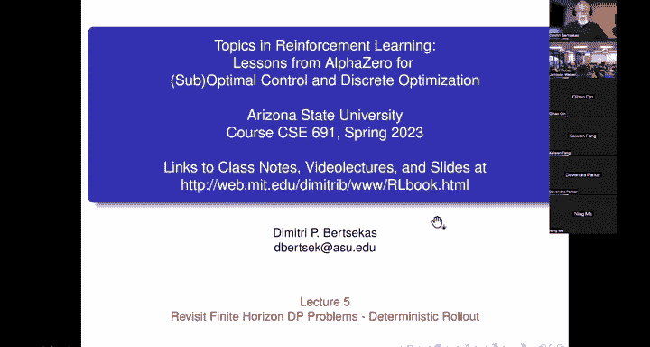

This lecture。Of our course on reinforce learning。And。

The first four lectures were sort of overview lectures they were designed to paint the big picture of the field。

And then in the following lectures， we're going to go in greater depth in some of the some selected topics。

 particularly related to rollout and also to various type of neural network approximations。

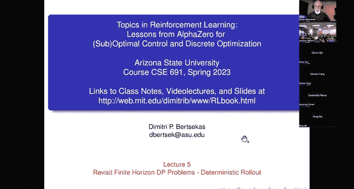

I've described in your class notes。

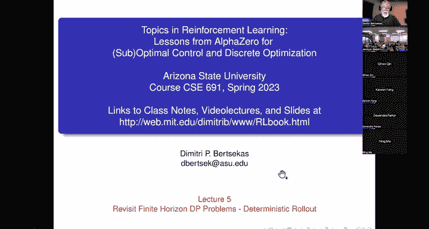

So today we're going to revis its finite Verizon dynamic programming problems。And look at rollout。

 and particularly。You're all out for deterministic problems。

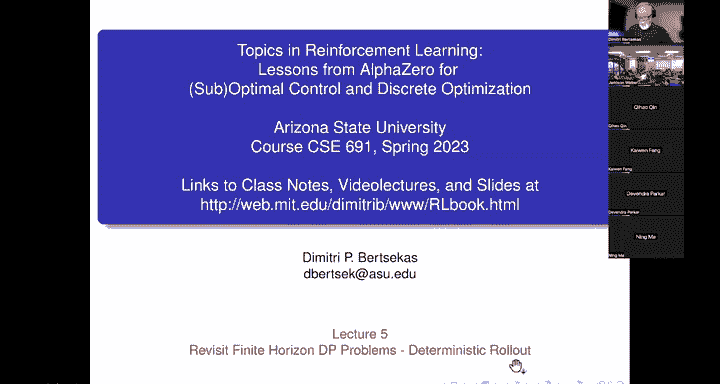

So we're going to do some review of finite corizion problems and then I'm going to discuss how they are related to infinite corizsion problems so that insights that we have already gotten。

 both algorithmic and also visualization related to infinite coriz in the previous lectures can be applied to the finite corizion problems that we are going to be examined。

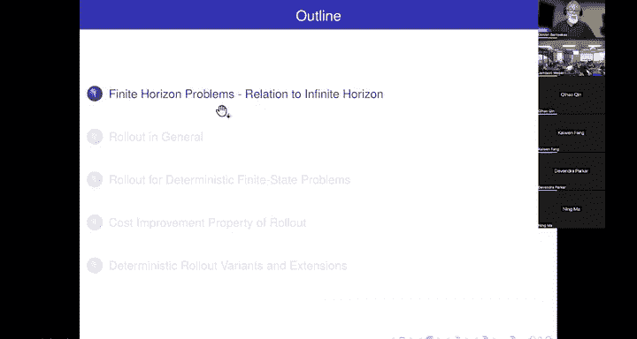

Then I'm going to talk about Ro in general， again， I review。

Then I'm going to focus on the Terministic United States system。

Pinite state because they facilitate the computations and we're going to look at rollout within that context。

Then we're going to look at the theoretical。Improvement property overall。

Mainly that the rollout algorithm performs better than the base policy which it deliverlies。

And then after we take a break， we're going to look at the variations and extensions。我你就咁的水。

So Ill review first on finite corion problems。

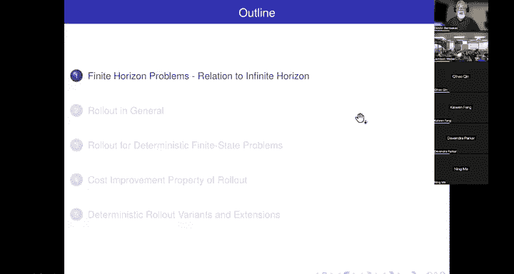

We have the general stochastic problem involving states proposeds and random disturbances。

And given the current state， we go to the next state by selecting control and then some。

The random disturbance speaks a value and we move to the next straight xk plus one。

 and we also obtain a cost which is random because it involves WK。Now the course function。

Is the sum of all the stage cost plus the terminal cost at the last stage。

And we're interested in policies。Sequences of functions that map states into controls。

 we assume that states are perfectly observed and given a policy。

 it gives us the control to apply at that state。And then。For a given initial stake。

 we want to minimize overall policies。This。Expected cost。

Which depends on the initial state and of course， the policy。

And the optimal cost function is the minimum of policies， which depends， of course。

 on the initial state。And。We are going to be focusing on finite variation for the most part。

 for the remainder of the course。For one thing it's most convenient for algorithmal purposes。

In particular， rollout that we're going to be focusing in greater detail。

 sort of assumes a finite variation and if it's infinite then we have to trucate。However。

 in terms of implementation， in terms of conceptualization。

Nearly everything applies to infinite coriz as well。So again。

 let's review the dynamic programming Albert。It produces the optimal cause of the tail sub problems starting at any stage and stage。

And it starts at the terminal cost， at the terminal stage and goes backward with each duration computing the optimal cost of the tail sub problem of the current state。

 given the。The optimal of the terminal cost of of a following stage。And at the last step。

 we obtained the optimal cost of the high correction problem。And to obtain a optimal policy。

 we have to minimize in this expression， assuming that we have already completed J star8 plus one。

Now the problem with all this is what's very time consuming or challenging problems it totally intractable。

And the enforcement learning deals with ways to simplify this computation and simplify the computation of optimalal policy。

And a major part of reinforcement learning。Perhaps the most important part of the learning is approximation in value space。

Whereby instead of this J star， J plus1， it is hard to compute， we use some approximation J tilda。

And then once we have J Tilda， then in the real time we。We do these minimizations at stage K。

 given Xk， we minimize this expression of playing duede gain。

 which is the cost the control that we apply。And there's also a multi step version of this。

 which we're going to come to shortly here， which involves instead of solving a one stage problem。

 solving a multi stage problem of smaller horizon than the original。

And the key question is how do we compute J Tilda there are many different ways。

 online it rollout is one， offline training using neural networks or other things is another possibility。

 pro approximation， heuristics and so on， as we have discussed。

90% of reinforcement learning revolves around we compute the straight tda and also perhaps how we do some approximations here so that this computation is not so onerous。

没有。We're going to be focusing on finite corsion problems。

 but we have talked a lot in the previous lectures about infinite corsion problems and garden insights and visualizations。

 but it's important to understand that the finite corsion problem can be transformed to an infinite corsion problem。

 so the algorithms and insights that we gathered from infinite cor can be applied to finite corion。

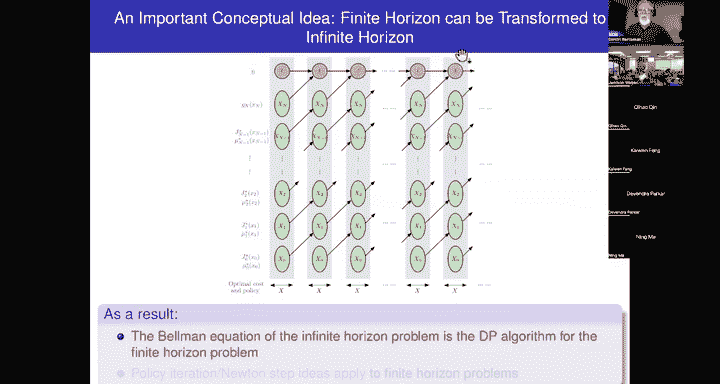

So how do we do this？In a finite horizon problem we have n stages and we have a state space and control space corresponding to each stage x0 is a state space of the initial space x1 capital x1 is the space of states x1 and so on。

And。We take to construct the state space of the infant col problem， we take the union。

Of all these state spaces， and we also add a termination state。

 which we have to reach upon reaching the end of the horizon。And now。

So this is the state space of the infant correlation equivalent problem。

The control space is obtained by looking at controls that are available at each state here。

And the transition function， the system function， is the one of the finite cor problem and takes us from x0 to x1。

 from x0， x1 to x2， and so on。So we have stack up。All the system functions into a big system function that gives you the one of the infinite cors problems。

So from some state here， we got some state here according to transitions that we have described。

 and so on， however， notice that these transitions go upwards and within at most n steps they reach a termination state where we stay at no cost。

 this is the end of the horizon。

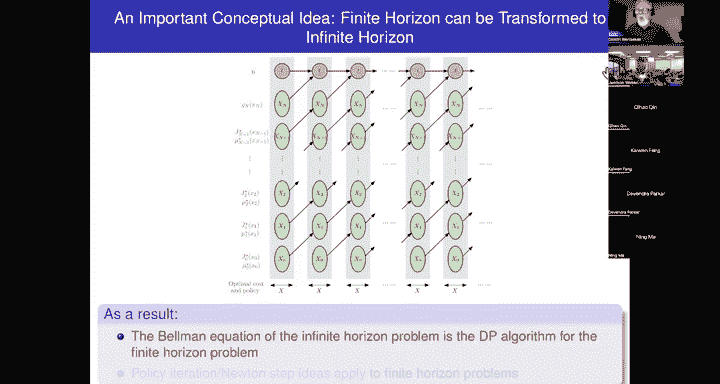

做 now。

If you look at the states that start the interest states at x zero in one step we're going to be x1。

 another step is we're going to be at x2 and so on， after n steps we're going to be at x n。

 and then there is a transition to the termination state， the end of the horizon。

 at cost this terminal cost。Intermedia transitions have costs of the okay， G0， G1， G2 and so on。

So now if you eyeball this figure here， let's look at the optimal cost function of the infinite H problem。

It gives you a value for every one of these states here， states and here， facing and here， and so on。

 and it's very easy to see that the optimal cost of the infinite cor problem。

 starting from this states here is the same as the optimal cost of the finite cor problem。

 starting at x0。The optimal course of the infinite correlation problem starting from these states is J1 star of x1。

 J2 star and so on。So the optimal cost of the infinite cor problem is a stack of all costs of tail sub problemm。

And the optimal control， also the optimal policy of the infinite horizon problem also gives you an optimal policy for of finite horizon problem。

So there's1 one to one equivalentvalence here and moreover。

 if you write the Belman equation for the f horizon problem。

 there's one Belman equation for every state whatever we on is。喂。

And you'll see that it's exactly the dynamic programming Al was a finite variation problem。

So Belmon equation for infant Horizon is the end stage dynamic program now with a finite horizon problem。

And。呃。The呃。The interpretations we take for balance equation like the Newton step and so on。

 they apply also to finite horizonoriz with this transcription here。In other words。

 a Newton step on the Belelman equation of the Fing Horizon problem is a Newton step on the dynamic program in algorithm fine Horiz problem。

It's more complicated， you kind of visualize it， but it is fair。Moreover， things like privacy don。

Can be applied to this infant cor equivalent and give you a policy duration I working for the finite cor problem。

Policy evaluation followed by policy improvement and then policy evaluation again and so on。

So all the theory for infinite corrosion applies also to finite corizion， or the insights also apply。

 it's just that the finite corrosion version is simpler because the infinite corrosion problem here has a special structure。

from all states， we get to the termination state and so on。

 infinite corizal problems can be more general than that。However。

 all that insights from Indian apply， that's the point that I want to make。

A any questions about this diagram is it clear？

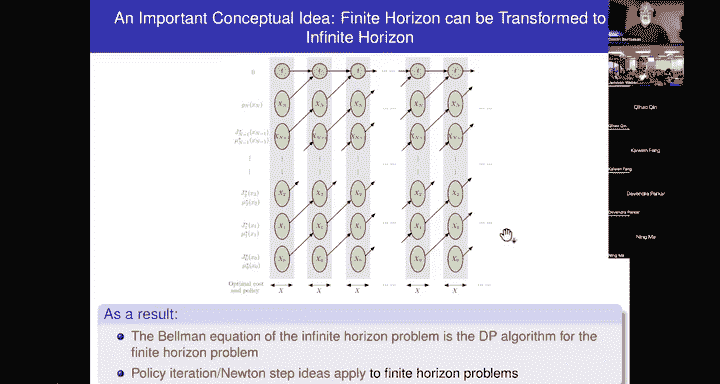

Okay， so let's keep going。Let's talk about roll out and review it。啊。

Ro out is a special case of approximation byspace， a special ja tilder。

I have you have seen this before， I'm showing the multi step look ahead case。

 L step look ahead version。And minimization of the some of the first L step cost plus the future。

As measured by the cost function of some base quality。Okay， so that's distinctive about it all now。

 Jay Tilda。Is the cost function of some base policy or some heuristic。

And I'm going to be using these terms throughout base policy and the policy obtained by look at hybridization。

 in other words， when you minimize here you obtain UK plus sequence of news and you apply the first UK and then throw out the rest and that defines the rollout control and the rollout policy。

So this the po， the finite cor policy， we call it the roll outpo to distinguish it from the base focus。

And we're going to look at the various interpretations here。

 where we have already gone through the Newton step interpretation that the optimal cost of the of the rollout。

 the cost of the function of the rollout policy is a result of a newton step starting from，V。

The cost function of the base policy the functions。

But we are interested in establishing whether the rollout policy is better than the base policy in terms of this performance。

And also， look at variations of。Of this algorithm here。For J tilda。

 instead of being the exact optimal the exact cost function of a base policy。

 it may be an approximation to that obtained， for example， by plant。

Can cost function in approximation。So this is the growth landscape that we're going to be operating in。

And we are going to focus， particularly in the deterministic case。啊。

Let me say a few things about why rollout is going to be important for us。好。

One of the it also roll out， one of the。One of the things that accomplishes is that provides options for cost functional approximation。

Wch are implementable they implementable in particular by simulation。

We want to find if we want to find the J tlta value at some state。

 we simply simulate the base quality from that state， and this gives us。

Within a reasonable approximation， the value of J tilda attach state。

So it's one option for cost function approximation， implementable online。

But it's also another reason which if you go back to the visualizations we covered。

 we did in the previous lectures。You'll see that it's a good option because it approximates the optimal cost from above。

And approximations from above， if you recall， tend to be。Better。From the point of view of stability。

 for example， in coraries。So that's one important reason why we'd like to roll out。Moreover。

 rollout is a basic building block of the considerational， is also very important。

And rollout is one single iteration of the phone st algorithm and the main difference is that rollout can be implemented online through simulation but。

Approximate policy direction cannot。 you have to use some kind of a neural network to represent the cost functions of the intermediate policies。

There are also approximate variant of policy duration and it allowed again comes into the picture in those。

ok。So here's some of the nice things about rollout and why we will consider it as important。啊。

It is the easiest。To understand method and to implement in the reinforcement learning。

They straightforward forward。Esy to see why， easy to understand why it improve improves on the base policy and also to implement it is very easy to implement a rollout on a given problem。

 it says takes two days， let's say。But then to implement a more complicated method。

 such as an approximate for the situation algorithm。It may take two months。

There's a day and night difficult change in the difference in the。

In the difficulty that it takes to the difficulty of implementing the rollout and some of the other reimbursement learning out。

Also to make this other algorithms to work is another story。

Because rollout is by far the most reliable method within this landscape for reinforce diet。

It works just about every time， okay， once you take some care to avoid some pitfalls。

 then it works just it very straightforward forward to make it work。

That's far more than I can say about some of the other methods in learning。

 like the Q learning methods， DQN， TD methods。To make those work。

You have to be you have to work very hard and you also have to be lucky because they don't always work this one works almost always。

 the other methods do not they fly and you may be lucky to make them work on a given problem but don't expect the success to be replicated with a broader context。

Okay， a is very general because it applies to deter termministic problems， the plastic problems。

 finite horizoniz， infiniteite horizoniz。It just is very general place of control problems。

 but the context of more be predictive and adapt。 so that's another advantage。

It relates to Newton's method， that's part of a theoretical underpinning of the method。

It deals with with all planning。 So if the problem changes on you as you。During decision making。

 then。Whatever new problem is is just incorporated readily within the rollout calculation。

And this also is true in the context of adaptive control。

 it's a useful alternative to reoptimization， as we discussed in the previous lecture。

It relates to model predictive control， as we have discussed in the previous lecture。

 and parallelout can also be used to improve the stability of various MPC schemes。

As I discussed near the end of my lecture last time。

 but is also explained in greater detail in your class notes。Finally。

 crd rollout can be combined with many of the other other functional learning lab。

Such as self learning， learning， aggregation and others。In two ways。

 Francd allowed can use a structural cost approximation， whatever these other methods produce。Also。

 it can use as based policy for rollout， some of the policies that are obtained， for example。

 by search learning or Q learning， so on。So。All of this make it a good starting point to the field of reinforcement learning and also a suitableable subject for you to do term papers and mini research projects。

if you are to implement some of the more sophisticated reinforcement learning methods for a term project。

I suggest if you think twice。Because it takes。It takes a long time and it's a dicey proposition to make these methods work on the other hand。

 if you have experience and confidence in some of the other methods like TV methods。

 your learning and so on， then by all means go ahead。

 I don't want to restrict you from from doing so。Okay。

 so now we're going to go into deterministic problems and roll out， are there any questions？Okay。

 in deterministic problems， there is no W， theres no stochastic disturbance。

So given the current state， when we apply control， we know exactly the next state is given by some known function。

And of course， it's also deterministic。The cost function is what you obtain from a sequence of controls。

And。And we minimize overall control sequences this expression。

 and we obtain something that depends on。

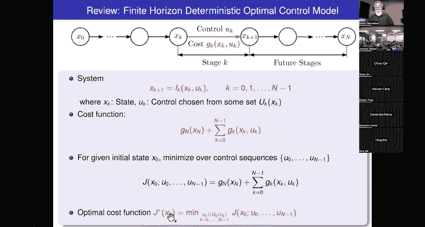

We obtain the optimal cost， which depends on x0。And now finite state problems。

A finite number of states at each stage。啊。Nice in the sense that they allow computation to go forward。

D programming of becomes useful。But also， they can be。

Vualize it can be depicted in a planar graph like this。 I've gone through this before。

 let me review it。啊。This is a layered graph， there's one layer for each stage here。

 the circles correspond to states and these are the initial states。States a stage1， the x1 states。

 the x2 states， and so on， the terminal states x10。

 and then there's an nonscript termination node to which we can move。Of course the easy time。

So nodes， the circles correspond to states。And the arcs correspond to controls， more exact。

 more precisely state controlled pairs。Xk UK。The start note of the A is Xk。

 the end note is what you end。The state that you end up after applying UK。So here at x0， we apply U0。

 this corresponds to this artrc here， and we end up on a corresponding state x1。At x1。

 you applyq1 and that's。It's represented by Ya art it takes you to x2。

And all the controls available in the given States and given by the outgoing arcs。

I would represent the correspond to the outgoing a。And so on。

 so for a typical trajectory of the system， you start at x zero。

 you select an outgoing art which corresponds to control use zero or end up at1 point。

Select another art， go to x2 and so on， and we obtain a trajectory that ends up a determination node。

And if you add the cost of these arcs， you obtain the cost of the sequence of controls。

And the the sum of these costs can be viewed as the。Length， okay。

 I forgot to mention that for every pair X K UK K there's a corresponding code。

 So the transition from each one of these。中中。

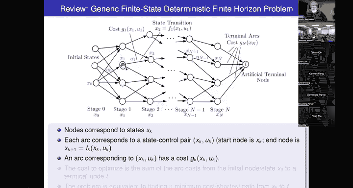

For every pair of states corresponds to the task cost equal to the。To given by GK or x。对。So。

The overall cost of a trajectory corresponding to a sequence of the cost is the length of the path。

 with length of each art being the cost of the art。

So this brings us to an important connection between finite states。

 finite corls of problems and shortest path problems of a special kind。

 a cyclic shortest path problems of this type that we shown here。

It's also possible to show that short spa problems determin and spa problems can be approached by dynamic programming again with a graph somewhat like this。

 So there's an equivalence here， but we really focus on the fact that。That。

Finance state domestic problems。Our shortest past problem or special kind and can be solved as shortest past problems either exactly one approximate。

So let's give a couple of examples here。啊。Theterministic dynamic programming problems arise very often combinatorial problems like the travelingver salesman problem that we have discussed in the past is another example。

 classical example， the N Queens problem。Whereby we want to place n queens on a chessboard that's n by n square and we want to place the queen so that none of there's no pair that attacks each other。

 none words， there's only one on each column， only one on each row and only one inch diagonal。

So here I'm showing the four queens problem。And the way to formulate this as a dynamic programming problem is to break down。

The seek the decision， the overall decision of placing the ends into a sequence of many decisions。

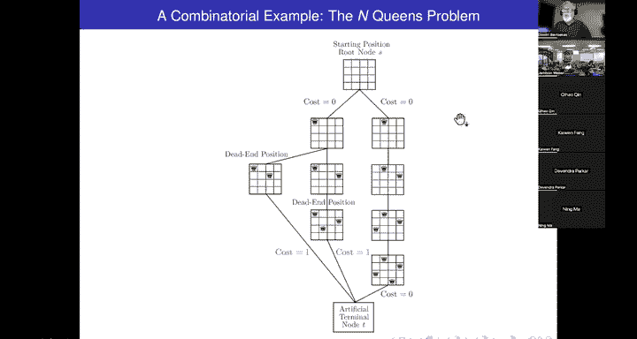

First plays the first queen in the first row， then place a second queen in the second row and keepith going。

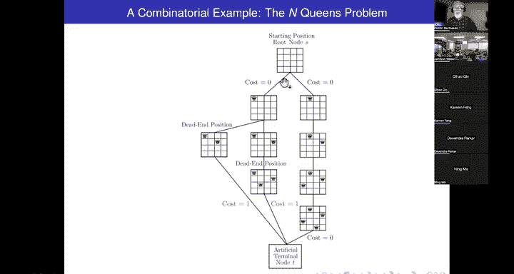

So。We model this as a four stage problem。Whereby we start at the empty board， the starting position。

And here we have a。Two decisions。Place the queen at this square，quid square one。

 place in square two of the other two decisions， another two decisions。

Plaing the queen in squared three and four， but this gives us symmetric solutions。

 so there's no loss of generality in restricting ourselves just these two。

Possibilities from the starting board。Now， as long as we can place Queens without reaching an impasse or a solution for that conflict and Queen attack each other。

 the cost of the transition is taking to be zero。However， once we reach a position like this。

But it is impossible to place any queen in the third row without attacking have one of these two queens。

Then this we call this a dead end position。 It cannot be part of a solution。

And then we move to a termination state with cost equal to one。So。

These are the two possibilities in the beginning， and then。At this position。

 there are two possibilities placed a queen here。And place a queen here。

 We cannot place a queen over here， right， because then they would be they would be。

Two queens will attack cell chemmet， the only possibility to place Queens without attacking the other queen is put is RVs too。

And from here， we can go to。有。We can place a third queen from here we cannot place a third queen。

 but this is a dead end position also and with cost one， we get up， we go through the termination。

Finally， if you choose this branch here， then we can place the only way we can place a queen without conflict is to put it on this square like this。

 and then the only square for we can place a third queen is over here and then we get a solution。

So we have obtained a solution which corresponds to a path of plus zero。

The path that are not solutions for the first two post one。

 So what we want to do is find a shortest path in this graph of。Book successive Green place。Okay。

 so that's easy enough but。Once you increase the number of queens， then very quickly。

 the problem becomes impactable。And not intractable but much harder to solve。

Of the number of positions explodes， so for example， eight queens problem。

 something like 8 million or so positions so that you have to consider you go to 16 queens is astronomical。

啊，And。So anyway， people have been able to。都都是。How should you solve this problem。And。呃。And。

It has been proved that it's possible to obviously find a solution for n equals four and higher for n equals 2 and n equals 3。

 the problem does not have a solution， but for n greater or equal or it does have a solution。

the number of solutions also is an interesting question。

 how many solutions there are for the eight queen problem or something like 90 solutions。

 90 configurations。And some people have。好好嗯。还。Samee the ay number。Solutions as end boost infinity。

 there's been a lot of interesting mathematics combinatorial mathematics around this problem。

We're given this problem here as an example of a combinatorial problem that's very difficult to solve exactly。

And for which approximate solutions may be maybe maybe。Are more promising and in fact。

 people have constructeded approximate solutions that have solved very large ends solution methods that have solved very large ends problems。

Okay， are there any questions about the slide？So now I must go to it all。

We have seen this figureg before。啊。We go one state at a time and at the current state。

 we consider all possible next states， all possible controls and all possible next states。

 and then we apply a heuristic， a base heuristic doesn't have to be a policy deter deterministic problem。

Just something that provides you completes this trajectory。

 you from xk plus one over the way to the end。And。呃。

The cost of the heuristic from a state x day plus one is the by H of x K plus one。

And what we're doing in rollout is we compute two factors。IQ factor were every。Control。

And given by this expression。The cost of the immediate first stage transition plus the cost of the tourististic from the next day。

And then we select the control with minimum Q factor。

So we go to the next state and then do the same thing again to the all controls run the base here from there and so on until we complete a trajectory。

There are also multi step look ahead versions where we look multiple steps ahead and then apply the heuristic from the leaves of the three of multi step look ahead three。

And an important question is whether rollout is cost improving。In other words。

The sequence that you obtain by rollout has a course that's no words。And the cost of the base here。

There's no guarantee because this heuristic can be anything can be a very stupid heuristic and maybe misguide you so under what conditions on the base heuristic I would guarantee to get cost improved。

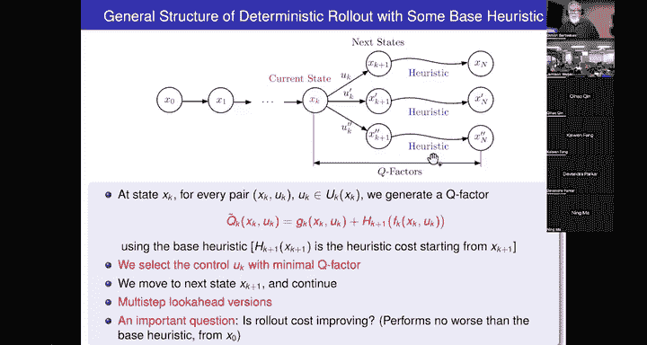

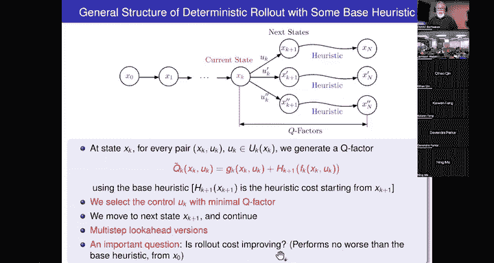

Okay， let's do a couple of more examples。One example to which we're going to come back。

Involves multiple vehicles。Moving on some grass。And aim to find aiming to perform some tasks that are located at particular points。

And。The objective is to perform these tasks in minimum time with a minimum number of moves from the two vehicles to the。

do我不代问 numberumb呃。So。This is a classical。Discreet optimization or combinatorial problem。

That iss impossible， it's in factable for any number of vehicles and any substantial network it's completely in factable。

And you can formula lake， however， as a dynamic programming problem。

For the state is the current position of the vehicles。Plus。

 the position of the tasks that remain to be done have not been performed yet。

And it's possible to try a heuristic， like the one。S here。

Given the current location of the vehicles and given the current pending tasks。

Move each vehicle one step closest。Towards the closest task， in other words。

 each vehicle by itself and without coordination。Looks at the two the are defend dust。

Finds the one that is closest in terms of number of hops and then moves one step along that minimum pop path。

So that's the basic hereistic。So， let's see how the。By the way。

 the optimal solution here for this for this particular instance that I'm showing is to move vehicle to。

Two steps to node7。And to move vehicle 1， three steps through node one。

 So there's a total of six moves，3 for for vehicle one and three4 vehicle。Three stages， six moves。嗯。

However， let's see how the base relationship performs。嗯。In the beginning the vehicless are here。

They calculate the closest pending task。And for vehicleh one， it is this one。 and for vehicleh 2。

 is this one。So both of them move to this node。Then。They are at the same location。

 So they're going to look at the they're going to find。The closest， the same closest tasks。

 so they're going to move together after that， and indeed the base heuristic。

Move both vehicles over here。Then this has been done， this remains。

 so the closest route now is this one， so both of them move here。

 both of them move here and both of them move here perform their task。So。

It takes five moves for every vehicle for a total of 10， as opposed to six， which is open。

And the reason for this is that the base heuristic does not involve any coordination between the vehicle。

They don't tell each other what。But their moves are going to be， theres no， there's no。

 they just other。Independently and selfishly move in the direction that their own calculation dictate dictates。

Now let me see how overall lab will work。Using this as a baseistic。But at each stage。

 given the cutting intent head of these positionss。

Consider all the possible pairs of moves from the current position。

Now there are four pairs in this case here。One moves here。Through moves here。

One moves here and two moves here， one moves here and two moves here。

 and one moves here and two moves here。 There are four pairs。Now， for each one of these pairs。

We run the base heuristicistic， we calculate the closest task and take one step in that direction。

And then we compare the Q factors of the corresponding moves， four Q factors to calculate here。

Can we select the move of minimum cu factor or minimum total vehicle moves？Okay。

 so now how would it roll lab work here？It will consider four possible pairs， in particular。

 will'll also consider this pair here， and then after that it will calculate the corresponding。

The corresponding。The corresponding。fuistic个。啊。And。Then。It will select this one as being better。

 it's better than all the other。So both of them are going to。 so I'm sorry。I said its wrong， okay。

The good pair to consider is this one， this and that。

Then it will give you a Q factor that's equal to the optimal Q factor。

 so this is the one that's going to be selected， and then this is the one that's going to be selected and so on。

So by placing the calculations here。You can show that the rollout algorithm finds the optimal solution In this example。

 a total of six moves as compared to 10。到。This is an example of cost improvement。And。

We're going to try to establish this property more rigorous。

But also is an example of an important type of problem where simplifications are possible。

It's a multi Asianian problem， it involves two agents in this particular case。

 more Asians in a more general case， and we are going to consider multi Asianian rollout。

 which is different than the rollout I've shown here and shown later in a few lectures from now that multi Asianian rollout performs much better。

T in terms of number of。嗯。Required moves and the number of required moves related to this all at once type of rollout approach。

Havere there any questions here？I have a question from a student here。ok。Hello。

 so I wanted to ask like in this case when it says that the rollout finds optimal solution。

 so I believe that when it chooses the first at the initial position when it considers the pair where the vehicle 1 moves from 1 to 3 and2 from 0。

2 to 。4 that's like the correct thing to choose， so as compared to this pair if we choose 1 to 4 and 2 to also 0。

4， how does the base heuristic what's the value of the base heuristic because if it only calculates the distance from the final position to the nearest reward then it should still give lesser value for the wrong option right。

 so that's why I thought I couldn't understand what the base heuristics is giving the cost it' is given？

屋企。对对。The optimal Q factor is going to correspond to despair。夫期就要补同费。

What you're asking is what's going to happen if we consider the Q factor。Of this。

Good we consider the base heuristic here for。To vehicles individually so vehicle one is going to go here that's the closest task vehicle two is also going to go here that's the closest task and basically they're going to replicate the trajectory of the base heuristic。

Which is a cost of 10， a Q factor that costs you 10。 whereas the Q factor corresponding to this。

There。Plus you 6。Okay， so what is the basic heuristic calculating from any point。

What's the function or whats what is it calculating。It finds the closest task， okay？

In terms of number of pops。And then moves each vehicle one step towards at that。Okay， so thats both。

ok。So will it also consider the other task after it finds the closest task for the total cost of that from there。

The basicistic does not consider that at all， only looks blindly it's a myopic characteristic。

It looks one step ahead on it。So I'm saying that when we are doing rollout for the Q factor。

 Q factor comprised of the current cost plus the heuristic from the possible solutions， right？

Possible state so in that case， if we consider the 04 it is where both vehicles land up this is I'm talking when it's roll out So the current cost is one for each vehicle and if we compute the heuristic from four then it should give one each right so total Q factor will be four correct。

For despair。But to the heuristic is run to the very end of the problem。Yeah。

 so that's what I was asking。 So heuristic calculates till the till both the tasks are just the nearest task。

Right， yeah， for for each one of both tasks， yes。So， the heuristic。This myic looks one step ahead。

 but it completes all the tasks， okay。都。So the basic heuristic from here goes to here。

 and then both of them go here， then both of them go here and so on until completion。O。

The solution of this is outlineding some detail in your class node， you may place the steps there。

And just make sure that。那可。There's a comparison of all the four two factors associated with the own model。

Okay， sure。 thank you。 best heuristic。Ba decision one step ahead。

 but it still has to run to an entire project to the end of the horizon。Okay， thank you。喂。

Any other question？

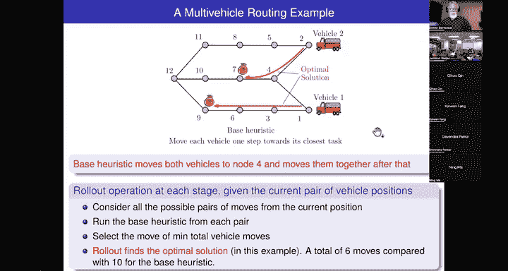

O， here's other exam。啊。This is a problem of some theoretical interest and some practical interest。

It arises， for example， when it search through a maze from an entry point to an exit point。

 find a path of three passages to to go through。We formulated as。In terms of a binary。3。

 at some root。And after to a question depth。Ms。Deepth of1。

And now some of the arts in this tree are free。And some are blocked once that are blocked。

 are the ones will cross。So these are blocked and the others are free and we want to find a path of three arcs。

From the roots to one of the leaves here， that's the problem。

So you can consider a basic heuristic for this。To be a great one。And also my office。

Looks only one branch ahead。At a given note。If one outgoing art is free， then you use it。

If both arcs are free， then use the right a， if both arcs are blocked， then okay。

 you can use also any one of them， but you're not going to get a free path display way that's the very heuristic。

So。The way the base heuristic is going to work on this problem， with instance。At the root。

 both branches are free， so we move to the right to the right。

 which is the right to work and go over here。But其。播法车咗。

So the best heuristic fails to find a free path in this particular instance。Now。

 the way that all that was going to work。Is going to consider。

This move and that move and then run the base heuristic conveyor。

And the base heuristic from here uses this art。 And then this art in finds the free path warriors from from here it。

That's not。So。The optimal Q factor is going to be okay for this move here。

 so it moves over here and then it moves through andfins in this particular instance。A free five。

Now this is not always guaranteed， it's not guaranteed that the rollout is going to find a free path。

 even if one exists。Dynamic programming， on the other hand。

 a full fledged dynamic programming algorithm that starts from the reefs and goes back what towards the root。

Assigning cost of zero to a free arc and cost of one。

Through a blocked art will find a free path if one exists。However。

 the complexity of this dynamic programming algorithm in exponential。

Because the number of leaves here at the last stage is2 to the end and there are n steps to go through so that's the complexity of the algorithm。

On the other hand， the complexity of the gradienty algorithm is O of n。

 there is a simple calculation to be done at every step and the N steps， so it's O of n。

Now they're all allowed examines at most N branches。No， I'm sorry the the the。

The rollout however at each stage runs the greedy heuristic twice。

 so it's over times2 whatever stage， so it's over square computation。Now。

 this is simply enough a simple math problem so that some analysis can be done。啊。Like I said。

 there's no guarantee thats the all algorithm I going to find the。The a free path， if one exists。

However， a probabilistic analysis can give the probability of finding a free path for both of these two algorithms。

Assuming that each art is independently blocked with a given probability。

Then if you calculate the probability that the're all allowed algorithm， fine。

A breakthrough path then it's larger， much larger than the probability of the gray algorithm。

And the answer so this takes a couple of pages， but we can find the literature and there a reference in your class notes。

The point I want to make here is that。It's a qualitatively typical situation。

But all out improves the performance of the base realisticuristic quite a lot。

At the expense of a polynomial amount， extra computation。

Rollout does multiple calculations using the base hereuristic。However。

 the number of calculations that it does is typically polynomial。

 but it's a polynomial expansion factor over the complexity of the risk。

And this is an example that illustrates quite clearly this。This fact， through analysis。这 is是。

Quitative， it's not very boishly established， but in practice， that's what happens。

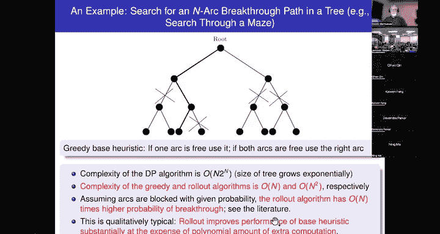

Okay。So now we've talked about this cost improvement property of all out and we are going to discuss it in some detail。

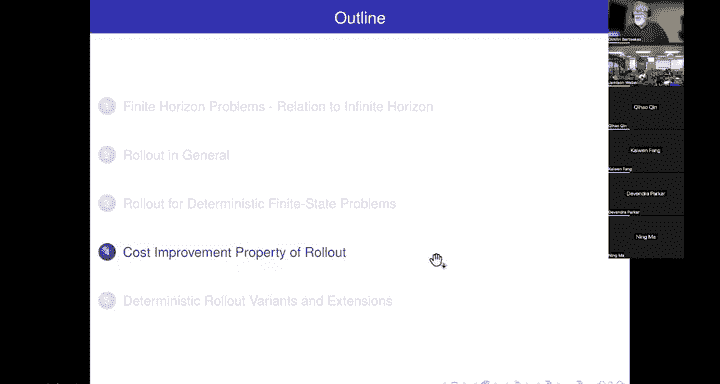

First of all， it's not guaranteed that I'm adequate。

 Some special conditions have to hold in order to。Guaranteed that parout policy has no worse performance than the base。

The best is you can be anything。 It can be our drive shield。

So it can be designed in a way to trick the algorithm to take own moves。So however。

 there are some conditions that hold quite mildly and you can look into and also form the basis for making the language more robust and reliableliant。

And these conditions are called sequential consistency and sequential improvement。

And the sequential improvement is more general than sequential consistency。

 but sequential consistency in is easier to understand in some sense。 and it also is vast is。嗯，第是。

Is relevant to stochastic problems。Okay， we say that the base heuristic is sequentially consistent。

If at a given state， it chooses a control that depends only at that state。

And not on how we got to that state。In other words， the heuristic。If it goes to stay next day。

It generates the same trajectory regardless of whatever， how it got to extend。

And another way to say this is to say that if the heisticistic generates the sequence starting from Xk。

 then once it moves to Xk plus one， it generates the tail of that sequence。And the。

It's a definition of psychological consistency and another way to phrase it is that the heuristic can be implemented as a legitimate dynamic programming force。

Applying。A。唔错。That depends only on the state that you're in。Agenity supports。啊。

Grey heuristics are typically sequentially consistent。

Like the nearest neighbor heuristic for traveling sales on problem or be really heuristic for the multi multi vehicle pool。

Aouting problem， they are sequentially consistent， you can show that。However。

 we're going to focus on a less restrictive condition。Which is a sequential improvement。

So the purpose of sequential improvement condition is to。Is to imply。Is cost improvement property。

 namely at the cost of overall our policy is less than the cost of the baseisticistic。啊。

And here's the definition of sequential improvement。In the process of roll life。

 you calculate very risk few factors。And at the given state that you are there's also of course generated by the basic riskistic。

And sequential improvement requires that the best heuristic two factor。

It's less on the cost of the heuristic at the state X gate where you are at all Xk。

So when you enter to Xk， you have calculated the cost of the heuristic from there。

 and now you calculate the two factors corresponding to various controls by adding the current cost plus the cost of the heuristic from the next state。

And this is the Q factor of UK， but this says it does there is a Q factor that's no worse than supposed to thek。

And this。You can check in video situations。And it guarantees， I claim that。

That there's cost improvement in this sense。So to understand this， let's look at this figure here。O。

In rollout， we generate a sequence of states and controls。

And let's say that we have reached the state Xk。Let's interpret the sequential improvement condition。

I X day。好。You can run the very heuristic and you have calculated this。

Now this is done in the process of reaching Xk because add Xk。-1。

 you have calculated all of these Q factors correspondinging to the different controls。

 and the Q factor for for。我嗯。对。Con that rollarch has chosen is precisely equal to the cost of this transition plus this cost here。

So as we reach X state tilda， we have calculated。The cost of a trajectory。

 which we call the current trajectory at time K， which is the cost of up here and then followed by the cost of the base your。

Now， once we reach this point， we look at all possible controls。And then we calculate the Q fat。

We calculate a Q factor of this control， We calculate a Q factor of other control。

And the cost of this part is the cost of the baseuristic from this state。And now， what does Roout do？

It compares all these few factors。And finds the best one。

 and let's suppose that this is the best one。With trajectory I gave plus one。

Then the sequential improvement condition says that the cost of this trajectory is better than the cost of this trajectory。

The cost of RK is greater than the cost of R plus one。Why is that well。

This is the cost of the minimumcu factor。And this is the cost of the of the Q factor corresponding to。

I'm sorry， this is the cost Xk。Over here and this cost of of this trajectory is that part。

 So we are given that this cost is better than this cost， therefore。The cost of the trajectory。

Our gate is。Greater than the course of trajectory R plus one。

 because the two of them share this common initial portion。

So according to the sequential improvement property， the cost of Rk is。

D than the course of our k plus one。So the cutting trajectory， you focus the cutting trajectory。

The course of the current projector cannot get worse with every tariff。Now， all0。

Is the cost of the base heuristic starting from x0。

Our M on the other hand correspond response to the trajectory of the Erollola。Therefore。

 by applying this many times from zero times0 I M， we obtain that the cost of R0 is greater than RN。

 and this is the cost improving。In other words。What we have here is a。

A sequence of generated traories by roll out discarding projectors R0 R1 r2 and so on。

 and each is better or no worse than the preceding one。If the sequential improvement condition falls。

And therefore， it implies what we want to prove。The other thing to note here is that sequential consistency implies sequential improvement。

 The reason is that under sequential consistency。啊。The current trajectory。

Is also correspond response to a Q factor that we applied in other words。

 this is also part of the sub trajectoryject that we generate at Xk and here we generate we choose the best trajectory so。

InP损失。It's under sequential insist。没异。The base heuristic control is one of the controls that we minimize over this condition folks。

Okay， so this is approved。And you can look over it。

 the main thing is that the other sequential improvement I have is monotonity property of these trajectories。

And I'd like to illustrate it for an example。So this is familiar。

 going through this example because it' a traveling and settlement example。Involving court service。

And here's the matrix of intercity travel costs。We formulate this as a four stage dynamic program problem。

The black numbers here corresponding to the either city travel costs。And at every stage。

 we select the next city to go to start our be from a， go to。A B， A C， or A D， and so on。And州。

We would use the nearest neighbor shouldistic that we have used in the past。

And you can show that it is sequentially improving as well as sequentially consistent。

AndNow we want to see these current projections and why they get improved at every set。

So here's how the algorithm will work。At the initial state。

 we apply the base shortageistic and generate。The first trajectory。By following the nearest neighbor。

And the nearest neighbor。Turistic generates this loop trajectory here。

But that's the first trajectory。What respond funding to the base risk？冇。The first step of roll out。

 we look at all these next city possibilities。And we aren't the nearest neighbor here。

 let's become each one。Okay from here， the nearest neighbor this one， from here。

 the nearest neighbor the is this one and here it's okay， I think it's this one here。

We compare the total cost， the Q factor of this move， this move and that move。

 and we find that this one is better。So now this is our current trajectory。This is part one。

And it is better than R0 you compare the numbers。 I think this is。This is 27。 this one is 28。Now。

 we are here。And we look at the two possible next cities。

And then we run the nearest neighbor heuristic from each one， which is okay， there's no choice here。

这子。The optimal two factors of pain from this。F here。 And this gives us the new current trajectory。

 which is R2。So we started with R0， went through R1， and now R2 is even better， it has a cost of 13。

But that's what this inequality show here。 That's the key to understanding the。

The cost proven property of rollout， it generates current trajectories that are monoal increasing with the first one being the trajectory generated by the base heuristic and the last one being generated by the rollout outlook。

Questions here。Okay， it's time to take a break。And。嗯。We'll come back in 15 minutes。And the。

You may ask questions about the first part of the lecture。You back at the。5，55。

Are there any questions from the first？After of the lecture。Okay。

 so now let's go into some variations of deterministicrollout。The first idea is。

I simplify your all love。Hes aimed towards economizing on the calculations of the standard algorithm。

The standard algorithming involves calculation of all the Q factors that are given state。啊。

These two factors may be a very large number。So ideally。

 would like to reduce this number without losing some kind of the cost improvement property。

But here's one way to do it。Assuming the sequential improvement condition。

Instead of applying the control that has minimal Q factor。

Use any control that has a Q factor less than the heuristic cost at the state that you are。

In other words， when you are of Xk。Use a roller control any utilityder that has a Q factor less than。

The cost of the base heuristic starting from Xk。And the idea here is to focus on a small subset of promising for those。

 find the one that satisfies this condition。In order to。Garantee cost improvement。And in this way。

 saved lots of computation。As an example。I mentioned earlier。

The work will puzzle the solution of the world will puzzle using a roll out approach。

And in the word working case。The number of few factors on every state is like 12500， okay。

This is a very large number。And to eomize on computation together with my students citizens the strength and A。

We reduced the set of two factors to something like 15， 20， 50， a very small subset。However。

 intentionally chosen， according to some。Turistic， preliminary calculation。

And this was critical for being able to solve the problem in seconds as opposed to being able to solve the problem in hours。

 okay？So let's see how this condition here can serve as a substitute of the sequential improvement condition。

It was actually very simple。啊。What we're going to show is that the rollout policy under the simplifying algorithm operation。

Has a smaller cost on the heuristic cost starting from any state。

And the proof is exactly the same as for the proof under the full sequential improvement condition。

This condition here is sufficient to guarantee that the current trajectory cannot get worse at every step。

So we have the current trajectory at time zero， which is the course of the base sturistic。

Cannot become worse until we end。Which gives us the course of the current trajectory becomes the trajectory that' generated by。

So it's the same proof it' just identifying the critical part where we can cut coordinates in using this condition instead of the minimum of this being less than each。

Okay， here's another interesting variation。In many problems。

 there may be multiple heuristics that seem promising and that we would ideally would want to use。

It would be nice if we could use the right heuristic。I thought， I part the state space。

So this variation allows us to do something like that。We combined severalcuristics。

By constructing a superheist。One that that each state encountered around all the heuristic。

And selects the best out of the trajectory produced。

Considers all the heactus of all the heuristics and then finds the best of all of them。Now。

 most formally， we can view the superturistic as a different base heuristic for the Royal Albert。

And what we're going to show is that if all the heuristics are sequentially improving。

 then the same is true for the supertheuristic。And for this， we have to verify the definition。Okay。

 we have capital n here。 The typical one is is correspond to。六M。

And the sequential improvement condition for the end heuristic is this one。

This corresponds the course of the M heuristic complexk corresponds to the two factor correspondinging to a Perx K UK。

 again called the M heuristic and the sequential improvement condition is precisely what you see here。

Now we take the minimum of both sides over M over all the hereic。And on the left， on the right。

 we get the minimum。Of this curiosityistic， which precisely the super curiosityistic course。

On the right， we obtain the minimum over M。Of the minimum over control。

But we can interchange the order of minimization， first minimize with respect to U and then minimize with respect to M。

 and then we observe that the superturistic Q factor is precisely what you see here。

For response to the minimum Q factor。Over all the characteristicsuristics and overall U and X。是。

From here， the hypothesis we get to this， and this is precisely the sequential improvement condition for the supercurist。

This is the minimum Q factor， and this is the minimum cost corresponding corresponding。

So this is very simple to prove and's very， very useful。I there any questions here？Okay。

 now let's try to go a little bit。Greatrave detail on the issue on the sequential improvement condition。

I'm going to give you a counter example。Where it's violated and they're all allowed to algorithm and performs worse than the basic risk。

But this example involves very simple。Involves two stages。An initial state， x 0。

From which we can go to two other states， x star and x tilde under control U0 star and U0 tilde。

From x1 star， we can go to x2 star with this control， or we can go to this x。

You still using another control。Which has high cost。

 I'm reading this example so that so that it produces， So it's a counter example to cost improvement。

And。If you go to x1 build up， then there's only one choice。So。啊。

Let's assume that the optimal trajectory is this one。

 and part of the reason for that is that this transition here has very high costs。

So this is the optimal trajectory。And let's assume that the base heuristic。

Cosess that optimal trajectory at the very first step。That's my choice。For this example。

And also assume that。So when you feel that the British producers use it of star， you one star。

At X0 and it produces it chooses this one here。X1 star。So it's not sequentially consistent。And then。

And also not sequentially improving， as we would say。It changes its mind when it starts here。

 the basically goes straight through to the top path once it reaches x1 star it changes its mind and follows this this point if it starts here it follows this transition。

I must look roll out that this is the basic heuristic that I've。That I've shown here。

 its not the trajectory。Starting from from。From exc。So what it does is it considers the two controls。

 considers this one， considers this one。And。At this point， it follows the base heacy。

 It is this this。This transition came from here to basic risk takes you here。

 So because this one has very high transition cost， the rollout selects this。工作。And then from here。

 it goes here。So it misses out on the optimal trajectory and。Generates our worse cause。

The two factor of use it of star。Because of this transition is larger than the Q factor to the zero。

 so we're all allowed out there selects you zero furtherer and moves to the non optimal next state。就。

In the absence of sequential improvement conditions here。

The all laws can DV from already available to good current trajectory。

And follow an inferior trajectory after that。Now， this is just a remedy。啊。

Detect conditions like that where we are off to be onto a current trajectory that's worse than what we have and follow the best current trajectory found so far。

 even if you're all allowed algorithm to suggest following a different but infeor trajectory。

So another words that I'm saying is have some way to detect that this trajectory is worse than this trajectory。

 my current。Sectly， and then。Then do not switch to。To go this way， but now I continue to go back。

And this is the idea of4 five the all out。It's a modification of rollout。

And can work even in the absence of sequential improvement。

 if restores the cost improvement property。Of for base heuristic that are not sequentially improved。

And the idea is what I described in the previous slide。At each that。

Follow the best trajectory compute so far。So。At the case stage of proout。

At the case stage of rollout。啊。We have this trajectory， which is fixed。

 so called permanentent trajectory。And we have compute the best trajectory up to now。

 which takes us to this state and。So that right trajectoryor that you have here。Now， at this point。

 we apply it all。We consider all possible controls。Find the one that has。Minim amount Q factor。

It's this green choice here， and then we compare this。

The cost of this with the cost of the best trajectory that we have found so far。And if。The。

The screen trajectory is worse than this red trajectory， we don't take this step as rollout suggest。

 but rather we take this step that maintains that keeps us on the best trajectory。

So let me describe here in terms of this bullets， in addition to the permanent trajectory。

 we consider we store a tentative best trajectory， this Tk bar here。嗯。

Once we find the minimum Q factor choice， the youth killed decay。We， we compare it。

To the sensitive trajectory， and if it's more costly。Then， we accept。That we reject this choice。

And otherwise we accept it and we update the tenative test trajectory to be this green trajectory。

So in other words， always follow the best trajectory we have found so far and if rollouts are different because there's a violation of the sequential improvement position。

 still stick with the best trajectory that we have so far。

And this restores the cost improvement condition and works well in some problems where。

The sequential improvement condition may hold for most states。

 but there may be some states when it's violated that may throw off the rollout algorithm。

So I'm going to give you an example of how this works。电啦。In this situation we had earlier。

Remember the problem？This is the optimal trajectory。However。

 the allowed compares this with this and prefers to go this way and because of this high cost transition。

 the cost of this trajectory is higher than the cost of this trajectory。走。

In the45 year old allowed algorithm， the steps are at the initial stage。We store as an issue。

 tenative best trajectory， the unique optimal trajectory that's generated by the base policy。

In the first and all out step， we compute the Q factors for user of star and user of tilde by running the heuristic from X1 star and X1 tilder。

And even though they're rollout preferred。You tilt that zero over zero start。Yes。

The qualified hours starts you till the zero intervaltros of U0 star。

 which is dictated by the ten test。Then sets the permanent trajectory to this and continues and canfins the optimal solution as。

This is a simple counter example of how the4ified algorithm works how it correctlys the deficiency。

 the potential deficiency of the。三个这个老丈子。Are there any questions about this example？

I have a question fromim。O。So in this example， does the heuristic also need to violate the sequential consistency property？

I'm sorry。 Could you speak up louder。 Yeah， so does the heuristic also need to violate the sequential consistency property。

The financial consistencyency。Yeah， so so for in this example， when it chooses a u1 bar at x1 style。

But previously while computing from xn， it had chosen U1 star at x1 star。

So which doesn't this also violate the sequential consistency property？

Yes it does if it violates sequential improvement it violates sequential consistency by necessity。

 but you're right you're exactly right， if it were sequentially consistent。

 then it will continue to choose do1 star after it moves to x1 star but it is not sequentially consistent and it chooses in particular this transition and it also violates sequential improvement because it's a highco transition。

Okay， yeah， I understand so a follow up question is can there be a heuristic which violates one of sequential consistency and improvement and not the other one？

Yeah， sure。 Of course。 Yeah。 Well， I mean， it's possible that that sequential。Okay。

 what you're asking if it's possible to violate sequential consistency but satisfy sequential improvement right。

 yes， and also vice easy versa， can you do one and not the other？Okay。

 this happens in a very important case。It happens， we haven't shown this， but it happens in MC。

I mentioned last thing the last lecture that NPC。Can be viewed as a rollout algorithm。

 particularly for the case where the heuristic drives the state of the system to zero。Now。

 you can prove that this particular role algorithm。Involves this particular heuristic。

Is not sequentially consistent。But it is sequentially improving。O， so。

So it's possible to have the weaker condition satisfied， but the stronger condition not satisfied。

So but the other other way it cannot happen right， that it violates improvement but sat consistency that cannot happen right？

That cannot happen because sequential improvement is a stronger condition， in other words。

 sequential consistency implies sequential improvement， but not the other way around。Yeah， good。

 thank you。那个。

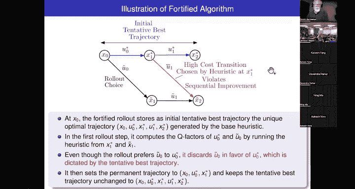

Okay， so let's go into our last subject， last variation of rollout。Which we call model free rollout。

For the case where。You either don't know the cost function or you don't know the constraints of the problem。

Now you may not know it， but there's a computer that knows it okay by model3。

 nothing is model free in reinforcement learner， there's always a model。

 but we we tend to call a method model3 if the model is inside a computer as opposed to being explicitly known via equations that you can visualize。

And understand。So。Let's consider。This problem here， the general discrete optimization problem。

Involving a cost function that depends on this。This是。F of components U 0 of the Un-1。And。

Each component is separately constrained。And we have discussed how to formulalate this generic problem as a dynamic programming problem。

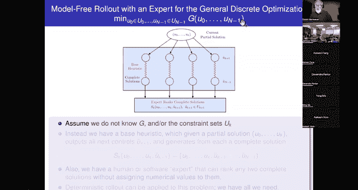

We introduce a state at time K， the partial solution consisting of the first components up to time K。

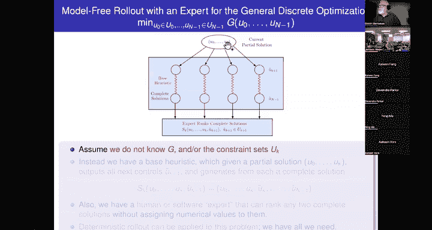

And then we select the next component， U plus one， and then we continue when we form a three of partial solutions。

 this expanding three and then if we knew this cost function here。

 we could do dynamic programming algorithm and define the optimal solution the very at the initial starting point and however this is。

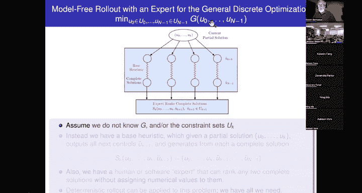

Certain on impact them。On the other hand， it's possible to use approximation algorithm rollout algorithms in particular。

 because rollout algorithms do not depend on how complicated the state space is， it can be very。

 very large， but it always looks at one state at a time。So now let's look at this context。

And the way it all out would work here is at a current partial solution。

 it looks at all the possible components that come next if people the take+ one。And then。

Arans a heuristic， right， a very heuristic through to the end completes a solution and then compares the course associated with these complete solution。

And pick the next the next componenting。To be the one that has the minimum the minimum cost。

 we assume here there is a cost only at the very last stage。On the other hand。

 what happens if we don't know G and we don't know the constraints change？Instead。

 we have a base youruristic。Which even a partial solution。It can compute all next confers。

And generate from each one a complete solution。So this is a heuristic that completes。

A partial solution， but is's sort of invisible to us on how it does it hidden inside some computing。

Now the other question is suppose we have these complete solutions generated by the heuristic。

 how do we compare them， how do we choose the best one， we don't know this cross function。

 but we assume that we have a human or software expert。

That can rank any two concrete solutions without assigning the medical virus them。In other words。

 the expert can tell us given all the solutions， which one is best。

And he doesn't have to tell us how he does it， but all we care is which one is best out of the candidate complete solution。

So this kind of scheme what we use。A heuristic that's hidden inside a computer。And an evaluator。

 of course， that's also hidden inside a computer without having expressions that arely available。

 it's just the same， it's no different。We can we have all we need。

 so all the ideas of deter deterministic rollout that we have discussed apply to this problem as well。

It is clear。Okay any questions。

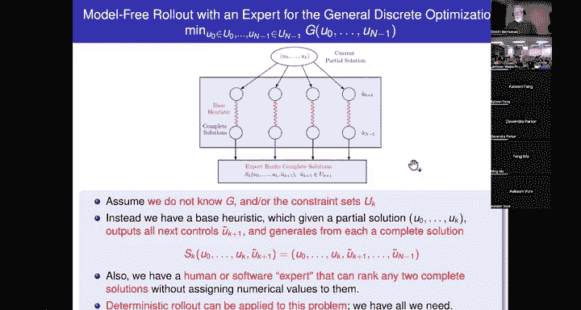

Okay， here's an example。Of which I had personal involvement。

And there's a paper that together with collaborators we we have。A publish an archive。years ago。

And this involves an RNA calledD application。This is a classical and important problem in computational biology。

And。Involved。啊。Sequences， auto sequences。Now not in a sequence。

Is it's just a regular sequence of letters， okay， for euccleotide types。

And there are four times AG can do。And these types can share with each other。A can pair with a U。

 C can pair with a G， so we have a sequence here of such letters。And some of them may care。Now。

 depending on the pairing。The theory has to satisfy the constraint。

 not only the constraints of A to U and C to G and so on。

 but also other constraints that the pairs in the sequence should not be crossing。

 there are a number of constraints。That I'm not going to get into。啊。Now。A given sequence once you。

Get the pairs in， then it becomes a complete folding。

 it's called a folding and some foldings are more interesting than others。However。

 biologists do not agree what's the best fault。啊。And instead。They have。

Software that compare different theories and。And then tell you which one is the best。

 according to the judgment of the software， now the software is not perfect， however。

 that's the best we have and we can use it for building holdings。

And here's what we have done in the way of Ra。We have a sequence， but not the parents。And I did step。

We go to one step forward in the sequence。We have already closed some fairings up to that now some pars may still be open and we choose between three decisions。

Either to close the spell was some。三。呃。Lether in the sequence that came earlier。Or to open pairing。

 for pairing with future letters in the sequence， or to do nothing。So these are our controls。

These are the states that we have gone through。And we want to pick。One of these three decisions。

And what we do。Is we have a baseistic。Which is a partial folder， a partial folder， what it does。

Given a partial folding， it completes the folding by making appropriate pairs according to this judgment。

So the partial folding software。It was complete holdings like that。

And then we give this to an expert software that compares the compute codings and。

gives the choice for best skill factor， either this decision， that decision or that decision。

So the basic heuristic is here in this partial fold。

And all we know about it is has some way that it generates a complete form。

And then two complete codings are compared by the expert software。And in this way。

 we make decisions through lower out。And there is no explicit cost function here。

It is internal to the expert software。Besides， biologist cannot agree for the best cost function here。

Some people say that a minimum energy kind of criteria is the best。

 but this is disputed and there's discussion about that。啊。

So an interesting thing about this problem is that there is no optimal solution。However。

 there are useful solutions that rollout can generate by using expert software。

Different types of excess work software and different types of partial folding so。

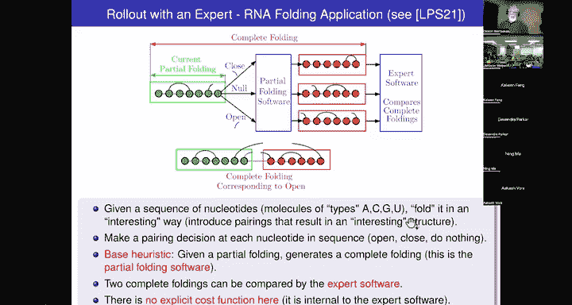

And。We have some success with this algorithm here。But I'm not going to go into further details complicated treatment of constraints here is complicated。

 actually。This application of B out。Connect with the constrained type of rollout that we're going to discuss in the next lecture。

So I'm giving this as an indication of how one may apply rollout in situations where the cost function is not known。

 but the details there quite a bit of detail that I'm not giving here。

 you can read the paper here and also look into the material from the next section about rollout。

Are there any questions here？Okay， about the next lecture。We're going to still stay with it all loud。

And look at the rollout problems with multi step look ahead。

 everything we did today was single step look ahead， but in fact。

 multi step look ahead in the context of rollout is interesting。Because。It is feasible。

 it's possible to do long to look ahead with in this context because the problem is deterministic if the problem more stochastic multi step look ahead becomes more problematic。

 but with a deterministic problem is' possible to do multi step look ahead and gain something from that。

So we're going to look at multi step look ahead and put potential approximations。

Or use in within this coin。Then we're going to look at another class of rollout algorithms that applies to constrained problems。

😊，Where the constraints are not just instantaneous at the current stage under control。

 but rather they involve trajectory constraints。Like for example。

 the whole trajectory of states must satisfy， must satisfy， must be within some subset， some subset。

Then there is a modification of the rollout algorithm dealing with this type of problem。

And this kind of modification also has a lot of applications in interteship programming。

And the problems that people in industrial engineering and operations research worry about。

And we're going to look at some problems like that in the context of constrained roll。

Your homework was due today， and I hope。I hope that you're off okay with all that。

And there's going to be another homework that's going to be due in two weeks。And this is exercise 1。

3 in your class notess。And it deals with a multi action problem。It's sort of a fun problem。

 it involves spiders and flies，' sort of an extension of the example that I gave a few lectures back。

And。The multi Asian problem， we haven't fully covered the theory of multi Asianian problems。

 but we covered the enough。In the third lecture for you to be able to do this problem。

If you have any difficulties， you can be， you can get in touch with me or with change them attach your homework。

他等于歌词。Okay guys， we'll see you next week。

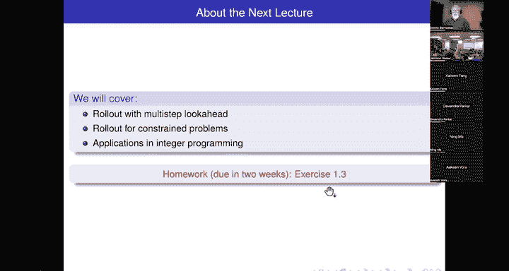