# ASU《强化学习2022-2024｜cse 691 Reinforcement Learning Course at ASU》中英字幕（deepseek - P19：[19]Lecture 6 2023_ Deterministic multistep lookahead, constrained rollout, - GPT中英字幕课程资源 - BV1zcfVYdErD

Okay， so let me welcome you to this lecture six of our course on reinforcement learning。

We are going to continue our discussion of deterministic problems in approximation in value space。

But today we're going to focus on multi step look ahead。

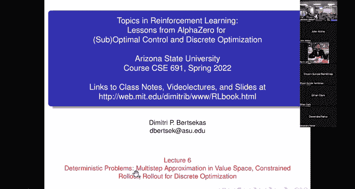

And then after we do that， we're going to go into constrained rollout。

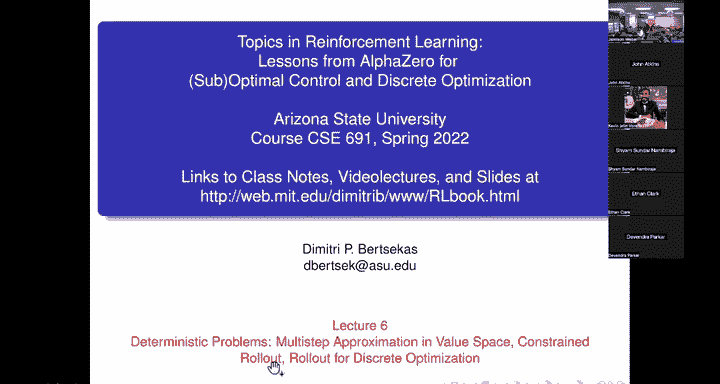

Roll out where there are constraints on the trajectory that's generated by the system。

And then we are going to apply constrained rollout to discrete optimization problems like integer programming problems。

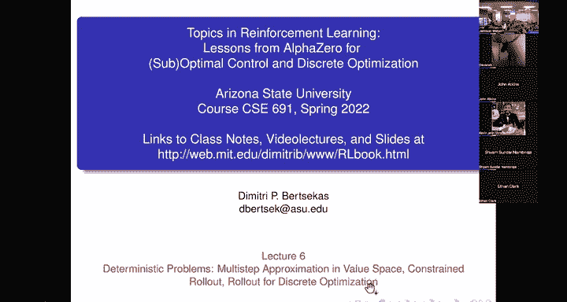

So here's the outline。We're going to look at multi step look ahead。

In the context of approximation value space or deterministic problems。

 deterministic problems are nice in this context because they do not involve any Monte carlo simulation。

 a approximation value space can be done in flexible ways that are not available for stochastic problems。

So we're going to look at the case of a multistep look ahead and today I'm going to talk about some new ideas。

 ideas that have not been presented before， and I think they are interesting and there are also very fruitful grounds for you to look in terms of your mini research project your term paper。

Then I'm going to talk about constrained rollout。And applications in discrete optimization。

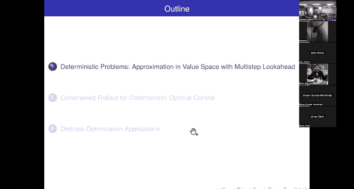

So let's get into deterministic problems and multistep look ahead。

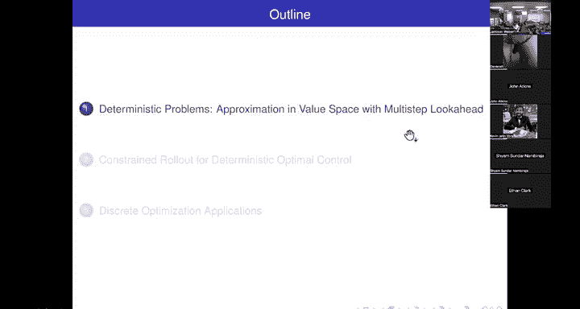

Now， here's a picture that we have seen before， except that it is simpler。

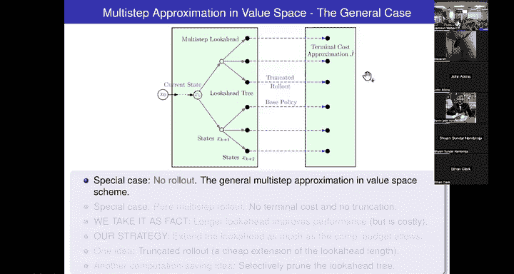

He raised four deterministic problems。And it involves a multi step look ahead。

 truncated rollout and terminal cost approximation。

This is the alpha zero architecture or related architecture that we have seen。

 but it's deterministic。

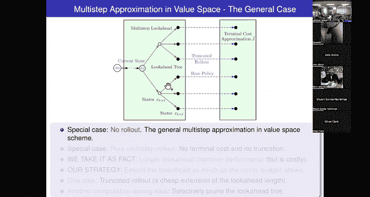

And it involves at the current state to choose the control。

 we form a look ahead tree that extends to L steps。Now L is equal to two here， two step， look ahead。

And then from each of the leaves of this tree， we ran a base policy， a deterministic based policy。

And we possibly truncate the steps of the base policy and approximate the future by using a terminal cost function approximation J Tilda。

So we have seen this before。And one special case is what there's no。Rollout in the middle。

 we go from the leaves if we evaluate the leaves of the lookhead tree by using J tilda without any intervening rollout now this is a general form of multi step approximation in value space。

Essentially， it's possible， always possible to get this truncated rollout portion to lump it into the terminal cost approximation。

 and we are going to focus on this type of scheme we're going to neglect the effects of truncated rollout that are going to be there except but indirectly。

Now， another special case， which we're not going to consider very much in this lecture。

Except when we go into constrain a lot。Is when。If we roll out is run all the way to the end。

 there's no truncation。And there is no terminal cost approximation。So that would be pure forout。

These two are special cases， but we're going to focus on the first one。Now。

 here's something that we're going to take as a fact， we like long look ahead。

We think that longer look ahead is going to improve performance。This is borne out by many。

 many studies including Alpha zero， Al zero owes its success primarily because is very。

 very long look ahead that it uses like 20 moves ahead， 30 moves ahead。

 it's been a big contributor to the success of Al zero。Generally speaking， the longer we look ahead。

 the better the performance。Now， mathematically， this is not always true。

There are artificial examples where we can show that the longer look ahead leads to worse performance。

But these examples are artificial。 they don't occur in practice that I know of okay。

 they occur very rarely and they are not being seen in practice。

 so we're going to believe the statement and we are going to aim for longer look ahead。

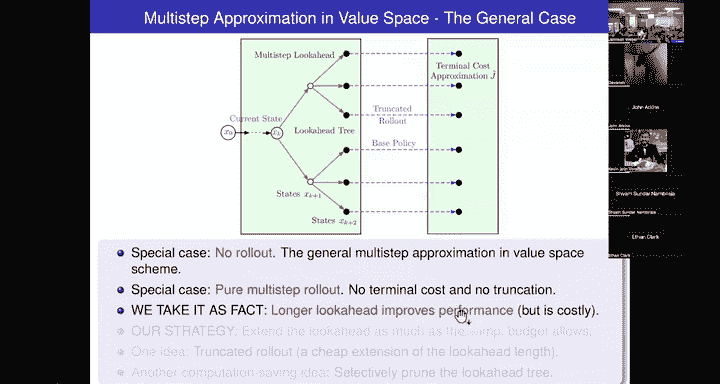

On the other hand， there is a constraint here， a difficulty。

 the longer a book ahead costs more in terms of computational resources。

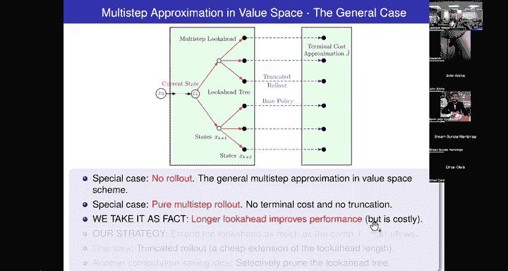

And given that this is an online clay algorithm， there are some strict constraints as to how much time we can use to generate the best food here。

嗯。

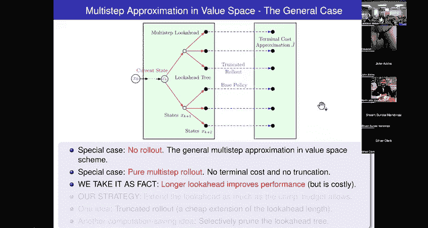

It may be that we have seconds or it may be that we have hours。

 but there is a constraint on the time that you can use for all this operation and the longer the look ahead。

 the more it costs if we can cut down somehow on these operations here。

 we may be able to go longer and that's an idea that it's going to come up in what follows in this lecture。

Now our strategy is to expand the look ahead as much as possible。

 as much as the computational budget allows， we have some time available to compute this to apply this multistep look ahead be second would be ours and we are going to search as long as we can as long as while within the constraints of our computational budget。

And one idea to extend the look ahead is truncated rollout。Okay， we have seen。

 we have discussed this before， we can you trunccate it allowed as a cheap extension of the look ahead length。

This is also a look ahead， but it costs a lot less than this look ahead。

This look ahead is done with a single policy and this policy deterministic。

 so there's no Monte carlo simulation involved， it's a very。

 very quick operation with a single policy。This minimization here involves all the policies available within this time horizon。

 so it costs a lot more。So truncated rollout is a cheap extension of a cheap way to extend the lookup head link。

 and that's an important idea in this context。And here's another computation saving idea that we're going to discuss。

啊。The the fatab， the more the more the more leaves， the more are there are in these。

In this tree here， the more the computation burden increases。

 so an idea here is to selectively prune the look ahead3 as we go on。

 drop some of the branches that do not look very promising。So， now。呢啲。

Getting to the specifics of all this， are they questions？

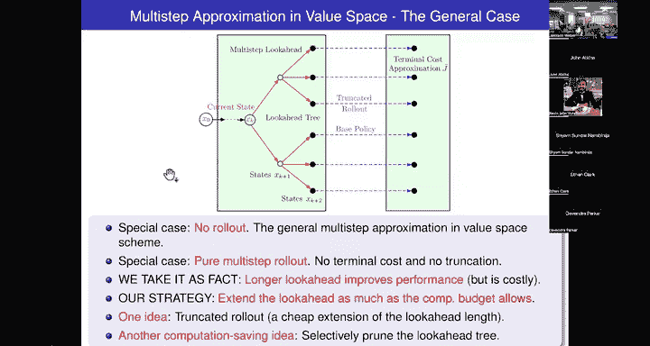

Okay， so now let me redraw this look I had， multi step look ahead picture。

Instead of going in this direction， I'm going to go vertically。

So let's try to understand this figure。Here's a current state。We are looking else steps ahead。

These branches here are correspond to controls。And at each layer， there are states in layer one。

 there are the states that are one step ahead， layer two。

 two steps ahead and so on at the typical layer N the。

These are the states and steps ahead and the terminal states as far as the。

Our look ahead concern is layer L。And then at layer L， there's a cost function approximation。

A terminal cost function approximation。And this Jay Tilda here。may also involve a heuristic。

 may also involve truncated rollout， but we're not going to focus on that possibility。

 we're just going to assume that there's a general Jay Tilde waiting for us at the end of L steps。

So the way multistep look ahead， an approximation in graduate space works。Is。

To obtain a trajectory from the current state to one of the states in layer L that minimizes。

The shortest distance from xk to xk plus L。Plus， the terminal cost approximation。

So there are many candidates here on layer L。We need to calculate all the shortest distances。

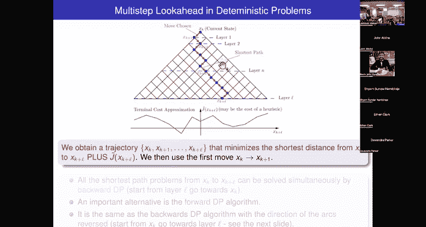

From Xk to each one of those， that's the shortest paragraph computation。

And then we can add to all of those the J tilde value and then obtain the best one。And then。

Consider the trajectory corresponding to this bed to the shortest distance。

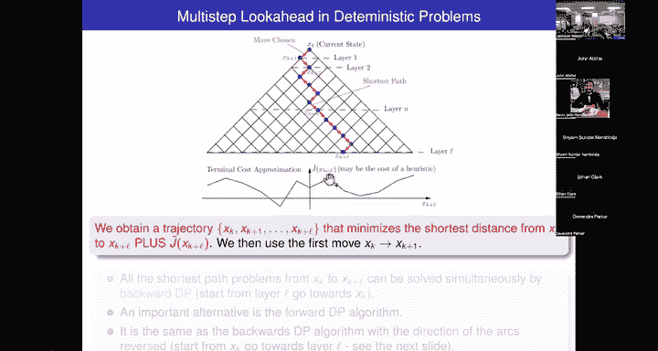

And we use the very first move from xk to xk plus1。And that's all we have to do at stage today。

A stage K plus1， we're going to go to this state， then we repeat the same thing。

 do all the shortest path calculations， terminal cost approximation。

 so1 and obtain x K plus and then repeat the process。

So there's a lot of computation for just one move， but this computation is fairly cheap and wed like to do it with long look ahead。

Now how do we solve the shortest path problems？To all the states。We can do。

Backwards dynamic programming。Start from layer L。And then go one step back， one step back and so on。

 compute the shortest distances。From layer L and then layer these are used to compute the shortest distance well layer L minus1 and then the shortest distance to layer to typical layer n all the way to react that's backwards dynamic programming that we already know。

But there is another alternative here。Which turns out to be more convenient in the context of all the step ahead and this is a forward dynamic programming。

The backward dynamic programming goes from the end backwards one step at a time。

The forward dynamic programming starts from the beginning and goes forward one step at a time。

And that each step calculates the short distances from xk to the various states in the various layers。

Now。I'm going to explain this algorithm to the next slide， but basically the idea is。

It's not different， it's the same backwards dynamic programming。

 except we reverse the direction of the arcs。Instead of the arcs going forward。

 we have them go backward， so the end becomes the beginning and the beginning becomes the end。

And from the end， we go this way and that's the forward dynamic programming algorithm。

So I'm going to explain this in the next slide。

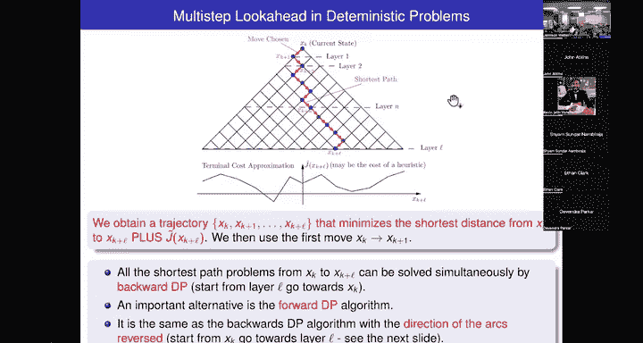

Okay， so this is the forward dynamic programming algorithm and this is the same figure that we had before is the current state except that。

To simplify the notation here， the current state is called the x0， the states that layer1 equald x1。

 x2， and so on。Just to make not to carry two complicated indices。And。啊。We want to calculate。

The shortest distances from x0 to the last layer。So we first calculate the shortest distances to the first layer。

 then the second layer， then the typical layer N， and we use these。

To calculate the shortest distances of all the states in layer n plus1。

And the form b is what you see here。The shortest distances。

Two states at layer n plus1 are obtained from the shortest distances to states at layered N by doing this dynamic programming type of calculation。

Which involves。The shortest distances to the n layer plus the costs of going from the various states in the n layer to the state x n minus1。

So to do this calculation， we take the typical state at layer n plus1， this x n minus1。

We look at all the predecessor。States at layer N。Take the cost of these transitions and add them to the。

Distances the Vn of X N of the predecessor states， and we find the best one。

So we have a shortest distance from here here， cluster the cost。

 and we calculate all these various ways of going into xn plus1。

 leveraging the shortest distances that we have to layer n in order to calculate the distances to each one of these states。

 xn minus1 at layer n plus one。Actually， this is exactly the backwards dynamic programming after we have reversed the direction of the arcs and the beginning has become the end and the end has become the beginning。

So now once we solve。Progressly。This this shortest path problem to layer N。

 layer N minus1 to layer L。Then， we have obtained the。the。Shortest distances to the states at Laer L。

We add the terminal cost approximation， and we find。Some state X L star， and then we。We。

Look at the shortest path that leads to x and star and move and make one the first move。

 make select the control that corresponds to the first move along this path。

Are there any questions here？one question is Excel start chosen at LaL like at the end of the process and before that every state is expanded into it。

Yes， before that， every state is expanded and we reach all the states here at layer L。

 and we find the one， this X star that minimizes the distance plus the terminal cost。Okay， thank you。

Okay。So now this brings up an interesting idea， the idea of iterative deepening。Quby， we。

Find we solve n later problems。And then we solve n plus one layer problems if we have time。

If we don't have time， can we reach the end of our budget constraint。

 then we just have solveved the problem with smaller look ahead。So that's iterative deepening it。

Solve the end step look ahead problem。Before solving the n plus one step look ahead program and this dovetails with this forward dynamic programming algorithm。

And now are we have an anytime algorithm。An algorithm that returns a feasible solution。

 even if it is interrupted in the middle because we have reached our budget constraint。

So in connection with iterative deepening， we use a very long horizon and just keep going and going and going and going for as long as we have time and then at the moment when we reach the end of our budget。

 we stop the computation。And find the corresponding state。XL prime， okay， some other。

 and we find a corresponding trajectory and take the first move along this trajectory。Okay。

 so this is one idea that is useful in this context。

Forward dynamic programming combined with iterative deepening。

Now we're going to introduce some other ideas to enhance economizing on computation。Three pruning。

 okay。But in three ping。We disregard some of the states in the process of the computation because on the basis of our interim results。

 they're not very good， they're not very promising。So these red portions here are what we've proven。

And as we prune， we have to deal with a thinner tree， less nodes。

 less states to deal with and eomize on computation， and as long as we eomize on computation。

 we can go longer and we like that。So。EE dip can be enhanced by pruning states end step look ahead at the end layer such that the end step look ahead cost is far from minimum in other words what we reach this layer here。

 we obtain the D plus J tilde values of the different states。And we're interested in small values。

 So those states that are。Far from the minimum， we prune them。And after what we put in these states。

 we can put in more states at the next layer。And we prune as we go。

Prune states at layer N before pruning states at layer n plus1。Now in doing so。

We economize on computation。However。We run the risk of overpruning。

Some prune states may be prun in error， maybe be good， may turn out to be good in hindsight。

So what do we do in this case should we go back and check for overpruning and how do we do this these are questions to be dealt with perhaps systematically perhaps in some more heuristic way。

Are there any questions？

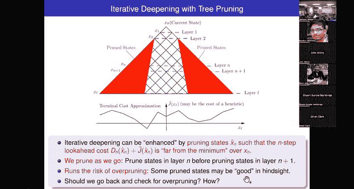

Okay， here's another form of a pruning。We're going to enlist rollouts to prune to remember， rollout。

Does this basically goes forward disregarding states？As we go along。

 so even if the state space is very， very large， rollout is not bothered very much from that because it only looks at one state at each stage。

So here is how this will work。We have， again， the current state， the various layers。

In the last layer。And we select some level of look ahead L bar， okay？

We would look at all the states in Lbar and from these。

 we're not going to do a full flged dynamic programming algorithm。

 but instead we're going to do an approximation， we're going to approximate the optimal trajectory from each of those with our rollout trajectory。

And in the end， we're going to reach。Some of these states in layer L。

And then we are going to add to the costs of the trajectories to those， we're going to add J Tilda。

And then we are going to find the one that has minimum sum of trajectory cost plus J tilda。

So instead of solving the L step look ahead shortest path problem by iterative deepening。

 pruning forward dynamic programming， we solve it approximately using rollout with some level of look ahead。

Now， this baistic here does not may have no relation to Jay Tilda。

Jay Tilda may hide within its some rollout， but this rollout is not related。

Hence the name double rollout， there's one rollout here and possibly a second rollout afterwards。

And the two may not be related。And are some special cases。Suppose we take L bar to be zero， okay。

 then what we obtain is just one step look ahead truncated rollout。Basically at x0。

 we look at all the successor states and run the basic heuristic from there。

 and it's exactly the same as a rollout that's truncated at the level of L。On the other hand。

 if we take this L bar level to be lower。U L -1。Then。There's no rollout。

 it's exactly the same as if we did L step look ahead approximation valueage space。

So this double rollout scheme is intermediate between。Truncate the rollout and no rollout at all。

With just plain approximation in value space。

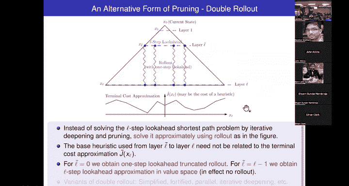

And there are variants of this approach here。 This rollout can be。

Can include modifications such as a simplified version of rollout。A 45 version of rollout。

 parallel the rollout， which you use， where do you use multiple heuristics。

And it may also include iterative deepening whereby we apply this to some level over here and then go to a lower level and to a lower level and so on。

Okay， so this is another form of pruning， it's a different type than the type I described in the previous slide。

Now， here is a another algorithm。That。Is based on this idea。Of， of looking at。

Some states exactly with exact dynamic programming and some states with approximations。

 but instead of using this particular subgraph， it use a more irregular， a less for regular graph。

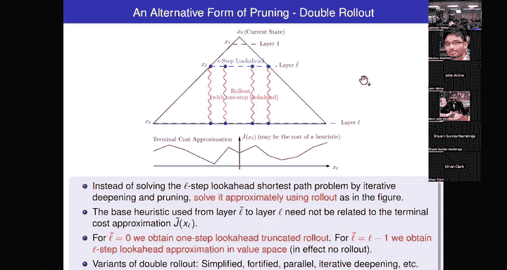

And I call this incremental multistep rollout。It involves a more flexible form of pruning and also a more flexible form of iterative deepening。

Now the difference from W or allowed is the following。

In place of the graph of the first L bar layers。We use a less regular graph， this blue graph。W其是。

Given here， it involves these notes。And we blue arcs， gu the graph。

At each duration on the way to constructing a trajectory。We have this subgraph。

And then we look at the lymph node。Of this of this graph。Can we calculate。This thing here。

D sub x is the shortest distance。The shortest distance from x0 to x within this graph going through the graph。

In other words， for the purpose of calculation shortest distance。

 we prune out all the rest and we consider just the subgraph FS。

And we find the shortest distance to each one of the leaves。Through this graph。

 and we call this d sub x。And。We find a lymph node x star that minimizes the shortest distance。

To the plus h of x。Quatial X is a heuristic distance。 Okay。

 some extra number that may involve also J Tilda and may involve also。The arcs that follow from X。

That'll give you an example of this in the next slide。So that's the idea。Given at any one step。

 we have a subgraph like this blue graph here。And we look at the leaves and we calculate the shortest distance to the leaves。

 plus a heuristic distance to the end。And then we find X star that minimizes this。

 and we expand the graph by adding the successor node from X star。

And then we start the next generation with a bigger subgraph s all the way until we reach the layer L。

So here there is pruning involved because this graph will extend and extend it will reach some layer L。

 but all these other nodes will be effectively pruned。

And the criterion is going to be the expansion and also， which is also going to be based on this sum。

Okay， I'm going to explain this slide shortly in the next slide。

 but are have any questions at this point。Okay。So here are some details。

 This is the same pictures that I had in the previous slide， the current state， the various layers。

A sub graph， we want to calculate a path。To the last layer starting from the current state。

 and to this end， we have a subgra which we extend until we reach the last layer。

So at the start of an iteration， we have an acyclic connected subgraph S。Whi is rooted at x0。

 it is connected so we can get to any if node there is a path to go there and so also a cyclic doesn't involve okay。

 everything's a cyclic here because the original graph is a cyclic there's only one direction of the arc from top to bottom。

So we minimize this sum over all the lifts and we then we expand the minimizing node now this minimizing node may be this or maybe that maybe that any one of these lifts can qualify as being the minimizing node so sort of expand selectively。

Depending and which one we expand， which node we expand depends on H of x， the heuristic distance。

And here's an example of heuristic distance that makes some sense。A of x for a given x。

 a given lymph node。Is the cost of three things。The cost of the base of a base heuristic。

The starts at X。And ends at some node of layer L。So this should like go all out。吓。Like we add also。

J Tilda， the terminal cost approximation。And also we do something else。

 we add an extra term that favors paths with few hops。Like for example。

 a term that' deelta sum deelta times the number of hops from x0 to x。So if x is here。

 the number of hops is one， if x is here， the number of hops is two， if it's here。

 the number of hops is one， two， three， four， five， okay。Right。one。2， three， four， five。

So the further down a lymph node is the more penalty there is going to be。

 so this term here and depending on the size of delta，Is going to favor paths with few hops。

And this allows the possibility of making after after the graph expense down， we may we this。

This addition of this deelta term。Allows us to backtrack。

 makes the nodes in higher levels more favorable。Now， some of the other aspects。

 the computation of the shortest distances is done progressively with a forward dynamic programming algorithm。

In other words， once we have the shortest distances within this subgraph， then after we expand it。

 we can trivially obtain the shortest distances to these expanded node simply by doing a backwards calculation here。

And as I mentioned earlier， the Delta term allows the algorithm to backtrack。

Go down for a while and then return back because this penalty becomes large。

And for Delta equals zero， what happens if delta is equal to zero？

Then we get the maximum amount of pruning。The subgraph tends to be long and skinny。 Okay。

 it has basically only one path plus some。Neighbor node of the nose on the path。

 so it's a very skinny path that goes down to the end。On the other hand。

 if delta is equal to infinity。Then we get the minimum amount of pruning， no pruning at all。Because。

We have to go。From the node in layer N， we have to complete all of those before we can go to layer n plus1。

 because it's going from layer n to going to layer n plus1， it causes an additional delta。

 and if delta is infinity， that means that we have to go exhaustively through each layer before we start going into subsequent layers。

So the Delta parameter。Controls the way this computation is structured。For deelta equal0。

 we get it roll out， essentially。Assuming that the base heuristic involved here is okay。

 but we have this base heuristic involved here and also perhaps there may some other heuristic inside J Til there。

So for Delta equals0， we get something like it all out。For Delta equals infinity。

 we get the full dynamic programming solution without any pruning。

And we still get the benefit of iterative deepening because this computation is progressing and once we reach the。

无异无异。The limit of our budget constraint or computational budget constraint。

 then we can stop the computation and simply take the best node within the subdra that we currently have。

So this is the incremental multistep rollout， and it fits within this landscape of multistep look ahead with as long as possible。

 as long as possible a look ahead。Using ideas of pruning， iterative deepening， and so on。

And like I said， these ideas are relatively new there you can find them。

 find details in your class notess。But there are kind of ideas that are very well suited for term paators and I know that。

Many of you compute the scienceus measures that are in the class have experience with deterministic search algorithms and game programming games and things like that。

 so it would be a very interesting type of term paper for you to try some of these ideas on projects that you're familiar with on the problems that you're familiar with。

Are there any questions？Okay， since we're going to switch to a different topic。

 we're going to take a break， a 10 minute break， and then we'll take another break for five minutes at some other point。

And you can ask me questions about the preceding slides when we come back。And。诶我。

According to my watch， we're going to get back at six at five。5，22，5，22。Okay。

 we're going to go now into constrain thatout for deterministic problems。

There is no constraint or allowed algorithm for stochastic problems， by the way。

 it just doesn't work。So what I'm going to do is give you a。Brief outline。

 and then we're going to play a video from last year's lecture。

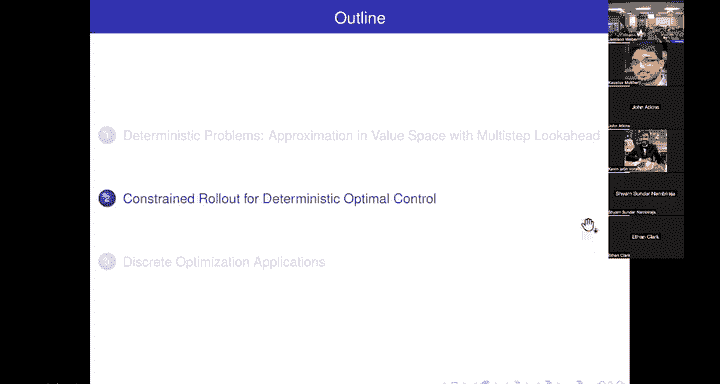

So the main ideas here is to apply or roll out to problems that have additional constraints。

Over the entire optimal trajectory constraints that couple the controls of different stages。

In ways that dynamic programming that cannot handle。Of course， dynamic program can handle everything。

 but you need an laboratory formulation in order to deal with the additional constraints on the whole trajectory。

Now by being able to deal with problems like that， we greatly expand the range of applications of RAA。

In particular。It will see that it applies to intractable discrete optimization problems。吓。

For example， short spark problems with a limit on the number of hops。 It's a very simple example。

Shortly spa solution from minority into a destination is。Is a。

Is an easy problem can be solved with many fast algorithms。However。

 if you introduce some additional constraints like。

The path from the oils into the destination cannot have more than four four odds okay now the problem becomes very difficult if you introduce a constraint like that or similar constraints。

These are the kind of constraints that we're going to try to deal with with constrained rollout。

Now constrained rule allowed is similar to unconstrained all allowed remember in unconstrained rule allowed when we are at a certain state at the current stage。

 we consider Q factors， so all the Q factors corresponding to different controls。

And then we calculate these few factors using the base heuristic。In constrained rollout。

We exclude from consideration the key factors that correspond to constrained violation。

 it's a very sensible， very simple idea。And it turns out that cost improvement is still guaranteed of the basic heuristic under some additional conditions。

In particular modified versions of sequential consistency condition or sequential improvement condition。

 you may need a fortified version in order to guarantee cost improvement and also。

There's an assumption that the base heuristic。Is。His feasible generates a feasible trajectory。

 one that satisfies the additional constraints， and that can be a problem in some context。

The base euristic from the start state must be my generator feasible trajectory。So， that's the。

That's the point where I want to start the video with an example， a traveling salesman example。

I'm going to begin with an example。😡，An example that you know and love。

 this is our four city traveling sensible problem。That involves travel costs， which are shown here。

 the numbers are， I think， pretty much for the numbers we have been using。呃。

We have been trying to obtain the unconstrained minimum cost tour。

 a tour is trajectory from a through the cities and back to A。

 and the unconstrained minimum cost tour is this one here。Now suppose that。

There are some constraints here， in particular theres a safety constraint that we have to obey。

And each tool has a safety index or costs associated with it， which is numerical。

And we require that were required to find the minimum cost tour out of those tours that satisfy this constraint where we。

The safety index is less than10。So this will disqualify this tour， which happens to be the optimal。

 it will disqualify in another tour， this one here。And the other tools are allowed， okay。

 so out of those that are allowed， we want to find the best one。

So how do we deal now with this extension of the problem？

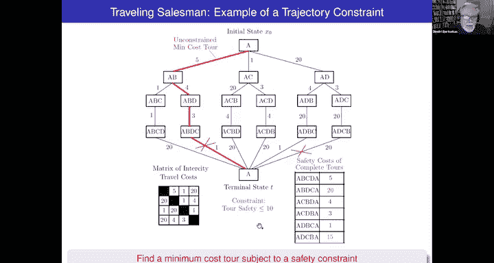

Okay， so let's。Let's。Review the unconstrained rollout algorithm and see at what point we have to modify to deal with constraints。

Remember that。The algorithm constructs a sequence of trajectories。

In the case of the traveling Enment problem is that trajectory is a tour starts from the initial state and ends at the final state through a sequence of controlled selections。

And the roll algorithm construct a sequence of trajectories， one at each event's steps。

And these trajectories under a sequential improvement condition have a monotonically non- increasingreasing cost。

 and that's really the core of the theory that in this way we are able to look at trajectories that go from beginning to end。

 have vision， but also decrease the cost as we go along in particular we decrease the cost if we start from x0 and user the heuristic。

Now。At any stage K， the trajectories from K onward。

 they share the same initial portion In other words， at the time K we have already selected。

K controls， and we have gotten from the initial state to this state X till decay。然后。

We look at all possible。Next controls。And we ran the base heuristic to generate candidate trajectories。

Which correspond to the different controls that you can apply？So at text till decay。

 we have this trajectory Tk， which is the cost， which involves this initial portion plus V。

The remainder is completed with a base heuristic。And then we construct candidate trajectories that。

Go up to Xk in the same way。 And then we get a choice of UK。 and then we run the basicuristic。

 and we find the。Chandity the trajectory that has minimum cost。 Okay。

 out of all those here is the one that has minimum cost。

 first stage cost plus the cost of the baseistic。And under the sequential improvement condition。

 we have that each time the new trajectory is no worse than the preceding one。

 and in particular the last one， the one obtained by rollout。

 is no worse than the initial trajectory， which is the trajectory generated by the base heuristic。

So now as we generate these candidate trajectories， when we have constraints。

 some of these candidatedid trajectories may not satisfy the constraint。

So the anity is very simple and fairly obvious。In order to deal with the trajectory constraint。

 we discard all the candidate trajectories that violate the constraint and we choose Tk plus1。

To be the trajectory that is best out of the ones that satisfy the constraint， it's very simple。

We get a number of trajectories， some of their evaluate the constraint。

 we throw away the ones that do and do the best we can with the others。And we still maintain。

 obviously this property here as long as。We can always find at any Xk that we generate。

 we can always find a candidate trajectory that satisfies the constraint other words。

 as long as we don't make some choices that are irredeemable the once we move here we cannot find that feasible trajectory anymore so we have to guard against that eventuality through assumptions or modifications in the structure of the algorithm。

So， this is the。追。Constraint and all out that with him。And。呃。

I'm going to illustrate now with the traveling salesman problem Oh I'm sorry I'm sorry， I'm sorry。

 I have one more。

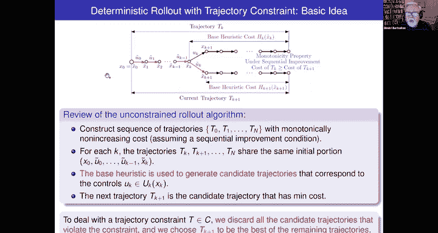

And then I'm in。

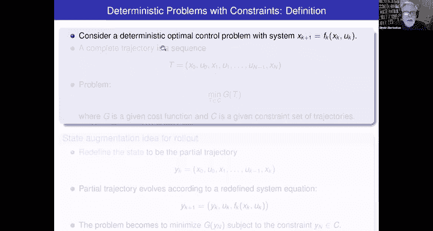

Let me ask for questions very question。 I have a question。 Yeah， yeah。

 What if the trajectory generated by the base heuristic itself while its constraint。跌记。

What do you do then。The first one， T zero， you mean yes， T0，20。

 it's an assumption that you get that the basic heuristic starts from generates a feasible trajectory。

 from the initial condition， okay。We have to make some assumptions because everything else is pretty general here called。

Are there any other questions？

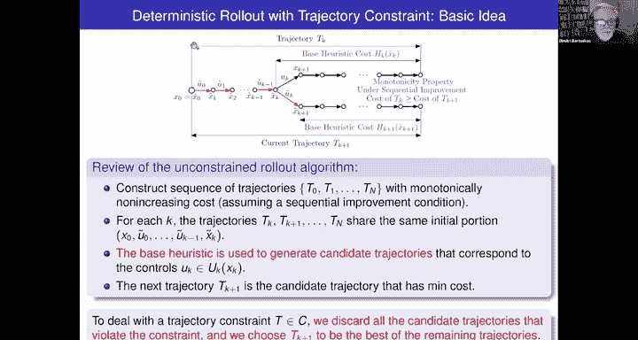

Okay， so this is a basic idea and now we're going to formulate the problem precisely。😊。

We consider a deterministic optimal control problem with the system equation。

And we defined a complete trajectory to be a sequence that goes from zero to the initial state to the final state。

And we have a cost function that's very general， it depends in an arbitrary way on this trajectory。

And we also have a constraint that the trajectory is one out of a given constraint set of trajectories。

So this is as general as it gets at this point。Now， the problem is that with constraints。

Couping stages like that in an arbitrary way and costs also coupling stages。呃。

We can't rely on going state by state because。We may have made in the beginning some choices that may affect。

Choice is far into the future。So we turn to the idea of state augment。

And we redefinine the state to be at time K， the partial trajectory。

 everything that we have chosen so far。And now this partial trajectory evolves according to a dynamic system。

Like so， the new partial trajectory is obtained from the old one by adding you okay。

Somebody save something。Okay， I guess somebody should be。说接。Himself or herself muted。Okay， so V。呃。V。

New trajectory， partial trajectory time cake is what obtained from the all by adding the control。

 by adding the new state。And now the problem becomes to minimize the final state of this system subject to a final state constraint。

So in this way， we don't have this coupling across stages where the cost function involves previous states。

 it only depends on the final state and the same thing for the control。

So this is one trick that we use in order to redefine the rollout algorithm to deal with this couplings across stages。

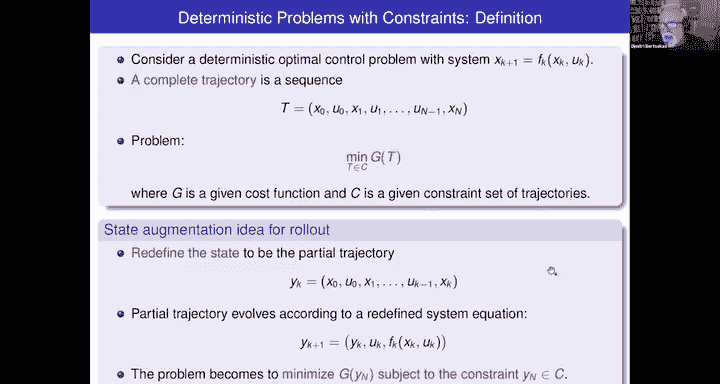

And here is the。And here is the algorithm。We start at the initial state and we keep adding controls in states up to the point where we get to X till decay。

 decay stage。Then we have generated this partial trajectory。This white tilda。オ父ケ。

And now we extend this partial trajectory by one control and one state。

We extend way2 decay to obtain all these partial trajectories that start from here and end up at this points here okay。

 we add UK in the corresponding next state and we do this for all feasible controls。

And now we run the basic heuristic from each one of those。Now the basic risk generates。

A partial trajectory R of Y k plus one， Okay， this one here， this shrink and so on。And now we join。嗯。

This part with this part， and we do it for every UK。We join the partial trajectories。

 Yk plus1 and R Yk plus one。For all the different values of UK。

 and we obtain complete trajectors of this kind。Okay， so we have now these candidate trajectories。

 some of them are feasible， some of them are not feasible。

So we calculate the set of controls for which this trajectory here is feasible。Satisfiies。V。

Constraint of the problem。And out of those thinned out set of partial trajectories。😊。

We find the one that is best， the one that gives you the minimum value of cost。

 but we minimize not over all controls， but only over the controls for which I get feasibility through application of the basic heuristic。

I think are any questions here？Yes， professorfes， I a question for you in the past in the past we had talked about problems where we augmented states to take into account time delays is this essentially equivalent to those。

Running rollout from those kind of augmented problems。Yeah， yeah， it's the same idea。

 not exactly the same， but it's the same idea of mental state in order to take into account couplings with previous states。

It's the same idea。

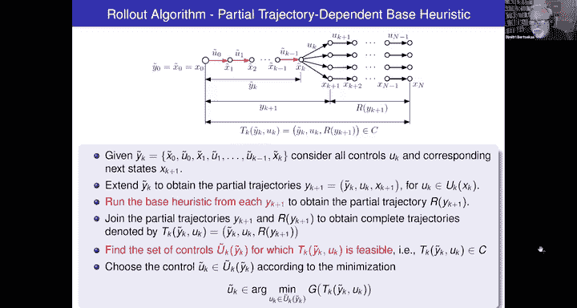

Okay， so let me now demonstrate the algorithm of using the。Traveling sales one example。

 this is the same one that we had at the first slide。

We want to minimize find tour that minimize the travel cost， okay given by this matrix。

 but also meets the safety constraint and two of those tours do not meet it， okay。So。

We have the cost function， we have the constraints。And we also have a base heuristic。

And this base heuristic， of course， the base hereurs can be anything， and I've drawn here with blue。

So at state x0， the base heuristic generates a complete trajectory。Hence this one here。Okay。However。

The best heuristic when it is at this partial tour。

It's not sequentially consistent and instead of generating this trajectory。

 it's generate this trajectory， okay？Now I did this because I wanted to make the example more cut more variety。

I'm free to do that because like I said， the pasturistic can be anything。Also， the best heuristic。

From this partial tour is this blue here。 Okay， is this heuristic from A B， heuristic from A C。

 the heuristic from A and the heuristic from A D is this one。How about the other tours。

 well the heuristic from ABC， its this one right， because there's no choice。

 similarly the heuristic from ABD is this one， there's not a choice and so on。

So I have indicated here the heuristics from A， A， B， A C， and AD， and not from the other。

Partial to it' because there's no choice。It's implied what the basic is。Okay。

 so we're going to go through constrained rollouts step by step now。

This is basically the algorithm of the previous slide。And we start the initial state。

 and we will do roll loud at A。How will this be done， we consider the partial tours A B A C and AD。

 we consider this partial tour， this partial tour and this partial tour。

 and then we run the heuristic from each one from this one the heuristic gives me this that's a candidate okay。

From here， the heuristic is this one。And from this one， the heuristic is this one。

Now this one happens to be in fe smooth， so we just throw it away and we compare this tour。

In that store。And the one that wins is this one。So we move from A to A B。

That's what this bullet says。😡，We start at a， consider the three possible choices and we obtain by using the base heuristic。

 we obtain this tools here， ABC D A， A B， D A。And A D C， B， A discard this one as being feasible。

 compareare this one and this one。

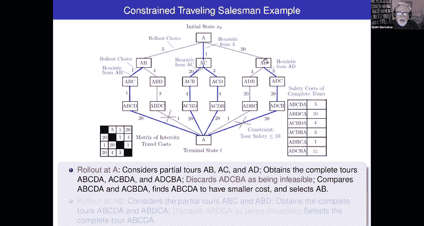

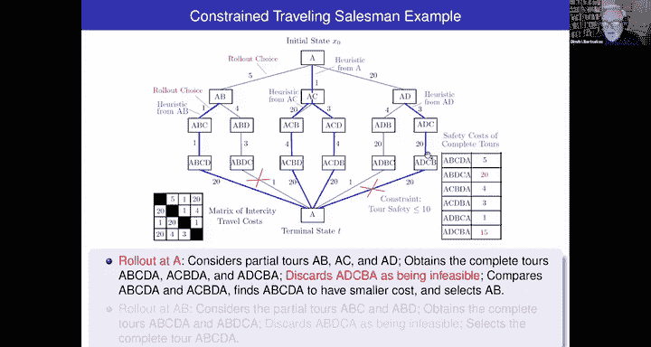

And find this one here to be better and we select AB。

So we're now done with the first step of rollout。Is this clear？It a some question。Okay。

So we have made this rollout choice and now we move to AB and we do rollout from here again。

So what do we do， we consider this possibility and that possibility and random basic heuristic from each one。

Okay， now。This trajectory here is infeible because it violates this constraint here。

 so we throw this one away and we select this one in other words， we move to ABC。

That's what this bullet says， we consider the partial tours， ABC。

And A B D run the base heuristic to obtain the complete tours， AB，C D A and AB D CA。

And we discard this one as being infeible， and we select the complete tour。This complete tour。

 of course。To be entirely formal and we have to go from here to here and but there's only one choice so I'm not showing the completion of rollout this is the rollout choice at AB this is the rollout choice at ABC this is the rollout choice at ABCD and we have reached the terminal state and we have the rollout。

Projectory。Okay， is this clear？If we did not have this constraint and we did not have this。

The violation from these two tools， the rollout would choose this trajectory。

 which would be the optimal and constrained trajectory。啊。However， because of the constraint。

 this was recognized at this point here and we went the other way。

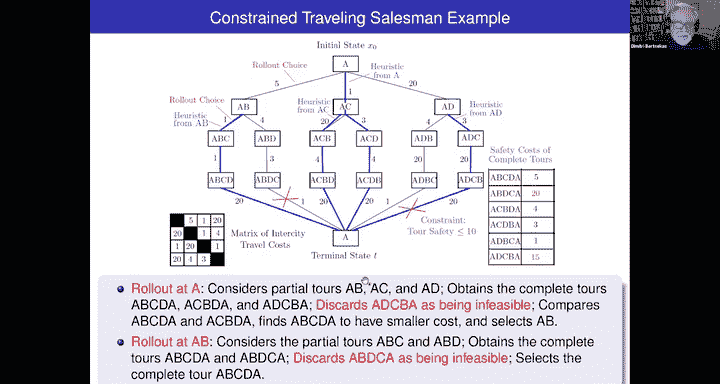

Okay。So now let's go back to theory。啊。What are the properties of this constrained rollout？あぐ。Well。

 obviously we will need notions of sequential consistency， sequential improvement。

 and so on in order to be able to assert anything。So there are extensions of the definitions of sequential consistency。

 sequential consistency and is the same as the sequential consistency of the unconstrained version。

Now， sequential improvement is a little different。😊，As part of the definition。

We require that the set of feasible controls， the ones from which the candidate trajectories。

Do satisfy the constraint， we assume for sequential improvement that the set of feasible controls is not empty in other words。

 at this step here there's at least one out of those trajectories that satisfies the constraint。

So that's the sequential improvement condition。First， that the set of feasible controls is not empty。

 there's at least one that is。Feasible and moreover。Out of those that are feasible。

 the Q factor of at least one， the minimum Q factor over those is no larger than the heuristic cost from here。

O。Now your notes have this。Your notes have the。The details of this。

 but I'm just summarizing this here。In other words。

 it's the same kind of definition for sequential improvement as before except that。

This property here of minimum heuristic Q factor is no larger than heuristic because that qua tilder is satisfied with the minimum taken over the ones that are feasible in other words we just discard the in feasible trajectories and we do and we define sequential improvement in a natural way。

Now a lot of things can go wrong if the sequential improvement condition is not satisfied。

 in particular there may be no feasible trajectory， you went mely along here。

 but all of a sudden you realized that you reached the point where you can't satisfy the con anymore。

So to deal with this， there's a fortified version。Whereby once you find a feasible trajectory。

 you keep it for later， just in case you can' find。Another one that's feasible Moreover。

 you replace it with a neutral trajectory once you find one that's better in terms of cost。So。

For the case where sequential improvement is not guaranteed to hold， it's not known to hold。

We use this qualified version， which maintains a tentative best trajectory and follows it up to generating a better trajectory through runout。

And now。We restore the cost improvement property。Assuming that the basic heuristic generates a feasible trajectory starting from the initial condition。

In other words， if our initial trajectory is feasible， then with dis fortification。

 we're guaranteed to always follow a feasible trajectory。And one that has no worse cost。

The details of this are a little tedious， but they're natural and you can guess them already by just looking at this bullet if you think a little bit about it。

Okay， so there's a multi agent version also， which I'm not going to go into the details。

The multi agent version applies for the K square。Each control。Has multiple components， okay。

 and therefore the search space is very large。So what we do in this case。

 we play this trick of reformulating the problem with the control space unfolded。

So that the components are chosen one at a time。And then we apply constrained rollout。

On this equivalent reformulation。So this extension is natural， it simple to。To deal with we simply。

Each one of these decisions is broken up into M decisions where M is a number of agents。

 and then we go one step at a time with the basic heuristic and all this procedure here that I described。

Okay。So now let me return to the traveling salesman problem。

This picture is exactly the same as the one that you saw in the previous slide。呃。There's a。

Cost function associated with the travel costs。There's a safety constraint or a constraint that from the trajectories。

There's a basicistic。Which from each partial tour gives you complete the。

But completes the partial tour。And。Let's look at the issues of sequential consistency and sequential improvement。

Okay。Is the heuristic sequentially consistent at A？It's not， and why is that？Somebody。

Why is it that this heuristic is not sequentially consistent at A？At A is generates this trajectory。

Once it goes through the first step， it generates a different trajectory。

 well that violate sequential consistency。Is the heuristic sequentially improving？Well。

 we have to check two things。Wever。From every one of the。Partial tours。呃。It can find。A feasible。

Candidate trajectory。And indeed， this is so at A B。

 you can find this trajectory at A can find this trajectory at AC C， you can find this trajectory。

And that trajectory also， and at AD， you can find this trajectory。But not this one。

 this one doesn't qualify。So the feasibility requirement for sequential improvement is satisfied。

But there's another requirement for sequential improvement， namely that。If you run the base。

 heuristic。From any given partial tour。I'm sorry。If you run the basic he from some partial tour。

 is this one here。And there is。There is a neighbor such that running the basic heuristic from that neighbor gives you a better or equal value。

And it turns out that this is true for， it's true for ABS and AD trivially， why。

 because this tour here has a cost of 27。W is the base heuristic has a cost of 28。So。

The sequential improvement condition is satisfied at A and also satisfied that the other node fairly trivially。

Because of the simple structure of the graph here。So。

We have sequential circuit improvement and indeed the rollout constructs this trajectory with cost 27。

 which is better than the cost of 28 that the base heuristic constructs from the beginning。However。

If we were to change this one。Travel costs and from 20， make it to 25。

 then the sequential consistency。Sequential improvement condition。At a would be violated why。

 because when I compare this with that， I find that I compare this with that one。

 I find that this one is worse than that。This one is also worse than that， okay。

 look at the numbers here。And also， this one is worse than that。 This one has cost。45。

 which is from house cost 28。So if I were to change this one number。

 then the sequential improvement condition would be lost。And in that case。

 you would have to resort to the fortified algorithm， which whenever generates a new trajectory。

 it compares it to the best tentative that you have。

 which in this particular case is the initial trajectory。

And if you apply fortification to this example， you'll see that the rollout algorithm。At a。

Tries to find a better trajectory， but it cannot。 The reason is that this one is worse and this one is worse and this one is worse or infeible in this particular case。

 so it sticks with the。Huristic trajectory with the trajectory that was generated at a and rejects this one。

So that goes back to the question that was asked by one of you。

 I'm not sure who was that what happens if。If you。What happens if the heuristic is not feasible from the initial state。

 well， you have to assume that。And you have to assume that to prove anything。

And if that is not and if that is assumed， then by more fortification。

 you're guaranteed to get a better or no worse trajectory than the one that the heuristic generates from the initial state。

Now。Okay， here's one more thing。How do I find a base heuristic that generates a feasible trajectory from the beginning。

 sometimes this is very hard。But we just skip this question and we just assume that we have a basic risk that at least from the initial state。

 it can generate a feasible solution。That's part of the assumption for this problem。

I there any questions here。I went slowly here and also in terms of pictures。

To give you the opportunity to follow all the steps。I didn't see any reaction from you。

 so that can mean one of two things， either you got very bored with the details and tuned out。😊。

Or the slides are so complicated that you lost track of what's going on。

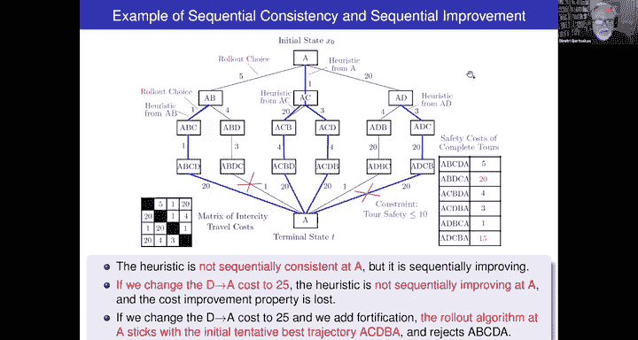

But anyway。Since there are no other questions， I'm going to go forward。And summarize what we are。嗯。

Okay， a constraint。Problem， constrained deterministic problem。

And the rollout algorithm written for it involves some ingredients， all of which are quite。见子了。Okay。

 some of you are saying that it's very clear thank you for the details， so I'm glad to hear that。嗯。

Okay， so what are the structural components of the framework that we have developed so far？嗯。

First of all， we have trajectories。Which are defined by a graph a layered graph。

Showing the transitions from states in one stage to states in a next stage through the use of controls so this。

There is this optimal control graph that we are using and the assumptions here are that the problem is deterministic and it's also finite state。

 finite state and control we will not be able to go through all this argumentation that of the previous slides if we had an infinite control space we have a finite control space and a finite state space and we have a graph that defines the transitions。

So this is the dynamic system defined by the graph。And we have a cost function。

That can rank trajectories either numerically or possibly through the use of an expert。

 we may have an expert that we ask， given this trajectory and that trajectory。

 which one is better in the in the in the。And the expert has some kind of way of rank trajectories。

So we have a cost， but we'll just assume that we have a cost function， a very general cost function。

We have a very general set of constraints。呃。回去。By which we can check。

 we assure that you can check it and determine feasibility of the trajectories。

And we have also a base heuristic。That starts from a partial trajectory and completes it。

 generates the remainder to form a complete trajectory。So these are the ingredients of our framework。

The problem。The problem of structure， the dynamic system， rather。The cost function， the constraints。

 and the basic heuristic。And now once I give you。V。Dynamic system。I give you number one。

 then the other choices are independent on each other。 I can choose anything I want。

 and this does not have to depend on that。 This does not have to depend on the other too。Moreover。

 given one， two， and three， which is the problem， you can try several different base characteristicsuristic。

Or you can combine the heuristics into a super heuristic whereby which naturally chooses the one that has minimum cost out of the ones。

That are feasible， okay， some of the basic heuristics a given from a given partial tour。

A given partial trajectory may not be feasible so you discard those and use。

And check compare the ones that give you feasible trajectories and then pick the one that gives you best cost。

So you can have multiple heuristics combine them together。And these。

And all of these choices are independent of each other， so given a particular type of problem。

 there are a lot of different problems that correspond to it and also a lot of different basicuristic and therefore rollout algorithms that can be used。

So that's the。So that's the constraint overall algorithm in structure。

 and now I'm going to look at a particular type of problem。

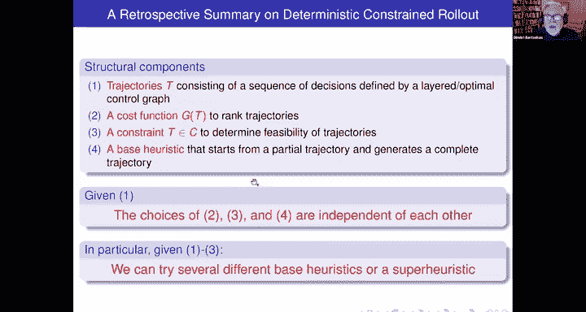

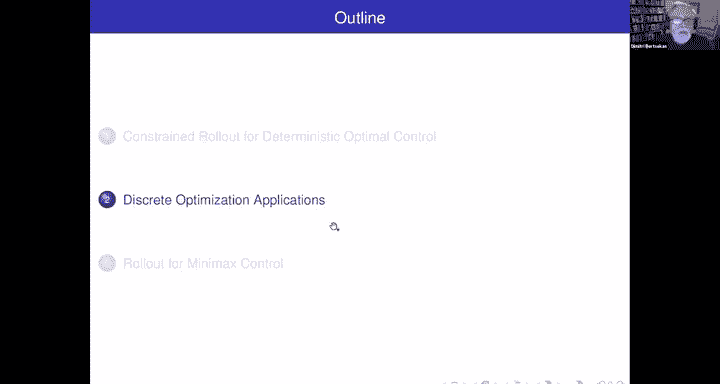

Involving discrete optimization。So here's the problem。It is very general and very useful。

 an awful lot of optimization。Just has the structure here。呃。

The problem is to minimize a general cost function Gs sub u subject to U lying within some constraint set。

 and the only thing that we assume here other than finite night，Control space finite choices for you。

 the only thing that we assume is this component structure you has multiple components that we arrange from zero to n minus1 in the way of stages。

So the problem is laid out， the problem structure is laid out like so we have seen this graph before。

 there's an artificial initial state which is the first control in the states of the first stage are theses。

 stage two， there are theses， pairs， stage three， triplets and so on。

 the last stage marks the completion of a solution， these are all partial solutions。

 this is a complete solution。And it has a cost dig of U， okay， this cost enters here。Now。

 if we didn't have these constraints， then we could this would be a shortest path problem。

 okay if we had costs only on the arcs， this would be a shortest path problem。

But now we have constraints in some of these trajectories。Are feasible and some of them are not。

 so we have to pick our way out from the beginning to the end。Through while maintaining feasibility。

Okay， so that's the problem。And we can view it as a special case of a constrained deterministic optimal control problem where the states are not really significant and。

They're just artificial， just a single state at every step。

 and only controls in a single state which is equal to of some artificial x0。

So for problems where states do not have some kind of intuitive meaning。

 we may prefer to sort of abstract them out of the problem and use this type of formulation。On。

 the other hand。The range of problems of this is just enormous。😡。

Any kind of combinatorial optimization problem that you can think of matching， routing， assignment。

 scheduling， big packing，Any kind of problem。Including the very difficult ones that are anticomplete and so on。

Fits this framework。They， as long as you have this component structure and you usually do， okay？啊。

Furthermore， any integer programming problem can be put into this framework in integer programming。

 we have some variables which are these usually， and they can take a value that's integer。

 usually zero or1。So。In an integer programming in a 01 integer programming problem。

 the solution is a sequence of zeros and ones， and I'm going to give an example shortly。那。

Because this problem is a special case of the one we had before。

not really a very narrow special case， actually this problem is equivalent to the deterministic optimal control problem that we had before。

 but we can view it as a special case in the sense that there's only one state。嗯。

Because this problem is a special case， we can apply。The roll algorithm that we saw up to now。

And this is the way to provide an entry point。For reinforce enforcementment learning。

Into the solution of discrete optimization parameters。啊。

What we're doing here is allowing the use of methods of approximation in value space。

 proagation policy space， dynamic programming， we allow these methods to come into。

This broad range of problems。Now， as I said， these a very。

 very broad class of problems and there are many， many methods for solving them。For example。

 a random search is one such a methodology where you start from some initial feasible solution and you generate a random some other a collection of other neighboring feasible solutions and you move to one that looks promising and then you search at random within a neighborhood of the place where you are and you find another solution that's promising and so on。

 and of course you can do this in many different ways and intelligent ways in particular。

But in random search， if you go from a complete solution to a complete solution and then to another complete solution。

 you don't go from a partial solution to a less partial solution up to a complete solution。

 which is what we do in Ro La， so random search in Ro La are quite different in the structure。

And this is true also for other methods， local search methods。In local searches like random search。

 moving from one solution to a neighboring solution into another neighboring solution within some neighborhood and the method is defined by the neighborhood and by which you move。

 which candidate within the neighborhood you select。Again。

 these local search methods have this complete solution structure。

 you go from a complete solution to another complete solution and so on。

 you don't build up the solution。Component by component。Genetic algorithms are another。Yeah。

 popular class of combinatorial discrete optimization methods。And again。

 they have the same kind of property as random search and local search。

 you generate you operate on a sequence of complete solutions。

 and you go from one solution to another solution by generating some successor candidate successors through mutation。

 extension， there are various operations that you can apply and，Okay。

 if you have some intuition about your problem， you can generate interesting ways to interesting neighborhoods from within which to search。

These algorithms have their successes and also their failures。

 and they are important classes of algorithm， but the main thing is that the rollout is different。

Integer programming also has a large variety of， a larger rich methodology。

And the part of integer programming that's closest to rollout is branch and bound。

 I don't know if you've heard this， Beth I'm not going to describe it here。

 but it involves fixing integer variables one by one and finding which candidates to fix in an intelligent some intelligent way using upper and lower bounds and so on。

That bears sum its similarity to what Roout does。So rollout is different， is different。

 better or worse， I don't know if it's better or worse。

 but it is good to have different algorithms because these algorithms are flaky and sometimes they don't work。

So it's good if your algorithm， your favorite algorithm does not seem to work to have some alternatives to try。

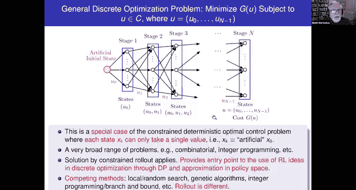

So now let me go to an example， this is an integer programming problem。

And it's one of the classical ones it's called the facility location problem。

And I'm going to go slowly， there's a lot of formulas here。So， you can。

Ask questions if something seems to be unclear。Okay， so what do we have here？

We have some candidate locations。In which we want to place facilities like power plants if you're talking about electric energy production。

Or some other kind of facility， service centers。And there are some candidate locations。

 and we want to find the most promising locations。啊。So if you place。A facility in location， K。

Then UK is equal to one。If you don't place a facility， then UK is zero。

So placement of a facility at a particular location correspond to a01 integer value。

Now these service centers， these facilities are set up there in order to satisfy some demand。

 satisfy certain clients。These blue circles are clients that are going to be served at these facilities。

And this clients have a certain demand。嗯。Client I has demanded Di eye for services。😡。

And this demand can be satisfied at a location K。At a cost AIK per unit。And。

A client can actually split his demand between two centers and send a piece here and a piece here。

Similarly， in other words， this infinite visibility we assume here of the demand of a client between the various service centers。

 the ones that are up， of course， that are operating。Okay。Back to facilities。

If we place a facility at location K。Then we provide capacity C C is the capacity of a facility at location K。

And it also has a cost Bk， this is cost to set it up， okay？And UK takes a value01。

 depending on whether a facility is placed at K or not。So this is the overall constraint structure。

And the cost is a linear cost， okay， its a bit of a handful。There's a。A cost for services。

 This is a service cost。And。There is a cost AIK unit per unit of client I。

That is served at facility care。So this is a linear cost。That depends on the y's。

 the y's are variables also， okay？Optimization variables in addition to the use。

There is also a linear cost that penalizes the placement of facilities if you build a facility at location K。

 you have to pay a cost Bk。And if you don't build a facility， UK is equal to zero。

 so you don't have to pay that cost。So this is a linear cost function in the variables y。

And in the value U， except that the U are not infinitely divisible and they can take only the value zero or1。

And what are the constraints here， well， of course。

 we have the integer constraints that the use can only be zero or1。And。

The service location and the facility assignments。Must be such that the total demand is satisfied。

In other words， these wives have to be。ervice services have to be done negative。

They should add up to the。Demand of client I， so for every client。

 the portion that allocates the various facilities should add up to the total demand in DI。

So we have this constraint， this constraint， this constraint here and also。The constraint that。At。

Location K at facility K， assuming the facility is built at location K。

 this can only serve demand up to a level CK in other words。

 the total demand that's being served at location K should not exist CK if UK is equal to1 and no demand can be satisfied at location K if there is no facility that we have built at location K。

Okay， so this is the classical version of the problem， but we can make it even more difficult。

There may be additional constraints on you， but we will ignore for the moment。

 but let me give you an idea of what this additional constraints can be。Okay， let's go back here。

This is the definition of the problem。And a transcription into our standard form of minimizing Gs of U over U belonging to C。

What is C now？The constraint set is the set of all the use that are in01 and also can satisfy the demand。

And perhaps some other constraints， like some public policy constraints， like zoning constraints。

Did I hear someone？Zoning constraints。That the。Say that within a certain geographic region。

 you cannot build。Any facilities？Or you can build only one facility and no more。呃。And。And。

And so there may be groupings of locations that have special properties that are not shared by locations in other places。

 this is what we mean by public policy constraints or additional constraints。

But let's not worry about those， although our methodologies can address those， okay？

Which makes it which actually it's generalized。So， this is the。Constraint set of the problem。

 and this is the cost function of the problem。Now， okay。

Here's the cost function I told you that's this one， however。

 if you look at this problem and you look at the variables U and the variables y。

 you realize that the really important variables are the U variables。

If I give you the facility locations， then the remaining problem is a linear programming problem that can be solved very quickly。

It's what's called。A linear transportation problem okay。

 it's a classical network flow problem that can be solved in polynomial time by very efficient algorithms。

So if the placement variables are known， the remaining problem is easily solvable。

So we are going to formulate our problem in terms of the difficult variables and the others。

 the Ys are going to be determined automatically through this optimization。With H。

Is the set of all feasible demand allocations？The ones that are not negative and satisfy the constraints。

So once I fixed the use。The constrain set of this problem is determined。

And this problem becomes a linear programming problem and its optimal value。

 I'm going to call it G sub U。In other words。I have eliminated the variables y from the problem by saying。

 well， they're automatically determined once you determine this location variables U。Okay。

So now I have the problem in the way I want it， I have a cost function。

Involving a sequence of decisions。And I have a constraint set。And I can check。

Whether for a given sequence of decisions this constraint is satisfied。

And now I'm going to apply it all out， whereby I will first pick。

The variable of the first location do I build or do I not build at school location zero then I go to location one。

 do I build or not build and so on go all the way up to the last one in that while applying some kind of。

Base heuristic and checking also for constrain satisfaction。So are there any questions？

Is this an example of a problem where certainly equivalence has been applied。

 because I would assume that the DIs in general are random variables。

 but in this case we're just treating as some known constant， right？Okay。

 this is a deterministic problem now how you have arrived at this problem we don't examine here。

 it may have been the result of certainty equivalentvalence in other words there may have been some random variables here。

 for example this demands D。Okay， they are random， and they probably are changing over the calendar year。

But we assume here that they have been replaced by deterministic quantities。

 so we're using in a practical sense， we are using certainty equivalentvals。However。

 from a mathematical point of view， we assume that these are known， they are not random。

Does that answer the question？Okay， yep， thank you。O。Okay。

 so now we are going to apply this constrained to rollout algorithm。

Considering places one location at a time， that means we first fix u0 then u1 and so on。

So at stage K， we make the placement decision Q from zero to1。

At this location and that end altogether stages。And here's our basic heuristic。

 I could use any of a number of basic heuristic， but here' is the one that I'm going to be using here。

The best heuristic。Complettes a partial trajectory right， so given a partial trajectory。

 it must have a way of completing this trajectory with additional U variables and it chooses to place a facility in all the remaining locations。

In other words。Having fixed user the UK， there are two。Candidate trajectories to consider one is。

Where we set the next facility to one and all the remainder facilities to one。

According to this ba heuristic。And the other is， the other candidate trajectory is not to place a facility at the next location。

But set the。But the place of facility in all the other remaining locations are as per our base heuristic。

And now。At U0 after UK， we have two candidate trajectories。And we check for feasibility。

And this one is going to be feasible。Why， because。It builds up everything okay。

 if we have reached up to here with with a state feasible so far。

 we're going to remain feasible because the best heuristic。😊。

Is very very generous and allows us to build a facility in every location。On the other hand。

 this one。😊，May not be a feasible trajectory。😡，Because this indicates that we do not place a facility in this location and this location may be a critical one。

 this particular。And without building it， then we can't satisfy the demand。Okay。So。

We looked at this too。😮，And depending on which one yields feibility and minimum cost。

 we move to UK plus one， it may be zero or it may be one。

And now we note that because of the nature of the space heuristic。

Sequential improvement is satisfied。The reason is that。Okay。

 it really satisfied because of the particular choice of the basicuristic and also。Okay。

 it's easy to see that the minimum Q factor。Between these two is has to be less than the。

Than the cu factor of。Of。Well， the cost of the basic heuristic starting from this location。

 basically， the basic heuristic here is not only sequentially。

Improving but given feibility is also sequentially consistent in other words。

 it keeps it stays the course you start out with a basic heuristic that sets all to one and then as you move forward it continues the taking of the trajectory generated by the basic heuristic also consists of ones。

So it's easy to verify that sequential consistency satisfied and also feasibility satisfied。

So you get。You get。Cost improvement。Over the initial choice which would be to build everything。

 build a facility in every location that's what the original that's the what the basic heuristic would give you starting from the initial state so trivially you get cost improvement and generally this algorithm in my opinion works pretty well。

Particularly the system can handle some very， very difficult constraints。

 which would not be possible to handle with other methods。Like into your programming type of methods。

Okay。And then questions now on this example。I have a question。

So setting dynamic programming aside for a second， if I'm just looking at this problem as an integer or linear program。

I would be finding like the total number of variables I would be finding values for would be all of the U1 through UK or all of the UK values。

 but also all of the y sub I k values right like okay。

 so so this cost function has two parts that has。嗯。

Trying to minimize the demand and also trying to minimize the number of。

Facility locations that you're going to put down in total。 So you said that。

So we have our control space corresponding to only putting down facilities or not。

 and then you said once you have a facility assignment。

 then at that point you feed the rest of it into a linear program to figure out what is the best way to allocate the demand。

 right？Yeah， okay， so I we've seen before that， like， for example， in the in the case of。

The linear quadratic case set that。Sometimes your controls。Can be continuous as well。

 So I guess my my question is， is there any way to adapt this framework to just purely solve a linear program where。

 for example， if if your controls were in some continuous range 0 to1。

Because I know we've seen that before。啊。The answer is。嗯。That would not。

 that would lead you to a different kind of methodology。Branch and bound。

So major methodology and inteship programming， as I mentioned。That's this。

Now there was branching bound at any one state。Allows at any one point has variables that are fixed to integer values。

And those are valuable of that。That are free to take by using the range from zero to one。So。

So there is this feature of relaxing the integer constraints and solving corresponding linear programming problems in branch and bound in rollout that's not done Okay we here we treat the the variables are zero or one and the remaining variables are automatically determined by solving this。

This linear transportation problem， minimizing this objective here， subject to this constraintstrain。

Okay，So we always operate with integer variables。And that's the difference。

 that's an important difference between this methodology and the branch and bound in your programming methodology。

Because for example， if your y variables were restricted to be integers， maybe not zero or one。

 but zero through 10 integers。They could also be a part of your control space， couldn't they？

They could， yeah。It's all a question of whether you can solve this problem here easily or not if the wises are not restricted to be integer。

Then。诶。Then this problem is very simple to solve relative to， you know， rather be speaking， right？

However， if there are additional difficult constraints on the why which make this problem nonponomial and hard。

 then you're faced with a different type of animal and you have to treat it differently and you have perhaps to consider simultaneously the choices of UK and YIK。

 but because here this problem is simple。relativelyly speaking。

 you can follow the solution methodology that we have discussed。

There's something else about these transportation problems。

They tend to have integer solutions under some conditions。

So even though we have assumed here that the Ys are。Our呃。

Are fractional could be fractional in reality， if all the other data of the problem is integer。

 then these transportation problems also have integer solutions。And okay。

 that takes us into different territories and I'm not going to go any further。

But there's one thing that I want to mention， and it's the last bullet here。

There are a lot of transportation problems here， right for every。😊，New value of you。Zero or one。

 you have to solve a transportation problem。And on the other hand。

 these transportation problems are similar， they have similar data。

 and then you can use the solution of one transportation problem to hot start the solution of the next transportation problem。

And there are algorithms in network flow theory， network optimization。

This auction algorithm in particular that are very well suited to hot starts starting。

The solution from an already good solution。And these auction algorithms are very。

Are very suitable for us intermediate solution methods。For obtaining the values， the cost values。

Okay， thank you。Okay， so we have reached the end of the lecture。

The material of today's lecture is covered in greater detail in your textbook。

 the lessons from Alpa Zero textbook that you can find。From my website。And now in the next lecture。

 we are going to do。tochastic rollout type of ideas today we cover deter deterministic rollout and the next time we're going to look at stochastic rollout and the Monte Carlo research methodology。

Which is like a pruning type of methodology， but it applies to pruning the simulation that's involved stochastic problems。

Then we are going to discuss an extension of rollout to the case of infinite spaces problems in particular an infinite number of controls。

 all everything that we have said so far applies to a finite number of controls。And that。

That will prepare the ground for going also into multi agent rollout two lectures from today。Now。

 as I mentioned earlier， this is a good time to think about your project。

 today's material should provide good inspiration for some of you also in the next lecture。

 but particularly the first four lectures， which were introductory foundational lectures for our course。

I urge you to think about your project and I encourage you to get in touch with me by email and to make appointment to talk by Zoom if you have some ideas that you're not sure about。

啊。And we ask you。To send。a。One page or less proposal about your term paper。

 we want you to start thinking about your your project and we want you to have a proposal ready by the end of the spring break and send it to me to take a look。

And that applies to both mini research projects as well as the reading report type of projects。

And also， if you have some difficulty narrowing down a project。

 then or you need some help with finding some good papers to read。

 please send me email and try to help you。So that's it for today and we will see you next week。

