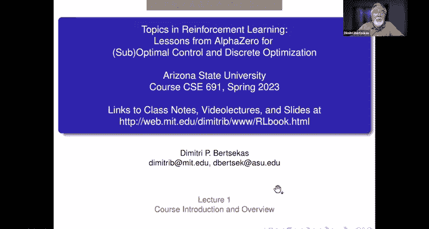
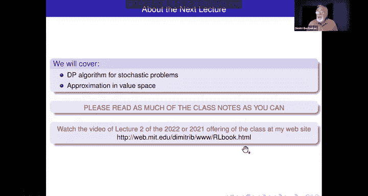

# ASU《强化学习2022-2024｜cse 691 Reinforcement Learning Course at ASU》中英字幕（deepseek - P1：[41]Lecture 1, 2024, course overview_ RL and DP, AlphaZero, discrete and continu - GPT中英字幕课程资源 - BV1zcfVYdErD

Let me welcome you to this class on topics in reinforcement learning。

You can see the link to the class notes， video lectures and slides here。

 this is going to be a repository of all information from this class as well as our previous classes this is the fifth time i'm giving this class at AFU。

Each time is a little different， this year is also going to be a little different。

 and I will explain exactly how as we go along。Today's lecture is an overview an introduction to the course with a little bit of a technical content in the second half。

Here's the outline， I'm going to start with the Alpha Ze program another later programs。

 Alpha Ze is a famous program that plays chess and creates a lot of enthusiasmthments about the prospects of reinforcement learning。

 and I'd like to in particular to focus on the two components of the algorithmic design in Al zero and in related programs。

 which is the offline training algorithm， and then the online play algorithm that once that we use online to play。

 the training algorithm is a prepar fair where we the architecture is trained with data。Okay。

 then I'm going to discuss a little bit to say a few things about the history of the subject。

 and overview some general concepts。Okay， then I discuss connections of the course with the various fields in artificial intelligence and decision and control and operations research。

Then go into， okay， after the first three topics， we're going to take a break a 15 minute break and then we're going to start on our technical the technical part of this course。

 we're going to discuss in particular dynamic program。

 dynamic program is going to be a very central methodology in our course。

And we're going to discuss the case of deterministic problems where there is no uncertainty。

 everything is known about the system everything is known about the effect of the decisions that you make and so on next in the next lecture we're going to discuss stochastic problems but the deterministic problems are going to be important for our class and we're going to discuss them in this lecture。

Then I'm going to give some examples of deterministic problems involving a finite number of states。

 and these examples connect to discrete and combinatorial optimization。

 which are going to also be important in our class。

Now I'm going to say a few things about organizational issues， this。

 how this course is run and so on。So， let me go into。Two remarkable programs。Alpha 0 and T D gamma。

 Alpha 0 plays chess。TD Gamon plays back gammon， these two programs were 25 years apart。

But they involved very similar architectures Alpha Ze came out in 2017 and created a sensation with its quality and originality of play and propelled the reinforcement learning field to the front pages of the newspapers。

TD Gament was also a very impressive program， just as impressive as Al0。

 particularly since it was the first program of its type was 25 years before。However。

 both of these programs share similar ideas， similar design， they both involve two algorithms。Now。

 a lot of people don't realize that there are two algorithms involved in alpha zero。啊。

The first algorithm is the offline training algorithm which uses neural networks and data self generated data。

To construct a value function， a scoring function for evaluating positions。

 and also a policy that can generate moves in response to different positions。

So all of this offline training takes place before the program plays any game against a human or computer opponent。

The online play algorithm uses the results of off training to play online with you and me and other computer programs。

And it uses multi step look ahead。Rollout in cost function approximation。

Now all of these are going to be explained at length as we go along。

 but what I'd like to note is that these algorithms have a very strong connection with dynamic programming。

 the classical methods of method of policy duration。

 and also reinforcement learning and machine learning type of approximations involving neural networks training and so on。

Now what we're going to try to do in this course is understand this methodology so that that applies far more generally。

 we're going to focus particularly in the architecture of Alze and Td Gamon because I think this is the one that holds the most promise and also the most generally applicable。

啊，Applications are going to be of course far beyond games。

 we're going to look at control systems and control system design。

 model predictive and adaptive control， control systems are of course very important in robotics in self driving cars in all kinds of control theories are very old methodology that they more than 100 years ago。

And we are also going to apply this methodology to discrete optimization problems。

 like the kind of problems that people and operations research or combinatorial optimization are interested in。

So all of this is going to be part of the playing field within which we're going to apply the ideas behind Al zero and TD G。

Now， what I would like to。To do first。iss discuss the online play algorithm of alphapha zero and the idea of approximation in value space。

 sometimes the online play out is called online research search over a tree of decisions over a time horizon。

And then I'm going to discuss the offline training algorithm。Now， the。

Online clay algorithm is what you see here in blue， okay。

Had a given chess position or more generally at a given state of the decision problem？嗯。呃。

It starts here and it involves all these things that you see in blue。However， at critical points。

 it uses the results of offline training。And the offline training provides two components。

One is a position evaluator， which provides a measure of quality of the state over here。

 the position over here at the end of the search。It's a numerical function。

Which is obtained by some kind of training neural network or other。The and there is also。

A base player， which is a a。A software that generates， moves or makes decisions at given positions。

All of this is obtained offline。And。So the。Online layout algorithm aims to improve the performance of the bass player by searching forward for several moves through a Look ahead tree。

So at a current position or a current state， it generates all possible moves one step ahead。

 then two steps ahead for whatever length of the look ahead there is。

And then it simulates the bass player for some more moves or after it reaches these three leaves。

And then it approximates the effect of future moves by using the terminal position evaluation。

After it has done the search， then it backs it down to the current position and calculates values of the available moves or decisions at the root。

And this is basically a backwards dynamic program and calculation。

 and we obtained a numerical value for every move and it picks the move that has the best value。

So that's the way it works for a given decision， a single decision。Then after this decision is made。

 we generate a new position and repeat， do the same。

 generate a new position and go forward all the way to the end of the game or the end of the control interval。

 the decision interval。Now this is the architecture that is used in both TD Gament and Alpha Ze and in other programs。

But there are strong similarities also with the。Methhodology of modern and predictive control and control theory。

In model privilege control， basically the same architecture is used at a given stage。

 there's an optimization over a look ahead tree or perhaps an interval。

 imal controls over a certain interval and there may be an additional simulation of a base player。

 and then a cost function approximation at the end， this is called a control interval。

 this is called the prediction interval， and there is a major difference。In model for control。

 the state space， the number of。The number of states is infinite， okay。

 it's a continuous state space like a two dimensional space or three dimensional space as it is in vehicle dynamics。

 cars moving or airplanes moving or three dimensional space and so on。

 there's an infinite number of space， number of states， on the other hand in games。

 the number of the number of states is finite。Other than that， however。

 the architecture is very similar in both cases。Moreover。

 the same architecture applies in discrete optimization by using something called rollout。

 you'll see the name rollout here， which we're going to deal with at some length。

So this is how the online player in Al zero and related context works。

And now let me go into the offline training Al， again in Alpha zero。

 it uses a form of approximate policy direction， policy direction of taskcal， as I mentioned。

 a classical algorithm in dynamic program。It applies an approximation of that algorithm。

 an approximate policy duration algorithm。Which uses self generated data。

And let me explain how this works。The algorithm generates a sequence of players。

Software that generates moves at any given justposition， we also call it a policy。

And the current player is used to train an improved player and the process is repeated。

 so current player we improve it and then go back again and get a sequence of players one better or hopefully better than the other。

Now this is done through a two stage process。The current player is evaluated by playing many games。

 plays many games， we look at the results， and we evaluate the player in terms of how often it wins。

 draws or loses。And this evaluation function is represented by a value network through training。嗯。

So after we have this policy evaluation。We use it in a policy improvement through a policy improvement operation to generate a new player。

And this policy improvement operation uses some form of multistep look ahead minimization。

 like the one I had in previous slide， except in alpha zero is somewhat peculiar。

 it's an approximate version called Monte Carlo Research。

And then the improved layer is again represented by a policy network through training。

And it takes the place of a current player and this loop is continued for as long as it's necessary。

There are also some nu answers you know this， and we're going to get into that over time。

 but this is the basic picture。Now， TD Gament uses a very similar policy duration algorithm for offline training of a value network。

It's trained in a different way than Al0 strain using a method called TD Lambda and also it does not use Monte Carlo research Monte Carlo research you'll hear a lot about it but it's not fundamental。

 it's basically some trick to speed up the computations but reducing the simulation burning。

And TD Gamma does not use Monteclo research， it also does not use a policy network。

 it replicates the functionality of a policy network by using the value network in one or two step look ahead。

Model predictive control。And also in discrete optimization， we don't they use。

Forms of offline training， but they more they tend to be more rudimentary。

The principal emphasis is in online play， we're going to explain all this and the differing gradations on the functionality and on the requirements of the offline training process。

But that's the idea。Offline training first and then going online using the online play algorithm。Now。

 here's some major empirical observations。The Alpha Ze online player trained with resilience of computers and the parallel computation and very sophisticated neural networks。

The offline trained player does not play nearly as well as the online player。

The offline train plays mediocre by comparison， whereas the online player plays phenomenal testses。

Some major point here， which indicates。That by online play。

 we can improve very much on the results and the performance of the offline training。

This is something that holds in greater generality and a major concept in our course。

 we're trying to exploit this possibility of using online play on top of offline training。

So that's one thing to remember。Another empirical observation， which dates 25 years ago is that。

City Ga plays much better。With this middle portion， which we call truncated rollout。

 then without rollout。The name Ro out， by the way， is it was coined by the So。

 the originator of Tdie Gament。And it relates to back gamma。

 like rolling the dice and rolling out the game and things like that。

The name is used in many different meanings these days。

 but I'm going to be using it in the same way that the So has used it。

 and that's where the origin of the game is。Now， the history of citygas as follows。The sorrow。

Had several backgamon programs。One back one program wasnt from the late 80s that used supervised learning。

 okay， a machine learning methodology that we're not going to get into。

 and he had some good results that attracted some attention。

 but the program was not playing nearly as well as humans and a major leap forward was when the sorrow used reinforcement learning。

To train。He back gamon player。In 1991， but without this middle portion。

 just one or two step look ahead and then a trained cost function approximation at the end of the look ahead。

Now， that program played pretty good back gaments， but。

But not good enough to win over the best human players， its performance was subhuman。In 1996。

 Tesorro introduced this middle portion， sort of extending the length of the look ahead。

 making the program look forward。诶。By minimization and also through this base policy and his program played extremely well better than all humans。

And in fact， in back and Cirs， people think that the Sos 1996 program is optimal， plays optimal back。

 it's not really optimal， but it plays so good that people think it's optimal。

So that's an important fact， it indicates that not only we can get improvement in performance by online play on top of offline training。

 but we can get even better results by extending the look ahead， particularly with this Rox。

 which is relatively cheap， relative to this one。Yeah， let me say a few things also about this point。

There's a difference between a major difference between chess and background。

Back Gamons a stochastic game， it involves rolling the dice。

 so it has some uncertainty involved in it。And also。Because of this uncertainty。

 the look ahead tree expands very quickly。So in that one cannot use long look ahead。

 people use up to two steps of look ahead， maybe three。

 but I think that the programs nowadays use than one no more than two steps of look ahead。

By contrast， alphapha zero looks like 20 moves ahead， 30 moves ahead。

Very long look ahead because the look ahead tree of chess。Grows much。Much more slowly than Ki Gao。

So by introducing this middle portion。The sora was able to increase the length of the look ahead without increasing the size of the look ahead tree because this。

This extension does not involve consideration of all possible moves。

 but rather only the moves suggested by the base pulse。

So this is another point that we are going to discuss in our course and we're going to spend a lot of time on the rolllo and its effect on the overall design of approximation value space。

没有。We're going to aim for explanations of this phenomena。

 draw insights from them get and motivate generalizations。

And the mathematical mechanism that this is going to be done is through。

Belman operators and Dyn vendor which are involved in the dynamic programming algorithm。

We're going to use visualization to draw insight。And there is a central door for Newton's method here。

 Newton's method is the one that you know and love from calculus。

 it's an algorithm for solving equations or optimization problems。We're going to see that。

The synergy between offline training and online play can be understood as a new method。

And if you look at this figure。嗯。The general idea is that there's a newton step for solving the Belman equation in dynamic programming。

 which is the initial part of this look ahead minimization。

And then this Newton step operates on the results of offline training and this online play also。

 which are given by this particular area， so these are enhancements of the starting point of Newton step。

Through all these operations here。And what the Newton step does is it takes。

The cost function approximation， this J Tilder that I have here。And it produces the performance。

Of the online player。That's what the connection is the mathematical connection。

Now I'm not going to get into the details of all this。

 in fact we're not going to get into great detail in this course， except two lectures from now。

 but I want you to be aware that there's a key insight。

 key understanding and key methodology that's involved here that centers around Newton's method。Okay。

So what are we trying to do in this course？Well。From an intellectual point of view。

 we tried to provide a unifying framework for several areas of large scale computation。

One is reinforcement learning as practiced by the AI community。

Dynamic programming in approximations as practiced by Partcel three。Control。

 optimization and operational research community。Model predictive and adaptive control as practiced by the control systems community。

And parts of discrete optimization， like search algorithms and other discrete optimization settings。

 as practiced like integer programming， as practiced by the algorithms and computer science community。

So we're trying to put all this under identifyingifying umbrella。And for this。

 we're going to rely on the algorithmic theory of exact approximate and abstract dynamic programming。

The paraagonal alpha0 and TD Gamon and similar design architectures。

 almost everything we're going to do is going to revolve around the type of architecture that I discussed earlier。

快开你。Visualization， which is going to be based， we're going to be using visualization to understand the role of Newton's method and the connection between offline training and online play。

In doing so， we're going to try to bridge the gap between cultures of different communities。

And also bring to bear the power of reinforcement learning to a broad range of applicationss。

So let me say things a few things about the history of the subject， okay。

 so the current state of the art is a result of a very fruitful synergy between artificial intelligence ideas and the decision control ideas。

Dynamic programming is a very old methodology， was introduced in 1950s and even before that。

 the names of Belman and Shannon， the father of Information The。

 and also incidentally the father of computer chess。

These names are associated with the origins of dynamic programming。啊。

Reinforcement learning was a field in artificial intelligence that was not going did not seemingly go very far up until in the late 80s or so。

 people that were working in reinforcement learning realized that their field had a lot of commonality with the decision to draw in dynamic programming ideas。

Now， all of this would probably。Not go very far， except that。

There was a major success with the backga on programs of theor。Which really attracted attention。

And also created some enthusiasm about the prospects。

Of this synergy between artificial intelligence and decision and control。Personally。

 I got involved in this field。Because to a large extent。

 because I was so impressed with the success of disorders disorder in。Withidman。And so。

This motivated。Further work。In the mid 90s that involved new algorithms。

 some analysis to understand the algorithms in the context to which they apply， various applications。

And also there were a couple of books that were published in the mid 90s。

 the first books on the field。Then in the 2000s， there was some mega。Trends in technology。

Machine learning。Became。Very big。People started looking at neural networks with renewed enthusiasm with other machine learning techniques。

 computers became more powerful， and so this became a topic of great interest。

Then data became much more available。And the。And people had。

Had access to data and they used it in their programs to generate applications that were quite impressive。

There was a lot of activity in the field of robotics。

And there was also a lot of activity and successes with deep neural network networks。

All of this happened in the mid 2000s and starting around 2000 and created a lot of activity。

And part of that activity was the。Alphago and Alpha0 programs in。In 2017。

 by Deepmind subsidiary of Google， and that exploded the field and created a lot of enthusiasm since that time where reinforcement learning has become a very。

 very hot field， perhaps the hottest field in artificial intelligence， although we have now chat GT。

 which may create another may divert interest in that direction。

But reinforcement learning right now is a very， very hot field and it's being applied in many。

 many different contexts beyond artificial intelligence and games and in decision and control。

 in operations research， all sorts of contexts。So what is the current state of the art here？Well。

The approximate dynamic programming enforcement reinforcement learning methodology is now ambitious and universal now what do I mean by this？

Exact dynamic programming applies in principle to a very， very broad range of optimization problems。

 it's a methodology that has very broad range of applications。

 it applies to the deterministic problems。Enter satorcchastic problems。

It applies to combinatorial optimization programs and also optimal control problems that involve an infinite state and control space。

It applies to problems with one decision maker or two antagonistic players that play a game。However。

 exact dynamic programming is plagued by。Two main difficulties， the curse dimensionality。

 the exponential explosion of the computational requirements as the size of the problem increases。

And also the need of a mathematical model to write down the dynamic programming algorithm。

 you need to have a mathematical model， and that's not always easy to obtain。So as a result。

 even though the broad range of dynamic programming was recognized early on。

 the methodology did not go very far because computers were just not powerful enough to provide implementations of exact dynamic program。

So that's where the enforcementment learning approximations came in。

They overcome the difficulties of exact dynamic programming in two ways。

Approxims that involve neural networks and other architectures to reduce the dimension and hence the curse of dimensionality。

And the use of a computer model in place of a mathematical model， you always have to have a model。

 it may be hitting within a computer， but it but then it does not have to involve mathematical equations like the mathematical model and with a computer model we can use simulation and carry you all kinds all the operations that are needed for execution of a dynamic programming algorithm in exact form。

So simulation and the use of a computer model overcame this difficulty of the of needing a mathematical model。

So what is now the state of the art？We have a very broadly applicable methodology inherited from the generality of exact dynamic programming。

 it can address a very broad range of challenging problems， deterministic， stochastic dynamic。

 discrete， continuous， games， and so on。On the other hand， the methodology is not very reliable。

There are no methods that are guaranteed to work。For all or even most problems。

 there is no secure method with guarantees。啊。On the other hand。

 there are many different methods based on a broad range of ideas。Which you can try on your problem。

And with skill and luck， you may have a reasonable chance of success。

For most types of optimization problems， including some that are extremely difficult， like chess。

 for example。What is the role of the theory on all this。

 we're going to try to keep a connection with the theory and its role is important。

It helps to structure mathematically the methodology。guuide the art and also most importantly。

 delineate the good ideas in this field， the good algorithmic ideas from the flaky ideas and even the crazy ideas of which there's no shortage in this field。

So that's where we are right now。And。Let me also give you a quotation from 25 years ago。

From the professor of the Neurdynamic programming book that I wrote with John Cs。And okay。

 it's a long quotation I'll summarize it it says that。

Our curiosity was aroused by reports of new methods。

That aim to provide effective sabomal solutions to complex problems of planning a sequential decision making over uncertainty that for a long time were thought to be intractable now John and I were understood dynamic programming very well。

 but never in our wildest dreams，Would we consider using dynamic programming？In the。

In context that such as background， these problems were completely intractable。

 completely outside our mental frame， and yet these people were claiming that we were having success with the problems of this kind。

So that was very exciting for us。And our first impression， of course。

 was that the new methods were ambitious over the optimistic La firm Foundation。

 we thought they were flaky， but the claims were so impressive that we decided to take a look and moreover the。

The development suggested that the correct approach for understanding these new methods was through dynamic programming。

 which we knew and loved。We spent three years working in this field wrote our book and after a lot of study analysis and experimentation。

 we believe that our initial impressions were largely correct。

 okay this is indeed an ambitious ad hoc type of methodology。

 but for reasons that we now understand much whether it does have the potential of success with important and challenging problems。

And after all these years， this assessment still holds true reinforcement learning is a flaky methodology。

 it offers no guarantees， but it has substance and with。

If you're clever enough and if you're also lucky and you have a big computer also。

 then you have a chance of solving some very important and challenging problems。Now for this。

 it's necessary to understand the full range of method because， as I said。

There are many methods to try， and not one of these methods is guaranteed to work on any given problem。

Okay， so let's say a few things about a course。This course is research oriented。

It aims to explore the state of the art of approximate dynamic programming and reinforcement learning at a graduate level。

U。Ially， it would help a PhD， a person engaged in PhD research。

We are also going to focus on some topics more than in others， particularly rollout in policy。And。

Our major objective is to provide you with the opportunity to explore research in this area。

I'm going to be using。Material that for the most part。

 came from previous offerings of the course in at ASU after the 19。2019， of course。

 I wrote this book。 and then after 90 the 2000。2020 course I wrote this other book and last year I also wrote this book which is also online this is a relatively simple book that that however it's very it provides a lot of insight on the kind of things that we're going to be doing it's online and we should take a look。

I also have a pretty substantial set of notes that are based on these books here。

And the notes are focused on the special reinforcement learning topics that we're going to cover to a great extent。

And at the website， given at the first slide of this presentation。

 you'll find the link to my website that has all the slides and the videos from the previous course offerings。

Several overview papers and other papers。And video lectures from for overview presentations。

 there's a lot of material at this website and it connects very strongly with our class。

The material for this class。The 2023 class is also going to be posted at the same website alongside with all the previous material。

Okay， so all of this we should suffice for textbook。However， there are supplementary references。

I have a two volume dynamic programming book， this is not a reinforcement learning。

 but it has connections with reinforcement learning。

 it contains quite a bit of approximate dynamic programming material。

 but it's more focused on dynamic programming， and also I have a research monograph that's more theoretical。

 more mathematical on abstract dynamic programming that's also online。啊。

There is the 1996 book with Johnson Sechlis。And all of this material has a decision in control orientation。

 on the other hand the field spans the range from control to artificial intelligence。

 and there's a very popular book。By Sutton and Barter is a new edition that came out a few years ago and it's online。

A lot of people read this book。And it's a supplementary resource for you to connect what we do in this class and what people are focusing on in artificial intelligences。

Okay。So I know that the important synergy between reinforcement learning and artificial intelligence and dynamic programming and decision control。

Conceptually， this is very important。And people are coming to understand that。On the other hand。

 there are some obstacles in making this connection。One has to do with terminology。

 these two fieldss use a different terminology。For example。

 reinforcement learning uses maximization of reward or maximization， maximization of value。

Tynamic programming uses minimization of costs。And within this context。

 the reward of a stage is just the opposite of the cost of the stage。

 reward of the stage in artificial intelligence can be explained as the opposite of the cost state。

 so you need a mental adjustment to switch a sign when you're talking about rewards and costs。

Then in reinforcement learning， people use state values as opposed to state costs in decision control。

We talk about value function rather than cost function。Okay， all of this is minor。

 it requires a mental adjustment， but some more major some more。

Some serious discrepancies in terminology。Decision Control uses the terminology of control systems。

But where there's a controller that makes it applies controls to a dynamic system。

Or a decision maker that it makes decisions sequentially over time。

Now a decision maker in reinforcement learning is called an agent， okay？

Asian is something entirely foreign as a term in decision and control。嗯。

In decision control people use controls， apply controls or decisions in reinforcement learning。

 we use actions。Decision and control deals with the dynamic system， discrete dynamic systems。

 sometimes continuous time dynamic systems， discrete time equations， differential equations。

 parts of differential equations。All of this in reinforcement learning is called the environment。Now。

 for a person coming from decision control using an environment in place of a dynamic system。

 it requires quite an adjustment it required for me， I know。

And then there are differences in methodology terms。嗯。

The term learning is using reinforcement learning a lot。

 it's part of the Office of S reinforcement learning。他。In。In decision control。

 it relates to simulation， solving a dynamic programming related problem by using simulation。

 the term learning connects with simulation in the control context。Self learning。

You'll see this term a lot in artificial intelligent literature or self play in the context of games。

For responsepon to solving a dynamic programming problem using simulation based policy duration。

 self learning connects to policy duration。In reinforcement learning。

 there's a distinction between planning and learning。Flanning。

Reffers to solving a dynamic programming without model。mathematicical model。

 whereas learning refers to solving a dynamic programming problem with simulation。

 model free simulation， so learning against it relates to simulation。

 but notice also that term learning is used in several different places with different meanings each time。

 so you may find this a little bit confusing you have to decipher exactly what's meant by the term learning in each context。

Now， another very unfortunate。Fact about the two fields is the differences in notation。

Re reinforceforcement learning uses transition probability notation。Okay。

 it uses the symbols S for state， S and S prime for state， a for action。Can this defines。

The probability that he will go。s to state S prime if you are in state S and you apply action A okay。

This is a standard。Type of notation， transition probabilities in finite state problems。

 problems with a finite number of states also called Markrovvian decision problems or MDP。

On the other hand， control theory， traditionally。Has been using discrete time equations。

Where of this type， what xk。Dotes the state at 1k that I've than Sk， Xk。

UK is used in terms of AK its defines of control。And WK is also the uncertainty transition probabilities denote some uncertainty。

 you don't know where you're going to land if you are a given state you will reply a certain action。

 this gives you only the probability that you may be the probability distribution of the next state。

Now， this uncertainty is included in some random variable here， WK in the system equation。

And this is standard in continuous space problems， as opposed to finite state problems。

In operations research， people use both types of notation for transition proes are also used widely。

 and typically instead of this type of notation involving parenthesis and many symbols。

 a more compact notation is PIJ probability of moving from state I to state J under the influence of control U。

Now the important thing to understand is that these two notational systems are mathematically equivalent。

 everything that you can do with one notational system you can do with the other。But。

Some types of notation are more convenient for certain types of problems and some are not。

In particular， translationization probabilities are very cumbersome for deter deterministic problems。

We're going to be dealing with deter deterministic problems quite a bit in this course in the deterministic problems there is no uncertainty if you are at a certain state and you apply a certain action。

 the next state is going to be certain， so to start with to define your dynamic system or your environment by using probabilities it's just very bad。

 it makes no sense。Because it confuses， it's very confusing and you can hardly do any mathematical analysis with this kind of notation for deter deterministic problems。

Moreover， when it comes to problems involving in continuous spaces。

like control of robots or self drivingr cars， things like that。

 where you have continued state and control spaces。

 this type of notation is not very good it takes you to mathematic the type of mathematics where you don't want to go extremely difficult in cumbersome mathematics。

So for such problems。啊。Disre time equations are much more convenient and more functional when it comes to analysis。

On the other hand， if you have a finite state problem， then this type of notation is cumbersome。

It's much better to deal with this or with that。So。No notational system is best overall。

 depending on the context， there are advantages and disadvantages of using the one over the other。

Now what we are going to do in this course， we're going to use both notational systems。

 mostly this one but also this one here， depending on the context。

 generally if we have a finite state system we'll tend to use either okay。

 any a finite state system that's stochastic like a Macovian decision problems problem we're going to be using this type of notation。

 otherwise we're going to be using this type of notation。

It's not going to be difficult for you to make the transition， I think。

 except that there's more notation to carry around。Okay。So。Are there any questions at this point？

We're going to have a break and then come back after 15 minutes。Do you have any questions？

Everything's making sense to me。Okay， I'm very glad。诶。So， let's。

Let's take a break and for 15 minutes， we're going to convene in 15 minutes exactly。

 and we're going to be doing this in all our lectures。Give you a chance to catch your breath。

 think about the issues relating to the first half of the lecture， ask questions and saw on。

And then when we come back， we're going to discuss the dynamic programming algorithm for deter programs。

So save you in 15 minutes。Okay， we'll going into the second half of the lecture。

 it's a little bit more technical， we're going to be dealing with dynamic programming for deterministic problems。

啊。Here what we have is a sequence of controls for decisions starting at some initial state。

The controls at time K is denoted by。UK， the state at times changed in order by Xk。And then。

The problem is a finite horizon， a finite number of decisions n capital N in particular。

And the evolution of the system of the state is governed by an equation like this。Which gives you。

The next state， given the current state and the current choice of control。

So the state stage is represented here from Xk， we go to Xj plus one under the influence of control under according to this function。

 you can view this function as a table。Which gives you the next state。

Given the current state and the control， for a case of a finite number of states and the finite number of controls。

 it would be a table that that you can represent this function here。

 however we don't make assumptions of finiteness in general。

 Xk could live in any space and UK could live in any space。

 although we're going to be dealing for the finite state case quite frequently。

So that's how the system operates， it starts at x0， apply control U0 goes to x1， then apply U1。

 go to x2， more generally when we arrive at state Xk。

 we apply control U and we end up going to state xk plus one， we do this over n stages。

And for each of one of these transitions， the K transition in particular， there's a certain cost， GK。

 another function of the state and the control。And over the end stages。

 this cost accumulates and for a given sequence of controls， it gives you a number。

 This number here is the cost of the sequence。It depends on the。

On the control sequence depends on the initial state。

 and I should also note that there's a terminal cost associated with reaching。They not state X again。

 X n。So theres stage costs and theres terminal costs。And。

So we have a cost function here for a given initial state。

 there's a cost function involving the sequence of controls。

And what we're trying to do is minimize overall sequences。And the minimum value is den by J star。

It depends on x0。So it is a function of the initial state。And this is a very central。

Very central quantity in dynamic programming， all of dynamic programming is geared。

Towards obtaining J star or an approximation to J star or an optimal control sequence or a an approximation to that。

Are there any questions about this slide， what we mean here by the values of expressions？Okay。

 so let's look at an important special case， which we're going to be dealing quite a bit。

 the case where there's a finite number of states and controls。So we have the stages stage zero。

 the initial states are represented here by the circles。Stage one。

 these are the states that are presented by these certains here， stage two and so one。

At the end stage， we obtain the last state Xn。And。There are costs associated with each one of these transitions。

 the costs given by GK and there ultra terminal cost。Now。

you can equally well represent the problem in terms of a system equation as with an acyclic graph like this for the case of a finite number of states in control。

On this graph， you can put everything， all the information that is given。

The nodes represent to the states。A layer of states for every stage。

And the arcs here correspond to controls。Every arc corresponds to a state control pair xk UKK。

 or the start node is xk， and the end node is where you end up after you apply X UKK。

So in particular， if you are a state x1 and you apply control U1。

 you will end up at state x2 given by this expression。It's certain that were going to get there。

 so that's the character of the deterministic problem there's no uncertainty if you choose a particular control you're going to end up at a unique state。

 there's no possibility of good getting to other states with probabilities。Moreover。

 each arc has associated with it the arc costs。So each one of these transitions involves a cost and the sum of all these costs is the sum of these numbers along the arcs。

There's also a terminal cost which takes you from schematically。

 takes you from the terminal state to some artificial termination state to which we assign to this art we assign the cost G hence of xn。

So on our corresponding to a state control there has a cost like here。

And the cost that we're trying to optimize is the sum of all this costs。

So given a control sequence is a trajectory， a unique trajectory that takes you from x0 to x n and then the termination state。

And the options that we have given the initial state is to choose the sequence。

 the optimal sequence out of all， the many sequences and many paths that correspond to them choose the optimal path。

And。Each。Arc of each path has a cost associated with it。

 so we recognize this as a shortest path problem。Think of each arc having a length equals to its cost and think of each path having the sum of the length of its parts。

 so that's the length of the path so what we're trying to do here is find the path of minimum length the shortest path。

It's the classical problem， one of the first problems that you learn in algorithms and it's kids。

If you have a finite number of states and controls， you have a short spa problems， a problem。

 and reversely actually， if you have a short spa problem。

 then you can convert it to a dynamic programming problem of the type I gave it in the previous slide。

So this is a very powerful， very convenient， very important connection between deterministic dynamic programming and with a finite horizon and shortest。

pathath problems there are many algorithms that you can use for shortest path and you can use dynamic programming dynamic programming pre solving shortest path problem。

 however we're going to be focusing primarily on the dynamic programming for。

 but it's important to keep in mind the shortest path equivalent。So let's get to。

The idea of the principle of is a very， very simple idea。呃。And it says the following。

Suppose that you have an optimal control sequence。U zero star at the UK star all the way to U star of n minus1。

And suppose that after the first。四。Control choices。You end up at State Xj star。

And you consider the tail sub problem。The problem of。Starting at state Xk star。

And going to the end optimally with minimum cost。This is not the same as the original problem。

The original problems when you start at x0 and roll the way to the end here we start at some intermediate point and let's say that we land at Xk star after the first。

T components of the optimal control seat。So this is part of the optimal trajectory。

What is the solution， the optimal solution of this state is a problem？Well。

 it doesn't take much thought to figure out that the optimal sequence for the tail sub problemsble is the tail portion of the optimal sequence for the originalal problem。

In other words， if you start an Xk star and use UKK star， and then after that these controls。

 you're going to end up and you're going to be doing optimally。

The tail of anop sequence is optimal for the tail saron。And why is this true， can someone say？Yeah。

 hi， this is Co of， So I I think anything me。Yeah yeah so I think that if you are at any any state。

 then you have the choice of taking one path or any other path and so taking the any other path than the suboptimal one would would make the remaining sequence suboptimal at all times so that's why you have to take it's kind of like if you compare with any other option that's always the best option so even if the previous part is suboptimal doesn't matter from there that point onwards you have it makes sense to just take the optimal one。

That's right， yeah， that's exactly right。If this were not optimal。

 if it was another sequence that was better， then we could concatenate this with the early portion。

Of the optimal of the optimal control sequence and get a better sequence for the original parameter。

So you have to be， you have to stay with the optimal control sequence no matter where you land intermediately。

So this is a statement of a principle of Na with a lot of words。

 but basically it says what we discussed， if you have an upper control sequence with correspond state sequence。

 we say the tail subproble that starts at Xk star and minimizes over the remaining portion of the remaining controls。

 the cost to go from time k to time n then the tail optimal control sequence is optimal for the tail sub。

Okay， and let's look at it for the generic short finite state problem。

 remember finite state problems can be represented by graphs with the circlecus being the states and the arts corresponding to control。

Okay， what are the T sub problemsbles here？The stage two tellss up problem starts from states over here and goes all the way to the end stage one tellss up problem starts from states here and goes to the end stage zero tails up problem is actually the complete problem okay。

So the principle of magic says that if you have an optimal sequence。FromStarting from x0。

Then if you stop at any intermediate point of the sequence like this one and look at going optimally to the end。

 your optimal sequence is going to continue to be what you found。As optimal going from the beginning。

Okay。So now we're going to use this idea of tail sub problems to the principle of narrativeity to go from one T sub problem to the next backwards。

 okay？Suppose we want to solve a tail subprom that starts at state Xk。

And let's call the optimal cost of that problem Jk star x， I'm going to be using star for optimal。

 generally speaking optimal quantities in this course。

So this is the optimal cost for the TD sub problem that we want to solve。Now。

 suppose that I have sold。The third subproblem for all possible next states from Xk。

So for XK I can choose this control and that control and that control。

 which leads me to different states， suppose that I have solved these stage sub problemsblem that begin at each one of these states。

Then， how would I。How could I。Re reformulate my optimization for this K sub problem。Well。

No matter which state I go to， I'm going to have to be using the sequence dictated by the Ter sub problem。

So I can consider all possible controls to all possible next states and then take the optimalmost solution of the corresponding T subproblem。

So what I need to do is take the cost of this first transition。

 add to it the optimal cost of the Ter sub problem， which I have to follow if I am to act optimally。

 and then optimize over all possible controls。So。At n minus K stage problem has been reduced to a one stage problem。

Assuming， of course， that I have solved all of these Tera problems。

And this is the basic idea of dynamic program， it solves all the T sub problems going backwards and uses this optimal solution of a given T sub problem to find the optimal solution of a T sub problem of one stage more of length one more。

So。We solve all types of problems efficiently by using the principle ofity。

Solve all the tailup problems of a given time length using the solution of all the tailup problems of shorter time length。

And here's a dynamic programming algorithm。It produces the optimal cost。

Of all the things sub problems for every stage X。Xk。It starts at the end。The at the end。

 you have to the tail sub problem is simply to take the terminal cost as a function of where plant。

And then at the case stage， I considered all possible controls。

Consider the cost associated with the transition from Xk to the next state。

 which is fk of xk U xk plus1， and then take the optimal cost of the corresponding T sub problem。

 which I have already computed。So I go backwards here， starting from this。

 compute J star n minus1 of xn minus1 by using this recursion and then go to k equals 10 minus2。

 n minus3， and so on。And at the last step， I obtained J0 star of x0。

 but that's the optimal cost of the ten sub problem from the initial state。

 which is the cost of the problem that I was trying to solve the optimal cost of the original problem。

So that's dynamic programming for you。Cranking backwards this iteration。And generating at every step。

 the corresponding optimal course of the tail sa。So now this dynamic programming algorithm applies to problems with an infinite state space or a finite state space。

If you have。Finite state space problem then you can do it graphically you can put lay your problem down on paper and do things do considerationcineration manually Its very costly to do so。

 but what you would have to do is。Start at all these states record the terminal costs。

Then go to these states， do this computation， for example， like this state。

 look at these two controls。Add the immediate transition cost with a thermal cost and then choose and then a record。

The optimal value， which corresponds to which is the optimal。

Cost of the ten are problems starting from here。You do this calculation for every state。

 and then you're ready to go one step back， you do it for every state。

 one step back and so on until you reach x0， and then you have solved your problem。Now。

 suppose that you have calculated for this computation that can be overwhelming of where， okay。

 you have obtained all these J stars。JN star JN minus one star all the way to J0 star how did you construct an optimal control sequence well it's very simple you use this minimization from dynamic programming but this time going forwards whereas as the construction the construction of the J star goes backwards the construction of the optimal control sequence goes forward。

You start at x0 and you look at all these controls here。You compare。

 you add the corresponding J1 star of x1。And you compare this expression。

 minimize over the four possibilities， and that gives you the optimal control for the first stage and the optimal next stage。

So you started here， we did this calculation forward， you one step， one step。One step up to x1 star。

Then you do the calculation for these two controls and going forward you find the optimal one and you end up at x2 star and so on。

 and step by step you end up constructing the entire optimal control sequence and the corresponding optimal state sequence。

So there's backwards calculation， which can be hard and forward calculation that can be hard also。

 and that's where reinforcement learning will come in， making these calculations easier。

On the other hand， I'd like to spend some time with a couple of examples。他。Okay， here's an example。

 we're going to go through this calculation somewhat quickly。

 but you can review these calculations at your leisure。This is a scheduling problem。

What do we want to find？The optimal way to sequence four operations， A， B， C， and D。

Now there are some constraints Op A must be done before before B。

 and operation C must be done before。Before D。And there are costs。In the。

sequencing costs to go from a to A to B， there's a certain cost associated within and similarly go from any one operation to the next operation。

 there are set up costs some kind of a cost there。hich is give her。

So how do we formulate this as a dynamic programming problem？

Well one way to do it is what I'm showing here in this graph。Actually， in dynamic programming。

 there may be multiple ways in given a certain problem。

 there might be multiple ways to formulate them as dynamic programming problems。嗯。

Here we're going to formulate in a particular way。Where the states。Are the partial schedules？

So we're going to questionulate as we start at the empty schedule。This is our initial state。

And after the initial state。We can either perform A or C because of these constraints。

So these are going to be the states。A stage one。Then we have to select another operation that we have not done before。

And it's possible to do B or C and so on。So we operations involving construct states involving no operation。

 one operation， two operations， three operations， and then once you have the three operations。

 the fourth operation is automatically determined。And we write down the costs。

Associated with the transitions。So here we assume that there's a cost of five to apply operation A initially a cost of three for C to apply B after a。

 there's a cost of two C after a is a cost of three and similar。

 these are the transition costs from a given part partial schedule to a feasible partial schedule that's one operation more okay。

And at the end。We also have some numbers as corresponding to the last operation。

So six is the cost of doing operation D， the one that's remaining after C。

One is the cost of doing B doing， I'm sorry， doing B after B and so on。

So these are the terminal costs， these are the transition costs。

These are the states and the controls are determined by the as。

So we're going to apply dynamic programming， the idea is to break down the problem into smaller pieces。

 there sub problems， and we're going to stand at the end and go backwards。Okay。

 so we have the terminal costs， which are given in red squares here these red numbers。

And we want to solve。The stage two sub problems， so an example of that is one that starts at CA。

And the acts optimally So what calculation do we have to do， Well。

 there are two possibilities choosing B after a， which costs us two。To go from A to B。

 and then a terminal cost of one to add the final operation D from B。So this gives us a three。

 this gives us a four plus three。So the minimum of the two is three， okay？

And that's what we write down， this purple number is the optimal cost of this tail sub problem。

Now we do this thing for all the CA sub problems。Okay， here it is， okay。

 there's only one possibility。Three plus six is nine is is two plus three is five。

Here there are two possibilities either go here or go here， the minimum is five。So now we have。

 we have done one step of the dynamic programming algorithm。

And have recorded the corresponding course optimal course。With the data separate offerings。嗯。

Now let's go one step back， we have the red numbers， we have the purple。

 we have the purple numbers from the previouss。Calculation。

And now we go to calculate that the onoosal tail sub problemsblem for these two states。And。

So to solve this phase sub problemblem。We don't have to go all the way to the end。

 instead we can take the cost of the immediate transition， add to it the purple number。

 excuse me a seven here and gives me an 11 here， so the minimum is seven and this is the optimal cost of this taxa problem starting from this state。

We do this for both states here we have a two plus nine is 11， three plus five is an eight。

 so we record that number as well。And呢。We can go one step back。

Sove the green sub problem tear sub problem， which is the original problem and now it's very simple we don't have to go although consider all possible paths instead what we have to do is。

Compare five plus eight and three plus seven。And that gives us the optimal cost equal to 10。

So the optimal course over all schedules is 10。And。

And this is the J star of the J star of the initial state。

Now how do we construct the optimal sequence going forward to calculate to solve the tail of problems when we went backwards now to construct the optimal sequence。

 we need to go forward and we do that by starting here， look at the two possibilities this is a 13。

 this is a 10 so we go here， then we look at the two possibilities this is a four plus37 and six plus511 so we go here。

And now we look at the two possibilities。Go to。It's two plus one to go to take this arc。

And for last three to take this arc so that this is the optimal。

So we have constructed the optimal schedule。And that's the dynamic programming algorithm is this very。

 very simple example。Of course， this gives you a hint that the calculations can be overwhelming if you have a very。

 very large number of states， let alone if the number of states is infinite。

 in which case you have to do some approximation， some disization。But， there are many。

 many ways to approximate continued state problems that we're going to discuss in the future。

Are there any questions about this example？Okay， here's another example that we going to use actually in the future。

 traveling salesman problem。T and salesman problem involves a number of cities that a salesman has to go through。

Each city has to be reached once and only once and the salesman has to return in the city where it target。

In this particular case， we have four series。And we are given a matrix of intercity travel costs。

 so to go from city A to city B， it takes five the cost of five to go from a to C。

 it's a one to go right from a to。To the， its 15 and so on for every pair of cities。

 we have the corresponding travel cost。And we formulate the problem of finding the optimal sequence of cities as a dynamic programming problem。

Similar to the sing problem that I gave earlier。呃。We consider a state' partial tours Okay。

 a partial tour is a complete tour involves all four cities Okay once each one appearing once and only once。

A partial schedule involves more than four cities less than four cities。

So we start at some city and we arbitrarily choose the city to be a。

And then three possibilities go to CDB， C or D， and then from after going to A and B。

 then go to C or D， and so on， we construct this acyclly graph that corresponds to state transitions。

And we take this intercity travel cost and we put them next to the arc so going from A to B is a five cost。

 going from A to D is a 15 cost going from A to C is a one cost。

So we put down all these numbers and we do dynamic programming starting from the terminal state。

 which is CD remember we have to go from CD and come back to CD through one of these。Bs。

That's according to the rules of having and say some problem。So。Let's solve the TS sub problemm。

But this is a trivial problem because at each one of these states after going through all cities。

 we have to return to CDA and the cost for that is fixed there's no choice to be made。

 so from D going to a it costs 15 okay from C to go to a costs1 and so on。So。

We record the optimal cost of the tail sub problemsble of length one， okay。

 these are the red numbers that you see here， okay 15 to 15 and so。Now。Actually。

 the tail sub problems。Tale sub problemsble of length two are also trivial there's only one choice to be made because once you have three cities the fourth one is automatically determined。

 so adding 15 and3 gives 118 adding one to three gives four and so on these red numbers here are the optimal cause of the tail subproble of length two。

Now we go to states。To these states here and try to solve the corresponding tail sub problems now here there's a choice after going to B from a there's a choice of going to C and going to D going to C courses at 20 from here。

And an 18。From this， from the optimal cost of of this sensor problem。

So this gives me a 20 plus 18 that's 38 going the other way gives me a4 plus48。

This is the best choice and the corresponding optimal closer materials tail have problems eight。

We do the same things such this city， okay we compare 20 plus 19 39， 3 plus 9 is 12。

 so the optim is 12。And similarly here。4our plus 21 is 25， 28， so this wins。

And now we have solved all of these typesa problems and we go to the initial state and compare the three controls。

5 plus8 is 13， one plus 12 is。13， and the。And 25 plus plus 15 is 4D so now we have two optimal solutions right this one is optimal as well as this one is optimal so I can start from here and construct going forward an optimal solution。

 but I can start here and going go forward along this branch and construct an equally good optimal solution。

So in this particular case， we have two optimal solutionss and this can happen in general， of course。

Are any questions about this example？We're going to be returning to it in the future lectures。Okay。

Stay with finite state problems， it turns out that any finite state problem。

 not necessarily having a sequential structure can be addressed by dynamic programming and in the way that we have discussed it here。

In particular， let's consider a generic problem。The genetic。

Discrete optimization problem of minimizing a cost function of some U vector U subject to U being in some constraintstrain set。

And we assume that each U has n components， okay， like for example。

 the scheduling problems that we had in the previous slides。

 each U corresponds to a city or corresponds to an operation。More generally here。

 we consider the case where you consists of multiple components。

And let's formulate this problem as a dynamic programming problem。

We start from a artificial state and the first state is going to be just the first choice of control。

Of， I'm sorry。Stage two is going to correspond to pairs of components user and year one， stage three。

Stage three is going to correspond to states involving three components。

And stage n is going to correspond to solutions， feasible solutions of our problem here。

 and all of these transitions involve no cost except the last one。Where we get a cost of G sub U。

 of course in special cases， there might be intermediate costs that we may consider here。Now。

 what are the transitions？From this state， which corresponds to the first control。

 we can choose the second control that could take us to a state like that。And similarly。

 the transitions correspond to the choice of component corresponding to the state。

So there is an acyclic graph again here， and we can start from this terminal cost and go backwards and solve this problem。

 obtaining the optimal cost of the tail sub problems and then find the optimal solution by going forward according to the numbers that we have found。

So that's the idea here， view the components as the controls of the end stages。

And defined as the state at the cave stage to be the first K components。

We introduce an artificial official start state。And we define the cost to be just the terminal。

 just use of you at the terminal stage and all other costs being zero。Okay。

 is there a problem with this formulation that you can see？Well。

 then it's an exponential growth of the number of states， as I go forward。

 I add one more components on exponential growth， the look ahead three that the three corresponding to the problem grows very。

 very quickly and this method is not recommended as an exact dynamic programming method except in very。

 very special cases。However。This formulation makes a lot of sense for approximate dynamic programming and the method of approximation in graduate space that I'm going to discuss next。

And the reinforcement learning methods in general。So while dynamic programming is not recommended for problems like that is a very。

 very broad class of problems， conatorial problems， integer programming problems， all kinds of very。

 very difficult problems dynamic programming exact dynamic program is not recommended for problems like that。

 approximate dynamic programming and the methods that were going to discuss。

 for example rollout are very well suited to solve this problem in my opinion are very effective。

Okay， so what's the connection between exact dynamic programming and approximate dynamic programming and reinforcement learning the major connection is what I'm going to show you here in this slide。

We have the exact dynamic programming algorithm for the generic。

F finite horizoniz deterministic problem。And。The way we constructed optimal control sequence after we have computed the J stars is to go forward。

 starting with the J0 star， calculate the next state， and sequentially go forward， calculate x2 star。

 x3 star， and so on all the way to the end。That's what exact dynamic programming does。

Approximate dynamic programming in particular， the method of approximation in garden space。

He's the following simple thing。Instead of J stars， which can be overwhelming to compute。

 which you may not be able to compute， use some J tilde functions that you obtain somehow by hook or by hook because somebody gave them to you or you have used offline training neural networks or other approximation architectures。

 that's the idea in place of the object that's very hard to compute to use an approximation and use some kind of training offline training。

Then you can use once you have the J to this。You can use online play to generate an approximate control sequence。

You have J1 tilde and at the very first stage at x0， you apply the control that minimizes expression。

This takes you not to the optimal next state， but with state x1 tilde given by this expression here corresponds to the initial state and the control that we have completed。

And then you continue going forward， you obtain u1 tilde。

 then U2 tilde and the corresponding x tilde states， and this is the recursion。

And you can view this as the online play algorithm。The offline training algorithm。

 which is impossible to do is this one， the feasible offline training algorithm involves computing J tildas in place of J stars。

And online play now involves going forward with J Tilda in place of J Star。

This is a much simpler operation， and by the way， once you have J Tilda does not depend on the size of the state space。

It depends only the size of the control string of the control contrain rather。

Because these are the number， these are the numbers that you're going to compare。

In reinforceal learning parlance， these are called the Q factors corresponding to the different controllers。

 and we use the control with minimal Q factor。Going forward like this。

This calculation holds true for deterministic problems。

 because stochastic problems is more complicated， it also involves unexpected value here。

 something that we're going to talk about in the next lecture。

But that in an nuts is what we're going to be doing when it comes to deterministic problems。

Of course， there will be variations of these problems。

Extensions here would have considered the simplest case， the shortest spot type of case。

Here we're going to again in the next lecture， starting with the next lecture。

 we' going to consider various extensions。Sttochastic finite Hizon problems。

For the next state is not fully determined by XK and UK， but is also affected by a parameter。

This is more difficult calculation， we're going to consider both exact and approximate dynamic programming in either case the calculation is more difficult than an deteristic case and part of it has to do is that this problem is not equivalent to a shortest path problem it's far more difficult。

Then we're going to consider infinite ver problems with a number of states， stages is infinite。

Can there。The calculations， well the exact dynamic program in theory is mathematically and well complex it's more sophisticated。

 there are exceptions， the dynamic programming theory for finite horizoniz problems is very very simple。

 but for infinite horizoniz problems it' quite intricate and you need more mathematics to understand it fully。

However， both the theory and the algorithm that it links to are more elegant。

 the method of policy duration， for example， which is the work of reinforcement learning。

It needs to be understood primarily in the context of infinite Hiz problem。

We're going to get to this problem starting with the。Next lecture， And then。Further in the future。

Okay， here's another class of problem that's very important and also poses a lot of challenges。

Partial state information problems sometimes people call them Pg DP， partial observation。

 Macgovian decision problems。Okay， in our， we're going to be making the assumptions for stochastic problems that at every stage we observe the current state。

We have full knowledge of Xk when we apply UKk， this is called perfect state information。However。

 imperfect state information or partial state information problems。

 you don't have the exact value of the state instead you collect measurements relating the value to the states。

And you accumulate those measurements and you do some form of estimation there's a probabilistic state that comes out of this estimation。

 which is actually called a belief state。And this complicates matters a great deal。Conceptually。

 however。Partial state information problems can be converted to perfect state information problems。

There is a procedure， mathematical procedure for doing so。

And once you have the perfect state information problem。

Then you can apply dynamic programming for the perfect。Information case。

The dynamic programming algorithm becomes even harder， much harder to solve even approximately。

So these are a very challenging class of problems， even with approximations， on the other hand。

 the number of applications is very， very large。And people are working actively in this area。

This is the kind of problems that you often see when reinforcement learning is advertised。

 you'd like to have robots that walk into a room with having no idea what's in the room and then look around and find interesting things to do identify objects that can be useful and then they figure out what to do with these objects and then do that now this is a bit of fantasy okay but it gives you an idea of the kind of difficulty associate with the imperfect state information problems。

To give you another example of a difficult type of perfect state information problem， think of chess。

With Jeess with。With。With some additional， with some strange characteristics whereby。Okay。

Chess is a game of perfect state information because you can work serve perfectly the state and you know exactly what the moves are in that sense。

 chess is somewhat easy is the partial state information problems are more difficult than chess。

Difficult as chess is， partial state information problems are harder。To get an idea， think of chess。

 but with an outer set of rules where all of a sudden somebody comes from the outside and says。

 I'm going to take out your queen and now you're going you cut to play without a queen。

That happens at random times。Or your phones。Cannot move forwards anymore。

 but they cant move backwards instead。And again， this will happen。

 this change of rules are going to happen at a random time。And。

How would you deal with problems like that？Well， control engineers actually have been dealing with problems like that for a long time in the context of adaptive control where systems that you are controlling are changing over time and the parameters changed that model change。

 the state change， like for example， when a car goes into onto a road and from a smooth road goes into a bumpy road。

 okay all of a sudden that's a change of environment， that's a change of module。

Or when one person is in the car， and then three more persons come in。

 it's a change of environment because the weight of the car is affected in motion its motion is affected。

So these problems of partial state information include also adaptive control problems。

 and they have been studied for years and years and years。

 and they are known to be extremely difficult。But now we have new techniques。

 we have more powerful computers and people are attempting to solve them often with success。

 we're going to discuss problems like that sometime in the future。Okay。

 there are also gain problems and mini maxax problems。

which should involve two players and therefore they involve one extension of the dynamic programming framework that we have discussed。

 which involves only one player。Their exact dynamic programming here is substantially more complex。

But then the most spectacular successes of reinforcement learning involved games。

So we're going to take inspiration out of games， but we're not going to get very much in great detail into them。

If any questions， you're very silent。I'd like to think that you understand everything。But。

But I'm also worried， are there any questions？Just soaking in everything that's being said。Okay。

 it's a lot that's being said， so I understand。Okay。

 now let's get off dynamic programming and look at how this course is going to be run。

My principle aim to get you to think about research and how reinforcement learning applies to your research interests。

 I know that you come from different walks of life and different research environments is perfectly fine to focus on your research environment。

 your current research perhaps or research that you think you're doing。

 but I'd like to you to think about how reinforcement learning and the kind of things that we do in this course applies to your problems。

咁 then。Then you can discuss your research interests with me and also。

Expand on them through a term paper。他。The requirements for this course is going to be homework in the early part of the course is probably to three or four homeworks that can involve part part analysis。

 part computation。There's going to be a computational component。

 even though this course is not about coding， maybe I'm not going to be supplying you with codes of any kind or teach on how to use particular codes。

 this homework is going to involve coding using your favorite software and favorite favorite computer。

 mostly Matlab， for example， that's sufficient。但。Then this is going to be 25% of the grade can incidentally。

The homework problems have solutions which are accessible to you。

You can consult the solutions I have no problem with that。

 however you have to write your own solutions and also write your own code。

 which we are going to check。So I think I'd like to think that it's good for you to have the solutions available so that when you get stuck。

 you can consult them and you can use them for a better understanding of the problem you're given。

Then the major part of the grade， 75% of the grade is a research orn paper and here you have two choices。

The first choice is a mini research project on whatever you is interesting to you。

 but also connecting with reinforcement learning。And you may work in teams up to three persons。

I'd like to encourage you to do a mini research project and I will work with you to the extent that I can be helpful and at the end of the class we're going to have project presentations。

On the other hand， there's another option， I read and report type of term paper whereby you will take two or three research publications。

 journal papers or other reports。That connect they should be connected and you should critically review them and draw some conclusions from them the choice of publication is up to you and you can also consult me or you want me to give you some hint I can I will do that。

诶。왜。There are no office hours for this quote incidentdentally。

 I should say that our teaching assistant is James Ga， who who is listed in Canva somewhere。

If you but I'm not going to be holding office hours at any specific time。

 but I'm very open to one on one or group to one meetings。have I'm concerned about car a little bit。

 so we may have to go outside somewhere depending on the weather。

But feel free to send me email and we'll arrange a time that's convenient for you and me。诶。Okay。

 a word about notation。There's a great diversity of culture around reinforcement learning there are people in artificial intelligence。

 control theory， operation research， discrete optimization， they focus on different problems。

 give different， they use different notations。And。Artificial intelligence and operations focus primarily on discrete and finite state problems which are。

Finance state problems which are stochastic。Except when it comes to some strands of artificial intelligence like search。

 automated search address to a great extent deterministic problem， not just achastic problems。

 but in any case，In stochastic problems， in these fields， transition probabilities are being used。

 I'm going to be using PIJs of view。To describe these transition probabilities。Now。

 control theories use a system equation notation。And as I mentioned。

 this notation is well suitable for continuing state problems。And also for deterministic problems。

 I'm going to be using that too， either this or that。Now。

I strongly encourage you to use my notation and my terminology for the course。

The reason is that if you talk to me。With different using different terms。

 and you write for me using a different notation， I will just not be able to understand it。

There's a language problem here。And it can impede communication very much。

 so I strongly encourage you to understand the meaning of the terms as I use them and also use my notation。

Please try to make that effort。The syllabableus is on canvas。

And the topics that we are going to cover。And what you see here。啊。

The club is a little different than in other years in particular we're going to skip some topics that were covered in the in in previous years your notes are going to have three chapters。

 The first chapter is focused primarily on。On deterministic an exact dynamic programming。

 but also in various type of problems that you can deal with approximations。

The second chapter is deals with rollout， the rollout algorithm in particular in various applications。

The third chapter deals with neural networks， how you use them will represent value functions and policies。

So。These are the range of talk that we're going to be covering exactly in approximately dynamic programming。

 approximation value policy space。Offline training in online light play and Newton's method。

 brought out oxygen pulse st， model predicting， adaptive control， multi agent problems。嗯。

We're going to spend quite a bit of time on multi Asian problems。

Training of neural networks and approximation architectures and also policy networks and approximation policy space it's going to be mostly approximation in value space less on policy space and it's going to be not much on neural networks probably about one lecture although the notes that have a substantial content our lecture is going to be probably only one lecture on neural networks on the other hand we're going to be referring to neural networks and approximation architectures and what they can do as we go along。

So。The first four lectures are going to provide an introduction and an overview of the subject。

I want you to bring you to the point where you can read some literature and you can get started to your turn paper。

 hopefully after the first four lectures。Then。And we're going to discuss some of these topics selectively in greater or。

Or lesser death。Are any questions about the topics that we're going to cover？

Probably you have a few things in mind when you join this course and you may be wondering how your interests correlate with the syllabus。

Feel free to ask questions now or send me an email about what you put in your mind。

Are there any questions？Okay。A few things about math。Maric ones for this course are modest。

 what we to prior it' listed is a full course in calculus and a first course in probability theory。

Both of these are going to be important。I know that all of you had some probability。

 I know that all of you have had some c my experience has been that unless you practice with these methodologies this mathematics over time。

They tend to be forgotten。So I would encourage you to brush up on what you have learned on clu and probability and also try to try to get。

A mathematical frame of mind whereby。You understand concepts in terms of equations， as opposed to。Cd。

 okay， or pseudo the code。嗯。There will going to be some pseudo code in that's going to be given to you。

 but most of the communication is going to be through equations， so you got to learn the language。

 otherwise you're going to be missing a lot。Now I'm not talking about sophisticated mathematics necessarily of the type that a mathematician would appreciate and use。

 I'm talking more about understanding basic algorithms through equations as opposed to pseudo code。嗯。

So。Consider this and see how you can adapt to the style of this course。No。

Our objective is not to develop new mathematics， but rather to develop。

 to use mathematics to develop insight， the best way to obtain insight into new concepts and new algorithm is through mathematics。

 that's a fact。And so by looking into the mathematics。

 you're going to enhance your insight into the mechanism of various methods and you're going to be able to understand how to construct variations。

 new methods， and how to start research。So I'd like to encourage you very much to pay attention to the mathematical component of this course。

As I said， the mathematical framework is critically important to develop insight。

You need some human thought， structure of human thoughts。

 mathematical reasoning is the most suitable for this purpose。

There's also some general difficulty with machine learning in general and the reinforcement learning in particular。

The algorithms become so complicated and they use complicated components like neural networks。That。

They are not that the algorithms cannot at some level cannot be very insighting， insightful。

 it's very hard to understand what's going on inside and neuro on that。

People try to understand it's very difficult to understand what takes place between input to a neural network and output of the neural network。

 it's just like a magic box okay that gives you helpful answers in some point。

But the upshot is that we don't know why they were。

 why do neural networks work or why do reinforcement algorithms work so we don't know if they can be trusted and indeed there are plenty of counter examples and failures to point to that indicate that they cannot be trusted。

 so if the algorithm goes wrong。How do you know what went wrong that's a there's a problem here we want answers and we want insight but we don't always get it and this is going to be a source of tension in our interactions with computers from now on it's just a fact of life。

That and I hope that you that we have to face and we try to get as much insight as we can in whatever we do in this area because there's a shortage answer of insight。

Okay， our lectures are going to be same time， same place。Same format。

And what we're going to cover is dynamic programming for schastic problems。

And the corresponding approximation in value space ideas。

We did in this lecture we did deterministic problems we're going to go into stochastic problems。

 brush up a little bit on your probability， expected values。

 what would they mean how they translate within the context of dynamic programming。

 try to read as much as you can from the classroom loads， they are online。

 try to read as much as you can。And。It would be helpful for you to watch a video lecture of the second video lecture of the previous two offerings of this class。

 again at the same website。So that's the end of this lecture。

Are there any questions about the organization of the class and anything that you have in mind？

I see someone in the chat， I look at the chat and says， nope。

No questions okay I had so not really a question， but I was wondering if there is a determined place where students can discuss things because it's like a research focused at class so anything like any people they maybe discussing among us is there like a slacklack or a forum that's predetermin？

And we can also ask questions to instructors， but also like within us mean like a forum of some sort yeah。

 yeah yeah， because we don't meet each other physically so I was wondering like how to interact。Yeah。

 that would be great we didn't do that in the。Wing this offerings。

I'll discuss with Jamieon perhaps we can set up some kind of a photo in Canva Jamieon is that possible within Can yeah there is already a discussion page where students can post comments and respond to each other I could also see about possibly getting a slacklack channel for the course which is like it's like a chat application that's maybe a little bit more convenient to use。

Could also do a discord。Also， possibility。Yeah， maybe， maybe I'll think about it， but yes。

 there there is some way to have a forum for the course。That would be wonderful， yeah。

 that would give me an opportunity to gauge who you are and what your concerns are。

So in addition to I'll be reading the forum comments。And。And like I said。

 you can contact me by email at any time for either your questions or a meeting。

If something you want to discuss。Thank you。 That would be great。Okay， very good， any other questions？

Excuse me， sir。What will be the grading scheme like So how much percent will we get a honor。B。

I have not yet given a B in this class in the four years， but it's all A， on the other hand。

You have to do the work if you don't submit a term paper or if you a shot you term paper then。

Then I may not give you a B， I may give you， however。Not a passing grade。

 I may give you an incomplete and ask you to do more work。And so。

 but as long as you do a decent effort and you're connected to the course。

 you show through your framework and through your through your。

Turn paper that you're connected to the course and you're making a strong effort to be with it。

Then you were very， very likely to get an A。Does that answer your question， yes。唔家。ok。

I'm nice to you guys you're going to get A's if you stay with a boys if you have difficulties you'll probably know about it and we might drop out we had some cases like that but never a case of a profile grade other than A。

It's possible that this course may not be for you because like I said， it's a PhD course basically。

 and it will involve some mathematics that you may not be familiar with and it may go somewhat fast because it's a research oriented。

But try to stay with it， read ahead， Okay， do the homework in time and read read。

Class notes ahead and watch video lectures or look at the slides from previous class offerings。

And that can be very helpful， I think， in staying with a force。Okay。

 I'm very excited about this course， I wish you all good luck and we'll see you next week。

