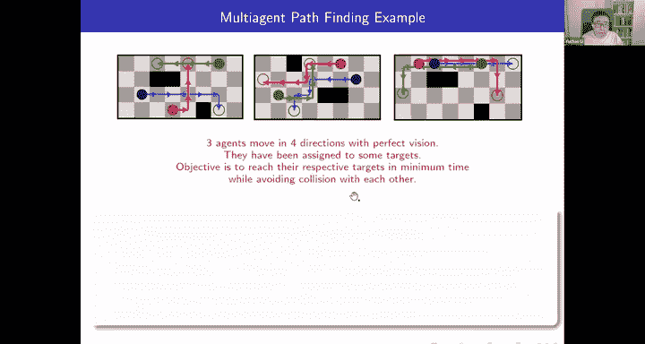
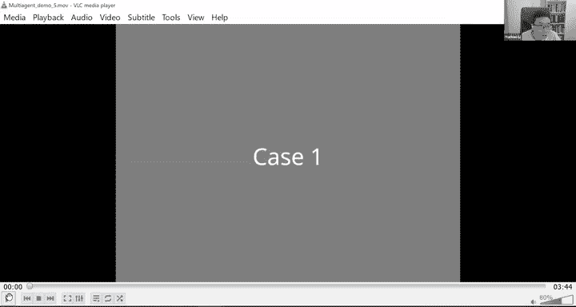
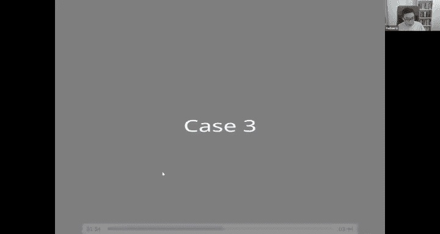
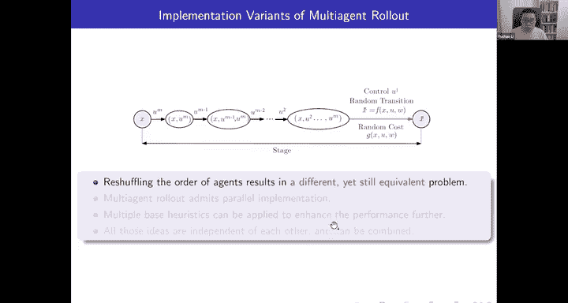
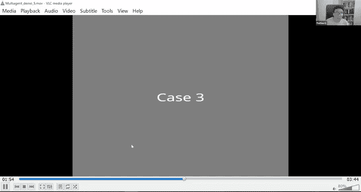
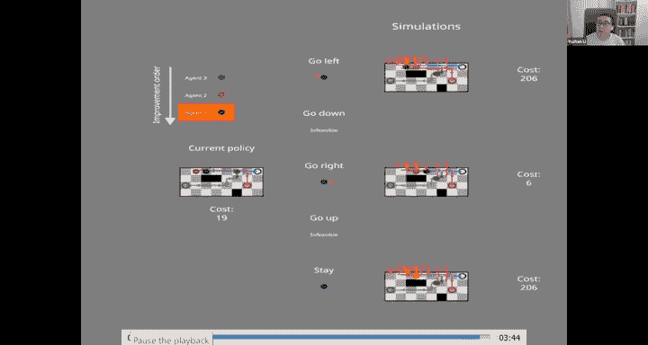
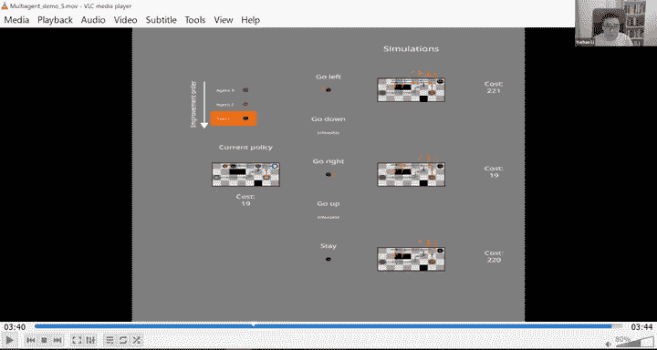
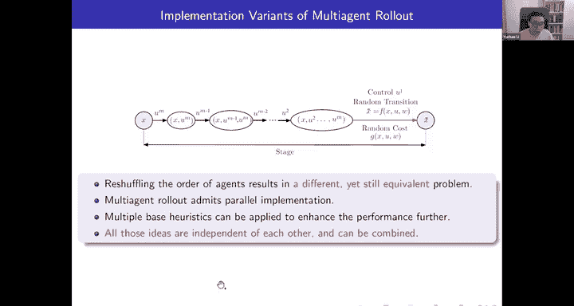
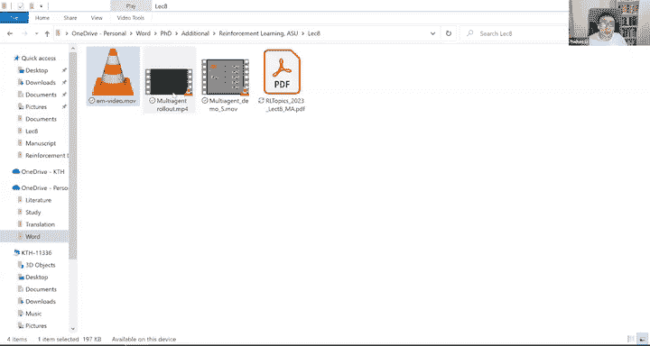
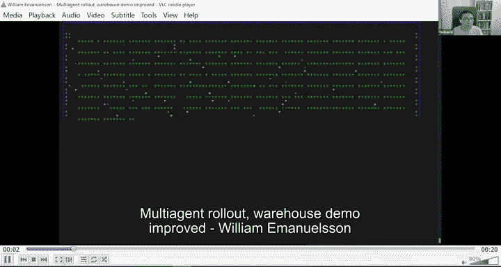

# ASU《强化学习2022-2024｜cse 691 Reinforcement Learning Course at ASU》中英字幕（deepseek - P21：[17]Lecture 8, 2023_ Multiagent rollout, Lecture and video demonstration, - GPT中英字幕课程资源 - BV1zcfVYdErD

Hello， everyone。Welcome to today's lecture and today my name is Chaooli。

 I'm a PhD student work on dynamic programming optimal control and rollout。

 Today we're going to review some fine point of multiageent rollout based on the slides of lecture3。

 In addition， as Professor mentioned， I'm going to show you some demos where my collaborator and I applied multiageent rollout for past finding of multiple robots in a tightly constrained environment。

And hopefully with this demo illustration， you can develop further intuition about the algorithm。

Let's start。So multi agent problem， as mentioned in the course。

 have a long history dating back to the 1960s。The defining feature of this type of problem is that there are multiple agents collecting and sharing information selectively with each other and also with an environment and computing cloud。

Each agent apply or decide its own decision based on the information available locally。

So if we look at this picture， agent one share information with the environment or the computing cloud。

 but it can also have access to the information available in the environment on the other hand it does not share information directly with agent4。

The defining feature is that the situation that evolve over time is not depend on single agent decision。

 but depends on the collection of all the agents decision as a whole。

 so from mathematical point of view we call this the Cartesian product structure。

The major mathematical distinction between the problem structures。

How the information are passed on in between agents。One class。

 which we refer to as the classical information pattern， whereby agents are fully cooperative。

 fluing and never forgetting information。What do we mean by fully cooperative。

 We mean that all the agents。On the same side or in the same team。

 so one agent would after collecting locally some information would share this information with each other in order to benefit for the for the beneficial of the team as a whole so this type of problem can be treateded by dynamic programming as we will show shortly。

On the other hand， the other type which we refer to as nonclassical information pattern。

 is where agents only share information selectively with others。

 and may even be antagonistic this could arise， for example。

 due to privacy concern or even competing relation agent one with agent4。

 it does not have the desire to share all the information available locally。

And this type of problem is hard because it is hard to be treateded by dynamic probe。

So in this review， we would only focus on the classical information pattern case whereby agents have exact state information and choose their control as a function state what do we mean by this。

 we mean that each agent after it compute after it measure locally some information conceptually we can simply think that its local information would upload to some cloud and simultaneously it can download or have access to all the information available in the cloud。

This means each agent， when it's making its own local decision。

 it have access to all the information available in the cloud。

 This is what we mean by choose their control as a function of state so every。

Control component is chosen based on the information available to all the agent。

 So all of them have the same picture of what is going on。From mathematical point of view。

 this problem can be modeled as a discrete time system with state X and control U here the state。

 as I mentioned a moment ago， need not distinguish between each agent because no matter what is measured locally。

 they would share with each other。So the problem may involve schity。

 but the characteristic remained the same。The decision or control have M components whereby U is composed of U1 and UUM corresponding to M agents。

 this is a generic feature of multi agent problem as we mentioned a moment ago。On the other hand。

 for this type of problem the agents here may simply be a metaphor what is important is this mathematical structure what do we mean by this is that for some problem。

 it may happen that there's only one physical entity that decides all the control components。

 but we may simply imagine that every control component is under the demand of some fictitious agent。

We do this for developing better suboptimal scheme， as well show short。For this type of problem。

 the theoretical framework is dynamic programming， as I mentioned that it only involves state X and control U and if we ignore this Cartesian product structure。

This problem is really nothing different from the single agent problem that is covered earlier in the lecture。

On the other hand， later on， we reintroduce a reformulation that would help for faster computation of some optimal control scheme。

 particularly robot。In the previous lecture we have dealt with this exponential size of search and control space based on this reformulation。

 we have also discussed about how to compute agents controls in a distributed fashion such as through signaling and so on。

 and in this process we have also dealt in part with the nonclassical information pattern。

But in the review， we focus on the classical information pattern。Now， let's look at an example。

Wwhich is multiagent passfin example whereby we have three agents。

 each one of them already have a unique target assigned and the goal is to reach their respective targets in minimum time while avoiding collision with each other each agent can move in four different directions it can only also stay still in the current position with perfect vision what do we mean by perfect vision。

We mean that every agent。No not only the layout of the situation。

 it knows the position of other agents。 In addition。

 it also knows the intention of other agents by which we mean that。Agent one。

 know how agent two plan ahead， how it're going to move over time。

And if we look at those two sentences， the objective is to reach the respective targets in minimum time and this。

Tells us the problem is cooperating。So the goal is not really competing against each other to see which one arrive first the goal really is as the team reach the goal as fast as possible while avoiding applying into each other or by the way。

 please feel free to interrupt me if you have any questions。

Now， if we look at this problem and we think， okay， I want to consider。

All three agents move simultaneously and find the best move at the current stage。

 Then we must choose from five to the power M drawing moves the best move。

 So M is the number of agent in our situation in three。On the other hand， through multi agent roadlo。

 we can reduce this。Number of selection to five time M while maintaining good properties here。

 the good property means that the mod roll would maintain the performance improvement property from the generic roll scheme。

As you know， the idea is to break down the control into a sequence of one agent at a time moves。Now。

 this is a good point to go to the video。Let's look at。

The first configuration。We say this one is agent one， this one is agent two， this one is Age three。

 and they all have their designated target position。

The base policy is to simply compute the shortest pass from this current position。

 ignoring the presence of other agents， and in this particular configuration it so happened that base policy is optimal。

 so we shall see in a moment that multi agent rollout recover the base policy because or the multi agent rollout will still be optimal because it should be no worse than the base policy。

So let's first see the simulation of base policy。Now for the multi agentent rollout。

We first focus on the first agent and see what is the feasible position action of the of the agent one at current stage。

 We see that all five moves are feasible。So we try all those five moves and then construct。

Taale portion of the trajectory by the base policy。And then for the other two agents。

 they simply follow what basic heuristic tell them to do。

We play out or roll out what is happening and find out this one is optimal， which is go right。

So we fix the action of the first agent to the one that gave the best move。

 best cost and move on for the second agent or the second agent apparently going down is not an option。

 so there's no point to do this simulationmination。So there are four optionss。Similarly， try out。

Those four different moves， well the tail portion is constructed by the base policy。And now。

 if you look at。Agent one and agent3 for agent one， is current roof have already been locked。

On the selection the choice that is selected in previous round。

 while Age three simply follow the baseline list。No layout。Roofs and find out， okay， those two boats。

Have the minimum cost。 Now， here is the interesting point that was emphasizing。

 We call that in the lecture notes， we write rollout mu t the X belong to or do mean。

 We don't use equal。 We use belong to that is because in some situations It could happen there There are multiple control that achieve the minimum。

Attain the minimum and in this situation is one of them， whereby go right or go up。

 both achieve the minimum。So that's why we use belong to instead of equal。

And here is the flexibility offered by rollL in general。

 and we simply choose use the rule that if one the control coincides with if one。

 the control that achieve the minimum is what base policy tells us to do。

 then we stick to the base policy。So we stick to the base policy and we move on to the third agent。

Again， the third agent have three， four feasible actions。Well for agent。One and two。

 you see they stick to the their current rules stick to what they are chosen for this simulation。

Now we see we recover the current policy that is already up。Now， in this situation。

Apparently it's more crowded and the cost is much larger because there are three collision occurred in total the cost is more than 600 so。

Let's see what will happen with multi agent rollout。

 similarly we first try out all the possible actions for agent one at current time step。

And construct the tail portion by base policy and layout。Ill see what happen。Okay， this one is。Now。

 at this point， after Age one devs from what initially the base policy tell you to do。

 we see the cost have already reduced from 600 16 to 200。16， and that tell us， okay。

 agent one actually involved in two of those patients。So we move on for the second agent。I repeat。

That you was at the same procedure。And的。We get。Still the same cost。 Now we move on to the last agent。

Repeat the procedure。Now we see， in fact， optimal is simply that Age3 stay still。

At its position for one time， for one stage， then it can avoid agent to。 So this is。

After in this situation。

All right， let's go back to the slides。Or this method in fact is scale up quite well。

 it can scale up up to 200 agents that's the size we tried， the largest scale we try。

 of course the environment need to be much larger。And my collaborators implemented in C++。

 the average computation time is about 50 millisecond for。

The decision to be made for all the agents at the current stage。

And can also adapt to a changing environment。By through recompetation， by which I mean。

 we introduce 40 agents that would randomly go broken along the way and become an obstacle ever since and through recomputation。

 all those agents can navigate this kind of time varying environment and still deliver the mission。

For further details， you can look at this paper and the C++ implementations here that are。

Go to一 moment。哦， sorry啦。Now， let's look at some mathematical。Insides呃 the。

What is going on under the hood。 So， in fact， it's the scheme involve trading off between control complexity and state complexity。

In fact， we introduce an equivalent rebulation whereby we unfolding the control action。

Recall from the simulation that we first try the action。

 the control of first agent and find out what is the best move for first agent。

 then recall that in the simulation， I highlight the control action for the first agent so this can be interpreted as this intermediate state and we move on for the first second agent and find out what is the best move for the second agent and so on so forth。

So in the physical world。All the agents apply their control simultaneously。

 supposed to be simultaneously and move on to X bar。

 but we can simply imagine that this is applied in a sequential manner just as when we did in the simulation we try out with action the first one and so on。

So for this reformulated problem。呃。Every stage involves a control selection that is only concerned with one agent。

Therefore， the control space is simplified。But the price we pay is that we need to introduce M minus1 additional layers of states and corresponding to M minus one cost functions all those。

Intermediate state that we introduce have a custom function。However。

 that's not at all problem because through this reformulation。

 we it allows a far more efficient rollout one age and at a time， just as I show a moment ago。

 this is just the standard rollout applied for this reformulated problem。We call that。

For this intermediate state， we try out all the actions available for the first agent and if this is just this fictitious state。

 we try out all the control actions of the second agent and so on。

 this is really nothing different from the standard rollout。

 if we taking the perspective of this reformulated problem。

 this is significant because this means even though we we reduce the computation complexity to a large extent。

 the multiian rollout is still a new test， which means the performance should be substantially improved compare against the base policy。

 which is confirmed in our simulation。So the increase in the size of state space does not。

Adversely affect rollout， only one state and its successors are looked at at each stage during online play。

Note that for the real system， it may involve sing。But for the fictitious part， it's deterministic。

 there's only one trajectory given one sequence of control elements。Therefore。

 there's no substantial computation involved in terms of those fictitious states。

And the computation complexity has been largely reduced。

 the ones that look at branching factories reduced from n to the power M to n times M where n is the number of possible choice for each component。

 know that in the physical world， from x to x bar， if we apply standard rollout。

 we choose one out of n to the power M and we move on to the state。

 well in this reformulated problem。In fact， we imagine that we choose M control。

 each one of them is chosen by standard rollout applied to the fictitious reformulated problem。

 so it involves M control and for each control selection involve n control element。

 therefore n times M。This framework is very powerful and it offers a lot of possibility and flexibility。

One of them shows video first。

It is another。

Situation whereby you see。The base policy is not good to involve conditions。Okay， we repeat the same。

Procedure。And we try out to。呃Y的 time。No first after first agent， nothing really improved。

 we try out the second agent。啊诶。Repeat the procedure。Now something better happened。

 there's only one collision occur。At least some improvement， that's good。

 We move on for the third agent。Unfortunately， this time we still have one condition occur。

So what can we do is one of the many possibilities is reshuffle the order instead of starting from agent one。

 this time we started with agent three。We try different options for Age three。As you can see。

This time， we already find a feasible path for all the agents as they turn out。

 which is quite obvious to our human eyes， is that。8。

 all we need is for agent3 to deviate from the conflict zone and go downwards early。So at this point。

 we can we can already stop find the upload， but let's。finishinish the reading。So just as before。

try out different options and find out this one。嗯。Nothing improved from agent2。And as we will see。

 there's nothing improved from agent one。

So。Yeah。

Now， what have we done？For this time， we start with the last agent and move on to the second last agent and so on so forth。

 in fact， we introduce a different reformulated problem， which is different from the previous one。

 but is still equally equivalent to the original problem。Therefore。

You can the the original order of control components really have。

Have no bearing regarding which one should be optimized first。

 so you can randomly choose the order or you can throw some computation to decide which order is is the best for。

Computing wide time rollout and for each different order。

 it amounts to introducing a different yes still equivalent problem in the lecture notes。

 there are a scheme where through computation this order can be find。

Like can be decided in a systematic manner rather than randomly chosen。

As the demo have already show or hinted that when we do simulation， you see on the right side。

 all the agents， all the different scenario are played out simultaneously。

This means there is really no restriction for all those computation to be carried out sequentially。

 you can do simultaneous simulation， just as standard rollout。 Therefore。

 it admits parallel implementation。 and if you have parallel computing units。

 you should take advantage of that when you apply multi rollout or rollout in general。

 So we also another important thing is we can also apply multiple base heuristics to further enhance the performance in all the simulation I already only use one base policy。

 where the shortest path is computed， but you can use several different base policy and combine them together。

Another important thing is all those ideas are independent of each other and they can be combined to further enhance the performance。

 of course it is at the expense of additional computation。So let's look at some additional video of。

Of larger scale。诶。As I was referring to， this is。This is one of the situation where hundreds of robots are involved。

And as you can see， each robot， this is empty robots。

 and this is robots carrying goods and they deliver goods to both sides。And this is a simulation。

 as I mentioned， written in C++ with base policy computed by a star。诶But。The base policy。

 which is a shortest distance from each grid to all those delivery points。

 can also be computed and pre computed and stored as a lookup table。

The reason is that this is the base policy is thinking that all the other agents are absent from the environment。

Therefore， it is really a static environment whereby you have all those shelves as the destination and for each different shelf you can compute shortest pass from every single grid in the environment and you can store that instead of computing shortest pass online through a star or dynamic program in our implementation。

 this lookup table just take seven megabytes and it's not really。Large。

 so this is this is a large scale I was referring to。And if you look at the actual。

呃。Real time implementation。This is how fast ladies same You。

 can I stop you for a student question one second of course。Yes please。

Hi yeah this is very interesting I had a question in regards to the collisions so you mentioned that to avoid the collisions we can implement different techniques such as reshuffling etc cetera。

 but I'm more interested kind of from a theoretical point of view is there a way to kind of guarantee that a particular situation would not evolvevol a collision or you still have to rely on heuristics in order to determine that？

Well， in our in our implementation we have we have two base policies involved and one is the shortest pass。

 as I illustrated， and the other one which may not be seen in the simulation and so on is that we've frozen some agents for a number of steps and from theoretical point of view。

 if you want to go that far， we can argue that every eight like at the end of the day。

 the worst but the most conservative and safest heuristic is。One agent at a time。

 finishing delivering for the first agent wait until the first agent to deliver。

It's good and then the second agent move on to delivery good and so on so forth， but of course。

 this is also based on the assumption that there is the pass for first agent to to navigate while all the others stay still at at their current location and if we based on that。

Mild assumption that for agent one to reach is target。

 while all the other agents are staying still is visible and then agent 2 and so on。

Yeah I guess there is a theoretical guarantee， but that's not the satisfactory one fortunately in our implementation we tried I think in total more than 1000 tests and it never happened that we need to go that far all we need to do is reshuffle up to twice and there would be a pass fund for all the agents。

Of course， another thing that I may hide or they misled you in the previous small demo is that in the simulation。

 when do multi agent rollout， they would already find feasible paths。

 And in this larger scale is less likely it could still happen that in the。

Future in the in the rollout phase where the base policy is applied for the simulation。

 there would still be condition。Occurd， and。Therefore， in our implementation。

 we treat collision as a cost and we introduce a discount factor so that we would like to push collision as far ahead into the future as possible and hope for your best that at that time when when actually projected collision by the base policy may already being resolved or there would be a way to resolve。

So in a nutshell， I guess there is a theoretical guarantee because we introduce this super conservative based policy。

 but that's not really reallyas surely and if we use strong base policy like simply rely on for this past。

And unfortunately， no。than you。😊，Yeah。So， let's。Check if the speed is normal this time。

 and now we can see this is really the real time computation。

 we record the display and this is how fast it is delivering about 1000 group and in this。Speet。

Real computationmplication time， as I said， on average is about to 50。め下た。

So was that？I'd like to thank you for your attention。

Thanks so much u Chao are there any student or any questions for u Cha at all before we say。

IOn you' if you have a question online， go ahead and just unmute your microphone and z it。

It's really a comment that does not relate directly to eachha top， but it's something that。

I's interesting to be aware of， and we haven't emphasized in our class。

What happens when you have a greedy heuristic and the greedy heuristic has has a tie between two or more actions that are equally。

 equally preferred like a short on the shortest path。Okay。

 remember that it's important that the basic risk is sequentially consistent。So that means that。

That you apply the same action。At any given state， regardless of where you came from on that state。

So if you have multiple actions at that and a tie， equally desirable according to the greedity heuristic。

tThen you shouldn't randomize， you should have a rule that is consistent regardless of when you arrived at the state。

 if you randomize， then you lose the cost improvement property and it can lead to quite bad results。

And I had this happen to me recently and scratched our heads for a long time before we figured out that there was a randomization that should not have been done under these circumstances。

So okay， so when it comes to shortest past， I think it's important to that the Manhattan distance is computed and it's implemented in a consistent way。

O。All right， if there are no other questions， I'll just thank you Co one more time for his time。

 it's very late in Sweden right now。But my pleasure。

 and please feel free to reach out to me for further details of implementation if it relates to your course project and I would be more than not to help。

嗯。哎嗯 by you Joe。