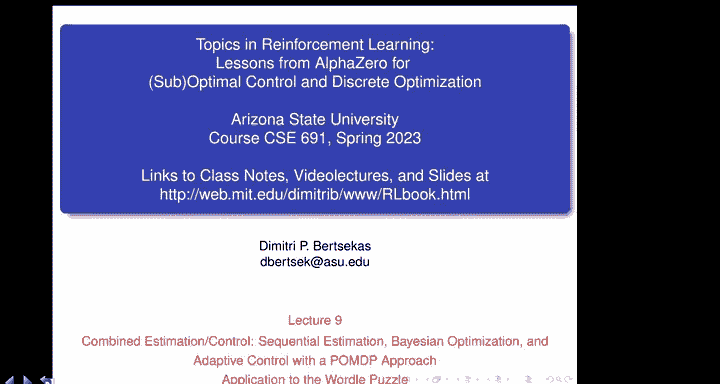
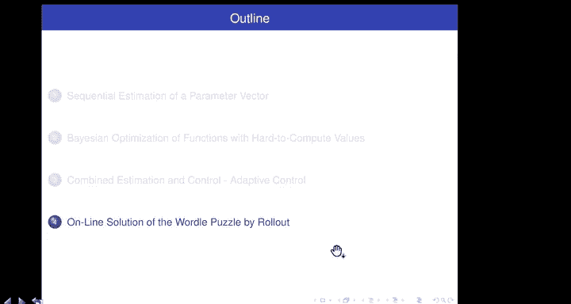
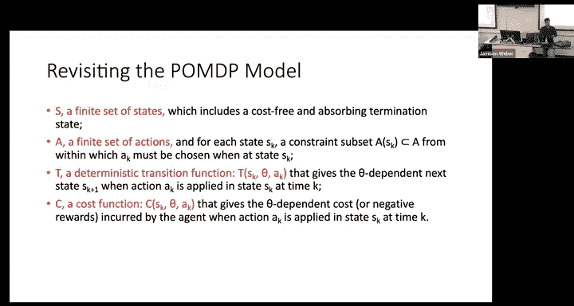
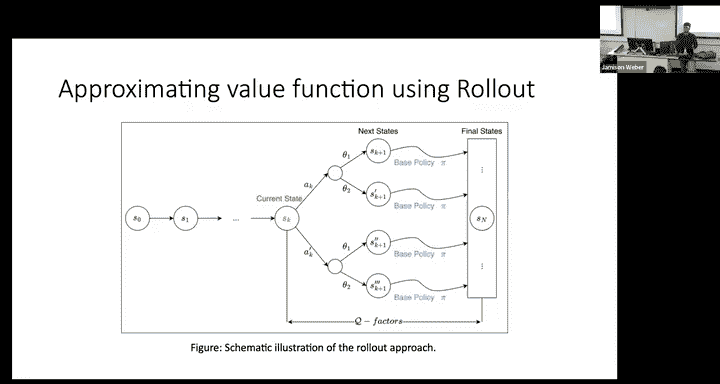
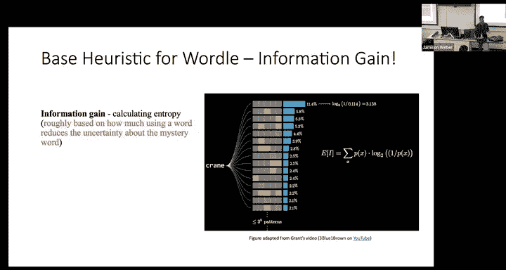
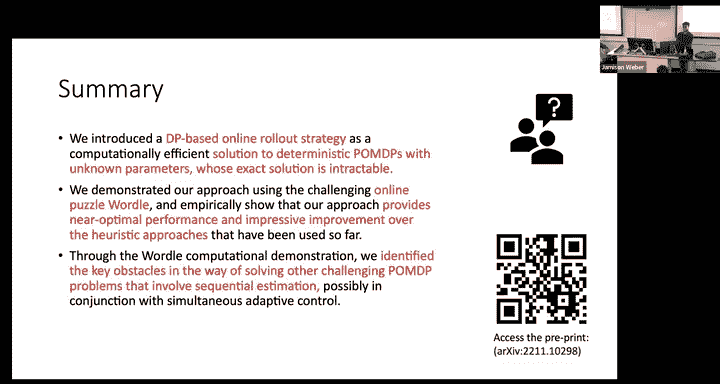

# ASU《强化学习2022-2024｜cse 691 Reinforcement Learning Course at ASU》中英字幕（deepseek - P22：[16]Lecture 9, 2023_ Bayesian optimization and adaptive control - GPT中英字幕课程资源 - BV1zcfVYdErD

Okay， well let me welcome you to this ninth lecture of our course on reinforcement learning at ASU。

Today we're going to talk about a number of topics。

All of which involve some kind of combination of estimation and control。And dynamic programming。

 of course， and approximate dynamic programming。The topics are sequential estimation。

 Bay optimization and adaptive control。They're all related。

 and they all share the feature that they can be addressed with a P DP approach。

We're also going to discuss an application to the World puzzle， two of your colleagues。

 Sidan and Ambrida， they're going to come in at the end to discuss that。

嗯。So here's the outline， we start with the estimation of parameter vector。

 but sequentially with a sequence of measurements and the previous measurements are used to decide on the subsequent measurements。

Then we're going to discuss。Basian optimization， So very。

Very it's a subject of great interest these days。It deals with optimization of functions that do not have an analytical form。

Instead， their values can be computed， but with a lot of difficulty and cost through simulation through experimentation。

 so on。Then we're going to discuss the combination of estimation control as it arises in the context of adaptive control。

 we will see that these two cases here are special cases of the adaptive control formulation。

 easier special cases， special cases。And then。Then we're going to discuss the application of adaptive control for the online solution of the world puzzle。

 and we're going to use rollout for that。So sequential estimation over a parameter vector。

We have a parameter vector。Theta， a multidisional vector theta， which we want to estimate。

And we want to use for these costly observations。And the number and the type of observations are subject to choice。

 there may be several types of observations that we can use with different costs。

 and we want to decide on which ones to use。So we have some kind of a system here that involves an unknown parameter。

 the upper prior distribution of this parameter is known。

 we obtain measurements or observations related to theta and the outcomes are evaluated by a decision maker who wants to decide between two things。

 one is to stop the observations and estimate theta on the basis of the observations that have been accumulated so far。

And the other is to continue the observations， but select also the type of observation in case there are multiple types of observation。

So this goes on for a number of periods， finite number or perhaps an unlimited number。And the。

The number and type of observations are subject to choice。

 and instead we have an evaluation of the observations by the decision maker with a u stopping or modifying the observation process。

So this involves sequential decision making。Thereby bringing dynamic programming to bear。

Let me give a classical example of this， suppose we have two hypotheses and we try to decide upon one of the two and we do this by using observations that are costly and are sequentially obtained。

And now given a new observation， we can either accept one of the hypothesistheses。

 the stopping action， or alternatively obtain a new observation at a certain cost。And。

The classical application of this has been statistics and quality control。

 like we want to decide whether a certain batch of a product is accessible。

 is acceptable or not acceptable and we take samples of the product and test them out to see if they are good quality or not so good quality。

And。And over time， we update the probability， the posterior probability that the patch is defective or it is acceptable。

And this was investigated in the 40s and it was addressed by dynamic programming， mind you。

 dynamic programming before the time of Belmont， okay， dynamic programming goes way back。

And there's a famous test that they came up with based on the dynamic programming formulation ratio。

 the so called sequential probability ratio test。Which says roughly the following。

Once the probability of one of the hypothesistheses being true rises above a certain threshold。

 then you stop the observations there and declare as through the hypothesis of that hypothesis。

Otherwise， you continue the observations， you can keep going until at some point you're almost certain that one of the hypothesistheses is true based on the probability on the posterior probability。

So。That's our classical application。And。There are other applications。Extensions of this。

Quality control type of application， statistical design。Like。

Select one of multiple high rather than just two。嗯。Design of clinical trials。

We can test or test for medical diagnosis， so we make various tests until we're sure that reasonably sure that one of the diagnosis is correct。

 that's the hypothesises that we accept。Then there are sequential search problems like search and rescue。

 we look over here， then we look over here， and then we have to decide what to look next。

 perhaps in places like we haven't looked so far， or perhaps places that are promising。

Search and rescue is the type of typical type of application of this kind。Sensor networks。

There is a network that we can go through and various measurements that we can take within the network and we want to plan a route so that we collect adequate information for our purposes。

 so we go through the network and we look at one side of some target， let's say。

 and if we're not sure at what's happening， we may want to take a different measurement or a more costly measurement to supplement the ones that we had so far。

Sequential decoding problems， and we're going to discuss this in the context of the world puzzle。

And then there is a surrogate and Bay optimization。For minimizing black box functions。

 functions that we don't have an analytical expression。

 but instead we can sample their values at points， at various points。

And we're going to discuss this one first。So these are applications of sequential estimation。

 and let me take the opportunity here to make an important distinction。2。The problem simplifies。If。

The current choice of observation does not affect the availability of future observations or the cost of the quality。

 So if I take a measure， but now that doesn't mean that I'm not going to have the option to take other measurements in the future。

 This is the simple sequential estimation problem。 It's generally easier。

A more complicated one is when。Once I take an observation now。

 that may preclude the options for the future， so this has more of the character of a control problem and can be viewed as a combined estimation control problem within the context of adaptive control。

So we're going to talk about patient optimization first。And。And。Based optimization can be viewed。

As a special case of a broader subject， which is called surrogate optimization。Roughly speaking。

 we have a function can that we don't have an analytical expression for it。

 it's hard to compute it so we construct based on measurements a surrogate function that we optimize instead so the question is how do weconstruct these surrogateates？

So。The problem is one where we want to minimize approximately a function whose values and given points are obtained only through time consuming calculation。

 simulation experimentation and。The starting point is a parametric model involving a parameter theta。

 We consider models of this function， the target function that involve a parameter theta。

We take observations that are related to theta， and then we decide either to continue the observations。

Or to stop the observationss with an estimate of theta and therefore a sorrowro get。

 okay based on this estimate。So we observe sequentially be through cost function at a few observation points。

And then we construct a model of a cost function， the Sarogate function， which by estimating theta。

And we minimize the surrogate instead of the original to obtain a subopmal solution。

So the question is how do we select observation points based on the results of previousview observations。

 in other words， how do we make future observations more productive relative to our our purpose？

And generally speaking， the method of this type， a recurring theme is。X。

Exploration versus exploitation， the trade off between the two。

 which we have seen in the context of Monte Carlo research， if you remember。So what the。

This to express this。To express this， sorry。To express the trade of what it is。

 it is observing on one hand points that where is likely to have near optimism。

Near the optimum points near the optimum。That's the exploitation part of it or observing points that are in a relatively unexplored area of the search space where we want to look into hoping that we may get some。

嗯。We get some good values to the function。Okay， so some example of Sarogate optimization。

Geotatistical interpolation。A classical application of this was。It took place in South Africa。

In the context of gold mining。The names of。Marathon and Kge or engineers in South Africa are associated with this application。

 in fact， you'll see the name Kging in the literature Cing is associated with Kge。

And the idea there was to find。呃。To drill for gold in locations that were reaching gold。

 But how do we know that we have identified a certain area。And we do make a few boholes。

 take samples。Test them and then decide on new samples。

 But the goal the drillinging costs costs is costly。

 Therefore want to we want to do this judiciously。 and they came out with an idea that's very much like Bayesian optimization。

And there have been several applications of this type。Ting for petroleum， things like that。

Another class of applications， design optimization。Where。We use inerodynamics， for example。呃。

We use hardware prototypes very often， first computer prototypes within hardware prototypes that are taking a wind tunnel now these are costly and we have to test several of those to come up with a good design and how you come up with a design is an issue based on the success or failure of area designs that may guide you may guide you new choices。

Similarly， designs of new materials， design of new drugs and so on。

A more recent application last 1015 years has been in tuning of the hyperpar of machine learning models like neural networks。

A neural network， for example， has several parameters， right， the number of stages， the parameter。

 how big its stages is also another parameter of the other parameters。And given a data set。

 we want to design and a neural network that will。That will provide good estimates within used properly this data set。

And therefore and therefore surrogate optimization has been used in this context to tunene the hyperparmeters。

 and that has happened in particular in the deep neural network Palfa zero。Allegedly。

 the Al zero paper talks about that but doesn't give any detail。

 so I'm not quite sure what they have done， but they claim that they have done it and I'm not surprised because this is a common use of surrogate optimization these days。

Okay， so now let's talk about Bayesian optimization， it's a form of surrogate optimization。

And we have a black box function， a function。Which is not known。

 but we can obtain its values at various points， perhaps with some noise。嗯。At some substantial cost。

So。Here we introduce a parameter of vector theta。Which has M components。

The function is defined over m points U equals1 up to m。And we take as our parameter vector。

 the values of the function at these mpoint， theta u。Is equal to F of U。 So theta of one。Stayta one。

Faith at two and so on。So say the the parameter vector is the function itself。 It is the function。

 the collection of values of the function。And。嗯。We wanted to use measurements of the value of the function plus perhaps some noise W。

Sttochastic noise。And the noise could be zero， the measurements could be exact。

 but we're going to consider more generally the case where it's not exact。

Would be exact as a special case。So here you see the picture。Get out of the points。

Where the function is defined， just four points here in general would be a very large number and it could be also a continuum。

 but we're going to consider a case of finite number of points in this lecture。

 the methodology for a continuum of points is similar。And but it's a little bit more complicated。

 And I'm not going to get into it today。So this is the function F of U at the NH domain are these points here。

And what we want to do。Is estimate theta。 E the function itself。With a number of measurements。

 that's much less。3。Then the number than the。Total number of points。In practice。

F may be defined over thousands and millions of points or perhaps an infinite number of points。

But Bayesian optimization typically looks to find a surrogate within 10，20，50 points， okay。

 because these the measurements are expensive the method is designed for surroates with limited。

 very limited data。So now the assumption we have is that we have an prior distribution of theta。

 the values of the function。And this is called the prior distribution， it's B0。

 this is a probability distribution。Of a multidisional probability distribution over RM， right。

 Theda lives in RM M dimensional space。So we have a multidimensional distribution over R M。

 and the initial distribution is such that。That the values at neighboring points are correlated。

 in other words， we expect that points near to each other have correlated values。

 values close to each other， and how you choose the initial distribution is a little bit of an art。

 generally speaking people in Euclidean space， they take。

 they take this distribution to have correlation， diminishing correlation。

For points that are further apart。So now suppose that we have taken。

K observations at the points U1 up to UK of this type。The value of the function plus noise。

 then we choose the next point at which to observe the value of F。

We update the posterior distribution by using some estimator。

 all the statistics here or the prior distribution， the W statistics， probability distribution of W。

 they are known so we can construct an updating formula。

For the posterior distribution that depends by the posterior distribution K plus one。

 is given with posterior distribution like k。The new point where we take the measurement and also the value of the measurement that we get。

And now this Bk is essentially the Sarogate function。

It's just a probability distribution of the values。 It's a probabilistic surrogate function。

 and it is updated with each new measurement。Now there's an important special case here。

 the Gaussian case。Where B0 the prior。And the noises are Gaussian。Now。

 Gaussian distributions have a very nice property when it comes to estimation and regression。嗯。

If you， if everything is Gaussian， the estimates。Probabilistically speaking。

 the posterior is also Gaussian and there are nice formulas for updating there are nice formulas for this Bk estimator here。

And so if B0 and the noise are Gaussian， Bk can be updated by means of a formula like that。

Which has a closed form expression。And it's based on the theory of Gaussan process or regression。

 which is a subject of its own。The thing that I want to impress on you is for the Gaussian case。

This is relatively easy and admits a lot of help from close form expressions。 Otherwise， you have to。

To implement this posterior updating， you may need a simulator。

 you may need particle filtering and it may be more difficult， however。

 since we're not going to get into the formula very much but we're going to look into the principles of the approach that will not bother us。

So this is based on optimization。The parameter vector are just the function itself。

 and we update its distribution using new measurements， and we want to use measurements that are。

That are taken at points where they provide a lot of information。Okay。

 so let me give you an illustration here。What you see here is the true course function， F of u。

U is depicted on the line。 F of u is the true course function， right or black。

The Sarogate after a number of observations， seven observations in particular in this case。

 which are noise free。Is this purple， it is a pro distribution and it's depicted here in terms of its mean and its standard deviation。

 so the mean is over here at this point U and the standard deviation is shown here schematically okay。

So what are the observations here， there's seven observations， one， two， three， four。5，6，7。hand灯。

The observations are noise free， which means， means that。

They give us the exact value of the black function， right？However。

 at other points there is uncertainty and over here there's a lot of uncertainty similarly over here and okay。

 so Bay optimization， we want to take some more measurements， where would you look。Well。

 you might want to look。Around here， where the purple function has low value。

Or you may want to look somewhere there's a lot of potential， perhaps。

For decreasing the value of the function， but' roughly speaking。

 the exploitation exploration tradeor。So we're going to come back to this figure。And。Now。

 let's look at the methodology。That's given that that for Bayesian optimization。

 most of Bayian optimization。It's based on myopic ideas。The question， of course。

 is how to select sequentially the observation， the new observation point。

 given preview the observation results from previously select points。And。

There is a principled way of viewing Bayesian optimization based on dynamic programming。嗯。

I'm going to summarize it here， we introduce a Po DP model， partial state information model。

The posterior distribution， given all the observation of to time K is the belief state。UK。

 the choice of observation point is the control， that's what you select。

The belief estimator is the system and we have the state evolving under the influence of control and also there's some noise。

 the noise is Z is the outcome of an observation at the point UK plus1 and its statistics depend on both BK and also on UK plus one。

Now， the dominant method in practice is not dynamic programming。It is dynamic programming。

 but it's not explicitly stated。It is。A， a greedy policy。啊。which is based on an acquisition function。

 greedy and I also called it myopic because it looks only one step ahead as opposed to the prospects of getting additional measurements in the future。

 it doesn't look into the future。Now， what is this acquisition function？

The acquisition function at time K is a function of the current。Poussterior。

And the observation a new observation point， in some measure of the benefit that you would derive by selecting the point UK plus one for observation when the belief state is UK。

So I am sitting at belief State UBK I'm considering all these various possible measurements and I compute this acquisition function the benefit of choosing a particular control。

 and then I choose a control that minimizes or maximizes in this case by tradition。

 the acquisition h。So the myarchy policy is to select the next point to observe to be the one that maximizes the acquisition function。

Which is defined whatever you and also at the given。Posterior that you have。

Now there is an alternative method， when we have heuristic policy。

 we've learned that we can improve them by using it rollout。

And this is the alternative to use rollout with a myopic based policy so that we look into the future。

 into observations that we may be able to take into the future with advantage。Now this has been done。

 it has been advocating in several research works since 2016， and the results are promising。

 but there has not been enough testing of the idea and its variation so far。

So now we're going to focus on the acquisition function and the base policy， the  greedD policy。Okay。

 I'm going to look at some examples。By the way， are there any questions so far？

Is it clear what we headed？How do you know what a surrogate is like within acceptable boundaries。

 How do you define the boundaries of the surrogate。

It makes sense the boundary that is up and down also like if you have a surrogate and kind of sits and's like an approximation。

 how do you know or how do you define what is an acceptable surrogate。

That's what I'm getting into now， Okay， I mean， I'm getting into， oh， how do you decide what this。

 okay？You decide often by running out of budget， Okay。

 or another way to decide is sort of look at the variance at point at areas of interest。

 the variance of the。Of the the range of the surrogate， and if it's small enough， then you say， okay。

 I've done enough and I'm going to stop。Okay， so。So recall that the myopic policy。呃。

At time K computes the acquisition function for possible you。

And finds the one that maximizes acquisition function。

And a common example of acquisition function is the so called upper confidence bound。Where。

Which is the sum of two terms。A TK term in an aK term。It's weighted with a beta parameter。

 beta is sample cunable parameter。And EK。Or a given you at the posterior Bk is just the mean the expected value of f of U under the posterior distribution。

Okay。And I is the standard deviation。So in this expression。

 this weigh both the mean and the standard deviation， and we can view the Tk。

 the minus the mean as an exploitation index by maximizing this expression。

 we encode our preference towards exploring parts of the space where f takes low value based on。

The poster distribution。RK can be viewed as an exploration index it encodes our desire to search within parts of the space where there's a lot of uncertainty about the range of the surrogate and therefore there's a lot of potential perhaps of getting good。

Good points to search。Now this is one example， there are several acquisition functions in the literature。

Another example is。The expected improvement。Where。Whatever you。

 this is the expected value of the reduction。In cost function that we are going to obtain。

Relative to the minimum value of F that we have obtained so far。

 again under the posterior distribution。So I'm going to demonstrate these two here in an example。And。

啊。This one involves explicitly a trade off between exploitation exploration。Yeah。

 this also involves implicitly a trade open and it's not so apparent， but in fact， these two。

 as I will show you in this example， often give similar results。Okay。

Now I'm going to throw a little curve at you， I'm going to switch from minimization to maximization。

 this is a maximization example， this function here is the inverse of what I showed in an earlier slide。

 now why did I choose maxim because I found this example in Wikipedia and I could not red it to make it minim。

 in fact in the Bayesian optimizational literature。

Most most authors prefer to use maximization rather than minimization。

 I could not find a good example with minimization， so I took the Wikipedia example。

And here what you see。Is the true function F， which is the black function。

And you also see the surrogate， which is the posterior based on six observations for this particular figure。

So we have taken six noise free observations and we have observed a function at these six point， one。

 two， three， four， five， six。And we have obtained through statistical considerations and statistical formula。

 we have obtained the period。has large variances here and the relatively low variances here。

 but also we have the mean plotted here in terms of with this purple curve。And what do we do here。

 What does Bayesian optimization do？It calculates the acquisition function for all。You。

And here's the plot of the expected improvement acquisition function。As a function of you， okay。

So this acquisition function says that it's good to sample in this area。ok。😊。

The value of the acquisition function is large。And。The expected improvement， okay。

 well if you sample over here。There's no improvement based on the acquisition function because we have already obtained the best point to be over here。

And we cannot improve so these areas are excluded and it is in these areas where we can can get a potential improvement and this is the plot of this acquisition function。

And maximizes this point。 So this acquisition function says sample right over here， okay。

There's another acquisition function， the upper confidence bound。

Which weighs both the mean and the variance。And it is plotted here。And it's maximized at this point。

 the two points are not identical， but they're close to each other。

So I think in the Wikipedia example， the sampling is done with this expected improvement acquisition function。

 so the next sample， the seventh observation is right at this point here。

So you see we got the exact value of the function at this seventh point。However。

 the posterior has also changed because of the new measurement， and it is what you see here。

We started with six observations， got to seven observations now we're going to go to the eighth observation。

 are there any questions from this figure？Yes。Yeah。

 so it's it's not very intuitive so maybe you can motivate the the intuition。

 So when I look at the graph like to me， it seems like between the。

Third and fourth point is where there's。Sort of the largest discrepancy between the true function and the estimated function so my question is what is the motivation。

 I guess behind this estimated so estimate between the the next set of points as you mentioned is。

At least visual， it seems that if we sample between the yeah， there's a lot of potential here。

 but not really all that much potential relative to what we have gotten already。ok。Moreover。

 so the exploration potential is good， but the exploitation is bad。So， these points are preferable。

According to both of these criteria。ok。But remember， we。

 we don't know how the function looks like here。 You have no idea that there's a lot of。

All we know is that。There's a range of values of F along these points that we know this range。

 That's all we know。 On the other hand， this。We know the range here and the range is better than here。

 right？So it makes sense to search here。Now。After the potential of measurements in this region is exhausted。

 perhaps we'll come back here after in future measurements， but not for the moment。

Right but there's also the beta parameter is also important that case right because you said that if we switch the beta parameter then everything would change as well its yeah the beta parameter is important and I don't really know what is beta in this calculations of YP the YkiPD example I just couldn't find it there okay。

There's a website that Wikipedia points to with a code okay， so you can play around with a code。

 you can dig into it and but。I really don't know what beta is here。没。嗯。

So my question is regarding the acquisition function。

 would the acquisition function take into account a point between every all the six observations that we had so to check by sampling which point would we get the maximum return like is it dependent on the possible。

Future points that could be some。We have the acquisition function and we have the entire purple graph here。

 we have it。We can sample it， we can obtain its values， the upper bound， the lower bound， in fact。

 the whole probability distribution。Okay， so maybe with calculations that I have described here。

 you can find， you can plot。This acquisition curves here。

So it has no knowledge of any future points that could be observations or only at the current it depends only on the current posterior。

 the current purple curve。Given the purple curve and given a range of points it will give you。

 it will plot out， it will calculate the acquisition function based on expected improvement and based on any other criteria the upper Comp Fund and so on。

So we can calculate these things and maximize the acquisition we may have to use an algorithm to do a maximization of the acquisition function。

But in principle， all of this is available to us to experiment with。Thank you。Okay， so。

So after six observations， we selected this point over here， and we have obtained this posterior。

 Now we're going to play this game again。Here we are after seven observations。

 This is the posteri that we gotten from the previous generation。And what we do now。

 we have seven observations。And what we do now is we calculate the acquisition function。

For expected improvement， the acquisition functioned based on the upper confidence bound。

They are again close。And the expected improvement prefers this point here。so。Okay， I mean。

 it sees the best point that we have gotten so far is right over here。

 it sees a little bit of a gain like 0。02 for this point。

The upper confidence bound sees potential in。Exploration， right？

And there's also exploration potential here， you get a pretty decent values of acquisition function。

 but this point here wins。And I believe in the YPPD example it uses to select the eighth observation based on the expert improvement。

 like this point and samples right here these figures are not quite aligned here so maybe but the eighth point is this。

Is right over here， okay， it's this point here。Now we have wiped out the variation around here and we have a lot of exploration potential over here。

 so let's see what the algorithm will do。Given the eighth observations。We have this。Poerior。

And we calculate again， the。The acquisition functions。And they both point to this area。

hy because there's a lot of potential for exploration， basically。So we select this point here。

 and that's the ninth observation right here。Now， our posterior became。Pretty good。 Okay。

 starts approaching the real function。We have nine observations。Again， we calculate the new。

Acquisition function。And it points to。To this area as a good area to explore。

And we have indeed taken this as a 10th observation。 And after we plot the。

After we have the posterior distribution， it's pretty good and I have not gone to 11 observations。

 but already you can see where we started and where we ended up。喂。

Targeting the right points to search for the value of the function。

So that's the myopic approach towards Bayesian optimization。

 like I said it's the dominant approach as a law embellishs variations or constrained problems for problems with a special structure。

 all sorts of different acquisition functions and so on。Anyre any questions？

So it looks like that the shape of the posterior， like after you sample one more point at the ten of observation。

 like。The purple region of the like previously observed point also change。 I that because like。

The posterior is from like。Like certain distribution family and then like once you serve that big change and it's assuming similar change in other points as well yeah you observe right here but you don't but the posterior does not change us in this region change everywhere okay depending on on the updating of the posterior that you have with Gaussian distributions that will happen yes because it is from Gaussian distribution so it assume right yeah this correlation of everything with everything else it just the degree of correlation changes with a Gaussian distribution but there is correlation okay thank you。

Okay。So allow us take a dynamic programming approach to Bay optimization。

We formulate Bay optimization as a P DP。Where the state is the posterior。

And the control is the sampling point。And the noise is Z， the noise observation that we get。

 and it's a dynamic programming formula cost optimal cost to go at time k is a function of the posterior is the minimum over all possible U or overall possible observations。

Of the cost of the observation， this takes into account the cost of the observation and the expected cost to go。

嗯。Condition， of course， on Bk and UK plus one， when you minimize with respect to UKk plus one。

 you get JK star of Bk， a function of Bk。And。We start from some terminal time。

With a terminal cost function， G's sub Bn， a function of the state at time N。

 the final posterior and this G function measures the quality of the surrogate obtained at the end。

 for example， it may value low means and small variances and things like that。Okay。

 so obviously this dynamic programming algorithm is impossible to carry out in a practical matter and the approximation in value space replaces J star by some J Tilda。

You may view this as a Q factor， an optimal Q factor， it is replaced by an approximate Q factor。

Where J star is replaced by some J Tilda， some， some。unI haven't specified how obtained。

So we minimize this approximate Q factor over all U， and that's the next point that we obtain。Now。

 defining J Tilda is not so easy in optimization， but people have experimented with rollout ideas。

Where J tde k plus 1 is the cost function of a myopic based heuristic based on an acquisition function。

 you simply run forward the acquisition function to obtain a Q factor， an approximate Q factor。

It was proposed in 2016， there have been several papers afterwards。Consistently， all of them。

S provide promising results。Consider improvement over the standard bioopic Bayes optimization approach。

嗯。All of this is now under development and I'm following it。

 I have done any work in this area myself， but I'm following it eagerly because it's an important area of research based on optimization。

Okay， let me give you also a diagram of tranccade that allowed with a myopic based heuristic。

Remember at time K， we have obtained all these observations。 we have computed the posterior Bk。

 We look at all possible next observations。And at all the possible posteriors that this can lead to Okay now this layer here is stochastic。

 so this tree is is quite substantial。And then from the leaves of the tree。

 we do roll out simulation with a base policy， the acquisition， the myopic policy。

 and perhaps trancate after a number of stages， all the studies that I have seen trancate after four or five stages。

 they look four or five measurements ahead。And there's also a lot of tricks that people use because this computation is fairly substantial here。

 they do use limited simulation， they use pruning， okay to prune out some of the possible observations as being obviously perhaps you can use an acquisition function to prune out some possible observations that are really not promising at all。

 they look bad， okay they're in bad regions of the space， we can prune those out。

So that's where the research is at and your class nodes have references in this area if you're interested。

 you may look into it， I think it's a very promising area of research。I questions。Okay。

 so now I'm going to get into combined estimation and control and adaptive control and then Sudan and Abrida are going to talk about the world puzzle。

Maybe we can take a break for like5，10 minutes and then and then we can。

Do these things this two thing， two subtopics together。So we'll get back at。5，35。Okay。

 so we have a look so far at。eststimation problems and the special case。

 sequential estimation problems in the special case of surrogate optimization。

 Beijing optimization now we're going to look at a more difficult class of problems which also involves estimation but also control like adaptive control we have already discussed adaptive control whatever we buy we。

We estimate unknown parameters of a system and then based on the estimates。

 we apply control as if these parameters， the estimates were true。

 That's the indirect adaptive control approach。And we have a。

We have discussed also the possibility of doing adaptive control by rollout now I'm going to discuss now a more principle adaptive control approach that makes no a priority assumptions about the structure of the controller starts from dynamic programming and goes from there。

So。嗯。This approach is based on P DP。 and I'm going to focus on on a rollout type of algorithm。

We start with a deterministic system that involves a unknown parameter vector theta， okay。

 notice that there's no WK。There is a corresponding analysis and algorithmic development for stochastic problems。

 but in this lecture I'm going to focus on deter deterministic problems。

And I'm going to assume also that theta， the unknown parameter vector， takes one out of M values。

In other words， the parameter space is already discretized and there are M values。

 We just don't know what is the value。And we assume that theta has a known initial distribution over the M possibilities here and stays constant。

 doesn't change。In the reality in adaptive control， you have parameters changing。

 but it is hoped that as the parameters change， the algorithm also keeps track and is able to keep up with the changes。

So Theta now， we assume that。The state of the system， X K is observed perfectly。 Okay。

 deterministic with perfect observation。And so this provides us some information about FA。

By observing XK， we're essentially taking measurements of theta。

And so that's where the estimation comes from。So we have the system， we observe the state。

 the controller has accumulates all these sequence of all these observations and decides on a control using some policy that we are trying to find。

Now， how do we formulate this problem as a po DP？We have the state its observed。

 but then theta is not observed。And there's a belief state， however， there's an estimate。

 a posterior estimate of theta， which we can calculate。

So we view theta as part of an augmented state， the state here is the pair xk and theta。

 and this part is imperfectly observed， this part is perfectly observed。

And we plow in with Belman's equation for Po DP。And I'm not going to go into the derivation。

 but this is the form。Remember that for PDP， one possibility is to take a state the entire information vector or information state up to time K。

Which involves all the measurements， the states that we have observed。

 and also all the controls that we have applied。And the algorithm can be written as in terms of optimal。

Cost to go as a function of the information state。And it takes this form and involves minimization over UK of two terms。

 one is the expected value of the cost of the immediate stage。8th stage。Which involves Fa。

But also is weighted with the current posterior of theta。

 So this term here is expected cost of the current state stage。This part。

With the weighted with the posterior is the expected cost。Of the。

Of the cost to go at the next information state， which is IK plus the new state。

 the new control and the new state， which involves data here。Now this beta AI is the belief state。

 the posterior distribution of theta over these M possibilities。

Conditioned on the information that you have so far。So these are M probabilities。

The probability that theta is equal to theta1 or theta 2 or theta M。And we assume that。

This posterior can be generated online somehow by formulas for simulation and it is used here in the dynamic programming algorithm on the other hand this algorithm is very。

 very difficult to execute in practice which is involves of overwhelming computations。And。

And so we consider the possibility of approximation in value space。

For by this J star is replaced by some J Tilda。Now。

The type of J tilde that seems you can use anything as J tilde。

 but the type of J tilde that is useful in this context is one whereby there's dependence on the theta。

And then there's dependence on the next state， so there's no dependence。

 direct dependence on IK and UK。And we use this in place of this。

And we minimize over UK and we obtain a one step look ahead policy。Now。

 there are some examples of Jay Tildas here。One possibility is to select J tillilde I to be。

The cost function of the optimal policy corresponding to theta I。

Suppose we were Playvoyant in somebody and we knew the value of theta。

Then we could design an optimal policy。Based on the known。Perfect state information problem。

Suppose that we were able to obtain this optimal policy and then and its cost function。

 then we could use this in place of that over here。Now。

 this approach has received a lot of attention。呃。In the past， not nowadays， it's forgotten now。

But it was up， it was up。It was researched quite extensively in the late 70s and the early 80s。

 it was my time， not your time， my time， so I know this literature very well。

And very prominent people have worked on this。 It's an interesting approach for the following reason。

Intuitively here， since you're getting a lot of measurements of theta。

 and the problem is deterministic， you expect that you will be able to zero in on the exact value of theta eventually。

 right？So you expect perfect estimation eventually of theta and once you have perfect estimation。

 this approach here will give you an optimal policy， an optimal policy for the pump DP okay。

So this is very seductive， very interesting and look straightforward。

 except for the fact first that you have to calculate an optimal quality for each one of those parameters。

 in some cases this is easy in some cases not so easy。

The second thing is that there are some hidden pitfalls in this approach。

 which all these researchers that I've talked about earlier have zeroed in and did some very interesting theoretical work and they were able to overcome these difficulties。

 but there's a lot of interesting analysis and theory that goes with it in the references are in your class notess and you may want to look into them。

Still， however， there is a problem of finding an optimal policy corresponding to every value of failure。

And that can be overwhelming computation。And rollout gives another approach where instead of the optimal policy。

 J Tilde is the cost function of unknown policy。 Okay， remember what rollout is。

 we have a base policy， we calculate its cost function and we use it as J Tilda So that's what we use here。

 however， we have to calculate cost functions。For every value of say。

The situation simplified if we choose the same policy for all the。

Instead of using a different policy， tailored to the。To theta。

 we use a policy that's the same policy for all values of theta。

 and it turns out that you can a cost improvement property that case。

So this in a nutshell is the approach。And。呃。There are details here that you can find the class notess。

I just want to give you a schematic of how this rollout approach works。You are at the current state。

 okay？And you have calculated the posterior of theta based on all the information that you've gotten so far。

Now you consider all the possible values of control as we do in the rollout。

And then we consider all the possible values of data。

 the M of them in this particular figure there's only two of them， but in general， the M of them。

And then you run the corresponding base policy up to the end。So what we do here。

Is for every branch here， we obtain an average Q factor。This average Q factor。

Involves the weighted sum。贵飞。Poussterior probabilities。Of Q factors computed。

 assuming that we know exactly what Theta is。So for every possible value of theta。

 we calculate this Q factor。Pi I is the base policy。

 so we have to calculate this expression by simulation often。And。So we calculate for every control。

An average Q factor of the control and。We minimize。

and we apply the control that has minimal average Q factor， so instead of using Q factors。

 we use average Q factors average using the posterior distribution。

Looks pretty similar to what we had in the past， and it also turns out that you can show a cost improvement property。

If all the pi Is are equal， the same policy， use the same policy in all of these branches。

 then you can show cost improvement over pi。This requires an argument that's fairly similar to arguments that we have used in the past in the context of non adaptive control。

So in two slides， that's the theory。And now。嗯。I want to go， we want to go into the world puzzle。

 an exciting project from last year， Sudan and Amarita did this turnberry project and then it blossomed and。

With interesting results and both in theory and there a practical application。

嗯。So。嗯。Let me provide you with an overview and then I'll turn to Suzanne and Amreda。啊。

Probably all of you know Worle， just about every person I talk to knows Worle and many of them are dedicated players of world they played every day。

 okay。Millions of people play world every day。Wordly involves a hidden mystery word or a code word。

 if you wish， that consists of five letters。And the the mystery world is drawn from an initial mystery list of like in the New York Time in the New York Times version。

About2 and a half thousand0 mystery words。According to some distribution。In the standard version。

 the New York Times version， the mystery word is chosen according to a uniform distribution。

 but of course it's hidden and the object of the game is to find that mystery word by making guesses。

Now， as you make more and more guesses of words from another list， and guess list。

The mystery list shrinks okay， because we use this information in the candidates for mystery word。

 the number of candies diminishes and eventually when the mystery word list list shrinks down to a single element。

 you have solved the puzzle， you have guessed the mystery word。And of course。

 the guests are chosen based on feedback about the misery were provided by the preceding yeses is a coloring scheme for which Dan and Aid I' are going to talk about。

And what we want to do here is a problem formulation。

 an optimization problem formulation is to minimize the expected number of guesses to solve the puzzle expected number over。

B。Probability distribution， the uniform probability distribution of the necessary list。Now。

 the uniform distribution turns out to be very critical here。

The belief distribution of a current mystery list remains uniform through the solution process other this Bks as they propagate over time。

 they remain uniform distributions。And the。This has been exploited by people who have solved this puzzle exactly。

 provided the optimal policy for the New York Times version。

This gigantic dynamic programming computation that took days and days with parallel hardware and so on was done by Selby and a British mathematician in 2022。

Now without this uniform initial belief distribution assumption。

Then the exact solution would be absolutely impossible。

 even with small variations of the problem structure。

 like increasing the mystery list or increasing the number of letters of each word。

You would not be able to solve it in your lifetime by dynamic programming。On the other hand。

 a rollout can solve near optimally with very close to optimal。

Both the current version of the puzzle and also its variations online much faster。

In the order of seconds， maybe minutes where you're talking about about about。

There are live small amounts of time。呃。So that's all I want to say。诶。

Now I'm going to pass the microphone to American Suan for a more detailed description。嗯O。So Dr。

 Btses introduced gave a pretty brief overview of what the project has been about and I'm trying to present。

 I'll go over a few basics the preliminaries again and please feel free to ask questions anytime。

So we'll briefly revisit the palmm toP model， we start with a finite set of states and we assume there is a known termination state which is cost free。

Then we have finite set of actions that will take us from one state to the other。

There is a constrain subset that is dependent on the current state at step K which essentially means that there are certain actions that we are assuming or which are feasible at that stage。

 of course you could say that all the actions are possible at every stage but just to constrain the subset of actions that we can take or take only the valid actions which are possible we just take this subset of the entire set of states。

There is a transition deterministic transition function because we are specifically dealing with deterministic Ops here。

 which is the dependent on the parameter theta。And with respect to Verdle。

 I will come when I'm explaining verdle， I'll also say what these individual components imply in the context of verdle and what essentially theta means in that context as well。

And there is a cost function involved。Which is also again dependent on the current state。

 the action taken or the control in other sense， and the parameter theta。

So just in case those of you who don't know what the world game is。

 there is a small representation of me playing the game in a brute force way to make up this diagram。

We have six guesses allowed we start with any random five letter word that we of course the word needs to be a valid five letter English word and the objective is to get to the the mystery word which has to by the end of the six guesses。

So there are two modes of the game， one is an easy mode and one is the hard mode。

The simple distinction here is。In the easy mode you are complete you have the complete flexibility to play any five letter word at any stage of the game as long as you want to minimize the number of possibilities and reach the final mystery word in the hard mode in this example you can see that once we get an observation for example I got the observation of the letter E in the first step。

I have to necessarily use the words that need to be ending within me。

 which essentially constraints a lot of like my subset of the actions that I can take at the next step。

So that's pretty much the only difference and yellow observation just stands for。

An alphabet that is correctly used but at an incorrect position of the game。

So that's pretty much the game and。The states here the 2315 words which is the subset of the bigger list and the final mystery word for example inert in this example would be one of these 2315 words and the number of actions are essentially all the words that are possible in the game and the simulator will accept those games。

Are those words。Then the transitions essentially in this context mean going from one mystery word list to the next。

 so for example， as soon as I played audio I got the observation as I as a correct letter but are incorrect position。

my actions significantly reduced to those number of words which have an I anywhere at one of the five positions。

If I played the words done it will reduce to the words that have TNN at some position and maybe this is the only word well these are two are the only words but just as an example TNN anywhere and ENR at these positions so that essentially helps me reduce the action space based on the transitions and the observations that I'm getting from the game。

And finally， the cost， so the cost here in this game is pretty easy as to how we are grounding it for our solution。

When we utilize the guess word， we just take a cost of one and final state here where we found the mystery word would be costty。

And observations are essentially the colored observations that we are getting， so an important。

Criiteteria to think about here was before even we thought of why to use roll out here we have access to the simulator that's a huge advantage that we get out of this word problem at least that we have access to the simulator we can simulate what the observations will be hypothetically。

If we played a certain word as a guessword。So， as Professor Bezes mentioned。

 there are optimal solutions and this is a figure from one of the papers that one of the articles that presented。

The the optimal dyna， the problem here being you need to have the optimal value function the value function essentially will tell you this is your current word for example I was in the previous example I was at maybe audio what what is the value function if for taking the action stone with the current state audio is it the optimal choice to make or not？

And for that imagine the number of words you would have to search through and also considering where the where that choice would eventually lead you to so all those considerations need to be and the state space is enormous as soon as again reiterating over the initial points made the number of mystery words increase the number of letters maybe start with a six letter words this game would not even finish within months。

So those sort of problems are。Natural limitations of the optimal solution using dynamic programming。

So we try to approximate that value function the function that you saw in the earlier slides that was that we were trying to calculate j star essentially that was the optimal function Now we are trying to approximate that by some J tder now rollout is the。

Solution algorithm that is helping us to compute that J tilda for any of the sets of actions and the theta parameters that we can take。

So， a slight deviation from the previous figure that Dr Ber showed in this case we have the same base policy so as you mentioned we would the results also show this that。

If the base policy is same， we would have a cost improvement over the base policy when the rollout is also used and I'll come to that once we look at the results towards the end of the slides。

Does anybody have any questions so far？

ok k 啊毛佢。So what could be a base policy for Vdle this is a snapshot taken from the famous YouTube channel 3 blue1 bros video was one of the first videos that actually became popular for playing the game Vordle。

And the concept here I use the snapshot just to explain the concept here is to use information gain theory what we are trying to do is calculate the entropy of a distribution and that essentially is what we compute in what we calculate in entropy with the in bits essentially tells us how much is the search space reduced so given a guessword if I am using for example the word green and for example these are the different observations so you could have three possibilities at every any of the five alphabets gray yellow or green and which is why about three to the five observation patterns are total possible。

Given crane any of these three to the core five possibilities would lead to a certain final mystery word and I know how many mystery words would fall into that maybe there are only 2。

1% of the 2315 words that follow this pattern after crane is split so that's exactly what information gain is telling me that what happens if I take this guessword and based on the observations。

So naturally the idea in the intuition would be that I play the word that reduces my search space the most and there could be many ways that you can actually try to minimize the search space with the information gain is just one of the methods that has been very useful in practice。

So I'll go over the algorithm and this is like at least the algorithm is presented in a very generalizable way for a deterministic po TP。

😊，So， what we have right now is we have the current state。

 we have this set of unknown parameters theta sorry I missed it theta essentially for us is the mystery word。

Because we don't know at any stage what theta could be。嗯。

We have the current believe distribution so at any time whatever the possible set of mystery words are we have a uniform distribution over them so that is a very simplifying assumption over the game which is what is true in the game as well but to make it harder you could definitely have nonunform distribution over the possible answers。

There is the action space， the transition function， cost function， and the base policy cost function。

 which we are essentially going to use the information gain for。

So we start with an empty average Q list which we are going to store all the Q factor by average Q factor values for any possible action that we can take。

And for the rollout part for each individual theta that is possible。

 which means that each individual mystery word that is possible。😊。

Im going to iterate over we calculate the Q factor so the Q factor for that Q factor dependent on the theta as well as the action the next step action would be dependent on the cost which is just like if I'm playing this word that would be like cost of one and what could be the total cost till the game is terminated so that is the value that j will give me eventually and then I just append it to my list ofq factors for this particular theta。

I find the average Q factor， the average Q factor here now since this is in generalizable I note as。

The product of the uniform the posterior distribution with the Q factors in this case it would just be a mean over like one over the number of my words that are possible over the Q factors。

Some of your factors。And then eventually we choose the one that is minimizing these Q factors and apply to get apply it to the transition function to get the next。

So that is how at least the rollout with using the base policy function can be utilized。

To many numbers but to get the gist out of this I have a few opening words that were deemed by different people who tried solving the game based on different algorithms different base policies I would say one was information gain the other could be character frequencies you try to see and match the character frequencies and so that the search space is reduced so that could be one of the ways so these are1 yeah I guess9 or 10 words and I use the maximum information gain as the base district these are the optimal scores that we already have access to from the optimal function the good idea here is that we can see how much the deviation from the optimal score is if we just use the base policy and if we use the base policy with the rollout improvement on it。

The percentages essentially help us to understand how far the optimal scores are for how far the rollout scores are from the optimal score as well as if we just use the base policy so it's very straightforward to say that the improvement is very significant。

Another interesting point is we actually experimented with two more heuristics。

 one was called the MRD which was the most rapid decrease base policy and other one was greatest expected probability so I'll give a gist of what they are to before I go further explaining this figure。

The maximum most rapid decrease algorithm essentially saying that if you are playing a word you would lead to a certain set of possible words that could be the answer now。

Based on those three to the by5 observations each of the observation could lead me to a different number different set of those possible words that could be the final answer Ill just choose the word that leads me to the smaller set so that' is one way of reducing your cell space。

The greatest expected probability is。😊，Ill try to find the probability just an estimate approximated probability rather of what of each word being the final answer so again that is also an approximate heuristic to get to the mystery word。

Now， what we tried was we experimented just to have some empirical results on this on what we were trying to hunch on using the rollout。

The improvement。 So the the。Y axis shows the average number of guesses。

 which is average number of guesses to solve the 2315 words where x axis shows the number of the star。

And all the all the line plots with the crosses are essentially the line plots for the base heuristics and the ones with the dots are the ones with the rollout so the cross line the line plot with the crosses for yellow which was the GPistic does not exist because all the scores here that I have been shown here are above5 are in the domain of5 and5 plus average number of guesses。

The interesting part the takeaway from everything that I've been ranting effort so far。

No matter how the heuristics are performing individually。

 there was GPuristic which performed extremely bad as compared to the other two we had the maximum information gain heuristic。

 we had the MRD heuristic。The rollout improvement。Gets the line plots for rollout improvement are much lower than their corresponding base heuristics and pretty much closer to the minimum that was possible。

 if I'm saying that maximum information gain was pretty much the best heuristic that I could have used。

 So even if the plot for G was too bad。 the rollout plot for that is pretty much still closer。

 So that cost improvement is what I'm trying to show here。And the best case was for the word salad。

 which essentially the optimal score was 3。508 foot and the closest that we could get in the range of 。

4% of that score was using the maximum information gain district。

So the cost improvement property becomes very evident using this plot。

But there are certain limitations to take care of when we are trying to look at what the rollout can do and cannot。

There is an important need for a reasonable base policy now in our case the idea was not to say which baseistic was better but it was to see given any any reasonable baseistic what could rollout change about it how what was the improvement that rollout could bring about it so at least it was relatively insensitive to the base policy but there could certainly be cases where it does not show a very significant improvement。

Then there is a need for a posterior distribution estimator。

 the game simplified it for us in this case because the distribution was uniform。

 but you would definitely need something like a particle filter algorithm so that you can know what the posterior distribution would look like if you don't have any intuition about it。

And the number of Q factors now， number of Q factors could。

Enormously that you need to compute could enormously increase if the number of states increased or the action space increased。

 but there are certain techniques， for example pruning techniques that you could reduce。

 for example you would not use all the actions to compute the Q factors for you can just take maybe the top 10 or top 100 performing action words。

And say that maybe the best next action could belong to one of those。

Offline training using a neural network pretty much closer to what Al0 had because essentially you have a network that is trained upon given any state and a corresponding action you can see what an approximate Q factor would look like for it so if you do not have access to for example I could directly compute the information gain for any action or any guessword given given the current state but if I could not for example the base policy was difficult I could have trained the network I I mean just to overcomplicate things I could train a network just to learn the information gain heuristic as what that could be overcompplication of things but that is one possible way if you would want to compute the Q factors in that way。

So in summary， we talked about dynamic programming based online land rollout strategy and the solution is applicable to deter palm DP which have this unknown parameter and the most important reason for having this approach is exact solution may be intractable in a lot of cases。

We demonstrated this approach empirically using the popular virtual puzzle and at least I believe that working around games and showing some algorithmic improvements using games seems to be pretty interesting and to easily understand and to discuss with other people as well。

And it definitely provided near optimal performance and impressive improvement over the heuristic approaches。

And the key limitations that we were able to identify that I discussed earlier were also through this set of experiments that we carried out so thats all I'll be happy to take any questions and there is a very detailed archive preprint that we have so if you want to check out with a lot of theory that is associated with this as well along with the experiments so please feel free to check that out thank you。

Thank you for the presentation my question is like I have a question like that is kind of related to what we are like what is taught in today's lecture to is that like exploration versus exploitation thing that I remember that people according to statistic there is like an optimal opening work that you can like。

Like for me， that information gain thing looks more like an optimal exploration because you are looking for more information like from the guests。

 but is it possible to switch in between like different policy like say like you' are at the third step you would want to give it a shot or something。

Like when， for example， you think you have enough information for a shot or something like that。

 just like the baseline currently looks like you are just trying to explore to the end until you like narrow it down to a very high level that the P of x is very high。

 right？So if I'm understanding the question correctly。

 are you saying we can switch the base policy in the middle？Yeah， like cause for me。

 the information gain is， is a， it's quite。L towards exploration， I would say。

 but like at certain step， after a certain step， you would want exploitation because like if you don't get。

 if you don't give a shot， like you can guess the word right。So okay。

 here's the thing based on my understanding on the information gain heuristic it would eventually lead you I mean exploration and exploitation are would be very overloaded terms in this context because let me try to explain that。

In the beginning you would have too many words to explain with I agree it' is very intuitive having an heuristic like information gain which would reduce your search space。

 but towards the end even information gain would lead you to a single answer at the end so when do you even say that the exploitation began。

I mean I don't really see the distinction of using those two terms in this when you are actually rolling out the policy。

 oh yeah， because the posterior is uniform that like you don't have like certain worth having higher frequency than others right right I see thank you。

在。嗯。And an exploitation gear， the base heuristic would try to select guesswords that are most probable okay。

 so you have great great probability to hitting。The mystery word in one shot。On the other hand。

 like you said， the posterior distribution is uniform over a current list of eligibleer wordss。

 so this is not possible。On the other hand， in general， in these problems of of。ODP adaptive control。

 there is a possibility for exploitation type of policies or in using exploration type of policies in a handy and idea in this in this respect is if you have a policy that's strong an exploration。

In another policy strong on exploitation， you can put them together and run them both and then take the best of the two。

 right， we talked about parallel land where you have multiple heuristics。

So it's a possibility to do that。Any other questions guys？

Okay， let's thanks， said An one more time。Thank you， Su。

And I'd like to close this lecture of a couple of announcements。There will be no lecture next week。

In fact， we have reached we have come close to the end of the lecturing portion of this course。

 and I want you to focus on your term papers in the last month in the following month and a half。

 I'm going to give a couple of lectures after next week， one or two lectures on neural networks。Now。

 remember that your class notes have three chapters。 One chapter was sort of。

A foundational overview of the field。Then a second chapter was focused on the rollout and its values。

Forms， deterministic， stochastic， minims， and so on。

 and the third chapter has to do with approximation。Of course functions and policies。

By using training and neural networks。That's also a very important part of the reinforcement。

 the learning methodology。And in fact， we have touched upon it in passing at values。

Pooy scene the course， so I won't spend one or two lectures。On training neural networks。

 training approximation architectures， and also how you use these trained architectures in the context of online play。

嗯。And。So that's what it remains in the way of lecturing。And then。

Turning to turn papers I've received over a weekend a deluge of proposals， very interesting， okay。

 a very interesting collection proposal from many of you。

And I look forward to reading some more about them and also look forward to working with you and if you have some questions。

 either in response to my communication to you or in the response or just just your own get in touch with me and hopefully some of these ideas can be developed and into something nice。

Okay， so we'll see you in two weeks。