# ASU《强化学习2022-2024｜cse 691 Reinforcement Learning Course at ASU》中英字幕（deepseek - P23：[15]Lecture 10, 2023_ On-line training ideas, neural networks - GPT中英字幕课程资源 - BV1zcfVYdErD

Okay， let me welcome you to this lecture 10 of our course on reinforcement learning at ASU。Today。

 we will transition。From online play ideas that we have been covering so far to offline training algorithms。

Including the use of neural networks and other paramedicical textures。

do a couple of lectures on offline training。

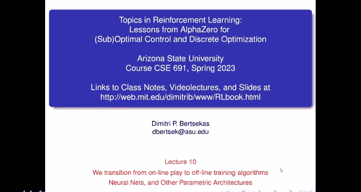

And here's the outline。We're going to do a little review of what we have done so far and where we're going and what we're going to not cover without。

Then we're going to go into offline training and the use of parametricic approximation architectures。

We will discuss trending algorithms。Or these architectures find the parameters of these architectures。

And then we're going to discuss the more general issue of。

These algorithms as a special case or a broader class of algorithms that is with optimization of sum。

 large sums of differentiable functions。

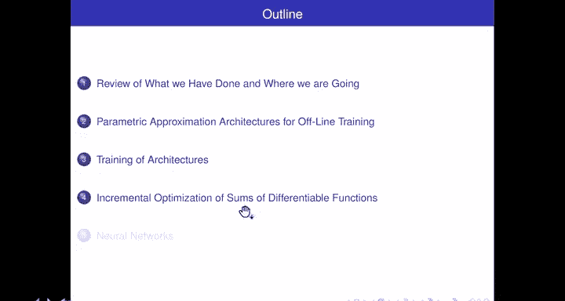

Then we're going to say a few things about neural networks and how these algorithms apply to their context。

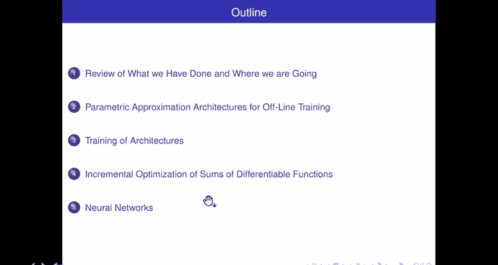

So let's go to a review。Okay， so this is a familiar figure at our starting point。

The Al Ze architecture and also the MC architecture they're very similar。

And they involve a fundamental division between online play and offline training。

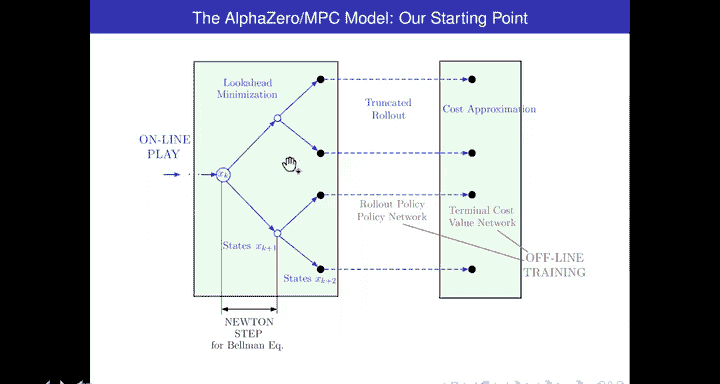

And the online play algorithm is what you see here in blue， and it involves at the current state。

 multistep look ahead and generation of a search tree。

And then， we run。A policy。For a number of steps。And then at the end。

 we approximate the effect of additional steps using eternal cost function approximation。

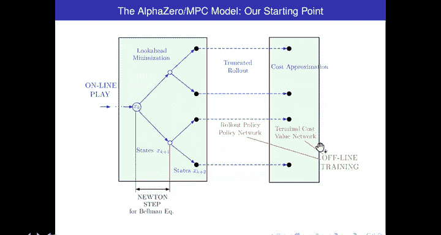

Now， what you see here in very square offline training comes into play。

Offline training is used to provide the terminal cost approximation and also the policy by which you do rollouts and this is done before you start the decision making process it's all the preliminary phase separate from the online play。

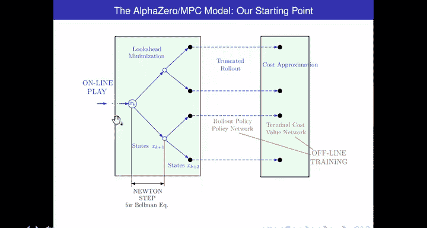

And the algorithms that we use for online and offline training can also be designed separately。

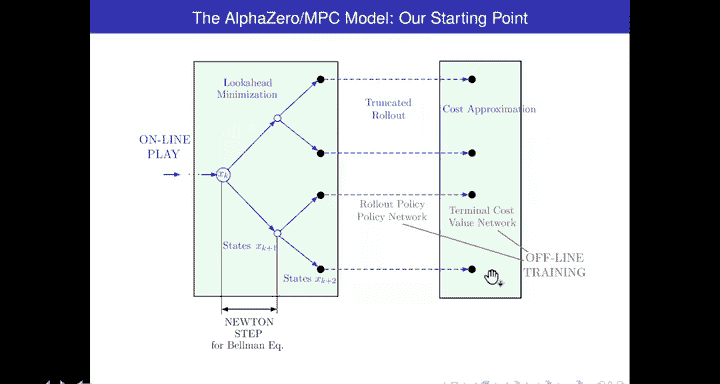

And and in almost independently。And the two interact together through a fundamental relation that has to do with Newton's method。

Newton's method is this first step of the look ahead minimization。

And these other steps here represent enhancement of the cost approximation to some forms of value duration。

 so to bring to provide a better starting point for the new step the first step is an exact minimization and does all the work。

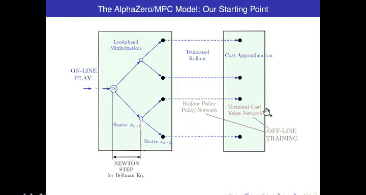

The remainder is important。But it's not as important as a very first step。And bear in mind， also。

 that。In this figure， you may not have multi step look ahead， perhaps only one step look ahead。

 you may not have a middle portion， different designs involve different uses of these ideas。

 what I have here is the more general， the most general figure。And。To me。

 this is fundamental for reinforcement learning。It is possible to get good policies to reinforcement learning without online play。

 for example， you can get。A base policy through some kind of approximation policy space a kind of a policy effort and use it directly without going through this all this step of academicization。

But there is a loss in performance is' a cost improvement property that we have discussed between the base policy and the online clay box。

 This is much better some cases it is tremendously better like in Al zero in other cases。

The improvement is not so substantial， so you may get better。

 you may get good performance out of the date policy。However。The best。Let will this keep here。

We have covered the online play。The online play algorithm design。

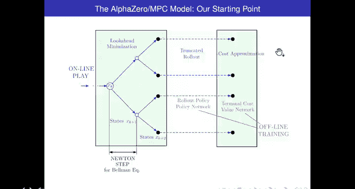

And。What we have done is we started with formal lectures with an over a big picture type of lectures that covered in chapter one of your notes。

The division between offline training and online play。When Newton step comes in。What it does for us。

We discussed exact dynamic program。Or the deterministic problems and pro stochastic problems。

Were finding horizoniz of problems and infiniteiz of problems。

We did this in not very much theoretical detail。Just to get you started and to set the stage for what comes were supposed to come later。

谢谢。And in this introductory lectures。We place an emphasis on rollout and approximately value ratess。

 we viewed rollout as part of policy duration， the very first step of policy duration。

We discussed the problem formulations and transformations。How do you formulate problems。

 the basic idea is that you need to start from a sequence of decisions that set the stage for a dynamic system and a sequential choices of controls。

Then if the problem does not quite fit the standard form that we have been using。

 you may change it by introducing state recommendationss。

May change brain use in the termination state or its some stochastic or spa problems。嗯。

Multiageaging problems add a transformation that's very interesting for our purposes。呃。

And rain involve。Multi componentent controls and these cause computational difficulties we coordinate the problem so that this difficult does not arise nearly as much extent。

We discussed the。Transforms or partial state information problems。

 perfect state information problems。By using the idea of a belief state sufficient statistic。

We talked about traffic control and motor predictive control， not in great detail。

 and unfortunately throughout the course， we're not going to cover this material very much。However。

 next year I plan to to focus the course on adaptive and more predict control subject is too large。

 so cant cover everything you must。Okay， so I'll turn this over your lectures。

We went in some detail on online playout in chapter two of your class。

We started out to roll out outs for deterministic and stochastic programs and values variations。

45 roll out，75 year old out， contrain roll out。Model three are all out for deterministic problems for sarcastic problems with upon variance reduction ideas that have to do with efficiency in the sampling。

Then we focused on multi step look ahead， we did a lecture。

 multi step look ahead for deteristic problems， ideas of pruning。Double rollout， rollout， so。

Then we look at multi step look ahead for stochastic problems。

The idea of certainty equal approximation， approximate the random barriers。Of all stages。

 except the first one。With a deterministic equivalent。That speeds up the computations tremendously。

And a relatively small loss of performance， if any。We talked about Monte Carlo research。

 a formal adapt simulation that aims to to make the。The computation of the various expected values。

 various parts of the online play algorithm more efficient。

We reviewed in two lecture ago multi Asian problems that there was a demo。

 there are some variations that we haven't covered in great detail。

 particularly the idea of autonomous。Agens that communicate with each other indirecting through signaling。

And and coordinate their actions， all of this is in your notes。

 but we didn't cover in as much detail as I would have liked。In the last lecture。

 we talked about patient optimizations， question estimation， adaptive control。A form DP framework。

 a more principal framework for adaptive control term。

 and also we talked about the use of rollout in that context that we did this is case value using vertical。

So that's what we have done so far。And here's where we're going。We're going to two more lectures。

Today and next week。And they're going to be based on the material of chapter three of your class notes。

And we will cover approximation of values and policies using values and cost function approximation and policy approximation using neural networks and other architectures。

The training of this approximation architecture is using incremental gradient methods。

 this is what we're going to do today。Next week， we're going to discuss。

Approximate bandwidth when told to see duration buttons。With approximation architectures。

For policy duration， you have to use approximation architecture with rather。

 you don't need to use neural networks or approximation architectures。

 but only you will try to do policy duration。Its。You cannot。

 cannot get away from using neural networks or something similar。

Then we're going to talk about an alternativeernity of observation architecture based on application。

 we're going to do these two things in our last lecture that next week。Okay。

 there's a lot that has been left out。And if you go back and you look at my video lecture from the course offerings of 2019 to 2021。

 also the personal learninging book of 2019 and also my two volume dynamic programming book。

There are several additional topics。There's a lot more of the theory between Verizon programs。

 The theory of eating Verizon programs is fairly integrated。 It's not like。

Finance Verizon dynamic programming mathematical species is almost trivial。

 it's very intuitive and very simple and you go to infinite verizon problems with this mathematical theory that's substantial。

Partly if you get away from。Discounted finite state problems。

 which is the bulk of the working reinforcement learning from the artificial intelligence community is on finite state discounted problems these problems are relatively easy。

 but once you step away from those substantial mathematical difficulties arise which we have not covered in this course there's a very good outline here and a very extensive treatment in here。

And also， in the early。What'ch video lecture。There aren't some。Training methods。

For stochastic problems that related to stochastic， either the algorithms and theyre used。

In approximation in value space。It's a famous method called T Lada and other temporal difference methods so a lot of literature of those who were very important in the only part of the subject now I'm not so sure that they are as important。

 but they were very important in the 90s。And they were also。

 they attracted a lot of mathematicians was theyre very challenging。

The how you involve challenging analysis， algorithmic analysis， which sort of。

Got mathematicians interested in that。Que learning iss also interesting mathematical analysis of Q learning。

The first one actually is my call or chance of cyclist。And all of this。呃。All of this。

We did not cover some of that in this book more in here and also in the references given there。嗯。

Finally， there's a fairly popular topic in quite a few groups in artificial intelligence。

D of reinforcement learning。Involving approximation policy space and policy gradient。

Policy gradient methods and also random search methods are used to ta policies。In our context。

 they could be used to provide a base policy for robot or for approximation value space。

 but they also could be used by themselves as standalone policies。

They are not as good as the ones that we get the multistep look ahead because there's no cost improvement on the other hand。

 it may be good enough to be used in a particular context and the nice thing about approximation policy space outside of approximation in space is that once you have a policy that has been trained。

Finding generating controls online is almost instantaneous。

You don't need to do this multi segment ahead manipulation roll out all this business。

 which can't be quite time consumed。However， there's a loss in performance in doing that。

 a convenience in the online computation， but a loss of online performance。Okay。

We're not going to do this stuff， there's plenty of literature。

 some my own and certainly a lot of literature in out there and all of these are topics that many people in the field are working on actively and they're important topics。

 however we cannot cover everything， so we have to draw the line on。Okay， are there any questions？

Okay， so now let me。And call a figure that we have used in the past。

What approximation in space with one step look ahead。At the given state Xk。

 this is for finite what a similar figures for infant ver and a given state Xk。

We find a control by minimization， the expected cost of the first step and the expected approximate was for the future。

 as encoded by a cost function approximation， J tilda K plus1 instead of j star k plus1。And remember。

 there are three approximations here， the three approximations。It is an approximation of the。

Opttiimum course the go function。Is an approximation of this expected calculation that can be substantial。

And there's an approximation of this minimization， which can also be quite time consuming。

And there are a number of methods that we have discussed。

Were computing Jay Tilder problem mentioned roll out predictive patrol。

 today we're going to talk about this pink stuff here。And in the next lecture。

 we're going to talk about aggregation among others。On approximating the expected value。

 we have discussed the use of certainty equivalentvalence， adaptive simulation， Monte Carlo research。

And a special case of appropriate minimization， which， however。

 has solid guarantees is multi agent limitation， It's a simpler minimization， but it doesn't lose。

Much of anything in performance。So this is for one step look ahead。

 is a similar picture for a multi step look ahead， except for some special issues that arise in the context of multi step。

Instead of looking on one step ahead， we use health steps ahead and then approximate the future of San Jail there again。

 there is issues of。Similarly issues。嗯。These issues of。

Of approximating the expectation by using certainty equivalentvalence after the first step。

 that's an important， an important。Important idea。And then there's a dynamic programming minimization of all this things this is an L step dynamic programming problem the original problem they have been a very longforiz but this is only L steps ahead。

 we minimize here with whatever approximations we have we solve this by some form of dynamic programming some sort of perhaps involving approximations that we have discussed and then we throw away all the。

Policies after the first step and used only。The first control。

And the idea of how the step look ahead。Is that it enhances？记然一点，所以跟当时。

The starting point of the noodles step。And brings it closer to the sweet spot of you scrapper that gives you very good performance。

In practice， how does that look ahead？Here we always works better than one that look ahead。

 but the computational requirements are more substantial and that's the basic tradeoff。So， now。

We're going to go into this pink stuff by dramatic approximation architectures for off training。

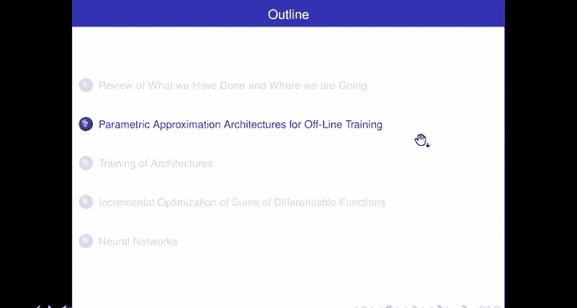

Okay， in reinforce my learning that two types of。Approxiation。

Machine learning of course a much bigger subject than reinforcement learning。

 all sorts of approximations， machine learning， but in reinforcement learning。

 there are only two things that you want to approximate。Cost functions and policies。

So the first type of approximation is post approximation impment and implementation programs。

In other words， approximate the optimal cost functions of the finite ver of problem or the optimal cost function。

The given Verorizon problem or the optimal Q functions for finite and given Horizon problems。

Note here that whatever environmental or problems， there's only one function that we want to approximate。

But in finally there problems that oh it's a whole bunch of that， okay。

 so presumably there's a lot more work for that， but still you can use approximations even in that context。

啊。😊，And that's why finite comparisonizon problems roll out is usually better than approximations because there's more work to do in approximations over inter comparisonorizon。

Just as we can approximate the optimal cost functions， we can also。

 we may also be interested in approximating the cost function of policies。

 a finite horizoniz policy or an infinite horizoniz policy or the Q function of a policy。

 finite horizon or infinite horizoniz course。So that's one type of approximation。

 course approximation。The second type of approximation is policy of approximation。

Approximate an optimal policy in finite or correction settings or approximate a given policy。呃。And。

And we are going to our can be done in many different ways， heurically see the plants forever。

 but we are going to focus on biometric approximations。

Whereby we introduce parametric classes of functions， depending on a parameter vector R。

Either in the cost of approximation or in the policy of occupation。

And then we choose art based on training。啊，对。And now this parameter here is going to be specific to particular types of architectures。

For example， neural networks， I is a huge vector that's the set of all weight so the neural network。

I presume that all of you have been exposed to some extent， neural networks。

 you know when I'm talking about waste and we're going to discuss ways shortly。

So that's what we're looking at for ametric approximations involving a parameter vector power。

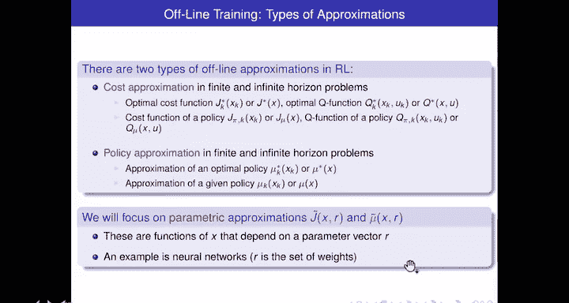

And。Let me give you a schematic for。Cost approximation and then policy approximation。Okay。

 cost approximation， we have a target cost function。It should jack。

We may have multiple targets cross functionss， but we do them one at one by at a time。

We generate training data， training data is pair of states and corresponding costs。

Perhaps involved in some of our measure， but I'm committing that here。So a genetic Q。俾年。Fs。

You may be in the。Kins or even millions， okay， would be very large。And it's done in some problem。

 specific fashion。We have understanding data。And then we pass it through an approximation architecture and we massage this parameter through somehow algorithm so that the output。

 the appating function matches。In other words， what this appxiating function does when it's specialized to these。

States。Gives you similar output as this J。This is done by some kind the players and so on。

Specialized optimization software。D the type methods that I'm going to discuss。

And also other types of for question。So we have a target and we want to match。

An approximation to the target。By using training， yes。

 how do you get the target cost function like that I say， like for trajectory。

 it will be quite expensive。 Oh like because we did all that。啊。

Thats like this we need the full computation， exponential computation to get an exact cost function。

 And then like， how how do we get that function。ま you yes。

At least in the methods that going your answerjectories。

I don't know what you mean by exponential computation run my two traorors。

And if the problem is storcchastic， you're earn more okay。哦不对。I mean。

 my question is just like how to get the。So I just run several trajectory or like doing like simulation based method and then just get an approximate of the actual expected。

Value of that state。 Yeah， by bunching together a lot of simulation traories。

 you do Monte college simulation the province of， then we get。

You get a richer training set in principle， this J may may consist of noise。

 but in the methods that we are discussing， the noise is going to be averaged by natural or national can be average So that J is the gold J is an approximation before Montelo。

Good good stage。The notology， theJ， this J could be a sample。

 Okay a ato acid trajectory issue and now all of this is most a lot of work。

Both the collection of the data。And also， the training。But all of this is offline。So。

You can sit there for weeks， okay， collecting the data or even more。

 And if you have parallel parallel computing hardware， then you can have them。

 you can put them into advantage， they put to useful advantage Thank you。So that's the picture for。

For cost functions， these may be finite horizonizon cost function or infinite horizonizon cost function。

 or function or policy， whatever。

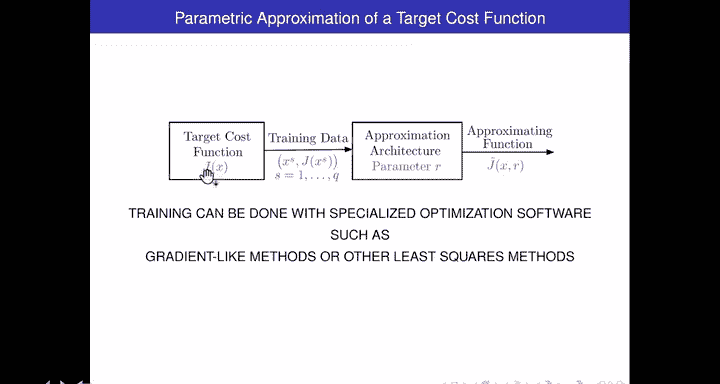

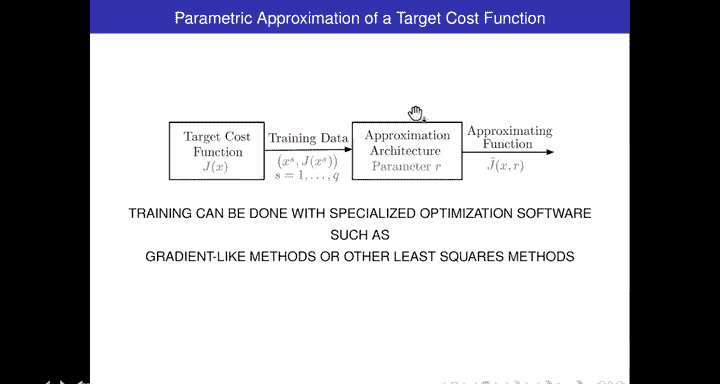

Now let's talk about policy approximation now。Now， if the control has continuous components。

 then the training is pretty similar to the cost function case， you generate training data。

 you pass it through an approximation， architecture， you do regression， you squares， whatever。

 and you get a parametric representation of parametricic approximation of the target policy。Now。

 in many problems， the control set is finite， okay， there are only a finite number of controls。

And this brings to bear an alternative approach。That's commonly used， it's based on classification。

If you've been exposed to machine learning at all， you've heard about the classification program。

You want to build a classifier。 And what the classifier does is it it。

For given samples from a certain population， it classifies the samples to a certain category。

 So let's say the population is fruit okay， a gigantic population of fruit。

 you put them through a classifier， looks at each one case and the classifier says this is an orange。

 So apple， this is an aprior。Okay， bear， whatever。So。

There's a lot of software associated with classification that's available to you and a lot an experience in using。

In consulting and using classifiers。So。Upon， it turns out。To be a classifier。

 you can who is a classifier。So quite the classification。

 it looks at the population of states and classifies them into the categories of the subsets of states that correspond to the different control。

And Jack boys。And each category， the first category is the set is。

It's a set of states for which we require control you1， the second category。

 the ones that's required control U2， so on。So the classifier makes a partition in the state space。

 and each part of the partition is a set of states that we use to corresponding control according to this point。

So a policycy for the case of a finite number for those is a classifier。

And you can train it with classification software。Now some classifiers introduce randomized policies。

Instead of generating controls at the output， they generate control probabilities。

That's common in classified， not all classifiedifies， but many of them。So here's a stitch sma。

You have a target policy that you want to approximate。You generate training data。Or。

F samples of states。嗯。You generate the corresponding control。And then。

You build a classifier which assigns state X to control for class U。

It's a parameter class square depends on the parameter。And output control probabilities。

So for a given state and for a given parameter， this is the probability that at state x。

 you have apply control1。And so on， that probability that I state actually applied applied control M these front of things have a meaning of quality of control。

 high probability controls are higher quality controls that you prefer。

And if you are interested just outputing just a single control。

 then you do a max operation here and output the control of maximum probability。For example。

 alpha zero at the output generates probabilities of various moves， okay this movie is 90% good。

 this other move is 3% good， this other move is 5% good and so it provides a more flexible evaluation of moves and it turns out that alpha zero those probabilities are used to。

To drive the Montete cargo research is a complicated story， but it gives you the idea。 Also。

 if you look at ch programs， Okay， you look at the。They， output at a given position。嗯。

Something that looks like probabilities， the strongest move， the second strongest move and so on。So。

It's common to use a。We randomize policieses and classifierifies output probabilities。And。

The training now， matching these probabilities to the data can be done with various classifications。

 software often involving in optimization， often involving in similar things as what costs。And the。

And one of the。Okay， randomom parts， the randomized sports are also helpful because they have continuous components and for some Alberts。

 continuous components， they're more friendly to them。So。What I want to impress you here is that。

Policy approximation， biometric architecture is pretty similar to cost approximation。

 except that in the case of。F those space， you have more options。

You have an option to use specific software。

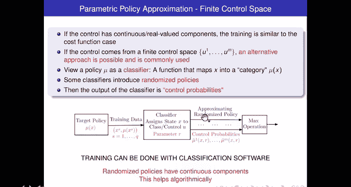

Okay。So now we'll focus on cost function approximation and not so much focus on quality approximation。

We start with a target function， and also we start with a class of。

 a parametric class of functions that depends on x and also on a vector of cunaable parameters。

This is a vector of empire。 M can be very large or can be relatively small。But it's a factor。And。

We aim to adjust this vector in order to change JDilda and match the training data from the target function。

And the thing algorithm give me simply the optimization algorithm that chooses。H。

So the direction type呃。No linear regression， type of all， voltage squares， linear regression。Okay。

 usually it involves quadratic。Penalties， but there are also other possibilities。啊。

This J tilde here depends on X in a complicated way。

 but it may be linear in R or it may be no linear。If it's the differential linear。

 we call the architectural linear。 otherwise， we call it nonlinear。

Neural networks are decidedly nonlinear and very complicated。Now。

 an important class of approximation a actually is use that feature base。

And they depend on x via a feature vector。 This is a vector。

And this is a vector that captures major characteristics for the campus。So mathematically。

 the architecture。Depends on x， but through this feature vector。

And the idea here is that the features actually dominant on nonlinearities。

 so even though the dependence is more restricted here on X。

 it's still good enough because fees well chosen。P0% article nonlinearities in J childrenil。Okay。So。

What is a linear feature based architecture？It is one that depends linearly on the parameters and also on the feature vector。

The feature vector here in this equation consists of M components。 Okay， there are M given X。

The feature vector is M numbers。And they correspond to the value of the corresponding feature。

And what you see here is the inner product of the nu of the parameter vector and the feature vector。

In other words， the sum of the products of these two。And。And the RL are the components of R。

 and PL are the components of P。And a linear feature based architecture， you can see a picture here。

 Iowa state。Out of this， we extract the features to paint this feature vector。

We weigh the features linear with parameters linearly， and we get at the output。

 the linear cost approximate this inner product here。And。And in training。

 we try to find as art that sort of matches the training set that you have from the。那是不这一下。Okay。

So now， let me give some examples of features and feature based architecture。

This is a very genetic exercise。P wise constant approximation。

 You have some target function that I'm not showing。

 you want to approximate with a piecewise constant function。

A function that is constant within some subsets。Now you have a partition of the space in subsets S1 up to SM。

 and you specify your approximation architecture。Do a。

So the approximation is constant in in its subset。So what is the feature， what are the features here？

They specify membership in the corresponding sets， so PL is equal to one if x belongs to the corresponding set as L and zero otherwise。

So in other words。Given a state， this feature tells you that。

X lies on the right side or on the left side or in the middle， okay。

 this is the kind of information that its features provide。And now， if you take these。

I functions that have let。Kite one， you multiply that with are。

 you obtain an architecture of this work here。There are these constant levels and the levels are the parameters。

我第二本是。

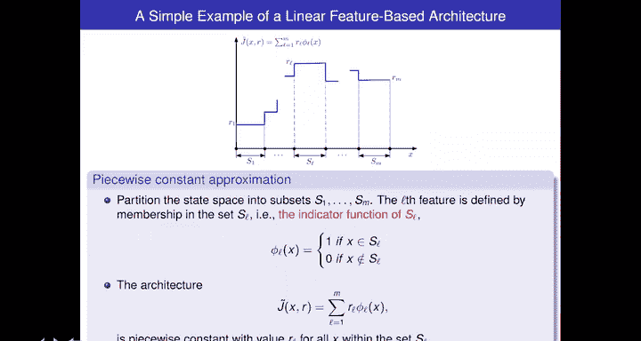

And the architecture which space constant with value R or all that within the correspond set。

 so very general architecture， not very powerful though。

 because if you have a complicated target function。

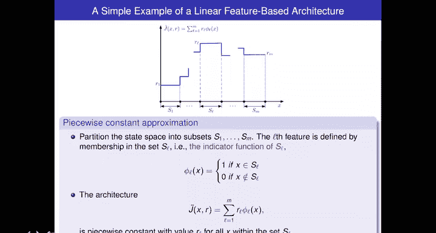

You have to select very judiciously this sense here before you can have something that's effective。

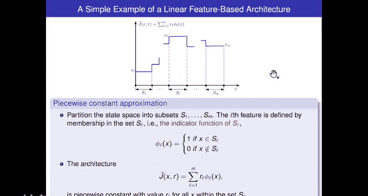

Here's another very general architecture， a polynomial approximation。

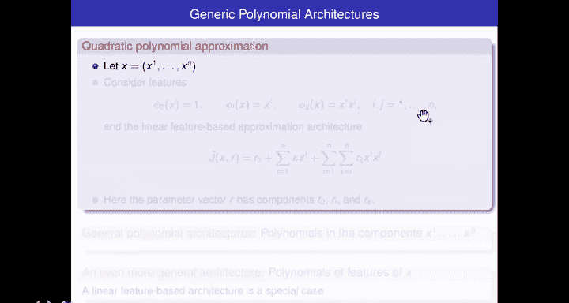

Okay， suppose that the state has n components， okay？

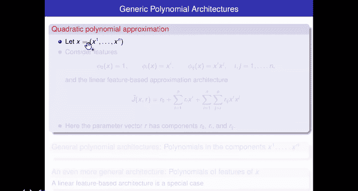

Its an element where you build in1 dimension space。 Let's consider。

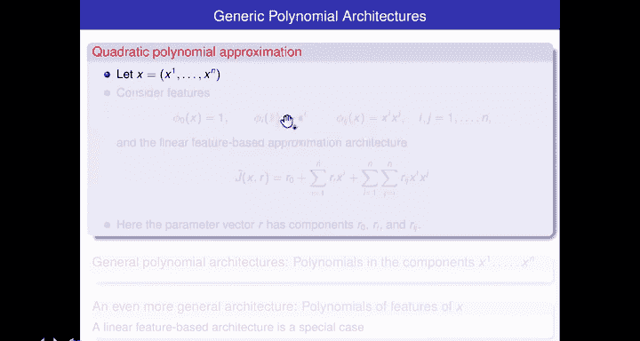

Quadraic features involving across products between the components。So there's x squared here。

 x1 squared here， there's x2 squared and there's x1 x2 and x1 x3 and so on。

 all of these are features。

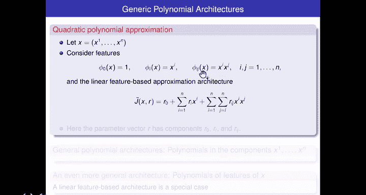

There are， these are also features the linear features， and there's also constant offset。

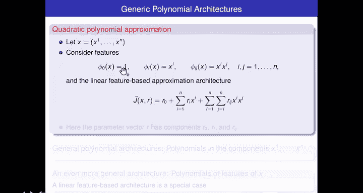

That takes the approximation up and down。According to the multiplying coefficient。

And this architecture like this， a linear combination of the features here are these quadraity features weighted with corresponding weights。

 the linear features weighted with this RI and the one that's weighted with r0。

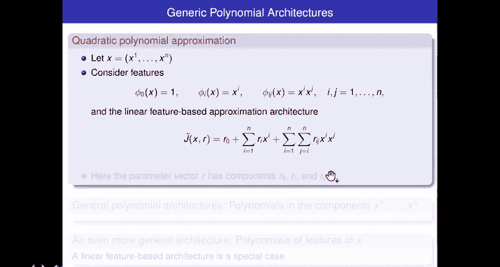

And。The parameter vector is the composite of r0， the RI's and the Rjs。

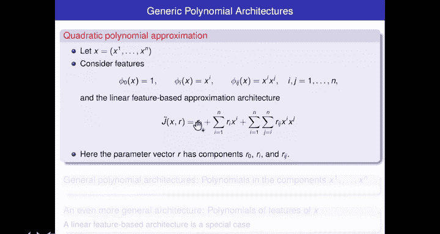

Of course， you can go into。More complicated putting on architecture。

 like third order sport order and so on。These are involved features that are polynomials of artery order of whatever order is necessary to get a good approximation in the components of expon exc。

Theres the whole theory here in the medical analysis that says that。

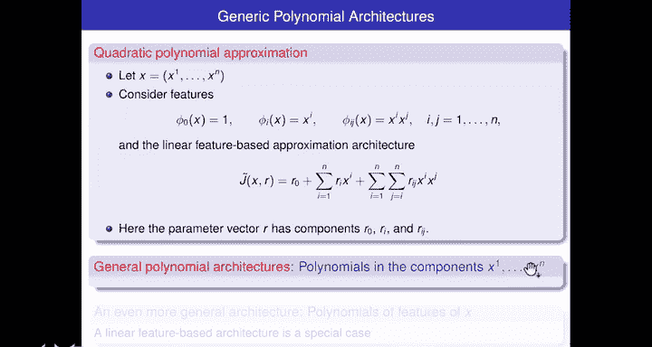

Given them enough polynomials， you can approximate just about anything that might be useful in practice。

Well the bias has approximation didn't very remember put it。啊。

There's also a more general architecture that calls polynomials instead of having features that are polynomials of a components X。

You can have polynoms or fi of X。In other words， it reduce some features of x and then polynomial you combine them to obtain more common complicated features。

Now， that gets pretty powerful。 And and， in fact。There's been a lot of work on features on architectures of this type。

Although nowadays， people tend to prefer to work with the neural and cycle。I thank you。

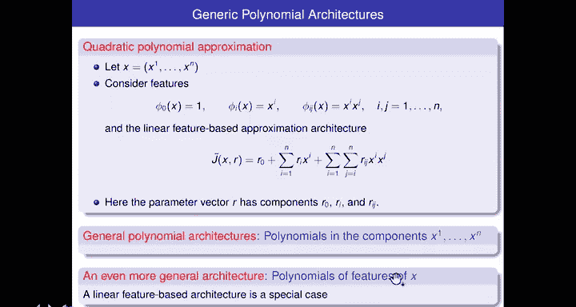

ok谢。Now。六过年安未有。And the piece constant architectures are very general， and they apply to very。

 very broad of programs。Now， it may be possible to look at a particular problem and look at。

At features that are special。They take advantage of this depend on the special structure of the talking。

For example， in chess in the pre alpha zero period。The standard approximation architecture。

 plus approximation in Jess is what you see here。The chs position was fed into a position evaluator。

The positionvalular extracted features， and these features work manually craft。

There are the type of features that the just where looks at the word and can tell you right away。

 what's important， what's not important。For example。

 the material balanced an important feature position， whether one side has one material or the other。

The mobility of the pieces， how many places they can reach， safety of the king。

 strategic features like open fights of which the loop can and the queen can。And呃诶。Andfinite。

 the position of the opponent。All of these are features that justes please recognize。

And in chess programs over the past or even not so recent， not so distant past。

These features were waiting。Mannually， okay， but just the hand crafting the weights。

Through trial and error try set of features and the program starts losing it spectacularly and you should scratch your head。

What what is， what is the way that's responsible to put all this way maybe it's this way。

 and then maybe we should change that way now little over years。 Okay， we're talking about。

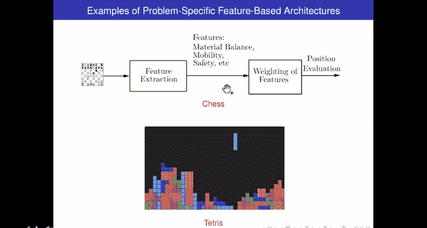

But such programs have been around since the sessions I think。啊。However， in the in。

More recently there has been the success of Alze and all of this has been replaced with a neuro network。

Or a combination of this and a neuralary。Theres there's actually a lot work that's going on with the test the space。

 and the alpha0 is not the。

There are a lot of challenges to。啊。不去。The pilot company has prudently taken out of circulation。

 so you cannot play against Al zero because it's not publicly available。

But there are sort of imitators about Brazil and their quality of play is just as good。

 and they involve combinations of this type of architecture and also neural network architectures。

Okay， are any questions so far？Okay， here's another paradigm， that it is。Yes， I have a question。

I we are planning the model in the data set， so we are collecting the both functions to that we。

But in case of the infinite horizon problems， like how we design the cost。哦，佢诶咗但的候啲就。

A conditional probability。 I don't understand what this refers to。啊。

There's no condition from media here， what are you referring。不。Yeah， please。

 because I can't hear very well。Yeah my question is like。

 how do you like design the cost like you need a data set to train the model， so how you design。

That data set like means while you are collecting the samples。You are getting some cost fellows。

 you told that you run Monte Carlo and generate trajectories and take some of the cost samples。

 so like in case of like if the problem is of infinite horizon then you don't have like any place to stop so how you model that cost like that is my cost。

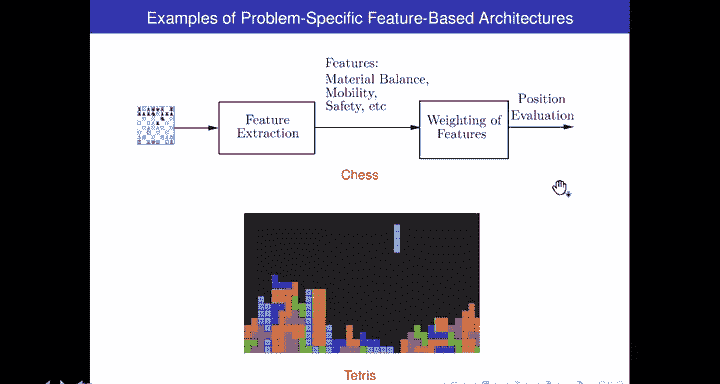

啊。Okay， with chess。The collection of data is very complicated involves both steicago research and。3。

It's just also the way you have described it here。It involves handcrafting。

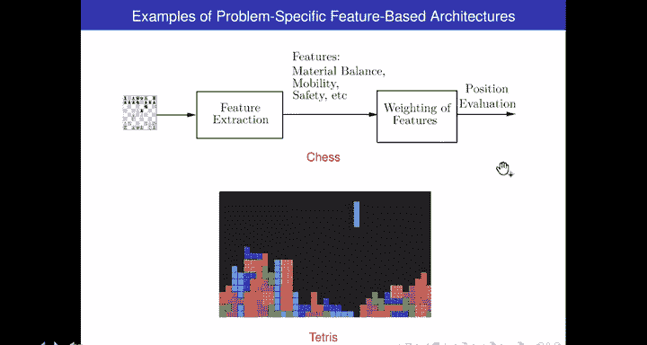

Of of the waves。 So there's no trend in Ukraine。

So there's no data set that has been that's collected。There are some just programs that。

That the user。A train set from the grandmaster play。In other words。

They formed pairs of positions and moves that grand masses have played in these positions。

And they train on the play of grandma。

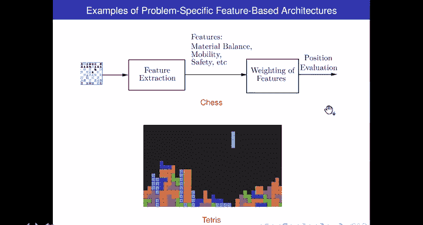

To make the architecture and the weight as close as possible to replicate the play of grandmas。

So but that's done in a that has been done in a few chess computer chess programs。

But not the certainly enough。哦。Okay。😊，So。Let me go into that。

Ts is another program that has been used extensively as。As a tester。呃，我问题发也是啊。And。

I'm sure sure you somewhat familiar with patterns it involves a certain board of the squares and it involves a。

Wing shapes of。Several different types， straight lines， jacketgged。呃。Object and so on。

And the objects fall， and they stack up along these columns， and。If at all with the is completed。

Then it's removed from the board and you score a point。

The objective is to score as many points as possible。

Up until the point where the top of one of the columns。W is the top of the board。

 which case the game stops。

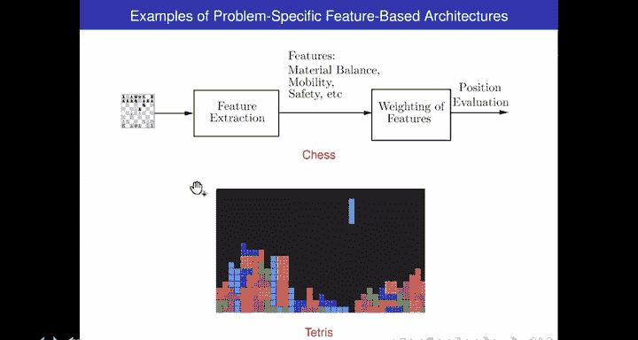

So now this is Loastic game， which makes it more difficult it ches， okay， and it。啊。

It has a tremendously large state space。 The number of positive this is just completely sounamial。

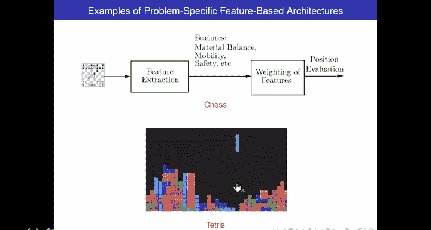

And and therefore they cannot be problem cannot be solved exactly。

 it's a stochastic short path problem。maticically speaking， but it cannot be solved exact。啊。However。

 its cost function has been approximated using a linear feature based architecture。

Evolving like 20 features or so。Now， let's explain what the featuress are。啊。Okay。

Just is eyeboarding the game and getting somedi understanding of it's clear that the height。

Of the columns is an important feature， right。So let's say you have 10。10 positions across。

 So there's 10 features right there， the 10 kinds of colors。

And then the relative height of adjacent be。The height differences between hydration colors is also an important feature because。

If the upper the top of the board is kind of jacket。

 then it's more difficult to fit fing objects within the holes and。Okay。

 that displays recognize that it's not a good idea to have big an event。T boundary。

So for a 10 position， it's another 9， 19。Now， another。

Feature that looks important is the number of holes inside the world because hall are inaccessible。

' very hard to to。It they sort of cut off the bottom from the top。

And so you want to minimize the number of holes in the board。And so， that makes it。Okay。

 the maximum kind of the world was another feature。

 So everything 21 features plus the constant offset 22 features。

So you approximate a course function that involves an astronomical number of components。

Into a 22 feature presentation， that's a big game。 and turned out that over the years with various training methods。

It it took decades to do that。 People have been able to train this architecture sufficiently well。

 so that。It plays back on whatever。呃。You can show that no matter。

 you can show that the optimal forestest here will actually。

L you terminate at some time whose probability1， this was shown by some mathmatician。

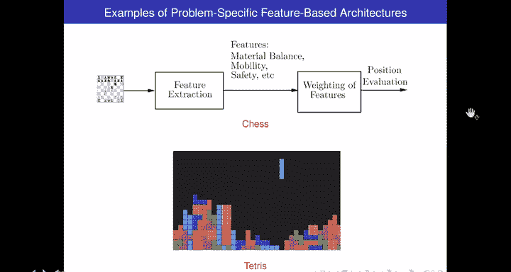

And， however。

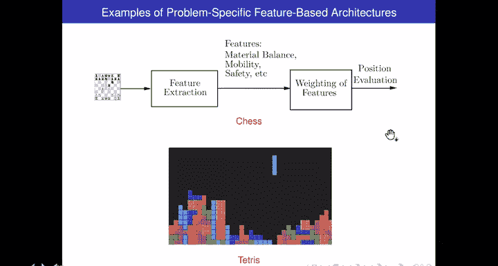

Good。Well trained veteran programs。With policy naration。

 approximate policy naration can score in the millions of rows removed verified。If the beginning。

 start out with hundreds of growth， that's but gradually with improvements。

 which's also motivated theoretical advances， the quality of these programs have improved。

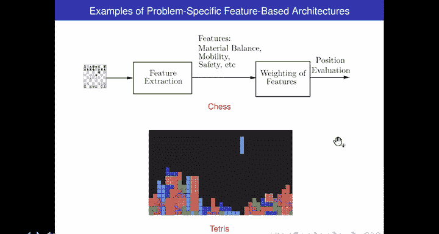

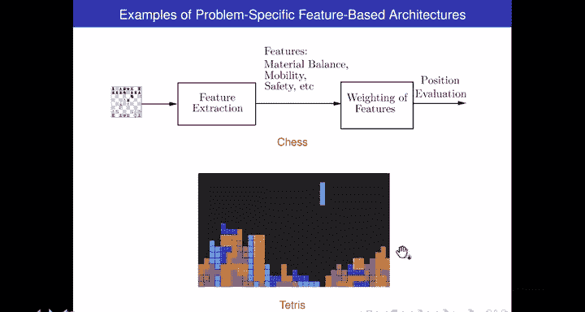

But the point I want to make here is that。By using problem specific features， you can gain a lot。

 if you get pretty good architectures。

Okay， so let me also mention another kind of architecture。How to construct。

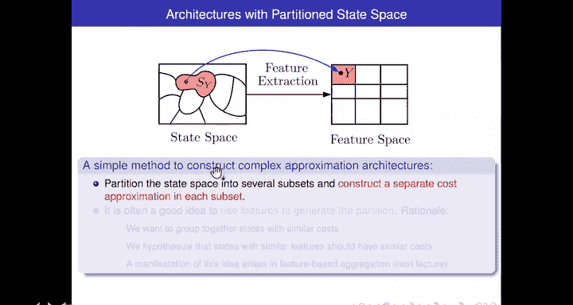

Complicated approximation architectures using similar architecture。

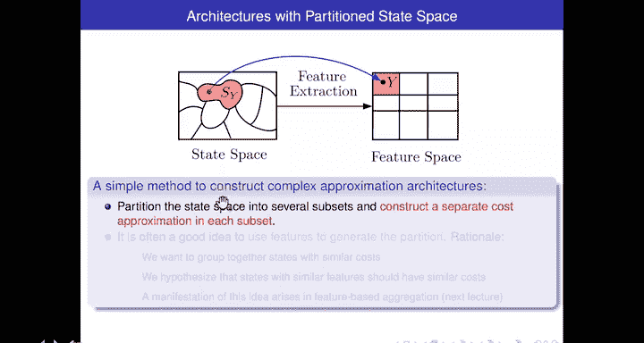

One way to do that is partition the state space into several subsets and construct a set cost approximation in each subset。

Depending on the character of the state space within each set of the partition。

 you tailor the approximation accordingly。对。An interesting idea here is to generate this partition。

By using features， supposed to have a regular part， but that's not very good。

It's important to have a partition that's sort of intelligent so that you don't have too many sense of partition。

 And one way to do this is to use patients。You use in feature space。You use ir regular app partition。

 which induces un regulargular partition in the state space。So in this way。啊。

States with similar features are grouped together。States with similar features， are group together。

And， and this tends to help。 But just if you think about it， it's come。And。

We're going to see an instance of this in the context of our a in the next lecture。嗯。So。

So that's the idea here and can take several different forms。

 and it can be very powerful in particular contexts。

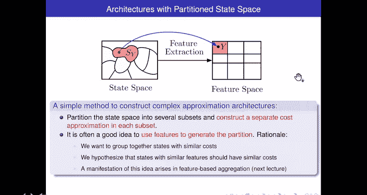

Okay， so all of the preceding architectures I talk to you about， you have to select the fish。

 You have to somehow。Design the features， polynomial features， special features， chests or dead。

 you have to provide them。In some cases， you don't have features or you don't have enough features。

 you can start the powerful architecture。And that's what neural networks stuck in。

Uural networks don't need features， they will construct features for you。How does this happen？Well。

 look at this simple neural network involving a single linear layer。

 a single nonlinear layer and two linear layerss。What do you have here。也稣。The state。

Being approximated by this the cost of the state， being approximate by this neural network。And， and。

In this neural network。呃。对。It's very often useful to use preprocess of the state to extract some features that you know already from the state。

 and also to encode the state into something that the neural network can understand。 So from X。

 you go to some vector y of xs。That's closer to what than you on that question。

And then we passed that through a linear layer。That takes y sub x multiplies with a matrix。

 adds a certain vector。Can produces another vector here at the out。

And this output vector is fed into a bank of nonlinearities， single input。

 single output nonlinearities。诶月嘅。A vector of the same dimension as the one that you have inputed here。

Now， this vector depends on x and depends also on the parameters of the linear layer P here。Is。

Involved the matrix of the linear layer plus B， the vector of linear layer。

 So these are the parameters to tune here。And what comes out here is weighted linearly to some other parameters to give you a cost function approximation that's linear in the features that come out。

At the output of the。I know this is complicated， but perhaps some of you have seen this kind of picture before。

This is the simplest neural network involves a single。No nonlinear later。Take to the state。And。

The neural network produces your cost functional approximation。By this process here。

 through a linear layer， with parameters to be tuned， through a nonlinear layer， and then again。

 a linear weighting with parameters to be tuned。So the parameters of this big contraption are these Vs。

And the Os， okay？And so。That's how you generate the cost approximation and you match this against。

人这个。

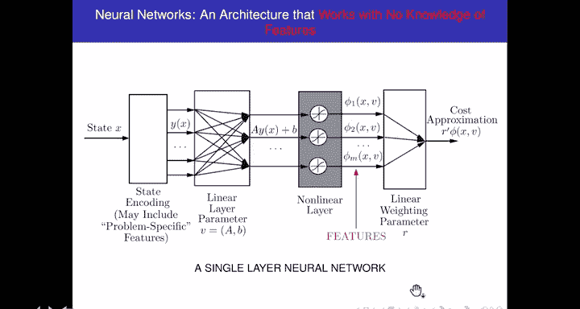

State lost fars。And you try to tunene the parameters so that what the neurohe produces is close to your training center。

Now， all of this is very nonlinear and faribly complicated。

 though even though this is only a sulator。So we'll come back to this。

 but what we want to go into now is the training of architectures。

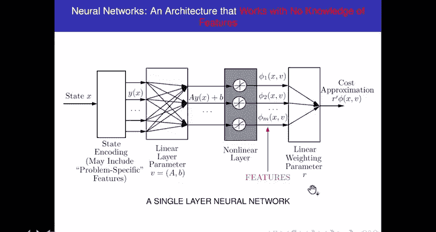

Mion optimization algorithm that we used to。Find the bottom of the sense。So let's take a break here。

 Are any questions or take a break。Take a break for like 10 minutes， and then we could get you。Okay。

 so。We'll now discuss the training of architectures。

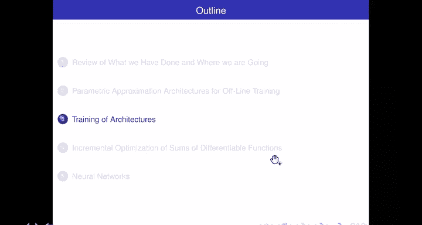

Both linear and nonlinear。啊。Remember that what we try to do here is to。Is to。Firstしくね。A training set。

A set of state cost pays。Access beta S beta S is the target cost。At X， S。Plus， some noise。 Okay。

 could， so it could be involve some noise。 The methods not changed if this is so。And。呃第。

The parameter vector。Is determined by trying to match the output of the architecture to the。

To the corresponding。Po of playing there。And。嗯。There are a number of cost functions for doing that the most common one is risk waste regression。

Whereby you try to minimize all the parameters。The sum of the squared。

Eally the output of the architecture and the output of the training set。And it's the sum overall。我好啊。

Overall training pairs， so this queue here could be very， very large。

 this functions seem relatively the simple。They're not they can be very complicated but there's a very。

 very large number of。啊。Sometimes quadratic regularization term is also added。

The norm of the parameter vector times some gamma scalar， positive scalar。

This is done for a number of reasons， one of these is to make this minimization a little bit better decay this regularization term tends to have some stability to various hardware that are used to this minimization。

 but there's another important reason。Which has to do with the issue of overfitting。Avoiding to make。

The output of the approximation of the approximation architecture， very close the data。Too close to。

Very close fit to。Today this may have detrimental effects because that the architecture sort of specialize in data may not be do so well in approximating the target function outside the data set。

Okay， so well known problem in in machine learning。

And we're going to discuss it a little later also in the context of neural networks。

The story has changed quite radically around the issue of povertyfitting。

And the field has been turned on its head in the last few years， the last 10 years or so。

So more on this later。So this is our basic problem。And。

Can distinguish between linear architectures and known nonlinear architectures。

 In linear architecture is one that ways。W is the linearity， the features。

And if you plug this in here， then this problem becomes quadratic R。

And qua commmunizations can be done in close form。So for linear architectures。

 this problem can be solved in close world。And here's the formula。Okay， to understand this formula。

It's obtained thing by setting the derivative of the objective and to zero。

 setting the derivative to zero， and then collecting terms， and then the result is what you see here。

And remember now that ps of x is a column vector M dimensional column vector。

E so X prime is the groundford transform force of that。Inental robotback。So this is an M by M matrix。

 square matrix。M can be large， so this can be gigantic， so that may be a problem。Also。

 you have to add all those over all。The of the data set。 So this queue can also be very large。

And then you have to invert that。嗯。The matrix here may be singular in some closer to singular in some problems。

 Okay， the inversion itself may also be difficult。So this involves a lot of computation and inversion of gigantic。

 potentially gigantic potentially guilt condition medicine。So this may not work in practice。

 may work to some problems， but not for others。啊。So。If M is large and two is large。

 it may not be the best。In which case you don't try to take advantage of the linearity of the architecture。

 this is the same thing that you would do for nonlinear architect。

Which is to use gradient type methods for the most part。

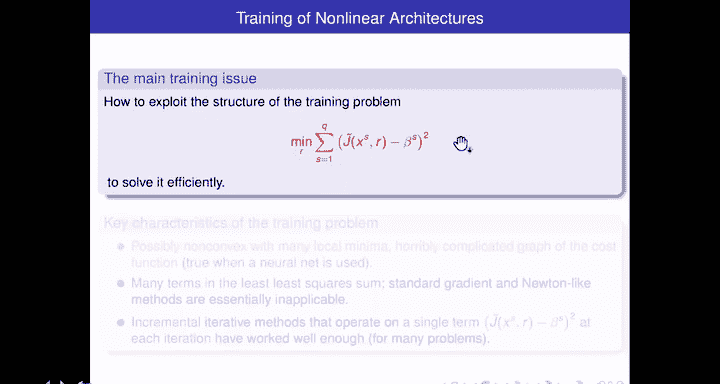

Okay。So let's go to the standing issue。How to exploit the structure of the training program。

Which is sum of square terms of large number， a large sum of square terms。

 How do we solve this problem efficiently。What have characteristics of this problem？

It's possibly not perex。Was this is not。With many local many men。

 a hoibly complicated guide for cross function。

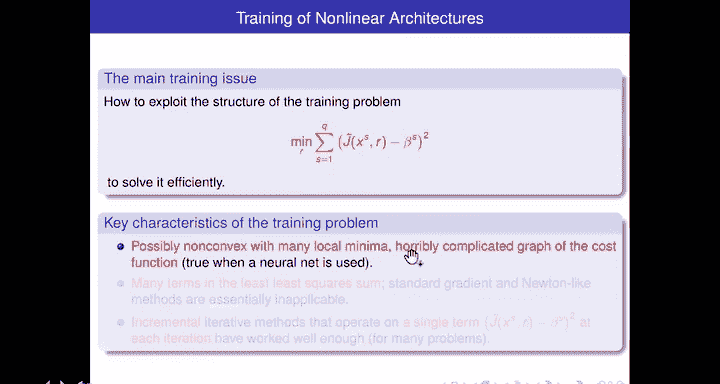

You don't have to go to larger large dimensions to see that even in just two or three dimensions。

 two or three ways， you can see that the graph of this function here is just point。

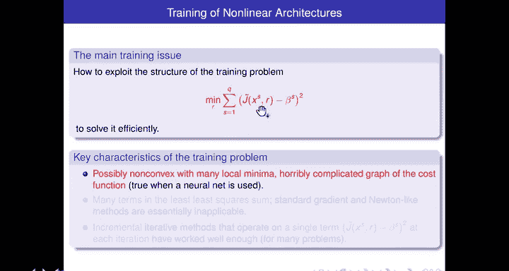

As flat surfaces and。Sharply dipping surfaces and a lot of local miniemia。It's extremely complicated。

 it's remarkable that anything works something like that， but actually it does。

TheAnother characteristic of this square is that it has many terms。 You can be very large。

 So standard gradient methods and you don't like methods that are the workforces of continuous optimization。

也算多少。The reason is that to cultivate the gradient of this cost function involves taking the gradient of all these components and the number of components can be very。

 very large。And to do calculate the secondary derivative relative is even worse。

 the secondary derivative be computers is even worse。

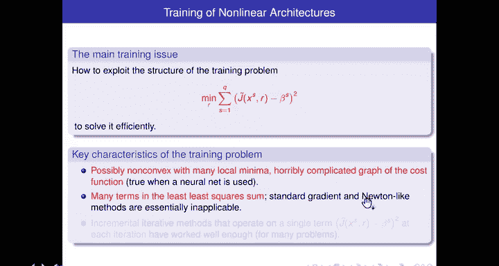

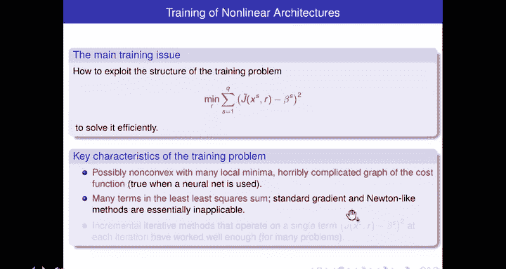

So the kind of methods that have worked for neural networks and the related problems and the traininging problems are incremental methods。

That operate on a single term at a time at every direction。And they have worked well enough。

For many problems， and they are used university。

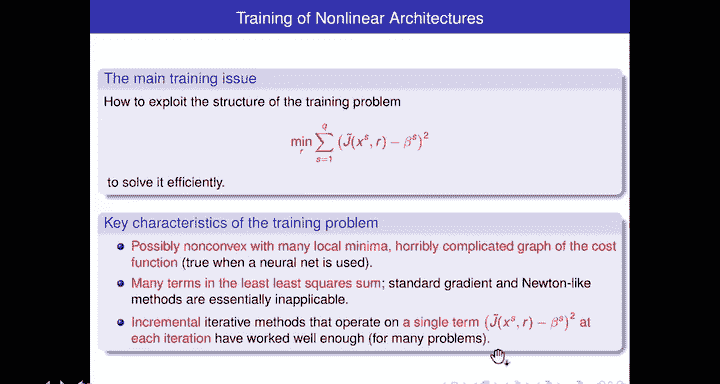

But the idea is instead of using all dealing with all these terms in the sun simultaneously。

 you deal with them one at a time， and this involves less computation。

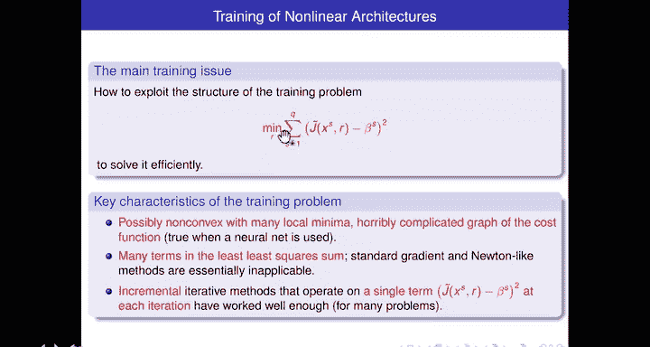

But how on earth would such a method work？Well， it turns out that this's interesting theory around business like that。

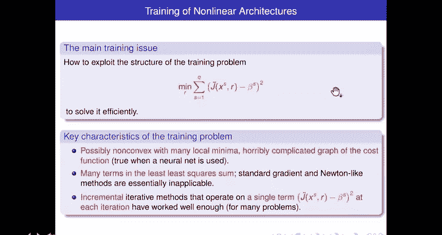

And we're going to discuss it now。Incrreemental optimization of sums。

 large sums of differential functions。

I'm going to discuss it。In a more general context， no not to cl me the slide complicated parametric approximation formulas。

 I'm going to discuss it in terms of this problem， minimized F of Y。

Where y is the optimization factor and F of y is the sum of a number of components。

Each F is a differentialable scalar function of the ndial vector Y in the context of paramed。

 clearly it is the parameter vector。Okay， now this methods。Were invented in in the 80s。

It were understood in the 90s。And the research in this area continues。The context of neural networks。

 these methods are called back propagation。啊。To me。

 that just the haveraian methods which if you want to follow the back Pation that's fine as long as we understand talking。

Here's the issue。The ordinary gradient method for minimize cost functions。

 generate cost functions that。Words like you see here。It's a iterative method， and at the K it。

 it has a vector Yk and generates a new vector。Why K plus one？白墓名。

In the direction of a negative brain。We calculate the gradient。F at Y K。Multiply with a constant。

With some positive parameters， the step size。Sometimes sometimes people put it a learning rate。

跨的是必要代。So this gamma K tells you how much you ought to move in the direction of the negative gradient and after you move you playing y k plus square。

啊的是序。A classical methododist。It's been proposed byhi。He French mathematician。In 170s。

sort of a very fundamental method in optimization that。The medical of。And however。

 when applied to our。

Some of components cost function， it takes this form here。

This gradient deal F is the sum of the gradients of the components。

And the number of propons may be very， very large。So there's an inefficiency here for a roadblock that we will aim to overcome by using an incremental version of that。

Whereby。Instead of calculating this gradient for all components at the K generation。

 we just choose a random one。

And then with therate and move in the direction of negative rating of that component only。

So there's a day and night difference between this。Itereration and this。 This is much， much。

On the other hand， not a gradient de but the hell is it， I mean， at first sight， why would this work？

And here is why it works。

啊。This figure is quite insight， tells you a lot of the story。

啊。We want compare the ordinary and the incremental gradient methods for a particular example In this example。

 the component functions are quite that。Okay啊。Why is。And C and BI are the parameterss the that。

So。Here is why here are the values components。

Okay， and。They have a。Okay， the minimum is at0。 actually you take y here to be the。

The issue BI and C and its zero each one of those as I mean that zero。

And the minima of all of these components I line some region， which I call capital P。

Y I star。Is the minimum of the I component function and the minimum。Minimizer is here。

 the maximum mini is here。So。These have a minimized bonus。The minimum of the sun。

The sun is likely is of course， above zero， something like that。

 and it's spinning by somewhere with previous region。

So this is a age of the minima， and basically we want to go somewhere in a bit。I suppose that the。要。

Start。You have an integrationeration for a white cake is。就是作为。Right of the speech。

They they called the off from。Then。The ordinary gradient method would calculate the gradients of all of the componentss and will move in that direction。

 right？Now， the incremental gradient would just pick one component， maybe this one， maybe that one。

 maybe that one， and move in that direction。So the incremental gradient method will do roughly the same thing。

As the regular gradient method at much lower cost。In the far out。

sortrt of goes in the right direction。Similarly， in the region to the left of this region here。

 it will do the right thing and will move towards where it gets go at much less。

Compplicationational course。However， what's the method the incremental method？Gets inside here。

 which I call the regional confusion。The method gets confused。Because。It's could be here。

And it to go somewhere very closer to the middle， but suppose that it takes it chooses this component either it or。

 then we'll go in the opposite direction。So doesn't really know where to go。

 sometimes goes in the right direction， sometimes in the wrong direction。And it gets confused。

 however， in the initial stages where the starting point is in the far out region。

 it zooms in at much less computationalal cost， and then has to play around。啊。Its going to be。Okay。

 there is theory。That says that it will con， provided the step size that you use is diminished。

So it requires diminish step size for converence that's something that was clarified the 90s and after that。

 a lot of people have looked into this issue of how you choose the step size the learning rate or guarantee converence。

So。That's the picture here。When far from convergence。

 the incremental gradient is as fast as the ordinary gradient with one over m amount of work there。

Iteration， they unite the difference。However， when these to conversionvers。

 the incremental gradient method gets confused and requires a diminish subsize for convergence。

 but the neural network applications and training applications。Don't care for extreme accuracy。

 We want to get near the ballpark for the most part。 And then if we can do better than that。

 so much the better， that it's not critical。Okay， there are some other things about this exam。

 it's very special。Because it's one dimension to begin with。

 So you have to think in a multidimensionalal case。

 you have to think of the far out region to be out in the peri very of this region of the mini。

That's still the same idea applies lies。In the far out region。

 we move more or less in the right direction。Also， there may be functions that they may be the components maybe like this may not have minima。

 they have maybe like these financials， but then again， there are examples。

Your class notes has exact habit has its arms that illustrate States is phenomenon or more general exactly。

But more general situations than what is seen here in this figure。

Okay。So this is the incremental gradient method what's called neural network partners back propagation。

 this is the bread butter type of method。This is the one that。

Has brought the neural network training into practice。However。

 there are improvements and the research still continues in this area。

 theres a classroom of method called aggregated incremental have accelerated。

The standard。And he still evaluate ways the think give a same term of generation， but then。

ItIt aggregates their youth， puts a lot of great deals together。

 the past great years together with the idea of getting an approximation to the true gradient that's more faithful than what you would get from a single component。

This method dates to the 2000s and has received quite a bit of attention。

 and also it was a starting point for a lot of other developments。

It's a community that works very intensively。Iish spent dollars。

It has theoretical and beautiful support in software better。啊。You will hear the name SGD， in this。

This area， stochastic gradientd decent。There's nothing stochastic about the methods that we have discussed in the in previous slides。

 however stochastic gradient descend stems from another problem which applies to the minimization by expected value。

How you been that I valuable and so。You have this function of the optimization variable y and the random value W think the expected value of this。

That's how you get T of why。啊。So。How is SGD。三不是。W。Applicated direction gets a sample and then moves in the direction。

 not of the expected value， but rather it moves in the direction of the gradient corresponding to that sound。

Yeah。😊，So it looks like if you think of expected violence being。An exploit weighted somes。

 it looks like like an map。啊。In particular。The incremental gradient method the random index selection。

Is the same as the sarcastic。这定。And the idea is to convert the sun。To an expected value。

 you start with a sum， you can prefer to expected value random execution。

 then you get this method here。

SGD and environmental gradient methods are very closely connected and points a special case with the other。

Okay， that number of issues here。How do you pick the step size？

Usually particularly in the original confusion。The diminish step size is used that the。

Goes down at this rate here。嗯。Some methods are ambitious and tried to detect in ineration confusion and reduce the step size upward keeping high up until the method gets wrongly in aci attorney and then they reduce the step size。

嗯。你。😊，Okay， how do you basically。How do you meet the components of which to it remember of their M？

Compforms of the cost function， how to pick the one that to it on。 Well。

 one possibility is to use a6 order。 have a certain fixed order of the proposal。

 You go for the first to the last， then back to the first and so on。

Its also possible to use organizationization that was other schemes and the。

So there are the deterministic coordinate randomized orders and so on。U。

 these two are the ones that the。That youll find that confusing。

 but there are also other possibilities。When you're using a randomized selection of components。

 it's important that the randomization is according to a uniform distribution。

 was although by some components may be weighted differently than others。

Diaagonal scaling is advocated quite a bit with good reason。That here， to basically。

Multiply the gradient to sub diagonal matrix， and this is roughly equivalent to using a different step size for each component of y。

And okay， there are ways to select the that they components。

There are also more ambitious alternative methods which are discussed in your class knowledge to a limited extent。

Relating to Newton's method。Something called the extended column filter。And there are also。

 there's a lot of， a lot of performance in this day。

Sometimes the proposal are special to to type of problem。Okay， so that's all I I want to go。

 that's a question I want to get into this issue， Are any questions。

Okay， now let's return to neurona。

How does all this apply to neural networkss？Remember the figure I gave earlier。

The neural network of ox。At the input gets a state。

 the state gets encoded into something that may involve features。

 that goes through a linear layer and then through a nonlinear layer at the exit nonlinear layer。

 there's a set of。The vector。That we view of as a factor of features， depends on X。

 It also depends on the parameter of the linear layer。

 And there's also additional linear weighting here。So。We have a given training set。

Of state cost fars。And。We want to obtain the parameters of the neural network， which is a matrix A。

 vector B and the vector R。And we do this by solving least squares。Traing problem。

Specialized this way drain problem。I admire this slide， specialized to the Europe network。Okay。

So we have to minimize sum of the squared errors between data。And the output of the。

The output and the first approximation。 So this is the inner product that you see here of R L。

 the components of R and the output。Of the Northerns， this sigma represents the Northern。

So what goes into each known realityity is the health component of this vector here。

It starts quantumal linear with this sigma function。Andued linearly with the。

With the parameters of the last linear layer。And the between this and the Bodes。Also of the data set。

I squared and it's minimized at the sum of all those  errors。

 squared arrows is minimized over A B and pi。

Since horrible。But it turns out that the gradient of each component can be calculated very efficiently by going back using this back propagation。

不是。If you're a person optimization we it simply as a chain rule。The change rule in the。Of confidence。

Is used to calculate a great change rule。Calculates gradients componentonent of compulsive function。

So going backwards is a composition function here， if you use to change a little backwards。

 you're going to get the gradientdiant of a component。So it can be can be implemented with the。是。

It software quite easily。啊。Here's I think about neural networks， as important。

They have a universal approximation problem。Suppose that you solve the problem。Then the solution。

Can approximate any target function。Any meaning any practically arising target function at some point official。

And， I regard you well。With sufficiently large network size。 In other words。

 if you increase the size， the number of these long nonlinear units。And the size of this matrix year。

You can get arbitrarily close to any target function。维斯。With， of course， we that large data。

 large that data set also。So this is the universal approximation property， showing。本ず。

But in practice， practical terms。

You need to deal with a lot of the other issues。

What's interesting about the universal approximation property is that it is value for even the smallest。

doesn doesn't have to be big。Only the number of parameters have to be large。

 but the number of layers can be as little as one。As a result in the early days of neural network。

 people do not look to add more layers， they use one layer for two layers， three layers at post。

Now， in the recent times。People have discovered deep neuros。

before we go to deep2 networks that involve many layers。

 let me discuss also with all the areas of that。Remember。

 these are single input single output nonlinear atoms。The most common on the is a so called re。

Reecttify linear building。Which is this function here。Is the maximum function between zero and psi。

 So the first device sub psi is linear and for negative x sub psi， it it is0。And。

This expression here a function size。Sooth out the corner。Makes a differential。

 We need differentiability because we're using gradients， right。

 You can't calculate the gradients of。On the function。So we smooth it out。

And it turns out that this is adequate for the。Universal oft building。你搜素对申。In the old days。

 people were using this soid on humans。

Socal hydrobolic cancer function that sort of flattens out as， as。As Pci increases or decreases。

And another one logistic function， which is what you see here again。

 the key thing is that it flattens out on both sides。

啊。The key characteristic， it's not essential， but it's the characteristic。

Here you think you use the same properly by putting together。By combining some rather。

In use behavior like this。Okay， nowadays， people use runs in the older days。

 the runs were not used but。Whetherther。It seems that there are some abandon simplicity one of them for using this type that。

Okay， so now let's get to deep neural earth。Like I said in the other days。

 people were satisfied with just two layers， two no nonlinearre。

Two layers of no nonlinearities or three layers of nonities at most。啊。When。And we the。The end of a9。

呃。People。Suspected that。对。By making rich， by using richer neural network thing。

 they would get some advantage。There was some computational studies phenomenon was not understood。

 and also it was not paying any attention to。Because around 2000 people stop being interested in your It was a socal winter of AI。

 every so often there's a winter of AI。 I think we probably have seen the last winter of AI after I think AI has taken on good。

But there were these periodss where people were saying that， okay， I't say I start it crazy。

 I don't see any benefit that， you know， it's lately and and so。All of a sudden。

 people started working on AI。 And that was one of those periods。

And then some brave salts continue to work on people neural networks， and in some applications。

 some key applications involving image processing， speech processing。This deep neural networks。

 which are simply many layers， many layers， lots of parameters， a gigantic number of parameters。

 is started producing some results that were very substantially better。ぱこ。

So there was a frenzy of research after that to figure out why are these neural networks？That个。

In various applications， after all they involve a very， very large number of parameters。Often。

 the number of parameters， the linear layer parameters are。In total。

 much larger than the number of data points。嗯。So the recent research is encouraging。

It's suggesting that it's over parameterization， that's the main reason why these neural networks work better。

What do we mean by over parameterization and lots of parameters as exemplified by deep neural networkss。

 lots of parameters， many more parameters than data points。So the data points。

 maybe you have a data set for let's say， 100 million data points。

For there a few billion of parameters and a strong enough computer。

And a deep neural network that may work and indeed clearly has shown that this is true in some sense。

Okay， let me get a little bit more specific here。Generally speaking。

 the critical parameters is R the number of parameters over the number of data points。

In the old days， if this art was close to one。That was called over parameterization。

Which means that you have roughly as many data points as you have parameters。

 so when you do the training， the parameters。Are chosen to fit the data？

And so you get an approximation architecture that fits very well the data。

 but does not do very well outside the data。SoThat was a fundamental problem and the drive the driver in the implementation of neural networks。

 that was avoid over parameterization， so it was the number so the。

The number of data points were starting to be。largear relative to the number of parameters and also entertaining。

 there was this quadtic regularization term。Added to steer the method away from fitting the data very closely。

好。In deep neural networks， R is greater than one， often substantially greater than one。

Many more parameters than data points。And it turns out。对。The problem of over parameterization。

Doing very well on the given data set and doing poorly outside the data set is overcome。Basically。

There's a lot of freedom of fitting the data with parameters and many more parameters than data。

 so you can fit the data exactly， but also you can。

 you can have additional freedom to play around the parameters。And so it turns out and。

But in practice。The problem without all can be overcome。So。

This you'll often see in this in the literature a figure where R the ratio is plotted and the critical point is r equals the one。

And the performance of the neural network is。It。And the performance of the neural network is good up to the point where r gets close to one。

 after r gets larger than one， the neural network performance gets better。

That's what deep neural networks do basically。 and that's why they work better。So。

The alpha0 ingram network uses about very big， really， very big。Chad CBD， I understand has also。

Big neural network。 I suspect that it is larger than the number of data points。

 although I'm not quite sure about that。 number of data points。 So okay。

 the details of Sha are not known， but it involves also neural network neural network。175 billion。

17 billion。 Yeah that's what you。Yeah， so imagine a gradient method it have 65 billion on its oh。

 I'm sorry， I'm sorry， I'm sorry， 175。How about the number of data points。Natural language。

 like from the web， I suppose。We don't know， but the largest publicly available data set on natural language is file。

 which is about 800 gigte of text。Soterabyte。The bill other。俾快四啲样。They my books。So。

What I try to do is to keep a text。How the network predict that next。

You can't have a bit to want if I help a student。Yeah， I'm not sure how training you' done。

 but I'd interested。Okay， so it's amazing， neural networks have been that on。对。

For a long time and they have been researched extensively and now with deep neuralical theory has been put to its head before it was saying。

 don't over parameterize for God's sake。 Now they're saying God's sake over parameteritize。

 this is good for you。So。So that's an interesting thing that has happened in this area。

And there's a lot of research going on still going on。

 and there has been recent research we're talking about just the last few years。

 so number was understood only the last five years or so， maybe a little more。啊。So。Okay。

 we reached the end of this lecture。Are there any questions？We have one more lecture to go。

 it's going to be again on offline training， doing guardian policy using neural networks。

And also an introduction to ag aggregation， which is a different type。

Canraian base the。That prop title。

Use a different framework， but it's still an offline training。是湖南的吧，是做。算计。

ok。