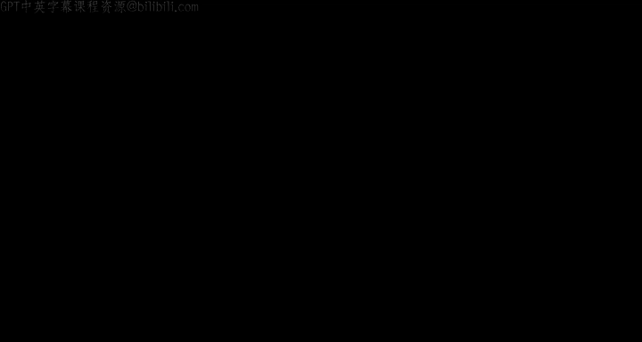
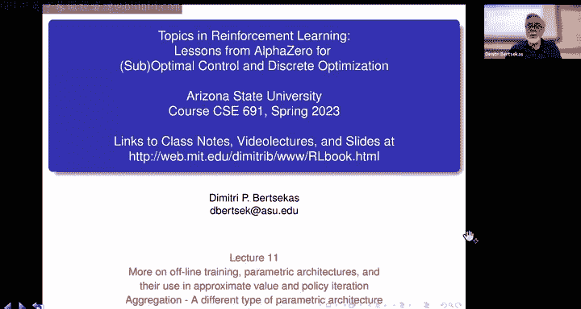
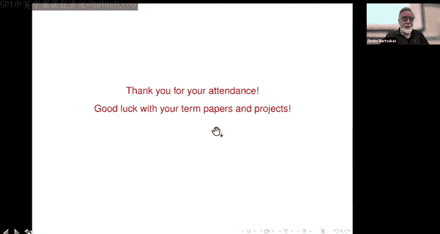

# ASU《强化学习2022-2024｜cse 691 Reinforcement Learning Course at ASU》中英字幕（deepseek - P24：[14]Lecture 11, 2023_ Review of off-line training, approximate - GPT中英字幕课程资源 - BV1zcfVYdErD

So let me welcome you to this lecture 11。Of our course on reinforcement learning at ASU in the previous lectures we talked about。

Oline training， we have approximation architectures and neural networks。

And we're going to review some of this material， and then we're going to see how these architectures can be used in the context of training。

And approximate value court duration。And then we're going to look at a different kind of parametric architectural agreg。

And we're going to discuss some of the special issues associated with that。

So here's the outline。We first are going to review ideas of offline training paramed architecture detection that we discussed last time。

Then we are going to talk about finite Verizon dynamic programming problems。

And how you train approximations offline to use for value duration and also for policy duration in infant veriz problems。

Then we're going to discuss aggregation in a particular type of agregation called aggregation with representative states。

 it's a form of discalization， interpolation type of approximation and its it is。

It is one of the forms， the basic types of architecture。

 perhaps the simplest aggregation architecture， and there are more complicated types of aggregation。

 which I would refer to to the class notess。So let's go into our review。呃。First。

 look at the familiar figure， which involving approximation value space with one step of the head at the given stay in Xk。

 we minimize over the UK， the sum of two things， the immediate first step cost and the future cost as represented by an approximate cost gold create。

And we may use those approximate as a year， approximate approximate expected value。

 We have been focusing on methods to。To to construct post observationss。

And last time we looked at the parametric architectures neural networks and navigation also fits framework here。

And there is the multi step look ahead at counterpart picture and we've gone through that。

In the enforcement learning， there are two types of parametricic architectures that we use。

 One is approximating cost functions like the cost function or policy or the Q factor or the policy or optimal cost function。

 the。You factor。Or approximation for。Polic is， approximation policy space。And the Microsoft shop。

Are quite similar。There are some more options for approximation policy space based on classification algorithms。

 but otherwise the methods are dissim， and we are going to in this figure here considers the case where the target cost function that we want to approximate is a cost function。

 J so x。So what we do is we collect training data to generate a number of states。

X1 up to x cube a large number of statess。Corresponding values of the target cost function。

At these states， perhaps with some error。And we feed them into into。An algorithm。That chooses。

A function J tilde to approximate this J of x that depends on a parameter R in the process by which you generate this function fine r is the training algorithm。

And it can be done with specialized optimization software like gradient type methods。

 otherly squares methods， neural network software， and so on。

So we generate the training data and run an optimization algorithm that matches an approximating function from the parametricic class to the data。

 that's a general idea。So more specifically， we select a class of parametric class of functions that depends on the state and also on a parameter of vector r。

 which involvess a finite number of parameters that can be tuned。

And we adjust this vector to change shape tilde and to match the training data from the target function。

And depending on whether J tilda is linear or nonlinear are we the architectural linear or nonlinear。

Two major types of architecture are feature based。Artect is feature based if it depends on x via a feature vector。

P of X。That captures major characteristics of X。 by this。

 we mean that the functional form of J did that。Depends on x p。

 There's another function J out here that depends on phi and it's identically equal to J tilde。So。

So the intuitive idea here is that the features can be made to capture the dominant long linearities in the cost function。

 so we can afford， in many cases to use a linear JHB。

 a linear in Phi and all the nonlinearity comes into these perhaps complicated features。

And a linear feature varies architecture is an important class。it's relatively easier to train。

And has this form J2 Do X R is。A linear combination of the features。

Up from one up to M weighted with coefficientics RL， which are cuable。

So the vector R is the precision of M of the M components which enter in this equation here and what you see here's the inner product。

Of I and the feature vector of x。Here有。恐怕很舒服。我说。Okay。

So schematically a linear feature based architecture。Pastor strain。It。For a given state。

 it extracts features out of the state， this feature vector fees of x。

And these features are linearly weighted， according to this。

This expression with the coefficients being the being the。Being the result of the training。

So given X and given the results of the training we obtain in this way。

 a linear cost function approximation of the target function。Now for feature based architectures。

 we need to be able to construct features， problem specific features。

 sometimes these features are not apparent， oftentimes they are not apparent and the nice thing about neural networks is that they construct features for us based on data。

And the picture is what you see here for a simple neural network involving only one layer。

So given a state X， it would an approximation to the cost of that state。And this is done by。

Taking a state and it in some form that suitable for the neural network。

 perhaps this and coordinate involved also some problems in specific features。

This encoding y of x is passed through a linear layer。

Where the matrix A here and the vector B consists of cunavo parameters that are the object of train。

At the output of the linear layer we obtain a vector。

 which is passed through a bank of nu nonlinearities and produces M features at theM which depend on x and also depend on P we are the tunable parameters of the linear layer。

And the students are weighted with the。The parameters R。

 which are part of the parameter vector neural network。

 and they give you a cost approximation of the target function of x。So。哦。

It's a complicated construction。The training problem。Cons of first。

Collecting a training training data， a set of state cost pays。X of S is the state of the。Of the S。

Of component S of the data set beta of S is the sample of the corresponding course at a x of S。

 So we have this trading data。And we solve a trendy problem which consists of usually a least square minimization。

Beta so S is the sample also of the target function。

What you see here is the output of the of the neural network。It involves the coefficientics R。

 it involves the matrix a， involves a matrix B， all of these are cumnable parameters that we minimize over。

And it involves M features。The feature that comes out of this back of nonlinear nonlinearities is the sigma that you see here。

And depends on the health component of the output of the mill linear layer。

So this is the linear approximation， and it is matched to the to training data。

 we solve this minimization problem and we obtain the parameters。A E and R from the neural。🤧う。

Now this optimization problem is just horrible， absolutely horrible。

 and it's also very large because it involves potentially a large data set。

 that was that this is a large sum， sum of many terms。

 so conventional optimization methods like the standard gradient method， news method。

 whatever cave do not apply very well。Yeah。And the situation would have been calledless。

Except for the discovery of these incremental methods that process the data one data point at a time also called back proification methods。

 it's critical to use。Some kind of incremental method and there are many of those and research is continuing in this area。

 it will work on better methods and was specialized in particular applications and so on。Now。

There are two important。Genetic profit is here。One is the universal approximation property of neural networks。

It states that with large enough size， with large enough。Layers here， linear layer。

 we can approximate anything， anything that might be of interest。In practice。

 any target function can be approximated with large enough layer here。 just only one layer。

 we don't need many layers， just one is sufficient。This property has been known for a long time。

40 years perhaps even more。啊。A more recent important structural property that has discovered is that。

Deep neural networks， networks that involve many layers， not just one， but many layers。

 they have some important advantages。And the recent research has linked the advantage of neural networks to over parameterization。

Many， many， many ways more than the data points， so that's what we call over parameterization and it turns out that over parameteritization helps。

Both in providing parameters that match the data set well， but also parameters that work well for。

Outside the data set。So they have a good generalization properties， as people say in this field。

This interesting theory that's associated with parameteritization idea in the。

There's a lot of research that has been done the last。Five to10 years in this area。So。嗯。

That in a nutshell， it's a summary of what we did in the previous lecture。And now。

 we want to see how。It is architects work in the context of the critical problems in a dynamic program。

So well look first at finite veriz of problems and we'll try to approximate the dynamic programming algorithm。

 the end step dynamic programming algorithm sequentially starting from the end and going backwards and with each step providing an approximation。

 neural network approximation or otherwise。Okay。This is also called Fi value durationeration。

 as name that you will find in the literature。It is a sequential approximation going backwards。

 starting from the last stage and going to the first stage。So we train cost approximations J tilda n。

 J tilda n minus1 up to J tillilda0 in place of being。Optimal cost functions。

 J and star JN minus one star， J zero star which is the optimal cost problem。

 and we do this sequentially going backwards， similar to the dynamic programming algorithm at every step we do an approximation。

So we start with J till the N equal goes to the terminal cost， GN is a terminal cost function。

And given the approximation at step8 plus one。We use one step ahead to construct a large number of。

Data pairs， state course pairs， XkS and beta KS。Where beta KS is。

The right hand side of the dynamic programming algorithm with the approximation J tilda in place of J star。

So。We pick somehow。100，00 a million or more data points states。

Property balanced and distributed within the state space。For each one。

 we do this calculation here and we form this data set。And that gives us the training。Se。😊。

By which we train an architecture。J tillda parameter architect。Now given J tilde' okay。

 we do the similar thing here， obtain data and train J tilde k minus1 J tilda k minus2 and go backwards all the way to J tilde0。

然后。Is something that's unpleasant here。that's the following。Every sample。

 every one of these betas that you calculate involves minimization of an expected value， okay。

 exact minimization of an expected value。Now that can be a pretty formidable calculation。

The expected value can be a substantial calculation， and you have to do it for every control。

 all of this just to obtain a single data point。So this can be a substantial calculation。Of course。

 it's not as it situation better if you have the deterministic problem。

 so there's no expected value here。 and if you have relatively few control。

As opposed to a lifetimena。So啊。And in any case， suppose that we have to calculate that data set。

 then what we do is we minimize over the parameter。Of the target function。

Perhaps some regularizations or might be added here。

 and typically we use an incremental method to solve this optimization problem。Now。

 video is on a garbageage here。After you have trained these first approximations。

 then what you use in online play is exactly the same minimization as here。So。Essentially。

 the software that use for training is the same as the software that you use for online play。

And in this way， the Newton step interpretation of lives。

 so we gain the kicking performance out of the Newton step。On the other hand。

 the problem is what I mentioned earlier， a difficulty that minimization of expected value complicates upon collection of samples。

 makes the formation data set。More difficult。Okay， now here's another way to implement the same idea。

 fitted value duration to battles， but instead of using costs， we're going to use Q factors。

 we're going to fit Q factors， approximate Q factors。So how do we do that。

 we introduce a parametric architecture involving two factors。

Few factors are depend on both states and patrols。And also here's the parameter。

And we remember from financial dynamic programming。

That we can do the algorithm in terms of optimal costs。And also， in terms of alcohol factors。

And the algorithm in terms of talking few factors look something like this。

 except that there's you start here you start here。Yeah。😊。

And if we want to do backwards approximation by approximation。

 that's the kind of approximation that we have to do at every step。Even Q till decay plus one。

 we want to matchq till decay to data that comes from this calculation here。

So we'll pay you till the XK， UK， RK。For many。For many triplets。X，k， UK and beta K。

 where beta K is a sample of this expected value，Now， sample， the word sample is important here。

 we don't need to calculate the exact expected value， which might take a lot of calculation。

 just samples of this is sufficient。This is a mathematical magic trick。

The order relative to the un of the previous slide。

 the order of expectation and minimization has been reversed。

For years before you had minimization of expected value， here we have expected value of minimization。

Minimization of expected value cannot be approximated。 However。

 expected value of minimization can be approximated by just a few sounds。

So we don't have like to calculate the full expected value here for this beta case of S。

 it's sufficient to take one sample， five samples， 50 samples， and that's just fine。

 you throw it into the same least squares optimization and it works that's the nature of the mathematics here。

Okay。Are there any questions about this fact trick here？AndBut why we can use。

Just a few sample approximation of its expected value as opposed to our full expectation。Okay。

 there's another advantage to this methodology based on two factors。The cycles。我认识三户数。

Random samples here can be obtained in modern free fashion。We don't need to have。对。

Mathematicical form， a close form expression for the course。

We don't need to have a model a mathematical promod the probabilities。

 a computer model is needed for some module needed， otherwise we go't nowhere。

 but the main difference is that we don't have to have a model。Sufficient to have a computer model。

 That's what model than3 means。 doesnn't mean that you don't have to worry about model than a。

 You got to have a computer and the computer， the simulator can generate。Samples of this form。

What a given Xk in UK， you can generate a random sample。

Of the first stage cost and the corresponding sample of the next day。So what you need is a black box。

 if you x and U and outcomes G and x K plus1， you don't need to have formulas for probability distributions or whatever else。

So that's another nice thing about this approach。Oh， having collected。This data set。呃。We。

And having computed， having done the training through these or whatever incremental methods or whatever what。

Then we can obtain the one step look ahead control drop online in this way。

Without the need of a model or expected value calculations， the train two factors。

 we minimize over all two factors at state X and we obtained that the total apply after the training is finished and we have this acade。

that's an important advantage， the online calculation of the is simplified。We have a neural network。

For other approximation architecture， we feed in the current state and it spits out all the very few factors and we minimize perhaps by bru force。

 minimize over this two factors。On the other hand， if you have approximated two factors。

The Newton step property is lost。You don't have the proper。

The proper you don't do the proper minimization that involves across the expected value and so on。

Also， after you train with some problem data， if the problem data changes on you as an adaptive control。

 for example， then you need to do online reply， but when it comes to online planninging。

 this is a bad thing to minimize because it has been trained on a specific。Moern。

A specific set of parameters one to change the parameters。Then。😊，This can be very bad。

You're using controls with approximations for which you。Which do not match the model。

 the current model。So how one can address these issues work with more work and this work involves。

Approxiation in value space。Involving。The cost and the appropriate distributions either provided by a mathematical model or by a computer model。

So you use approximation in value space and you calculate a J filterder here using this miniization。

You can do it with training， text training。To extract the J tilde out of this Q tilde。Well。

 we can do it online its available。It。So in this way。

 the Newton step properties is recovered and also be the the。

The younger is resilient to online and planning for minimum changes。

 you still use the simulator to calculate the correct cost function and transition of visit。Okay。

 so these are important issues in using， but is also training dynamic program。I在过生期。

This is an important slide， and I urge you try to understand it's also explained in the class notes。

对那现上那个的15。It听。Should we approximate Q factors or cu factor differences？Differences。

Vvolving different controls。we have gone。 we have touched upon this issue when we talked about。

About the about the。About variance reduction。 You remember。

 we had some discussion about variance reduction。 we said that the。

We need to focus on two factor differences and target our variance reduction to the two factor differences so now we're going to look at this issue in a little different context。

Okay， suppose we approximate two factors。Is an example of bad things that can happen。

Suppose if you have a scalar system and what per stage of this war。

Xk plus one is just xk plus Delta UK， and Delta someos number is very small。

Think of discquization of a continuous time problem involving the simple differential equation。

X dot equals u，If thisitize this equation， standard disization have。

This equation in this discrete time of suspension where deelta is the disctization interval。

 sodinarily you want to make delta very small。The corresponding cost for stage。

From T to T plus deelta is something that's proportional to Dlta in quadra。

 I'm taking this example of P quadra。Good。So this is a problem that's very commonly。

This is an instance of a class problem that's very common in practice。Have a container spine problem。

 We discretize it。 And if you want to faithfully discretize， you have to take Delta very small。

It is a linear qua problem also can be solved in close for。So let's consider a linear polish。

The ph applies at x， it applies minus2 sub x， just an example。

Its cost function can be calculated with a equations with the standard formulaness that we have gone through and if you do this calculation。

 that's what you get。Yeah。Look at this formula here。

This is an exact form of J mu for this J or this new。It is quadratic in x in x， as you expect。

 in linear quadratic problems， the cost functions of linear policies are quadratic。

And if you look at how Delta enters equation。This a term， but doesn't depend on delta。

Its a term that depends linearly on Delta。And there's a term that and some other term that very quadra So for that as small these。

印色啊。This term doesn't count。 So this is the cost of a policy approximately as a function of de。No。

If you compare it to the postper stage。It is huge，Because this does not involve Delta。

 It's the dominant part。However， if this one is proportioned to do。

So when you do approximation you do when you instruct two factors。The two factors involved。

The sum of JU and the sum of the first stage cost。And the corresponding Q factor。

 you can calculate it to B like so。Okay we add here the quadratic term that corresponds to U squares by itself。

So the Q factor involves a huge term here。A little doctor here that involves X and U。And also。

 I know deal good。I know I've got a square term but doesn't count much。

So the Q factor involves the sum of disproportate terms and the important part part here is the part that depends on you。

 that's what we minimize。However， this part here， which is the important part in this formula。

 is washed out in magnitude by this term here。So the important part of policy improvement is this。

 that's the only thing that involves you。On the other hand。

 if you approximate this with some Q tilde， the approximation is going to try to catch this term here。

And this is going to be in the noise， probably the birds disappeared。So。

You're going to get nonsense when you try to approximate this thing here because this term that dominates is irrelevant irrelevant。

What do you want to do。On the other hand， if you approximate the two factor differences。

 between two Q and U prime。This dirty is atract away。So you're approximating the right thing。

 the important thing。And。And the the problem of disprocaate terms does not arise。

So you will see a lot of literature about what people call advantage updating or the use of baseline where you subtract out some dominantant terms in order to make the training a little better。

 these example are representative of the difficulty in this context。啊等你 questions about this是这样。Okay。

 so let me pause this program in a little bit more general context。As I said。

 there's a lot of literature in this area and a lot of art。Meで。Okay。

 join this huge impact or difference approximation。

So this with general disproportate terms in the Q factor calculation and the remedy generally speaking is to subtract state dependent constant constants from the two factors。

Which we call them we find the term baseline in the literature。

 the use of baseline is also also aris in machine learning in general。When you're trying to fit。

方式是对的。And the consensus attracted should affect the offend terms， cancel them out in some sense。

 that is partial。So let me give an example here， suppose you can say trancated rollout with a policy view and some terminal cost function approximation。

So。When you。So the cost structure approximation is probably speaking close to the cost of the policy CPU。

And。对。In approximation in value space， we minimize overview this expression。And the question is。

 how to heal。With a problem where she is tiny relative J filter。哎。😊，他。In transator allows。

 there are approximations and if this is tiny， it's going to be lost in the shuttle。

And when is this Gtying the relative chain do that。

 well we saw an example of that when wety discretized continuous time systems。Okay。

 that was what happened the previous life， but another case hes been。There are sparse posts。

 but sometimes they copy call it sparsely words。In other words。

 most of the course is incurred at the end of the horizon。And in the meantime。

 the course are0 or very small。Now， the intermediate co out is cheese。 If this is zero。

 then everything depends on J Tilda。 and if you don't properly approximate J Tilda。

 you're going to be in big trouble。G。It's insignificant。So。

One remedy here is to subtract a baseline from J tilder and train using the difference。And。

For example， J u does of x。And this is J Tilda at the next stage。So。

We train with cost difference between current state and next state。

 as opposed to training with the course of the next state。All of this I'm going through very fast。

 it's an art and there's also。阿多就。Special cases discussion that goes into this and there is discussion in your class notes。

About what can we do in situations like that？One possibility is instead of learning J Musov X。

Learn the difference between j mu of x minus j mu the x prime because that's what's important。

And in this way。We introduce automatically some kind of baseline。This is now on the financial trend。

Training on course differences as opposed to training on costs。

Another method is advantage updating where we work with relative Q factors and subtract a state dependent baseline。

 which is the minimum Q factor from the ordinary Q factor。So we approximate advantages。

Two factor differences as opposed to two factors themselves。

A lot of art that's involved here and I' just going to sensitize you to the tissue。

 I urge you to look more closely into the notes and。And other language。Okay。

So this is for finite Verorizon， a lot of things that for finiteiz extend to the infant Verorizon case。

 but also in infant horizoniz， we have the important method of approximatepoli。

Onecin is primarily for different varieties of products。So we want to look at the use of。Of trying。

Approxiations。In the context of policy duration。Are any questions？Okay， that's a new summary review。

Let's look at the exact consideration。Which we never already studied in depth。

 but we got touched upon a several places in our course。

 including at alpha zero when we discussed Alpha zero in the very beginning。啊。

When it comes to computations with policy duration， we prefer to use。

Pinite state transition probability notation because orly the system involves a finite。State space。

And one consideration consists of two steps。Every duration involves a policy evaluation phase。

Where we compute the course function。我太唔房先。And also， it's two factors。

 Okay expect was the first stage because the expected course to go overing。

 We're talking about the exact policy here。And policy evaluation gives the two factor。

 this expression here， and then we obtain the new policy by minimizing at every state。

 the Q factor obtain a control at every state， that's a new box。

 so this is exact and has theoretical properties is are nice for discounted problem。

 discount by state problem。For problems other than discounted when I state that is quite a bit of。

Trickally involved in this forestest and there's a lot of fearclo in it。你哋复常咗你。

People take it as program granted that for this duration is a solid algorithm in exciting point。

 It's not， but。people think that's exactly that it is re。It is reliable for discounted problems。

 but not for other problems。Okay， now let's see what happens when we use approximation for。

There's policy evaluations approximate。We cannot compute these few factors here。

 So we approximate with a paramedic architecture。And then we film the parameter of the architecture in a usual way by generating a large number of training riplets。

てくぞ。States could in two factor samples， okay？And we fit the cu factor samples。

to the samples provided by the architecture， to the least square fit and determine the parameter of R by minimizing this least square drop with incremental gradienting methods with the useful back engagement stuff。

So that's the approximate policy evaluation， it is an approximate Q factor in place of its exact or the exact。

And we calculate the new policy with policy improvement in the standard way。

He minimized the approximate Q factor in place of the exact Q factor。Okay， so that's the。

That's the approximation scheme。Now let's look at some practical issues associated with that。

The first thing I want to warn you about is that there are big challenges here if you think that approximate policy deeration can be made to work。

Quickly and rely on me， sit down and within a week you have it all working。Don't count it o。

We have looked at roll out， it's a piece of cake by comparison。

That big challenges to make a policy generation work。If you read the literature。

They say they use approximate generation case as a result。

 they don't tell you how much they struggle。And they don't tell you also。啊。

How representative the results that they give are they tell you about the successes after a lot of tweaking and tuning and specific problem but they don't tell you about the failures。

 okay be aware of this。🤧Yeah。So what are these big challenges， there are a number of them。Okay。

 issues of selecting architectures， approximation architectures。

He would like to use a linear feature based architecture。

Because the training problem is simpler in this case， on the other hand。

 you have to have good problem specific features， and for a given problem。

 this may not be easy to come by may get some features。

 but not a good enough set of features to trust training with a linear feature- based architecture。

So if you don't have good features。Then you have to use something like a neural network。

But then the training issues are harder。Moreoverover。There's a genetic difficulty here。

If you have a problem with changing system parameters， an adaptive control type is problem。Then。

you'll need online planningning but online planningning in starting against from scratch with a perhaps different architecture and with the offline training for a different set of parameters being more or less useless for a new set of parameters in other words。

 the training is targeted for specific model of the system the model of the system changes so that your effort that you did for training。

So these are the architecture ratio。Okay， there's something。An important issue around exploration。

 exploration has to do with how you generate the training set in order to get good approximations。

So you have to explore the state space enough to get a representative training set。

But there's some fundamental difficulties here。Remember。

 policy duration impose policy evaluation followed by policy improvement。Now。

 given a policy to evaluate it， you have to simulate， let the system run using this policy。

So the samples of J Mu of X are obtained starting from state X that frequently visited by new in other words。

 this policy view may have a tendency to go on this side of the state space well the samples are going to come from that side of the state space but not from other sides of the state space。

So what may happen is that we may have some represented states。

 the states favored by the policy that you train with in some other states which are not represented。

 and then when you go into policy improvement，This may this may create serious problems。

The underrepresented states， which are unlikely to occur until you will throw off the policy improvement。

Because it may be that the next policy wants to go into another part of the state space。

 but if you don't have good approximations within part of this part of the state space。

 you may get nonsense， essentially。这是。It very difficult， okay， and really。人呢啲。

It's very hard to deal with。Some of the literature， how you generate an representative data set。啊。

There are remedies， none of them perfect。One possibility。

 instead of using long trajectories and generating longness lots of samples independent simultaneously。

大 you放书。You use short trajectories， but use more initial conditions。

 so more initial states to sample the state space in a more representative way。

Another possibility is。是。In addition to sampling with a current policy to evaluate it。

 you sample with a so called of policy。A policy that's under being so that it tends to steer you and collect samples from different parts of the state space。

Okay， it's an old idea， it's a lot of flaky stuff that has been written about off policies。

 making an off policy work is difficult。Don't let anyone tell you that willll use an off policy or an Epsop policy or things like that。

Doesn't work always and may work only with problem specific cuning as opposed to genetic。There's。

 there's no guarantees that this is going to work。There are also other ideas here。

 if I can refer you to the literature， you can look at your class notes and so on。

So people have worked alone on exploration issues， some people have worked with the。你是个腐。

Getting a data set involving states that have been generated not only with the current policy。

 but also with previous policies。This is called a experience。Experience called buffer， okay。

 a buffer， you build a buffer of initial states that involves multiple policies。And okay。

 there's a lot of magic in Budoo and luck in both all this okay。I started the issue。

That is not quite understood。In principle， it's devastating， but in practice。

 somehow things work out has to do with oscillations。

Exact consideration generates a sequence of policies that converges at some point。

 it terminates with an optimal policy。Approximate police duration generates a sequence of policies that in the beginning they tend to improve the cost。

 but then after a while they tend to watchly， sometimes they improve， sometimes they deteriorate。

And the oscillation can be。In examples of these can be quite wide， way far from the optic。

And this is not around the patterns occasionally through by black， so to speak。

 it's a generic problem。A genetic problem and you can understand it even with the of simple examples。

There's even more to this that's even more aware。There's a phenomenon called Chaing。

 which I'm not going to explain here， but we can look at the literature and you can see we can understand it because occurs occurs even in very simple examples。

remember that here we are approxiating audience that are parametermedized。

So the parameters of the border may converge to something。You can see the conver。

But the corresponding policies areosly。Now how can this happen？

The limit of the parameters may correspond to multiple po。

 and the method postsellates between these po， and the oscillation may also occur far away from the oc。

It's really devastating examples。However。It turns out that these occur in small problems。

 dynamic or large problems。 they tend not to occur through our mechanism that I cannot explain。

 So that's why it would。I'm not complaining much about ociation issues。 They are there。

 they can be seen， but they are not devastating in practice。

Another thing that I want to mention about station is that。

They do not arise in specific approximation contexts like agreg。I will talk about agation shortly。

 and agregation does not suffer this difficult。It suffers from this difficulty。But not from this。So。

That's all I have to say about approximatepoli station。And。

This slide is supposed to war you that not all is rosy within this area。Are any questions？So why。

 why do policies。Repeatated cycle。I mean， repeat in cycles when you have。

Some sort when the parameter space is just more or less the same when you converge。

 that doesn't intuitively it feels like you should have only a small one or two policies。That work。

In a converged space。Optimally。But if。Are you saying that there are multiple policies that would all result in the uneququivalent。

Quality control。Or yeah， the question is， why does this occur in particularly small problems？啊。

And you're right。You may have parameters。For which there are two policies attaining the minimum。

And the method jumps from one to the other， and this policy can be very different。And have。

Kly the not of course okay。So that's the mathematical context how they arise of why you actually tend to be attracted to this kind of singular points。

 that's something that I cannot explain here， but it's easy to understand if you look at graphical interpretation。

 what happens even in two dimensional space， for example， two parameters。

parameters specs are two parameters， and you can see that， okay， thiscycls。

 the optimal may be somewhere down here， but the method may get caught in some kind of cycle far away。

And okay。You have to have a picture to understand that。But that's what's happened。Right。

I'm imagining something like the butterfly attractor where you have two points。

And it has chaotic behavior is that。Sort of what's going onotic behavior。It is ge。

 but I can't connect to a particular example。It's's really chaotic yeah， behavior。

 particular liquidity involves sampling， okay， because if the。

Okay sample is deterministic then then there's not much chaos。But the problem is stochastic。

The supposed case。Okay， so let's take a 10 minute break。And we're going to aggreg， fact as the。大过。嗯。

Okay， guys， we're going to。It started。So we's going talk about that relatively new topic。Agregation。

And it arises in the context of offline training。Coming back to our basic picture。

Not this here that I've changed notation a little bit。

 we're going to be talking about an infinite Veriz context。

What am we going to be using I and J for states？And the transition probabilities instead of system equations。

And however， it's the same concept minimizing at a given state I。

 minimizing sum of the first step cost and the cost of the future stages as we represent by a cost function approximation J tilda。

 and that's where aggregation fits。It is a effort for calculating J Gils。

And you can view also as a form of problem approximation。Basically。

 we have a dynamic programming problem， which is difficult and we approximate it with a smaller or easier version。

Which we can solve optimally。To obtain change out of that。

It's also related to feature based byic approximation。Oftentimes in major types of obligation。

J tode is Pewise constant， it's an approximation a Pewise constant。

And you can view this as a feature based paramed approximation where the features are 0。

 one set membership functions， okay one for a particular set and zero elsewhere and so on We went through an example of a piecewise constant。

Prametric architecture and this is。Approxation that comes out of aggregategregation training often。

And there are several versions finite what I don because about giving what I are one step head。

But there are several versions of Facebook， finally for as how the step of the。

 multi the Asian distributed versions and so on。And also， okay。

 can be combined also with other types of biometric architecture like a neural network in a couple of ways that I'm not going to go into in in any detail。

 but in your class notes， you can see how it can be。

Can be combined with a neural network providing features， for example。

 to use within the applicationg frame。So now I'm going to give you an example that you have seen in one way or another in various context。

You have a computation that involves states。Many states。And this black crossing points。

And you want to approximate with a computation that involves fewer states。By having a fine drink。

Of points approximated with a co or little points， these red points here。

And the idea is you introduce this。Is bullet points， is space。They are fully represented。

course strict。And then you approximate your electros of dynamic programming problem with a dynamic programming problem defined on the red states。

 of course create a smaller problem。And we call this the aggregate problem。Now to do this。

We need to have transition probilities from red states to other red states， right。

 and we need to have costs associated with the red states。

So how do we get those from the original problem， that's one issue。

But once we have defined this aggregate problem， we can solve it by the exact dynamic program because it's smaller。

 say the original problem they involve billions of states。If we approximate this with a0 states。

 okay？Maybe be solveable by exact calculation。And then after you have solved a small problem。

 the aggregate problem， you extend the optimal course function of the aggregate problem to the original fine grid。

So you get numbers of the red states and then you make an interpolation。

To obtain cost numbers on the like states。One possibility is to use sometimes a nearest stable。よれして。

Like， for example， you have obtained a cost function of the problem on the real estate。

 such an approximate cost function。If you want to calculate a cost function at some other black point here。

 not a red state， then you look at the red state that closes。And you take the value。

 the cost value associated with that red state， that's what I mean by a nearest neighbor type to interpolation or representation expansion。

So。This type of observation occurs in。In various types of numerical analysis， computation。

 machine learning， all sorts of state context， a very old type of technologyology and it has been researched extensively。

Howeverever， dynamic program。All some special issues that I'm going to go into here。

So I'm going to talk about a more generic type of。A generalization of the specific example involving representative states you can view this as a form of discrimination interpolation。

 your class notes there are other board general types of a until you touch upon those but we' are not going to discuss discuss it in detail。

So we're going into this scheme involving the representative states。In this schematic。

 you see the states， there are both these red circles and also these plaque circles。

The a representative states is a subset。Of the original state space。

 which I assumed to have end states。So the original states， the black states， are numbered one to n。

And the representative ones are this bread。说同时。And。We denote them by x and y， okay。

 so x and y are the states and the next states in in the。There are a percentage。

But the transition of the original problem。And thank you from my state to black state okay。

So the question is。We want to transition we want to define transition probabilities from red states to red states。

 and the question is how do we do that？From my state， I can go to a black state。

According to the corresponding transition probabilities。

 but then to get to the other to the red states I need additional transition。Artificial transitions。

That I needed to define my problem。And this artificial transition of are all the aggregation of。

They relate Or states J。To a representative states have read。 And this an heartbit。

 You define those and。You have in this way transition probabilities from red states to red states。

 so transition probing from x to y2， for example， is the product of this transition probability times say transition probability。

So that's where we're going。So。We relate the original system states to the representative states with disagggregation probabilities。

You can view them as interpolation weights if you wish。And however， they are probabilities。我来基边。She。

They are all not negative， and they add to one。So think of this from J1。

 you can go to Y1 with some probability， Y to allow probability。But you othermatic it similarly。

And this aggregation capabilities。You can view them as interpretationpolation coefficient efficiency that express similarity or proximity。

Of the original states， the black states， the representative states。

NowOnce you have introduced this aggregation of mobilityities。Then the aggregate problem dynamics。

 in other words， the transition probabilities between the representative same x and y is given by this simple part of that。

We add we multiply the transition probability from x to J with the agregation probability from J to y。

 and we add overall j。this is the total probability there okay。是。

Startandard probabilistic calculation。So given and Phi， this defines the dynamics。

 the transition provendance of the aggregate problem。

We still need to have the expected cost for the aggregate problem。

And what is the expected cost at the representative state X other could told you， well。

 it's precisely the cost of the average cost of the original rubber。对。When you are at the at。

At X and you apply U， this is the expected course that you think。

 whether you are in the original problem or in the。Okay。So that's the basic construction。

 it's very simple we simplify the state space， take only a finite number of them and define。Dynamics。

 transition probabilities between the representative states and the corresponding cost using this aggregation probabilities every choice of aggregation probabilities gives you a different type of approximation。

And there is an art also in change in selecting certification capabilities buildings。

It's a new concept， a different concept than the neural network cost function approximation。

 entirely different idea， but aims at the same objective， creating cost functional approximation。

Okay， so here's a schematic。We have the original problems that for I to J is governed by transitional mobility and control you and for respondwning course。

And we。Agreggate problem involves this bottomfire。And in both transition probability's called X to U。

X to y。Corresponding to you using the form I gave in the previous slide and also the cost given at the previous slide。

So。For this service， in the state setting， the aggregate problem is very simple to understand。

It takes place even though it goes through the I andJ states。

You can view it a simplified way as taking place with the state's text and why。まあ。

After you solve this problem。Thiss called R stars of x， the optimal cost of representative state x。

Then you obtain approximate the optimalmost cost structure of the original problem by interpretationpo。

要是一为。Investgregation for obience。So J tilde stars J stars of Xj is the upper function。

 J Tilde is okay after you solve the aggregate problem。

Otain these part stars and then interpoolating the。Yeah。And as I said。

 for different aggregation for a business， you get different kinds of per。

And an interesting type of obligation。It's both hard degregation。Becauseconag。For every J and y p。

 the agregation of readings， either zero or what？So for a given aggregate for a given or system state。

 there's only one aggregate state that we can go to。And as a result， if we look at this formula。

 say t there a specialized cost。J to this constant on。What each settled this form。

It's constant on the set of original system states that correspond to。statewide。

This is called the footprintprint center of why。Let me give你 book。But hard education。O。

So on this axis， you have a sche a。States J of B additional problem。

And this point here correspond to their representative states， correspond to a discretization。

 so to speak。And for each having state， there's a corresponding footprint。

It is the set of all J of which the aggregation capability public is one。

So this a probably a hard a take case。Provide a practitioner。

Of the state space into this footprint sets。And within each footprint consent。

The approximation is constant。Because of the formula that we have here for approxiating the。

For J till， only one of means phis is zero is one， and all the others are zero。

So its peaceful wise possible。So that's the easiest example to understand。

 and it relates to a lot of experience that we have from many other contexts。And。

This type of observation。Cond neigation case。Provide some insight as to how we should select the。

Agregation probabilities。啊。Clearly， if the original function is green function that target the target function。

 changed star is peaceful linear。We want to approximate。The green function。With the。

A red function that aligns along the corresponding piecewise linear sets。So basically。

 the idea is that we should be choosing the。B。The a from babies， so that。

The green function does not change very much within。What percent。And indeed。

 there's an error bound here that says that。The difference between the approximate cost and the true of cost is small。

If the J star， that is looking within the 45 cents。

So we have to sort of find where the cost function is sort of flat。

And then align the partition along。Along the points where you have the one one changes。Okay。

 I'm going to give a proof of this this， I want more thanscribing here。

I'm trying to cover just a few slides of main ideas that then point you to the class notess and beyond。

Okay， so now supposed we have defined。Yeah I to get problem。

 We have the service states defined and and so on。 How do we solve it。Well。

 the aggregate problem is just an ordinary dynamic program problem。

Elving this transition of abilities and this other response。

 so we just solve it with any method that you want an exact method， for example。

 such as value duration， policy duration， and policy duration。

 any method that can be used any exact method that can be used for if private dynamic programming can be used to solve the aggregate problem。

Once you solve the aggregate problem and your things are star when it is。

 then this is the approximation that you get。So that's straightforward， however。

 it requires exact solution of the aggregate problem。

Sometimes the aggregate problem itself is difficult， or it may not have。 you may not have。有为。

You may have a model free situation， They have a computer model in place of of a mathematical model。

Then you can use simulation。For solving this aggregate problem。

By combining a simulator for the original problem， combining it with this proagonistic mechanism。

So any method， any more than free method。That， you know， can be used to solve the aggregate problem。

 provided this a simulator for durational problem。And the modern free method should be exact to get this R star。

I start sating this。So this is fairly simple to understand， however。

 once you get into more complicated aggregation modules becomes more intricate that I'm not going to go into that。

Any questions here？Yeah， maybe I miss this， but what is the property that we are looking for to select these representative states？

Look at the region where the target function is flat。So it's so there you almost be spice here。

And then you align the petition within the flat partss how do you do that。

 there are techniques for doing it but。The idea is that。You choose the aggregate states。

 the representative states， sort of in the middle。Of flat areas of the target function。第三。😊。

I'm trying to think of it from the perspective of state space that is explored and or is left or is yet to be explored by the model of the engine that we are using。

The target function would only be available for the region of the state space that we know of， right？

What you're really asking is how do you know which parts of the state's place have a flat post function。

 have a flat target function in one ways， yes okay。Well this you have to use。Intuition of some form。

But also， you may want to have。A preliminary training calculation to identify these areas to a neural network。

that's much far complicated， okay？But it's possible to follow on approach like that。

Use a neural network stack speeches。Of the state for the target function and then use those features。

Use and。And consider areas where have similar features。Use these as the sets of the partition。

So use the features provided by a neural network to partition the state space in a way that's conducive to applicationgreg。

Okay， I'm going a little fast here。First we have two slides of color。

OkayThe example I gave for representative issues in the assumption was。

There's a finite number of regional system states， what if you have a continued state space？

Like you do， for example， when you many control。啊。Let's assume here that。

You have still a discounted problem with bounded possible stage， so theory is is favor。Now。

 in that case， you have a continuous state space， but you still take a finite number of having it of representative states is a disctization but the representative states approach applies with no modification。

However， the number of representative states should be finite in order to be able to do all these reinforce learning checks and computations。

 exact dynamic programming computations， and so on。

You can still use model free simulation based approach for the aggregate problem。

 the spirit of the previous slide。And。In this way， we can obtain a general discreitization method for continuous spaces discounted problems。

Thisres essentially by using application and solve the aggregate problem。Now this is。

 this can be done fairly， fairly straightforward。Or discounted。

But when it comes to other types of problems， they you state space like stochastic or the spot problems。

Butmaticly， there are a lot of complications that occur。

 and I'm just mentioning to you that there are some pitfalls。

 not everything extends to straightforward forward。An important context。

This within your state space is Wang H。In one DP， one way to formulation T P to convert them to。

Perfect state information problem is by using a belief state formulation。

Reform data from the B is believed space， and then the belief。Is the state， but it's continuous。

 right。So how do we deal over that？Well， its just。You just。You just use this for states approach。

 it still applies it just you just applied within the belief， we need。

Formulation of the over of the quantity。And then aggregate version of the based on representative states。

 the aggregate version of the compete problem is a finite state MC， okay？

It can be solved with standard， discounted， finite state problems， algorithms。

And it can be solve or be。Post vector and then by using any kind of for modern base or modern pre methods。

 Val， poly， so on。 So you have this quantityp in the space。

 then you discretize it by using the represented States， and then you apply your favorite method。

 exact dynamic programming method for discarded programs。

And then after you obtain the over optimal time get post structure。

 you obtain an approximate post function by using interpolation。And this state tillda defines。

An approximate plus function that can be used for one step or multi step look ahead in an approximation value space。

That's a very viable approach for community。SDP has an infinite belief space。

 discretize it with navigationgregation， and you can solve it with standard MDP methods。

Notes thats for PDP。The control space is still finite， Okay。

 so you don't have to deal with disctization of the control space。

Here's a situation where you have to digretize a control space， let me give you an example。Yeah。

 we have a problem that it was。Both a continuous state space and a continuous control space。

It involves continuous motion。You have a self driving car that wants to drive from point A to point B。

 perhaps two obstacles。It has to choose the trajectory。In state space。And also。

 the control in continuous space。 The control is the direction along which。You steer the car。

And we assume here。That。We want to drive from A to B。And okay， it's  a000 meters，1000 meters。

 and the power speed is one meter per second in any direction。

So now let's follow an approach that comes to mind immediately。

We just discretize the continuous state space to grid， okay？And then we say， what don I solve。

 problem the。And we can go up or down or sideways and go from A to B。啊。

So we are stick the directions of ocean to horizontals for。

 and then we solve this discretized problem in place of the original。Is this a good approximation？

What do you think。啊。Many people would say， yes， a good approximation。Ive heard sound veryreable。

People in the field say， yes， selfishish。This是 true。嗯。

Why don you take two or3 minutes to think about it。There's something wrong with using。

This participation in place of the optimal in space。Any comments？It's entirely possible that。

The discretized。State space can result in hats that are just not feasible， so for example。

 if you can the result in。It's possible that something that is feasible in the continuous space is not feasible in the discrete space。

 so for example， if you have two large objects with a narrow gap in between them。

 if you have and the optimal path only goes through this cap。嗯。Yeah， what you say is that。

The discrimination may not be consistent with the obstacles that we have here right I agree with that。

 but suppose there are no obstacles at all。So this issue does not arise。对， go ahead了啊。

Since we are disccrtizing it， so the instance travel will along horizontal or vertical for means time more respect。

Sped up traveling the shortest So the final agreed later。好好，这清楚。Yeah。

 what you're saying is that by restricting yourself going up and down。

 you may have to travel more distance， may not be able to approach the optimal distance。

It's actually， in this case， it's the same distance because it's always the Manhattan distance between the two points。

Okay， yeah， so in this way it's the Manhattan distance， which is 2000 feeders， okay。However。

 the straight line which is the optimal。Is only square room of a house need。So there's always a gap。

Between the discretized solution， no matter how fine the discretization。

 you may discretize resziillion points， but still its because you're restricted to go in the four directions。

You're going to be traveling 2，000 meters total。What is here， you can go with a square root of。

广告人估就是乱。Okay， I think you got it。Okay， so I'm very delighted。不只不就 say say的。

The disctization is flawed。啊 okay， so I assume我 motion。What's one per me there in no obstacles。

Then the continuous optimal solution， the straight line from A2 B， again， ignoring obstacles。

It has length the square of  two kilometers。 It screwd up a solution has length of 2 kilometers regardless of how fine is position is。

 I'm assuming that each motion where I level up and down was the same。

That would be true even if that was even there was a location specific cost。

And what's the difficulty here fundamentally？We discretize the state space finally， finally。

 but we do not discretize finally enough， that discretization of the state space is not fine。

We're using four discretization points at every at every。For for school。For possible controls。

But he is a space of control infinite。So we don't do a fine enough discretization in the control space。

 we need to discretize finally both the state space and the control space。On the other hand。

 if we have a OP， as I mentioned earlier， the control space is finite。

 so this type of difficulty difficulty does not arise。

 however it does arise problems with core space。Okay。So。Yes。

It seems that the scheme with representative states is powerful， but it's not powerful enough。

There are some difficulties and the main difficulty is that it may not be is to find a set of representative states in corresponding thiswise constant or linear functions that approximate world up J style。

And you may need too many representative states to do an adequate approximation。

 and that can be a problem for a high dimensional situation and so on。On the other hand。

 is a variation of the application idea involving representative features instead of。What states。

In other words， you discretize the space of features and you form the sets within which you keep the approximation constant。

By using sets。A partition that involves states with similar issues and then for similar costs。

It's what I was talking about earlier， you use a neural network to design features for you and then you dissitize the feature space。

And we aim for a aggregate problem where the states are representing beach。

That's a much more complicated architecture， but it's also more flexible and more broadly applicable。

And okay， so I'm going to refer you to the class now which I can't go into details on that。

 a lot of literature that you can explore。So that's all I had to say about agreg。

 are there any other questions？Okay。SoWe have reached the end of the last lecture for this course。

And I want to close it with some generalities。Well some words of caution。

Just in case you've heard the rosy assessments of reinforcement learning。

There are challenging implementation issues all over the place。

Particularly when offline training is involved， and there are no foolproof methods。

Some methods works for some problems， some methods。Not work at all any， but the superposed in the。啊。

When it comes to。To architectures。Involving features。Then you need to have domain specific knowledge。

 select good features， you need to understand your problem。

When you have on the other had neural network approximations， they may be harder to train。

And the training algorithms are not as reliable as you might think by reading the literature。Okay。

 I mentioned this earlier， and it's very true。Moreover。

 approximate policy duration and approximation in policy space do not deal well with online planning。

On the other hand， approximation in value space does and involves a neutral step。啊。

In addition to dealing well with a changing model， that means that you have to take into account the changing cost and the changing transition capabilities has the as the。

But I of problem change。Suppose that you have implemented a scheme and you'll gain some test results。

Out of it， How do you know that you have succeeded。You have nothing to compare it against。

 you don't know the optimal solution， just get an approximate solution， but how good is it？

And I have some personal experience about that， okay？顺度便啲去啲。Back 25 years ago or so。

An interesting test problem was dead。It a nice benchmark to work。 It was sufficiently challenging。

 sufficiently well understood。And。Had the two。For links and friends， Johnson and Ben Van Roy。

They instructed and。A feature based actually actually involving three fies， okay， fortes。

 thats of course has a zillion states， but they introduced three featureses。like height of the world。

 the number of the number of phones in the world。At the standard， the constant offset speech。

And they trained in architecture that with approximation to by space score on the average。

32 points for guess。🤧And then I had a student in my class。Who introduced a 22 feet architecture。

 which I think that I've discussed in the previous lecture。

And then we use the a special method for training architecture。And all of a sudden， from 32 points。

For game。We got into St， 50000522，000， now we got it up to 3。

000 points or greater half thousand points of that neighbor。So we thought that was a great success。

From 32 to thousands。And then there were other people that followed。With other members。

Different methods than ours at the same architecture， the same 22 fishes。

And then they raised scores to 400，5000。And we were very proud of our success。

 they were also proud of their success。And we thought we were doing well。However like。50 years later。

 people tried some other maths a different implementation with the same 22 inches and they got the scores to go into。

The hundreds of thousands， okay。So we thought we were doing good with a few thousand。

They were getting a few hundred stars。And how they do that is still a mystery quite a mystery。

 but just different methods that were better better matched to the problem on the other hand we did not know。

 we thought we were doing well， but we did not know that there were some other designs that were much。

 much better we just didnt have no idea of where the opening applied。So that gives you an example。

uss and others were ha about whose method is better， but all of our methods were lousy。

 and were other methods that we did not suspect they existed and they were discovered 15 years later。

That's what I mean by recognizing success or failure can be a challenge。

Here's something else to keep in mind。There have been spectacular successes of the reinforcement learning game context like chess and backgamon。

But these successes got benefited from a perfectly known and stable model。Just is a stable game。

 doesn't the rules don't change from one day to the next。

Also involves a small number of controls like 30， 40。嗯。Problems involving changing models。

 like an adaptive control and involving a large number。

it continues with those space are far more difficult。Even though ch is considered a challenge game。

There are problems out there hormone problems practice that are far more difficult。

Problems with partial partial state observation remain a big challenge here。

 there have been successes， but it's always a challenge to deal with a quantity type of problem。Okay。

 so on the positive side。approximationroxiation in value space and rollout are relatively decent and reliableliant。

 they tend to work almost every time， so my advice to you will based。

The new problem is the first thing you want to try is approximation value space with simple approach post functional approximations and also rollout。

After you do that， then you may want to become more ambitious and try some other。

Methods important outline trend， like， for example。No a network type。

Of methods in conjunction with policy that。Don't be discouraged if you fail， okay。

 it has happened to many people。But keep on trying。

 maybe you'll get lucky at some point for your problem， okay。

 you may have a method that may not work on other problems。

 but may work on your product with cuning and hacking and so on if you fail completely despite your efforts。

 go back to roll life because。It would seldom fail。

All of the methods that we have discussed can benefits for parallel computation simulation is valuable well suited for parallel computation。

 similarly。You can compute parallel few factors。And that's a source of hope to deal with be massive professional problems as well in area。

Is a。I silver lining here。The kind of problems that we can consider with the first learning methodology。

Cannot be addressed with any other medical。There are problems of unimaginal difficult， andimagin。

 unimagin unimaginable， even a few years ago。And therefore， for aim。To solve big problems。

 important problems。And there's a good chance that something will work with skill and luck。

So on the whole， there is an exciting， exciting and long journey ahead with applications of reinforcement learning in a great variety of different fields。

 there's a lot of interesting theoretical work to be done。

 a lot of interesting implementation but to do done。So。Is our general comments。On the course。

 the point of the course。And okay， some words of wisdom。

You know that all professors like to give words of this wisdom to the younger generation。

I have no words of wisdom。But there are some quotations that I'd like to give you。

 like the words of wisdom of other people。The first one is that the book of the universe is written in the language of mathematics。

Okay， so why is it that we can understand the word around us with mathematics？It's a big mystery。

 one of the big myster， why is that always mathematics that allows us to get deeply into something that's very real。

 the real world around us。So it's also an opportunity to use mathematics in creative ways to understand what's happening around us。

In engineering， physics。Social sciences。Don't forget that no matter what kind of methods we have。

 no matter what computer we use， what tricks we use， mathematics is at the bottom of everything。

 okay， it's the foundation of everything。Okay， so here' is another quotation that involves the word of learning。

Learning without God is labor lost， God without learning hisparance。Are the teacherses of confucius。

No。You have to understand this quotation in the context of the language of Profucius Day。

Where learning was sort of synonymous to obtaining knowledge。

And thought was had to do with the ideas on how to do things。

So translate properties is what basically you have to think of it like。Okay。

 getting knowledge without ideas， what to do with it is they were lost。

Having ideas without having the proper knowledge to implement it is parents。Okay。

Apportation from legalgo。嗯。About learning from experience。

 many arts have been discovered through practice and vertical experience makes our life proceed deliberately but inexperience unpre。

Plalay do I attribute this so is。So that this is not right。那都不道出现。And。

It's it's appropriate for our subject， because。We can understand what's happening in enforce learning very often and period at by looking at the numbers。

 by looking at the results， looking at how different methods work。

The methods are difficult to understand， the problems are very complicated。

 so practice and then testing is important in this week。Teng Xiaoping。

White cat or black cat is a good cat if it catches mice。呃。

A lot of what's involved in our field is what works， okay？If it's， if it works is good。

If it doesn't work， it's bad， maybe theoretically beautiful， but if it doesn't work。

 it's not good okay。So。The proof is in the actual practice and。嗯。

So these are all quotations that me give you a couple of recent ones。

Machine learning is a new electricity。Andrew As a professor at Stan。Iner what professor。

Says that electricity has changed how the world is operated。And。Spon application transform many。

Get artificial intelligence。Its supposed to have a signal impact。

 There's no question that artificial intelligence going have a great impact。

I thought that this quotation was a bit optimistic。But after seeing G。

And the hopes that it has raised， I tend to think that under account。Right。Well a native sense。

So this an optimistic quotation。Is another one that's。

More tempered assessment of chronic of artificial intelligence and the machine learning。所在にた newアケビ。

Earlier union than。呃。These were students of mine in my class at MIT a long time ago that are now quite prominent in machine learning。

And what they say is that we do not know why some algorithms work and others do not。

 nor do we have rigorous criteria for choosing one over another。Like in alchemy。

 you mix ingredients and something happen， some things are interesting。

 sometimes are not so interesting， but even if they are interesting。

 you cant understand why it happened， what's involved。

 what are the mechanisms that they you interesting what effective。

So it's the same thing often with reinforcement learning。

You may put a lot of algorithmic ingredients together。 Sometimes you have success， sometimes。Not。

 but。Just why you having success or why you have failure， it's often hard to understand。

到时候其实空机叫做 apple数数。So a lot needs to be done in this area of understanding and transforming the alchemical into a science。

some of the。Consider a lot to think about， but our course is over now。

And I thank you for your attendance。 I should put backward course is not over。

 You still have your term papers and projects to submit and。Discuss with a class。

And those should department。

