# ASU《强化学习2022-2024｜cse 691 Reinforcement Learning Course at ASU》中英字幕（deepseek - P25：[13]Lecture 12, 2021_ Aggregation methods and approximation - GPT中英字幕课程资源 - BV1zcfVYdErD

Let me welcome you to this lecture 12。Of our course and it's going to deal with aggregation methods iss another type of method that's based on approximation in value space。

 but some in several ways different than what we have seen in the past，Let me give you my outline。

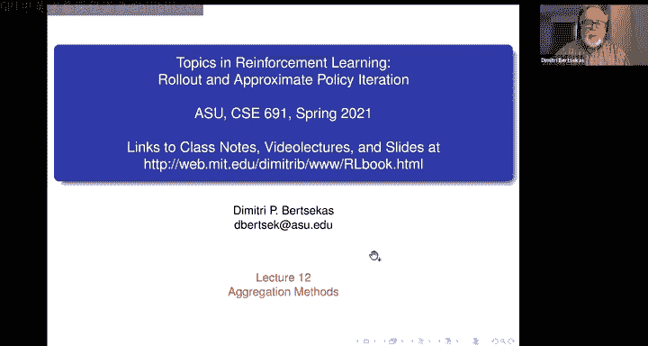

We're going to have some introductory remarks to aggregation。

 its nature and what we can expect from it。Then we are going to talk about a simple form of aggregation that involves a representative states。

 I'll explain what that is， it's a form of disctization of the state space with a coarser grid than what there might be might have been there to start with。

呃。Then the basic principles of aggregation for whatever present States are going to be extended to a more general type of aggregation involving features。

And we're going to give a number of examples of this type。We're going to form an aggregate problem。

 a simpler problem than the one that we started from。😡。

And we're going to look at solutions reference based， for example， on policy duration。

And also simulation。Then we're going to discuss some variations of aggregation and that will be the last topic。

Now， most of our lecture， almost all。Is going to be based on videos from the 2019 class offering。

So I'm going to switch to the video， but at strategic points。

 I'm going to be pausing for you to ask questions。So let me go to the video now it started now。

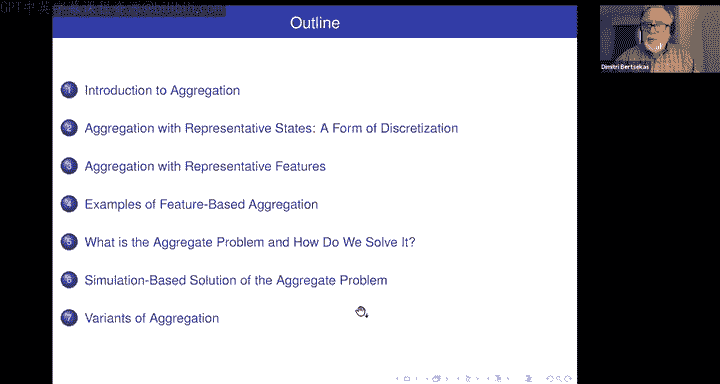

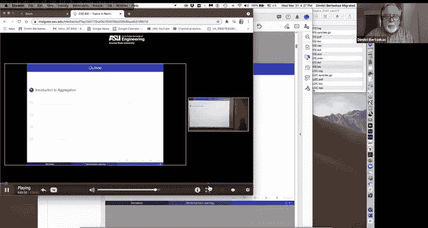

So。Where does aggregation fit in the big picture well we have our friend here the big picture figure and here's aggregation remember this is for one step look ahead we're looking at a discounted problem we're going to be looking at discounted problems exclusively in this lecture and we're looking at one step look ahead and J Tilda is the approximation of the future costs and it can be obtained with any of a number of methods problem approximation or roll approximation policy iteration parametric approximation neural networks and we have covered all this and now we're going to talk about aggregation also the other approximation but we're going to focus on this how do we approximate using the aggregation method。

So now aggregation is actually a form of problem approximation。

 it qualifies as a special case of this， if you will。

 basically we approximate our dynamic programming problem with a smaller and easier。

 less dimensional version， we solve it optimally and we obtain J Tilda in this way。

It is also related to parametric approximation because we are going to see that it produces J tildades that can be viewed as feature based approximations and in particular if J Tilda。

 we're going to see a major special case， major special cases are going to be obtained when JTilde is piecewise constant。

And we have seen that piecewise constant functions can be viewed as feature based approximations with the members。

 with the features being。0，1 membership functions， one over a subset，0 everywhere else。

So there is a relation of aggregation with this， there is a relation with this。And。

Not only there is a relation of parametric approximation。

 but it can be combined with parametric approximation。Like a neural network， for example。

 in two ways， we can use the neural network to provide features for feature based aggregation or we can add a local parametermetric correction to J Tilde like a piecewise constant approximation to a JTilde obtained by a neural network。

 so we may have already some J tilde obtained from a neural network and then we can correct it with piecewise piecewise constant approximations。

Moreover， there are several versions of ag， here is one step look ahead。

 we could be looking at multistep look ahead， which is very similar。

 finite horizonor as opposed to infiniteite horizonoriz and there are other versions that I'm going to go into in the next lecture for today's lectures。

 this is the figure okay。Okay， so let me get you get across this idea through a simple example。嗯。

Which dates back to the early days of dynamic programming。

 approximating a state space which may be large with a coar grid of states。In fact。

 it's an idea that goes back to the very early days of computation。 Okay。

 any kind of numerical computation has。Ha at some level involved ideas like that。

 sort of thinning out a number of variables。Fcusing on a certain subset。

So here the states in this figure are the cross points on this grid， the black cross points， okay。

And this are they are represented by this fine grid。The representative states are the red ones。 Okay。

 it's a small smaller subset。And so this is the red grid is a coarse grid that is lies in between the fine grid。

And we produce these these。States， and we call them representatives。

So now the idea here is to approximate the original dynamic programming with a course grid dynamic programming problem who states are these fewer red dots？

U。To do this。We have to form an aggregate problem and for this we need transition probabilities from red states to red states。

 how do we move under the influence of control in order to define an aggregate problem。

 we need to define transition probabilities and we need to define also the cost of transition from red states to red states。

Now suppose we have done that。We can solve the aggregate problem by exact dynamic programming。

Because there are fewer representative states， we may consider doing that。

Now after we have obtained a cost。An exact cost from the aggregate problem for the red states。

 we have to extend it to the black states right？ How do we do that Well。

 there are a number of ways of doing it by some kind of relation or proximity， for example。

 states that are black states that are close to a red state may take the value of the red state。

 or otherwise a red state right here maybe obtain an approximate cost by interpolation。Of the。

Approximate of the course of the red states。One possibility is our nearest neighbor piecewise constant heuristic scheme。

Where a fine grid state， a black state takes the cost value of the nearest cost grid state。

 that would give you a piecewise constant。Approxiation， right。

 and the levels are going to be the exact optimal cause of the red states。Okay。

 so that's the first idea and we're going to build on that。So。

We'll introduce these representative states and we are going to approximate a prominent by projecting onto them。

So look at this figure here。The black states are in this black enclosure。

 and they are the original states， O of the original problem。

The red states are the representative states， it's just a subset， okay？And。We' are going to relate。

The original system states like this J。To the aggregate states by means of some kind of a similarity or proximity coefficient。

 this fees here。Add up to one。 there are probabilities。 There are weights that that connect the。

Original system states to the representative states。

 they are non negative and they add up to one okay so in a problem that has a geometric character。

 this may be distances okay or in a problem that has a different character based that can be selected on the base of intuition of the given problem。

If you could also have only one of these fees be one and the others be 0。 okay。

 and then you attach the black states to a particular。Re state。Okay。

 so I have this red states and I have introduced these aggregation probabilities。

And this defines aggregation dynamics。Whereby the transition probabilities between two representative states like this X and this y。

 generally speaking I'll be using the convention aggregate states are going to be x's and Y's。

 Origin system states are going to be I's and Js。So from x to y。

 what is the transition probability given these fees。

 well it's this one is the probability of going here and the probability multiplied with the probability of going or this probability here and we have to add of course over all possible successors of this representative state。

Okay let me repeat here， the black state the red states are just legita states。

 they're just a representative， the green arrows are the transition probabilities of the original system。

 and then we complete the transition to another representative state by introducing by using this aggregation probabilities。

So this defines， for me， transition probabilities between the representative states。

In the process of this transition， we incur a cost， what is the cost well along the green archs。

 we have a certain cost。G of X， U and R J， and depends on U。 And if we。

Average over all J that come out of this x。Will you obtain the expected cost？From。

Re state x under control U。 So my model is completely defined now。

 These are the transition probabilities。Given these filess， and these are the expected costs。

 And I'm in business with dynamic programming。Here's the aggregate problem。The original。

Problem involves transitions and cost from Is to Js， the aggregate problem。

Involve transitions from representative states to representative states under these transition probabilities and under these transition costs。

I can solve this problem。Exactly， and let me call r stars of x。

 the optimal cost of representative state x。Now having done that。

 I obtain approximate course for the original states to Js by interpolation。With his f。Now。

 in a case where the phis arrive0 or1， then I have a piecewise constant。approximationroxiation。

 why is it bewise constant because all the fees here are going to be zeros except for one that's going to be one and if you consider this set here of all Js for given why if you consider the set of all the Js that map onto that y。

 which I call the footprint of this representative state。Then。

J Tilda is constant on this set and takes the value R stars of y。Okay。So。

This is a small dynamic programming problem， it gives me these numbers here。

 and I use these numbers to obtain a piecewise and interpolated cost function on the entire state space。

 which is piecewise constant in this special case where all the Phis are either zero or one。Okay。

So basically， that's the。The aggregation framework of representative states。And for another picture。

Now I' consider again the case， the simple case of Pwise constant。

 where all the phis are either zero or 1。The green function。I is J star okay？

On this axis are the states and the representative states。 Now。

 the states are the things that are in here。 The representative states are。Just these。Okay。

Each representative state under this assumption here has a footprint。

And the approximation is peaceful constant。Within each footprint， the level of constancy is the。

Is the optimal cost of the corresponding representative state？Now。

 if we didn't have this case where J connects to a single x， if J connected to multiple x's。

Then this would not be piecewise linear， it would not be piecewise constant。

 it would be piecewise linear。And。It's sortrt of a similar approximation。

 perhaps a little bit more faithful， more ambitious to approximate well， this green J star function。

O now for this case there is an  error bound and this  error bound is not important because you can calculate it and get some conclusion out of it。

 but because it is qualitatively expressive of what happens in these approximation schemes。

So this gives you the approximation error for this case。

And it says that let's consider these footprint sets。Over which the approximation is constant。

And suppose？That J star varies little within this sense。Okay。

Then the approximation is good in the sense that the error is small。So look at this bound here。

If epsilon is the maximum variation of J over all these footprints。Okay， so look at。

At this particular footprint and look at states， look at the maximum variation within here。

 the maximum variation over all of those， and let's call this epsilon。Then， Jay Tilda。

Produced by the aggregation scheme is within J star。With a bound of epsilon。

 but divided by1 minus alpha， which I don't particularly like。

The thing to read from this theorem is that。The arrows is small if J star does not vary very much within this footprint。

In fact， if J star did not vary over this oneprint。

 if the original green function were piecewise constant， exactly like that。

 then aggregation would nail it exactly would find the exact J star。

There are bounds like that all over the place in the theory of aggregation。

 and again you should not look at them literally， you should look at them more from a point of view of what they express qualitatively。

Are there any questions about the frameworks so far？Remember on terminology and notation。

 I's and J's are for original system states， x and y's are for aggregate states。

 we have representative states in this framework， we have this aggregation coefficients that connect Js with Y's。

And。And the approximate cost function produced by aggregation。Heres。

A is obtained by interpolation exact of the R stars that are obtained by solving the exact aggregate problem。

Okay。So how do we solve this aggregate problem？This is my aggregate problem here。

 I have defined its transition probabilities， I have defined its cost function。

 and I can use any exact method if I can calculate all these numbers。

 I can use any exact method for solving the problem。Value duration， policy duration。

 optimistic policy duration， linear programming， whatever you might have。

The problem is a little bit more difficult perhaps because it involves these extra probabilities here and notice that the problem is stochastic。

 even if the original problem is deterministic， the aggregate problem is stochastic。😊，However。

There is some problem here。 Do you see the problem？Potentially for large， if n is large。

 suppose that n is large。What's the potential difficulty here？Suppose n is 10 to the 100， let's say。

new。Eating the im model for the representative states will be expensive。

There's a summation here over n。 If n is very large， you would never make it。

Unless the problem is sparse， okay， I have relatively few x's and I have only a few successors， J。

 then I'm lucky I can use this method here otherwise。

I will need to have some different way to deal with this problem and the way to did to deal with it is with simulation。

If I have a simulator for the original problem， then I immediately get a simulator for the aggregate problem because my fees are given。

 so all I have to do is concatenate the system transitions with the fees and I get a simulator for the aggregate problem。

So I can use this simulator to obtain an exact model free method。Based on the simulation。Notice here。

 I use the term model 3。 I intentionally stayed away from。From。

From using a sort of colloquial use of the term model free。

 model3 does not mean that you have a for our purposes， model3 means that youre using simulation。

 It doesn't mean that you don't have a model here we may have a model。

 but we may use a model free method anyway。Okay。So a little bit that's all there to say about this representative states model because we have a solution method and we have a variety of stuff here that we can use。

if the number of access is very large， you may consider using an approximate dynamic programming method to solve the aggregate problem。

 it's also possible to do that， although we're not going to emphasize this possibility。

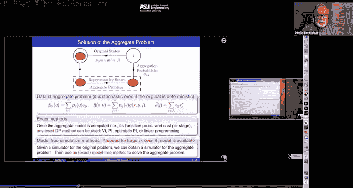

Okay， now if you think back at the framework， you'll see that everything applies to the case where the state space continues。

Okay， think of a continuous state space and get a。A finite number of representative states in there。

 if you can calculate the corresponding transition probabilities and corresponding costs。

 you have an approximation to the original continuous space problem。

We haven't talked about infinitefinic horizon continuous space problems except in the very beginning。

 there is a theoretical requirement that the cost per stage should be bounded。In order， therefore。

 the theory， the good theory to apply because only then we would have contraction mapping under。

 but that's fine， okay， the cost per se should be bounded。

We can still use a simulation based approach for solving the aggregate problem。

 because if we have a simulator for the original continuous space problem。

 we still have a simulator for the aggregate problem as well。So in this way。

We have a general discretization method for continuing spaces discounted problems。

And this can be quite useful in a number of contexts in an important context where this is true is po DP。

Now， Po DP， remember， is finite state problems with partial state information。

 and one way to address them is to consider。The problem in the belief space of probability distributions of the state given the information。

 So in belief state land， you have a dynamic programming problem that has a continuous state space because the space probability distribution is continuous。

However。This type of problem fits neatly into this formulation here。嗯。All we have to do is。

Introduce a representative states within the simplex of belief states。

And then solve the corresponding MDP。So the partial observation is lost。Within this framework。

 we have a regular playing vanilla。呃。Marakovvian decision problem with perfect state information。

It has a finite number of states， finite number of controls。

Because the pump assume to have a finite number of controls。And。

It can be easily defined and can be solved by any exact model base or Model 3 method。

And after we solve this。Dretized pump DP problem for the optimal aggregate of R star。

 Then we obtained a。A uninterpolateulated approximate cost function。That's a powerful method。

 actually， to solve Poky appeal with relatively few states that people don't has been addressing the literature。

For quite some time， but people don't like it very much。 They look at other methods。

 whereas is very often this type of method applies very nicely。Okay。

So I have a challenge question for you involving continuous space problems。嗯。

I have a self driving car that wants to drive from point A to point B within this continuous space。

And it has to avoid these red obstacles here。And it has a travel speed of1 meter per second。

 but in any direction， you can point a car in any direction you want， and that's its travel speed。

And this is 1000 meters， and this is 1，000 meters。Okay。

 so this is a problem that has a short path problem， but we have continuous state space。

So I approximate this by introducing a fine grid， okay？Make sense to do that。And。Okay。

We disquitize a space with a fine square grid and we restrict in order to stay on the grid。

 we restrict directions of motion to be horizontal and vertical。

 So in this approximation it has to move on the grid at this speed here， but go one step。

Horizontally or one step vertically。 So we restrict also the direction of motion。

 not only the direction of the end points at each step。And then we take。

 we solve this by a short path method， right？And。And we take this solution as an approximation。

To the solution of this problem。Is this a good approximation？Okay。

I want you to think for five minutes， some of you may know the answers， so don't give it away。

Okay guys， let's take a five minute break for you to think at this question。

 sort of a cute question because particularly because it involves a pitfall that many people fall for。

 even experience people， make the mistake， make mistakes around this question。

So what I'd like you to do is take five minutes to look at this question。

 we'll come back and also take the opportunity for you to ask questions about the slides so far。

 the approximation， the aggregation with representative states。So we're coming back in five minutes。

And before we go back to this challenge question， let me ask you about aggregation with representative states。

 are there any questions， is it clear what we are doing？I think the view of discretization。

Passing from a very dense grid， original system state， which lies on a dense grid。

 or on a continuous space， passing on to a coarser grid。

 I think this is sort of a good image to keep in mind for approximation for aggregation with representative states。

So have any questions？I just wanted to verify that a representative state is also an original state in all cases right。

 or is it that's right， it's a finite and smaller subset。

And we sort of restrict the problem to this finite and smaller subset to obtain a smaller problem。

 one with smaller states， but then we have to figure out what to do if in the course of transitions。

 we end up outside the representative states and this fee probabilities bring us back to the representative states。

 and so everything moves from x to y a representative state x representative state y so it's a smaller。

 it's a way of reducing the size of the problem。So problem them approximation。Okay。

 so in in the case for。OrP DP， for example， you would to do this。

 you would just sort of put like a finite precision on the probabilities that you're associating with each of the original states right is that how you exactly I see？

You have the belief space is a continuous simplex， the set of all numbers that are positive non negative and add up to one and and we select a finite subset within this simplex and these are the representative beliefs okay and we define now a problem that goes from representative belief to a representative belief and that's the aggregate problem I。

Thank you。Any other questions？Yeah， I a couple of questions， first of all。

 how do we actually select the aggregation probabilities？Okay， we haven't covered that。And。

Or how to select aggregation probabilities， okay？If your problem has a geometrical character。

So that let's say all the states lie on a two dimensional plane。

Then then the aggregation probabilities would have to be related to geometrical proximity。

 so if you have a state that's surrounded by some other representative states lies within a triangle that's defined by three other representative states。

 then you take as fees， for example， the relative distances to the three states。

It would be a natural way to do it， but I mentioned also other ways where the probabilities are zero or1 based on proximity。

Now， in this geometrical case， geometrical state space situation。

 usually geometry gives you the answer of how to select the fees。Otherwise， it's not so easy。

And it's basically problem dependent， and we can just leave it at that because I really don't have any better answer。

Okay， and then I'm guessing it's also problem dependent on how we select the representative states。

Yes， absolutely， yes， it's also problem dependent and again。

 you can give concrete examples where it makes sense on various schemes make sense on an intuitive base。

On the other hand， now we are going to give some automatic methods that are based on feature based aggregation。

 but this is going to come later in this lecture。Okay， and then I was also wondering。

 is it possible or I guess useful to。Combine this aggregation idea with time delay state augment schemes that we saw earlier in the course。

So that we can in some sense attempt to aggregate across time as well。嗯。

Aggregation of time is something that we are going to discuss in this lecture， at the very end。

Where there's going to be aggregation in space， but also aggregation in time。Other than that。

 I have no other。No other good illustration for how you deal with time delays。Okay， yep， thanks。Also。

 one last question if I can。So at the end， once we were using the aggregation probabilities to do some kind of interpolation。

 could we also use some kind of parametric model like a neural network， for example。

Like we learn an exact。Solution on the aggregated problem so we have the exact optimal cost for those representative states can we use those to just form a training set and then train。

A neural network to the products meet the cost function。For that。Yeah。

 but what does this have to do with aggregation， This is just training， right。

Whyhy is it connected with aggregation？I guess I was just thinking instead of doing like a linear interpolation at the end once you are going back into the aggregate states or sorry。

 once you go back and try to apply。to the other states other than the aggregate states like could you use some other kind of model。

That would generalize better， hopefully generalize better than just doing a linear interpolation。

Okay， so what you're saying is instead of linear interpolation by using this aggregation probabilities。

 the fees， the fee numbers use a linear type of interpolation， but that's that。

Takes you away from the logic of the aggregation approach。

And invalidates some of the principal methods that rely on these fees being probabilities。

So I want to stay with Ph being probabilities。Okay， sure， makes sense。这个人。Okay。

 so back to this challenge question。 what do you think about this idea， this question。

 this question here， is this a good approximation to do this grid and sort of construct by some kind of a shortest path method。

 construct a path， an optimal path。That is a jagged like this。

 and then use this path as an approximation to the optimal path for the continuous space problem。

I have an idea it's just kind of a guess。Okay， so。The pitfall that you mentioned， is it related to。

Manddabro's coastline paradox where the smaller the precision that you use when trying to measure the length of a curve。

The seemingly longer it gets。IfFor example， if you were you to use like a smaller precision on this grid。

 you might get an even bigger cost， that's just a guess。Yeah， I don't know this paradox。 Okay。

 I'm sorry， Okay， but， but。What happens here if you use finer precision， Okay。

 it turns out the paradox is that no matter how fine the precision is。

You cannot improve the result and you cannot approach the continuous optimal， continuous path。

That's the challenge question I。Any other comments on this challenge question？

Wouldn't the cost always be the same it'd be the same as if I took the path from a went to the bottom right corner and then went all the way up to the top。

And that cost would always be the same no matter what the precision is。

 because I always have to take that same number of steps up and that same number of steps to the right。

That's exactly right。The problem here is that。All solutions that do not look back on themselves。

 Okay， are equal in this discretized version。 You can go this way， assuming， of course， that the。

The costs are uniform， okay， it costs you the same to move for one meter。

 whether you go up or you go sideways。Then you can go this way and get the same ghost as this one。

 and you can go this way。All of these are the same and moreover they are less than they are more。

 they are more costly paths than the path that's obtained by continuous motion， for example。

 with a straight line。ForThe straight line， it is the square root of of two times 1000。 That's the。

That's the。That's the cost to go along a straight line from A to B。On the other hand。

 if you go along the grid， it is 2000。 it is 1000 times2 versus 100 times square root of two。

So let me get to the let me start the video and go to the next slide。

Are any questions about what what I'm asking？So the optimal solution here maybe this continuous brain curve。

 the optimal solution here may be something that's discreite。

 Now as you make the grid finer and finer， you're getting something that's better and better。

 but will you do as well as this， That's what I'm asking。Okay， I think I have to advance the video。

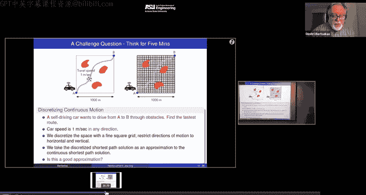

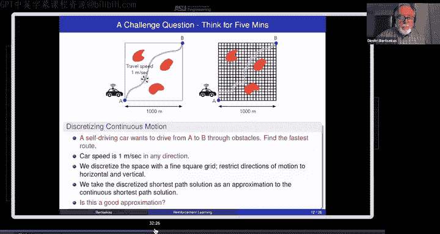

Let me explain this a little more。O。The is flawed。And。And here's an example。

That assume that all motion costs one per meter， okay？And there are no obstacles。

 then the continuous optimal solution is the straight A to B line。 there are no obstacles here。

And it has length。It has length square root of  two kilometers， right？It's  one kilometer this way。

1 kilometer this way around the hypotenus is square root of two length。And this is the optimal cost。

The optimal distance， okay， from here to here。However。

 the discrete optimal solution involves counting units along the piecewise。

horizontalorizontal vertical path， and no matter how you do it。

 you're going to have a distance of one and another distance of one，2 kilometers。Okay。

Not a square root of two，2， no matter how fine you make the discretization。

And the problem here is that the state space is discretized finally。

 but the control space is not okay， you have to discretize the control space also。

Many directions and then use aggregation， okay use a stochastic formulation to make interpolations up properlyly。

 and then in the limit you can prove that you can get the optimal cost。Yeah。IfIn the actual space。

 I live alone。I can move from one corner to the other corner。就冇水伤咩。have。

So you are considering on applies into the environment。

If I also volunteer see get an action that I can vote。ああかな。

No it will not work what you're saying if I understand it correctly is I suppose that here not only you can go up or down or you can also go diagonally that will not work The reason is that instead of having the control points in of discretizing with four points you want to discretize with edge points but what we want is a large number of discretization points you take all these diagonal directions。

And approximate with a finite number， a large number。 And then you'd be getting。The cost limit yeah。

The8 points。Eight points will improve it， yeah。But instead of a square root to2 bound。

 you have a different bound， a little better bound， Okay， but still。You have a problem。But。

What you can say mathematically is that if you add more and more directions。

 diagonal directions along which you can go in the limit， you're going to get the optimal。

That's same。It will not increase it。 it will not increase it because you will keep those black states to the representative states。

 and then youll add aggregation coefficients。So you move perhaps from here and you end up somewhere in the middle of the square。

 and then with aggregation coefficients， you interpolate to the neighboring black states。

So to solve this problem， to solve this continuous space shortest path problem。

 you need to make this stochastic， you need to make it a stochastic shortest path problem to solve it by aggregation。

 It's an interesting concept in order to get the exact solution in the limit by discretization。

 you need to pass to a stochastic formulation。Now in the Pom DP example that I gave earlier。

 this is not an issue because in PomDP， the belief space is infinite is continuous。

 but the control space is finite， still finite so we don't have this particular problem here。Okay。

So now from aggregation we represent the states， I'm going to pass into a broader and more powerful aggregation framework that will involve features。

Now what's the main difficulty with the representative state scheme？

It may not be easy to find a set of representative states and corresponding pwise constant or linear functions that approximate well J star if you do blind discretization you cant figure out whether the function changes by a lot or the J star changes by a lot or by a little so some parts of the state space may need more representative states and others may need less so。

If you go blind into a given problem， its hard to find。

 it may be hard to find a good set of representative states， there may be too many in other words。

 you may have to go to a very large number before you get into a good approximation of J star。Now。

 suppose you have a feature vector， a feature vector that you get trust。

 It sort of expresses the nonlinearities of J star well enough。

Then instead of discretizing the state space， we discretize the feature space。

So we introduce representative features that span adequately the fis space。

And we aim for an aggregate problem whose states are going to be representative issues rather than representative states。

And。We associate every representative feature with a subset of states。

That relate to it approximately， that approximately map into that representative feature。

 remember extra representative feature， and we consider states that have a feature map that almost map into that。

And this。A relationship between states and their features and representative features is done with the help of some ways。

 which we call dis aggregation probabilities。The disaggregation probabilities roughly say how close。

State i is。To the representative feature X。We also consider aggregation probabilities。

 interpolation coefficients from passing from aggregate to original。Clst function。

And we construct an aggregate problem using the representative features。

The Phis aggregation coefficient in this additional coefficients that relate features with states。

Look at。So here' is the conceptual picture。Here's the state space。And this is the feature space。

 So these are features in here obtained by applying the feature extraction mapping the F onto these states here。

 we discretize this a regular discretization in the feature space gives you an irregular。

Partition of the original space， where I of x。AV。Okay， we pick a state X inside here。

 which we consider a representative。 and I of x is the set of states that map into the neighborhood of X。

So somehow we were able to look at the features space。

sortrt of partitionly discretized in some regular way obtain a representative features inside each one of these and look at states that map in the neighborhood of each one of these representative states。

 and we call them I of x。And for these states here， I introduce a non negative。

 a possibly positive coefficient D。So here's the figure that I had before， but enlarge somewhat。

We have transitions from representative features to representative features and from original states to original states。

 and we go this way and we map representative features into a subset of states like this one which almost have feature value equal to x。

And then we go back here and we use these aggregation probabilities。And once I define。

This de coefficient， this probability in this phase， I have a model for transition。

From one feature to another feature。And also a model for the cost， the corresponding cost。

Now we have to explore the properties of this problem here， whether it's good or not。

 but this is the basic framework。Representative features plus。Connecting probabilities。

 connecting weights， connecting relations， if you will。Okay。

So let's take another break just to give you some some time to assimilate this concept a little bit。

 but I'm going to ask you the following question。Okay。

 this is the figure I had in the previous slide， why is the representative states model。

 a special case of the representative feature model。

 and that's an easy question just to warm you up okay？😊，And here's another question。

Just like we had this error bound for representative states。

There is a general principle in this feature based aggregation。

 which I'm not going to prove right now， but is intuitive。Namely。

 that we should be choosing features so that states with similar features have similar cost function。

Make sense， that's what features are for to tell us something about J star right so suppose that we choose we have a feature map like that。

In other words， J star changes little within each of the footprint sets where these probabilities are positive。

Can you think of examples of feature schemes that would fulfill this type of condition？

What would be useful features to choose in this context here？

Let's take just a few minutes to think about Ra then we come。Okay guys， I'm postsing the video。

 let's take five minutes to sort of warm up to these questions and try to get used to the notation and the concepts and then when we come back you can ask your questions and we can also continue with these questions。

So five minutes and we're coming back。And。I want to ask whether there are any questions so far before we go into this question one and two。

Yeah， can we extend this， we can extend this to a Q learning setup right where we would just use the aggregate state。

In place of the original state。So in regards to。Like the state action pairs that we were using Q learning。

Yes， it's possible to use Q learning for V aggregate get problem。

So the state action pairs would be correspond to aggregate， state and action pair。And。

It's not's not so simple as it sounds， but。It's a possibility because there are fewer state action pairs in the aggregate problem。

Yeah， that's we get into that。Okay，' not going we're going to get into some other methods that are simulation based。

 but not Q learning。And then are we also going to get into， I think it lends itself。

 obviously to some。Paraallelization are we going to be talking about that later or if not could you just maybe。

Give an overview of that。I'm not sure there are interesting issues that are specific to aggregation。

 there are genetic parallelization issues that apply also to aggregation。

 but no specific issues have that exploit the aggregate structure。I don't think， okay。Okay。

 so let me restart the video。Convene again。

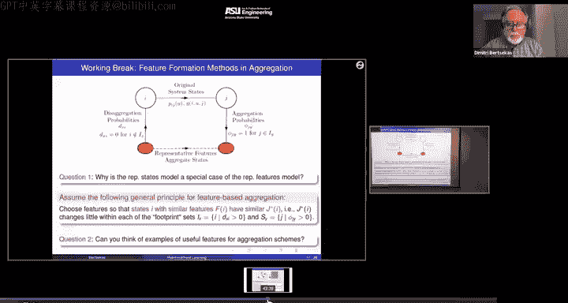

You know the answer。

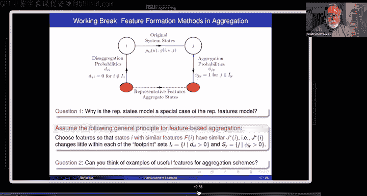

Okay。So let me get into that。Examples of speech based aggregation。Okay， use a scoring function。

 suppose you have some kind of a scoring function， V， which is approximate J star。

Then we can group together states with similar scores。And call these sets features。 Okay。

 within which set does your state fall。In particular。

 we can partition the range of values of V into M disjoint intervals。

 like what you were saying earlier。Okay。Let's look at this figure。 It's a little complicated。

 The green function is J star， but we are trying to approximate The red function is what we are going to get。

The black function is the scoring function。It doesn't have to be。Very close to the green function。

 as long as it catches。The horizons and falls the shape of J star。

So now we look at the range of the scoring function， which is from here to here okay。

And then we cut it into pieces。And the corresponding states we call。The footprints of。Of feature。

 a representative feature。 So a representative feature would be the little point， let's say， of this。

 of this。Of this interval that corresponds to the topmost range。

Now the representative state feature would be here and so on。

And so we define a feature vector according to this， which says。

If your score is within this interval， representative your feature is the index of that interval。

So the feature here is membership within the corresponding interval of the scoring range。Okay。

 so this is one idea。 and how would I get good scoring functions？Well。

 cost functions of heuristics or policies， we mentioned that。

Approximate cost functions produced by neural networks， perhaps after one or two policy durations。嗯。

Now let's draw a connection with rollout。His rollout。

What we do is we have a policy and we evaluate this cost now suppose we take a scoring function the cost of a policy。

Then rollout produce uses as cost approximation this JM and aspires to do better than this JM。

Now suppose I use。Jame knew as my scoring function to form features。

Then the resulting J tilde is not J mu， but it's a nonlinear function of J mu that aims to approximate J star。

 in other words， aggregation goes for J star， not for an improvement of J mu。You see the difference。

 it has the potential to give you much more than the rollout approach。In fact。

 if the scoring function quantization were so fine as to have a single feature value per interval。

 then I would have J tilde exactly equal to J star。If I make。

 if I digtize my feature range finely enough， then I will get J star。

 not an improvement to J new like rollout， I will get J star， which is much better。

So with this type of scoring function， you can view aggregation as a more sophisticated form of rollout。

The downside to this is that it's more computation intensive。Because if you have J New。

Then rollout can be implemented very easily， just one step Look ahead。It can be done online。

 however here there's a lot more computation to be done to solve the aggregate problem。

Using a single scoring function can be enhanced considerably。

By considering multiple scoring functions。Okay， so if one scoring function doesn't catch it。

 you get some differentiation of features through another scoring function。Okay。

 so let me get into the possibility of using neural networks。

And this is the big thing about neural networks。 out there at the output。

 it produces features and produces some kind of a cost approximation by linear combination of these features。

So suppose that we have trained a neural network。Maybe with one or more policy directions。

 and we have obtained an approximation。These features now can be used by discretization to form representative features。

 In other words， we can sample this feature space。That we obtain from the neural network。And in fact。

 the training process of the neural network produces a lot of feature values， right， in fact。

 state feature pairs。So we can obtain representative features and footprints corresponding footprints of of corresponding states。

By from the training set of this neural network， and we can perhaps supplement it with additional pair data。

 perhaps to improve exploration， for instance， things like that。Moreover。

 I can extend the set of features that I get from a neural network by using some kind crafted features。

In a more sophisticated and ambitious formulation。And notice now that this form aggregation yields a non nonlinear function。

 J tilde of the features， this is linear， the aggregation will give you a nonlinear function that aspires to approximate J star。

 not J hat。So it goes for a bigger target。Okay。So now let's look how policy duration will look in the context of aggregation and neural networks。

Suppose I use。A neural network based parametric approximation to do policy duration。

We have gone through this。We have， we have a scheme that generates a sequence of policies and from the current policy。

 we train a neural network to represent。cost function of that policy how do we do that。

 the neural network generates a feature vector， linearly weights it ands an approximation to Jnu。

 the cost function of mu and then we do a policy improvement operation a one step look ahead and I obtain the improvement policy。

This is what we have gone through with a neural network。Now。

 suppose I bring in aggregation into this picture。How would it work？Again。

 I want to generate a sequence of policies。From the current policy。

 I have the neural network producing a feature vector。

 but instead of using this feature vector to obtain an approximate cost function。

 I sampled this feature vector for a representative values for representative features and I could obtain an aggregation framework which I can solve to obtain a new policy from the aggregation problem this is going to be different than that and potentially more powerful。

So there are several options for implementing this scheme is sort of a mixed neural network aggregation based policy duration。

I can do this neural network process multiple times each time followed by an aggregate problem solution and that constraintstrains a new policy。

 in other words， use this policy after policy after policy。

Another possibility is to use the neural network training process and the feature construction only once。

Okay。And then obtain some set of features， which I can use in the aggregation framework。

I can also add after the neural network feature formation。

 I can add problem specific handcrafted features， I can add features from preview cycles。

 I can enrich my set of features in a more flexible way than otherwise。

And one more thing about deep neural networks， deep neural networks。

Use more sophisticated final features and relatively fewer， okay， because。

The training and the weights go through so many processes rather at the end。You have。

At the end of a hierarchy of features， you obtain more sophisticated features which can be more useful in the context of aggregation。

 you will need fewer representative states if you have better features。

 which deep neuro networks will give you。Now all of this is somewhat speculative。

 and those of you that have attended my lecture in here at ASU at the end of April or the end of last April。

May remember the， the flavor of this， of this line of development。 This is relatively new。

 It has not been tested。Extensively， okay。But。I hope that。

Some of you will not do this for a project in two weeks。

 but will do it sometime in the next few months， maybe be interested in trying some of these ideas because I think they do have merit like everything else。

Like everything else in approximate dynamic programming。

 don't expect this to work well in every circumstance。

 but there will be uncon circumstances where it will do better than other schemes。Okay， there's up。

Big omission so far， we have discussed how to solve the aggregate problem for the case of a representative states。

 but not for the case of representative features。 And this is an interesting challenge。

 How do we solve this aggregate problem and how do we formulate it。

The simplest thing to do would be just to mimic the simpler representative states model。

In other words。Okay。What are the transition probabilities from here to here。 Well。

 there's a certain formula。That that corresponds to a given you for each pair X Y。 okay。

 this is just the multiplication rule of probabilities to go from x to y。 I have to。

Go to one of the state's I with these probabilities here and then go across with these transition probabilities and then go down with these other probabilities。

 And this is what you get。At the same time， as I go through the cycle here。

 I incur a cost right here right at this point， and that cost is the expected cost of going into states in here。

And then the expected cost of making the transition， This down transition does not cost anything。

So this is the expected cost per stage。However， this gives you a legitimate aggregate problem。

 but it is flawed。😊，Can you tell why it might be flawed？

These transition probabilities assign a U to all the states that correspond to x。

 there's a big restriction on U here that's associated with transition from x to transition from x。

So。He doesn't capture the variation of the control within the footprint states that this aggregate state maps into。

It gives you leg J tilde， but it is not very good， that's the problem。

So here's the flaw of this simple version of the aggregate problem。

Implicit in the formulas for the aggregate dynamics and the aggregate cost function is that for each given a representative feature x it's the same control that supplied at all states I in the footprint。

This is fine in the case of the representative states because there's only one state corresponding to which。

A representative state， but it breaks。 but this formulas become。Become flaky when you have。

The more general framework of representative features。So what happens here？

This problem can be solved again by exact model3 model based methods to obtain corresponding costs for the representative states。

 However， the J tilter that you obtain may not be as good。As good。Approxiation to JR。

 as you would like， is legitimate， but the approximation may not be very good。

So our first business for the next lecture is how to make this aggregate problem more sophisticated and also to discuss solution methods。

For the。Solution methods methods for solving it。Okay。

 I'm going to stop the video now and switch to another video， just bear with me for a second。

 here it is。

In order to bring in controls associated with states。

 we have to bring this into the aggregate model and what we will do is well create an enlarged state space that would involve both our representative features and the original states and their transitions So now from these。

I tripled the number of states， I have this is part of one component of state space。

 this one other part of the component and another part and each one of those has an optimal cost associated with it R star and I call this J tilda0 and I call this J tildas of1 these are not the same。

Because there's an in between transition between the two。Okay。So now I have an enlarged problem。

I have， of course， the full transition mechanism through this aggregation。

 segregation probabilities and transitionpro of the original problem， and I have Belman equations。

 There's one Bellman equation for this cost， another Bellman equation for this cost and another Belman equation for this cost。

The first one is this one， right。Its the weight that is the expected value of J tilde 0 weighted with the probabilities of the segregation probabilities。

The second Belman equation is the original Dman equation of the system and there's another Belman equation going down。

 J Tilus 1 is an interpolated version of R star with interpolation coefficients being。B phi。

So I've created a gigantic Belmon equation bigger than what I started。

 but it turns out that it's still simple and the reason is the following。😊。

If I take this J1 tilde and plug it in here。And then take the resulting J0 tilde and plug it in here。

 I eliminate J0 tilde and J1 tilde。And I end up with this equation。you see what I've done？

Taking this， put it in here。Takeking of this whole thing。And put it in here。

And Ive obtained an equation that has on the right hand side， the R stars。

Ha our star on both sides and the J tilde zeros and J tildas of once have been eliminated。

So now I have a composite Belman equation that involves only r star。

It has some differences than the Belman equations that you have seen before because it involves an minimization here and expectation here。

But it also involves another expectation on the outside。Okay。Still。

 it turns out that this pman equation has a unique solution for a discounted problem because this mapping turns out to be a contraction mapping。

 You can prove that a contraction mapping has a unique solution。

And you can try to solve it in various ways。Okay。Before we go into solution methods。

 let me mention an arrow bound。For representative states for the peacewise constant case where the aggregation coefficients are zero or one。

So the approximation J tilders of one is piecewise constant， okay。

 it's constant within each footprint。So for that case。

Consider these footprint sets corresponding to the representative features。

The result basically says that the error between aggregate cost and optimal cost is small if J star varies little within each footprint。

In other words， you get an approximation that's piecewise constant like that。

 if J star itself also varies is very little within。These footprintets， then the。

The approximation to the O coast is small。And here's the bound。

If Epsilon is the maximum variation of J star within each footprint set across representative features。

Then the error of the approximation scheme is epsilon over one minus alpha。

 splification factor1 minus alpha。 This is just a generalization of the band I gave in the previous lecture for representative states。

 which is not surprising because representative states is a special case for representative features。

So the implication here is that you ought to choose a representative features so that J Saai is little over the footprint。

Of X。 And this is true for this piecewise constant case。

 but it's generally true in the aggregation schemes。Roughly through。

 although it's hard to write a precise result。So that gives you a guideline on。

Which sort of supportive to what I mentioned earlier that you should choose。

Feature maps such that states with roughly equal J star have roughly equal features and also that you should be choosing representative features so that their footprint within their footprint。

 J star does not very much。Okay。So now let's go into the solution of the aggregate problem。Okay。

 so here's the aggregate problem。 This is a composite Belman equation R star。

On the left side should be equal to h of r star， which is the right hand side of Belman's equation here。

And I want to solve this equation。And it is natural to use some form of value duration now value duration would actually replace RK plus  one with H of RK right that could be value duration and it would work on the other hand。

 it's difficult to implement because there is an expectation here that bothers us。

It is a legitimate algorithm and converges because H is a contraction。But。

But it's difficult to calculate H of RK because of this outer expectation。

We're going to use sampling to approximate that。 and once you use sampling。

 you need to introduce all step size。Whereby a this duration。

 you compute an approximation to this h of R k， and then you move in that direction of that approximation with a step size gamma K that's diminish。

Okay， now all of this is not easy to digest because it involves。Difficult proofs。

And some insight in stochastic approximation methods that I understand that many of you may not quite have。

So this is something to look into at some time later。You don't quite grasp the details here。Okay。

 so here is how this works。 Instead of computing and expectation， we just sample this。

 we sample and at the。Time K， we iterate for a single representative feature。

 we pick a representative feature at random8 Xk。Update。The cost estimate of that。Using this。

Interpolation formula， and we keep all the others unchanged。Now IK here。Okay。

 we need an IK IK here is a sample from the footprint of xk。

Ands selected according to the disaggregation probabilities。And this is。This algorithm is solid。

It has a convergence result that dates back to the mid90s。

If you choose gamma K to go to zero at a rate of 1 over k。And some other technical conditions here。

Actually， this is the main condition， gaification go to zero and also。

The other condition is that each representative feature should be taken up for reeration infinitefamously often。

 you can't stop iterating on some x， right？So with these two。

 you get convergence to the unique solution R star。And。

This is sort of reminiscent also of Q learning in Q learning we also had expectation of minimization。

 the minimization was inside an expectation and。And we did sampling。

 you sample the outer expectation。 This is very similar and the proof of convergence is somewhat similar to true learning proofs。

 All of these proofs were done in the 90s。Okay。Now this algorithm is still quite formidable because you have an inner expectation。

 so if the problem is not deterministic。This is this may be a form double computation。So。

Policy duration does not have this problem。Why is that because in policy duration。

 we don't have this minimization during the policy evaluation so I can sample both the outer expectation and the inner expectation。

That's the difference。Okay， so I'm going to go through this and show you the formula list。

And so this is a policy direction for solving the aggregate problem。

And it consists of cycles of policy evaluation， policy improvement。

 it generates at each generation a policy and also the aggregate cost corresponding to that policy。

And these rs converge monotonically。There's no oscillation stuff here。 It's all good monotonic。

 and in a finite number of directions， RK is equal to our style。Essentially。

 what you're doing here is exact policy duration。For the aggregate problem。

 there are no approximations involved here， and there are no oscis， exploration issues。

 all this other stuff that can go wrong。Here， everything is guaranteed theoretically， to work well。

So let me give you the policy evaluation and the policy improvement cycles here。

So we have a policy in UK。 This is a policy that connects the upper transitions from original system state to original system state。

And the policy associates each state。To a control， right， It state eye to a control。

 not I represent the future， but it state。So the policy evaluation。

 we have the policy in the UK and we solve the corresponding composite Belman equation。

This composite Belman equation I've written here in the shorthand。R。

 so x should be equal to this right hand side。And notice now this right hand side does not involve an minimization。

 it involves the aggregationaggregationbabilities， it involves the transition probabilities of the policy。

 okay。And involves also the。Aggregation probabilities here。

And so how do I solve this policy evaluation problem Well I can use a sample version of value duration。

 the one that I had before， but we can do sampling for both I and for J okay we can sample this probability this composite probability here。

And。So that。That facilitates a Monte Carlo policy evaluation。But there's also an alternative。

Look at this equation， our is on this side， dark k over here。It is a linear matrix equation， right？

And can be written in this form。Where RK appears on the right hand side， left hand side。

 RK appears on the left hand side。With linear coefficients that I collect in a matrix A K。

 and this coefficients are。These things here。Times that。 Okay， this multiply the components of。

Of the vector RK。And there's also a constant vector， the components of the cost of vector。

 I just see this part。There's one for each x， and this is the vector。BK。

So now these are expected values that I can compute by Monte Carlo simulation。In other words。

 for every X I can compute this thing here by Monte Carlo simulation， I get one entry。

 then a second entry， all the entries of BK can be computed separately and in parallel。

By Monte Carlo simulation。Similarly， the coefficients of this matrix AK can be computed in parallel。

By Monte Carlo simulation。By。Doing this。Pro build this。

And then after I have calculated this to a degree of accuracy。I can。Use matrix inversion。

To obtain this solution。I make it sound easy， but in fact， it's quite formidable。

 and here's one of the difficulties。There's an inversion here。

And there is noise in the evaluation of this A K。Inversion does not like round of noise or any noise。

 can w havoc。If you have。If you have。A discount factor that's close to one。

 then this discount count factor is related to the spectral radius of this matrix。

 In other words the eigenvalues of this matrix is one eigenvalue set right up to1 is equal to alpha。

If alpha is very close to one， you have to do a lot of simulation。

To get this A K accurately enough in order for this inversion to make sense。

And there are special methods for inverting this type of method that。

That try to confrontvent around this problem of instability， duty due to Monte Carlo noise。Okay。

 I don't want to get into that。I don't want you to think that this is trivial， it's not。

So this is the policy evaluation phase of the current policy， and we have to do policy improvement。

And policy improvement is done in the usual way by one step look ahead。I have the solution。

I have RK from the policy evaluation， I plug it into the usual policy improvement equation。

 and I obtain a new policy。Notice that there's an expectation here that will potentially bother us for some problems。

You may have to use。You may have to use。Approximation in policy space on top of approximation in value space。

 in other words， calculate samples of the right hand side and fit some policy using some kind of a neural network or approximation architecture。

Nothing is easy in this field， okay？嗯。But we have， in principle。

 a certain method that has some nice properties。And we can work with it。Okay。So we have covered。

 that's all I wanted to say about simulation based solution to the aggregate problem。

 now let's talk about variations of aggregation。There's something called biased aggregation。And。嗯。

It deals with a following situation。Suppose you have already a good approximation of J star。

Aggregation aims to approximate J star， but if you have already a good approximation。

 you may want to build on the approximation and correct the approximation V rather than start from scratch。

Standard aggregation the way I have presented it corresponds to v equals0 okay now J star is this green curve here。

 it is the state， this is a function the state very oversimplified an oversimplified picture。

And v equals0， you can set up the aggregation， correspond aggregation。

Framework the way I have described it and obtained。Something like this red approximation。Now。

 suppose you know V that is。Sort of captures the shape。Of J star， more or less。

Then you may consider to use aggregation to build a correction。 Our aggregation is going to。

Give you a correction to this V that will approximate J star。And how do you do this。

 you can do it very simply， actually。By modifying the cost structure of the aggregate problem。

To add this be。the app transitions。In this way in the down transitions。Now， with this trick。

Structure is modified so that J Tilde gives you V。Plus。The interpolated R star。Now this is not so。

This takes a lot。 It's easy to see， but you need to write it down to convince yourself that I've done the right things here。

 I have added and subtracted the proper， the proper amounts。嗯。

This is actually in reinforcement learning。This process。He's also called。Cost shaping。

 You may have seen this。 costs shaping or reward shaping is actually an old technique in dynamic programming that date back。

Maybe 30， 40 years。嗯。When people try to modify the Belman equation by adding this attracting quantities and put it in some kind of variational form。

But in the modern days， you may see that cost shaping。And。嗯。And given this grief。

And now in given this。Agreggate framework， including the large state space。

 but just a different cost structure。Then you will have three Belman equations。

 given you R star Jt then J1 J tillL is 0 j to 1。Note that because of the presence of V。

 J tils of1 is going to be v plus a correction。 this is the correction that we add to V in order to get an approximation to J star。

If you know V to be， if you know J star itself and you stick it in here， then。

You're going to get R tilde0， J tilde。0ero and10 shade deal at 1 equal to J star。

 and the aggregation framework is going to give you the optimal policy for the original problem。Okay。

So this suggests that if you know a V that's close to J star。

 the aggregation problem is going to give you a better result， a good result。

Suppose you have some policy and you choose V to be the cost function of that policy。

Then you can apply the seggregation framework， and then you get something that looks like a rollout。

In fact， if you have a single representative feature that maps to all the states here。

It's going to be exactly the rollout algorithm。And this suggests that if you have multiple representative features and therefore a more accurate approximation framework。

 then。The aggregation policy is going to be much better than product。嗯。

All of this has to be verified， but it's clear from simple examples that this should be true in some form。

All of this is very new。 Okay， we're talking about stuff that's been developed in the last three months。

Okay， that error bounds also similar to the case where v is equal to0 and suggests that。

Once you choose a representative features in footprint sets so that。

Within which v minus j star values little。Not just J star， but v minus J star。Now， okay。

 I'd like to use v minus J star to construct representative features， but I do not know J star。

 so one possibility is to use。K value directions on V to approximate J star。

That will give me roughly the shape of this difference。

 which is what I need to know actually for using for picking representing features by using this expression as a scoring function。

I'm rushing all this by you， but you may want to look at all this later。 it does make sense。

 but you need to look into it a little bit more deeply。

So that's what I want to say about bias segregation。It looks like a promising idea。

 but the present has not been tested extensively。The idea of。Of using。

Cost shaping has been tested in reinforcement learning with results that look good but not fully convincing to me。

 Okay， buts something that people have looked into。Okay。

So let's take a break now and here's a challenge question to think about。We have this。Aggregation。

 aggregate problem。Involving a large state space involving the transitions here。

And we aim to compute our star J tilde 0， J tilde 1。

 which we're going to use in one step look ahead framework。And we have given some algorithms。

We have given a value duration algorithm that involves sampling over the footprint set， sampling。

 according to this。Probilities， we have also given a policy duration algorithm that involves policy evaluation。

 this composite solving its composite Bel equation for the current policy。

And then policy improvement using one step Look ahead。Now。

 a question to you is suppose that the problem is deterministic。

 make it as deterministic as you want。What's the benefit of it。

 How can we exploit determinism in this framework to make the computations。More。More tractable。So。

 and also。Suppose that you want to go all the way with theinism and use a representative states instead of representative features。

What's the benefit of that？And suppose that you want to get more even more fancy and you want to use instead of one step look ahead。

 you want to use multi step look ahead。Aiming at better approximation。How can you do this？

So the question is， suppose make it as deterministical you want and tell me what the benefits are going to be。

 what the potential benefits are going to be。And。We'll get back in five minutes。

Okay guys we're running a little late and there are a lot of concepts and I understand that may be challenging also a lot of this material is foot for thought for the future after all this is the last lecture of the course so we sort of go speculative a little bit。

And。You may。You may browse around this slide for a couple of minutes and then we're going to be started again。

And if there are any questions at this point， you may bring them up。

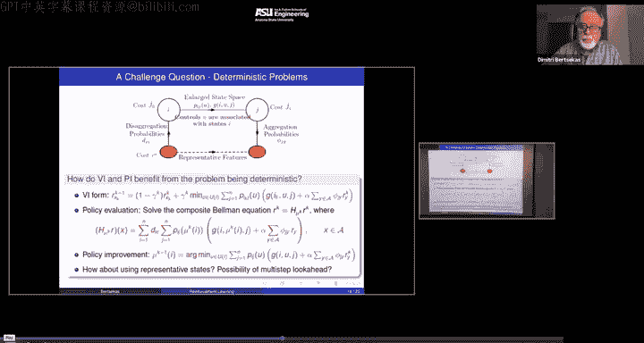

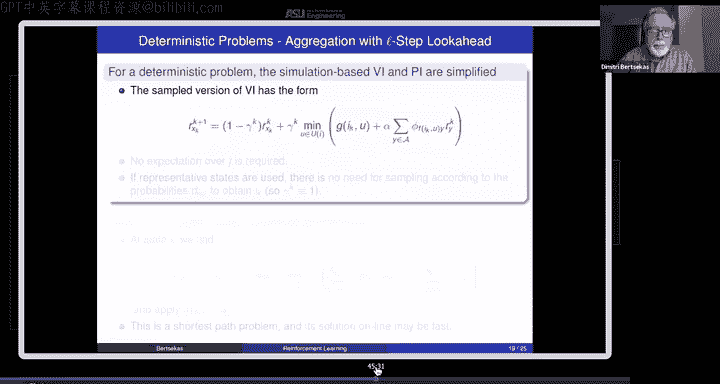

Be here。嗯。For the domesticistic problems， the simulation based value and force。So。

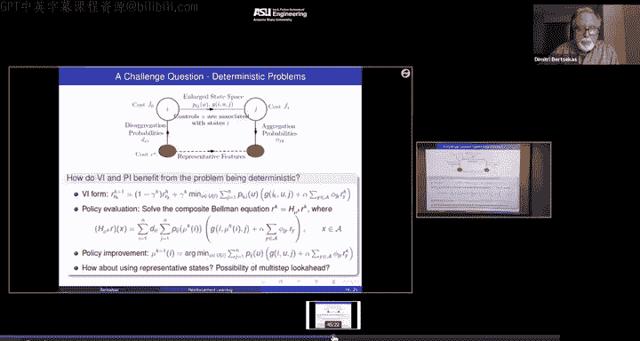

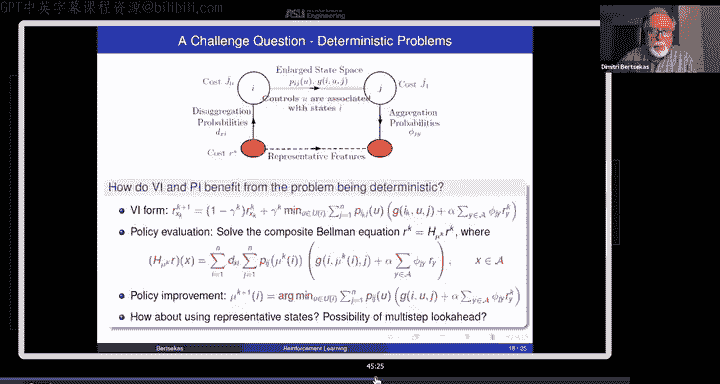

Okay， I'm starting the video again here。嗯。For the distic problems。

 the simulation based value and policy duration are simplified because the sample version of policy of value duration has this form。

 here's the sample， the sample state in the footprint， but there is no expectation here。

 no expectation of what J is required。If representative states are used then there is no need of sampling。

 according to the。To the disaggregation probability。

 So this IK is just simply the Xk equal equal to xk。 and in that case because there is no sampling。

 I don't have to use a step size。 I can use a step size equal to1。Okay。

 a much faster computation all of this。All of these algorithms。

 stochastic algorithm that involve a diminishing step size are slow， very slow。

 it can be horribly slow， okay， bear this in mind and bring a big computer with you because it takes a lot of time。

嗯。Okay。So now let's consider L step look ahead minimization。In the。

In the implementation of the approximate the subbomal policy。Yeah。So here， I'm sorry。

So suppose you're given our star。Then。How would you find a control okay， at a given state？U。Well。

We are at state I0， and then with L step look ahead， we would have to solve this problem here。

L steps。Optimization of the cost of NTs plus a terminal cost appropriately discounted with R star。

And then we apply the first control in this sequence。If the problem is deterministic now。

 there's no expectation here so this becomes。A short path problem involving an acyclic graph。

And its solution online may be very fast。 Okay so deterministic problems lend themselves to multistep look ahead。

Okay。So now let's look at another version of multistep look ahead。You remember， we had an aggregate。

Problem structure involving representative features。嗯。Transitions to the original system states。

 according to the segregation probabilities。One transition。To a system state J from I to J。

 according to this transition probability。And then go down to。

And I get feature using disaggregation probabilities。

Suppose now that instead of a single transition before going down， I use N transitions。

What would be the benefit of that。What would be the benefit of using this multis stageage structure versus using the structure per n is equal to1？

Well， this problem may be a better approximation， right？ It's more faithful to the original problem。

 The original problem is an infinite number of green transitions， right。

 So here we're going to take a large number of transitions。

 potentially in between dropping down to the aggregate states making some kind of compression of the state space every end stages。

 So we hope that this framework will be。More faithful to the original problem。However。

 now we have an enlarged state space that like that。

And it involves n plus 2 stochastic Belman equations。

Valu duration based on sampling goes other boards， okay， you can't do it， why。

Because there's a minimization over a miniization over a minimization over a minimization each time involving an expectation in between。

So it just cannot be implemented。You can implement policy duration because for a given policy。

This transitions here， you can do Monte Carlo。 There is no minimization。

 so you can do Monte Carlo across its transitions。However。

The policies that we implement are multi this step。 Okay， they're not just a single step policy， but。

And stage policies。 So that complicates things for a general stochastic problem。

Now here's a simpler case that I'm going to focus on， had the deterministic problem。

In the representative states， no features。 Okay， So from a representative state。

 I go to a true system state。To the same I stayed at the same state。

 and then I move deterministically across， I end up with at some after the end of end stages at some original system state。

Which I interpolate with the fees and go down to the representative features here。Okay。

So now value duration。Involves the solution of an end stage deterministic problem。

There is a minimization across the stages， but this is deterministic。

 so that means a shortest path calculation over the end stages。And basically what you're solving is。

An end stage Belman equation。 I'm sorry。End stage value duration。U。

Tpe of equation involving end stages of the dynamic programming operator so value duration would take to this form。

 and this would involve minimizations in between， but these minimizations are solvable by shortest path calculations。

So now if you look at this algorithm here。It involves aggregation in space。

Because I'm looking at a small subset of states， the representative states。

 but also it involves aggregation in time。I'm aggregating one transition from x to y into I'm aggregating n stages。

And time steps into a single transition from x to y。So that's the last topic I want to look at。

Which I call spatial temporal aggregation。And the idea is to compress space and time。

 You haven't heard special temple aggregation before， right。It's because I made it up。

A couple of months ago。And however， the term space temporal。Is is a legitimate term which is used in。

Visual signal processing context where you have video， okay？That's。That he involvess。Frames。

Your space。 but over time， these frames change。And people have looked at compression of video。

 compression in space。And also compression in time like time lapsing。

And the term and people have worked on this spatial temporal compression。For video signals。

 but now we're going to take the same idea and apply it into dynamic programming context。

So I'm going to start with an example。Suppose that you plan to go。

Take your car and you want to go from Boston to San Francisco。And you want to find the fastest route。

 Okay， so for every little portion of the root。There's a cost associated， which may be time。

 it may be some measure of convenience。Let's say just time。

 you want to find the fastest route from here to here。How would you do it？😔。

Well if you think about it。If you look at all the side streets， the little highways， the bypasses。

 whatever。You're faced with a gigantic， shortest path problem， right， deterministic。

 short path problem。And you'd be crazy try to solve it。

 to begin with you don't have a computer big enough to solve it。it's gigantic。So how would you do it？

Sort of tried to compress。the task。You would。Select major cities to go by like New York， Chicago。

 Salt Lake City， Phoenix， Memphis， whatever， these are the red states here。

 which we view as representative states。But there's also a time element to this， right。

 because you can't go from Boston to Washington， D。 in in one step， right？He move seven steps。

And several choices of fruits going through here。So。It's natural to sort of eyeball a map。

Look at the candidate cities to stop by and then say at the end of the first day。

 I'm going to be either here or here or here at the end of the second day I'm going to be either here or here or here。

 okay。Canada sits for the breakdown。The time， the five day travel into pieces like five stages。

 Or if you want to stop。Whatever you may want to stop， you may want to stop， for example。嗯。

To see an amusement park on the way， that can be figured out into the framework。

So now after you hide more of a map。And look at candidate routes and candidate time schedules。

 you decide on one of those， okay， in some way， your own way， at a course level。

And then after you have the trip at a course level。

 then you optimize the details in between if you have decided to go through Chicago。

 you may want to optimize whether you're going to go this way or that way and all that。So。

 that makes sense。And you can view this as an example of reduction。

Over a very large scale shortest path problem into a manageable problem by spatial temporal aggregation。

You compress the space。And you compress the time。So that's the idea that I want to get across and the issue now is how we are going to implement it in mathematics。

Okay。Yeah。Space。HowI'm sorry I didn't get your question。Is that different。Thisre。And also。

 the number of。見せます。Well， the state space here is the。All the possible stops， okay。

 like the start point of each side street to the end point of that street， so it's done for you。

 it's discretized。But it's just very complicated。 That's so what we want to do is take an original discretized problem。

 It is discrete to start with。But we want to compress it into something that's simpler。

 And then from the solution of the compressed， go out to a submal solution of the detailed version。

Is this clear？なるこです。Okay， okay。Okay， so let's will this figure me？

This complicated figure may make it clearer， Okay， okay。

It complicated the figure is complicated because the problem is complicated。

What we have is a discounted infinite horizon deterministic problem。So。

The starting point is over here goes across for an infinite number of stages。

And the state space is stationary。 Okay， the state space is。A sliver of green。

 a vertical sliver of green that you see here。 These are the states。And of course。

 there's an infinite number of infinite number of stages in this black。Things are choices of control。

 Okay， there are no transition probabilities here。 The problem is deterministic is our choices of control。

So， if you neglect if you。If you ignore the red。Layers for the moment。

 the original problem is just a sea of green。 those from one end to the other stationary。

 and these are states。These are stages， one stage， the next stage。Choices of control and so on。

 so simplified， of course， because I can't do it any better。No。Suppose that to approximate this you。

You interject these layers of representative states。So every end stages。I insert。

A layer of green red states。It be Wednesday stage。まて。There are many green。Start at3。Yeah。

We want only will start pointing with it。Okay， this figure is not meant to represent the map root problem。

 the rooting problem。It's meant to represent a genetic。

Discounted the deterministic infant horizon problem。 So there are many state， many starting states。

 That's why。Okay。Stage looks the same as the next， Okay， because the stationary problem。

 the state space does not change from one one time to the next。Okay， so as a matter of approximation。

 let's introduce these layers of representative states every end stages。It's my choice。

 I'm not saying that it makes sense in the context of mapping。

 although it will make sense eventually。嗯。And。And now。

 let's make sure that we understand what these red transitions。And blue transitions are。

The red transitions correspond to controls。At a representative state。X。

There are these controls that I can choose and go to this state， that state or that state。Okay。

So these are control choices， the red choices are control choices。And these are also control choice。

 the black here。And the blue， I'm going to take them to be either zero or1。

I'm going to take all this aggregation properties to be 0 or1， so this become just cost free。

Deterministic transitions from this state to that state。

 basically why here has us footprint these two states and similarly for these other ones。

They mark which original system states are connected to each。We。

To each a representative representative state。Okay， so we started some initial condition。

Go through end stages， meet。The first layer pass on to。Arepresent。State。

 we go to the course grid and then travel on the fine grid all the way for end stages and then go down again and so on。

Why does this make sense now？Are we going to gain anything out of this approximation？

I claimed that the original infinite horizontal problem。Decomposes into a sequence。

Of identical and stage short path problems。From this layer to that layer。

Why is this so and how can it be done？weuse those policies。Can you a louder， please use， yes。Right。

 yeah， the principle of optimality。 Okay， remember the principle ofity。

 if you have an optimal path from start to end， every portion of the optimal path is optimal。

So if I have an optimal infinite horizon path here。Deterministic， remember， every portion。

Of the path is the shortest path between the endpoints。 So that means that。I can。Compute。

The optimal path piecewise for all possibilities of these states to this states。 So for each x。

And why I can compute the shortest path here。 I can do this for all pairs。

And now I have pre computed。The entire。Portion of the path that I need for an infinite horizon path。

So。We compute a shortest path from each representative state x to each representative state y。

 and we construct a grid of one to one， one stage transitions with corresponding costs。

And then we have a low dimensional deterministic infant horizon dynamic programming problem where the states are just the representative states。

Okay， I'm going to give this in the next figure。Here's my original problem。

 deterministic and so on as deterministic as you can make it。

We insert these representative states in between here。And now for every x and every y， all pairs。

 I compute the shortest path within an end stage block。And。

For each one of these shortest path computations， I reduce this graph into something that's compressed in time。

Where the cost of this transition here is the shortest distance between x and y。Okay。

 so I have for every x and every y， I have computed these short distances and I have now compressed this portion of the。

Pranジ graph。Into something that's one stage long。And the。And the。Indeed。

Length of the transitions are computed through this all to all computation。

So every end stages block is compressing on all to all short dis path problem。

And now I can solve this problem here。 This is an infinite horizon， discounted。Problem。

Which is deterministic， but involves a lot fewer states， just to representative states。

So this computation is relatively simple， and this computation is relatively simple。Okay。

 this is just too regular to be true， okay。嗯。The mapping problem does not look that way。What？

What should I do to bring this idea into the mapping problem？

The major cities would be have to be this， right， and the times here would have to correspond to to the end of day。

 the end of the day or the the。The， the。The stopping points， stopping time terms of time。

But this is too regular for that， okay？So。So here's another figure that's more less regular。

Consider a shortest path problem that involves a starting state and an end state and disregard all the red stuff okay so the shortest path problem starts from here and it involves state spaces that may be changing over time can be very irregular and goes from green state to green state。

According to your choices of controls。Okay。So we have here。you have seen this figure before。

 a short problem with a given start state and end state involves a cube。offff。Space and time。

 space and time。There's a cube of。O。Of acyclic transitions。And。

We can break up this tube by introducing this representative state time pairs。

 these layers that need not be regular。This may be okay， this may correspond to different times。

 there might be a state here， there might be Chicago here。

At the end of the first day or Chicago at the。At the end of a day and a half。could be。

 in other words， the the layers here can be irregular。The key thing is that they represent barriers。

Which separate the past from the future。 That's the key idea。

That they break the continuity in this graph here so that any。

Shortest path from here to here would have to pass through every one of these barriers。

So give me an example of this kind of breakup with barriers for the Boston to San Francisco travel。

 how would that work？Let's go back to this map， where would the barriers be？

This sort of more or less， gives you the tube of space time pairs， right。

 because time is sort of proportional to distance more or less。 It's like like all this。

All these transitions here correspond to one state time pair to another state time pair。

 so what would be the barriers here？で。Yeah， there should be one barrier It might be like something like that。

Okay， that would involve。The candidate cities。At the end of the first day。

 but keep or take a couple of hours， for instance。It may have a time width。

 and those are space width。So it could be a barrier， something like that。

 another barrier might be something like that， another barrier might be over here and so on。

And then you would solve the shortest path problems from barrier to barrier。

Compute with a simpler computation， a short distance。From start to end。So here we are。

We introduce the spacetime barrier， subset of representing state and time pairs that separate past from future。

We compress the portions of the spacetime tube between two successive barriers into shortest path problems。

 so there would be one shortest path problem here from here to here， another from here to here。

 another from here to here。And then we put them together into a low dimensional。

 short path problem who are all the arcs。Are computed the art lengths are computed from the shortest path distances。

 and also the transitions from red states to red states are one transition long， one step long。

And this is a much maybe just a five day problem， or maybe even an hourly problem can be done for in the case of travel。

So we form a master short path problem of low dimension that involves only the representative state time pair。

A completely intractable problem has been made all of a sudden intractable at a cost of approximation okay you' are not going to find the exactly optimal route from Boston to San Francisco you may be missing in some of the details because you have constrained yourself to go through the barriers you have chosen the barriers first so。

There's an approximation there， but。It sort of addresses adequately the practical problem。

With tractable computation。Okay。We're done。Do you have any questions？Yeah。

 so in comparison to methods like options in you also have a temporal aspect。

Is the difference here is that apart from the state aggregation part。

 is also the difference that you are enforcing the end stage limit。

Is that what makes it still like you don't have to consider things like semi drugs？Okay。

 the end state limit is artificial people I I， I， I gave you this end state limitation， you know。

 to explain the problem。 but you can， you can do this。

I've spent a tremendous amount of time reading about the optional literature in reinforcement learning。

 there's something called options and I can't describe it to you any any better。

 it's not deterministic， it is stochastic and for all my effort I could not understand it okay it's explained by examples。

Okay， you have an example where there are significant tasks to be done and we compress time to go from one task to end to the end of the task and then start a new task it's always done by example and I can't figure out what the mathematics are behind it so if you figure it out and you can explain to me I'd really appreciate it。

そで啲入。There must be something there， and certainly there's a relation to what I'm talking about。

I have not been able to figure out the exact connection。

 Most of the seen there usually semi processes because they say that。

Even if you treat options as a single option。The depends on how long the execution well I challenge you to take the problem of traveling from Boston to San Francisco and put it into a semi Markov framework I don't think you'll make it。

ok。So it cannot be very general。嗯。There is a paper by。By David Silver， which I found to be。To be。

The best of in this category， but I'm still trying to understand it。

 I have been able to understand completelylily。So but he。

He makes an explicit connection with aggregation。And you may want to look at this paper。

 and if you cant understand it， you can explain。ok。

But I understand that he's not working on this subject anymore。Because he's busy developing alpha 0。

And have questions？Okay， so this is going to be an overview on Thursday and until next Tuesday。

 there will be the project presentation。Okay， guys， this was of course， the。

The video of the lecture of two years ago。And you can see that there has been。

 there was a lot of speculation at that time about aggregation。

There still is a lot of speculation and I think today's lecture is current and it poses a lot of interesting questions that beg for solution and experimentation。

 and I hope that some of you will do that and advance the field in this way。However， are the the。

Technical content of our course is now over。We covered a lot of material at a graduate level。

 perhaps advanced graduate level， some of it。And what we're going to try to do in the next lecture next week is to put it all together in summary。

 emphasize the important points and the main concepts and the main algorithms and。

There is a lecture of mine， the slides of a lecture of mine on the Internet， which is called。

10 key ideas for reinforcement， learning and optimal control， something like that。

My lecture next week is going to be based on that slide presentation。There's no video of it。

 but that's what we are going to do， an overview and would be a good opportunity for you to bring your questions about points that you would like to some clarification。

 perhaps even related to your project。After next week's lecture。

 we're going to focus entirely on the projects and have one or two one or two。

To our periods for presentation， depending on how many projects are going to be presented。

 so stay tuned， we are going to announce the dates and times and make sure that you submit your projects to me in time in well in advance so that I may I have the opportunity to take a look at them。

So that's all I have to say for today， are there any questions on any。Part of the lecture。

Or what lies ahead？And incidentally， a few days ago， I came to Tempe。

 so I'm very close to the university。And I can meet with you in person assuming you're vaccinated。

 of course I'm vaccinated and we can meet outdoors， so the weather is here is very nice。

 the outdoors is very pleasant and we can have a conversation about your project or any questions that you might have about our course。

Okay， I just have a question。 I saw yes， the upcoming assignment said the due date is April 16。把把你预预。

You said the the presentation already begins at 14， right。To be honest。

 I don't remember the dates but。We have one lecture ahead of us and whatever the data I have given in on canvas。

Is going to be the operative one for submission of the projects。

 but we are going to send out an email summarizing all this information。Okay， O。Any other questions？

Okay， guys， we'll see you next week。

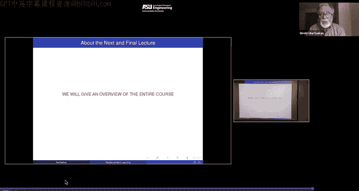