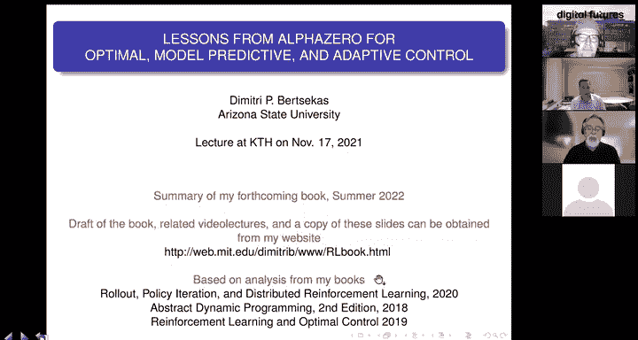
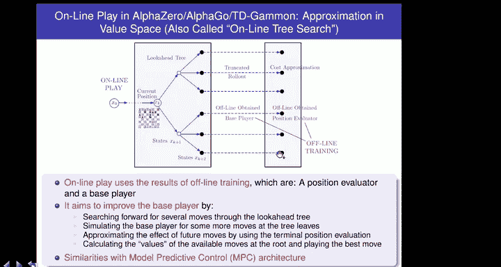
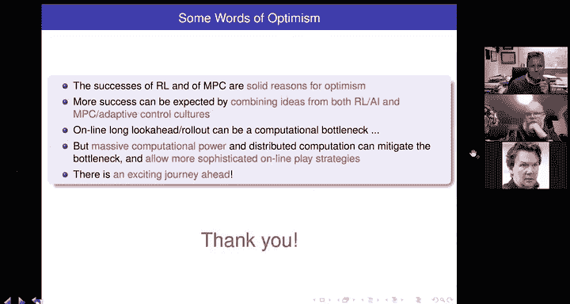

# ASU《强化学习2022-2024｜cse 691 Reinforcement Learning Course at ASU》中英字幕（deepseek - P27：[11]Lessons from AlphaZero for Optimal, Model Predictive, - GPT中英字幕课程资源 - BV1zcfVYdErD

Hello everyone， you can see my title and this is also the title of my forthcoming book that's scheduled for publications sometime next year。

You can find a fairly complete draft of the book， video lectures， a copy of this slides。

 and other material in my website。The purpose of the book is to provide a new conceptual framework for reinforcement learning。

And its connections with the traditional control methodologies of bottle protective control and adaptive control。

The book is based on visualization and geometric interpretations， for the most part。

 on the other hand there is quite a bit of mathematical analysis that is given in my earlier books that supports the visualization。

So。I'd like to start with two remarkable programs。The first program is Alpha Ze。

 which playss chess and created a sensation when it came out in 2017。

And the other programs much earlier from 25 years ago， it's called TD Gammon。

 and it's placed back Gammon and at that time it created a lot of enthusiasm about the prospects of reinforcement learning。

So I' was talking about Alpha Ze and TD Gamon and these two programs are very remarkable。

 even though they were quite a few years apart when they were implemented。

 they are quite similar and both of them involve two algorithms。

 some people don't quite realize that there are two algorithms that are involved in these programs。

One algorithm is the offline。Training algorithm by which the program learns how to evaluate positions and also how to select moves in given positions。

And this is done with a lot of data， neural network approximations and so on。

The second algorithm is online play algorithm， which is what the program uses to play against other computer programs or human opponents。

 and it is based on multistep look ahead rollout and cost function approximations。

And all of this has strong connections with dynamic programming。

 the classical method of policy duration and。A reinforcement learning type of approximations。

And what I'm going to try to do in this talk is aim to understand this methodology。

 so it applies far more generally and particularly on issues of how it connects with control system design methods of NPC。

 model predictive control。And also adaptive control。But there are extensions in a broader context。

For example， discrete optimization， in programming and the like。

 although I'm not going to talk about those in this particular talk。Okay。

 I'm going to start describing the online play algorithm in Alpha Ze。

 Alphago and other but related TD gamon and other settings。

 and then I'm going to discuss the offline training algorithm。

Now the online play algorithm is what you see here in blue， okay。

 the online play algorithm used the results of offline training at two points。啊。

It uses a position evaluator to evaluate positions and a base player that it generates moves at given positions。

So this is online play， but there is crucially used information provided by the offline training algorithm。

And。Here what we're trying to do is improve the base player。

 the one trade offline by the following process。Given that we are at some position。

 let's say after K moves， the current position xk。We search forward for several moves through a look ahead three of moves and counter moves up to certain depth。

Then from the leaves of that tree， we simulate the base player for some more moves。

And then we arrive at some positions here， which we evaluate using the position evaluator。

 and we approximate the effect of the future moves by using that evaluation。

And now we back up these values back to the root， and we calculate a value of each possible move at the current position and we play the best move。

So that's what we do at a given position and then we go to the next position after one move and do the same thing and so on。

Now， all of these programs use structure， but there are differences。

Alpha0 does not use this middle portion。It uses a very long initial portion。

 the look ahead portion is very long and does not need to use this middle portion。

Alpha go uses a version of this middle portion。TD Gamon relies very much on the middle portion because the look ahead portion is short in TD Gamon。

 TiD Gamon plays back gamut， which is stochastic gate and the look ahead3 expands very quickly。

 so it cannot use long look ahead so it relies on this middle portion， the truncated rollout。

 in fact the term rollout was coined by the originator of TD Gamon Gerta Soro。

 and I'm using the term here in the same way that he has used it。

There are also similarities with model predictive control。

 model predictive control structures are remarkably similar to the structure and to the alpha zero structure。

There is an initial look ahead portion where minimization takes place。

 this is called the controlled interval。And then there is sometimes a rollout portion。

 which is called the prediction interval， and then there's a terminal cost approximation。

 so model predictive control is quite it pretty close to this structure。

 except some of the some of the parts are implemented differently because model predictive control deals with infinite state and control spaces for the most part。

 whereas these games deal with discrete state spaces。

So let me go now into the offline training algorithm Alpha0。

It is approximate policy duration with self generated data。

What we do here is generate a sequence of players。And the current player is used to train an improved player and this process is repeated several times until we stop somewhere and we give the trained player at the end to the online play algorithm。

So policy duration has two parts every step for policy evaluation policy improvement。

 these are done approximately with neural networks。

So the current player is evaluated by playing many games。

 collecting data and representing its evaluation by a neural network。

 which is trained with lots and lots of data。Now， once we have the evaluation of the current player。

We can improve approximately improve the current player by using multi step look ahead minimization。

And an approximate form that's called Monte Carlo Research。And the improved player。

 after we collect all this data from the improved player。

 we represent it with a policy neural network through training。

So we have a sequence of value and policy networks generated here。

 and these are given at the end to the online player for for online play。Now。

 TD Gament uses a very similar policy duration algorithm for offline training using the so called TD Lambda method。

It uses it generates it uses it it。It does not have a policy network。

 the functionality of the policy network is provided by using the value network through ones that look ahead。

And it also does not use Montecallo research， and that's not really fundamental and does not really affect the overall character of the process。

So。Here are some major empirical observations that I want to focus on， here's the online layer。

 it uses an offline player that has been trained with neural networks。

But the online player plays much better in alphapha zero than the offline train player。

This is just a fact， and's an obvious fact for people that have used these programs。

 the online player of alphapha zero is just a phenomenal chess player。By contrast。

 the offline player is relatively videodiocre。And so there's tremendous performance improvement。

By having online play on top of offline training。Kty Ganon plays much better with this middle portion。

 the truncated rollout portion than without the rollout portion。

T sort of had the two programs in the 90s， the first one was in 1991。

And it was based on this structure， but without the middle portion。Then in 1996。

 he introduced the middle portion， the rollout portion。And he found a great deal of improvement。

The 1991 program was playing his performance was subhuman， it was being bid by the best humans。

By contrast， the 1996 program had superhuman performance and has not been improved since that time。

Now these are empirical facts。And what we like to do is to explain them， provide。

 draw insights from them， and generalize them to other contexts。

By using abstract dynamic programming ideas， abstract Belllmon operators。

 visualization for the most part to draw inside and we will focus on the central law of Newton's method。

 this is the the key new research that I'm going to present today。

 how Newton's method ties everything together。So here are the principal viewpoints of this talk。啊。

I'm going to show you that online play is just a single step of Newton's method for solving the Belmon equation associated with the problem。

 the dynamic programming problem。This is true for one step look ahead。

 in the case of multi step look ahead， the Newton step is preceded by some value directions。

In the province of numerical analysis， this is called a Newton SOR method， so well known method。

With a lot of literature， SOR stands for Suive over relaxation。And so online play is a newton step。

Offline training。On the other hand， provides the starting point for the Newton's step。😡。

And in my opinion， online play is a real workforce， everything happens in online play。

 the big performance improvement is during online play。By comparison。

 offline training plays a secondary role。And a major reason for this is that online play is an exact Newton step。

 it does not involve approximations， it's not degraded by neural network training errors。

So that makes it different and much more powerful。Now the offline training can be done by many different methods in reinforcement learning。

 we have temporal differences methods， aggregation， we have linear programming。

 there are many different ways to do the offline training。However。

 these differences in the various imperfections of these methods affect only the starting point。

 but they do not affect at all the Newton step， which is exact and theyre all washed out by the Newton step the Newton steps a big equalizer errors that you may make in offline training are washed out by the Newton step。

Now there's a cultural difference。Between the reinforcement learning。

 artificial intelligence community。And the control community， particularly more and adaptive control。

😊，People in reinforcement learning focus primarily on offline training issues。What is？

Itally model predictive control are focused largely on online play and also stability issues which are not dealt with by reinforcement learning community office at all。

So we're going to try to bridge this gap。Through the visualizations。And。

I'm going to talk a little bit about adaptive control。

 but instead of using the reoptimization in response to changes in the estimated model。

 we're going to use multi this step look ahead and rollout。And and。And。😊。

This framework is going to involve an exact newton step instead of reoptimization that applied to a changing Belmon equation。

 changing in response to a system identification process。

But the bottom line is that it's still a new step。And it's very powerful。

Now all of this surprising rate generality， abstract dynamic programming is a very general framework it can accommodate arbitrary state and control spaces。

 stochastic systems， deterministic systems， hybrid systems。

 involving both discrete and continuous state space and control space components。Multiasian systems。

 games and mini Maxs， finite par， infinite comparison， discrete optimization， integer programming。

 dynamic programming is a very， very general methodology and abstract dynamic programming captures this generality and because everything I'm going to talk about is couched within couched on the abstract dynamic programming framework it it has very broad applications。

NowSome of these viewpoints may be a little controversial and personal。

 so I thought of showing you this cartoon。These two people look at the same number and this guy says it's a six。

 but this guy insists he's a nine， and I think this cartoon may have some relevance to my talk today。

So let me give you an outline first I'm going to talk about discounted and un discount in problems to provide some context。

Then I'm going to talk about abstract dynamic programming， abstract Belmon operators。

Then I'm going to show by visualization how online play can be viewed as a newton step。

Then discuss stability issues， the original stability and how you can visualize it。

Visualization of rollout， truncated rollout and policy duration。

Then I'm going to talk about a familiar problem， the classical linear quadratic problem where the visualizations are in terms of riadi equation operators as opposed to Belman operators。

Then I'm going to discuss application modative control and the connections there。

 and then also adaptive control， indirect adaptive control with mod estimation。

So let me start with discounted and undiscounted infant coriz problems。

So what we have here is a system， discrete time system。Excuse me。

Involving a state which I denoteed like Xk is a state of timek， a control UK。

In the random disturbance， WK is random。And the system evolves according to this equation。And。

We're interested in stationary policies that maps state into controls and this control must satisfy control and strength for every X。

啊。There is a cost for each transition this encoded by this function G。

 and the cost is discounted by a factor alpha Al could be less than one or could be equal to one。

And at the stage K the cost is discounted by Al theK。

And the cost of a policy starting from some initial condition x zero is just the limit of the end stage cost。

 this denotes expected value over all the ws， this is a random variable and we take this expected value and take the limit as the number of stages n goes to infinity。

So this is a function for every state， there is a value here given by this function and the optimal cost function is obtained by minimizing overall。

Overall， policies be policy cost functions。And I have in mind primarily three contexts。

 one is discounted problems where alpha is strictly less than one and G is bounded。

 this is a nice case。Everything I'm going to talk about。😡，Is correct。For discounted problems。Now。

 for other problems， there may be exceptions。And I'm going to mention a few of those as I go along。

The second class of problems is stochastic shortest path problems where there's a special cost free termination state。

 think of the origin as being a termination state and alpha is equal to one。And then。

The MPC type of problems。Where the system is deterministic。The cost per stage is positive。

The origin is determination state。And this is a regulation problem。

 the aim is to drive the state to the origin or keep it close to the origin。

 and this is encoded in this positive cost， the cost is zero determination termination state positive everywhere else。

So these are the problems I have in mind， and let me give you a synopsis of the theory。

The first result is that J star， the optimal cost function， satisfies Belman's equation。

Now there's one such scalar equation for every state， so that's a functional equation。

And Jay satisfies this equation。嗯。Often uniquely， but not necessarily。

 that's why I have this question marks。😡，There's an optimality condition。

If for a given x new stars of x attain the minimum in this equation， for every x。

 then the policy that you obtain is optimal， again， there are some exceptions to that。啊。

And there are regarding algorithms， the first major algorithm is value iteration。

 it generates a sequence of cost functions starting from sun J0。

 which can be more or less arbitrary and uses this recursion here this iteration。

 which is just the right side of the Belman equation， but with Jk minus1 replacing J star。

This generates a sequence of finite horizon costs and it's one of the major algorithms and the other major algorithm is policy duration generates a sequence of policies。

 muk and their cost functions， mu zero is arbitrary。

The typical iteration starts with some policy mu and generates a new policy， new tilde。

 I'm going to be using this symbols a lot in this talk， mu for current policy。

 new tilda for the next policy。In two steps， there's a policy evaluation step that computes the cost function chain U。

And there is a policy improvement step that calculates the improved policy by using this equation here by doing for every x this minimization。

 which is the same minimization as in Belman's equation， except that we use J mu。

 the cost of the current policy in place of J star。Okay。

So now let's talk about approximation in value space。

 a major approximate dynamic programming or reinforcement learning framework。Here。React。

It's very difficult to find J star， so you replace it with an approximation J Tilda。😡。

In Belmon's equation。And when we arrive by the state X， we perform this miniization。Which balances。

Cost of the first stage plus the future cost as evaluated using this J Tilda and also properly discounted this minimization is over all the possible controls at the given state and provides a control to use so we apply this control and then we go to the next stage at the next state we apply we do the same this type of minimization again and we proceed going forward。

This is called one step Look ahead because we look for only one step before going to the approximation。

Multi step look ahead is sort of the same thing except that。We。

Minimize the cost of the first L stages plus the future cost as evaluated by J Tilde。

 and now thiss an L step problem。And it involves minimization over our control UK and policies from K plus1 to K mark+。

L minus1。We solve this problem and we use at Xk this first control and we throw away all the rest。

Either way， one step look ahead or multi step look ahead， this defines a look ahead policy。Mut tilde。

 mut tilde of Xk is the control that's obtained from this minimization is the minimizing UK。

I'm going to be using a lot of the symbols J Tilde is cost approximation new Tilde is the look ahead policy obtained by either one step look ahead or not a step look ahead。

And here's the key facts。Ja Utilda， the cost function of the look ahead policy is a result of a Newton step for solving Belman's equation。

 starting from J Tilda。Now this is true for one step look ahead， for multi step look ahead。

L greater than one is the result of a Newton SOR step。

 which is some value generations followed by a Newton step。Either away。

The error decreases super linearly， that's a generic and the key property of Newton's method。

Quterby the errors that diminish very rapidly and in particular。

 this ratio goes to zero as J Tilde gets to close it tends to J star。

So you had an error in Cota between J Tilda and J star and you have a new error after the Newton step that gives you the cost of the look ahead policy compared with J star and this numerator is tiny relative to the denominator。

 this error is reduced very fast super linearly。So now let me。

Going into abstract dynamic programming concepts and how you interpret all this in terms of Belman operators and through visualization。

Okay， so here's the Belmont operator， it's the right hand side of what you have in Belmon's equation。

And it maps costs functions J into co functions team nu J。So J has a component for every x。

Team use of J has a component also for every x， and it's given by this expression。

Involving the cost of the first stage using mu and the cost of the remaining stages as measured by J。

So there's one such equation， a scalar equation for every x。And I call this the mu Belman operator。

And there's also the min Belman operator， which is the one that appears at the right hand side of Belman's equation。

 and it involves minimization here over all controls。And。

If you take this values here and minimize over new， what you get is TJ of x。Again。

 J is a function of the state。TJ is also a function of the stage。 So this a functional。

 this an operator mapping functions into functions。

And Belman's equation can be written in shorthand by using these operators the min Belman equation is represented as a fixed point equation J star is a fixed point of T。

And there is a Belman equation for every policy， J Mu for a policy mu， J knew。

 the cost of that policy is a fixed point of this new Belman operator。

So team U and T transform real valued functions J into functions teamus of J and Ts sub J。

 and for this talk I'm going to assume that these are real valued。Now。

 these are pretty big operators。 How many dimensions so do they have well。

For every x is a scalar equation so that dimensionia is the number of states。

 it could be astronomical or it could be infinite。On the other hand， for every x。

 these are real values functions of J。And you can view them for a single state。Okay， as one example。

 suppose you have a two stick system。Then J is a two dimensional vector， J1， J2， this a real number。

 this a real number， this is a vector in R2。And T sub J has two components， also a vector in r2。

 the components Tjs of1 and TJs of 2。So。Even for a two state system。

 we have an operator that maps two dimensional space to two dimensional space。

 so you need a four dimensional graph to represent it that pose a little bit of a problem。And。

But on the other hand， even though teamU and T are large and perhaps difficult to visualize。

 look at first sight， they have some nice properties。

The first is that theyre both monotone as you increase uniformly the J function here and here team Mu of J and TJ also increase the reason is that the expectation preserves monotononicity。

 expectation means a positive linear combination， so it has the monotonity property。

And similarly here， as you increase J because of the monotononicity。

 because of the expectation of operator preserve this monotononicity and the minimization all of preserves monotononicity。

 you have that team UN T are monotone。Another important fact is that teamU is linear， okay。

 expectations is a linear operation， so this is a linear operator。嗯。T on the other hand is concave。

 it's concave because it represents it can be viewed as the minimum of linear operations if you take the minimum of linear operations。

 then you get something that's concave。So in particular， for every fixed state X。

T js of x is a concave function of j None of x of j J remember is a function T sub J is also a function of J that's concave in the traditional form in the traditional。

Traditional meaning of convex analysis。So for infinite dimensional state space。

 T U and T are infinite dimensional operators mapping and infinite dimensional functions in the function space into itself。

Some other questions is， how do we deal， we want to do visualization with these operators。

 how do we do that？Okay， so what we do is use one dimensional slices of the graphs of these operators。

To give you an idea of this， let's consider a two state and two controlled example。

We already have a four dimensional graph， but we can represent us two three dimensional graphs。

 and I'm going to do it here。Okay， blue stands for the new operator and red starts stands for the mint operator。

Here is the teamU operator and has two components。One for state one and one for state two。

 and I'm showing these components here for state one and for state two。

And this is linear and monotone， and this is concave and monotone。So for state one。

There are two controls here， each control defines。Each control defines a linear has a linear graph。

 is the blue graph that you see here， here is J1， J2。

 and this is the linear function team use of Js of one for state one。Now。

 the mint Belman operator is obtained by。By minimizing over these two。

 so it's a piecewise linear function， it has this red graph here that you see it's a function of J1 and J2 and I'm showing also J star here J star is shown right here。

And I want to focus attention on the fact that we can consider slices。

 one dimensional slices that go through J star， and you can see this slice here。

By using one dimension slices， were able to visualize this operator on a piece of paper rather than and deal with a high dimensionality。

So there's a slice like that for state one and there's also a slice like that for state two and the slice involves a piecewise linear monotton function。

 you can see the 45 degree line here。And so that's a visualization for a two by two problem。

 and from now on， we're going to be focusing on one dimensional slices that passed through J star。

Okay， so let's visualize the new Belman operator。It's given by this equation。

 the mu Belman equation is this J mu is a fixed point of T mu。And the operator has a linear graph。

 is this blue line that you see here that defines team use of J as a function of J。

And to find the cost of mu J view， I have to。Find the point where this blue line。

Meets the 45 degree line。And this is the fixed point of the operator team mu。

 and it is the cost of mu satisfies the Belman equation。Of course。

 this cost has to be somewhere further to the right of the optimal cost。

And all of these costs are to be right。 There are many of these new operators。

 and they are all they are defined by。In a similar way。Okay， now the min Belman operator。

 the mint Belman operator is obtained。By minimizing overall controls or minimizing overall all these blue operators for a given x。

 it's concave and monotone and it's defined as follows。Here is T of J。

This red graph here as a function of J。And。To obtain its value， let's say at at some point， J Tilda。

We have to consider all the policies， find the point of intersection of these policies with this vertical line and go to the lowest point。

 this is the minimum over policies of team use of J Tilda。

So that's how you find P of J tilde and you do the same for every J。

And basically the red curve is the lower envelope of the blue lines。

 you have all these blue lines and what lies below that is the graph of the mint operator。

And now the optimal cost J star is obtained as the fixed point of this。Of this of the operator T。

 it is the point where the red curve meets the 45 degree line。

 so that's how you visualize J star and all these operators and the connection of the blue operators with the red operator。

I think to notice is that the red operator is concave。And also。At J Tilda。

 the blue operator that attain the minimum。Is tangent。But why a linearization。

Of the red operator at this point， now， this linearization is going to be key for understanding the role of Newton's method。

So。U。Let me also illustrate how value iteration can be viewed within this operator context。啊。We have。

Ps of J as a function of J and in value direction we generate a sequence of cost functions。

We start with sub J0 and we find Tj0， okay，s this is J1。

Then we reflect J1 across the 45 degree line to this point here。

And then apply t to it and we obtain the second leader J2， so J2 is t squared j0。

 we reflect it again across the 45 degree line and we obtained J2， I'm sorry J3 and so on。

So there is this staircase construction that provides a visualization of value iteration。

And you can see that there's a tendency to converge to the fixed point， but not always。

 it depends on what J0 is， the slope of t， in particular if t is a contraction mapping。

 which means that the slope is uniformly less than one。

 then you get convergence and you get also a unique fixed point， but that's the favorable case。

 but that doesn't always fold through。So that's the visualization for value it。And now let me。

Go into Newton's method and this connection with online play and。One step， look ahead。Okay。

 so let's look at the familiar Newtons method for solving a fixed point problem。

Finding a fixed point of the operator T。This is a generic operator here。

 and I'm showing it in red concave and monotone as it is in dynamic programming。

And Newton's method is an iterative method， you generate a sequence of literates JK， you start J0。

 generate J1， J2 and so on。At's the typical step。You are at JK and what you do is you linearize T at JK。

And this blue line is a linearization， it involves the first or the Taylor series expansion of T。

At the point JK。We now solve the linearized fixed point equation， in other words。

 we find this point here， and that's the new Ierate JK plus1。So that's what Newton's method does。😡。

And it's pretty similar to one of the things I showed you earlier for online play。And for one step。

 look ahead。So Jk linearization solve the linearized problem， Jk plus1。

 then linearized at this point solve the linearized problem。Otainane Jk plus two。And so on。

 and you can see that this process can be very fast indeed quadratic under the right conditions。

And the。Okay， I've shown also here T to be differentiable。

 but then we will relax this assumption with what follows。So this is genetic Newton's method。

And here。Here is how it relates to one step look ahead。Now in one step， look ahead。

 what we do is we have a J Tilda across approximation and we find new Tilde。

A one step look ahead policy， which is obtained by minimizing overall possible policies。

So what one step Look ahead does is it linearizes T a J Tilde and obtains this blue operator。

 which is the look ahead policy new Tilde。So。How do we represent the cost function of this look ahead policy well it is simply the intersection of this blue line with a 45 degree line and it gives you J new tilde as the fixed point of t Mu Tilde so we start with this cost approximation and we end up with this one step look ahead policy cost and you can see that it is un honest goodness Newton step。

Now it's a key insight。But then immediately some questions our raised。

In the classical form of mutant's method， you have to have this T operator be differentiable。

 twice once differentiable。Do we need that， well the answer is no， you don't need that。

 you can substitute concavity and monotonity for disensability。This is known in numerical analysis。

 if you look at the classical books like Ortega and Rinbow from the 60s there are。

There is theory associated with that， primarily with monotonicity。U。

But it's also true that you don't have to have differentiability here。

 concavity is sufficient because this blue line in the case of a non differentfferiable operator。

 is just a sub gradientd， you use sub gradients instead of of of derivatives ins。

And the important thing is that you have a tangent hyperplane， a supporting hyperplane。

 and this can be provided by a sub gradientd or by a gradient just as well。

Now you do need some assumptions for this process to be valid because there are all sorts of anomaities that can occur here。

 but everything works out fine for contractive problems such as the discounted problem that I gave earlier。

And notice one more thing。The Newton step is very fast， a super linear converges。

So it smooths out starting point variations。If you make variations to J Tilde。

 there will be corresponding variations to J and Utilde。

 but these variations are tiny relative to these variations。So。

You may make some errors here and these are smoothed out by the Newton step and there's lots of empirical evidence to support all this。

嗯。Okay， now let me go into stability issues and how do we visualize that。啊。

Here I'm going to be focusing mostly on the NPC context， the termministic system。

 cost free terminal state and so on。So stability is paramount importance， of course， in NPC。

 but the question arise is how do you define stability given that the。

that the state space can be discrete and can be continuous so instead of going to concepts of le of stability and the like。

 we adopt an optimization based definition of stability and we say that a policy is stable if its cost function is finite for all X。

If the cost of the policy does not blow up。😡，For any initial state。

 then we say that the policy is stable and this has the advantage it's a very general definition。

And generally， this is true if teamU a contraction or has sloped less than one in the context of our figures。

So let's look at one step， look ahead。UWe want to the original stability。

 we define to be the set of all J tilda cost approximations for which the look ahead policy is stable。

So you can see here that if you choose J tilda。To the right of some threshold。

 then the corresponding policies because of the monotononicity are stable。On the other hand。

 if you choose them to the left of some threshold， the policies are not stable because they don't intersect basically the 45 degree line。

 they have slope greater than one。And the threshold is precisely the point where the Belmont operator has a staent。

 the 45 degree line。So this is how the original stability is demarcated Sha tilda to the right of this threshold point。

Gives you a stable policy and。Otherwise， it's an unstable policy。Of course。

 this's for a one dimensional slice， for a multidimensal case is more complicated than that。

 but the general idea still applies。Now this is for a one step look ahead。For multi step look ahead。

 now multi step look ahead tends to push J Tilda into the stable region。啊。Now。

 remember that multi step look ahead amounts to some value iterations and then taking the Newton step。

So this gives you an example where a two step look ahead。What are the stable J Tilda。

 the ones that after you perform？After you perform one value duration。

 you cross into this stable region for one step， look ahead。

So the threshold moves to the right and the range of stability is expanded by multi step look ahead。

And there are rigorous studies， mathematical analysis that verify this， and also a known fact in NPC。

So it makes sense to push JT that to was JU， which is stable。

 and that's what the multi step look ahead does and it's also an idea that underlies the concept of R。

So now let me go into rollout and policyeration and how we visualize that。Okay。

 now rollout is simply a newton step starting from J tilde equal to the cost function of a policy。

So you have some policy new， which we call base policy。It has an evaluation， okay。

 obtained by this intersection point， this is J New。And then it all out。

Thus a Newton step linearizes here， and this gives you the rollout policy。

So that's simply what it is。And it can be implemented in a number of ways， including simulation。

And an interesting fact is that if you have a stable policy to begin with。

 then the rollout policy will also be stable。You can see this from this figure。Now。

 policy durationeration is simply repeated rollout。You start from a policy， do a rollout on it。

 and then do a rollout on the rollout and so on， and generate a sequence of policies。

The visualization is the following。Let's say newK is the current policy， and this is its evaluation。

 the cost of newK。You do a you step。Linenialize the Belmon equation a J in UK。

 then obtain new K plus one， this is the policy improvement step。

 policy evaluation policy improvement and obtain a new policy。And its cost is is。Is a。

Is obtained by the new policy is this corresponds to this blue line and its causes is obtained by projecting on the horizontal this point of intersection。

So start with muk， generate mu K plus1， then generate muk plus  two and so on and converge very fast。

The pure form of policy duration is exactly Newton's method and does not rely on differentiability at all。

The fact that the connection with Newton's method actually is well known in ca theory。Starting from。

Cls paper or linear quadratic problems。Clelyman was a student of Mike Athens at MIT and wrote this paper that was followed up by a lot of other works。

 both for linear quadratic problems and also for more general。Forms of consideration。

There are also corresponding results in the mapp of decision process theory。

 all of this is very well known in dynamic programming as well as linear quadratic problems and the like。

Um。Okay， so now let's go into truncated rollout rollout is a single step of single Newton step starting from the base policy。

Trancade the Ro lab starts from some ja tilda。Does several value generations using the new operator and then at that point takes the Newton step。

So it is。First， value iterations with。With the mule operator。

 M of them M equals4 in this particular figure。Starting with Sam J Tilda。

And then applying the Newton step by doing this minimization here。

 and that's the cost of the truncated rollout policy。So trancated ro La also involves a newton step。

Now， you can have a combination of。L step look ahead minimization and M step truncated rollout and the total look ahead is L plus n。

And an interesting fact， it is that the sum that's important。

 not so much the individual values of L and M， but the sum is important。Now。

Rollout with a policy is much cheaper than look ahead minimization so。

Tranncated rollout can be viewed as an economical substitute for multistep look ahead。

 and this was the motivation of Tesoro when he introduced trancated rollout in the context of Baka。

Also， people use this rationale in NPC use rollout with some base stable policy to。

To enhance the starting point for the Newton step。So now let me go into a familiar problem for people in control。

 the linear quadratic problem。In linear quadratic problems， there are similar visualizations。

 but instead of using the Belman operator， we use a re equation operator。So in this particular。

For illustration I'm using。A one dimensional linear system with an a coefficient and a B coefficient。

 a quadratic cost involving non negative Q and R coefficients and alpha equals one， no discounting。

And it is well known that the optimal cost function is quadratic。

With quadratical coefficient K star and this K star solves the riadi equation and the riadi equations a fixed point equations。

 the algebraic ricardi equation is given by this expression here involving A， B R and Q is concave。

And the solution of the Riadi equation is obtained by intersection of this 45 degree line and the red graph here。

Actually， there are two solutions。However， there's a unique solution。

That is positive and they are a solution that is not positive。This， in fact。

 this is true for multidimensional problems。啊。The normal case is when Q and R are positive and the K star has is this unique positive solution。

However， just to sensitize you to exceptions， here's an exceptional case where Q is equal to zero。

And now in that case， you lose observability。But but。

K star is actually equal to zero because there's only cost on control and you can set the control to zero and obtain optimal cost to zero。

However， the Riad equation has two non negative solutions and is another solution here。

 which has an interesting interpretation。And this is an example where you don't have the uniqueness。

 and in fact if you try value duration for this exceptional case。

 you'll find that value duration converges to the non optimal solution rather than case style。啊。

This is just an example of exceptional behavior and then many of those in other contexts that are more complicated than linear quadraity。

Okay， so here's a common question in the end。I want to have a policy and I we say that this online play policy is good。

 why can I not learn this policy by some neural network and use it？In fact。

 there's a whole community in reinforcement learning that practices approximation in policy space where we don't care about cost function approximations。

 multistep look ahead and the like， but instead we parameterize the policy and we optimize the parameters。

 by using some kind of training， perhaps neural network training。There are methods called policy。

 gradient methods， random search methods and so on， there's a wide variety， it's a very broad field。

And。My visualizations， and my point of view suggest that this viewpoint is flawed。

Because it lacks the exact mutantton step that sort of does all magic。

 it corrects all thearrows of offline training and super linearly so。

So there's no correction mechanism in this approach whereby we don't use a Newton step。天灯。

To illustrate this point， I have an example here。It's a one dimensional linear quadratic example。

With a known and fixed model。And we consider parameterization of the policy。

 we use linear feedback policies with coefficient L。And L， we vary L， okay。

 this is the L we varied broadly。2。Okay， L around minus 0。4 is optimal。

And what I have plotted here are the cost differences from the optimum。Without the u step。

 just this policy， apply this policy。We see that very quickly the performance of the policy is degraded。

On the other hand， if you introduce one step look ahead， in other words。

 if you introduce a newton step。Then。The performance is almost indistinguishable。From the optimal。

 so all this is is the loss that you incur。For not having a newton step to correct the errors in the subopmal policy parameterization。

Let me say a few things about model prediction control。Well， I'm not doing very badly with time。

 I'm glad about that， so I'm going to go a little slowly here。Okay。

Mo predictive control is a very is a major methodology。

 perhaps a dominant methodology in control theory research these days。It takes to。

Close to 40 years and has extensive literature， it has been applied to very very challenging problems。

 there's a lot of experience with it。The classical form of NPC applies to continuous state and control problems。

 deterministic problems with positive cost。So we have a nonlinear system and a cost function is positive everywhere。

 except the origin。Where the cost is zero， so basically this encodes our desire to drive a system to the origin and keep it there。

And。Now。APC is culturally different from the。The reinforcement， learning。

 artificial intelligence practice of sequential decision making。The architecture of NPC。

 as I mentioned earlier， is very similar to alpha0。It includes look ahead minimization。

Just often called controlled interval。In some versions of NPC。

 there's a socal prediction interval to improve the terminal cost approximation and which amounts to rollout with some stable policy。

And there is also a terminal cost function that's being used。So all the elements are there。

 on the other hand。MPC focuses。On continuing space applications and also stability issues。And。

Also relies primarily on online play。There is some online offline training in NPC， for example。

 computing offline terminal cost approximations， computing some stable policies to do rollout with。

And also computing targeted tubes。Safe regions in order to deal with state constraints。

One of the central motivations of NPC is to be able to deal with state constraints。

 critical state constraints。That for which， the linear quadratic unconstrained framework does not deal very well。

So to do that， there are some interesting issues of how to use controls。

 select controls that keep you within the safe region， and there is a theory of target two port。

 which actually is very dear to my heart because my PhD thesis 50 years ago。

 dealt precisely with this topic of introducing the notion of target cube and also how you construct this target tubes。

嗯。Nobody read my fist for about 15 years， but then all of a sudden through NPC。

 it became an interesting topic。Okay， so this is the classical form of NPC， but there are a lot of。

Extensions。And you can look at for example， recent books by Roins Maine and Dial and Boreli Bmorra and Morarri。

 which describe a lot of extensions。呃。That deal with stochastic uncertainties。

Hybrid systems involving both continuous and discrete control and space components。

Minni Maxax versions。Deal with target tubes and so on。

So there's a lot of very broad literature dealing with a broad variety of problems。Moreover。

More recently， there has been a some emphasis on getting。On using data， simulation obtained data。

And roll out。Without some offline train policy。And this come under the general name of。

Learning at NPC， this term was introduced in the paper by Rosolia and Boreli。

 who have done interesting work in this area。And there has been also a recent paper。

By Yu Chao Li and Johanson and Martinson， professors at KTH， and I'm also a author in this paper。

So now let me go into adaptive control with model estimation。

 what's called indirect adaptive control is combined identification。

 model identification and adaptation of control in the response。

So what we have here is a system that's changing over time， its model is changing over time。😡。

Data is collected from this system， and we run a model estimation system identification algorithm。

The results of which are passed into an adaptive controller。Who makes proper adaptations？And。

The indirect adaptive control viewpoint is to reoptimize the controller。

When the estimated model changes。On the other hand。

 there's a problem with that this reoptimization may be difficult or very time consuming。

So there is room for simpler alternatives。And that。

Rollout provides and rollout combined with multi step look ahead provides such an alternative。

You have。You use multi step look ahead that takes into account the current model as estimated by the system identification process。

But the rollout itself uses some robust policy。However， all of this involves a Newton step。

So we use a Newton step instead of reoptimization， and if you're close。

 if your changes from the nominal are not very serious， then the Newton step。

 I argue is just as good。As re optimization and computationally simpler。

So we capitalize on the fast convergence of the Newton step to avoid expensive reoptimizations。

So that's the idea for the use of rollout in adaptive control as a substitute to early optimization。

And。Let me give you an example here。This is a。One dimensional linear system。And。

It involves an unknown parameter， a changing parameter B。

 and R result may also be variable here in the cost function。Now。As B changes。

 the optimal cost as measured by the quadratic cost for efficient changes。

If you use a fixed policy in particular， the policy that is optimal for the nominal values of b equals2。

An audio was 0。5， then the performance。Degrades so robustness is not really fixing the problem here if you have large deviations for the nominal parameters then you can get a lot of degradation performance。

On the other hand， if you use rollout， including the Newton step。

 there's hardly any change from the optimal， it's just as effective as reopimization。

And this is true when we change B， but keep R fixed and the right figure。

 we change the cost parameter at the R and keep B fixed。So。This is。

But I want to say that using a robust control is a base policy without a new step is often flawed。

And we correct the flow by introducing the Newton step。Okay， let me conclude。

I want to make a few points here， the first one is that there is much to be gained by using online play on top of offline training there's a potential for very large improvements。

If you just use。Just offline training without online play。

 it may not work very well because we lack the Newton step that corrects for training errors。

And can deal with changing system parameters。On the other hand。

 uses just online play without offline training， we may miss out on performance because。

We will not have good starting points for the U step。So that's the first point I want to make。

The second point I want to make is that Newton's method is central in all this。

 this a new insight and can guide both analysis。Explain behavior and provide motivation for new algorithmic designs。

And again， the Newton step is exact all the approximation。

 Newton neural networks and the like go to the starting point for the Newton step。

 which washes out training method differences and errors。

Another point is that there's a cultural divide between the。

Between reinforcement learning as practiced by the AI community and the control community。

We are dealing with very similar problems using similar methods and the cultural differences can be bridged by combining offline training and online play in the model alpha zero。

MPC uses a very similar architect to alpha zero， but can benefit from RL and artificial intelligence ideas。

And we can also approach indirect adaptive control through rollout using a newton step in place of reoptization。

The last point I want to make is that all of this is very general。

 even though I focused on on just a few problem types， the generality comes from having。

Arbitrary state and control spaces。And the generality of abstract dynamic program。In particular。

 there are a lot of interesting applications in discrete optimization， integer programming。

 multi agent versions， which involve exploitation of the special structure。

And a lot of this is in my 2020 book， The Details of that。Finally。

 there are exceptional behaviors all over the place once you get away from the benign。

Discounted case。And there's a lot of room for clarification bio mathematicalmatic analysis and computational experimentation。

So let me close some words of optimism。We had tremendous successes in both artificial intelligence。

 reinforcement learning and NPC。And this provides hope for the future。

 more success can be expected by bridging the gap between these two communities。啊。

Look ahead minimization and rollout can be a computational bottleneck and people in both artificial intelligenceencies and NPC have been struggling with that on the other hand we have massive computational power through distributed computation a lot of these computations can be parallellyzed and all of this power can mitigate the computational bottleneck and so we can obtain online strategies that are more sophisticated as a result。

So all in all， the future looks very bright and I thank you very much for your attendance。

All right thank you very much so please we have time for questions。

 it was a very exciting talk I think Id like to leave the floor open for questions。😊。

Before asking my own questions if there's time in the end so we can try if you raise your hand， yeah。

And then I can can pass the word so you are in you can unmute maybe if you want to ask a question yes so let me join Michael called first by saying a fantastic talk it really opens up the thought and perhaps my question is because I haven't fully digested the concept yet but when when I think about this exploration alphabeta pruning in type of games and then with the proxy of a cost of future possible steps I tend to view it more as a exploration of state space so when you take the jump to。

Dynaal systems is the state in the dynamical system the same state that you would apply say to a shesboard or is it more of an abstract concept？

That is used in the analysis or is there one to one correspondence there the state spaces is arbitrary here the visualizations are validd for an arbitrary state space now in the case of chess and games the state space is discrete the same is true for Bovviian decision problem the type of interest and operational research in other places in the control in the control applications is mostly continuous state space now of course the minimization the look ahead minimization depends very much on the nature of the state space indeed in chess you have forward search through a tree with alpha beta pruning and all this other stuff Monte Carlo research which facilitate and expeddite this search。

On the other hand， it's a discrete process searched through a tree。

In NPC it's a different sort of thing people in NPC use continuous type methods or combinations of continuous and discrete methods that are closer to integer programming nonlinear programming or sequential quaratic programming so depending on the character of the state space you would use different methods for the look ahead minimization。

 the concept however is the same it's just the the。The implementation depends on the problem at hand。

I guess my question was so。So when you interpret it in terms of a controlled problem is then does the state describe the whole look ahead process or is it？

So maybe I just didn't fully understand。ButSo when you take the control theory view of it。

So is the look ahead algorithm something different from the state or is that actually the state in that interpretation？

So that the state evolution is supposed to be known here the system equation is supposed to be known it could be stochastic however we can predict the future fully for a given policy we can predict the future fully but we have a module for it right I don't know if I answer your question I think yeah Ill probably have to think about it more but it's input thanks。

So Mario， or maybe you can unmute and ask your question。

Okay， thank you very much。This talk was extremely inspiring for me there's one point which maybe I missed so it's very interesting to see how these methods are essentially Newton steps but I missed a bit the connection with policy gradient methods because policy gradient methods essentially also do something along these lines。

 they take some sort of a newton step though approximated depending on which Haian approximation one uses so I was wondering if you could comment a bit more on this aspect。

啊。Sure Newton's method can be used in several different optimization contexts what I was talking about here is Newton's method for solving fixed point problems。

 the Belman equation in particular in policy gradient methods which is conceptually quite different from。

The approximation in value space that I've been using here。

In policy gradient methods iss an optimization problem to be solved and the optimization not involves the parameter。

 a parameterization of the policy。So。For this， you can use any optimization method that you would like。

 you can use Newton's method or you can use a a gradient method。

 you can random search anything that you would like， but the context is different。

 the cost function is different。You in the policy gradient context。

 you optimize the performance with respect to the controller parameters。

 the performance of the system。In here in my talk， Newton's method is used not for an optimization problem。

 it's used to solve a fixed point problem， which is not the same。Right， yeah。

 maybe what confused me is that in policy a gradient you take the expectation over an initial distribution over a distribution of initial states。

 so that's what makes it similar but yeah indeed it's a very different kind of optimization problem thanks a lot。

对。I see some hands， but I don't hear anybody。Yeah， I was waiting to Meika， can I go on？

You're muted now Michaelel， so that's why we didn't hear you。

Okay right so so yeah thanks also very nice talk and it's good to see such a broad audience from all over the world in this talk I have a control question demi so I mean you commented on indirect adaptive control and the interpretation here how one could of think about this in this framework so you know at the time that there was this discussion about different architectures for adaptive control。

 indirect adaptive control anddirect adaptive control and so on so could you comment a little bit on the role of model here because in indirect adaptive control you explicitly have the planned model you identify the planned model and you use that for the design so with your framework here is it so that so to say one can argue that there should be such a model explicit in the architecture for the control。

😊，诶。So is this to say an argument because that would lead to this particular structure that you present here with the online play and offline training？

Yes， speaking of adaptive control， I'd like to take the opportunity to pay some tribute to the outstanding contributions of the Swedish mathematicians and control theories in this area。

 particularly Carl Asstrm， who has been a friend and a source of inspiration for me over many years。

About the difference between。Indirect and direct adaptive control。

I don't think from what I can tell that direct adaptive control can fall into the framework that I have discussed。

Because it involves。pririmarily stability type of analysis and also optimization type of analysis that do not seem to fit the model of dynamic programming very well it's like in policy gradient methods so you do an optimization but does not involve so much dynamic programming you just optimize in the direct case direct data control case you stabilize the you try find parameters that stabilize the system and of course it's kind of secondary but sometimes they combine it two。

Well I'm also not an expert model in direct adaptive control and perhaps someone will be able to find some connections that I don't see right now。

Thank you， thank you very much。Great， thanks， Kelly Yes， I have two questions。

 The first question is about the convergence rate of value and policyit algorithms。

 Could you please elaborate a bit on。This point， and in particular， how。Can we make them faster？

 And the second question is about the optology gap of。Rollout algorithms by optimal gap， I mean。

 the difference between the cost of。The drive policy and JSstar。

 do you think if we can find any bound on the optimality gap of these algorithms？嗯。Yeah。

 the issue of convergence rate， at least for the simpler cases， is fairly clear。

Value duration has a linear convergence rate。And iss much slower than policy duration。

 policy duration has a super linear convergence rate。

Converge in a finite number of generations if the state fail if a number of policies finite。

So poll is much faster。And rollout takes advantage that of that fast convergence。

 its computational studies show very remarkably how effective rollout is。

 even though it's a single duration。Particularly if you have a good starting point that's obtained by some kind of offline training。

 it just works。Wonderrous is just it's very reliable also。While there are error bounds。

 if you look at IBooks， for example， there are error bounds associated with rollout， policy duration。

 value duration， and so on with approximations with J Tilda approximations。This  error bounds。

A interesting mathematically， but they are very conservative and they don't really tell the whole story this sort of point of direction toward which performance tends to go but。

I would not rely on this bounce very much to draw quantitative conclusions or base design decisions on those。

So all in all。Policy generation is very effective， but I cannot fully justify the my argument on the other hand。

 there is like 50 year experience on the on this methodology and。

What I'm saying is pretty reliable based on just the experimental evidence。Thank you。

Excellent any other questions？😊，Maybe I can take the opportunity to ask one so if I understand quick。

 I mean a lot of things here okay they're very abstract but it seems like you're using a full state feedback let's say a full access to the state to the system and what would happen or what would happen computation if you don't have like if I want to make a machine for playing a Texas holder card game where I can only have part shell observations。

 let's say of the state。So does your question have to do with imperfect state observation， exactly。

 yes， partial or imperfect？Bright yeah。 Okay， so once you pass into a perfect state observation。

 you're getting a more complicated problem。 On the other hand， it is。

It can be transformed into a perfect state information problem where the state is something much more complicated。

 it is a belief state， a probability distribution of where the state is。Now。

 that's where approximations are called for， perhaps neural network approximations。

And there is not much experience in this area using this type of value space methods including rollout。

 however I have two papers with some collaborators from ASU Stephanie Gill and also some of her students and these papers over have been generated the last couple of years with very challenging very high dimensionional PDP problems and everything works exactly the same as for lower dimensional problems of course the implementation is more complicated。

 the offline training takes days to run okay but still when it comes to online play it's possible to do it and the results seem to be quite encouraging。

So that's all I can say it's a very interesting area for many people to work on there are efforts in various communities but'm。

But the。By work， the two papers I mentioned is the ones that。

 more closely relate to the viewpoints I've expressed today。

Kre also ask if you could share some other insight。

 I mean your framework I think it's very beautiful conceptually explains a lot of things that we can see。

 but algorithmically， I mean you mentioned a little bit to rollout optimization could be challenging。

 but do you also have some say algorithmic insight that you can share of how this could transform the way we do computations。

 not just an analysis say and conceptually structure algorithms？😊。

I think the computation is feasible。Yeah， I mean。Based on my experience with the pump DP problems which were horrly complicated。

 I can tell you that's feasible。 you have to be clever about it， you have to be lucky about it， but。

But。We have used a lot of distributed computation to do all this and like I said， training for days。

 so as the availability of parallel computation increases， it's going to have a big effect。

Because a lot of these in database computations。Can be paralyzed， for example。

 Monte Carlo civilization is eminently paralyzable。

So it's not as hard or prohibitive as it used to be and in the future is' going to be more accessible。

 so a lot of the things that in the past had seemed to be out of the real feasibility may become feasible or are feasible right now。

So I'm optimistic in that regard， the computational results are just so plentiful and that gives me a lot of hope。

Sounds excellent， I think we have one more question before concluding Jing Zhao。

Yes thanks Professor for your talk and it's really interesting actually I have two questions but in terms of the time you may just answer one of them I can stay on if anyone wants to stay beyond can I can stay on the point。

Yeah go ahead please thank you first of all iss about yeah I can inter you mentioned that it's linearization of the of some。

The it's a newton step and linearize a function or an operator and then when you talk about this sub gradientdient。

 how did you define the proximity or the metric in the function space because in terms of the facial derivative of this operator you I am curious about about the metric in this space and secondly it's a monoone concave function and Im curious about what's the due of this function look like because there might be another physical meaning of the dual of the function that's all my question。

Yes， even though the problem may be discrete。The state space may be discrete。

 like a finite number of states， five states，10 states，100 states。

The Belman equation is defined over real valued functions， right。

 and that's why you can talk about convexity。And the metric there is， okay。

 you're dealing with function spaces， Euclidean space， perhaps， so that's what you use。

You could consider the possibility of dual functions guess what you would call convex conjugate functions。

 but I haven't found any use for that so far， but it's a possibility。嗯。

I don't know if I answer your question。 Thank you。 Thank you。 Thank you， yeah。Okay， excellent。

 I think we should we can conclude here and if there are people that still have questions for Prossor Bzes。

Maybe you can just stay on and those of us that want to continue discussing a little bit more can do so so with that I think we conclude and thank you so much I wish we could all applaud also with the sound but we do it with our little reactions and thank you very much for everything。

Thank you for the opportunity and was a pleasure to give this talk。

I'd like to say hello to a few friends whose I see whom I see in the audience here。

 David and Ben and Mark。嗯。Except I will I think in now there's so few people left。

 so those of you that I want to speak to the can just unmute。And we'll sort out。Yeah。I， I think I。

 my question that I。Was similar to the one of Mike Mikel， that。

One of the reasons why you would use policy iteration， for example， is that you do not have a。诶。

Model of the system or the rules of the system that would allow you to do look ahead。

But I guess this most of the methods that you had talked about in this presentation does assume some model of the system。

Right， you need to have a model like in NPC。You need to have a module， on the other hand。

 you may be estimating the model online。And。And that's our limitation。

If you look at problems where you don't have a model， then you are in the area of dual control。

 what's called dual controlling in traditional stochastic control theory。

 it's a concept that goes back to the 60s and people have been trying to deal with that also in conjunction with adaptive control for decades and it's one of the great challenges。

Of control theory， and I don't think that you're going to solve them with reinforcement。

 solve this problem with reinforcement learning methods， the problems are very fundamental。

So basically。I think that the。It's not very clear how you deal with this unknown or changing models。

 it's certainly in my talk today I have assumed unknown model。

And only by I have had waves when it came to estimating a model and using the estimate in practice you would do that。

 but whether this is sound or not it's not very clear to me。嗯。All right， yeah， thank you。

So do you think we could get a handle on that problem of how to select rollout R I mean do you have any more insight in that for sure I mean。

You could say， okay， the longer the better， but is that always true， the longer the better？My video。

 actually not。And one can construct interesting examples where you increase the length of the rollout horizon and the performance becomes worse。

Basically。You。Okay， with the。With rollout with a policy。

 you push the starting point of the Newton step close to the cost of that policy。On the other hand。

 you don't really want to go at the cost of that policy。

 you want to go close to the optimal cost and apply the Newton step there now how do you choose the rollout horizon to do that is' not very clear。

On the other hand， in practice， this can be resolved by some kind of experimentation。

 basically that's I mean that's there's no theory that can guide you about the length of the horizon because what's a good horizon also depends on J Tilda。

 the starting point， and that cannot be predicted very easily。

So it's an interesting question to deal with both practically and perhaps also theoretically。嗯。

I had another question。 You talked about alphapha0 now， but there's also。

 are you familiar with the method mu0， that's also from Deep Mind。

Yeah do you have any comment about that yes I do I've actually looked at this new zero paper not very carefully。

 but one statement struck me that Monte Carlo's research is not very good for the for as it I mean we've been hearing from deep mind about how good Monte Carlo research is and people have been trying to use Monte Carlo research in all kinds of contexts。

 even though，Even context for it was implausible that it would be well suited。

Now the same alpha zero， deep mind people are telling us that Monte Carlo research is not good。

And so I don't know what to believe， but I have done my own experimentation about Monte Carlo research。

And I have found that it's a hit or a misalposition。

Sometimes it doesn't work at all and no matter how hard you try。

 other times it may work and if you look at how the method works。

 you can see that that's probably the case。Now， depending on application。

 it may work very well and I think that in Alpha0 it has been。

 at least I've been told that it has been a major contributor to success because it prunes intelligently the look ahead three。

And save some computation time。On the other hand， I don't know how to make out of this new zero。

They say that Monte Carlo research does not work very well and they have rejected it they have taken out of the design。

 but I don't understand the reasons。Just as I did not understand why the original Monte Carglo research worked。

 I don't understand now why it does not work。So I have brought to learn about New Zealand perhaps you have some insight that I do not because my reading of the paper was superficial I just know that you know it it is a more。

De modern， deep learning approach where you map everything to a sort of latent vector space where you assume that you can。

Kind of do everything。嗯。So it is， but it is also less interpretable because of it because you。Yeah。

 well。One of the more controversial viewpoints of my talk today。

Is that offline training does not matter all that much。Refining very very。

 very closely this offline training process。And its not doesn't make much difference because the Newton step sort of washes these differences out。

So。Is it the deep neural network that make a difference， I mean。

 Tesra's work does not use a deep neural network uses。Two stage network。

And deep is not necessarily better。Maybe it's better for some application。

 in image processing applications， but in dynamic programming， well。

Alalpha zero has proved must have proved has some evidence that it has worked。But but。

But whether it works in general or not， I'm not so sure。

I like deep neural networks and the ideas behind them， but I am。

I do not think that it is critical that you use deep neural networks in offline training。All right。

 thank you。Professor， I would like to ask that you mentioned about having this model and knowing the model and you refer to the case that the model could be a simulator as well。

 right because for policy gradient then those type of method。

 they still need to have a simulator model or whatever to collect data in the first place。Yeah， yeah。

 that's a good point， yeah。Yeah， when I say model， I don't necessarily mean equations。

 and probability distribution of a like， it could be a computer model。I mean。

 a computer model implements a mathematical model。😊，So what I mean by。By needing to have a model。

 it could be a computer model。😡，As opposed to the case where。

You don't have such a model and you're identifying， you need to do system identification。So。So yeah。

 you're right， a model has a broader meaning in my context。

Yeah sorry my zoom crashed that way I asked a question and then I disappeared I apologize for that I asked about this rollout。

😊，Length the design but I can ask you you shall later what the answer to was I just wanted to apologize for disappearing it was not very polite I may out the a lot now。

😊，Thank you。😊，But Professor， I think one of your slides that have truncating rollout and this slope actually explained the idea elegantly that you have too long rollout。

 then the rollout would goes to that cost function of that particular policy instead of the Belman equations solution。

 I think that figure would explain that it's not necessarily good to have way too long rollout。Yeah。

 yeah， thank you very much， you child， I think if you look at the draft of the book。

 there's a section on this question precisely。🎼The situation where are longer or allowed may help but even so。

 there's no definitive answer on how you do it。You might gain some better understanding about what's going on by looking at this section of the book or the figure that yousha mentioned。

But it's hard to say how much rollout would be most effective。嗯。

On the other hand there's always a Newton step， okay。

 once you have a Newton step you can afford to you can play around with different parameters of the design。

 the Newton step has the power to correct a lot。Yeah。Do you know in TD Gamma。

 the author did he reveal I mean， I guess the design of TD Gamma did he reveal how that was tuned。

 I mean， I I guess or Google with Alpha Ze， did they also discuss this in their own contributions？

Well。The Soro's paper very explicitly says that it's important not to have a very long rollout。

 but the reason that he gave is that it takes a very long time to do a long rollout and that's why he substituted he introduced Rancation introducing a cost function approximation at the end of the rollout。

The so had it all figured out， but he did not give any mathematical analysis and his motivations were always computational how to make the thing work because remember the was rollout program dates to 1996 and computers were very primitive at that time。

 and for the So to play a single game of background he had to pull together a lot of workstations at IBM research center to work all night in order to play a single game because Monte Carlo simulation was involved and it was important to use parallel computation and also to keep the length of truncated rollout short。

That was a good use of computing resources in the end。

 you know yeah it's amazing Tesorro has been amazing in this field and'm and and I think that his great influence and great contributions have not been fully appreciated unfortunately in this field of reinforcement learning memory is very short stretches back to a few years anything that's been done 20 years ago or longer is as if it never existed yes yes。

😊，ItI guess it's important。It's a more general problem Oh yeah， people tend to be forgotten。So fast。

Yes。Great， but don't you， Dimitri， we will not forget you。Yeah。It'sGood to hear。

 but I'm not sure I can hold you to it。Great this was fantastic so I guess we should conclude and I know you work with Kae Yushao and So that's fantastic I hope you be able to come to visit us at KTH in a non pandemic future hopefully。

😊，I love your city， I'd love to visit and also I hope that we can do some further work in more computational experimentation with meaningful problems and I think there are many possibilities and working with Yushao has been fantastic for me and gave me the opportunity also to connect with your group。

It's great。All right， so thanks a lot， I am leaving yeah。😊，Thanks and many， many thanks。😊，Life okay。

 thank you about thank you， Dimitri and I will send you the recording。Okay， guys。

 thank you very much。 Yeah I'd like to have the recording Ab， I'll fix that。

 Thank you so much Take caree。😊。