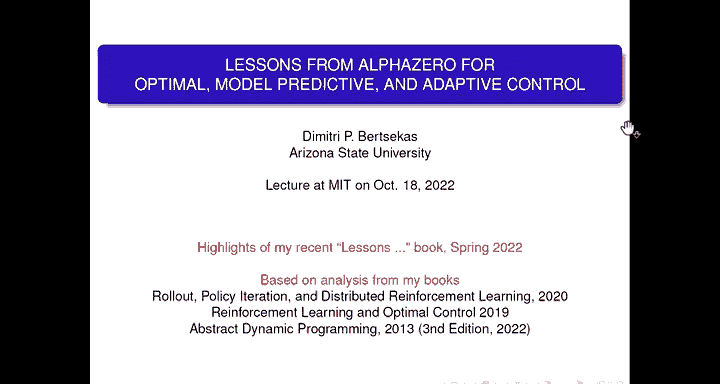
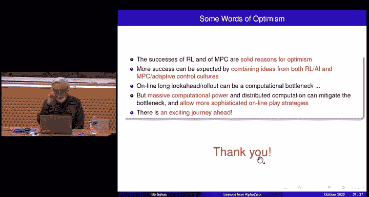

# ASU《强化学习2022-2024｜cse 691 Reinforcement Learning Course at ASU》中英字幕（deepseek - P28：[10]MIT Lecture, Lessons from AlphaZero for Optimal, Model Predictive, - GPT中英字幕课程资源 - BV1zcfVYdErD

I was just asked to introduce the speaker， I didn't have the time to look up your CV。はは。😊，这个跟月份的评费一次。

現在？First year in graduate school I started by taking thenitri' classes and then came for him。

 so Dmitriri has spanned a monumental breadth of topics because we've written seminal textbooks。

Very active in research and writing has received plentylen of distinctions， all sorts of reward。

 control System Society from theattro Green award is the latest one。

M National Academy for Engineering and so on and so on。

 so it's been working on reinforcement learning。It was about 5 years ago。

 so that's why we're going to working together。比如。Very active in this。

 So I understand tell us today about some。Inside the bird factory， which is very recently。嗯。Well。

Okay， it's my great pleasure to give this talking person。

 I think the last time I gave a talking person was five years ago。

 right in this room and so it feels nice to be back and what I'd like to talk about today is my new book and it just came out a few months ago and I'd like to give a summary。

😊，And that's the title of the book over there， and the book is short and and it relies on visualization and itss mathematics are reasonably e rigorousrous。

 but there's a lot of mathematical detail that's left out and it's contained in this other books that you see here。

So the objective is to develop a new view of reinforcement learning in its relations to the subjects of control system design。

 model predictive control， adaptive control， and also discrete optimization。

 like integer programming and things like that， it's a very。

 very general framework couched on the methodology of abstract dynamic programming。

And it is also inspired by the Alpha Ze chess program， which has made a lot of headlines。

So I'm sorry。 I'm going to sit， so I'll be able to point also on my。On my screen。嗯。

I'd like to start with these two remarkable programs， Alpha zero。

 which plays chess and TD Gamon that plays back gamon。

Alpha Ze created a sensation a few years ago with its quality and originality of play and created a lot of enthusiasm for the prospects of artificial intelligence and reinforce learning。

😊，T the gar们。I is much older about 25 years ago and it also created a great little enthusiasm at that time。

 and its just as impressive as alpha zero， perhaps more impressive in some ways because it was the first of its kind。

😊，And stimulated a lot of research。And motivation， including myself and John。

Get into the investigations that led to in our neurodynamic programming book。

 motivated to a substantial extent by the TD garment program。Now。

 these two programs are 25 years apart。But they involve a similar type of methodology， similar ideas。

 And both of them involve two algorithms。 A lot of people don't realize that there are two algorithms involved in these programs。

One is the offline training algorithm using neural networks to train a cost function approximation and also a policy network and all of this is done with data。

 selfgenerated data well before the programme plays， in other words this is a prepar phase。

 the design of the algorithm and then all of this is strap into an online play algorithm。

Which generates moves in real time against human or computer opponents。

 and its users multistep look ahead， rollout， cost function approximation， and things like that。Now。

 both of these algorithms have strong connections to dynamic programming。

 the classical methodology of dynamic programming， the classical method of policy duration。

 and also reinforcement learning type of approximations like neural networks and machine learning and the like。

And what we're aiming to do here is to understand this methodology so that it applies far more generally。

😊，So we're going to focus on the connections with control system design。

 particularly MPC and adaptive control， I'm going to argue that the alpha0 and tD Galon algorithms and NPC share the same idea as the same fundamental architecture。

And the framework that I'm going to introduce is very general and it applies aside from continuous space。

 state space and control space problems to discrete optimization， including integer programming。Okay。

So I'm going to go first。These two algorithms cells have0 and tdgament。

 we then interpret them in a more general setting。The online play。

Algorithm in alphapha 0 and other programs。Is based on approximation in value space。

 Sometimes people call it online research and。What。this algorithm is what you see here in blue。

 the blue stuff here is the online play algorithm。But it crucially depends on the results of offline training at two places。

A position evaluator like a cost function appximator given by a neural network in the case of alpha0。

 but in general doesn't have to be。And also it involves。A player， a bass player that just generates。

Controls in response to states。And。The online play algorithm aims to improve on the base player。

By starting at the given position that you are。This is the initial state， then at the current state。

 you generate all possible controls and then you search forward for several moves through a look ahead three。

Then you simulate the base player for some more moves。For every three leaf here。

 you run the base player， you run into some other states over here。

 and then you approximate the effect of future moves by using the terminal position evaluator at the states。

Now once you have done that， then you go backwards。

 you back up this computation to the starting state。

And basically by using backwards dynamic programming。

And you calculate the values of the available moves at the root， and you play the best move。

And then after you select your move or your control。

 you move to the next state and you do the same thing。 again， forward search， perhaps this。This。

Look ahead with a bass player， which we call frankly the rollout。

And you do the same thing and move forward until we。For another。

 an infinite number of moves or until a termination state is reached。

Now there are variations in this scheme， for example， alpha0 does not have this middle portion。

The middle portion enhances the look ahead qualities of the algorithm。

 but Al0 uses such long look ahead that's not necessary to use this middle portion。

At least in the public version， perhaps they have tried it。 Alpha though uses a version of that。

 Alpha0 also uses a mini version of this middle portion， but it's not very substantial。😊。

TD gamon on the other hand relies very substantially on the middle portion there's a difference between TD gamin alpha0 TD gamin is a stochastic game so that each tree experienced very quickly so you can use long look ahead and this short look ahead of TD Gamon is supplemented by this truncated rollout portion。

😊，In fact， the name of rollout is due to the sorrow， the originator of TV gamma。

 and it relates a name relates to back gamut where you all diece， you roll out a game and so on。Now。

嗯。There are also similarities with model predictive control in model predictive control。

 there's a minimization interval from the current state， this is called the control interval。

And then in some versions of model predictive control。

 there is also some base policy that you run for a number of more moves in order to get some terminal state altogether this is called the prediction interval。

 and then there's also cost function approximation at the end。

So the architecture is remarkably similar。😊，But there is a difference in model predictive control typically the state space is continuous like a Euclidean space whereas is in games。

 it's typically discrete but out of that conceptually the architecture is pretty much the same and at sound level the mathematics are also very similar。

😊，So this is the online play algorithm。 And now I'm going to go into the。Offline training。

This takes place before you play any， before you do any real time operation of the system。

And in alpha 0。It is a form of approximate consideration using self generated data。

 the data of self learning， as it's called。U。It generates a sequence of players。

 software that generates moves in response to positions。

And the current player is used to train an improved player， and then the process is repeated。

 the current player gets you animproved player and the improved player takes the place of the current player and the process is repeated。

Now in policy duration we have two operations， policy evaluation and policy improvement and the current player is evaluated by playing many games。

 the program plays many games against itself or against perhaps other opponents。

 computer or human opponents and out of its games before some kind of an evaluation of each state of its position。

 and that's the policy evaluation， and this is done using a deep neural network。

 a very sophisticated neural network adapted to the structure of chess and so on。

 it's called the value network。So that gives your policy evaluation。

Through a neural network and training。😊，And now this current player is improved。

By using a form or approximate multi step look ahead minimization， it's a little peculiar。

 it's called multi Carlo research and that' the policy improvement generates moves in response to positions and these moves are used to ta this。

Improved player using another neural network， a policy neural network。

 actually alpha 0 to two are conflated together， but they can be thought conceptual as being different。

TB Ganon uses a very similar quality algorithm。For offline training with a value network。

It uses a method called TB Lambda， one of the first methods in reinforcement learning。

 a very different method than the one that's we use alphapha0。

 but still the objective is to fit a neural network to values， okay。

TB Gamo does not use a policy network and does not use Monte Carlo research。

 Monte Carlo research is not fundamental really， it's just an approximation to speed things up。

And PD Gammo replicates the functionality of the policy network by using the value network and one step look ahead。

So these two are very similar in model predictive control， there is kind of a procedure like that。

 but a little different there less emphasis on repeated。

In policy improvements and policy evaluations。Okay。

 so now here are some major empirical observations。

The Alpha Ze program generates by offline training and deep neural network and zillions of computers and lots of computing time generates some player。

 however back player is not very good。The online player plays much better than the offline trained player。

So。Despite all the sophistication in the training， you're not giving really good quality of play unless you harness that offline trained player into a multi step look ahead an online play。

The online player is a phenomenal player， plays phenomenal chess。

 the offline training player is productive mediocre。😊。

So what this says is that one can improve or the results of offline training by using online play and the improvement is significant。

This is a fact it's just very easy to observe， in fact。

 for people that play around with these programs。And also with computer chess。嗯。D弟加盟。

Plalayce much better with this middle portion than without the middle portion。

Tesorro had two programs， one was in 1991 that did not have this middle portion went straight from one step ahead or two step look ahead into a cross function evaluation trained with T Lambda。

 and it did not involve the middle portion。That 1991 program played at a subhuman level。

 it played pretty good backgamon but not good enough to beat the best humans。In 1996。

 thes introduced this middle portion。To extend the look ahead， so to speak。

 and the performance of the program became much better and at a superhuman level。

It could be all humans。And also it played just extremely good backgalon。In back down circles。

 this program， the 1996 program is viewed as optimal， the thing is optimal， it's not really optimal。

 but it plays so good that they measure everything else against that program as that's the yardstick。

😊，So now what we will do is try to explain these observations。

And get insight from them and and motivate generalizations。

Through the methodology of abstract Belman operators， visualization。

 and there's a central law for Luton's method here。😊，The offline player and the online player。

Are connected neural through mutant's method。 This is the same mutant's method that you know and love from calculus。

 It is applied to the Belman equation of the dynamic program you problem that underlies this framework。

Ands okay it uses some embellishments， variations， depending on how you implement this methodology。

 including whether there is a truncated or loud portion or not。

 but it's newton methods that ties everything together， and in my opinion。

 explains all the empirical observations over a period of 25 years。And now here is in this figure。

 where is the U step well you have a terminal cost function evaluation and you have an online player which has a cost function。

 the mapping from cost function approximation to the cost function of the。

Online player is the Newton step。It maps a function into another function。

 And this other function is very close to optimal。And again。

 this is Newton step on the Belmon equation。 and it is just the very first portion of the。

Of the look I have minimization。 The mutantton step is a tiny part。 It seems out of this picture。

 but it's the most important。All the other stuff is enhancing the starting point of the Newton step。

 it brings it closer closer to the。Optimal cost function。 And from there。

 the power ofs of Newton's method takes over and。Its you very close to optimal。

So you start with a cross function approximation， you improve it through this part。

 you improve it through this part except for the very first portion。

 and then the final step is the Newton step that ties everything together and that's all the magic。

That's what I'm going to argue。So these are the principal view points of my talk。

Online clay is a single step of Newton's method for solving the Belmon equation。

 underlying the problem in the case of modestab ahead and also truncatedlo， it is a Newton SOR step。

SOR stands for successive over， it's really value directions。

 value directions with a policy or value directions be with minimization。

 and so in multistep look ahead， what we have is start from a cost function approximation enhance it through this SOR its。

 this value directions， and then apply a newton step at the end。Now。

 what the offline training does is it provides the start point for a newton step through a cost function approximation and also perhaps a policy to do trunccadeated rollout with。

However。The online play the real workforce。Offline training plays a secondary role。In my view。

And there's a good reason for this。Offline training involves a lot of approximations with neural networks and all of this degrade the quality of the starting point。

 it never gets you to what it would be， but because it involves approximations in neural networks the online player on the other hand is an exact mutantton step does not involve any neural network approximations and despite all you may think about neural networks having magical properties。

 they are not that magical， they involve errors and these errors are the reason why the offline player does not play so well and the online player plays much better。

Here's another insight。Okay， the offline training can be done with many different methods。

 temporal differences methods， aggregation methods， linear programming。 There's many。

 many different methods for offline training and policy， approximately duration。

And these differences affect the starting point， but these differences are washed out by the super linear new step。

 people in the numerical Ana who have worked with Newton's method know very well that if you are within the sweet spot of Newton's method。

 variations within the sweet spot don't matter， just in one step you zoom into the optimal。

 and that's that， on the other hand if you are far away。😊。

Outside the original convergence or outside the sweet spot of Newton's method。

 then it may not be as good a method。On the other hand， once you are close。

your starting point of the Newton step is close to the optimal。

 all differences between offline training methods。I washed up。

 and I had this experience when I started working in this field 25 years ago， I would try values。

Different types of offline training methods。They produced different results。

 I could see that the results were different。 but once they were strapped into an online。

Look ahead minimization， the differences disappeared。They were very close， too close to understand。

 and I can now come to understand that this is the reason that once you get within the sweet spot of mutant's method。

 then differences in training in how much data you collect， how you collect it and so on。

 they don't matter。Okay， there is a cultural difference that we relate to bridge。

 there is reinforcement learning AI type of research in this area and there's also control type of research in this area based primarily around model predictive control and also adaptive control now the AI research is focused largely on offline training issues。

How do you collect data， how do you use it， how do you do that training。

 how do you select the neural networks， and so， how you design them and so on。On the other hand。

 model predict control is focused primarily on online play and also issues of stability。

 you'd like your online controller to be stable， that's of paramount importance in control theory。

 although in artificial intelligence this subject is not really addressed almost at all。

By bringing together online play and offline training。

 we aim to bridge the gap between these methodologies。

Adaptive control is an important subject in control theory。

 It involves systems whose parameters change over time。As the system parameters change。

 it is possible to try to estimate them online， and this is what's done in a large portion of adaptive control methods。

Even though the Belman equation， when the model changes due to online estimation。

 the Belman equation also changes， on the other hand you still have a Newton step which is exact and as long as you perform the Newton step。

 then the performance of the overall system is still very good because the Newton step is very powerful。

The final thing I want to impress on you is that all of this applies in gray generality。

 all of this is couched， the insights， the mathematics， the visualizations。

 all of this couched on a methodology of abstract dynamic programming that use dynamic programming models in generality。

With arbitrary state spaces， arbitrary control spaces， stochastic problem， deterministic problems。

 hybrid system， multi agentss， minimize。Dynamic program is a very， very general methodology。

 and applies to a very broad classes of problems involving spaces that are arbitrary。

Our insights and analysis will be based on abstract dynamic programming and therefore apply universally。

 they apply in a very， very broad class of problems， including games as well as control systems。

 integer programming and the lake。Okay， so here's my outline。Excuse me。O， in the way of introduction。

 I'm going to set the stage with some discounted and discounted dynamic programming models over an infinite horizon。

 everything applies to finite horizon as well， but I'm going to focus on infinite horizon。

Then I'm going to introduce abstract dynamic programming concepts like Belmon operators。

 Belmon equations， non abstract setting。Introduce visualization of online play as a newton step。嗯。

Discuss stability in the region of stability and how we visualize it and what we can do to improve it。

Then I'm going to provide visualizations of policy duration。

And that simplyly duration version of policy duration called rollout。It's the same。

 but all out that I mentioned earlier。Then I'm going to discuss。Adaptive control。And。

I'm going to discuss an application to the Wdle puzzle， the New York Times Wle puzzle。

It can be formulated as an adaptive control problem。

 and it lends itself very well to the use of a out。Finally。

 I'm going to say a few things about discrete optimization， into programming。

 assuming I have the time。Okay。So let's take this as a starting point。

 infinite horizon problems involving a system that has a state Xk， a time K。

 the system moves from Xk to Xk plus1 through a system equation that depends on state control in the random disturbance。

 a random variable WK which is stochastic system。Corresponding to this transition from Xk to xk plus 1。

 there's a cost which is also random because it involves WK。

 it's also discounted with an alpha factor which is less or equal to1。

And we are interested in policies， stationary policies in particular。

 that map states into controls through this function new and satisfy some control constraint for all x。

Now， once you have chosen a policy， the cost of the cave stage is given by this。

 the control applied is this one here。The cost of the policy is the sum of the stage cost over an infinite horizon。

So what we have here is for any run of the system over end stages。

 this is the sum of cost that's generateds a random of variable because of the presence of WK。

 we take the expected value of that， this gives us a number and then we take the minimum over the number of stages and this gives you a number corresponding to the policy mu and an initial state x0 so this is a function of the initial state and its the cost function of mu of the policy。

 the cost function of the policy is this it gives you the expected cost of the policy of an infant horizon starting from the state。

And the optimal cost function， which I ignored by J star。

 is obtained by minimizing overall policies new。It's again， a function of the initial state。

And I have in mind， three primary classes of problems。

 One is discounted problems where alpha is less than one is G。 The cost cost per stage is bounded。

And this is the nice case， all the results that you would like to hold。

 all the analysis that you would like to do eventually come true and can be done relatively easily。

 This is the nice case of infant horizon dynamic programming。😊，Another class of problems。

As stochastic short path problems where there is no discount discounting。

 but there's a special termination state， which is cost free。 like games， for example。

 have a termination state， which is not known perhaps a priority。

 but determination state once keeps the cost finite。 and these problems admit。

A relatively nice analysis， not quite as nice as discounted problems but。There is。

The results that you would like to hold once you make the proper assumptions and you view the problem properly。

Finally， there is the control NPC type of problems。Which are for the most part deterministic。

 people look at stochastic versions of NPC but the starting point for NPC is deterministic problems。

Positive cost to provide an incentive to go to the termination state。

 The termination state has zero costs。 No termination states have positive costs。

 So this provides an incentive for big control to drive the system towards the termination state。

These problems。Do not have quite as nice theory as the other two。

 and they involve a lot of pitfalllls， but they have been studied a lot and people know how to deal with them by now and they're quite well understood。

Okay， so in this slide， I'm going to give you a quick rundown of the theory of dynamic input cor dynamic programming。

The principle fact is that J star， the optimal cost function satisfies Belman's equation。

 Belman's equation is what you see here。 It's a scalar equation for every x。

 so it maps J star into something else。 and this equation says that J star is a fixed point of this equation here。

In some cases， it is the unique solution of Belman's equation。

 but not always that's why I put this question mark here。😊。

And then theres the optimality condition if you knew J star and you were to do a minimization here for every state。

 you would obtain a policy， that policy is optimal， okay not always true but mostly true。

 certainly true in discounted problems。Then we have algorithms。

 the value direction algorithm generates a sequence of cross functions。

 which you hope would converge to J star and what the form of it is what you see here。

Start with some J0， you generate J1 by doing this minimization involving the right hand side of Belman's equation with J0 replacing J star from J1。

 you obtain J2 and so on， you obtain a sequence J0 is more or less arbitrary okay。

 but there are some exceptions here and you expect to converge to J star。

 It's one of the principal methods of principal computational methoddynamic programming。

And the other main computational method is policy duration。 Val duration iterates on value functions。

 Policy duration iterates on policies。 It generates a sequence of policies， mu and course functions。

 starting from a more or less arbitrary initial policy。And it involves two phases， two steps。

Policy evaluation and policy improvement。Now the typical iteration starts with some current policy and generates a new policy first by evaluating the current policy。

 perhaps with approximations。For example。A finite number of value duration steps， okay。

And then after you have this evaluation。😊，You do a policy improvement where you stick this evaluation into this minimization and you obtain a new policy for our own state。

 so from you you get mut tilde and then you double tilde and so on generate a sequence and you hope that this will converge to an optimal policy and the optimal cost function。

So that's the theory in a nutshell。And now where does reinforcement learning come into play。

 what does it do？If we knew J star， then we could minimize in the right hand side of Belmon's equation to act optimally at any stage。

 we would do this minimization online Now the problem with this is that we don't know J star and in approximation in value space。

 we replace it by J Tilda， some kind of approximation obtained by offline training obtained because somebody gave it to you somehow you have this J Tilde and you stick it in here and you generate controls online。

This is one step look ahead where you try to balance the cost of the first step and the future as evaluated by J Tilda。

In multi step， look ahead， you do much of the same at the current state Xk， you look L steps ahead。

L greater than one。And you try to minimize the sum of the cost of these first L steps and then add the cost of the future as evaluated by J Tilda。

Now， this minimization can be done by L step dynamic programming。

And it will give you an initial control to apply at XK and policies for the remaining stages and what you do at XK。

 once you have solved this problem， you use UK， the first control out of this sequence and you throw the other stuff away and then you go to the next state and do the same thing and so on each step involves a one step dynamic programming calculation or an L step dynamic programming calculation。

Whether you do one step or multi step， this operation is defined a policy。

 this mut tilde policy at Xk which gives you the minimizing UK this is the greedy policy。

 I'm going to be referring to this as the one step look I ahead policy or multi step look I ahead policy or just greedy policy。

So we have J Tilda that we start with， and we end up with a greedy policy， new Tilda。

 I'm going to be using this notation throughout the election。🤧嗯。The key new fact here。Heres that。

J Mu Tilda， the cost function of the greedy policy is the result of a newton step to solve Belman's equation starting from J Tilda。

In the case of one step look ahead and starting from some J Tilda enhanced by a number of by this dynamic programming operation。

Through a Newton S， O Y step。And because this is a mutant step。It has superline convergence。

In other words， you start with an error， J tilde minus J star， your approximation error。

From the opt and you end up with a new approximation error which is the cost of the greedy policy now this new approximation error is tiny relative to this you may start with a big error and end up with very small error and this is guaranteed if J Tilda is close to J star its within the region of convergence and so to speak the sweet spot of Newton's method for quadratic convergence and superralineial convergence takes effect。

So that's the key thing and that's the point where I'm going to base everything。

 including my visualizations。Now， to understand all this， we need to look more abstractly。

Through abstract dynamic programming and。In a more introduced， a more general setting。

 Belelman equations and Belelmont operators。And there are two Belmont operators here。Now。

 I've written an abstract dynamic programming book in 2013， and the third edition。

 the second edition was substantial revision， the third edition， not a very substantial revision。

 but still a revision， and you can find this in the internet， there's a free PDF available。嗯。

There are。And， and the idea in abstract dynamic programming is to abstract the essential elements of the dynamic programming theory and encapsulate them within these operators。

 the Belman operators。And in the context of the discounted problem that we have been considering here。

 there are two Belman operators。For a given policy mu。

 the new Belman operator is simply the right hand side of Belman's equation for the policy。

And the min Belman operator。Is obtained by minimization of the new Belmont operators overall policies。

Now this is an operator in the sense that it takes a function J and produces another function。

 team use of J， similarly here from a function J， we obtain another function T of J。

And the Belman equations that hold in the context of dynamic programming say that for the policy new。

 JV is a fixed point of the new Belman operator， and Jstar is a fixed point of the min Belman operator。

So there's a shorthand notation which is very nice here， and however。

 just let's try to discuss this operators a little bit。😊，嗯。Okay。

Here I'm going to assume that T and T new map into real value functions， that's not necessarily true。

 but we are going to assume it here for the purposes of this talk。For any fixed state。

These are functions of J。 So they live in a continuous space， in a function space。

 even if the problem is discrete。Or has a discrete state space。

Another important property is that team U is monotone if I increase J here uniformly for all states。

 team U of J also increases monotonically。Moreover， the team new operator is linear， okay。

 because the expectation operation is a linear operation。The Tbel operator is not linear。

 but is obtained as minimization of linear operators， so it is concave， in other words。

 for any state X。T J so X， is's un of goodness， con function of J。Moreover， T is also monotton。

 if you increase here， J， T of J will also going to increase。On the other hand。

 these operators are very complicated。Suppose that you have only two states。

 You have a markov decision problem with only two states then。The J vector is a vector in R2。

 the TJ vector is also a vector in R2， so to construct a graph of this operator。

 you need a four dimensional space which you do not have， so that's a problem with visualizations。

If you go to an infinite dimensional state space， T U and T are infinite dimensional operators。

 and they map infinite dimensional function space into itself。

 so it's very difficult to visualize them。Our approach here is to use visualization along one dimensional slices of the graphs of the operators。

Now this does not provide proofs， mathematical proofs。

 on the other hand it provides a lot of insight and foot for third and conjecture。

 which you have to verify by using mathematical analysis。😊。

So that's the line that we're going to follow here。

 visualize and conjecture based on one dimension slice visualizations and then。

Verify through rigorous mathematical analysis that the results of the insights from visualization are indeed correct。

😊，So I'm going to be using one dimensional slice visualizations or one state visualizations。

 if you will。And let's visualize。The new Belmont operator in one dimension。And here is the operator。

 it's linearar in monoone and the mu Belman equations。

 what you see here is this fixed point equation。So here's the graph that I'm going to be using for visualization here and in future slides。

On the horizontal we have J， the cost function， and on the vertical we have team use of J。

And the graph of this operator is linear， what you see here is this blue line here。

It is monotone and it's linear。 and how do we visualize the solution of this fixed point equation。

 Well， we have to make the right hand side。Equal to the left hand side。

 So the solution is the point of intersection。Between this and that。 And this is the cost。

Of mu is the solution of the fixed point equation。Okay， so now let me go to the Mint Belman operator。

U。It is what you see here。Minimization over all these linear operators。And so what we have here is。

Is。Is。The graphs of the linear。New operators。And we take the minimum of those to obtain the graph of the min Belmon operator。

 which is this red curve here。So the red curve is。V。The envelope， the lower envelope of this。

Linear operators and it's concave。So suppose we are a J Tilde and we want to find Ts of J Tilde。

 how will we do that Well， we go up here， we find the points of interception with the blue Belman operators。

And then we go down and find the minimum of all these points of interception， it's this point here。

And if we consider now this is。The greedy policy， a J Tilder right is obtained by minimization in the righthand side of B equation and it has a certain graph。

 Now that graph because of a concavity of the red operator is tangent it involves a linearization of the。

😊，Bread operator。And the greedy policy evaluation is obtained by finding this point of interdeception。

 drawing the tangent， find the point of interdeception here， and this is the greedy cost。

So from J Tilde， we obtain J New Tilde， and I'm going to argue that this step here is a Newton step。

Okay， so let me go into before I do that， let me also。

Show you the visualization of the value duration method generates a sequence of functions by applying the T Bellman operator successively。

And it starts with J tilde， then it goes up to the red curve to obtain T of J tilde， which is J1。

 reflects this point along the 45 degree line to obtain J2， then J3 and so on。

 and that's the way it works。The results of value duration is obtained through the staircase construction and。

And。As you can see from this figure， there's a good chance that JK converges to J Star。

But the convegence depends on the slope of T。 If T is a contraction， then things work out。

 if it's not a contraction， then you may have some difficulty。Okay。

 so now let's get back to Newton's method。And its visualization。

Let's look at Newton's method in general for solving a generic fixed point equation。

 So T here is not related to dynamic programming。 It is just a generic fixed point equation。

 which I have here indicated in red。 This is a graph of J of T of T。Now。

Newton's method generates a sequence。Of iterates， JK at the current Ierate。

 what you do is you linearize this operator at JK， solve the linearized equation。

In other was replace TJ by disc linearization and solve this for fixed point problem here。

Then you obtain JK plus1。And that's the way Newton's method works。Then once you are at Jk plus 1。

 you linearize again， intersect with the 45 degree line， obtain Jk plus 2， and so on。

Now that's the way you learn mutantton's method in calculus， on the other hand。

 typically in calculus， always in calculus you assume differentiability of T so you can use first order tail series expansions。

 gradients and the like。😊，Do we need differentiability or the answer is no。

 and in fact this is important because in dynamic programming。

 we are not guaranteed this differentiability。Concavity of T is enough， and this has been known。

Since the middle 70s， all you need to do is linearize a properly Belman's equation or the mapping T。

😊，Using perhaps sub gradientds， and this is what happens in our dynamic programming context。

So from the general type ofutance method for a generic fixed point equation。

Let's go back to dynamic programming and look at one step。

 Look ahead and the Newton step interpretation there。

What we have is a cost functional approximation J tilde。The greedy policy， as I argued earlier。

 is obtained by forming a tangent to the graph of T。

This defines a linearization of Belman's equation and the solution of the linearized problem is precisely the cost of the greedy policy。

 so from J Tilda to J Utilda I go through a linearization process that's exactly the same as for Newton's method this is the Newton's step corresponding to J Tilde。

So that's a key insight on which everything is based。And there are some important gramifications。嗯。

The first is that。The Newton step of smooth cloud starting point of variations。 Okay。

 so if you change a little bit， J Tilda。The difference here is going to be tiny。

 You're still going to be very close to J Star。The other thing is that locally the error decreases very differently than what current theory suggests。

 current theory is a global theory of error bound that's conservative and does not best very little in relation to reality。

😊，嗯。In reality， what happens once you get close to the optim is a very different behavior of the error。

 It decreases super linearly and much， much faster than the current theory predicts。

Now if you have multi step look ahead， it's a similar picture that occurs in multi step look ahead you precede the Newton step with a number of value durations。

 so you start with a cost approximation J Tilde do a number of value durations。

Two in this particular case， go up to this point。 and at that point。

 you apply the Newton step and obtain the greed diplomaency and its cost。So from J Tilde to J Utilde。

 there's a Newton SOR step。Two value directions first， and then a final mutantton step。

Now the Newton SOR method still converges very fast and faster， in fact， than the pure Newton method。

 but it's more time for consuming that's the basic trade of。Okay， just a short interruption here。

 it's 459。And。We started late， and I'd like to。I'd like to shorten my talk and you can find the slides on the internet。

And what I'd like to do is。Is。Okay， I won't have time to talk about the origin of stability。

 Incidentally， there's a two hour version of this talk that's on the Internet。

 and it's pretty much the same as what I've given here with a few exceptions。 And you can attend。

 you can see this talk on the Internet。Now I'll have to shorten this talk。

 maybe I'll just record the full talk in Zoom and put it up on the internet。

 but I don't think I can finish this talk in the amount of time that we have so what I'll do is I'll skip stability。

And the original stability， the original convergence of Newton's method。Then。

Rollout is simply a mutantton step starting from J Tilda equals to the cost of some policy。

And there are some important advantages to roll out。

And there's also policy duration is just a repeated rollout。

 starting from a stable policy produce a sequence of stable policies。Incidentally。

 policy duration and interpretation and Newtons method was actually。Invented here at lids。

 It's not lids。 Really， it was electronic systems laboratory at that time。 In 1968。

 there was a thesis by David Kleim， a student here。Who。

Who developed this connection of policy duration and Newton's method for linear quadratic problems。

 David Klein was a student Mike Athens， there was a lot of research in this area at that time and optimal control begins of optimal control here in our laboratory。

And Climma's work was followed up by several other people and the interpretation of policy duration as Newton's method is well known in control theory on the other hand the new part is the interpretation of approximation in value space in terms of Newton's method and the insights that you can get from that。

O， this rollout with approximate policy evaluation， truncated rollout。Then that I。

There's a theory for linear quadratic problems， a familiar class of problems。

Where you use Riaddi operators instead of Belman operators。

 and this is somewhat more insightful in the context of linear quadratic problems。

And the ricardi equation has a similar kind of Ricardi operator has a similar kind of graph。

 but it involves the restriction of the Belmon operator to the subspace of quadratics。

This kind of interpretation is very nice because you can program it in MATLb and within an hour or two。

 you can see a lot of things that can verify some of the things that I'm talking about here today。

 it's a very nice way to visualize what's happening within the cortex that I'm describing。

Let me say just something。About this question， I get this question very often。In the end。

 we want to produce some kind of an online player which is good。

 We suppose that we got that through Newton steps multistep， look ahead， whatever what have you。

 why can we not train a neural network to emulate this online player？And in this way。

 we're going to be using approximation in policy space， get some good controller。

 and then approximate through a neural network。Now， this viewpoint， I argue is flawed。

 is it is a mirage that you're going to get a good controller this way because this transcription。

From the online player， which is good to one represented by a neural network。

It does not involve an exact Newton step， it involves approximations that are introduced by the neural network。

 so you're not going to get the advantage of the full advantage of approximation in value space and one step or multistep look ahead and there is an example here that you can find in the book and illustrates the difference。

 what happens if you use the Newton step and when you don't use the Newton step is's a big difference in performance。

Okay。I'm going to spend a little bit of time on adaptive control because I want to say about something about Waterlo。

 which was Ben， which was a project that was a lot of fun for me and a couple of my students at ASSU。

😊，Adoptive control involves。A system whose parameters are changing over time and what we often do here is we estimate these parameters from the system as it is operating。

 we obtain data， estimate the model of the system the change parameters and we feed them into an adaptive controller which adapts its control accordingly。

 and the classical methodology of indirect adaptive control is based on the reoptimization you get new parameter estimates。

 you reoptimize the controller and you keep going like that on the other hand。

 this reoptimization maybe time consuming okay linear quadratic problems。

 perhaps it's not time consuming， but for other problems it is quite time consuming so it is a problem。

But here there is a faster alternative， which I argue is almost as good。

Do in direct adaptive control by using a rollout in place of reopim。

And use a Newton step in other words， instead of reoptimization and the result is just as good almost and it capitalizes on the fast conversions of the Newton step and also provides insight why model predictive control has worked so well with adaptive control situations。

So I have a computational example here of adaptive or optimization and adaptive rollout with a newton step is almost as good and if you use a。

😊，A base policy， a fixed policy without a given step， then you miss a lot in terms of performance。

Now there' is an alternative adaptive control formulation which date back to the 70s and reforms the problem into a poVP。

 a partial state information problem where the unknown parameters。

 which I call theta become an initial state。😊，And it's part of an augmented state that's partially observed。

And you estimate this state by forming over time a belief state。

 which is the probability distribution over the unknown parameters。

 given the information that you have collected up time K， which are the states of the system。

And theres a beman equation for this pom DP， and I'm giving it here。

 it involves the cost function as a function of the information available up to time K。

 and this is the information available at the next state which depends on the unknown parameter。

 and also theres the belief state that comes here this probability distribution。And。Now， again。

 J star is very difficult to compute。And in approximation in value space。

 we can use an approximation J tilde in place of J star。

 which depends on the unknown parameter under a cl ofvoal assumption that you know theta。

 the true value of theta。So。And there are， and you minimize over UK and you obtain a greedy policy。

 And there are a couple of options here。 The first one has been investigated extensively in the 80s。

 and it involves interesting mathematics and interesting ideas。

 and there are some pitfalls in this approach， which people have investigated。And in this approach。

 you use IJ Tilde， the cost function of the optimal policy under the clairvoyant assumption that you know。

The value of theta。And this may be easy to calculate and you stick it in here in place of J star and you obtain an adaptive control policy。

😊，The other possibility is to use。And all out。In place。

 so J till the I is the cross of some known policy again under the Claboyan assumption。

 and this is what we have used in the world rule puzzle。Now how does Wlo。

 I presume that most of you know what Wlo is just about anyone I talk to knows or is a dedicated player of the puzzle。

 it appears in a your time every day， a lot of millions of people played every day。

 I never played it myself， I had a hard time understanding the rules in the beginning， but anyway。

We were able to model this as an adaptive control problem where the unknown parameter is the unknown mystery word here we're trying to find some mystery word that's chosen。

😊，For the uniform distribution from some list of mystery words。

And then you try to guess that mystery word through guesses of drawn from some。List of guess words。

And so it's basically the controls are these guesses that you choose sequentially and you're allowed a number of guesses。

 and these words have four five letters and number of guess words in the over 10，000 words。

 so it's a substantial list substantial number of controls that you can choose from。So。Now。

 this type of problem， together with other search problems or finding some hidden object by using observations is part of this formulation here。

And。And。We have applied rollout。 now， the details I'm not going to be able to give you here are my collaborators。

 and we are free to have a paper in a few weeks from now。😊，I'd like to show you the results。

What you see here is。Different opening words。 The best opening word is this salad。

It's a strange word， and they had to look it up some kind of a strange hat， okay。

It turns out to be the best opening word， the best initial guess， turns out to be this salad。

And what you see on the vertical here is the average score。

 the average number of guesses that you expect。😊，By。O。

 it's average because you don't know the mystery word。

 The mistake is average over the initial uniform distribution of of the mystery word。

And the optimal is。People have calculated the optimum with days of computation。

 days of It's a gigantic dynamic programming computation， but people have done it。

days of computation with parallel computing systems and the lake， and the optimal is 3。

5084 on the average number of guesses needed to find the mystery word using this solid initial word。

 and they are a little higher numbers for the other initial words。

So the aim is right where you see this horizontal， but a little higher it's around 5。1， 3。51。

And we have tried Ro out with three different base policies， and there are three base policies here。

 One is this maximum information gain。 All of his base policies have been suggested in the literature。

 by the way。These the blue， the blue stars give you the performance of this the performance of this maximum information gain policy。

For。This opening words。And the another policy is this yellow policy。

 and another policy is the red policy。 And what you see here。

 the circles are the performance of the rollout policies。 Now， you won't see any red stars。

 The reason is that。The performance of this policy is off the chart。 O， this is a real bad policy。

 it turns out。's at least the way we have implemented it。 It's like 5。8 or something。 It's way。

 way higher。On the other hand， the other two， the blue and the yellow are fairly close to the optimal now the rollout gives you uniformly good results。

 much better results。The best that we get is 3。5231 versus this is。

 which is the option in other words。We hit the optimal number of guesses， on the average。With the。

We then。Less than 1% additional number of guesses。And whatever。

 we get the online answer within seconds， like one second， two seconds， three seconds。

If you were to fire you be optimal。And all of this， by the way， our bunch stuff together。Which。

Which shows how the Newton step washes out the performance difference of the values based policies。

And then。And the other point I want to make is that if you were to change the world puzzle a little bit。

 increase the size of the mystery list or the guest list， or instead of having five letter words。

 consider a list of six letter words， seven letter words。

Then the rollout approach applies and still solves the problem within seconds。

 but finding the optimal approach would be entirely impossible outside the realm of possibility。So。

Okay， so I was excited about this research project， I wanted to let you know about that。And the。

I'll skip into your programming。And。I'll quickly go through some of this。

 There's much to be gained by using online play of on top of off training。

 This is the principal message I want to convey。The role of Newton's method is central here。

That can guide both analysis and algorithmic design。

The cultural divide between AI and control can be bridged。

By through this synergism of offline training and online play。And then finally。

 all of this is very in general。 applies to arbitraryrbit state and control spaces through the formals of abstract dynamic programming。

So all in all， I think there's an exciting journey ahead。

 and I hope that we will all be participants。Thank you very much for your attendance and sorry for taking a little longer than expected。

