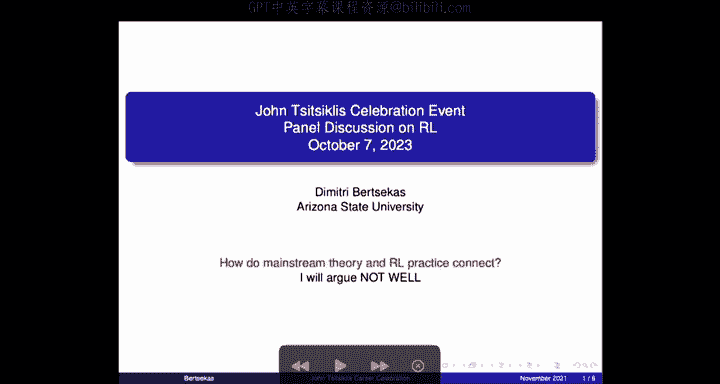
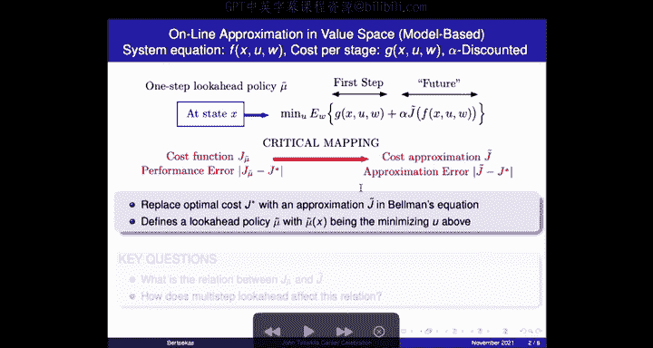
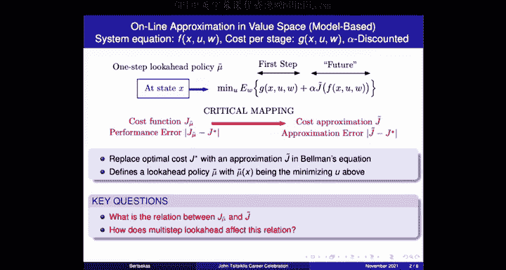
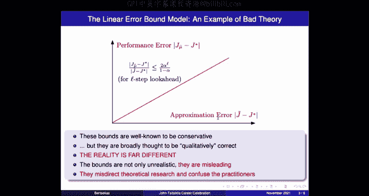
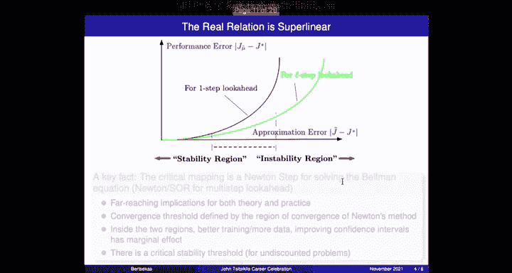
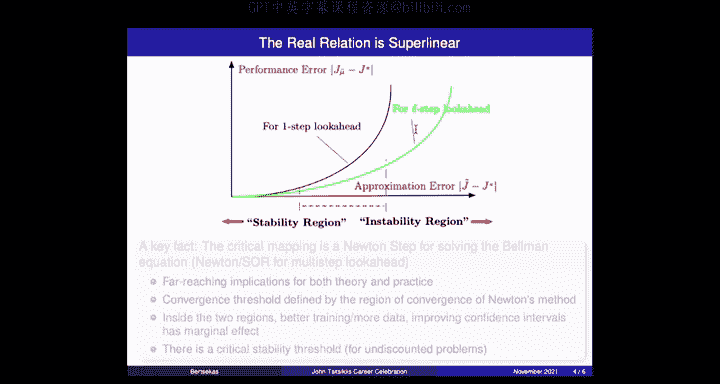
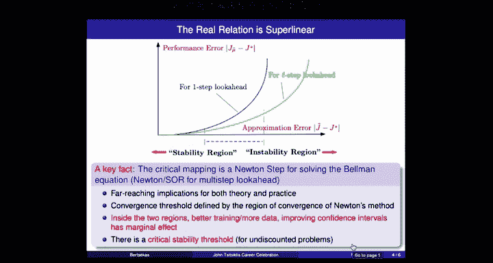
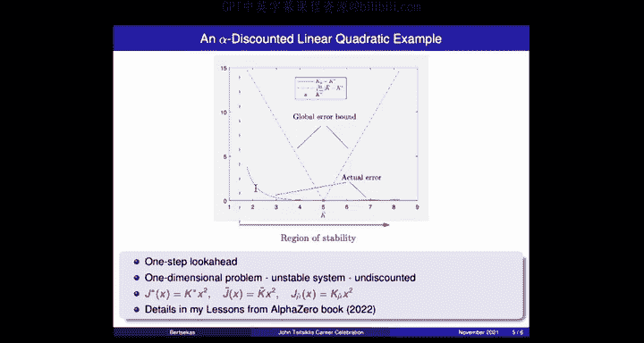
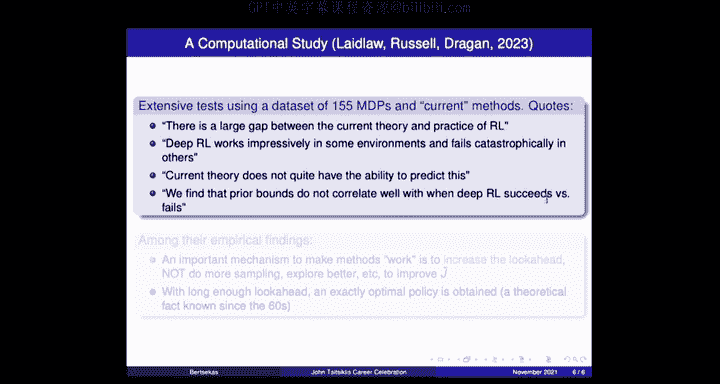
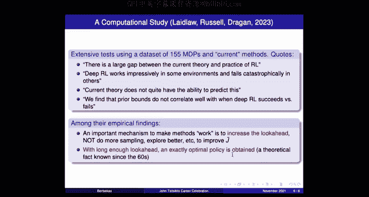

# ASU《强化学习2022-2024｜cse 691 Reinforcement Learning Course at ASU》中英字幕（deepseek - P29：[09]The failure of theoretical error bounds in Reinforcement Learning. - GPT中英字幕课程资源 - BV1zcfVYdErD

Well， I'm pleased to be here。 I'm not quite sure how to answer the question of what is reinforcement learning。

 There was a lot of exchange back and forth within our panel before we came here and。😊。

I'm at a loss to give you an answer that will please all or even most of you instead I'm going to answer and try to answer this question。

 how does mainstream theory and RL practice connect and I want to argue that not well not well at all and I'll illustrate this with an example that comes out of my relatively recent experience。

So。嗯。Okay， I'm going to take you into symbols and math。

 But this is a very elementary figure that most of you that have studied enforcement industry have seen before。

 perhaps with different symbols。This involves。Approxiation in value space and and theres a system equation here de by F。

 this is an old symbol。 Theres a G course function like Leslie said。

 there's a G which was used for many， many years before reinforcement learning came along and I'm going to consider a discounted problem over an infinite horizon that has an alpha discount。

 and a lot of reinforcement learning revolves around this figure。

We replace the optimal cost function in Belmon's equation with some approximation。

 that's what's called approximation value space。 we approximate J star the value function with a J tilde and we minimize like we would in in dynamic programming exact dynamic programming except this approximation J tilde。

 so basically at any stage that we are we minimize the weighted sum the sum of two components。

 the cost of the first step and then the future as approximated with this J tilde and w here is our random value。

 so there's an expected value with respect to W if there's no randomness then you don't need this expected value。

Now， this is a model for much of reinforcement learning。And there's a critical mapping you will hear。

How does your approximation。J Tilde affect the end result， which is the policy that you get。

 That's the question you're interested in。 How does all the stuff that you approximate affect the quality of the the of the policy that you obtain this new tilde。

So what the critical mapping is。The one that maps approximation error。

 J Tilda from J star to performance error， the cost of this policy utilde。

 which I call J Uilda minus J star， that's the core question。And then。And so。

We have this one step look ahead policy。 There may be multi step look ahead。

 which I'm not going to give because it's too long。 And you have this， you have this mapping。

The key question is， what's the relation between between J U Tilda。

 the performance of function and cost approximation。And。And also， if the smallest step look ahead。

 how does it affect this relation。

Okay， so there's a standard approach to this question， which is the linear error bound model。

 It says that the approximation error and the performance error are related by some kind of a linear relation。

 And there's a certain classical bound It from the 60s。 it's a folk theorem here。

 from the 60s that says that。The ratio of these two is bounded。

 something that depends on alpha L is the length of the look ahead。 so with more look ahead。

 the bound improves and there's a linear relationship and this quantity here is the slope of this line。

And now。This is an old bound， but in our web， some of these were original and we were taking great proud of them。

 We thought this was some of the core results of our book。We， of course。

 we knew very well that these art bounds are conservative。

 they are the real relationship is the real relationship lies much lower than this bound。However。

 we thought that broadly speaking that qualitatively correct， even though this bound is not exhaust。

 it gives you the rough the general trend and some kind of a qualitatively correct result。Now。

The real。The reality I found out relatively recently。

 why teaching reinforcement learning at AS S Q reality is far different。 This。

 This bound has no connection to reality。 The relationship is not linear at all。

And the bound is not only unrealistic。They are， it's misleading。

 It takes you along conceptually wrong paths。And in this sense。

 they misdirect theoretical research and also confuse the pakiism。

The tube relation is not linear， but rather it is super linear。

And for one step look I here it looks like this， in other words， flow。

 if you make a small approximation error， then you would get make a very tiny error in performance。

 its going to be almost optimal in this region， no matter how large the approximation as long as you stay within stability region or region of convergs。

And there's also another region where if you go by even moderate amounts to improve the approximation。

 error gain nothing， the error is catastrophically large。And。Now， if you use multi step look ahead。

 there's a better curve。 Okay， still the same shape， but a better looking curve。

And the key fact is， if you know， if you know about optimization， American analysis and so on。

 this will remind you of Newton's method。 That's the way Newton's method works。

 One direction of Newton's method works like this。And the critical fact is that the mapping。That。

 that takes approximation error to performance error is a newton step。

For solving the Belman equation， in the case of multi step， Look ahead is a Newton S， O， R step。

SOR stands for Suive over relaxation， it involves a newton step。

 but preceded by a number of first ordinary directions。

 and that's what shifts the curve to with the right。Okay， so now this， I think。

 has far reaching implications for both theory and practice。

It says that if you are in the good region， the region of convergence of Newton's method。

 it doesn't make。Does make a difference how long you train， how you improve your confidence bound。

 you're going to do very very well。 on the other hand， if you are outside in the stability region。

 then no matter what you do， you're stuck， there's nothing you can do with collecting more data and things like that。

And there's also a middle region where you might get lucky and have good performance， but not always。

So theres some convergence threshold here， which is defined by the origin of convergence of Newton's method。

And marginal effects within the two regions， there' marginal effects with all the tricks。

 the metrics and data collection tricks that you can play have a marginal effect。

And there's a critical stability threshold for at least for undiscarded problems。

 These problems are always， we need to stable contraction mapping， stable equations and so on。

So。Just to give you a simple figure。This is a。A linear quadratic problem involving a one dimensional system。

 one step Look ahead。 but the system is unstable。leftft uncontrolled。

 and the problem is undiscounted。 This is what the error bound gives you。 the classical error bounds。

 the bound that everybody relies on for other analysis。In the actual error。

 you can calculate it here。 It looks like that has no relationship。

 This bound has no relationship to reality。Moreover。

 there is some nuances to this to this arrow bound。 For example。

 the bound on the on the right is much better than the。T the bound on the left。

 And if you study Newtonance's method， you will see why this is true。

 And you will also see here this asympt， which is the origin of stability。

 If your approximation error is on this side of this stability threshold， then no matter what you do。

 you're going to get an unstable system。Okay， so this is some of the details of this example。

 And you can find more in。My recent book on half for zero。嗯。Now， okay， this explains。

Observations that I've been holding， that I've been collecting。Since the 90s， okay。

 and all of this is consistent。All of this is consistent with， with this experience。

 but there is an interesting computational study that came out a few months ago。

From Berkeley， Russell and Drgan are two professors， like he is Department。 Russell， of course。

 is a prominent figure in artificial intelligence。 Lightlow is a graduate student， apparently。

And they conducted the most extensive computational study。

On reinforcement learning methods and problems， they compile a re of 155 MP。

 some of them very large and glned out of data sets that were benchmarks that were available in the literature。

And here's some quotations from this paper。There's a large gap between the current theory and practice of R。

Deep Ar works impressively in some environments and fields catastrophically in others。

Current theory does not have the ability to predict this。

We find that prior bounds do not correlate well with when deep reinforcement learning succeeds or fails。

And they have empirical findings and the principle finding is that an important mechanism to make methods work is to increase the length of lagbu ahead。

 like alpha0。 people believe that alpha0 succeeds because it has huge look ahead。

 There are a number of ways you can increase， look ahead， including rollout with some policy。

So to them， this is the key。 And that's what the computational results bring out。

The quality of the approximation doesn't matter as long as the look ahead is long enough。And okay。

 so there reached some conclusions about look ahead and I'm not quite sure I agree with us with this。

 but one result that stands out is that we long enough look ahead regardless of the approximation error and exactly optimal policy is obtained and incidentally its a theoretical fact。

 so that's where theoryia comes in a theoretical fact known since the 60s。

So， okay， so I'm going to stop here because my Chaman demands it。判郸。

