# ASU《强化学习2022-2024｜cse 691 Reinforcement Learning Course at ASU》中英字幕（deepseek - P2：[08]Lecture 2, 2024, Stochastic finite and infinite horizon DP, - GPT中英字幕课程资源 - BV1zcfVYdErD

Okay， so let's get started。We welcome you to the second lecture on topics of reinforcing and reinforcement learning。

Last time we talked aboutministic。Finite Horizon dynamic programming problems。

 Today we're going to focus on stochastic， finite and infinite horizon。

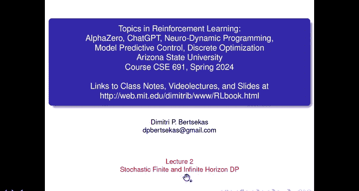

Dynamic programming problems。And。Here's the outline。

We're going to a review first of the deterministic case。

 and we're going to talk a little bit about approximation value space。

 how do we do approximate dynamic programming for deterministic problems？

This is going to be very brief in an introduction to the more extensive discussion of our approximation value space for stochastic problems。

Then we're going to talk about a stochastic dynamic programming algorithm。

And we are going to illustrate it with an important type of problem， linear quadratic problems。

 a linear system and quadratic cost function for one dimension is going to be an easier calculation for one dimension。

And this a very basic。An important problem in control system design。

And it's also a very favorable case because that needss an analytical solution by dynamic programming。

 so we're going to have the opportunity to see how dynamic programming works in the few problems where an analytical solution can be found。

Then we're going to talk about approximation in value space。

 this is going to be our reinforcement learning work work workforce is's a fundamental approach that we're going to spend。

Practically the entire semester on approximation in value space where we approximate value functions or cost functions。

And we're going to summarize this review it。And then we're going to contrast it with an alternative approach。

 which is approximation policy space where we try to approximate policies。

And we're going to see how these two can connect。All of this is going to be for finite horizoniz problems。

And then we are going to discuss briefly infinite horizon problems。

 an overview of the theory and of algorithms， and we are going to illustrate the theory。

And the algorithms with linear quadratic problems after we extend them to infinite horizon。

We're going to take a break right around here。And hopefully we will not need another break。

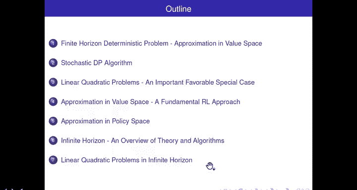

So a review of finite aion deterministic。Here we have a system that generates a sequence of states。

 x 0， x1， and so on up to a finite。Horizon N up to Xn。呃。

The next state is generated from a current state according to a system equation where the control enters。

And。The control is chosen from some set， depends on the current state。Now。

 one thing that I mentioned last time and I want to emphasize again。

 is that this formulation is very general， except for deterministic， this is very general。

The control and the state spaces are arbitrary。 They can be vectors in some Euclidean space are in。

 They can be ches positions taken out of a finite set of all possible chess positions。

 They can be word strings。 They can be。Anything。So that。

That enhances the generality of everything we're going to discuss。

 We want to bring out the fundamentals at the highest possible level of abstraction so that we can apply them as generally as possible。

Okay， so each transition also has a cost ge that depends on state and control。

The cost function that we use is the cumulative sum of the cost of all the transitions。Plus。

 a terminal cost that depends on the final state。Now。

 given an initial state and given also a sequence of controls。

 the cost is a number is given by this expression， so it depends on x0 and all the controls。

And what we want to do is find the optimal cost function。

 minimize overall sequences of controls that are feasible。And after we do that。

 what's left is a scalar that depends on x0。It's effectively the a function of x0。

 and we call it the optimal cost function。 It's a very fundamental object in this this problemable formulation。

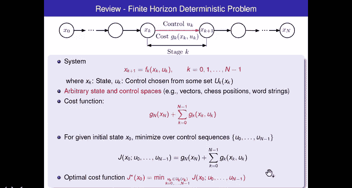

So we discussed the dynamic programming algorithm， the principle of humanity。

Wwhich computes the optimal costs of all the tail sub problems that start at a given state xk at a stagek。

 we call this the J star value， okay there are many of those dynamic programming will compute all of those and it will start at the terminal stage。

With just the terminal cost function， we'll go one step back according to this equation。

By minimizing the sum of the next stage plus the optimal cost of the next ten sub problem which we have computed it because we're going backwards。

 so from JN star we go to N JN minus1 star JN minus2 star and so on all the way to J star0 at that point we have the ten sub problem which is just the original problem so we have gotten J star the optimal cost function of the problem。

Now it's possible to obtain an optimal solution generating by keeping track of all the controls that we obtain by minimization of this equation。

However， we can also， after we finish with all the J stars， go forward in an online play fashion。

Start with the initial state， we know J1 star， we minimize here， we obtain the first optimal control。

We plug it in the system equation， we get the first optimal state。Then we obtain U1 star。

 then x2 by this minimization what。Then x2 star， then u to star and so on all the way to the end generate the entire trajectory。

So that's the dynamic programming algorithm， very simple specificification， lots of intuition。

 but also lots of computation。For this calculation， which you can view as offline terrain。

 if the state space is very large， this computation is exorbitant， think of a very large。

 think of a traization problem with a very large number of of cities， right， the state space。

 the size of the state space grows exponentially。啊。

So that's the reason we have reinforcement learning to simplify things here。

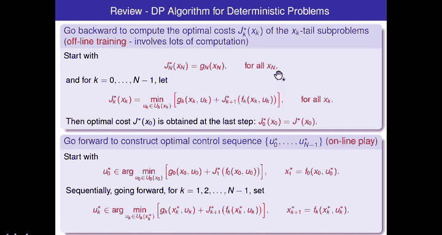

But before we go into that。Let's look at another， the concept of a Q factor。

The Q factor is a function of state and controlled pairs。And。For Xk and UKk at stagek。

 it takes this form。It is the cost of the。The immediate cost using UK plus the optimal cost to go from the next day。

So it can be viewed as the cost that Q obtained if you were to use U at Xk and then act optimally afterwardwards。

so。If you know the J stars， then your computer Q stars。But also if you know the Q stars。

 you can also compute the J stars， you can recover them by minimization here。

 what is this minimization is minimization over a of this expression。

 but that's exactly the dynamic programming algorithm， so this is J star k of xk。So。If you know one。

 you know the other， this one requires more storage than this， but it has some advantages。

 conceptual advantages and algorithmic advantages that later on we're going to discuss。Now。

 one thing to note is that the dynamic programming algorithm can be written equivalently in terms of Q factors。

The Q factor is defined by this expression， but this expression is obtained by minimization。

Of the Q factor at time K plus 1。So。Combining these two equations， we have this。

So we can generate all the optimal few factors sequentially going backwards from time n to time zero。

According to this algorithm。有。Algothms that are based on Q factors arise in several different settings in reinforce learning collectively。

 we'll call them Q learning。There's no one Q learning algorithm。 There are several of those。

 and they all share the feature that they calculate exact or approximate Q factors by using some kind of iteration。

Okay， so now let's get into approximation value space。

We mentioned that computing the J stars is very difficult， very time consuming。

So we replace those with an approximation J tilde for each stage， this is a function of the state xk。

And it is the exact optimal cost。We replace it by an approximation how we get this approximation let's not worry about for loan。

However， we can use this J tilda during online play to generate a sequence of suboptimal controls。

At time zero， we minimize this expression to get u tilda zero。A control for the first stage。

Then we get the state at the next stage， x1 tilde according to this equation。

 and once we know this state， we can do this minimization and get u1 tilde and go forward， U0。

 then u1， U2， and so1 all the way to the n。Now， this is a much easier calculation than the calculation involving J star。

 the J stars。And that's why we do it and that that's why it is the principal method in approximate dynamic program。

Of course， the question I raise is how do you get this J tillil this this is one of the principal issues in enforcement learning。

 we're going to be talking about it。啊。Extensively in this course。Let me give you some ideas。

One possibility is offline problem approximation。Okay， we have a difficult problem。

 Suppose that there's a simpler problem that looks like it， Okay。

 and it's so simple that we can solve it。Bothline by exact dynamic program。

Then we can use the solution of the simpler problem as an approximation。

To the optimal cost function of the original problem。对。Maybe it's a problem with smaller dimension。

 maybe it's a problem with more less difficult non nonlinearities， whatever。Another major approach。

Obtain J Til up。From some parametric class of functions， in other words， functions of the state。

 We parameterize it with a parameter R and would use training from data to depend to obtain good values of R。

This is the typical approach that you use。In the course of neural networks。

 we use a neural network which has weights and therefore this parameter R。

 and we find parameters that sort of match as best as we can tell the optimal pulse function。

And a third approach， which I'm going to illustrate shortly is rollout with a heuristic。

And I'll explain this in the next slide。Good questions here。

assume that the optimal cost has to be the global optimal because know why do we assume we can obtain always we can obtain the optimal value of a function the second non vaccine。

 maybe sometimes we get one local opt another time there's another local how that fact and there is a problem when you don't know how the global optimal function。

Okay， dynamic programming does not feel at all local a lot it's always global， okay？

It's a global optimum， that's the nature of the algorithm。

 and you can prove that from the calculations that we did。

When you solve the traveling sales problem in the example。You found that global optim。

 there's not even a definition of local optimum in this context。

 is' only global optim that we're dealing with in this course。

Local optimality has to do with gradient methods that can be attracted to some local。

 but not dynamic programming， that's one of the advantages by the way。

 it cannot get stuck into a local opt。First when we go into reinforcement learning and we use gradient type methods or other methods that are deviations from dynamic programming。

 then we may have to deal with local optim， but generally speaking， that's not a concern for us。

It's always global function。 How would dynamic the dynamic programming just have element operator or operator percent if I just have like a function。

 sine x squared something like that。 How would how do we implement them operator dynamic doesn't tell us how to do it you we equation。

Okay， so you're referring to the case where this minimization involves a continuous variable。

Then we assume that we can find a global optimum， of course that's a big assumption。

And that's as far as the theory will go。It doesn't deal with the details of how you find the minimum。

 it assumes this equation here and the preceding equations that we had。

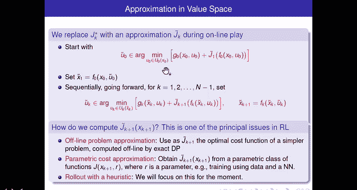

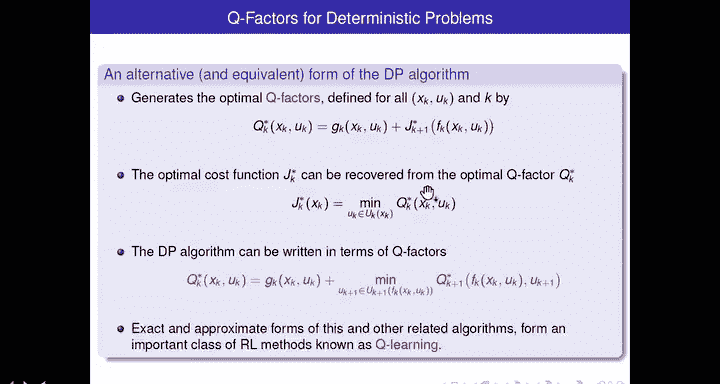

Here assumes that you find the global minimum。 that's an assumption how you find or if you can't find it is not a concern。

This is the theoretical setting that we have。But local minima do not enter the picture at all。

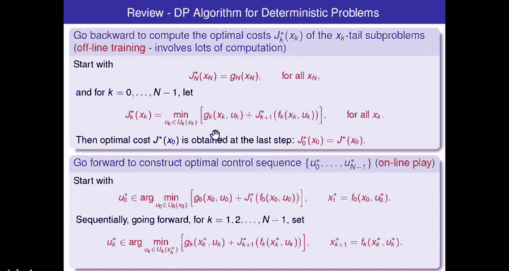

Can you exact stay space for only person。Yes， we can。

 if we are lucky and we can execute the minimization。 Now， we are going to see an example。

The linear quadratic example later in this lecture where you can do it。

 it involves continuous control variables and you can do the minimization exactly and en closed form。

And there are a collection of good guys in dynamic programming， good problems。

 favorable problems for which you can find a close form solution。

If you have find a solution computationally。And you have continuous control spaces。

 then inevitably you have to have approximations。Because the computer cannot deal with continuous with this type of continuous minimization。

Okay， so we are in the subject of approximation value space， the question is。

 how do we find this J tildaus here and I'm going to illustrate the case of rollout。

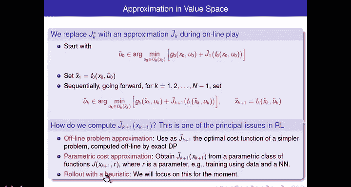

Which is an algorithm that we're going to be。Using quite a bit。Okay。

 so here we're dealing with a discrete control space， a finite number of controls。

And we're going to do the optimal cost approximation。

 we're going to replace the optimal cost function with a cost function of some heuristic。

 the cost obtained by some heuristic， which of course need not be optimal。So。

Here's how we use rollout upon reaching the state Xk。

 we consider all the possible controls that can be used at that state。And。Ideally。

 we would like to have the optimal cost going from xk plus1 to the n。However。Instead of that。

 we ran some heuristic。That generate states from xk plus1 to the end， and we take this cost。

 which we call xk plus 1 of hk plus1， the heuristic cost。

 we take it as a substitute for the optimal cost， and this is our approximation of J Tilda is this age here generated by some heuristic。

And。Once we calculate all of these heuristic values。

Which are really like approximate or heuristic two factors， right？We use， okay， it's it's。

Cost of the first stage plus the heuristic cost is a heuristic cu factor， you might say。

Then you apply the U tillde that minimizes this。So we calculate this， calculate this， calculate this。

 and we apply by U that gives you the minimum。Approximate Q factor。

And then we generate the next state， we go from xk to xk plus one， let's say this， go to xk plus1。

 do the same thing， consider all controls， approximate the optimal cost with the cost of a heuristic and go forward from x0 all the way to the end。

M。So let me illustrate this with a traveling sales one problem like the one that you had in your homework。

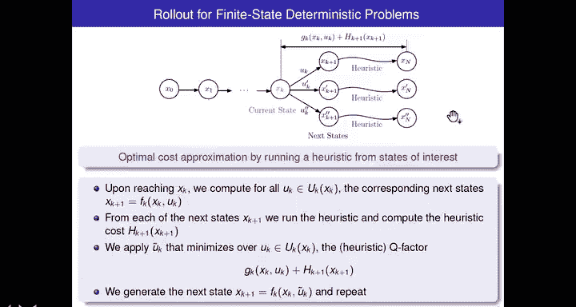

It involves four cities， ABCD。It and。The problem specified by this matrix of interc travel costs。

 So to go from A to B， it's 5 to go from A to C is 1 and so on。

And the travel costs are the black numbers that you see on the branches。

And you can solve a problem exactly by dynamic programming， as we know。

 and the optimal cost to go numbers are these red numbers that you see here。

And suppose now that we wanted to apply rollout with a base heuristic， which is very simple。

 it's the nearest neighbor heuristic。From a given city。You go to be。

To the nearest city that you can go to in one's hall， okay？So if you are in CDB。

 then you would go to CDC because that's the minimum one， okay， the nearest one。

So here's a schematic of them。But all out。We are at XK， a state Xk is a partial tour， okay。

 a number of cities without that don't close a full tour。

 and then we consider all possible next cities。And then from each one of those。

 you run the nearest neighbor heuristic to complete the tour。So let's say we start at CD8。

 what would the base heuristic do out of all these three， it will go to this one。

Out of this one out of these two that it can go it pull over to this one。

 then there's only one to go and only one to go， so the base heuristic will generate from CDA this trajectory here is not optimal of course right the optimal happens to be this red one。

And there is a way to calculate the to apply the nearest neighbor heuristic from any partial tour。

 so from here it will go to here and here and so on， if you are here， it will go to here and here。

 if you are the nearest neighbor heuristic from here it's going to go first to this one。

 then to this one and do that okay。So these numbers， the H numbers are defined from every state。

And we use those in place of the J stars。So let's apply it all out。In this problem。

We start that the initial state are decly taken city A。We look at all possible controls。

 all possible choices， and we run the base heuristic from there。 So from A B。

 we run the base heuristic and we get a total cost of 27。5 plus one plus1 plus 20，27。And。

So that's the Q factor associated with this choice。Now from here。

 we have the base heuristic goes this way and it has a Q factor of 28， right？

From here it goes for this choice。We go， the basic heuristic will follow up with these cities and it's going to be like 63。

So we compare these three Q factors and this one is the best。

 so rollout will move you from a to a to B。And have this partial tour。

Now we're going to do the next step。Consider the two possible choices and run the base heuristic from it。

So this one will give1 plus 21， this will give four plus 3 plus one， so this one is the best one。

And so the rollout algorithm will move from here to here。It will change trajectory， okay。

 we'll move here and from here， of course there's no from this state there's no choice it will move to CDC and so on。

说。Look at what happened。We didn't look for the optimal that it required all this gigantic calculation。

 We did a much simpler computation That's polynomial， actually， in the number of cities。

And what we did is start out the base heuristic from the cityA。

 and then the rollout algorithm generated a better trajectory from 28， it reduced to 27。

Then it changed his mind again and followed another trajectory with a cost of 13。

And it so happens that here this trajectory of the rollout is also optimal， that doesn't have to be。

 but we will see that rollout is very effective in improving a lot over the base heuristic。

And the mechanism for doing this is。We're going to explain in terms of Newton's methods。

 something that's going to do in the future but。The thumbnails of this type of algorithm is。

 first of all， it's very fast relative to the optimum。 Second， it works well。And and the third。

 it can improve。On any heuristic， no matter how good or bad heuristic， it can improve on it。

With relatively simple computation。So you're going to be asking your homework to do this computation for a bigger problem。

And then we will take it and then you'll get a sense of what's involved。Are there any questions？Yes。

Ex how does go nearly move about the basis variables that we have so far in this case。

 let's consider if the optimal cost was at a0 like it was the last。And so in that case。

 it would go into the last it right let me interrupt you I'm not going to go into the explanation of why it improves。

 Okay， this requires a long explanation that lies further ahead。

But it doesn't improve always because the basic heuristic。Can be really crazy。

 it has to satisfy certain assumptions， but these assumptions are not overwhelmingly difficult and even if you choose a stupid heuristic there's a general method to make it improving by modifying a little bit now to explain this on this example it would not help at this point so be patient or read ahead in your your textbook and you'll see the answer。

 it works like it can turns out different or allows based on different university costs。Yes， sure。

Yeah， what you get depends on the heuristic that you use。Okay， so again there content like。

I remember number twoing way to find out as the best。Here the city of admission。Okay。

Usually you pick heuristics on the base of convenience， what's available to you。And。

You can try them out all of them or most of them。And see what happens， which one works better。

You can also combine them all together and get something that's better than all of them to get a rollout algorithm that performs better than all of the heuristics together。

😡，And we're going to explain how this is done pretty lexious from now or so。

And the other thing that's going to come out again from future lectures。

Is that the quality of the base heuristic does not matter all that much。

And you can have heuristics that are far apart in terms of effectiveness on their own。

 but if you roll them out， you get results that are pretty similar and that's going to be explained in terms of the Newton method interpretation that we're going to discuss studying from next lecture。

Okay。So。Let's go into stochastic dynamic programming。

So we generalize our problem to introduce stochastic uncertainty。

 again we have a system that generates states over n stages from x0 to xn。

The transition from a state Xk to the next state Xk plus 1 is governed by an equation that depends on control。

 but also depends on a random disturbance WK sum uncertain certain parameter。

Which may vary depending on the context， the practical context could be physical noise and electrical system could be in an investment problem。

 it could be uncertainties about stock prices， demand for inventory。

Breaking down machines unpredictably。Any kind of stochastic uncertainty is allowed here in principle。

So the next state is not determined by the choice of control。 All we can say is that。

We can have a probability distribution over our next states。

 which which is determined by the probability distribution of this random parameter。

There's also a cost function。 There's a cost that depends again on the random。Disturbance。

 as we call it， the W。And the cost is the cumulative sum of the。Plus， a terminal cost like before。

 But there's a difference here。This is not a number， but rabbits are random variable， right。

 because W is random and also the states are random。

So to get a number here that will characterize the performance of a sequence of controls。

 we need to take the expected value。Expected value that is。The relatedged some。

Of the values of this cost weighted by the corresponding probabilities。So that's our cost function。

Now here's another thing about stochastic problems， we have to look at policies。

Policies are not sequences of controls， but rather sequences of functions of controls。

 which we call mu zero， mu1 all the way to mu n minus1。

This functions determine the control that you are going to apply at a given stage。So。

You can view UK as a lookup table， which gives you。Qu control to apply are state Xk。

So we have a different control。P each different state。Which is given by this function UK。Now。

 why is that？As the system progresses， we land at different states and it would not。

Be a good idea to apply the same control at all states， which we can predict at the initial state。

 but rather it would be helpful to wait to see what state we get。And choose the control accordingly。

So that's the consequence of this stochasticity， we don't know exactly where we're going to land which is data control sequence。

 and therefore we need to wait to see which state we're going to be in。

This is called a feedback policy or a close loop control law。

And the preceding one that we had for deter deterministic problems was called an open loop control sequence。

Now， for deter deterministic problem。Open loop control sequence and close loop control laws give you the same result。

 if you optimize over one， you get the same result as if you optimize over the other。

But for stochastic problems， it makes a genuine difference to have feedback。

 to have a closed loop policy as opposed to an open loop control sequence。

So we have to minimize over these more complicated objects。And like I said。

 the important point is by using feedback， choosing controls with knowledge of the state is beneficial in view of the stochastic nature of the problem。

So now if I give you an initial state and I give you a policy。

These costs are defined as numbers which are random， however， because of W。

 taking the expected values of those gives me the cost of the policy starting at an initial state x0。

So this is a function of the initial state as and depends on the policy。

And the optimal cost is obtained by minimizing over policies。Of this jade pies of exro。

And this is J star， the optimal value of the problem and depends on the initial state like it did for deterministic dynamic programming problems and of course。

 an optimal policy is one that attains the minimum in this minimization。

Now what we're going to do is extend the dynamic programming algorithm to this setting。

Questions here。So why we don't have like one thousand function。New one and new take don any input。

Yes。嗯。You can think of situations where the。The controls that you would apply when you're close to the end。

Would be different than the cost that you had applied at the same state， but in the beginning。

But the input is still like just a stay。 So consider the ches positions like you put like one position。

 the policy should be。In stationaryOkay。Okay， for we'll see later that for infinite Hiz problems。

 where your position， no matter how many stages you have played already， how many2 states you are。

 the future looks the same。So in that case。Stationary policies。

 policies that do not depend on the stage， but only on the state make sense because the cost of the。

Detailed subproblem looks the same， it goes from the current state to infinity。

 so what happened before or how many stages you were doesn't matter。And on the other hand。

 if you have a finite horizoniz problem， look， for example， suppose that you have。

You have to exercise an option。You have bought an option in the stock market and you have to exercise and you have to exercise in 30 days。

WhatYour exercise policy is going to be different one day from the end than 20 days from the end。

Okay even if the price of the stock is the same。Just's like the fewer days you have you want so that's why and that will change your mu。

Okay。Let's go into the dynamic programming algorithm。

 like the deterministic case it produces the optimal cost of the tail subproblems that start at Xk at stagek。

 all of those， it's also all of those。And it starts with the final one that's defined by internal cost function。

 then goes to time n minus1， and it uses a formula that's pretty much like the one of the deterministic case。

It minimizes overall possible controls。有。Cost of the current stage。Plus。

 the cost of the remaining stages， assuming that we act optimally。However。

 this number here is random because of the dependence on W。So we take the expected value。

And the intuition behind that is pretty similar to the one。

But we use for deterministic problems and the mathematical derivation is not so much more difficult。

So it makes sense intuitively and we're going to leave it at that， this is the way the algorithm is。

厅灯。It works similar to the deterministic case， start at the end。

 go to stage n minus1 in minus 2 and so on。Up until we get to stage 0 at that point。

We will have obtained the optimal cost function。Now in the process of doing this calculation backwards。

We can calculate the optimal control at every possible state that can be encountered。

And we can construct the optimal policy by putting together all these states。On the other hand。

 it's also possible to implement the optimal policy online。By going forward。

Starting at the initial state， observe that state， and do this calculation。

 go to the next state and do this calculation again and so on。闹。So this is the difference between。

Offline training and online play implementation using the results of offline training。

You know there are some big issues here。We need to calculate。Jy Star。

 this is a formidable calculation。As was mentioned earlier in the case where the state space continues。

It cannot be done unless you are likely to have a close form solution， it cannot be done computation。

Even for discrete problems， it's very they may be a very large number of states。

 this calculation is foreign。It's more difficult than in the case of deterministic dynamic programming because we have to compute this extra expectation and that's not necessarily an easy calculation。

Besides， you have to do it for every state and for every control， right。

And then you have to do this minimization over the use。

 which is in itself may be a difficult problem。So that's where reinforcement learning comes in and tries to simplify these difficult calculations。

But before we go into approximation graduate space and reinforcement learning。

 let's look at an example。Where。The structure is so favorable that we can。

Obtaining the optimal solution， analytically。

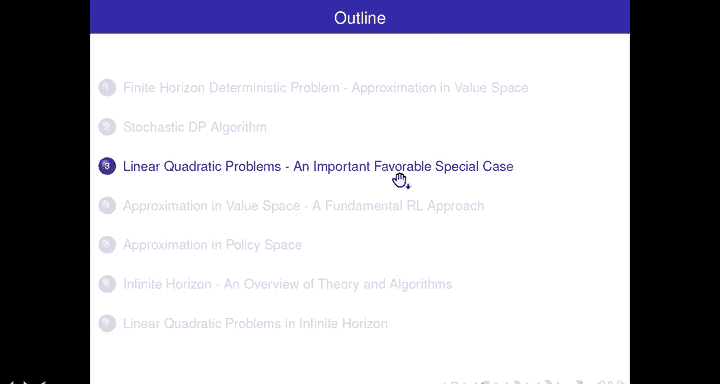

this is an important problem， it involves a linear system。And a quadratic cost function。

The system is linear in the following sense。诶。I'm giving here the one dimensional case。

 the case with the state is just a scalar。In general。

 this say analysis extends to the case where x case of vector with n components。

And the new state is given as a the summation of a linear。multiple a multiple of the current state。

 less a multiple of the control and a random。Disturbance， W。A and B are known are given scaleless。

 and now I'm going to assume here that the W has zero mean。So that's the system。

And the post of each stage is quadraing。Q andR are given positive scaleals。

This is the cost on the state and the cost on the controller at stage K。

 it penalizes deviations from zero， it encodes our desire to keep the state close to zero。

And this part here encodes our desire to keep peak control near zero。

So we want to keep the stake leader near zero with。Relatively small energy， so to speak。

Q andR are given， they could depend on the stage， but I have simplified here to make them the same for every stage。

And there's a terminal of course， which is also quadratic。Okay， so that defines the problem。And。

The dynamic programming algorithm starts with the terminal。Po and generates backwards Jn minus1 star。

 Jn minus2 star and so on， according to the usual formula。The sum of the course of the stage。Plus。

 the optimal cost to dough from the next state， the next state is this one。

And we take expected value of that with respect to。W。And we minimize over you。

And the main result here is that this algorithm can be carried out in closed form and heels。

Optimmal costs to go of the following form， for ara。

With Kk being some number that can be computed in closed form。Class a constant。

And constants of course， don't bother us because they get outside the minimization。

 so essentially the optimal cost to go always qua。And， moreover。The optimal policy is linear。

 linear in the state。Its proportionportal to the state with L K being some。

Conntunnal coefficienttion that can again be computed in closed form。

A very favorable result in the calculation is not difficult。Is another thing that's nice here。

The optimal policy does not depend on the distribution of W EK。As long as it has zero mean。

Depends only on the mean， actually， of the。Of of the distribution。

But here we assume that zero mean and。What we get is basically the same result for deterministic。

 the same controller for deterministic problems or for satochastic problems。

We get the same result for the case where there is uncertainty with zero mean and for the case where there is no uncertainty at all。

 it's the same policy。This is called certainty equivalentvalence。And for linear quadratic problems。

 it holds。Exactly。In other contexts， we may wish to use it as an approximation idea。Moreover。

 as I mentioned earlier， this result generalized to multidimensional linear pratic problems。

 but a is a matrix， B is also a matrix and the vector x is。

is a multidimensional vector in similar UK is a multidimensional vector all the calculations I'm going to show you generalize except that it to they have to be done with linear algebra with native algebra。

 this is possible to do it's the kind of calculation that when you take a course in control theA you learn right away it's a very fundamental kind of calculation in control theA。

So what I'd like to do is apply this dynamic programming algorithm and show you how we're obtain this result。

Okay， so we're going to do it starting from the。Govermental cost， which is this spadic。

And then we're going to do this calculation。Of dynamic programming and we're going to show that it gives you a quadratic again。

 so from quadratic we're going get a quadratic and we're going to continue to get optimal course to go to that quadratic。

So let's see how this is done。Let's look at this long expression here。X n minus one is fixed。

 the variable over of which we minimize。Is you， Okay， the a quadra the。And there's a function。

 a quadratic function of something that's linear in U， so this is quadratic in U。

And we can expend out this spity。Okay， JN star is given by this expression， so here it is over here。

we expand this spadtic。Into the quadratic of the first two terms。And then the quadratic of W。

 and we take the expected value inside here。And then the cluster between these two take the expected value。

 this does not have any uncertainty， does not depend on w。But this is the expected value of wn minus。

 which is zero。So this term he had disappears。In this term he is constant。

So let's do the minimization， we take out the terms that do not depend on you because they don't enter the minimization。

 so out closes the term。This term is q times the expected value of WN。10 minus1 squared。

 so it's the variance， the variance of w， which I call sigma squared， it's a constant term。

And what's left is this pdratic minimization。Now we know how to minimize quadratics。

 take the derivative and set the derivative to zero， it's a positive quadratic。

 it's not a negative quadratic， it's a positive quadratic， so yet admits a global minimum。

Setting the derivative of this to0 all these quadratic terms gives you this。

And this equation can be solved for you。And the solution。Is。This。Okay。

 you have to calculate it takes you to the。One side and all the rest in the other side and make a solve this equation。

 and what you get is a linear expression of x。Obviously linear。

 this equation shows a linear dependence between U and x and the coefficient is this after you can see that type population。

So that's the optimal policy for the last stage n minus1。It's linear。And after we plug it in here。

This linear function of x， we're going to get something that's quadratic in x and that quadratic is given by this formula here。

T you also this constant term， it is quadratic plus constant。

With kn minus1 given by this expression here after some straightforward calculation。

 I'm not going to show you that calculation。But the main thing is that quadratic gives you a quadratic and also linear control in the meantime and we repeat this calculation again from Jn star n minus1 to J star n minus-2 and we continue and for every k we get this general formula。

Quadraic plus constant。With the K coefficients generated backwards， according to this recursion。

MV L coefficients， the control coefficients， depending on a corresponding K。

compare this formulas here。We start with。Okay。Start with Q。And we generate Q N -1。

And then QN minus2 and so on， and after we have all the K， we also have all the Ls。

So that's the calculation and you can do this calculation except a more complicated way with matrices to obtain the generalization for the multidimensional linear quadratic problem。

Questions here。

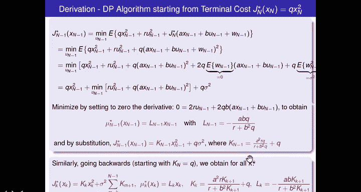

Okay。So there are a lot of generalizations of this type of calculation and linear quadratic problems。

We made this observation that the solution does not depend on the distribution of w。

 but only on the mean which is0 here and we have a certain equivalentvalence in other words the stochastic problem can be replaced by a deterministic problem and the optimal controller will not change。

allyWe talked about generalization to multidimensional problems。

 there's also generalization to non zero mean WK。Basically。

 you have to modify in a simple way the calculations of the previous slide。

Its a general addition to infinite Horizon we're going to show this later in this lecture。

There's also a more sweeping generalization。To problems where the state is not known to the controller。

 exactly。A time K， but instead you obtain only some measurements， linear measurements of the state。

And you accumulate those measurements and you can sort of infer somewhat in exactly of where the state is。

And it turns out that the optimal policy。Involves an extended form of certainty equivalentvalence。

The optimal control that you apply at time k， given all the measurements that you have is obtained by multiplying with this LK。

 not the state， but rather the expected state given the measurements。

Now this expanded expected state given the measurements is provided by an estimator。

 you estimate the state given the measurements， this estimator is the famous Kllman filter。

All of this has a tremendous amount of theory behind it over a period of 60 years in control theory and this is a remarkable result that certain equivalence holds even in the case where you have partial observation of the state。

NowProblems with partial observations of the state are called PDP in reinforcement learning and dynamic programming。

Partial observation， Macovian decision problems。 They are the most difficult problems that you can find in this entire field and。

And we're going to deal with them。We're going to mention them in the next lecture and also in subsequent lectures is how we can deal with them。

Like the most computationally difficult problems that you can find。

But in the case of a linear quadratic problem， they are not so difficult they're given by a form of the optimal policies given by form of certain equivalentvalence。

Now， like I said， in aquadratic problems are foundational in control system design。

 and they are the starting point for other lines of investigations and approximations。啊。

Problems with。Constraints。The linear quadratic problem in pure form does not involve any state constraints or control constraints。

 but these constraints arise very often in practice， self drivingring cars， model predictive control。

 chemical process control， and again the linear quadratic problem comes into play through approximations。

In， in this type of。This sign of design methodologies。

State constraints as well as control constraints。The most difficult type of problem were also a linear quadratic clubs play role。

Is when the parameters of the system？Are either unknown or change over time like the A and B coefficients change。

And the control the constraints also change。Its a subject in the field of adaptive control again。

Lar a quadratic formulations and the results play a role， but these problems are very difficult。

Almost impossible to solve exactly， even for the simplest cases。

 approximations are needed and the investigations have been going on in this area since the 60s。

In reinforcement learning， these problems are also。系。Of great interest。

From the artificial intelligence point of view。And we're going to try to follow a common line of analysis and a common conceptual framework for both the type of problems that are used that are addressed in control theory and in artificial intelligence。

Any questions。Okay。So now let's go to approximation in value space， which is。

A very basic reinforcement learning approach that Queon spent a lot of time with。

The idea is very simple。We have dynamic programming that at the given state minimizes。The sum of the。

Current stage cost and the optimal cost to go from the next state。In approximation value space。

 we approximate the value of this。Optimal cost to go with some approximate cost of J tilde。

 we replace J star with J Tilde。 That's what approximation value space is。And。Notice that the。

That this is a method that's suitable for online play once I give you the J Tils。

 we go forward by minimizing this way。And notice that。That in addition to this approximation。

 there' are some other difficulties。 We have an expected value here。

 which can be very time consuming， and that can be approximated also。

By some kind of is more easily computed。Approximate expected value， for example。

 this expected value is computed by simulation， Monte Carlo simulation。

 you may consider to limit simulation or even approximation of this w by some typical value。

 a form of certainty equivalence。This minimization can also be difficult。

 so you may consider some kind of simplification in the minimization。

 it another form of three approximations。Cost approximation。

 expected value approximation for stochastic problems， of course。And minimization simplification。

And all of this can be combined more or less independently of each other。

And the art and the practice of reinforcement learning to a large extent has to do with different methods for dealing with all these three approximations。

Now， a major variation。Is multi step look ahead。 This uses single step look ahead。 one step ahead。

 and then approximation of the future。Multi step look ahead involves。Looking forward。

For multiple steps。And then approximate the future with this jade tillilda。In other words。

 instead of considering this problem here， we consider this problem that involves the sum of the cost of the first L steps and then the cost of the future as measured by J Tilda。

Now， this is。An L step problem is not a one step minimization is an L step problem。

 which is itself a dynamic programming problem。With horizon that is simpler， that's smaller than n。

So that's what we gain。And the。You minimize over a policy。The control of the first stage。Plus。

 the class control functions。For the remaining L minus1 stages。And then what you will obtain is。

Something。That。That involves the first control and the remaining control functions。

 but you keep and apply only the first control and you throw all of this away once you do this minimization。

 you apply UK， then you get go to the next state， do this minimization again。

 you get a multistep policy， throw away everything except for the very first step。

 then go forward again and forward again and so on。So the calculation is。Is longer。

There's a lot there's a lot more computational overhead in this minimization than in this minimization。

 On the other hand， generally speaking with multi step look ahead。

 you can get enhanced performance of the。Policy of the look ahead policy that you get。

So that's a trade off。More computation for better performance。And in practice。

You'd like to use as much look ahead as you can， except that you typically have a budget constraint because this is an online computation and。

What what ordinarily you would do is use as long as you look ahead as you can。

 given the computational budget that you can afford， example they may。You may have to。

 you may have to produce a control within the next 10 seconds。

 so you you'll use as much look ahead as you can deal with in 10 seconds。But you may also have。

Like one hour or you may have half a day， in which case you can lose longer， look ahead。

 that's recommended。Now。In multi step look ahead， we also have the three approximations。

 this cost to go approximation， expected value， approximation and。Approximate minimization here。So。

That's the landscape of approximation value space， and that's where we're going to be dealing with about 90% of the course。

Various ways to do these three approximations in various contexts。Okay。

 let me go to the next slide and then you can ask questions。

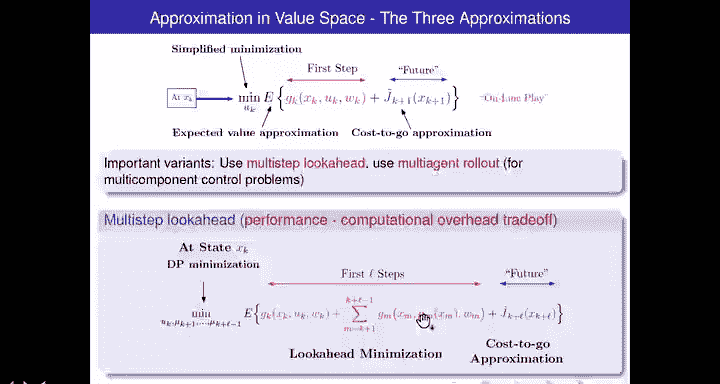

Here is a bird's eye view of different ways to construct approximations。

When it comes to approximation for JTL B in JTil the approximation。

There are many different ways to do it。One possibility is problem approximation。

Solve exactly or almost exactly a similar problem that is simpler and use the cost function of the similar problem into in place of the used Ij tilda。

嗯。Certainty equivalence is a type of problem approximation where you replace a stochastic problem with a deterministic one。

 which is easier。Is another type of approximation called aggregation。

That we are going to discuss near the end of this class。W。Tries to replace。

 which replaces the original problem with a problem with smaller dimension。 it aggregates dimension。

 aggregates variables。Cs a simpler problem which it solves exactly。

 and then it uses its optimal cost function as J Tilda。We mentioned rollout。

 model predictivedi control also involves special types of J tils。

Prametric approximation in neural networks is a major one。

You generate data of optimal or almost optimal cost and you approximate it with a you learn this cost function by using a neural network。

嗯。We're going to see also okay， so these are the major ones that are some other ones that combine various versions of combined various components of different approaches。

 and that gives you just a partial list。Approoxmating expected values。

An important approach is to use adaptive simulation。In many enforcement learning contexts。

 you would calculate this expected value by Monte parallello simulation。

And you can do exact modular simulation with a lot of samples or not so exact with relatively few samples。

 That's what I mean by adaptive simulation。For some controls you do a lot of simulations for other controls not so much。

 and how do you decide， well， you would want to do accurate Montecargo simulation for the most promising controls or the ones that based on a few samples they don't look very good。

 you don't want to bother with them too much。That's also the idea that underlines a popular approach in artificial intelligence called Monte Carlo research Monte Carlo research is a form of adaptive simulation。

啊。Here， approximate minimization， you may have a continuous state space。

 you're approximated by a discrete， or you have a continuous space with a discrete space with a lot of components with a lot of a lot of elements。

 you approximated it with a。With with fewer compounds， like a。You have a fine grid。

 you approximate with a coarse grid。嗯。And then you may， on the base of some criteria。

 thin out the control contrain set。And pick out the most promising controls。

 according to some heuristic criteria that will simplify this minimization。

All of these tricks are part and parcel of the methodology of approximation in value space。

And this can apply to both one step look ahead and multi step look ahead。

We're going to talk about all of this at one time or another in various contexts。

Let me give you also some examples of rollout。Rollout from a given state simulates a heuristic over way to the very end。

But one approach might be to simulate a heuristic for just a few steps and then take a cost function approximation after that。

This is called tranate the rollout。And operates like I'm showing here at a given state。

 I calculate all the possible next states， both for a deterministic context and stochastic context。

 all the states Xk plus one that can happen。Then youre allowed with some base policy for a number of steps。

 M steps， a truncated horizon， and then you take a cost function approximation to approximate the cost of the remaining stages。

And the base policy can be computed， can be obtained very free， it may be heuristic。

 it may be obtained through a neural network， and the cost function approximation again may be obtained in different ways。

 problem approximation， neural network， segregation and so on。嗯。So。Now。

 if you go if you remember from the previous lecture。We gave a figure for alpha0。

 it involved truncated rollout of this form， but also with multi step look ahead。

 there multi step look ahead minimization version of this figure as well。

 and this is the alpha0 architecture。Okay， so I think we are due to take a break here are there any questions？

第二个。Can you re explain both the difference of？であ。Both stages you change the value functions and since I aren't playing have been any resources。

On plague means in the real time， you control the system in the real time。

So offline it can be a week， a week earlier but we do all the calculations。Online play is real time。

 so if real time imposes you tight resources， that certainly will affect the kind of algorithm that you will use。

是。Yeah， real， yeah， online play is like you play chess， you play chess in real time。

 you move and then you move again and so on。Whereas offline training is。Deep mind。

Use resilience of GPUs to calculate the cost function over a period of weeks and months okay。

it seems likere judging out the name， it feels like I the think doesnt change the value function for doesn and learn apple。

 but actually you can change the value function as well。Online play does not learn anything。

Because of the current the choices plus the state that you end up with after you transaction action and it can vary and then change the policy so that's not don't change the policy。

You simply determine the control on the basis of calculations。But you don't learn anything。 Okay。

 you don't learn a course function。You just calculate the course function。Okay。

 we're falling into the trap of semantics around the meaning of learning， what is learning， okay？

If I calculate one plus one equals two， do I learn how to do one plus one or is it just I'm doing addition？

嗯。Different people mean different things about with the term learning。And rolling with a heuristic。

 which is fixed does not involve learning， although you might say I learn the cost of the heuristic。

 but that's not what I mean。Okay， so my question is in the stochastic variant。

 we brought in something called policies， but in a interesting when we then start states controls。

 So can just in the stochastic case to use noise very good controls and states to solve information。

 what was the need for them to up to our policies， I don't think they got。What a policy is。

 it's a table on one side you have states， on the other side you have controls。听接 n听见。

For every state， it's a prescription of which control out of the many you're going to apply。

At that state。Start executing a policy you may not like necessarily arrive in the state that you thought you were trying to arrive at by executing that。

 so because of that you need a lookout table to figure out what to do in which state as you're a involved in the system because you don't know exactly what state you're going to arrive at。

 say that execute the policy at that state， but there may be some sasticity at which state you arrive at and next given that that action。

对来。Okay， thanks， Jamesen。Okay， guys， yeah。呃。With one does。 when you say finite horizonorizon。

 do you mean that there exists an n at which point every sequence is termminated。

 or do you mean that there are no long termating policies？When I say finite horizon。

 I mean that you have to terminate。At that。Time， and you cannot terminate earlier or later。 So every。

 every sequence exact same Yeah， right， yeah。Of course。In a of a problem。

 you can terminate early if you want， but then you have to introduce an additional termination state。

 and then you fill up the horizon by just staying in that state。Okay， so there's。

As long as the is as long as the horizon is finite， whether it's variable or not variable。

 you can always make it fixed。My question on board basis to will rec the next election for my step group。

How do you design the parameter L in the multi step look ahead at what point what do you mean。

 how we decide which action to take for the next L90 step？

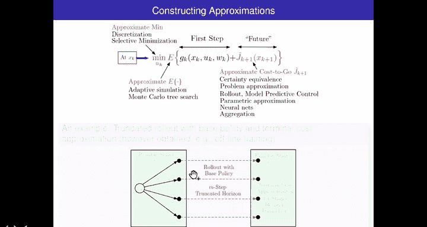

I mean police there。Okay， so this is the figure from all this step look ahead。So at state xk。

 you do this minimization。And get you get this multi step policy。

 you use the first term and you throw away the rest。Now， the next。Step， you redo this minimization。

 but advanced by one time unit。So in this mini， we are deciding UK based based on the thing that that gives other means for overall equation。

 right， but how we are deciding UK plus one。You paid this one， so。UK plus one。でた。啊。Well。

 this minimization is only for UK to decide what UK you're going to apply after you move to the next state。

 it's an entirely different calculation has nothing to do with the previous one。

You just redo the calculation with the new。New at the new state。

And there's a good reason for that because。These controls are not useful anymore。You have moved。

With under。Under their uncertainty because of the Ws and。They're not useful anymore。

 so you have to redo the calculation with new data。Yeah， I mean。

 I understand that the question is how to do minimization over the UK and also the subsequent policies I think that's really is this a question。

 well， it's a dynamic programming problem。Involving this terminal cost and this cost per stage。

So you do it by dynamic programming。Except it's a smaller horizon。

 this is also a dynamic programming problem of Hiz1。This is a dynamic programming problem of Hiz L。

I'm not saying that this is an easy calculation， but it's easier than the original problem。

Plus you can also do simplifications here， which will make it easier， even easier。Okay。

 I'm sorry I didn't understand your question。If you are far away， my hearing is not perfect okay。

 and if you're far away makes it more difficult， so please speak up a little louder。Okay， guys， so。

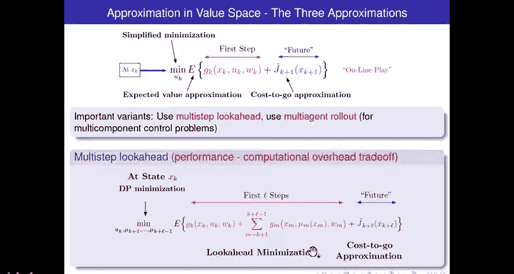

It's time to take this break。And we'll get back at the six。0，6。

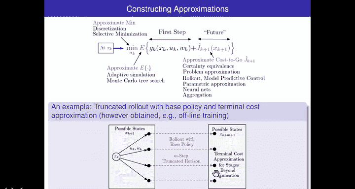

Okay， so now we're going to go into approximation in policy space。

 which is the major alternative to approximation in value space。

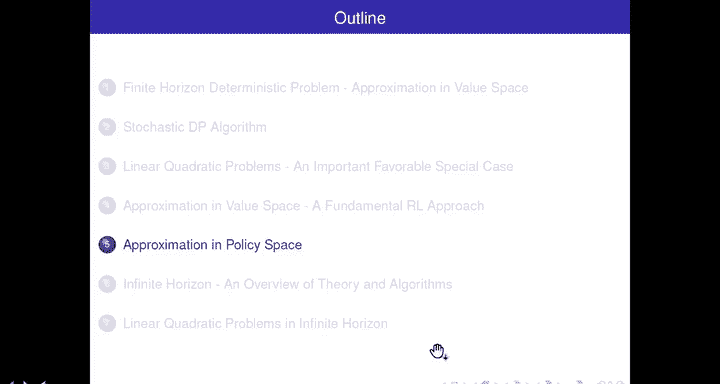

In approximate volume space， we approximate cost functions， value functions。

 Here we approximate policies。And we select a policy by optimization over a suitably restricted class of policies。

Usually that class involves a parametric family of policies other words。

 the policies here do not depend on the state， but also depend on a parameter which is tunenable。

 We learn that parameter through data， most likely。And。

So we look at a parametricic family of some form， like for example。

 the one provided by neural network are here in that context is a set of weights of the neural network。

So for a given parameter。This controller back， goes into this feedback loop， observes the state。

 generates controls， and the system keeps going。So if you select a parameter。

 you select a controller and therefore there is a cost function that's associated with that controller。

And what you'd like to do。Is a。Optimize。With respect to the parameters。

 the performance of this closed loop system。This system depends on the parameter and theseors depend on the parameter。

 you optimize the parameters， you optimize the system。Okay。

So now thiss minimization in the space of parameters。And you can use many different methods。

For this optimization。啊。ARandom search。Start with a parameter vector， simulate the controller。

 and based on the results， you move to another parameter vector and then to another parameter vector through some kind of a random search mechanism。

I'm not saying that this is a good idea， but I'm just telling you that it's a possibility。

An important class of methods is policy gradient methods。

Where you move this parameter in the direction of some gradient。Of cost improvement。Okay。

 there's a lot of literature in this field and we're going to cover it methods like that late in the course。

嗯。There are also machine learning type of algorithm based on classification。

Which can be used for approximation value space。We're going to talk about those late in the course。嗯。

It's important to realize that this is not an online method， it's not used in real time。

 it's used offline， you train a policy offline and when you use it in real time。

 but it has an important advantage then once you have calculated the parameters。

 this controller will speed out controls very quickly。You observe the state。

 goes through this neural network， the answer is immediate。

 it calculates the control almost instantaneously。Where he is？

If you compare this with approximation value space and approximation value space。

 you have to do a lot more computation online。So that's the great advantage of approximation policy space。

But there's also a disadvantage。Once you choose a parameter， you're stuck with it， if the system。

 the problem changes on you。Like， for example， an unexpected obstacle。Appearce in front of a car。

 a self driving car。Your controller has not accounted for that。If the conditions change。

 the problem changes from you， this approach does not allow for online re plan。

And we will see also that from a theoretical point of view， it does not involve a Newton step。

 which we have mentioned earlier。We're going to discuss this later there。Okay， so。

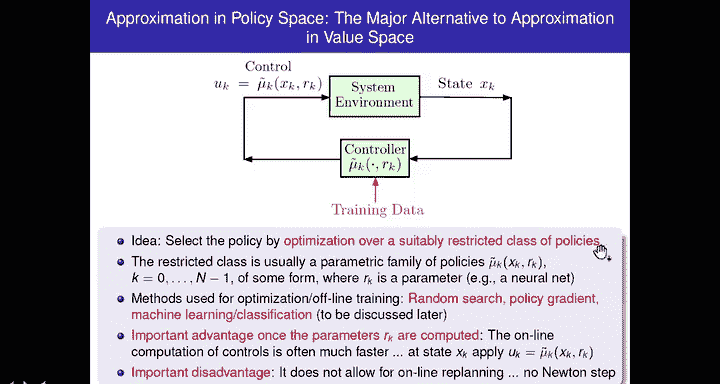

诶。How do do this。Ex。So we talked about the major conceptual difference between approximation value space in policy space and approximation in white space。

 you have to do this calculation online， so it's an online claim method。

 however it can use the results offline of approximation in policy space。Within this figure。

 it can use。An offline trained policy for rollout。So。That's where approximation in a policy space。

Can be combined with approximation in value space。There's also a very reverse。

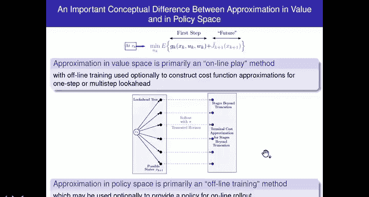

Given that you have done approximation in value space。

 you can go and do approximation in solid space to gain the advantage of fast response of fast generation of controls。

So suppose that you have obtained approximate cost functions J Tilde。

These define a subopmal policy through one step or multi step look ahead minimization。

So given this J tilda。This involves quite a bit of minimization to implement online this subopmal policy。

 how can we simplify it， or here's the idea。We learn new Tilda through approximation in policy space。

 which is done offline。And how do we do that？This mut tilder。

 we use it to generate a training set of a large number of state and controlled pairs。So。

We have we generate that。A collection of representative states， a large number of them， perhaps。

And c the corresponding。The corresponding control that would be obtained by this one step look ahead policy。

So we collect pairs like that。And we use them to match。

We use them to learn a policy that replicates the pair fairly closely。So for example。

 we introduce a parametric family of R of policies。And then we。

And then we calculate the parameters by some sort of gl squares fit。

So match an element a member of this parametric family with the pairs of the training set through a least square minimization。

Note that all of this is done off and all of this is done online offline。

 but if you get this policy here， the strain policy。

 it gives you answers much more quickly than this minimization does。

So you can view this as approximation in pharmacy space on top of approximation value space。Okay。

 are any questions？In our course， we're going to focus on approximation in value space。

To a great extent。Methods for approximation in policy space are going to take about a lecture。

 or maybe a lecture a half near the end。That's part also of my bias。

 I think that approximation value space is a more interesting and a more efficient and effective type of method than approximation policy space。

Okay， so now that's going to infinite horizonorizon problems。

 we're going to do an overview there's a lot of theory associated with infinite horizoniz problems。

 some of it quite mathematical， but we're not going to get into that as much here and particularly in today's lecture is only going to be an overview。

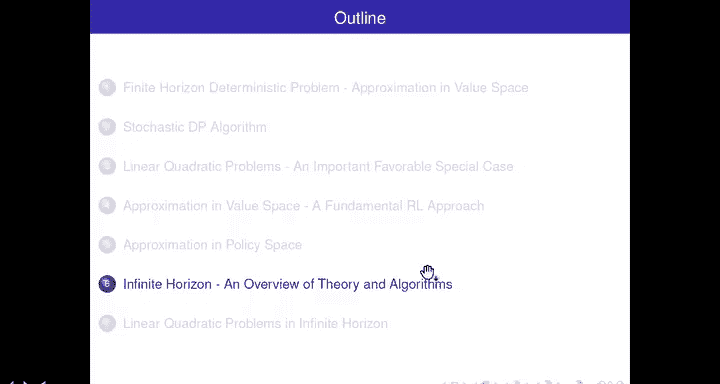

So what's the infinite horizon problem that we're going to be discussing is's like a stochastic programming。

 the stochastic dynamic programming problem over a finite horizon。

 except that the number of stages is infinite， the control goes on for an infinite number of stages。

There is a system involved here， the system is stationary。

 F does not depend on K that's important in horizon problems。And we consider again policies。

 one policy， one control function for every stage。And the cost of each stage is determined by a function G。

That is similar to the finite horizon case。But hes also awaited by some author to the。Now。

 wilds a scalar between zero and1。And if alpha thought is less than one， it's also to the case。

 proportionateally small。And。And that specifies。That。Cast occurred。

Far into the future do not count as much as costs at the same state earlier in the horizon。

So costs diminish over time due to this discount factor。And this has。

Interesting mathematical ramifications。Because it makes the cost。

 it keeps the cost finite so the cost doesn't explode the accumulation of this terms G。

So let's see what the cost function is。It is the end stage cost with n going to infinity。

 but it includes also this alpha to the K。As a result， if G is bounded。

 this expression remains bounded because it involves the sum of a geometric progression multiplied with bounded terms。

 It's finite。 Okay， mathematically speaking， so the。

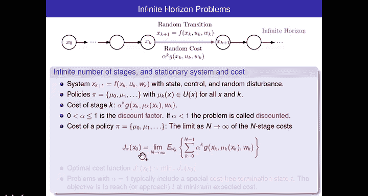

Cost function。Is finite， the cost at a starting at a given state of a given policy is finite over an infinite number of stages in this case。

 and that gives rise to the nicest class of infant corsal problems which are called discounted。

 they involve a discount it' less than one and the cost per stage that is bounded。

The optimal cost function， of course， is given by minimization of this expression。

There are also interesting problems where alpha is equal to one。

But they typically involve a special termination state。 and once you reach a termination state。

 which sure may happen at a random time the。The cost accumulation stops so。

You get you guarantee finites of the cost through this termination state。And in this case。

 the objective is to each should。The termination nation state at minimum an expected cost。

The most common and easiest to understand the infinite horizoniz problem involving a termination state is our shortest path problem。

In a shortest path problem， you want to reach some destination and then cost that stops accumulating after you do that。

 however it's also possible to view as an infinite horizoniz problem where you sort of spin around cycles before you go to the termination state and however。

It's an example of a problem where some policies have infinite costs。

 however the optimal policy always has final cost as long as there is a path from every state to the destination。

Shortest path problems， deterministic shortest path problems are a special case of this。

 but there are other problems called satorcchastic shortest path problems that involve satochastic uncertainty and are more complicated but very useful in practice。

Because problems with termination states arise profit。那不再是。

In our presentation we're going to focus on the easiest case。

 which has a nice theory discounted problems， we're going to touch upon stochastic short spark problems a little bit here and there。

冇。A any questions about formulation？Okay， is this analytical theory and computational theory？

There are three theorems in infinite horizonizon problems that you aspire to prove。

 you hope that they hold in a given problem setting。

The first theorem says that the case stages optimal cost。

Converges to the infinite cor cost as the variation goes to infinite。In other words。

 if you take a finite horizon problem with the same cost。And with the same cost function。then。

If you let the horizon go to infinity in the limit。

 you' are going to obtain the infinite horizon problem and therefore the infinite horizon equal that makes sense。

And mathematically， it says that J star is equal to the limit of J K of x。

 Well J case of x is the optimal cost。Starting from x and going for K stages forward。Now， this JK。

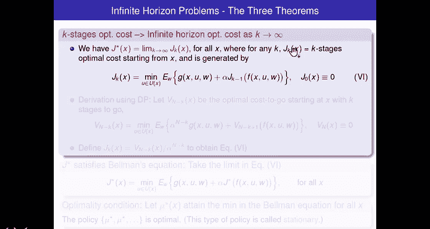

Function is generated sequentially by this formula。Okay， look at this formula。

 it says that the cost over K stages。Optimal cost is obtained by minimizing the sum of the cost of the first stage。

Plus， the sum of the。Cost of the remaining stages。But starting。

One step later and therefore discounted by an additional alpha term here。 Okay。

 that's where alpha the discount factor comes in。Now， intuitively， this makes sense。Mathematically。

 there is a simple derivation based on dynamic programming that you can。That you can。

That you can read， I'm not going let me not go through it。啊。So。

You solve a finite horizon problem for one step， horizon， then two steps horizonizon。

 three steps horizoniz and so on， but you don't need to resolve from the beginning。

 you just do the simpler iteration to generate all the finite horizon costs。

This is also called value iteration， it's an algorithm to calculate in the limit in J star。

So that's the first theorem。Second theorem is Belman's equation。

 Belman's equation holds that J star satisfies this equation。Given this formula here。

And assuming that you have this， the J size is the limit of the JKs。

 take the limit of both sides here。On the right left side， youre going to get a star。

On the right side， assuming that you can get the limit inside， you get the limit of JK minus1。

 which is also J star。So this is what you。Okay this equation have sort of a hand waved here with limits and so on。

 but it turns out that it holds just about always in input variation dynamic programming it's one of the most reliable results in this one is not so reliable as this one。

So we're going to take it as given that J Star satisfies Belman's equation。

And for discounted problems， it turns out that it's the unique solution of Belman's equation。

Notice it's a functional equation。The unknowns here are the J star functions。

In the case where x takes a finite number of only a finite number of states， let's say n states。

 then J star is an n dimensional vector， so this becomes an n dimensional vector equation。

Which is nonlinear because of this minimization。This is the most fundamental object in imprint variation dynamic program。

And the object， the objective is to find this J star or to approximate it by using reinforcement learning techniques。

So theorem number one， theorem number two。The number3 says that if you manage to solve Ben Belelman's equation and have J star。

 then by minimizing on the right hand side， you obtain an optimal policy。

If mu stars of x depends on x attains the minimum in Belmon equation。

Then the function that you obtain of x。Gives you an optimal policy， which is stationary。

It doesn't depend the control that you apply depends only on the state and not on the stage that you're in。

One nice thing about infant horizon problems is that optimal policies generally are stationary and you can restrict attention to stationary policies。

Which involves a smaller number of values， right？It doesn't depend on the stage。

 it only depends on the state。So these are the three theorems。And there are also two algorithms here。

 two main algorithms。One is called value duration， and the other one is called policy duration。

Both of them are very important in high reinforcement learning analogs。In value duration。

We try to we generate a sequence of cost functions。

 each one being the optimal cost function of a finite horizon problem it's the same equation I gave in the previous slide except that the initial J0 is not zero but rather it can be arbitrary I have a question mark here because there are some theoretical issues this assertion。

But that's the algorithm start with some J0， generate J1， J2， J3， and so on。

 and in the limit you hope to get the optimal cost J star。The other algorithm is policy duration。

 instead of generating a sequence of optimal cost functions， it generates a sequence of policies。

And their cost functions starting from some more or less arbitrary bodies。And。😊。

The typical iteration。Starts with a policy and generates a new policy in two steps。

I gave this algorithm。In a context of alpha0， this is the alpha0 algorithm。

 tD gammon algorithm except with approximations。That two steps are policy evaluation。

We compute the cost function of this policy， which I generally refer to as base policy。

And then the new policies obtained by policy improvement。

Which confuse the improved policy are all out policies， Hol to speak。

By using the one step look ahead minimization。So start with new zero， evaluate it， improving it。

 improve it to get new one， evaluate new one， improve it， and so on。And we keep going。And。

Let me also mention that this policy evaluation step is J U can be done in a number of ways。

 you have to solve basically this Belman equation but for the policy without the minimization in the control substituted with mu of x。

And you can do it。Either using value iteration without this minimization。

 or you can use some other method。 And one nice thing about this equation is that it is linear in J。

 if J is。A vector， an n dimensional vector。 This is a matrix equation。

 a linear equation that can be solved by Gaussian elimination， MAlab。

So there is this possibility for policy evaluation。Another possibility。

Is to calculate the cost of a policy by just simulating it。And doing Monte Carlo simulation。

 starting from different states， that would also give you values of the policy for these initial states。

All of this is very basic and all of this involves a lot of approximations that are central to reinforcement learning。

So let me give you。Aschematic diagram here， this is exact policy duration。Given a policy。

 the best policy you evaluated calculate J。Then you you improve it by minimizing Belman's equation with J mu instead of J star that gives you the new policy and you keep doing the same thing over and over。

 that's policy duration。In some of the important facts。而。

You expect that policy duration will give you in the limit on optimal policy。

This is true for easy problems for more difficult problems。

 it may be there may be some question else about it。 It's an important question to ask here。

We generally， will assume that。That that policy duration does give you an optimal policy。

Particularly for discounted problems for which this can be proved mathematically。

Well this duration is much faster than value duration。

The reason is that it can be viewed as Newton's method for solving Belman's equation。

 and Newton's method is much faster than。The type of iteration involved in value iteration。

And the factors of interesting in reinforcement learning is that policy duration can be implemented approximately。

It's one of the most fundamental methods in reinforcement learning， approximate policy iteration。

And the way you do that is by approximating these two steps。With some kind of neural network。

 typically。A value and possibly a policy network。This is the type of algorithm that's being used in Al0。

 tDgamon and many， many other contexts。You have a policy。You generate data。With this policy。

And you approximate。Its value function。You obtain what's called a value network。Then。You use。

SYou generate samples of improved policy。And you fit a policy network to that data。

And then you obtain this new policy and you keep going。啊。So。This is a。

A framework that we're going to discuss in many different contexts。And。播苏。诶。

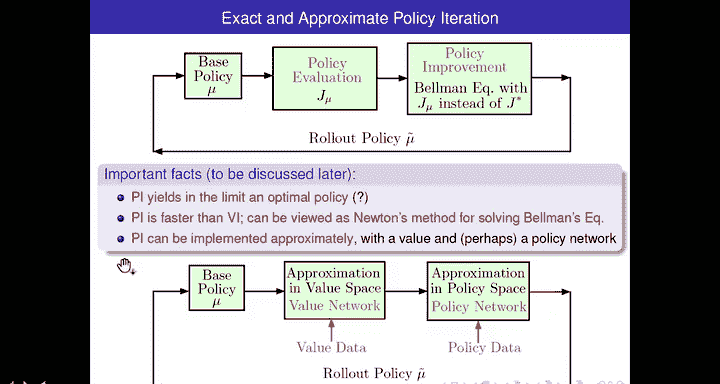

In呢。In limited forms。

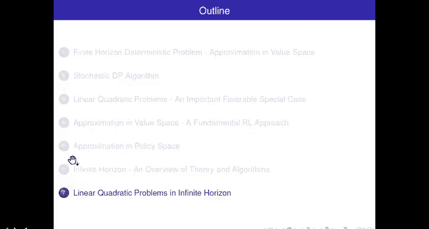

In particular， rollout is going to be viewed only one step of this。Look here。

 not repeated generation of boists。Okay。So。That's all I have to say for the moment for infinite cor problems。

But I would like to specialize this theory。To linear quadratic problems。

 the same linear quadratic problem that we saw earlier in this lecture。Questions。

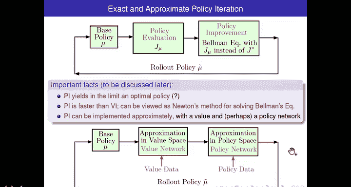

Okay， linear quadratic problems in infinite horizon。

We have the same system where I will consider the deterministic case everything goes through for a stochastic problem except that you have to use certain equivalence for that and do a little bit more mathematics so let's consider the deterministic problem。

Where the state is generated by a linear expression linear on state， linear of the control。

In one dimensional。The co per stage is quadratic。This is Q andR are given positive numbers。

The penalty on the state will try to keep the state near zero and the penalty on you try to keep you small and Belman's equation is given by this expression。

 right？Minimization over first one stage cost plus cost。Of the future stages as measured by J。

And we have to solve this Belman equation。Now J is a function of x and it's not represented by a finite pi s of numbers。

 but it turns out that it is quadratic。And that allows us to solve this equation in essentially en closed form。

Now， why would it be quadratic， we know that。V。K stage optimal cost is quadratic with a cost coefficient case of k。

 which can be calculated。That recursion。So， assuming that。This case。

Converge to something as k goes to impfinity and that' something is K star。

By the value iteration theorem， we expect that the optimal cost of the linear quadtic problem is K star x squared。

And we also expect that the optimal policy is going to be linear where L star is obtained from this Belman equation once we plug in。

K star you plug in K star here what we obtain is a quadratic minimization that can be done in closed form。

 and it gives you this expression here with L star calculated。Braly from this quadratic minimization。

Okay， so let's see what's the form of K star and the L star。啊。

We plug in this quadratic expression into Belman's equation。And we obtain this， right。Now。

 this minimization is quadratic in you， it can be done in close form。

So after you do all that and the type of derivative takes a derivative and set it to zero in the way that we have done for the in our earlier calculations。

You obtain in the end that k is equal to this function here of k。K is equal to this expression here。

So。So。You have to find K such that F of k is equal to this。And also。Once you find this K。

 the minimizing you obtained from this minimization。

Similar to our earlier calculations is a linear function of k given by this expression here。

So the final result is what you see here。The Belman equation is solved by a quadratic function with K star being a solution of this equation。

This is the left hand side of this equation， this is the right hand side。

 this equation is called the riaddi equation。It's very fundamental in control theory。And。

It dates to the 1700s。Counry Kati was a。His account and those are famous mathematician in his day。

 and he invented this ricard differential equation。And since that time。

 there has been a lot of work on this equation because it has nice properties。

 and's very fundamental in control theory， because it arises in this quadratic linear quadratic problem。

This is called the rikai equation associated with the linear quadratic problem。

But for the one dimensional case。All， all the data of the problem coming here， A comes here。

 B comes here。R and Q。And I'll show you a graph of this ricardi equation shortly。嗯。

Once you solve this ri equation。And you calculate the K star。

 then you can calculate the optimal policy according to this formula here。

 find the control coefficient L star according to this。

And the optimal control is a linear function of the state。

 it's proportional to the state with a factor of proportionality being this L star。Okay。

 so that's the solution， I hand waveded up a great deal here based on the solution of finite problem and now let's see what kind of insight we can get into the solution of this ri equation。

Are there any questions here？Okay。There are methods for solving eka equations that are very efficient and very inventive。

诶。However， we're going to use a graphical solution that provides a lot of insight。

And we can do a graphical solution because we're dealing it with a one dimensional problem。

 and therefore k is a scalar as opposed to being a matrix。So here's the ri equation。

 k equals to f of k with F being this expression。It's a function of K。No nonlinear function， right。

 because k also appears in the denominator here。And it involves A， B， R and Q。And。

It has this form that you see here， it's a typical form of dryhand sidevericaddi equation。

I'm going to solve it graphically as follows， I'm going to plot f of k the right hand side。

 and I'm going to plot also the left hand side， which is just the straight line， right？

And the point where the two meet is the solution。You see this。

Here's the right hand side of Belmans of the riaddi equation。And here's the left hand side。

 which is just k， K as a function of k。This is a function of k at the point where they meet is the solution K star。

 there's also another solution here， but that solution is negative plus q is positive。

 the crossing point is above0。So we are only interested in the positive solution。

Now the curve is concave。😔，You can verify that。And also it approaches an asymptt at this point。Okay。

 so for k going to infinity， you divide here by k， then what you obtain then then then。

Then what you obtain is this value here。It's easy to verify that this is the correct asympt。

And there's also another asymptot where this red curve goes to minus infinity。

When the denominator here becomes zero。This goes to。F of k goes minuss infinity。

So that's the graphical solution。And you can get a lot of insight from this graphical solution。

Which can be generalized with a multidimensional solution。Of course。

 you have to verify all the conclusions that you draw from the one dimensionional solution。

 you have to verify that it holds that they hold for the multidimensional solution。

 do the mathematics and the proofs and verify that indeed this is true。Now this graphical。

 this graph here can be used to understand value and policy duration。

 and that's very important for our subject because both value and policy duration are important algorithms。

That we are going to use with approximations。In the reinforcement learning。

We're also going to interpret reinforcement learning algorithms on the base of graphs like this。

And this we're going to provide insight on what we're going to be doing。So here's value duration。

How this value duration works？记得。It generates a sequence of cost functions。

And these cost functions are the optimal cost。For the finite horizon problems of K plus1 steps。

We have shown that they are given by。诶。by。This expression here。With F being this function。So。So。

 value duration。Generates a sequence of quadratic functions。Where however。

 the quadratic term can be canceled out。And you can。

You can write value duration as any duration will be cost coefficients。

So this is basically a way to solve the read equation value by using value duration。

 generate a sequence of k that conges to k star。Now lets see。

 let's plot this value duration on this figure。B F function is this red function here。

The typical literate starts at K， K。And calculates Kk plus 1， and here is Kk plus 1。

 it's obtained at the point where this vertical crosses the graph of f。Now。

 this K3 plus1 plotted down to the k axis is given here。And then Kk plus 2 is this level here。

And it projected down on the horizontal axis is this。So value duration。

Can be visualized as a staircase iteration starting from some initial condition and generating an infinite number of iderates。

 which you can see from this figure that converges to K star no matter where you start here。

 the staircase。Iteration converges to K star， and even if you start on this side， again。

 the state case iteration converges to this K star。

And you can see also that the iteration can be fast。But it can also be slow。

 depending on the slope of this。Gurve here， if it comes very close to being。To the 45 degree line。

 then the progress is slow。Now in the next lecture。

 we're going to visualize in the same way policy direction， we're going to see that's much faster。

And we are also going to see how。诶。Approximate value duration works and also general approximation in value space works for linear quadratic problems。

Using the same visualization。And。This visualization is insightful。Motivates several conjectures。

And also generalizes to problems beyond the linear quadratic domain is based on ideas that are far more general than what you see here on this graph。

But we're going to be drawing our insight primarily from this type of of。

T a quadratic type of graphs。So that's my last technical slide， have any questions on this lecture？

Okay， it's late， yeah， please。 So when you have like a value network。Automatically。

 we can sort of deduct like a policy network like a policy algorithm。The value comparisons。

That's right， if you have a value network， you can obtain。You can do policy improvement。

 approximate policy improvement， get data and construct a policy network。Okay。

 so when you said you said you like policy， minimum dont like policy interventions， like values more。

I said that。No， he said that he doesn't like approximation in policy space as much as approximation in value space Okay so where do you drop the line when you approximate by space but you get policy as well like it seems like policy or policy method merit is the facts。

I you， I guess I shes there。 Can you talk more about it。 Well what I said is that。

That approximation in policy space has the advantage that's very fast online。

It gives you controls in the response to given states very quickly。

But it has some major disadvantages， one disadvantage is that it's not suitable for online planningning。

 in other words， if the problem changes on you， some of the constraints change some of the dynamics change。

 the A and B coefficients change， then you're stuck with whatever you've trained offline and you can't change the parameters of your policy network in the response。

So it's not suitableable at all for problems for adaptive control problems， for example。Because the。

The problem changes on you and you have trained on a different problem。

 it's like having trained on checkers and then you are presented with a chessboard。

Which is you're not being asked to play chess after having played ever having trained on checkers。

And that's one disadvantage， another disadvantage was more subtle and has to do with performance issues that the。

The ceiling on performance is lower。For approximation policy space。

 even if you implement it perfectly， it will not do。

As well as approximation in value space under more or less similar circumstances now that's harder to explain。

 but I hope that it can become evident as we go along in this course。Along sea lines。

 are there ever scenarios where we would want to do both approximation and value space and approximation and policy space that have an approximate of each。

 like for instance， if you wanted to do online planning that still have some kind of policy approximation just if it' this combination of faster is that something that's ever done？

Sure， yeah， Alpha zero uses two networks， a value and a policy network。And， and。

And in the context of。Of model predictive control。You can have an identification algorithm that identifies new dynamics as they change and you can do your approximation in value space。

U。We identify dynamics， the current dynamics。That。That hold after the problem has been changed on you。

 but when it comes to。When it comes to the rollout far into the future。

You may use an offline trained policy this is context dependent depends on the context myself dry car has cameras okay and the cameras presumably。

Have algorithms that drive them and tell you when there is a person in front of the car and specifically like wouldn' we be able to tell。

 for example， if but certain policy isn't working as well without indication that we should do online re。

 for instance。Is entirely context dependent depends on the problem。 the dynamics。

 the changes in dynamics can be very， very different for different problems。

 It's hard to make general statements of that kind。About the health of zero to network thing。

 are those independently trained or is like the policy one trained to imitate with the value of？

In Alpha zero， they're trained together。诶。They're trained together。And。诶。Ordinarily。

 they would be trained differently。They could be trained entirely differently。So I mean。

 they're trained on different data， the value network is trained on cost data。State cost pays。

The points network is trained something entirely entirely different strain control。Yeah。Control。

State pass， okay， so。那边。Costs are one dimensional。 Its just a number。

 A control would be multidimensional。And the course take continuous values。

 controls may take values from a finite set and discrete set。

So the value network and the policy network may be very different and in alphas in approximate policy they actually think sequentially you first train one and then use the the net from。

The value network to the policy network and then use sequentially。

 but not together in one box in one piece of software。Yeah， yeah， right， they're in synergy。

 certainly use they are used in synergy。De training in synergy and。

The follow question on the like the is classification in the language space。

 did they also suffer from the adaptive control mission。Adaptive control。

And like the approximation in United space， then it also suffer from the adaptive。

Just the one the participation policy policy space is that first right。Yes。In approximation。

 in value space。Part of the computation is done offline to compute JTilde， the cost approximation。

 and part part of the computation is done online， this one step or multi step look ahead minimization so the ones the multi step look ahead minimization can take into account the changed problem data。

So if you have a system identification algorithm that identifies the new dynamics of the system。

 then this multi step look ahead minimization will。

Aappt to that will will take into account the new data that's called online re planningning now the part that has been trained offline cannot be changed it's there's just not enough time to change that。

So okay， that's yes。Not number on the policy network and the back network。

 So they are somehow like connected， because the policy is the ultimate of the like the minimum of the cost But what if we train them separately。

 What it break down the between them and then what if the link broken。

 then which one should we choose to like to guide the next state next control。Okay， value networks。

 okay， let me go back to the correspondingponing figure。

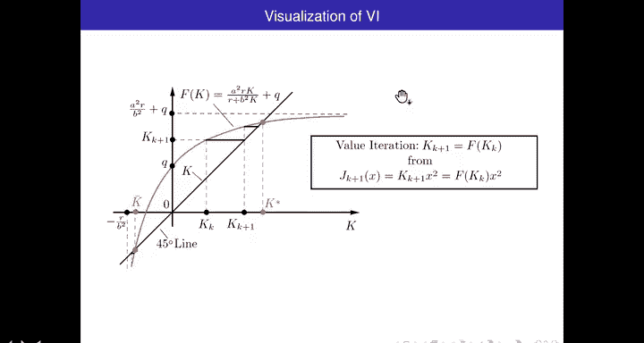

Okay， so here's the figure。Okay， the value network is trained and then the policy network is trained using the value network。

 okay？Because the value network is used to generate a new policy and the new policy is generating the data。

That'staining the policy network。So。These computations are synergistic， but they are also sequential。

And the inner structure of the value network may have nothing to do whatsoever with the inner structure of the policy network。

I mean， this can be this generates controls， which are multi multidimensional entities。

 whereas this generates values which are one dimensional and continuous。So。

Definitely should the structure of this should be different than this。And。

And they're done in sequence also。Thanks。I'm glad that you asking all these questions。嗯。

I welcome this。And we would like to go through reinforcement learning in two and a half hours。

Like I said， the first four lectures are on overview and I have deliberately chosen to use to。

I have deliberately adopted a fast pace， a very fast pace。

So that I'm able to cover the broad picture in four lectures。

And to get you started in doing some targeted reading on different parts of the landscape。

And after the fourth lecture， we're going to get into specific topics in greater detail， however。

 we're not going to be able to cover the entire landscape in depth。

We're going to paint the broad picture and then focus on specific parts of that picture and if you're not interested in if you're interested lie outside these parts。

 you have to do some reading of your own。What your term paper doesn't have to。

Be on a subject that we have covered in depth here。

 but it's going to be up to you to read and to understand in greater depth。

The subject that you are interested in。Of course， we're going to be ready to help you with literature and suggestions if we can。

 because the field is so vast that I'm not sure that we understand it fully in all its depth and breadth。

Okay， so。

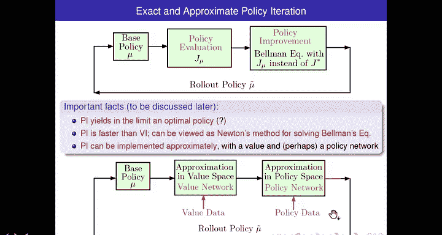

I have another slide。等国伟。But the next two lectures。That will conclude our overview。

We're going to cover these Newton step interpretations。

 we're going to focus on linear quadratic problems。

 but we are going to comment on how they extend beyond linear quadratic problems。

 basically by using the visualizations that I gave in the last two slides。嗯。

The argument that we're going to make is that approximation in value space is a newton step for solving the Riaddi equation or marginality。

 the Belman equation， starting from the cost approximation。As a special case。

 we're going to argue that rollout is a newton step starting from the cost function of the base policy。

And policy duration is going to be a sequence of repeated rollouts and therefore a sequence of repeated newton steps。

That's going to be our conceptual framework， and we're going to illustrate it visually using linear quadratic problems。

Then。I'm going to take you on an overview journey over the different types of problems that people look at in dynamic programming and approximate dynamic programming and reinforcement learning。

There's the issue of how do we formulate dynamic programming problems in practice？

We're going to discuss problems involving a terminal state。

 such as stochastic short path problems that I alluded to。

We're going to discuss a general technique called state augmentation that allows。

Complicated problems be reformulated。In the format of the problem that we have considered。

We're going to discuss P DP imperfect state observation problems。Multi agent problems。Which involve。

A control space that's very large because each control consists actually of many components。

 one component corresponding to a different agent。So if there are 200 agents， for example。

 in your problem， that control would involve。The Cartesian product of this controls of the 200 Asians。

 so it's going to be a very vast space of controls。

And how do we deal with the computations associated with that？

And we're going to talk also about adaptive control。

As well as model predictive control for systems with unknown and changing parameters。

So it's going to be an overview of the applications in the playing field。And out would urge you。

 as I have done。In the previous lecture。That you read as much of the textbook and a class notes as you can。

Watch videos from the previous class offerings。And there's a homework during one week。

Which is the second part。Of the exercise， the traveling sales exercise that you did as homework for this time。

It's going to be basically solving a th segment problem using some kind of rollout method。

And execute the roll out algorithm and do various things around it。

So I think we should send an announcement out about the form， but this is what it's going to be。Okay。

 I see you next time。