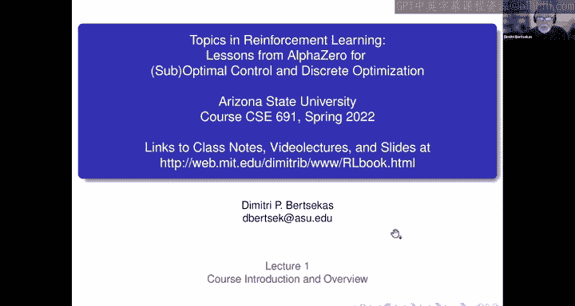
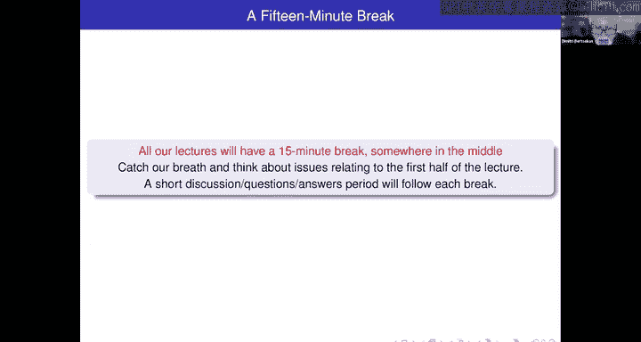
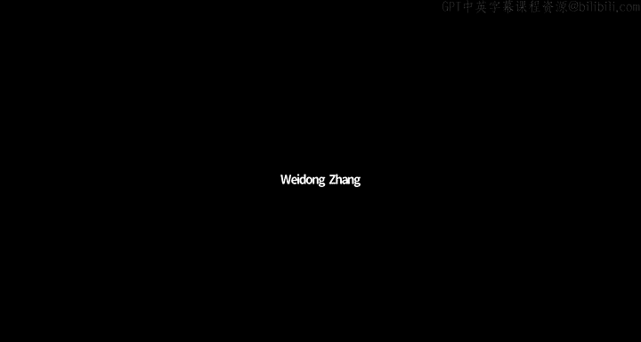
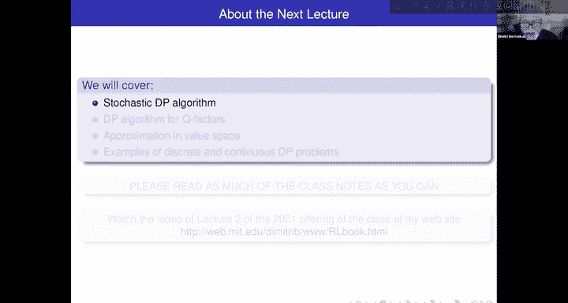

# ASU《强化学习2022-2024｜cse 691 Reinforcement Learning Course at ASU》中英字幕（deepseek - P30：[37]Lecture 1, Spring 2022_ Introduction, course overview. ASU.zh_en - GPT中英字幕课程资源 - BV1zcfVYdErD

嗯。

So let me welcome you to this class on reinforcement learning。

This is the fourth time that I'm giving this class at ASU。And each times a little different。

 so if you've taken this class in the past or you have watched some video lectures。

 there may be something new for you this time。诶。There are links to the class notes。

 the video lectures， and the slides at my website。And for those of you that have an ASU and access to Canvas。

 theyre also posted it in Canvas。And also announcements are put on canvas。And other material。啊。

Our first lecture is going to be an introduction to the course。

 an overview and a discussion of some of the basic concepts。

Okay， so here's the outline， I'm going to start with alphapha zero， our remarkableable chess program。

That came out a few years ago and created a lot of enthusiasm about the prospects of reinforcement learning。

I'm going to explain its two main component algorithms。

 the offline training algorithm in the online play。

 and I'm also going to explain how Alpha Ze will serve as a guiding example as a paradigm for the design principles of our course and how its algorithms can be expandedend to a far broader domain。

So。B I'm going to go into a historical account of a field in the general concepts where they started and the connections between。

Decision and control and。Reinforcement learning is practiced in the artificial intelligence community。

Then I'm going to discuss the。The connections of our course to various fields。啊。

Then I will talk about Newton's method， a mathematical algorithm that will connect various parts of the course together。

 and it's going to be an important part of the framework that we're going to be using。

Then we will take a break， a 15 minute break， this a roughly two hour lecture we take a break somewhere in the middle as we will in our future lectures as well。

And then we are going to get into more specific technical issues。

 introduce a dynamic programming algorithm for deterministic problems。

And then give some examples of his application to。Discrete optimization problems。

With finite number of states。Also， discuss some organizational issues about the course and so on。

So let's talk about alpha0。And also TD Gamon， another program， Alpha zero plays chess。

 TD ga plays back gammon and back gamon is a sophisticated sophisticated game of strategy as well as chance。

These two programs。Were 25 years apart， Al zero came out in 2017 and。Created。

A sensation with its quality and originality of play。TD Gamon is also a very impressive program。

 just as impressive as Alpha zero came out 25 years ago。

And created a lot of enthusiasm at that time about the prospects of reinforcement learning。

These two programs。are quite similar in their structure， and both of them involve two algorithms。

 sometimes people don't realize that there are two algorithms involved in alpha zero。

One is the offline training algorithm？Va。Learns how to evaluate positions and also how to generate moves in response to various positions。

And this this algorithm uses neural network approximations training for a long time with data。

 and that's one of the major components。The other algorithm is the online play algorithm。

Offline training takes place before the program faces any real opponent。

Online play is used after offline training is finished。

And it plays against opponents like you and me and other computer programs。

And it uses multi step look ahead， roll out cost function approximation。And。😊。

These two algorithms have strong connections to dynamic program。

The fundamental method of policy duration。Approxiation ideas of the reinforcement learning types。

 such as neural network approximation architecture ideas。

And what we will try to do is understand this methodology， the methodology of alpha0 and td gamon。

 so that applies far more generally。For example， it applies。In control system design。

 an area that we're going to emphasize。And in particular。

 the method of model predictive control NPC and also adaptive control。

 these are well established methodologies that I' have been around for many， many years。

And we're going to try to view them in the context of the alpha0 and tiggamon algorithms。

We will also discuss discrete optimization problems。Like combinatorial optimization。

 the difficult NP heart problems。And how they can be sold by rollout。

An algorithm think that's also inherent in these programs， particularly T gamut。

And we'll explain why that is as we go along。So I'm going to discuss now the online play algorithm of Alpha zero and then the offline training algorithm。

Now， the online play algorithm is what you see here in blue。

It generates a move in response to a given position， more generally a state position state Xk。

I'll be talking primarily about Alpha0， but when the same architecture applies to these other programs as well as。

More general domains。So。The blue part is online clay and it uses the results of offline training。

Whi which is this red stuff over here， it uses a position evaluator obtained by offline training and also a player。

 some kind of a player that has been trained to generate moves in response to positions。And。啊。😮，V。

Online player aims to improve the baseline player as follows at a given chess position。

It searches forward for several moves and counter moves through a look ahead3 up to a certain length。

Then after it reaches the leaves of this tree， it simulates the bass player for some more moves。呃。

Up to a certain number of moves to reach these terminal these leaf positions。

And then it approximates the effect of the future moves by using the terminal position evaluation。

So for any one path along this。Three， we have at the end a position evaluator now we we back up these values to the root and we obtain。

A value for every possible move at that position。And we play the best move。

So that's how the movie is selected。And then we go to the next position。

 and then we repeat to the same thing， select the next move and go on forward。Now。

There are several programs。I'm sorry， yes。Can I ask a question， how is the play of the aversarial。

 the adversarial player approximated in the look ahead tree， how is it predicted？啊。第。Okay。

 there is a complication here because this is a game and not involving two players。

 but let's assume that there's a fixed player so it becomes player a one player problem。We。B。

When there are two players。This part， which is called tranc the drawout。

 involves also moves and counter moves and both players use the bass player。Now。

 one thing to note is that。The published version of alphapha zero does not involve this middle part。

啊。The reason is that we look ahead three in alpha0 is so long that it is not necessary to have this extra look ahead。

On the other hand， TD Gamon depends very crucially on this middle portion。

And the reason is that TD Gammon involves a stochastic game。

 so the look ahead tree expands very quickly， so you cannot have a very long look ahead tree in a stochastic game。

And Pi Ga depends on generating moves in a cheaper way。

 less expensive way to expand the look at that。Now。This type of architecture。

Its also very similar of what's used in model proic control。In model predictive control。

 what we want to do is control the state of a dynamic system， usually taken from a continuous space。

 using continuous space controls， a continuum of controls。And we choose a control at each stage。And。

In model predictive control， there is a look ahead minimization for a few steps。

This is called the controlled interval， and then sometimes theres rollout with some stable controller。

This is called the prediction interval， and there's also a terminal cost function approximation。

And the architecture is remarkably similar， except for the different contexts。

 particularly the difference between discrete state space and continuous state space。

Also in discrete optimization。There's a similar architecture which uses as bass player some heuristic。

It and in discrete optimization， usually there's。There may be no training at all。

 offline training just use a heuristic that's given to do rollout。

 however in other ways the architecture is very similar。

So that's our basic architecture and this is how the online play works now how do we obtain a base player and a position evaluator and alpha zero？

What's used is the policy iteration algorithm， a fundamental algorithm dynamic programming。

 but approximate versions of that。Using data， self generated data。

Now the algorithm here generates a sequence of players。

 a player is a software that selects a move at a given position， we also use the term policy。

Where as in policy direction。And the idea is that the current player is used to train an improved player。

 and then the process is repeated with the improved player taking the role。

 both the current player and so on。Now， policy duration involves two basic modules。

 policy evaluation where the current policy evaluated and policy improvement will be improve policy generated。

And the current player is evaluated by playing many games， many games against itself。

And the results of the performance of the current player。呃。

Are represented by using a value network through training。So basically we get a lot of data。

 performance data from the current player， and we approximate this by a neural network regression fit so this quest fit。

Or some other method， but the idea is that we use a neural network to approximate the。

The performance of this bass player。And then the current layer is improved in this box here by using some form of multi step look aheadization。

 in particular alpha0， there's something called Monte Carlo research。

And it's an approximation to a full multi step look ahead minimization。And。So we obtain improved。

An improved policy samples of un improved policy， improved controls。

Whi we fit with a neural network to obtain a policy network which generates move probabilities or generates the best move at any given position。

So this is the loop involving a sequence of players。诶。And at the end。

 we obtain the final player and we give it to the online play algorithm。

 which uses it for its in its own software。Did the ga on users？

A similar policy iteration algorithm as alpha0。Except that it does not use Monte Carlo research。

 Monte Carlo research is not really fundamentally essential and it can be substituted by other forms of search。

 including exhaustive search through Luaan3。啊。Also TV Gamon does not use a policy network。

 it uses it replicates the functionality of a policy network through the value network and let me not get into that。

But fundamentally， the algorithm for offline training is the same as for Al zero。

Model predictive control and discrete optimization by your rollout do not ordinarily use such sophisticated forms of offline training they use。

Other schemes sometimes very rudimentary。Okay， so now let me。Let me revisit this。This figure。

Quer online play connects with offline training。And make give you a major empirical observation。

 namely that the online player。Improves often a lot on the offline train base player。In particular。

She is the online player。So next moves。And。Provides has a certain performance function。Now。

 this performance function is much better than what the position evaluator predicts or the base layer obtains。

This is just a fact the online player of alphapha zero plays phenomenal chess。By comparison。

 the bass player。Plas mediocre chess。So there's a day and night difference between these two。

 and thiss an important observation， it says that if you take online clay and put it on top of offline training。

 you can obtain a significant performance improvement。对的。Oh excuse， I can ask a question。Yes。

Is there like， can we guarantee it theoretically like prove that the online play is more efficient？

Yes， actually。We going're going to elaborate on these them。

 it's going to be one of the main things in this course to explain why this is happening。

And also to expand this observation to more general domains。Thank you。

 I'm how you talk about that in a short while。But this is an empirical observation that is supportive。

To the theory that we're going to develop。Thank you。

Another empirical observation is that in TD Gabon。If you take away this spin portion。

 then it plays much worse。Toso， the originator of T Gamon had two algorithms one in 991。Where？He had。

Basically。Offline training or position evaluator， one or two step look ahead。

 but no truncated rollout in the middle。And。The program that he had was in 1991 is quite impressive。

 came close to beating the best humans， but on the whole it had some subhuman performance。In 1996。

 he introduced this middle layer and he introduced all the name Roout， by the way。

 Roout is the name Roout is inspired by Jack Ba。And he found that with the introduction of this middle portion。

 the performance jumped a lot。To the point where his program would beat the best humans and its performance has not been surpassed since that time。

T the Yemen withdrawal rollout is the gold standard in Ba Yemen， in fact， in the back。

Backham on circles it's viewed as optimal， even though it's not optimal， it's viewed as optimal。

 it plays so well that it's viewed as optimal。So these are interesting observations and what we like to do in these course is explain this observation and use them within far more general contexts。

Okay， so what do we aim to do in this course？Well， we're going to try for unification。

 provide a unified fine framework for several areas of large scale computation。

Reinforcement learning as practiced by the AEI community。

Approximate dynamic programming as practiced by parts of the optimization and operations research community。

Model predictive and adaptive control as practiced by the control systems community。

And also part of discrete optimization， combinatorial optimization。

 as practiced by the algorithms and computer science community。And for this。

 we are going to rely on dynamic programming， the theory of exact。

 approximate and also abstract dynamic programming。

We're going to use a lot of visualization this course。

 intuitive visualization that's based on concepts of Belman equations。

 the Belman operator dynamic programming， all of this is also couched in the Mamatic theory of abstract dynamic programming。

Even though this theory is quite mathematical， fortunately。

 it admits also an intuitive visualization and we're going to rely a lot on that for understanding various concepts。

😊，We're going to follow from some distance the paradigm of alpha0 and TD Gamon and similar design architectures。

We're going to generalize basically their architectures。Finally。

There is going to be an important connection with Newton's method。

 this is the Newton's method that you learn in calculus but a little but adapted somewhat to the dynamic programming context Newton's method applied to the Belmon equation which connects all of the above and also provides the mathematical explanation that one of you asked me just a little while ago。

As to why online play improves on offline training。Now in doing so。

 we're going to aim to bridge the gap between cultures of various communities。

And also bring to bear the application of reinforcement learning to a very。

 very broad range of applications。So let me go now into the history of the subject。

The current state of the art owes a lot to a very fruitful synergy between。

Artificial intelligence and decision and control。And dynamic programming in particular。

Now exact dynamic programming is a very old field it date to the 50s。

 you'll hear the name of Bellman has been the father of dynamic programming， Shannon。

 the father of Information theory。And also incidentally， the father of computer chess。

And there's a very。Very extensive theory around dynamic programming。

 which has been developed over 60 years or more。诶。Reinforcement learning was sort of a languishing field in artificial intelligence。

Until the 80s。And then people that were working in this field discovered。

But a lot of what they were doing could be explained in terms of dynamic programming ideas。😡。

So there was a confluence of ideas。In the late 80s and the early 90s。

And it generates a lot of interest。But all of this would probably have not amounted to much。

 except that in the early 90s， there were this background on programs of Teor that were very impressive and created a lot of enthusiasm and focused a lot of attention on reinforcement learning and dynamic programming ideas。

And a lot of people got into this field， I got into the field because I was so impressed by the Sos programs。

So the 90s was a very， very active area。There was at Golden Hick progresscus。

 new algorithms were invented， all the algorithms were understood。There was。

Many applications were considered and the first books came out in the mid 90s。Then as Stein went on。

 there was some mega trendsren that occurred。Machine learning became very big in the 2000s。

 big data became using data to solve complicated problems， became very popular。

Robotics became very active， neural networks became active again， particularly deep neural networks。

 which caused some major successes。And all of this has helped to create activity and progress in reinforcement learning as well。

Finally， in the in 2016， there was the Alpha go program in 2017， the Al zero program that really。

Proroppelld the field to the forefront。And。Reinforcement learning now is a very hot field and I'll explain why this is so。

 but before I do that， let me also mention that there were a lot of quite a few complementary ideas that combined around this synergy between the two fields。

Both fields had a lot to contribute。One is the artificial test idea of learning through data and learning through experience。

The idea of simulation was very important， was unknown in dynamic programming。

 using simulation and also model free methods in dynamic programming was something that was unknown at that time。

Vueous ideas around approximations or representations using features， neural networks。

 these were contributed by artificial intelligence， and then various heuristic ideas， as star， games。

 and so on。At the same time， decision controls provide a lot of the mathematics and a lot of the fundamental concepts。

 the principleity， the fear of Markov decision problems or partially observed Markov decision problems。

But the algorithms of upon， value duration， and so on。

So all of this was very synergistic and each field borrowed from the other very significant components to supplement what they would have been practicing。

So now back。To why the field has become important。诶。

Reinforcement learning is now both ambitious and universal。By this， I mean that。

It applies to a very broad range of problems， this is true。For exact dynamic programming。

 it applies in principle to deterministic problems， stochastic problems。

 combinatorial optimization problems， which are discrete， have a discrete state space。

 optimal control problems that have an infinite state and control space。

Problems involving one decision maker or。Problems two player games。However。

 exact dynamic programming has some major difficulties。The curse of dimensionality。

 which refers to the exponential explosion。Of the computational requirements as the dimension of the problem increases。

And also a second course， the need for a mathematical model。

In order to apply exact dynamic programming， at least in the older days， you needed。

You needed equations guiding representing the dynamic of sort the system。

 you need probability distributions， and these equations were hard to obtain in practice。Now。

Approximate dynamic programming in reinforcement learning overcomes these two difficulties。

With in two ways， by approximation， using neural network and other approximation architectures to reduce the dimension of the problem。

And also using computer models in place of mathematical models。

Computer models that are based on simulation， emulating the dynamics of the mathematical model through a computer。

Of course， a computer model also realizes a mathematical model。

 but it can realize models that that would be very。

 very complicated and very difficult to write down and understand mathematically。So in some cases。

 it is very， very convenient to use a computer model in place of a mathematical model。And and。

Simulation and computer models are part and parcel of reinforcement learning。Now。

What is the current state of the art？We have a broadly applicable methodology because it inherits this generality from exact dynamic programming。

It can address a very broad range of challenging problems， deterministic。

 sarcastic dynamic discrete continues， just about any problem。

Of optimization can be formulated as a dynamic programming problem。

 very often it's the only way to do it through dynamic programming。

 so the range of dynamic programming is very broad and so is the range of reinforcement learning。

On the other hand。There are no methods that are guaranteed to work in this field。啊。你接说。

You will see methods advertised in the literature， people say that they work well on their problem。

 but you try them on your problem and you see that they don't work。

Now there may be a variety of reasons for this， it may be that a method is not suitable for the problem。

 it may be that your problem is very challenging it may be that you're not implementing right and you need to tweak it for a number of reasons。

 practice has shown that。There are。Theres no guarantee that if you try your method it's going to。

That's a reputable method， it's going to work on your problem。On the other hand。

 there are enough methods。That you can try。Each one without a reasonable chance of success。

And hopefully one of them will work for your problem。First。

 that depends on how well you understand your problem。

 how well you understand the methods to be able to match methods to your problem and also depends on luck。

 let's not minimize luck。Now the role of the theory here is to structure mathematical data methodology。

 and we will aim to do that through mathematics， central visualization。

And the theory can there's a lot of art in this field。

So the theory helps guide the art and delineate the sound ideas from the crazy ideas and there are many crazy ideas that you'll see advertising in the journal literature that do not have a sound mathematical structure and the theory will tense。

Will help delineate the sound ideas from the fly ideas。Okay。

 let me also give you a quotation from the neurodynamic programming book that I wrote with Johnson Schlis。

Many years ago。诶。It's a long quotation， so I'm going to just summarize it， it says that。

Cary Riossti was aroused by new methods， reports of new methods of reinforcement learning。

And these methods were aiming to provide effective solutions to complex problems。

Of planning sequential decision making that for a long time we're thought to be intractable。

We were excited and very curious about methods that were。

Being published and the success stories that were being published， challenging the。

Problems that were far beyond the state of the art。

 problems that were beyond the reach of the methods that we had at that time。

 that was quite exciting。Then after we started working on this field。Well， to begin with。

 we are very skeptical， we thought that these methods were ambitious。

 overly optimistic and lacked with firm foundation。On the other hand。

 there were claims of impressive successes and so on。

That there was a core of the approach that was based on dynamic programming。

 which was also a subject that was interesting to us。Now。

 after we wrote the book and we understood the field a little better。

Our initial impressions were correct。It's indeed an ambitious ad hoc methodology。

But for reasons that we understood better， it does have the potential of success with important and challenging problems。

 so what we are saying is that this is a hit or mis methodology， but if you're clever enough。

And if you're lucky， then you may be able to solve some very important problems like chess。

And this assessment still holds through， nothing has changed in the meantime。

 it's still a flaky field， but it has a lot of potential to address very difficult problems。Okay。

 so let me say a few things about the connections to various fields。Our course is research oriented。

It aims to explore the state of the art at a graduate level。嗯。

It will go in depth in some topics like rollout and consideration and Newton's method that I mentioned earlier。

And the idea is to give you the opportunity to explore your recent interests as they connect to this area。

嗯。The are references that we're going to be using。Like I said， I've given this。Hse for。

Three times earlier， this is the book that resulted from the first offering of the course。

This resulted from the second and third offering of the course。

And this is a book that I'm writing now and is prepared for the needs of this class that we are in now。

啊。There's a PDF draft， a fairly complete draft that's in the course website。And you can read that。U。

There are also class notess that have a lot of the content that's in here and they are focused on the topics that we're going to discuss in this class。

These are also at the courseur website。Finally， there's a lot of other material， slides， papers。

 videos from the previous offerings。So there's a lot of material altogether。

which will be enough for you to get by unless you want to study the subject in more depth。

 in which case you'll have to look at these books and also study exact dynamic programming in greater depth。

I have a two volume book on dynamic programming。Together。

 the two volumes are over  a thousand pages they contain more that you'd ever want to know about dynamic programming。

And also they have a lot of material on approximate dynamic programming。Finally。

 I have an abstract dynamic programming book which has relevance to this course and Newton's method in particular。

And。诶。that the third edition just came out and there's a PDF in the website of the course that you can consult。

There's also the neurourdynamic programming book from 1996。

Which is more mathematical than the level of this course。

 but it has ideas that are still relevant today。And。From the artificial point。

 the intelligence point of view， there's the book by Sutton andbardo。Which came out in 1998。And。

And there's a new edition that's online that came out a few years ago。And。

This is different now it's a different style， it's less mathematical。

and more couched in the culture of artificial intelligence。

 it is very popular in artificial intelligence and you may consult to see an alternative point of view。

 we are going to be addressing the subject mainly from a dynamic programming decision control point of view。

But we are going to be keeping track of what's happening in artificial intelligence and try to provide entry points to that field as well。

So I mentioned that reinforcement learning。And decision control have interacted very fruitfully with each other。

 unfortunately the two fields have a different culture， different mathematics， different language。

 and also different terminology。So I have in this slide prepared a limited glossary to allow you to translate terms as they are used in the two fields。

And your class notes have a much bigger glossary。One irritating difference。

 although not so important is that reinforcement learning uses maximization。

 we're dealing optimization problems， we can view them as maxim problems or minimization problems。

 reinforcement learning uses maximization， dynamic programming uses minimization。As a result。啊。

The cost of a stage which is sum of the cost of all stage minimized in decision control。

 the cost of a stage is translated as a reward of a stage which is maximized in the reinforcement learning。

State cost is translated at state value。Cost function is transd as value function。

All of this is not very important， you can learn pretty quickly to make a translation in your head。

Unfortunately， however， there are some other more significant differences in terminology。

In decision and control。诶。Decisions are made by the decision maker or the controller this is the term used in reinforcement learning。

 the equivalent term is agent。In decision and control， the applied actions， okay。

 action is the term used for reinforce learning， but decisions or controls is the term used in their decision control。

Decision control is couched in the language of。Dynamic systems like differential equations。

 discrete time equations， partial differential equations。

 there's some kind of a dynamic system which state evolves under the influence of control。Now。

 a dynamic system。In reinforcement learning is called the endron that for a person that's coming from decision surgeon control。

 this translation is a little hard to assimilate it was for me anyway。嗯。So。

Bear in mind this major difference in terminology。Then about methods。

The term learning is used reinforcement learning， it's part of the name and the term learning is used in many different meanings。

 the dominant meaning is learning means solving a dynamic programming related problem by using simulation simulation is the key term that connects to learning。

Self learning in reinforcement learning。Translates to solving a dynamic programming problem using。

Simulation based policy direction， self learning is related to policy direction。

And the term learning， again， relates to simulation。

There's a distinction between planning and learning in reinforcement learning。

Planning relates to solving dynamic programming problems with a model learning。

It relates to solving dynamic programming problems using without a model。

 using a computer model and using also simulation。So build this in mind and also the fact that the term learning is used very loosely。

 often in this field。With many different meanings。7。Unfortunately。

 there's still some further discrepancies that are annoying between the reinforcement learning and decision control。

 and they have to do with notation。We're dealing with dynamic systems here where we go from one state to another state using some kind of a dynamic process。

Reenforcement learning uses transition probabilities。Their notations as follows P of S A and S prime。

 this is the probability that when you are at state S。

 you will move to state and prime when you apply action A。

 A is a symbol used for action in reinforcement learning and S is the symbol used for state。

Now this kind of transition probability formal is standard in finance state problems or Macovviian decision problems。

And it's suitableable for these problems。In control theory。

 people use a discrete time equation formalism。X is the symbol used for state。And。

There's an underlying system equation from state Xk。

 you go to a state Xk plus one under the influence of control UK is the control that you apply at time K。

U is a symbol use for control as opposed to A。And also in this equation。

 there is some uncertainty WK is a random quantity that has a given probability distribution。

So the evolution of the state is stochastic here as well as here。

 but there's a different form that it's being used。

And this is standard in problems that involve continuous spaces because this other format is difficult to use in continuous spaces。

 problems， continuous state space within control space。In operations research。

 both types of notations are used except that。People use PIJ type of notation。

PIJ states are denied by I and J U is deniedote by control。

 and this is the transition probability of going from state I to state J， other control U。

Professor can I ask a question。I'm sorry there's some kind of。Yeah。

 please repeat because I my phones not what yeah go ahead okay， my question was。

 is there any term in reinforcement learning that quantifies this uncertainty？Yes。

The uncertainties is inherent in this transition probabilities，So this this。

When you are at state A and you apply control A， you don't know where you're going to land。

 you don't know the state S prime it is the。It is the you only know the probability distribution of SP。

So that's the uncertainty。And the uncertainty here is in WK。ItThank you， Bruce。

Now the important thing to note is that these two notation systems are mathematically equivalent。

 anything that you can do with one notation， you can do in the other notations。

 it's just a matter of what's most convenient。And transition probabilities， generally speaking。

 are cumbersome for deterministic problems。If you have a deterministic problem。

 there's no uncertainty from a given state。apply a certain control， the next state is certain。

 is determined， it's not subject to any uncertainty。So there's no probabilities really。

 and to start with probabilities as the basis of your dynamic system is just bad， it doesn't work。

 it's very inconvenient。嗯。And similarly， if you're dealing with a continuous space problem。

 using transition probabilities is mathematically very complicated。

It takes you to mathematics that you don't really want to go the mathematics of continuous probability spaces。

 measure theory， concepts that are。Difficult to deal with。On the other hand。

 system equations are cumbersome for finite state problems。诶。

Differential equations are not designed for finite stake problems， difference equations similarly。

 so it's better to use the transition probability notation。So what are we going to do。

 depending on the problem that we are going to be dealing with。

 we're going to be using this notation or that notation or rather this notation here。

 and we're going to use this notation for the first three quarters of the course。And。

In the last quarter， we're going to use transition probabilities because we're going to focus primarily on finite state problems and Markov decision problems for which this type of notation is better。

Okay。So now let me say a few things about Newton's method， are there any questions by the way？

Before we go into Newton's method。哦。Professor there was one question on one of the earlier slides。

 so since you mentioned the difference between exact dynamic programming and how approximate dynamic programming and our methods improve on it。

 are there is there any class of problems or scenarios which can only be dealt with exact dynamic programming and the other approximate methods are not able to do？

嗯。Anything that you get。Any problem that you can address by dynamic programming you can also address it by approximate dynamic programming right I'm not sure I understood your question repeat the last part of your question。

So I was asking about any specific scenarios for which a solution can only exist through the exact dynamic programming methods and using approximate methods can lead us into some limitations of sub sort。

Well， that's a subject of our course， what are the problems with which approximation methods。

 approximate dynamic programming methods work and how well they work。

Obviously you can find some methods where approximate the dynamic program works very。

 very well and other problems where it doesn't work at all it just falls apart。

 it also depends on what kind of method you're using right because I mentioned earlier that not all methods work equally well on any given problem you have to be you have to smart enough you have to be lucky enough to find the right method to match your problem。

OK等应就是。Okay， so let's return to the online play offline training figure。

We want to view it as a Newton step for solving a fundamental dynamic programming equation。

 with Belman's equation。And。嗯。😊，Remember that the online play is this blue part that generates actions or moves at any given position or state。

 and it uses the results of the offline training， which is a position evaluator。8ight。

Cost function or reward function， a value function that gives a value to any given position so it's a function and it also uses a base player which generates moves at any given。

Position。And now。This viewpoint is going to argue that there's a Newton method step that describes this figure。

And the Newton step。Takes the position evaluator and maps it into the performance function。

 the value function of the online layer， so it takes a function into a function。

And the connection is through Belman's equation now I'm not going to give you Belman's equation for the time being we'll do it next in the next lecture。

 but Belman's equation has a solution， the optimal cost function of the problem。

 if you could solve Belman's equation， then you would have the optimal， the optimal performance。

 the optimal policy。So。诶。What I'm going to argue and explain as we go along is that there is Newton's method。

 this is the Newton's method that you know in lot from calculus adapted to the Bel equation。

Characteristics。And it maps the。Offline。Predicted。AV function into the value function of the online player。

And。This position evaluator of course obtained by the offline training in between the applying the Newton step and。

Just before applying the Newton step， there may be some online enhancements or the Newton starting point like the all out that's in here。

 use also the base player， but basically it's one step of Newton's method。

A nuus method is a very powerful method， it's the most sophisticated and powerful method in optimization in algorithmic optimization and also in numerical analysis。

啊。If Newton's method is close to solution， then it zooms in very quickly and very accurately。

 if you can get Newton's method to work， you get great improvement and get very close to the optimal performance。

And so what's going to be the key in our development of the subject that in passing from offline player to online play。

 there's a newton step。That。Worked very well。And explains why the online player is much better than the offline trained player。

Now this is a new viewpoint and my latest book is discussed in much greater detail and we are going to be visiting it and fortunately this can be explained with the insightful visualizations。

 so we're going to be able to look at this in significant detail。Now here are principal viewpoints。

Online play is a step of Newton's methods for solving the Belmant equation。

 the fundamental design program equation that yield the optimal cost function。

 that's what I was saying in the previous slide。While offline training provides the starting point for the Newton step。

 in other words it provides a hot start， what we call a hot start。

 a good starting point for the Newton step， but the online play the real work。

 that's where all the magic happens， that's where all the good performance is obtained。

And the offline training plays a secondary role by comparison。

And a major reason for this which can be understood， online play is an exact mutantton step。

 it is not degraded by any kind of approximations that are common in reinforcement learning。

 for example， neural network approximations offline training is subject to errors。

 neural network training errors， online play is exact and it inherites its power from Newton's method。

Here's another interesting insight， which is supported by a lot of。

A lot of experience over many years。Ierfections and differences in the offline training affect the starting point of the Newton step。

 but they are watched out by the online plague， which is the Newton step itself。In other words。

 Newton's method is a hot algorithm， a very cable algorithm。

If it's within its sweet spot within the area where it works， let's say fairly near the solution。

 then it doesn' need a hot start any errors in the offline training are washed up and all these training methods。

What roughly the same。And it doesn't pay to spend a lot of time to do very extensive training to improve a tiny bit。

 the starting point of a Newton step is all washed up by the Newton step itself。

Now there's a cultural difference that we're going to aim to bridge based on this viewpoints。

In reinforcement learning and artificial intelligence research。

 people focus primarily on offline training issues。Things like。Data collection methods。

 regression methods， error bounds， confidence intervals and the like。On the other hand。

 in control theory， model predictive and adaptive control。

 research is focused primarily on online play and also stability issues。

 whether the system that you obtain is stable and stability issues is something that reinforcement learning does not address at all。

So we're going to put together offline training and online play and therefore see what。

Which pieces of research make the most sense in given classes of problems？In discrete optimization。

 owing to the generality of dynamic programming， also the scheme。

 our scheme is going to be viewed as an exact Newton step。诶。Using rollout。As opposed。

 primarily rollout。And finally， all of this applies in great generality， like I mentioned。

 dynamic programming applies to the very broad class of problems， arbitrage state and control spaces。

 stochastic deterministic hybrid system， multi Asianian systems。

 we're going to spend a lot of time in multi Asianian system， mini max control， gains。

 finite and infinite correctionsion， discrete optimization， all of this has a Belmon equation。

 all of this admits a newton step interpretation。嗯。Now this viewpoints。

Are a little controversial and somewhat personal。So I thought that that。

Flash this cartoon here on the screen。These two people look at the same number。

But this guy says it's a six and this guy insists it's a nine。So it depends where you stand。

As to what the truth that you see is。And this has some relevance to our course。This semester。Okay。

Yeah。So now let's take。A break， a 15 minute break will come back in 15 minutes。

We're going to do this with every lecture。That will help you catch your breath and meet also。

And we can think about issues relating the first half of the lecture and when we come back you can give me your questions and we can have a short discussion sometimes in some other lectures I'm going to give you something to think about during the 15 minute break and we'll discuss it at the end when we start the next and the second half of the course。

So。We're going to break here and we will get back in 15 minutes， which should be。ItShould be five。

550。In Arizona and 750 in。In the in the East Coast。

Are there any questions before that we shall address now？Okay， so we'll take a break。

I'm going to unshare my screen。

And we'll meet in 15 minutes。Hey， professor。Probably。日好。Sorry， I can't hear you。Oh no。

 you're just muted。嗯Yeah。I just wanted to ask， so is it will it be in Zoom format for the rest of the semester or just for the next few like times？

What formera did you say？Zoom format， will this class be in Zoom format Yeah yeah。

 everything is going to be Zoom。Got it。 Got it。 Okay， understood。Okay。Thank you very much。

On the other hand。We're going to have office hours， you can talk to me over Zoom and so。

It's just that I was planning to be in Arizona。嗯。For this first lecture。

 but unfortunately with COVID being what it is， it became too risky to travel。Ay， professor。

 this is wow。 a quick question。啊。Do we have a projects or homework。For this course。Yes。

 there will be homework and there will be a project at the end of term paper We I discuss this at the end of the of the class and also in。

The syllabus， there's a description。Of。Of what is expected。Thank you。O。

Okay。Welcome back， we're going to get started for the second half of the lecture。嗯。I have。

I have a couple of questions in the chat。诶。Okay， I'm reading question， you mentioned a few terms。

 policy duration， value duration， heuristics and rollout。

 can you please briefly describe the difference between these terminologies？Unfortunately， I cannot。

😊，Because that will take us too far， we just don't have enough background built in this class。To。

To explain these terms， this luurious proof is intended as an overview。Value duration。

 policy duration and rollout will be discussing in the next lecture。So。If you have not。

 if you're not familiar with these terms， it may be a good idea to take a look at the class notes before you come to class that will facilitate your understanding because it okay。

 the lectures are。Quick and not enough to give you a very， very detailed understanding。

So wait until next lecture， we're going to start our course in earnest and explain terms in detail and also through the class notess。

Second question。You talked about Newton step is the concept of Newton's steps similar to gradient descent。

Okay， no it's not。Graaddian descent is for solution of optimization problems the Newton step I was talking about is for solving the Belman equations for solution of equations this does not necessarily involve the concept of disscent and to begin with Newton's method is very very different much more powerful than gradientadian descent。

So the answer is no， forget about gradient descent for the moment。

 it doesn't connect to anything that we're going to be doing for a long time。

 it's going to be seven or eight lectures before we get into gradient descent in connection with the training of neural networks。

 but for the moment there's going to be none of that。

Does this answer your questions or are any other questions？Yes， professorsor， thank you。Professor。

 I have a question Yes I know you have already mentioned that in the rollout stage we basically do some look ahead simulations。

 but isn't that the same thing we're doing in the look ahead trees as well？Yes。

 but look ahead of look ahead three involves minimization。Now。

 minimization over a look ahead3 is much harder than look ahead with a policy。For example。

 if a policy deterministic， look ahead with the policy generates a single trajectory。

 there's no look ahead three really with a single policy。

 it's a single trajectory from any starting point。Where is so rollout with a policy is a much cheaper way of look ahead。

 basically we search for that policy as opposed to searching over all policies and trying to find the best path to the look ahead trade。

It's a big， big difference in terms of computational overhead。Thank这公司O。Could I askく。Sorry。

 could I ask a quick question， I might be jumping ahead a little bit or maybe I'm confused。

 so when you have one step look ahead， you are applying Belman operator which is already monotonic。

RightSo are we getting more insights by because that would mean we are always going to improve on our。

Value approximations， are we getting more insights by mapping it into a Newton step？

A we going to get more insight？You a question Sarah sorry It Mr。 lastworth。

 could you repeat that again for a second？Okay you mentioned one step look ahead and then we have also here multistep look ahead but what was the point of your question so I was just saying like when you have one step look ahead you're already applying a beman operator on a like a like a value function so since it's a monotonic one you are going to improve upon it at least in like a standard like discounted like discounted cases right so are we getting more insights by mapping it into a newton step。

Okay。First of all， if you apply the one step look ahead minimization on a given function。

 you don't necessarily get an improvement， but suppose even that you got。

 that's not what the Newton step does， what it says is that given a certain cost function on which you apply this value it or one step look ahead minimization。

 you're going to get a policy and the cost function of that policy。

Is going to be a newton step on the cost function on which you perform the value iteration。Oh， okay。

 yeah， okay。 Thank you。 Hopefully it' will be more clear when we go to the class gathering minute。

 Yeah， what yeah， this was just a。😊，Sort of meant to excite your appetite for what's coming in the next lecture。

But we're going to discuss this in greater detail in the next lecture and it's also discussed in the。

particularly in the lessons from Alpha zero PDF that's in the website。

 and then there are a lot of figures from which everything becomes very transparent if you take a look at these figures I think to understand better than the way I can explain because。

I can only explain my words， but the figures speak much clearer and much louder than my words。みか去ろ。

Any other questions？Okay， so。Let's go into dynamic programming。

The technical content of the course begins now， what we discussed so far was just an overview and just general ideas that we're not very specific from now on we're going to be far more specific and we're going to start with the deterministic problems and the dynamic programming algorithm。

 the exact dynamic programming algorithm。So here's the。We know that we're going to be using。

We have a system that evolves。According to some discrete time equation。

XkD knows the state of the system and the state can take values。In any space。

 it could be a discrete space， a finite set of states， or it could be a continuous space。

 like a Euclidean space。And the next state。Is obtained from a given equation and UK is the control that we apply。

 the next state depends on the control， which is chosen from some constrain set。

 the constraint set depends on the stage depends also on the state。And。

We choose N capital n controls starting from some state x0 and ending at some state XN through these intermediate states。

And at state Xk， we apply the controlled UK and we end up with xk plus one。

 according to this equation， this is called stage K。

And we also incur a cost that depends on both the current state and the control that we apply。

And as we go from x0 to xn， we accumulate。N costs of this form。

 and there's also a terminal cost that depends on the terminal state where we land。

So be some of all the course。Corresponding to a sequence of controls and corresponding sequence of states。

 what we call a trajectory， a state trajectory and a controlled trajectory。

 the cost is what you see here。And now。For any given control sequence。

This cost is a function of the initial state as well as the controls that we use。

If we minimize overall feasible controls that satisfy the constraints。

 then we obtain something that depends only in the initial state。

 which we call the optimal cost at state x0 and we denote by J stars of x0 and we can view J star here as a function of the initial state generally speaking cost functions will be。

Will be real valued functions for us。And that depend on the state， there are functions of the state。

 and they may take there may be a finite number of states or there may be an infinite number of states。

 it doesn't matter dynamic programming works just as well for both， at least in principle。

 in terms the of its mathematics。So that's the problem we want to solve。And there is。

A simple and fundamental idea underlying this problem。It's called the principle of optimality。

 it's really a trivial idea， but it's very helpful and very intuitive。He says the following。

Let's consider an optimal control sequence that starts at some stage x0 goes to the end。

And it goes through a number of states and let's say that at the beginning of stagek。

 it goes through Xk star， some state Xk star。And now let us consider the tail subproblem。

Whi is the problem that you forget all the past and you start from Xk star and try to go to the end optimally with minimum sum of stage costs this is the tail sub problem。

 it has fewer stages and a different initial condition。So let's ask the question。

 what is the optimal solution， what is the optimal control sequence for this tail subproble？

And the answer is it is the tail portion of the optimal control sequence。In other words。

 the tail of an optimal sequence， the tail is optimal for the tail subproblem。And this is obvious。

The reason is the following， if there was a better sequence for the tail sub problem。

 then we could concatenate it with the initial optimal sequence and get something that's better for the overall problem。

So。That's why that's the justification of principle of Op。啊。If you。And that's what analytically says。

 let this be an optimal control sequence with corresponding state sequence because you have a tail subroble that starts at Xk at time K minimizes over the corresponding controls that start at time K。

 this costs to go that starts at Xk star and goes all the way to the end。

 then the tail noal control sequence is optimal with the tail subro。We give you an example。

 suppose that you're considering going by car from from。Boston to Phoenix。

And let's say that the optimal route。Goes through St Louis。And let's consider another problem。

 the tail problem that starts at St Louis。And once you go optimally minimum distance route from St Louis to Phoenix。

 what would be that， well， it would be the tail portion of the optimal route from Boston to Phoenix。

 the tail that starts at St Louis。So。That's。That's sort of and。

But manifestation of principle was mandatory before this problem。Okay。Now this very simple idea。

 we're going to leverage it to construct an algorithm， the dynamic programming algorithm。

Here's the idea。We solve all the tail sub problems of a given time length using the solution of all the tail sub problems of shorter time length。

In other words， in dynamic programming， we solve all the tail of problems starting from all possible states。

However， the solution of the tail subproblem longer of a given time length is obtained easily from the solution of the subproblems of shorter time length。

And why is that？啊。Okay， let's consider the tail sub problem that starts at state Xk。

Now it involves a sequence of UK， UK plus1 all the way to U minus1。How we can we solve that。

 assuming that we have solved the sub problem at all states， the ten sub problem of all states。

 at all states that stand at10 K plus one， what we consider all possible first stage controls that takes us to some state xk plus one and then use this principle of optimality to。

And the optimal sequence for that tails sub problemble。So we consider every possible UK。

 solve the state's a problem that starts on the next state and this gives us the cost of UK of using us first control UK。

 and then we optimize overall possible UK。Now， mathematically。This is the following algorithm。

The dynamic programming algorithm， which produces the optimal cost of all the tail sub problemsblem starting at any intermediate stage。

We start at the very end， the tail subproblem the third at any terminal state is just the terminal cost trivially。

 and then we go backwards， we go to x to J compute Jn minus1 j minus J n minus1 star Jn minus2 and so on all the way to J0 by using this algorithm。

This is the optimal cost of the tail sub problem that starts at Xk what we do is we look at the first stage and then use the optimal solution of the tail sub problemble。

That starts at time K plus one at the state where we land after we use UK。

And we minimize over all possible controls at state Xk。

 and that gives us the co cost of the tail sub problemblem at Xk。

Going back n stages all the way to compute J0 of x0 of the given initial state will give us the optimal cost of the tail sub problemble that starts at the initial state。

 which is the optimal cost of the overall problem。So this is dynamic programming algorithm。

 starts with this initial condition， then calculates Jn minus1 star as a list of numbers。

 each number giving the optimal cost at each state Xn minus1 from that list we go back one step then another list for Jn minus2 star Jn minus3 star and so on。

So we're going to see examples of this algorithm。However， once we have computed。This JK stars。

 which you can view as some sort of offline training， okay。

 how do we construct the optimal controls that correspond to these J stars？Well。

Here's how we construct the optimal control sequence。At the initial state。

 we have already computed J1 star， we do this calculation and this gives us a control U0 star。

 that's what we apply at x0。And that takes us to the next state x1 star。

 and then we repeat this calculation to obtain U1 star and also the next state x2 star。

 and we go forward one step at a time each time using this optimal cost function。

That we have computed earlier by offline training， so to speak。

 and we do essentially online play by generating forward the optimal control sequence。Okay。

So conceptually straightforward， mathematical computationally。

 it may be very difficult because the number of states may be very， very large。However。

 it's possible to use approximations and this is the main focus of our course。

 approximation in value space。We。Offline training， online play game。Instead of JK star。

 which is very difficult to compute， we use some approximate function， J tilda K。

 J tilde n minus1 n minus2 and so on。Now how we compute this is the whole subject of reinforcement learning。

 both for finite coriz problems and co infinite cor problems。

 but let's suppose that somehow by hook or by groupook。

 we got some J Tils to use in place of JK star， then we can generate controls online。

 which is our online clay by minimizing here with J1 tilde in place of J1 star。

That gives us a control to apply at time zero and takes us to a state x1 tilde。

 and now we play this game again at x1 tilde to calculate U1 tilde and continue forward。

So this is reinforcement learning。In a broad sense。If you can calculate some Jtders。

 that's how you would calculate suboptimal controls online。O。😊，So。

Let's focus on this algorithm here and generating optimal controls for the moment willll go into approximations later。

嗯。Let's consider the special case。Where there's a finite number of states。

Then the problem can be laid out in a graph like this， in a cyclic graph。

With the nodes of the graph corresponding to the states。So this is the initial state， okay。

 that's where we start。And then from the initial state， we can go to state x1。

And suppose that there's only a finite number of states you can go to。And how can we get there well。

 by various choices of control？These parks。Correspond to state control pairs。

 they correspond to different controls that we can apply。That state yes。

Now so these are the states at stage one， the states at stage two。

 they are laid out over here' a finite number of them。

 and there are these arcs that correspond to different controls that we apply at the corresponding states x1。

And there are also costs associated with this transition with this artrcs。So each park。

Is of the form Xk and UK and has a start in endn Xk。

And xk plus one that depends on both the previous state and the control。And each arc has a cost。

Associated with it。And now the cost that we're trying to optimize。

Is the sum of the a cost from the initial state to the terminal node。

So we have laid out our problem in a graph with all the states here。

 with all the controls here beneath these arcs and the cost to go from the initial state to one of these terminal states corresponds to a path。

The various paths。Are the various control sequences that we can apply starting at this initial state？

We introduce also an artificial terminal node that has a cost equal to the terminal cost。

So that when we consider a path that starts at the initial state and ends up at the terminal state。

These arcs here count the cost corresponding to the transition cost。

 and this last arc counts JN of xn， which is the terminal cost。吓。

But the cost of any one path from S to T。Use。Is the sum of the R cost and a path cost so what we're trying to do is find a shortest path from S to T and there are many。

 many different paths and dynamic programming will find the best path from S to T there are of course other algorithms other than dynamic programming that can do the same thing。

But that's an important equivalentence our dynamic programming problem for the finite state case is equivalent to a shortest path problem。

 finding the shortest path in this graph from an initial state to a terminal state that's very important。

We will see， for example， that in stochastic problems where there is uncertainty for transitions between states。

 then the shortest path view is not possible and that's unfortunate because deterministic shortest path problems are very well understood and very relatively easily solved and also we're going to see easily approximated。

Actually， any shortest path problem can also be viewed as a dynamic programming problem。

 so the Germanic shortest path problems of funding number of states are the same really as shortest path problems on drafts。

Okay。Are there any questions about this graph？Okay， so let's go now into some examples。

Our first example。Is a scheduling problem。Or we have four operations to be performed A， B， C and D。

 and we want to sequence them optimally。Now， there are costs associated from going from。

One operation to the next in particular， and this course are laid out in this graph。To go from A。

To apply B after a， it costs you two units。To apply C after A， it costs you three units。

These numbers here give the cost of transition from one operation to another operation。

And there are some constraints also。A must proceed B， okay， you can't apply。

You can perform Op B before performing Op A， there's also the constraint that C must precede D。

So now we want to find a schedule like ABCD or FCBD or whatever that satisfies the constraint and minimize the total cost。

How do we formulate this as a dynamic programming problem？Well， we have to choose the states。

 we have to use the choose the controls and the other。And the cost and so on。And。诶。😊。

I claim that this graph here。Who represents the problem？We use our states。Partial schedules。

This is the empty schedule in the initial statement but we haven't scheduled anything。

This is the schedule that involves only one operation。

 there are only two possible A and C because the others are not eligible。

On this column here are the schedules that involve suling the first two operations。

Three operations and then the fourth operation once you choose the first three operations the fourth is determined。

 so for example after choosing A B A and then B and then C， you can only use D。

And these numbers here at the end correspond to the cost of the remaining operation。

 so the cost of using D with scheduling D after ABs after C is six and so on。

 all these numbers that you see。So the entire problem has been mapped out on this dynamic programming graph and it has to do with dynamic programming because these are the states。

 the initial stage， the states of stage one， stage two and so on。

 and the controls are given by these arcs， the costs map are recorded next to the arcs。

 and we want to find a path from the empty schedule to some。

Feaible schedule such as the sum of these numbers。Is minimized， it's our shortest bathroom。So。

We're going to solve this by dynamic programming and the idea is to break it down into smaller pieces。

 tail subpro。The trivial final T sub problemblem a stage four is this。And then。A problem at stage。2。

This involves this Tsa problem as stage three involves this stage sub problem and so on。

 and at initial stage zero， we have the original problem， the Tsa problem is the original problem。

So as in dynamic programming， we start from the last solution decision and go backwards solving tail sub problems。

Okay。So， now。The final tail sub problems Ill give you this。This red numbers that you see here， okay。

 just a terminal post。And now let's look at the typical stage two subproblem。

 and let's say at this stage here。啊。What we do is we look at the。

First transition cost and then add the optimal cost of the corresponding tail a problem。

 so here we have to compare two plus one， which is three。And four plus three。

 which is seven and two plus one wins。We record this optimal value of this tellsela problem right here。

 you see this purple box。We do the same thing for every state。Of this stage。For example， at this day。

 we compare four plus one and six plus three， four plus one wins， we write this number down。

Here there's only， we don't have to make any comparison because there's only one option。

 so it's three plus six， it's nine， still recorded。And。Now we go one step backwards。

Here's a typical stage one subproblem。And let's this is the initial state of this sub problem。

 we have already scheduled C and we look to schedule the remainder there instead of going all the way to the end and compare all the possible schedules it's sufficient to go only one step forward because what remains has been already calculated。

So the dynamic programming algorithm will compute four plus three and compare it to six plus five。

 four plus three wins， and this is the optimal cost of this tailsa problem。

 which we record in this orange box。And similarly， we do this for the other typess of problem。

 there are only two typess of problems at this stage。So having done that？

We go to the stage zero sub problem， which is the original。

Instead of comparing all the possible paths to the end， we just go only forward only one step。And。

And use the optimal cost for the TsSA problem， because spontaneous sub problem has been already calculated。

So we can five plus eight。And three plus seven and three plus seven wins hence10。

 this is the optimal cost。Of the。Of the problem starting at this initial stage。Okay。

So now what you see， we have calculated J stars， j star of three， j star of two。

 j starss of1 and j stars of zero， they are the numbers in this boxes， okay。

 we have executed the dynamic programming algorithm going backwards。Now。

We have to construct the optimal sequence going forward how do we do that while we do this minimization and we select between this arc and that a which is the arc that gives you this number 10。

 it's this part here， this is our first control in the optimal schedule we schedule first operation C。

And now we compare these two operations to add to C， A and D。

 and we look at we use the results of the offline of the J2 star calculation。

 the Ten sub problem calculation。And we find that this is the one that gives you。

This orange number here。So that's the second control in an optimal sequence， and we go forward again。

 we use these red numbers to calculate the cost of B adding B or adding D and this one wins。So。

Where is the offline calculation？Took a long time going through all the states and think of a much bigger problem。

Going forward is not so difficult， okay， it requires only selecting one arc for each stage。

But in any case， this is the way the dynamic programming algorithm would compute the exactly optimal sequence and the exactly optimal costs。

Now， if you were to do reinforcement learning， which I would not recommend to do on a simple problem like this。

You would have some J tildades instead of J star to replace this red box numbers。

 purple box number and so on， and you would do this forward calculation using the approximations to these numbers。

 but we're not going to get to that in the month for the moment or to into the question of how do you compute this J Tildades。

Okay， so what we did is apply dynamic programming to this very simple scheduling problem。

Are there any questions about that？Okay， here's another exam。It relates to the traveling Sa problem。

 a very well known famous problem that we're going to be using again and again as an example in various lectures。

If the traveling sales on problem， there is。There's an imaginary salesman that wants to travel。

Between cities perform a tour over a number of cities in this particular example。

 the cities are A BC and D start at some city and come back to that same city going once and only once through each one of these other cities。

So now there's a cost of going from one city to another and the travel costs are given in this matrix here。

So the cost of going from city A to CDB is5 the city D is 15 and so on。

So we have this travel course and we want to find a tour。

Covering all the cities and returning back to the original that has minimum costs。啊。We。

The question is， how do we formulate this as a dynamic programming problem？Well。

 it's possible to what do we use as states and what do you use as controls？Well。

 one possibility is to use a states partial tours。Tools that involve only a subset of cities of distinct cities。

But they're not complete。And these are the states， so for example， the states are given here。

The initial states had arbitrarily chosen city A this particular exam。

And then we consider all tours of length2， there are only three of those。

 the partialial tour that goes from A to B。And then we haven't figured out yet how we're going to complete the tour。

And those are dis partial tools of length too。Partial tours of length three。

 partial tours of length four， and then at each one of those there's only one choice。

We have to return back to a so going so at this stage， for example。

 we have gone from a to B to C to D， and then we have to return back to a which pose 15 from D to a causes 15 that's the number I pick out here。

So the numbers， the black numbers that you see on this graph are correspond to travel costs to add。

One more city。To the existing partial tour。And this is the GF。

 and this is the dynamic system that we have here， discrete the finite number of states and that meets a dynamic programming solution and this dynamic programming solution is done backwards。

Now， okay。So this is a terminal state and at these states we have no choice there's only one。

Seely that we can add namely a and the corresponding costs are what you see here that are read from this matrix。

And now。Coming a door。诶。😊，Having a tour of three cities。

 there's also only one choice to add before duplicating is。

As well so that you don't duplicate a certain city。So there's only one choice， one arc in this graph。

 and the corresponding course are obtained from this matrix in the obvious way。

And now let's go to this states here， this state corresponds of starting at A going to B。

 and then we can decide to go to C or to go to D， and the costs are 20 and4。Now。

 with a dynamic programming calculation， we have calculated backwards。

The tail sub problems corresponding to this states and to this stage。

 they are simply the sum of this cost is 18 here。It's 15 here， it's one and four， 15 plus 419。

5 plus 4，9 and so on。So we are at a point where we have solved all the tail sub problems that start at these nodes and we want to solve the tail sub problems that start with these two city partial tours。

 so here we compare Add going toCC and CDD this costs us 28。I'm sorry， this course says， yeah。

 this course， I'm sorry， this course says。20 plus 18， which is 38 and this causes four plus four。

 so four plus four wins and we write the corresponding optimal cost of details。

 a problem over here is eight。Here we compare three plus9 and 20 plus 19 and three plus9 wins。

And note that here I have as I do this calculation， I have also。

Marked the corresponding optimal arcs。Which is helpful if I want to navigate forward later。

Similarly here， I calculate the Tsa problem started at this impartial tour and it is okay， it's 25。

And。诶。Now I go back to the original state， the initial state and the corresponding Team up problem。

 I compare5 plus8 is 13， one plus 12 is also 13 and 15 plus 25 which is 40 so what wins is this。

Are here， this control here， but this control is equally good。

 so thiss a case where we have multiple solutions to the same problem。

And we can generate the solutions by going forward along the arcs that attain the minimum in the calculation。

 so this is the offline training and this is the online play and ordinarily we generate only one path。

 but I could generate all possible paths in this particular case。

 the two optimal paths that you see here in red。Now when we talk about all out later。

 we're going to use this travel sales problem as an example and instead of using the exact threat numbers。

 which would be very hard to calculate in a large travel sales problem because there's an exponential explosion of the number of partial tours at each state here there's only four cities we can write down the single page but imagine if you had 400 cities。

 it would be an astronomical number of partial tours to compare。

Now there we're going to use heuristics to approximate。Visa。red numbers。

 which we can't calculate exactly。And through heuristics。

 the heuristics may be trained by some kind of an offline training algorithm， or perhaps to me。

 some heuristic that we know about somebody has given us。

 and we are going to generate approximate solutions to the travel session problem by doing online play on whatever heuristic we have used for offline training or have obtained to offline training。

But this is several lectures ahead。Just trying to give you an idea or focused on exact dynamic programming for the month I want to give you an idea of what may happen as you go as you。

As you go into Ruxman solutions。And let's generalize is discrete optimization framework。

We're going to look at the most general discrete optimization probably possible。Minimize G sub u。

 a function of u subject to some constraint。However， we will assume that you has n components， okay？

Like for example， if the travel safety no problem， at these were the city components。

 the scheduling problem， they were the operations。It has end components。And。We formulate。

A graph and the shortest path problem。That corresponds to this。有备说。Do this problem。啊。

But do we use states， well， we use the partial sequences。

An artificial initial state for which you haven't chosen anything to choose first U zero。

 the first component that takes us to these states that consist of the first component。

Then we choose the second condodomin U1， and that takes us to states that have two condos。

Three components and so on。Notice that the state space size increases and exponentially so。

So pretty soon we ran into the astronomical numbers。

 but conceptually this problem is this formulation is correct。Now， when we reach the last control。

We have a complete schedule。And I'm sorry， a complete solution consisting of the M components。

And the cost luies are following。All of these transitions cost you zero。

And there's only a terminal cost。Whi is G of you， once you have completed a sequence of the。

 you then the corresponding cost is the cost function of the problem。Okay。

So we view the components of the control as the controls of the end stages， we define the。

The states as the partial solutions with one control component added at each stage。

We introduce an artificial start state。And we define that just the terminal cost as G sub U and all the other costs are zero。

Does this formulation make sense？Well， if you try to do exact dynamic programming。

 it does not make sense because of the exponential explosion of the size of the state space as you go forward。

On the other hand， it often makes a lot of sense in the reinforcement learning if you try to use an approximate solution。

 an approximation value space。Suppose that instead of computing the optimal course。

 you have some approximate course that you have obtained through some heuristic。

 some neural network calculation， whatever， then you can do this forward online play can generate quite cheaply the solution of an approximate solution of the original problem。

 a sequence that's subbo。So we're going to use this example quite a bit as we go into discrete optimization。

 remembering that the formulation does not make sense。For solution with exact dynamic programming。

It's a good area of application of our approximate solution methods。Okay。

So starting with our next lecture， we're going to consider extensions of the dynamic programming algorithm。

And more general problems。We're going to look at stochastic finite horizon problems where in addition to Xk and U on the right hand side of the equation。

 there are WK and uncertainty。The next stage is affected by a random parameter in addition to XK and UK。

Now these problems are more difficult deterministic。

And what is critical here is that they are not equivalent to a shortestpan problem。And therefore。

 you don't have the panoply of solution methods for shortage path problems to apply here or to approximate。

We're going to discuss stochastic problems and the principle of multiple problems at the dynamic programming algorithm in the next lecture。

Then we are also going to look in the next lecture a little bit on infinite horizonizon problems or a number of stages。

Is infinite now that the exact dynamic programming theory for those is mathematically more complex。

Than for collision problems。But it's also more elegant and it admits algorithms that are not easily available for finding a coion crop。

So that's the other major class of problems that we're going to look at。Now。We have a shoe on there。

But we apply controls with knowledge of the current state。

Oftentimes this is not possible and we have a problem of partial state information where the state is not exactly known。

 but instead only a probability distribution is known for the current state。

Which is estimated by some kind of an estimation procedure。

 we're going to look at the examples of this。These problems are extremely difficult。

Very difficult to apply， impossible to apply to solve optimal。You can solve them。

 try to solve them approximately， but still are very difficult。

 but still there are difficult and more difficult than problems where you know the exact state of the system。

Our approach would be to convert them to problems of perfect state information。

 then apply conceptually dynamic programming and more realistically approximate dynamic programming。

There are many， many applications involving in problems like that and we're going to consider some pretty challenging instances and give case studies and examples where we can solve this type of problems by reinforcement learning methods this is going to happen far into the course on the other hand we're going to discuss the imperfect state information problems in a couple of lectures as so。

Okay， now there has mini max problems whether there's adversarial opponent game problems。

 the exact dynamic programming theory for those is substantially more complex to begin with there is no dynamic programming algorithm for Nash games for those of you who have heard the name。

For zero sum games， there is a dynamic programming formulation， for mini max problem。

 there is a dynamic programming formulation， the theory is substantially more complex。

Yet these problems are relevant because they arise in a number of applications as well as in games that we have looked at a little bit in the beginning of this lecture。

We are not going to go into much detail with on game problems。

 we're going to treat them lightly maybe half a lecture we're going to spend on those somewhere down the middle of the course。

Okay， so that's where we are headed towardss in the future。诶。And。

Now let me discuss some organizational issues about the course。Okay。

 this is a research orient of course， the my objective is to help you to think about how reinforcement learning applies to your research interests。

Some of you， many of you will have already started on some problem that may involve reinforcement learning。

By taking this course you're going to sharpen your understanding of whether reinforcer learning is for you and for your problem。

 and you may also do some of some preliminary research along that direction through a turn paper。

Which is a requirement for this course if you take it for credit that is。There will be homework。

 a total of three or four homeworks， and that will count for 30% of the grade。

And then there's a research already in the term paper that's gone for 70%。

You can choose between two things， one is a mini research project and you may work in teams and you're encouraged to try to work on a mini research project。

 perhaps it may relate to some research that you have already done or it may relate to some research subject that you're contemplating。

That would be a good opportunity for you to try on the other hand， if you don't want to do that。

You can do a different type of third paper， a read and report type of third paper based on reading two or three related research publications。

And summarizing their content， their interconnections。

 and how it may relate some applications of interest。You get to choose the research publications。

 they may be related to things that you're already。'reExted about。And however。

there will be some consultation with me to make sure that you stay on track and you're doing things at are end the course some who are down the middle of the term we're going to agree on whether you're going to do a mini research project and what or you're going to do a term paper and select the research papers。

what you select in the middle of the term is not in stone。

 but it's also a good way for you to stay focused on this last requirement。So。

These are the requirements for the course。And the homework is going to end somewhere in it' going to diminish as the court progresses and there will be more emphasis on the term paper。

The first four lectures， the first four or five lectures of this。Of this。Class， as well as a。

As well as the class notess are geared towards getting you started。

providediding you with enough tools to be able to make a decision about your research project。

So that's going to be， so the class notes are going to be， again。

 the first few lectures are going to be important in making your selections。Okay， a sensitive issue。

诶。I mentioned earlier that there is a discrepancy in notational systems between people in reinforcement learning in control theory and operations research。

There's folks on different problems in different notations。And reinforcement learning。

Tends to focus on discrete finite state problems， which are stochastic Macwaion decision problems and use transition pro to inscribe uncertainty control theories use system equation notation。

And this notation is useful for continued state problems and deteristic problems。Now， whatever。

Whatever notation you use， I want to strongly encourage you to use the notation。

 the official notation and terminology of the course。呃。Otherwise。

 you cannot expect much in the way of feedback from me if I have to struggle with your notation because it's different to what the course is than。

I'm not going to have enough time to help you so if you want my feedback。

 I strongly encourage you to use the notation and the official notation and terminology of the course。

诶。This is just as a， it's not a rule written in stone。

 but it's just as an incentiveing for you to get used to the notation of the class。Okay。

 I'm going to run through the syllabus。This lecture dealt with fine horizonor deterministic exact dynamic programming。

 the next lecture is going to look at stochastic dynamic programming and also an overview of infinite horizonoriz methods。

The third lecture， was going to go into examples of various problem formulations。

 solution by dynamic programming。And a special class of problems that's very fundamental in control theory。

 but also in reinforcement learning， these are linear quadratic problems involving a linear system and a quadratic cost function。

Lecture four is going to get into approximations in earnest and the role of Newton's method。

 we're also going to discuss Newton's method when we talk about in this next lecture。

Lecture 5 roll out for deterministic problems，6 roll out for stochastic problems。

 we're going to spend a lot of time or rollout rollout is simply one。

One iteration of base player to improve player， there is no policy iteration loop in rollout。

 there's only one iteration。Of further the consideration method。

These are some of the the most broadly applicable and most reliable methods that you'll find in reinforcement learning and we're going to spend quite a bit of time on them。

Both in the context of model predictive control and optimal and decision control and also discrete optimization problems。

We're going to spend a lecture on most predictive and adaptive control。

Multti Asian systems is going to be an important subject that we're going to touch upon somewhere in the third lecture。

 but more in earnest， somewhere around the middle of the course。

And we're going to see multi-agian systems systems where the control consists of many different components。

 each one corresponding to an agent， a several decision making decision making entity。

 and we're going to simplify the calculations for these problems if you try to do either reinforcement learning approximation in value space。

 let alone exact dynamic programming， these problems can be very。

 very very difficult to methods are going to be very computationally intensive and impossible to apply we're going to discuss methods to facilitate the application of reinforcement learning methods。

 approximation value in value space to this type of problem。

Then we're going to expect a lecture combbininatory optimization and rollout。

Then we're going to go into neural networks and approximation architectures。

 creature based architectures， neural networks training methods using stochastic gradient decent algorithms which someone asked to me earlier。

 that's the first time we're going to encounter gradient methods。

And then we're going to a lot of this is going to be for finite horizon problems with pointers to infant horizon problems with this lecture we're going to get exclusively into infant horizon problems in special issues of approximation and value space。

 algorithms like value duration， policy duration and so on。

 don't worry if you don't understand the terms fully at present。Variations of policy duration。

 policy is going to be a work algorithm for us and it's connected to Newton's method。

And there are various flavors of consideration， optimistic， multi step multi agent distributor。

 synchrons and so on， we're going to cover all this。Then we're going to talk about。

What's called approximation in policy space and gradientdiant descent methods within that context。

We did the the the。The construction and the methods for training policy networks as well as value networks。

And and we're going to discuss the methods for doing so。

 the algorithms gradient in the same type of algorithms for random of search algorithms and we're going to。

We're going to use them in the context of pro dynamic programming and there's going to be also a final lecture。

 a final summary lecture and at the very end there will be project presentations now the projects will involve term papers that are many research project that research oriented you'll get the chance to present in front of the class for about 15 minutes what you have done and I think this is an excellent way for you to practice and also for us to understand what you have done and learn from your experience。

So this is a high point of the course and。It's the culmination of your work with a term paper。Okay。

 one more slide。The mathematical requirements for this course are modest。

There's a lot of mathematics in this area if you're trying to do PhD research， a lot of math。

But we're not going to go deeply into the math， we're going to just use c elementary probability。

 you have no probability without probability。You should reconsider whether you want to listen to this class。

Calculus would involve things like the convergence of sequences。Ds and things like that。

Our objective is to use mathematics only to the extent that's it develop insight。

 our objective is to develop insight often through visualizations。

And it develop insight into mechanisms of various methods enough to be able to start research。

 so research is going to be our guiding light and math is going to be supportive。On the other hand。

 you do need math， don't make the mistake to think that you don't need math。

 a mathematical framework is critically important。Because human insight， we are after insight。

 but human insight can only develop within some structure of thought and mathematical reasoning is the most suitable for this purpose。

So math is going to be very important。And let me also。

Give you here a quotation from a New York Times article by Professor Cornell， his name is Storgas。

And he says that。诶。F machine learning has a problem with insights。

But he says what's frustrating about machine learning is a the algorithm cannot articulate but their thinking。

We don't know why they work， so we don't know if they can be trusted。

And that's true of neural networks， neural networks are opedic and it's hard to figure out what's going on in there。

 so you get a good answer for some problem， but you are not quite sure whether the same method is going to work on other problems because you don't have insight through the neural network mechanism that lies inside that。

So as human beings， we you want moral analysis， we want insight。

 and this is going to be a source of tension in our interactions with computers from now on。

So mathematics and insight through mathematics are going to be important。

 and we're going to focus insight as much as we can within our context。Okay， next lecture。

 stochastic dynamic programming algorithm， another version to introduce Q factors and dynamic programming Q factors。

 approximation in value space and examples of discrete and continuous dynamic programming problems。

I recommend that you read as much of the class notes as you can the class notes are not textbook quality。

 but they are not bad they are fairly fairly polished。And also。

 they are more focused on what I'm going to cover in this class and I recommend for those of that have a serious interest in understanding the material in depth that you read ahead before the class。

 and you may also want to watch the video of lecture two from the previous offering of the class which is available at my website。

So that's all I have to say for this lecture。And。Are there any questions？

I had a question about what type of projects have people done in the past？😊，Yes。嗯。Oh yeah， that's it。

A typical project would be to take some application area， like for example。

Data communication networks， scheduling packets to go and various communication cues。

Or some problem in industrial engineering， like scheduling or routing through routing， let's say。

 trucks within a complicated network。Well， here healthcare type of problems of scheduling the supply of blood to hospitals so scheduling the COVID tests to people who need them。

The and and then。The problem is going to be very difficult。

 but you apply some kind of reinforcement learning method， perhaps rollout。

 perhaps something different， and you present your results。

You're not expected to discover something new， but you are expected to show something that has not been done before。

 even if it's not very original， of course the more original it is the be is going to be and they having been instances of students who have written papers。

 research publish up papers out of their turn papers。

 but that's not expected from everyone also if you don't feel comfortable to present you don' because you don't think you have done in enough progress then you can switch to a original report type of term paper。

So anything。set your expectations high， but it's fine if you don't reach your expectations but as long as you learn from it and you have something that's meaningful and don't be if you don't want to present at the end of the class to the rest of the class。

 that's fine too。Does this answer your question？Yeah， by way， by the way。

 there are on the Canva website。Guidelines for selecting a term paper。

 which you might find helpful these are from last year。

 but I'm going to put also pretty soon some kind of a guide for selecting a term paper。

 including potential topics that you can select or resources that you can use。Oh， I see。

 I it going to be available on the website or only on Cans？It's going to be available camera okay。

 oh Im the I'm the student that emailed you so maybe maybe I'll ask later about this guide。

Yeah yeah yeah ashole yeah if you if you'd like to get anyone who wants to get material that's on the canvas。

 but it's not on the website can email me okay thank you I do not want I can send it to you privately Thank you so much send me an email and I will respond Thank you。

Okay。Any other questions？hello， professor。Yeah。😊，So in this course。

 like will we be only considering a finite state problem or we deal with continuous state as well？

We're going to consider all kinds of problems finite state。

 infinite state and everything in between like hybrid systems know there's a part that's finite a part that's infinite dynamic programming is very general by its nature。

And I'm going to be exploiting this generality to the fullest extent。

 anything I'm going to everything I'm going to discuss is going to have very， very broad opportunity。

God thank you。Professor are the homeworks going to be like simulation based or more problem solving based。

The homeworks are going to have a computational component。

So I'm going to set up the problem and I'm going to ask you to experiment with some of the algorithms。

 usually either exact dynamic programming or approximate dynamic programming algorithms。

And there may be some freedom on how you select your solution。

 how you do your solution but they're going to be computationally based and you can use any computer you want。

 there are no special software the computation are going to be so simple that you can probably program them on calculator or your personal computer without any problem。

 you don't need any special software packages to do the calculations。

 they're going to be simple calculations。And programming also this course is not based is not focused on programming of any kind。

 it's assumed that you know how to program， you know how to compute and what I'm going to be asking you to do is quite simple。

Any other questions？Okay， well thank you for your patience， it's going a little late。

And we'll see you next Wednesday。And the recording of this class。

He's going to go hopefully tomorrow sometime at my。At YouTube via my website。Okay。

 so I'm stopping the recording， stopping sharing and goodbye until next week。

