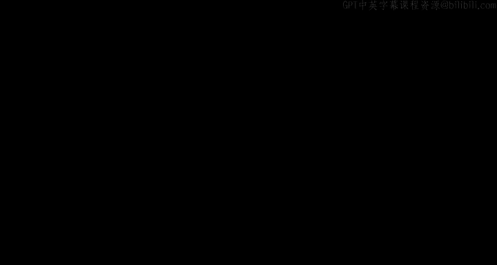
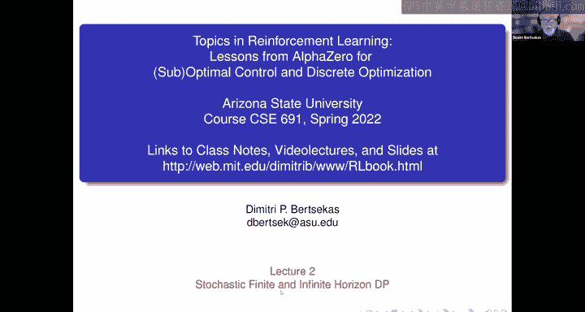
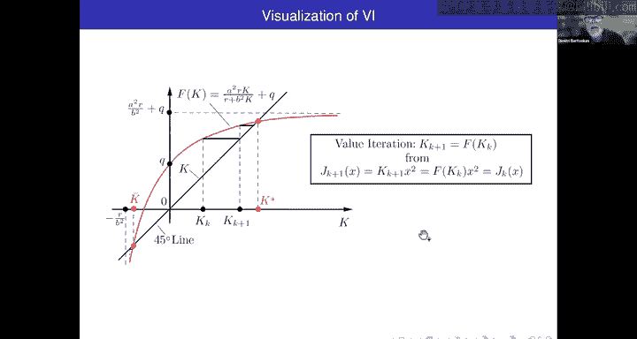

# ASU《强化学习2022-2024｜cse 691 Reinforcement Learning Course at ASU》中英字幕（deepseek - P31：[36]Lecture 2, Spring 2022_ Stochastic DP, finite and infinite horizon. - GPT中英字幕课程资源 - BV1zcfVYdErD

Okay， let me welcome you to this second lecture of our reinforcement learning course at ASU。

We talked last time about the deterministic dynamic programming problems。

And today we're going to talk about stochastic problems with finite and infinite horizon。

So here's the outline， we're going to do some review。

 review the dynamic programming algorithm for a finite whereas and deterministic problem。

Talk a little bit about approximation in value space and also give an example of rollout。

Then we're going to talk about。The stochastic version of dynamic programming algorithm where the dynamics involve a stochastic random disturbance。

Then we are going to。Talk about an important。Nice special case。

 a case where the system is linear and the cost function is quadratic， a very important case。

 a very important problem in control theory and also one that has an analytical solution and will provide us with a lot of insight for more difficult problems。

We're going to take a break and then talk about infinite horizon。

We're going to overview the theory and the algorithm returned back again to the linear e quadratic problem。

So。Let's get started with review。We talked about this deterministic。

Dynamic programming problem involving end stages。Who state begins at time zero and goes all the way to。

The last stage n and the state is denied by x0 x1 up to xn。

The state evolves under a sequence of control at state Xk。

 we apply control U and we move to a state Xk plus one， according to an equation。And。

The corresponding cost for that stage is the like so。Now I mentioned last time。

 and I'll emphasize again that our formulation allows。Arbitrary state and control spaces。

So the state can take a finite number of values or an infinite number of values and similarly for the control。

That's one of the nice things about dynamic programming it applies。

 the main ideas apply in great geneity。Okay， so given a sequence of controls。

 that are all these costs generated and there's also a finite state cost。

And this is our cost function。And what we want to do is for a given initial state x0。

 minimize overall control sequences， this cost expression， the total cost。Now for every sequence。

 this sequence of controls， this cost is defined and it's a function also of the initial state。And。

The optimal cost function is obtained by minimizing overall controls。This expression。

And it depends again， on the state X0， we use J star to denote optimal course or anything anything optimal we denote by starting course。

Okay， so this is a problem。And we talked about the dynamic program not resolving it。

The dynamic programming algorithm focuses on calculating the optimal cost of the tail sub problemsble。

 all the tail sub problems that begin at any stagek and for any state Xk。And。

It starts with a trivial。Theres a problem involving in just a terminal state。And it goes backwards。😡。

啊。1 k and state Xk。We solve the corresponding tail sub problem。

 starts with Xk and goes all the way to end by simplifying as follows。For every possible control。

 we calculate the cost of the state and we add to it the optimal cost of the remaining stages as calculated earlier and starting at the next state。

So we go backwards first J and star， then J and minus1 star all the way to J0 star。

 which is a function of x0 the initial state， and the argument is that this is exactly the optimal cost of the problem。

 we have found the optimal cost for this solve。And we just very justify based on the principle of optionality。

 and there's a more formal mathematical proof in your class notess。

Now you can view this as a computation that's done offline， it's offline training。

 it has to be done offline because it involves lots and lots of computation you have to do all these operations for every。

Stage and every state， there could be zsilience of states， so that can be an enormous computation。

So it has to be done offline。Simultaneously， we can calculate the optimal controls as we do this minimization。

 but theres another option， we can calculate the optimal controls online by online play。

And here we go forward and we construct the optimal control sequence。Starting at state x0。

 we do this calculation just for that state， and we have already computed J1 star from offline training。

And we find J un zero star。And that would generate the next state x1 star。

 so we go one step forward to the next state and do this calculation again。Using， again， the。J2 star。

 which we have calculated from here， and we go forward all the way to the end and we construct the entire optimal control sequence this way。

Okay， so let me interject here parenthetically。The term Q factor。

 we're not going to use it for the time being except peripherally。

 but it's going to be helpful later。If you look at the right hand side of the dynamic programming algorithm in the term within braces that you minimize the first stage cost and the cost cost to go。

It depends on the state and control。And we define the optimal Q factor corresponding to x k and U by this expression here。

啊。And if we know the s factors。Then we can calculate the optimal cost by just minimizing here。

 this is just the dynamic programming algorithm with this expression plug in here。

So we can combine these two equations also and write the dynamic programming algorithm in terms of these few factors。

Okay， so the Q factor is defined like so we take this expression at K plus one and we plug it in here and we have this expression here。

We minimize with respect to UK plus one here， and that leaves something that depends on Xk and UK。

And it's the optimal Q Q factor， and it is the optimal cost assuming starting from that we start at Xk and we choose as our first control UK and act optimally after that。

Now there is a class of algorithms in。A class of algorithms in reinforcement learning called Q learning。

This is。A simple。form of Q learning， but we're going to discuss other forms that involve approximations that involve more complicated things。

 but for the moment， we'll just leave it at this point that there's a Q learning form of the dynamic programming algorithm。

So now let's go to approximations。We mentioned that computing J star。

G style of k is over 120 calculation， so the idea here is to replace JK star with some approximation during the online clay phase。

So here we start at， we calculate this minimum at the initial state x0。

And it involves instead of J1 star， we use J Tilde one。

And then we find this control and then we go one step forward and we sequentially go forward from x0 to x1。

 x2 and so on， each time selecting a control， this calculation。

 which is exactly the dynamic programming formula， but with J tildes in place of J stars。

So if we know J Tilda， that's much better calculation than in doing this with J Star。

 but how do we compute J Tilda， well， this is a million dollar question and it's one of the principal issues in reinforcement learning。

UIn a lot of reinforcement learning， what we're trying to do is find the right kind of J Tilda with a reasonable amount of computation。

And there are a number of different ways to do that。One way is。

What we call offline problem approximation。So here we use usJ Tilda。

The optimal cost function of a simpler problem。Which we compute offline by exact dynamic program。

So we simplify the problem， we simplify the dynamics， we simplify other constraints and。

We obtain an easier problem that we compute offline with solution and we get the solution and we plug it in as J Tilda in our original problem that's one way of doing it the method of aggregation is one class of methods within this category。

Another possibility。Is to compute these values through a shorter horizon minimization。

 compute them online by multi step， look ahead and also perhaps add a primitive terminal cost。

And this is what's often done in model protective control we'll get to this kind of methods later。

Another possibility is to do training using neural networks or some other kind of approximation architecture。

But we calculate this J till this。By selecting them from a parametric class of functions。

That depend on state and also depend on a parameter。

 this parameter is the set of weight of the neural network， for example。

And we train the neural network， find parameters that fit data， and then we plug them in here。

 and that's going to be ourJ Tiilder。That's a very popular method and we're going to discuss this extensively later。

And another possibility is rollout。With a heuristic and I will demonstrate this explain the demonstrated。

And postpone discussion of these other methods for later。Okay。So remember。That。

What we want to do is calculate online。A control at every encounter state。

And suppose that we have so what we do is we generate a single trajectory。

From X0 to XN by online play。And we start out at x0， and at every step we reach the state。

 let's call this the current state at xk。Upon reaching it。

 the rollout algorithm does the follows following。It generates all possible controls。😡，At that state。

And then from each one of those， it runs a heuristic， some heuristic， okay。

 we don't care what the heuristic is for the moment it just generates a trajectory from Xk plus1 to XN and also has a cost associated with it。

 the cost of the transitions that it produces from here to here。So for every possible control。

 we do this plus that calculate this term an approximate Q factor。Then we do this for this control。

 calculate this plus that and similarly。So from each of the next states where under the heuristic computer heuristic costs。

 and then out of all this heuristic costs， we find the one that minimizes。This expression。

 and that's what we applied at Xk。So here we calculate these Q factors。

 find the best the qua robot minimize the Q factor， go one step forward， and then do it again。

Around the heuristic again from the next possible states and so on。And in this way。

 we generate a complete trajectory one step at a time。So let me give an example of this。

This is a traveling salesness example。It's the same example that I used in the previous lecture。

It involves four surge， A，B，C and D， and this is a matrix of intercity travel costs。And。

We formulated this problem as a dynamic program broadly where the states are partial tours。

 this is the partial tour that involves state A， B and then C。

And this is the partial tour that involves AB，C， D and C。

 and it can only be completed by going to A back again。

 so from each partial tour by adding a city an eligible city。

 we go to a longer partial tour until we reach the end。So this is the initial state。

The stage of the first stage， second stage and so on。

 and the costs are given by this matrix of travel of interc travel for example。

 to go from a to D from A to D there's a cost of 20 and we write it here so these black numbers are the costs as given by B by this matrix。

And we solve this problem by dynamic programming， exact dynamic programming， it's very simple。

And we calculated these red numbers， this red numbers areB。

Optimal cost of the tail subproble so this is a tail sub problemblem of starting here and going all the way to here and eight is the optimal cost to go from to go to you really have to choose between these two it turns out that this is best。

We have already。Done in the previous lecture， the dynamic programming algorithm。

 and we have calculated the optimal cross。Now we're going to use rollout to solve the problem suboply。

And。In the rollout algorithm that we're going to discuss， we're going to use a specific heuristic。

 and that's the nearest neighbor heuristic。Here we are at a given state。

Which corresponds to a partial tour， we look at all the eligible next cities to go to。

And we go to the one that's closest in terms of travel cost。

So we do that here for all eligible cities and we run the nearest naval heuristic to the end and compare all these costs of the。

Partial of these portions of the tour and we choose the city that is best in this in terms of that cost。

So what I'm going to do now is demonstrate the rollout algorithm。For the problem。

Let's run the base heuristic， the nearest neighbor heuristic from CDA all the way to the end。

Here out of all the response three possibilities， this is the nearest neighbor， right。

 has a cost of one， so we go here。Once we get here。

 there are two possibilities go to C or to D and the nearest neighbor is D。Then there is no choice。

 there's only one choice， and so we go all the way to the end。

So the nearest neighbor heuristic generates this trajectory。

Which we call t0 and it has cost 28 in this case。Okay。

 so now let's execute the rollout algorithm from state x0。

We have to generate all possible next cities and then from each one of those around the nearest neighborval heuristic。

So let's consider this one。The nearest neighbor heuristic looks at this two neighbors。

 finds the closest one and goes here and then goes here and goes here。

So the nearest neighbor heuristic will generate this trajectory from here and the overall trajectory is going to be this one。

The red is the quite now I'm sorry， you have， yeah， bright， okay。So now。

We have done a calculation for this。For this for next city B。Now， for the。Next CDC。

 we have to run again the same calculation， the base heuristic from here。

Nearest neighbor nearest neighbor nearest neighbor， so the cost here is 28 and that cost here was 27。

 so we prefer this branch。Over this branch。Let's look also at the third possibility。

 we go here and then run the nearest neighbor heuristic。Which is very costly。

 so we reject this branch。And the rollout algorithm at x0 at the initial state goes over here。

Now we do the calculation again。We look at the possible choices， C and D， and from each one of those。

 I run the base heuristic， which actually there's no choice and we compare。

The cost of this branch and this branch。And。It is。This one。

And the rollout algorithm at this city is going to go to that city。

And the overall cost is going to be 13。So we improved over the preceding choice。

And then the all allowed algorithms we going to move here and then there's no choice but to go here and then to go here。

So。We started with a basic heistic。With this trajectory。

 we did one step of roll out and we got to this trajectory， which is better。And then at this point。

 we got。Another step of rollout and we got this trajectory。

And each time we improved the cost and the rollout algorithm gave us 13。

 which is also the optimal cost， whereas the base heuristic gave us a cost of 28。

So this is something that we're going to prove in general that rollout with a base heuristic improves on the heuristic。

And the way it does that heurically is because。Itat。Looks further into the future。

 where as the basic heuristic does not explore at all this area， where the optimum lies。

The rollout algorithm explores more paths to CDA and discovers this path at the second step。

 not at the first step， but at the second step。So this is the calculation and your homework your first homework。

 which is going to be due next week。I to repeat this calculation。

 but for a more complicated problem that involves five cities。Are there any questions？呃， professorfe。

跟住。Hello， yes， yeah， so Professor， how does the state change from A to A B using rollout？

So what does that mean。Okay， remember that in roll out at a given state。

 we look at all possible options and we go to the next state and then we run the heuristic for all this next states。

 we compare all of these trajectories and we find the one that has minimum cost and then we go to the next state according to the choice that gives us the least cost。

So over here， yeah， ahead，m sorry I'm sorry if this continue， I'm sorry。

I was going to say that during the straight here， here we looked at all the possible choices in random based heuristic。

From each one of these。And we selected this state as being the one that brings us to the minimum cost。

Oh， I miss you， thank you very。Okay。Any other questions？Profession。Yes。😊。

Are there any assumptions on the problem that can ensure that the rollout leads to an optimal solution？

no no。No， the rollout is not guaranteed to give you an optimal solution。

 the rollout under some assumptions， which are satisfied in our example。

Guarantees that you are going to do better than the base heuristic。

 you're going to improve on the base heuristic。哦，O。On the other hand。On the other hand。

 the improvement can be very， very substantial， going to connect this with we're going to explain why this is so in future lectures。

And。Notice that the calculations here are quite simple relative to。

 let me think of this example with many more studies。

 the calculation is impossible to do the exact dynamic programming calculation， but with rollout。

 we're able to do this calculation much more simply。

 so it's are very simple and also very irreliable way of overting the curs of dimensionality and the difficulties of exact dynamic programming。

So let's go now to the stochastic dynamic programming algorithm for the。

The system equation involves a random parameter， WK。With given probability distribution。

So the system evolves like so， but after you select the control， the next state is not certain。

 it's subject to this uncertainty of WK。And the cost also is random， it may depend on WK。

Now this WK may be several different things depending on the context。It could be physical noise like。

Wind noise if you're dealing with an airplane that kind of problem， market uncertainties。

 if you're dealing with a financial problem， demand for inventory， breakdowns and so on。

Most problems in practice involve randomness， on the other hand。

 for a number of reasons for reasons of convenience and completion tractability。

 sometimes we assume away the randomness and treat them treat the problems as deterministic。

But now we're going to deal with the stochastic problem。And how about a cost function。

 if you apply sequence of controls， then you get cost at every stage and also a terminal cost。

 however these costs are random， so to get a number to associate with a sequence we have to a sequence of controls。

We take the expected value of this random quantity。Over the joint distribution。

 the probability distribution of the random quantities here。And we consider policies。

 policies are different than controls， there are rules to select controls。

 and a policy pi consists of n functions。From state to control。嗯。And。

It tells us what control to apply at any given stage， so it's like a lookup table。

For every possible state， it gives you the control to apply。

And this is what we call a policy for a given state today。

 and the overall policy is the set of all policies for the end stages。

This is also what we call a closed loop control because it takes into account knowledge of the current state。

Also feedback policies， a number term that's used。We assume here that we will observe the state Xk and we act accordingly with knowledge of that state。

And now that's different。Then selecting a priority a sequence of controls because as we did in deterministic problems。

Here by using feedback， choosing controls with knowledge of the state。

Gains us something is beneficial because of the stochastic nature of the problem。If we apply。

 if we choose a sequence a priority without knowledge of the state。

 then we don't know where we land or we might make a bad choice， but by knowing the state。

 we can make a more intelligent choice of control and there's a benefit in doing that in terms of smaller cost。

That's why we're looking at policies which are definitely more difficult objects than just controls。

So now suppose that we have some policy pi and we plug it into the cost function。

 we're going to get a random number here， takes the expected value of that and then we get。

A deterministic number， a number， a real number。Which depends on the initial state。

 and that's the cost of the policy pie starting at state x0。

Minimizing overall policies gives us a function that depends only on the initial state。

 and that's the optimal cost function of the problem。

And our objective is to find Cha star and also to find a policy。That achieves this optimal。

And we are going to use dynamic programming to do so。这就是。

So here's a stochastic dynamic programming algorithm。Like the deterministic algorithmine。

 it produces the optimal cost of all the tail sub problemss。

This is the optimal cost of the T cell problem the start stage J and。And at state XK。

And we do this backwards。We start with a trivial there is a problem at the end that involves just the optimal cost。

And then we calculate the optimal cost of the tail sub problems that at stage n minus1 for every state x n minus1。

 we do this calculation first stage cost plus the optimal cost of the tail sub problem at state N。

 which is this one。We calculate HN minus1 star and go backwards， it's exactly the same calculation。

As in the deterministic case， except that we introduce also this expectation because the problem is stoch。

And the optimal cost starting at x0 is obtained at the last step。

This algorithm will give you all the optimal costs from every initial state。Like again。

 this is also true for the domestic case。And this calculation also will give you。

The optimal policy component。For every stage at stagek UK star is constructed simultaneously with calculation by finding the minimum and setting UK star of xk to this minimum such state xk whatever things the minimum is the optimal control and it's one one entry in the。

In the。In the lookup table that represents MuK star。Now that's one way of doing it。

 but there's another way。You can view this calculation backwards as offline training。

 we compute all these J stars， suppose that we have computed these J stars。We can generate。

 we can implement the optimal methodologyology by online play sequentially going forwards。

Observe at each state K， the current state， and apply the control that minimizes in this expression。

In this way， we construct the the optimal policy online。我 with。N minimizations。

 one minimization at each stage， we observe the current state and we do this minimization to apply the optimal control。

However， the problem is here that we need to know Jk plus1 star。

 so there is no escaping that we have to do this calculation and this can be overwhelming。嗯。

It's even worse than for deterministic problems because we have to compute an expected value here for every Xk in UK。

So。In reinforcement learning， we try to bypass this difficulty by using approximate cost functions instead of the。

Instead of the optimal cost functions， and its approximate cost functions。

 can be computed in a number of different ways。嗯。A lot of reinforcement learning methods deal precisely with how we compute this J till that。

And there's also some other possibilities， we may try to approximate this expectation。

 which can involve substantial computation。In some cases。

 we may try also to minimize to simplify this minimization here。

 which can be also difficult to do in many contexts。

So this is the exact dynamic programming algorithm for stochastic problems。

It involves a lot of computation in this。Offline training portion。And in approximation value space。

 we try to reduce this computation by using approximation J tlde in place of J star。

Now we get into before we go further， let's do an example。Linear quadratic problems。

 this is an important and favorable case。It can be solved analytical， analytically。As an example。

Let's look at a cruise control problem where you have a car and you want to keep it。Vellocity。

 constant to some set point。Now the system equation associated with that is linear like so。

And xk is the current at stagek velocity minus v bar， which is the desired level。

 we want to keep this xk small， okay， the current velocity as close as possible to the desired velocity。

And we have。Car controls that can increase or decrease the velocity。

 and there's also some noise could be wind could be road conditions， could be a number of things。嗯。

因为。We assume that the control is unconstrained， in the reality it is not。

 but we' assume it's some constraint and we're going to solve the problem and check whether the constraints are violated or not。

And we also assume that。WK。The disturbance has zero mean in some barrier sigma squared。

This is a very simple problem。In practice it may be there may be many difficulties， for example。

 many cars today involve adaptive cruise control that not only regulates the velocity of the car。

 but also make sure that there's a safe distance kept from cars that are ahead。So that involves。

Another。A more complicated system， it involves also constraints and so on。However。

 for the moment we are going to。Were going at we're going to focus on this problem。

 but also we're going to look at it in general。And generalize in the following way。First of all。

 the cost function here that we're going to use involves a penalty on the deviation from the desired velocity。

 so it's quadratic in the state。And there's a positive coefficient that regulates the severity of the penalty。

And there's also， we also want to do it with small control。

 we don't want large controls or large changes in control to use an so an appropriate penalty is this quadratic without coefficient R。

And。So that's how a linear system。And a quadratic cost is generated for this example。

But we're going to look at a problem that involves a genetic one dimensional system where there's also a coefficient A in front of Xj。

And the same cost function。And let's look at the dynamic programming algorithm。

 the typical step is like so。First stage cost， last cost to go from the next state。

According to this system equation。So we start at J and star equals toqn xn squared and we'll go backwards according to this equation。

And the nice thing about this problem is that the dynamic programming algorithm can be carried out in closed form。

 these calculations turn out to be easy， can be done analytically because they involve quadratic。

Minimizations， as we will see。And this is the form of the final result。

The dynamic programming algorithm gives you cost functions that are quadratic for the current state plus constant。

And this Kk is a number， a positive number that can be computed analytically。

 and we will show how this is done。Moreover， the optimal policy。Is linear。

Consists of linear functions of the state。With this coefficients， LK also computed analytically。

So linear cost functions。Of the state and quadratic cost and that's。That's the key to solving this。

This problem， and it's odd to the fact that this calculation here is quadratic。Now。

 notice another thing。That the optimal policy does not depend on the distribution of WK as long as it has zero me。

Sigma squared does not enter in these calculations except here in this constant。And。So。

Even if we had a zero mean noise， there was no noise， we would get the same policy。This is known as。

Certainty equivalentence。诶。We say certain equivalence holds if when you replace the uncertain quantities by their expected values。

 the optimal policy does not change。It doesn't hold for every problem， in fact， it holds very rarely。

However。Often， it's a。It's a common sense approximation idea for other problems。

 and we're going to say a few things about that as we go along。So now let's verify this calculation。

And also show why certain equivalence holds for this problem。

So we're looking at this system equation and this quadratic cost function。

 and we're going to do the dynamic programming algorithm starting from the terminal cost。

 which is this。Okay， so the dynamic program equation is for station minus1 is what you see here。

Here is the first stage cost。And here's the。The cost of the remaining cost starting from the next state。

 which is this one。And we have to do this calculation。啊。We first。Flag in to x and。

Squared in place of this， we plug this in here。Then。We simplify this expression。

By taking out the stuff that involves random quantity W。So we expand this quadraity here。And。

The terms that depend on W。Involve the expected value and this term。

From multiplying W with this expression and taking the expected value of W。

And this expression which involves， which comes from the quadratic term in D。

Now this term is equal to zero because we have assumed that w has zero mean。This term is not zero。

 but it is constant， this is the variance of wn minus1， is which we have called sigma squared。

So this calculation here gives us。This where we have taken out this term does not depend on UN minus1。

 we have canceled out this term here and we have and this is the last term。

And now we do this minimization in closed form， it is quadratic in you。

And we set this derivative with respect to u equal to zero。E which is what is shown here。

 and we solve for the u that sets this expression to zero。

And what we obtain is the optimal policy for the last stage。And you can see that it is。

Equal to Ln minus1 times x and minus1， where Ln minus1 is obtained by solving this equation。

 collecting terms that involve U and solving。So this is what we have obtained from the first stage of dynamic programming。

 a linear policy which we can plug in here and do all the calculations and because。

U enters quadraically in this expression and is linear in x。

 who obtain something that is quadratic in x。It's this quadraity here plus the constant term。

And after doing all the calculations， collecting terms and so on。

 the expression for Pn minus one is what you see right here。

Involves A and B from the system equation， R and Q from the cost function。

 and that's the expression that comes out from this calculation。

So all of this has carried us through the very first step of dynamic programming and we can go backwards now in the same way。

 why is that because we have obtained a quadratic。Cat to go。At stage n minus1。

 which has a similar form to this quadratic that we used in this calculation。

There's also a constant term here， but it doesn't matter in the minimization。

 it just drops out of the minimization and does not bother us and exactly the same calculation gives us going backwards。

This form of JK star。Aquadratic。In the current state。

With some coefficients Pk that are going to be computed analytically。

 there's also a constant term that depends on the variance of the。Of of the disturb servantance。

And the optimal。Policy is linear as a function of the state。

It's just a matter of carrying the calculation backwards here to verify that PK is generated by this recursion。

Starting with Pn equal to zero and going backwards for every stage， we calculate this coefficients。

And simultaneously， we calculate this。Linear policy。Coefics， LK。So。

We do this calculation for k equals n minus1， we do it for k equals n minus2 and so on。

 and we have obtained at the end the optimal policy for the entire problem from zero to time n minus1。

So that's the solution of this problem。And notice that at the critical points of this calculation。

 this disturbance terms。Do not matter。And what only matters is that the expected value is zero。

We could generalize the problem to have a zero mean disturbance。

 and in that case we would have include to include this in the calculation and carry it along and the foreigners are going to be a little different。

 but the process is going to be pretty much the same。Professor I have a few questions。

 so here the P and Ls are just a coefficient that we're repressively determining。Okay。

 professorfessor ask my question was。While we are defining the cost function， could you。

 can you tell me whats the intuition between this term r times u square。

The intuition behind this choice here， yes。Yeah。Basically we want the size of control to be relatively small and there are a number of issues a number of reasons for that we don't want the control to be very large because it may cost us a lot in some real sense。

 some practical sense， the other is that there may be constraints on the control and we want to keep this control small in order not to violate the constraint。

 for example this cruise control problem the thro can only push you so much okay it has a limit。

 an upper limit。So that's what this quadratic penalty serves to keep the control small。

 not to violate the constraints。So that' that's basically these are the basic reasons for a quadratic cost。

 it's not necessarily the best choice for every problem， but that's what we choose for this example。

 if for not the reason for illustration purposes this problem this type of problem with a quadratic cost function in state and control is very popular。

For every practical setting， they may be different reasons for just different ways to justify the quadral cost。

O不安全 thank。Okay。So。We。Here we're focusing on a mathematical solution and the fact that the solution can be obtained analytically。

 it has a convenient form， linear policy and quadratic cost。And as I mentioned。

 there are a number of there are generalizations， and the solution does not depend on the distribution of WK only on the mean。

In other words， we have certainty equivalentvalence and this certainty equivalentvalence property carries out to more general linear quadratic formulations。

Then we have considered one dimensional problem but we may have a multidimensional problem where we have several equations。

 for example， one equation maybe have to do with the velocity and the other equation may have to do the distance to the preceding car in problems of self-driving cars and automated highways。

 the models are much more complicated than that they involve not just a single system equation but multiple system equations however as long as we have a linear system and a quadratic cost function。

 the character of the policy remains the same。啊。We may have non zero mean disturbances。

There's a generalization to infiniteity horizon， which we're going to talk about shortly。

There's another major generalization。Where the state of the system。Hes observed。Partially。

Through linear measurements。So in some cases， you may not know exactly the state。

 but you may estimate through measurements。And。In that case。

There is an extended form of certain equivalence where you， even though you don't know the state。

 it's an uncertain quantity， you replace it by its expected value given the measurements。

And you use the same。Linear coefficient for the control policy。And。

This expected value is provided by some estimator。And there's something called a column filter。

 which I'm not going to get into， but it's a convenient estimator for calculating its expected value and the important thing is that this extended form of certainty equivalentvalence holds even for these problems it's one of the central results of control theory。

嗯。Now， of course。Linear systems with quadratic Co are very nice assumptions and lead to an analytical solution。

 however， there are also a starting point for other lines of investigations and approximations。

For example， there are linear quadratic formulations for problems that involve。

State and control constraints， these are more difficult problems。

 but the linear system in the quadratic core still are convenient。

And these type of problems are aris in model predictive control。嗯。😊，And also。A major a major。

Difficulty。啊。A far more complicated problem is a problem where the parameters change over time。

For example， the B coefficient in the cruise control setting。

 the B coefficient relates to how much reinforce the throttle applies， the engine applies to the car。

 but that depends on a number of other things， it depends on how many passengers are out of a car it depends whether the car is going uphill or downhill and all of this changes over time so oftentimes we have to design a control system other conditions that are not known high priority and they may be changing over time and this is a subject of adaptive control which we're going to discuss in the context of reinforcement learning in our methodology in the future。

Still in all this， linear quadratic formulations play a significant role and we're going to encounter them as we go along again。

Okay， so let's return to approximation value space for the stochastic problem。And。

What we do is at a given state。We have to find to calculate the control and we do this by minimizing the cost the first stage cost。

 is one step look ahead with a cost function approximation involving J tilde。

 some J tilde we have calculated in some way。There are also other kinds of approximation。

That you can introduce in this minimization。You may try to you may try to。Yeah。

You may try to simplify the expected value， which involves considerable computation and you may try to simplify also the minimization。

 so there have three approximations involved in this scheme。Cost the go approximation。

Expected value approximation and some simplification in the minimization。啊。

There are some variants here， you may use multi step look ahead here。

And the expected value may be replaced by some certainty equivalent of WK。

We're going to talk about an important class of simplification。

 which involves multi Asianian systems， which have where the control consists of multiple components and we're going to see there that we can simplify the calculation by doing the minimization one component at a time。

Okay， so we're going to revisit these approximations as we go along， here's an example。

 an example of how we picked this J Tilde by truncated rollout with some base policy and some terminal cost approximation。

Which I obtained。By offline training。And this is the alpha zero example。

 except that we use one step look ahead in this figure。So at Xk。

 we looked at all the possible next states。And including those that random lived with recur of WK。

We run the a base policy from each one of those。And then we add the terminal cost approximation at the end and all of this。

 the cost of all this is ourj tilda from xk plus1。嗯。

So this is just an example and we're going to see other examples similar to the Germanministic case that we looked at earlier。

Okay， so now let's take a 15 minute break， it's going to be a working break。We can catch our breath。

 but you can also collect your questions。And there's also a challenge puzzle that I want you to think about。

If you wish， it's optional。It involves a chess match。

Where a chess player plans against a chs a computer program， a two game match。

And here a win comes for one， draw for one half， low sport count for zero。

And if the match after the two games is drawn， is one one， then you play sudden death games。诶。😊。

And whoever wins the first game is the winner of the match。

And now chess play can choose to play in one of two possible styles。The first style is bold。

 risky play， which wins with some probability less than one half and loses with probability with a complementary probability。

So there's no draw in bold plate， uncompromising clay， no draw。

The other possibility is to play timid， in which case you can get a draw with some probability。

 but you can also lose with a complementary probability and you can't win。

The player gets to choose the style for the second game。After seeing the outcome of the first game。

So the player has feedback here in watching the progress of the game and the computer is assumed to play the same cannot affect the style of play in the game。

Okay， so the player plays worse than the computer。On the average。

 whether it plays bold or whether it plays timid， the probability of winning the match。

 winning a particular game is less than one half。嗯。

The player must play bold at least one game because otherwise he cannot win。

So I want you to speculate on the optimal policy of the player and in particular。

 even though the player is worse than the computer， a worse player than the computer。

 is it possible to have a better than 50-50 chance to win the match？So。Let's come back in 15 minutes。

And we're going to do we are questions and also we're going to discuss this puzzle。Okay。

 so see you in 15 minutes。Hey， professorfe， can I ask you a quick question？Yeah， go ahead。

So is it during any game， the probability of win is sampled from a uniform distribution from zero to one half？

Or like is for each game， so it's not probability when it's not。Page game individually yes， okay。

 thank you。Are there any questions about the previous slides before we go into this chest much？

problemblem。Okay， no questions， so we get that。Hi， Profess， I have one question。Yeah。

 I just want to know can you simply describe the advantage of rollout algorithm because when I go over the dynamic programming。

 I found that when we want to find the optimal path。

 we start from the end point and backtrack to the start point and then we can find the optimal path。

For the rollout， we use a heuristic algorithm to search， I think， search all the parts。

 and then we use the rollout to find which parts is the optimal parts。

 So currently I cannot find the different parts between the rollout algorithm and the dynamic programming。

 I know why we use the rollout algorithm， because when we use the dynamic programming。

 we have the a dimensional curve。 So that is why we choose the rollout。So， but， but currently。

 I cannot find the different， different parts。Between the rollout algorithm and dynamic programming。

 So I'm confused about why we choose the rollout algorithm。No。

 there is a difference if you look carefully at the rollout algorithm you will see。

 but it does not explore all the paths。It explores quite a few paths， it explores like I think。

4 parts。What is altogether there are six paths。诶。But also in a larger problem with more cities。

 there would be a lot less paths that would be explored by rollout relative to being。

To the exact dynamic programming algorithm and this is also part of your homework problem you'll see that in a larger problem involving five cities the Ro lab will explore a lot fewer paths than the dynamic programming algorithm so check the computation and if you still have a question you may ask me privately。

O O O， thanks。 Thank you。 Thank you。Any other question？Okay， so let's go to this chestes puzzle。

Whoho wants to say something can you comment on what you think the optimalmost solution is and why？

And is it possible to have the player have more than 50，50 chance of winning the match。

 even though it's a worst player？My intuition was that the first play has to be。

A bold play because otherwise if you play timid， then it basically doesn't make sense because you either are the same spot where you started at or your opponent has an advantage so the first play has to be bold and then if you lose it has to be a bold play again because if it's a timid you stand zero probability for winning。

And。Otherwise， if you win， it makes sense to play timid because。

I think that preferability comes out to be。Well， it probability comes out to be higher for a win because there's no way for the opponent to get like one point。

Or。Sorry， the other way， yeah。Right， yeah， yeah， yeah。

 it's pretty clear that you have to play bold in the first game because if you play timid。

 there's no way you can win and you may lose and if you draw you're in the same place where you are with one game less。

So clearly you have to play ball in the first game that's correct。

 of course you have to verify it mathematically， but intuition is pretty clear on this。

And then you played both in the first game。But if you。If you， you lose。Then the score is tied and oh。

 I'm sorry， if you lose。Then you have to play bold again with aiming for the chance to tie and then to play sudden death。

So we。It's pretty clear that。You start with bold clay and there are two possibilities。

 either you win。With probability， which happens PW， in which case you have to play timid， okay。

 because if you if you。Because it's a case of a draw。You would have to you would get into。

Preciumably， you have a better chance to draw than to win。

And then you would maximize your chances of winning the game， of winning the match。他。

On the other hand， if you lose the first game， then you have to play bold。The optimal policy。

 you can represent it with this graph here， start here， play bold， and then if you win。

 you play timid after that， and then play if you lose， you play bold。

And you can verify this with a dynamic programming algorithm the calculations are given in。

In one my books and you can access this particular you can access 20% of the book through Google Book and you can see the solution there it's included。

So let's accept that。That this is the optimal policy。

And then the transition probabilities between different states are shown here。

Is it possible that the overall probability of winning the match is better than 50%？

Well how do you calculate this probability？Of winning the match。You have to。

There are all sequences of events。Here。You win and then draw。

And then you win the match with probability1 so this branch of the three has this probability Pw plus Pw plus Pd and then the probability of this branch is the product of probabilities and so on so from this three you can calculate the match win pro and it turns out that it is possible with the right choice of Pw and PD that you will get an overall probability that's better than 50% and in fact you can verify from this three here that if Pw is 045 okay you win with probability 45% and you lose with。

Probably 55%。And in PDd equals 0。9， 90% of drawing and the 1% of losing with these numbers。

 then if you do this calculation， youll find that the probability of winning the match is more than 50%。

Now， what's the intuition for that？The player has an advantage against the computer。

In that it can choose， it can dictate the nature of play after the first game。The computer adapt。

 cannot change its probabilities， but the player can。And so uses feedback。

 uses a policy as opposed to a sequence of plays that is chosen a priorityi without looking at the outcome of the first game。

So that's the advantage， is the advantage of feedback。

 the advantage of using a policy rather than sequence of decisions， which makes the difference here。

Have any questions？I have a quick question。嗯。So this。

I just wanted to check so if we ran this simulation or like using this policy and we ran it a thousand times so with different realizations of PW and PD。

There's no guarantee that 50% of the time the player would win， right？Well。

 P and PW are going to determine the outcome of the simulation。Yeah。

And if you if you were to use1 million times 1 million runss of the simulation as opposed to 1000。

 then you would be almost essentially at at the。At the you would get the correct aboaging result。

There's no guarantee that you will win， but you have a better probability。

I see I see I just when I first saw the question I thought I was asking for like yeah running over a million games with would the optimal policy be able to will you be able to show that a player would win over 50% of the time within optimal policy over a sufficient number of games that's exactly what yeah that's that's that's that's the that's the result。

If you were to play a million matches， okay， with it's possible with these choices of probabililities。

Together more than 50%， you'll get 53%， you'll get a win 53% of the million times。Almost。

Oh I see I thought that Pw and PD were sampled from a uniform distribution。

 so with that we didn't necessarily choose that Okay my be my bad no the outcome of the game is sampled from a distribution of 0。

45。55。Yeah， God is。Sounds good。Yeah。O。Okay， so let's now go into infant cor problems。Here。

The number of stages is infinite。And we still have random transitions from one stage to the next。

 subject to uncertainty， and theres a cost。For each transition， but。It's multiplied。

With a discount factor。The cost， the same cost is counted less in the overall cost function as time goes forward in other words。

 we count we value。We value。We're not worried about high costs in the future。

 the costs in the future are discounted by this factor this is in order as you sum all these costs in order to keep the overall costs finite we introduced this discount factor。

Now this discount factor could be either could be less than one or could be equal to one。

And if it's less than one， the problem is call discounted。And。And。

The cost of a policy over an efficient number of stages is the limit of the finite horizon costs。

This is the expected cost of1 stages。He let end to go to infinity。

 you would think because of a policy。Starting from a given initial condition。

And the optimal cost function is the minimum overall policies it depends on the initial state is the get by J star and。

Is the optimal cost of runninging。Starting from a state x0 and going forward for an infinite number of stages using this policy。

Now， problems with a discount factor equal to one must have special structure to keep this cost from blowing up to infinity。

嗯。They typically introduce a special termination state， which is cost free a state where。

If you reach it， you pay no cost and you stay there。And typically for these problems。

 also G is positive。And up。Then roughly speaking， the objective is to reach or to approach the termination state at minimum expected cost。

Many problems in control theory out of this type。诶。

Shortest path problems or stochastic versions of shortest path problems are of this type where there's a gold state that you would like to reach with minimum expected cost and once you reach it you pay normal cost and usually this shortest path type problems。

Involve alpha equals to one。So the cost of the policy is the limit。Of the finite cor costs。

So how do we approach this problem？Well， it makes sense to。Think that。

The end stage is optimal course， approach the infinite horizon optimal course as n the length of the horizon goes to infinity。

So let's see what this intu leads us。Let's consider the end stages version of the problem。

And let's call Vn minus k to be the optimal cost to go starting at x and going for k stages。三。

So this is given by dynamic programming。And。诶。We have to play a trick here in dynamic programming。

 time runss backwards， right from maternal state backwards。

And what we wanted but in an infinite horizon problem， there is no terminal terminal time。

 the horizon is infinite， so we have to modify our thinking about costs as they get incurred。

 so let's modify the dynamic programming algorithms so that it runs forwards rather than backwards with a change of notation。

So we introduce this notation here， so VN is is the。

V sub n is the terminal cost and we go backwards like this to Vn minus1 and so on。

And let's in this equation。Reverse the time index divide divide with this alpha to the n minus k and do the calculations and call this J case of x。

 then we obtain this formula which goes forwards This is a dynamic programming for that algorithm that goes forwards and does not depend on the terminal state terminal。

The horizoniz end。So。Js sub n is equal to v sub zero。

 which is the n stages optimal cost starting from x。And。😊，Jk of x as given by this algorithm here。

Gives you the K stages optimal cost starting from x。So with each iteration of this algorithm。

 you get the optimal cost of a longer problem， longer by one stage from k stages to K plus one stages。

 K plus two stages， and as k goes to infinity。You expect to get the optimal cost。

Of the infinite horizontal problem for an infinite number of stages。That's what this expression says。

That you can run the dynamic programming algorithm forward with a reversal of time index。

 and in the limit you should get the optimal infinite horizon cost。

Now this is the intuition is through a lot of the time， not always。

 but for the problems that we are going to be considering， it will be true。

So let's accept that as a working hypothesis for the time being。那。

You have this equation holding for OK， take the limit here as k goes to infinity。

 which gives you in the limit J star here and J star here。Then you get this equation。

 this is the limiting form of this equation here。And this is an important equation。

 it's called Belman's equation。you expect that it would be satisfied by the function J star。

There is some question mark about that， a mathematician may question that。

 but it is almost always true， certainly true for the problems that we are going to be discussed。

So if you can solve this equation。You'll find J Star。However， this is not a trivial equation。

It involves an equation for every x， so if x is a million， there are a million equations here。

 if x states values in a continuum then is an infinity of equations here。

 it is a functional equation and not trivial。However。

 it's the fundamental equation from which everything else flows。Notice that alpha came here。

Through this calculation。And basically， there's an intuition that we can use to understand what this equation says。

 it says that if you are at state X。The optimal cost from that X with optimal choice of policy should be the minimum of going。

Through the first through the first stage paying the corresponding cost and then。Add the cost。

 the optimal cost of the remaining stages from the state where you land。

 but also discounted because with every state there discounting your welfare so。

You can verify you can think through the about of fact that there should be an alpha over here。

So there's an intuitive way to see this equation， which is very fundamental， like I said。

And now this equation， if you can solve it， if you can find J star， then。

You can obtain an optimal policy。By minimizing for every x and calling the corresponding control new stars of x。

So if you start with x， I change the minimum in this equation for every x。

 then this policy is optimal。Now notice that this policy does not depend on the time index。

That's the policy optimal mals that you would use at stage one at stage two at any stage。

 it's called station editing。And the reason is that everything here does not depend on k。

 this does not depend on K this does not depend on K。

 the state space and the control space stay the same， so if you are at a given state。

 whether you are at time zero or whether you are at time 10。

 you're seeing the same problem ahead of you and therefore it's reasonable to expect that you would use the same optimal points。

Now these are the three theorems， the three basic theorems that you expect to hold in any kind of infinite Hiz dynamic programming trouble。

You get the optimal cost functioning the limit by taking the limit of the finite horizon optimal cost。

And you generate this costs this finite for us through this algorithm here。

 which is called value iteration， and we're going to see it in the next slide also。So。

Value duration convergs is the first theor。Belmon E holds is the second。

Third equation is that the optimal third theorem is that the optimal policy is stationary。And。

It's obtained by minimizing in this Belman equation， the right hand side the Belman's equation。

These theorems do not hold always， they will hold for every problem that we're going to be discussing they are the subject of theory。

 the theory of infant horizoniz dynamic programming。It revolves around this threes。

 guaranteeing that they hold under the right conditions。

And the theory of infant horizon dynamic programming involves also。

Two algorithms that are fundamental。The first algorithm is the value duration algorithm。

And generates。The finite horizon optimal costs。one。one。One stage longer with every iteration。And。

It turns out that this algorithm is often validd。Even for an arbitrary J0 or from a convenient class of functions。

 J0 to start。So even for almost arbitrary initial function。

 you crank forward these functions and that's the value duration algorithm and you expect it to converge to J Starr and I put some question mark here because that's not always true。

 although it will be true for the problems that we're going to be discussing。

The second major algorithm is policy iteration。This algorithm here generates a sequence of functions。

 the JKs， this algorithm generates a sequence of policies， new K。

 these are the players that I was talking about in the last lecture。But alpha zero。

 the sequence of players， their policies and the case policy in the sequence is known by mu of k。

 superscript K。And it also generates the cost functions of those policies。

 starting with some more or less arbitrary policy。And the main result here is that the J Mu case converge to J star。

 you get the optimal policy in the limit。So how does this consideration algorithm work？

The typical iteration starts with some initial policy new zero。With some initial some I'm sorry。

 the typical direction starts with a current policy mu and generates a new policy。

 which we call new new tilde。In two steps。The policy evaluation step。

Which computes the cost function of this bond。We also call this policy based policy。And。

The new policy is called the all out policy。And obtained by this policy improvement operation。

Which computes mut tilde。By using。One step look ahead minimization， but。

With the terminal cost B J mu。Okay， so from the first step。

 I calculate the function J mu as a function of x， and I plug it here in this minimization in place of J star。

We use the current phase policy and we minimize here and we obtain a new policy。So from new zero。

 I get mu1， from mu one， I get new two and so on， I generate a sequence in the corresponding sequence of cost functions and the result basically is that this sequence of policies converges to an optimal policy in that this J UK is converged to J star。

Okay。Now this algorithm is more sophisticated， more time consuming by durationeration than this one。

 but converges much faster， it turns out， and we were going to see why。嗯。

But involves some major difficulties。Given a policy， how do we compute？

This cost function of the points。Well， for policy evaluation。

 we can look at the Belman equation for the policy。

This is the same as the Belman equation for the overall problem， but involves only one policy。

 this policy mu。And it has this form here， does not involve miniization instead it involves only mu of x。

And it turns out that。Using the same kind of reasoning as we did in the previous slide。

That this is the Belman equation that should be satisfied by J&U。

Now this equation is simpler than the Belman equation for the overall problem。

 which we call the min Belman equation， we call this a new Belman equation。

The min Bellman equation involves a minimization here， which makes it。Complicated and nonlinear。

It turns out， and you can see that this equation is actually linear。If you double J mu。

 you're going in here， you're going to double the overall expression。

So it is the expectation is a linear operation and so this equation is linear。

So for a finite number of states， let's say n states。

 this can be written as n linear equations with n unknowns， the cost of a corresponding states。

It can be solved for small problems， can be solved by MatLap， okay。

 simply solving a system of linear equations。So that's one way to solve the Belman equation。

Not only is easy for a large dimensional problem， for a problem with many states。

 but but it is one way to do it。The other possibility。Is to calculate the needed values in here。

 to find。Okay， in this one step look ahead， minimization， you need J you from some next state。

You can run a Monte cargo simulation from that next state using the policy。

And average the results to get the expected value of that， that's another possibility use simulation。

To calculate the needed values in this one step， look ahead。And。That are also。

Methods for doing this approximately there are some other more sophisticated reinforcement learning methods called temporal Di。

 which we may get into sometime later。But these are the two basic methods。香。And。

S the Belmont equation。It's also possible to solve it either by MALb or you can solve it using value iteration。

 crank this iteration here， but without a minimization with mu of x instead。

 that would be another way do to solve the Belelman equation。一得了对对。

So all of this suggests that this policy duration algorithm is more sophisticated。

 more time consuming than this algorithm and on the other hand we're going to see that it is much faster。

And it's also better suited for approximations of the type that we do in reinforcement learning。

So here the schematic for exact policy integration。Yes， somebody said something。Yes。

 so in the policy improvement。So what is the difference between like when we are finding the policy improvement step we are finding the new policy so what is the difference between value iteration and the policy improvement because you said in the policy improvement we use one step look ahead to find the new policy。

AndIn the value I， we are actually performing the minimization based on the。

Control policies like the policy again。So what's the difference between policy improvement and the value itration？

Yeah， the amount of difficulty in carrying out this minimization is comparable。On the other hand。

 you expect to do this a lot fewer times。Because you're using the J new here。

That's the basic difference。We're talking here about exact calculations， right。

 exact dynamic programming， solving the problem exactly， not about approximations。

This may take you millions of iterations to converge。

This usually converges in a handful of generations， 5， 10， 20， something like that。

So you mean in the one that look ahead， we。So we actually improving our policy， so。

We changing our complete policy like we have a policy means we have the control operations for all the time steps and then policy improvement means we find the。

New operations， control operations for all the time steps。Well。

 because the policy that you find is stationary， you only have to do it for one time step。

 but you have to do it for all states。Oh yes， okay， okay， I got it。Thank you， present。

Just one moment， I'm going to try to improve the。The audio here because I can't hear your questions very well。

I'm going to try to use。A different speaker。Okay， can you hear me now？Yes， professor。 we can hear。

Okay， hopefully。Okay， somehow I'm not getting I'm not hearing you very well。

I' understand why this is so。Anyway， we'll continue。So。So we have three theorems。30ren。

And two algorithms。And。Going back to consideration， this is s schematic of the exact form。

 we have a base policy we evaluated by any of the number of methods that we discussed to get J Mu's cost function。

And then we do a policy improvement。To obtain the rollout policy。

 and then we repeat with the rollout law policy in place of the base policy。That's the algorithm。

 like I said， it's very time consuming， both of these can be very。

 very time consuming and this can be very， very time consuming。However。

 this algorithm has some theoretical properties that we can prove there's a lot of theory around it in。

In the limit it yields usually。Although perhaps not always an optimal policy。Infeity。

If you can carry out this algorithm exactly with exact calculation。And in the limit， as you do。

 an infinite number of policy variations。Conster is faster than value it。

 and we're going to interpret it as mutant's math。For solving Belmon's equation。

 that's quite faster because it's Newton's method and Newton's method is very powerful。

Now for approximate implementation。You can approximate these calculations here。

 obtain this function here in this policy approximately through using by using data and。

Some approximation architecture， like a neural network。So you have the base policy。

You collect a lot of data， performance data， samples of its cost function from various states。

And then you fit a neural network to that to obtain an approximation to this JU。

Then you use this chain you to generate。Corresponding one step look ahead， policy samples。

 and then you hit those samples with a policy from some class in a policy network。

Sometimes you don't use a policy network， but you use a value network only that happens in TD Gammon in Alpha0 is's a policy network and a value network that I used to approximate this and to approximate that step。

And then you get an approximate allow policy。That you can use to start again a new it。

So that's the schematic， that's the way to thinkche that's one way to think about exact approximate policy duration。

 and then you can ask questions about how each box is going to be implemented。Okay。

 so now let me give you an idea。About。About an abstract view of dynamic programming that is going to play some role in our context。

 particularly starting in the next couple of lectures。啊。Belmont equation has。But right hand side。

 which is a function。And the left hand side， which is also a function。

So this expression here can be viewed as。A map， an operator that takes a function J star and maps it into another function and the equation says that if you operate with this operator on J star。

 you'll get just J star just。Again。So you can write these equation as a fixed point equation in the following form where T is the beman operator that transforms a function J into a function T sub J。

 and it has this form， you plug in J here， you get a T of J， a function of x。

It's an operator and you can view it as a sub routineoutine， okay。

 you feed it some input and some output that comes here and the Belman equation says that J star is a fixed point of that operator。

So this is also a shorthand way to write Belmon's equation， which is rather long。

 you write as J star equals Tj star。And there's a shorthand theory that goes with everything that is of interest in dynamic programming that uses this Belllman operators。

Value duration is simply this from JK， you get piece of JK for the next generation。

So it can be viewed as an it for solving a fixed point problem， the fixed point problem being the。

J St was DJ Star。Also。For every policy， there's a Belmont operator that corresponds to it in corresponding Belmont equation。

So the operator that corresponds to mu， the mu Belman operator is this team mu here。

It maps a J into a team use of J through this expression here。And in particular， J mu。

 according to the Belelman equation， is a fixed point of this team mu。

So there are two operators here， the min Belman operator that involves the minimization and the mu Belman operator that does not involve minimization and involves it's associated with a policy view。

And there's a nice and convenient way to write policy policy compact。

We are on a certain base policy in UK， we evaluate it。

By finding a fixed point of this new K Belman operator。And then we improve it by。Finding。

M K plus one that satisfies this expression here is the mu K plus one that attains the minimum， okay。

The minimum here when Jstar is replaced by New J。So all the important components of the theory can be expressed compactly and conveniently using operators。

And this is nice if you want to work out mathematical proofs or to eyeball various calculations in a succinct way。

 but it's also very nice from the point of your visualization and we are going to do a little bit of that shortly。

 but a lot more in the future。So that's what I'm saying。

 the abstract view is very useful for theoretical analysis， intuition and visualization。

So let's forget about these operators for the time being and look at them。In a simpler context。

In the context of。Linea quadratic problem， which is also deterministic。

 so we don't have to carry this Ws， this disturbances and this expectations。

 we're going to make the problem deterministic after all。Certain equivalence holds for this problem。

 so you can really analyze it by looking at its deterministic version。

 well the random disturbances have been set to zero， they' expected by。

So this is the system we're looking at here， there's no WK。It's a quadratic cos per stage。

 the same that we had before， again， we look at one dimensional version of this problem。

In order to simplify the calculations for the purpose of this lecture。And。

We consider the undiscounted version of the problem， but alpha is equal to one。

Now there is a termination here state zero is a termination state。

 so this is a problem where we can't get away without any discount factor。

So this are system equation and the quadratic cost and the Belmon equation。

 so we're looking at an infinite horizon version of the course of the problem we looked before except that there is no disturbance。

Now， for the finite H case， we got an optimal cost function that was quadratic in the state。

And a policy and the an optimal policy， which was linear in the state。

So this suggests the form of the results for the infinite cor problem。J stars of X。

 you expect that it will be a quadratic of the state。

Qu K star is some positive scalar that remains to be determined。

And you also expect that the optimal policy is linear of this form here。

 a linear function of the state， where L star is some scalar。

And now how do we characterize this K star？Well。We plug into the Belman equation。

Here's the Belman equation， if for J sub X being the genetic quadratic here any positive statement。

So we restrict attention to quadratic functions and we write the Belman equation。Now。

 this Belmon equation has the favorable structure that we witnessed in the finite horizon case。

 it involves a quadratic minimization。With respect to control and after you compute the minimizing control and plug it in。

You get a quadratic function of the state。So we can do this calculation in close form。

 plug in the result。The minimizing you and do。Carry along the calculation and we get this final result。

And this is a very similar calculation to the one what we need for finite Verizon problems and I'm not going to show it here。

I'm going to show you the result this f of k is a function of k。And it has this form。

 which is reminiscent of the form of the。We find the Verizon case。In the minimizing you。

Is the one pro thisistic patient here is given by。This expression， a linear expression of X。

So the minimizing use suggest a linear policy， with this being the linear cost coefficient。

So the Belman equation is solved by。K star。But。Is such that？It's such that。

K star x squared is equal to f of k star x squared or k star equals f of k star the x squares drop out from here。

So the Belman equation becomes k equals f of k。And this is called the Ricard equation。

Belman equation is this one after you drop out the X starss， it becomes the rikadi equation。

Which has this form here。K star equals to this expression。Of K star。NowThis is a nonlinear equation。

It's quadratic actually in K star。And if you can solve it， you obtain K star。Moreover。

From the Belman equation， we minimized with respect to you。

with k star in place of k and we obtain the corresponding optimal policy。

 which is linear of this form here with k equal to k star。That's the solution of this problem。

If you can solve this ri equation for K star， you will have found the optimal cost function。

And in the process also， after finding K star， you obtain the optimal policy as a stationary policy。

 which is a linear function of the state。A very basic result， a very important result。

 and it is the limiting version of the finite horizon result。Okay。Are there any questions here？

So we want to solve this infinite horizoniz problem and we want to find the optimal cost function。

 which。We have suggested that it is quadratic with this case star related to the ri equation。

 how do we solve the ri equation？Well， for a multidimensional problem involving a multidimensional system。

 you would need to do some calculation that's kind of complicated。

 but the advantage of working with a one dimensional problem is that you can solve this equation graphically。

And here's a graphical solution。K star is a solution of this ricard equation。

And the ri equation involves is right hand side F。And it is given by this expression here。

 this is the A and B coefficients of the system， hiringing Q coefficients of the cost。And it is。

And you can plot and this is a pretty accurate depiction of this function。It is concave。Yeah。

Asymptotically goes to this level and you can see that by taking k to go to infinity。

 if K goes to infinity， then this part term drops out。

And then what you get in the limit is this expression here。It is monotonomically increasing with k。

 so the red graph， the graph of the F function approaches is asymptote。

On the left side as k goes to minus infinity and reach a approach is the point where the denominator is。

Positive。Well the nominated up process is zero， okay？Still positive but approaches zero。

 then it drops down to an asyt around this point here。So。That's the graph of this F function。

Now you want to find a fixed point of this F， a K star that。That is equal to f of k star。So。

The right hand side of this equation is this red graph。

The left hand side of the equation is just a straight line， the 45 degree line。

 and at the point where the right side graph and the left side graph intersect。

 you obtain a solution of the equation。Now one of the intricacies here is that this is a quadratic equation has two solutions in general for a multidimensional problem we have even more we have more than two solutions actually。

 but even in the one dimensional case there are two solutions and one is positive and the other is negative。

 this is always true okay， because like I said， this depiction here is' realistic。

It's one positive solution and one negative solution。

 but only the positive solution is of interest because the optimal cost we know that it is positive。

 so this solution does not matter and it's unrelated to the problem we just disregard it。

So it's a common way to。To represent the solution of fixed point problems。

 you plot the right hand side。And you plug the left hand side and you find the points of your interception。

 and this gives you the solution。And it works very well for the case of the study equation。Somebody。

 yeah， can I ask a question？We are basically solving the equation imposing a structure of J。

 so like how do we guarantee that this is not a suboptimal solution that's optimal only in the space of quadratic functions。

Okay， that's a good question。嗯。This ricard equation is Belman's equation on the space of quadratic the space of quadratic functions。

 so it's equivalent with the Belman equation or the space of quadratic functions。

 so we found a solution through this process we found a solution within the space of quadratic functions。

 how do we know that it is the optimal cost function and something not something subbohimal and it' is a non- quadratic function that iss actually the optimal cost function。

It's not evident from this figure， this figure just looks at a subspace of functions or quadratic functions。

 so there's no guarantee from our analysis so far that the Fiopal cost function is quadratic。However。

 you can verify by some additional analysis。Whi that represents sufficient conditions for a certain cost function to be the optimal cost function and you can verify the sufficient conditions and you can prove that actually this is optimal。

 but we're not going to prove it here。对， thank you。So。

So that's the solution of the RiadD equation involves this fixed point structure here and now let's look at other operations。

 we're going to look at how value iteration can be interpreted in within this this riad equation figure。

So what is a value duration， remember value duration generates from JK， it obtains JK plus one。

And this Jk plus one。Is。Is the K+ one inerate？Cor' JK is what you obtain from the Riatti operator at KK。

So if you write the form of value duration it involves this ri operator and it has this form and if you cancel out this x squared。

 you obtain value duration in the space of quadratic functions， starting from a quadratic function。

 you get a new quadratic function and a new quadratic function with quadratic cost for efficient Kk。

 Kk plus1 and so on。So that's value duration in the space of quadratic functions。

And we represent it here in this figure as follows。

We are at the typical starting point of an iteration Kk， we start at some point K0。

 some positive000 to K0 at the typical step you have Kk。And you calculate f of Kk。

 now F of Kk is this level here。You reflect this level across the 45 degree line and that gives you。

Kk plus1， right， Kk plus1 is equal to。This level here， but this。Is equal to that。

 right because it's a 45 degree line， so that's the way you get k K plus1。

And now you apply F to it and you go to this point。And you。

Horizontally down reflect vertically to the horizontal axis， and you get kk plus2。

 Kk plus3 and so on。So this is a typical staircase structure that you encounter in graphical depictions of fixed pointed directions。

Start somewhere。go up horizontally up again and so on and you can see from this figure that if you start anywhere from any positive initial point。

 then you're going to converge to this point K star。

If you start from anything that's on this side of the axis larger than K star， again。

 you're going to converge to K star。In fact， faster。

Even if you start from a negative initial condition， you're still going to converge to K star。

If you start from an initial condition that's not only negative。

 but also smaller than this aymptote here， you are going to converge smaller than this point。

 this other solution， then you're going to converge to the solution K bar。On the other hand。

 from the starting points that make sense， which are the non negative starting points。

 you're going to converge to K star and that's a justification for value duration。For a case， again。

 a one dimension case， a graphical justification of value duration for the。For we。

For the one dimensional linear quadratic problem。All of these results hold true。

 even if you have a multidimensional system， in other words， instead of a state variable。

 you have a state vector consulting on multiple state variables。

And all of these results hold the analysis。It is a little more difficult， it involves some proofs。

 it involves matrix algebra。We are going to use here the linear quadratic problem for intuition and also for visualization。

 visualization like we saw here， and also in the previous slide。And in the next lecture。

 we're going to look at policy duration， how it relates to this figure。

And we're going to see that policy duration is Newton's method。For finding this fixed point。

 the solution of this equation is going to involve linearization。And then。linearization。

 solution of the linearized problem， and then another linearization again and so on。

 and we'll see that it converges very fast and also provides a lot of intuition about what happens when you do approximation value space when you do rollout and things like that。

So。This is。

The last slide。And let me say a few things about what we're going to do in the next lecture。

We're going to look at linear quadratic problems again and look at the Newton step interpretations that I have alluded to so far。

We're going to view approximation in value space as a mutant step for solving theaddi equation。

When I'm going to view roll out as a newton step starting with a particular starting point the cost。

The quadratic cost coefficient of a linear base points。

And we're going to view consideration as repeated Newton steps。

And all of these are going to give us intuition about what makes these methods work fast。嗯。😊。

It's going to revolve around these interpretations based on Newton's method。

So that's going to be one part of the lecture and then we're going to go into examples examples of problem formulations and reformulations I know that many of you are interested in how all this theory that I've been talking about relates to your own problems how about some examples where we gave a Ra Sigma example gave a linear quadra example but there are so many other problems that we want to address and there's an interesting issue as to how do we formulate problems so that they are solvable and solvable conveniently by dynamic programming or approximate dynamic program。

We're going to discuss problems that involve a terminal state。

 like shortest path problems and stochastic versions of shortest path problems that involve a gold state。

We're going to talk about problems that have unusual dynamics that may involve delays in the evolution of the state value。

 so xk plus1 is affected not only by Xk， but also by Xk minus1 or xk minus2 there are delays in the system equation we're going to see how we can reformate problems like that in our usual format。

other types of characteristics， problem characteristics that we have not addressed。Like up。

I have implicitly assumed that the WKs the sarcchastic disturbances are independent from one stage to next。

 what happens if that're correlated， we're going to try to deal with that by。

Reduccing the problem into the one that we now how to deal with to some equal state of plantation。

There are many， many different problems that are more complicated than the ones that we have discussed。

 but can be reformulated in the format that we have discussed and the process is called state augmentation and it's very convenient because it allows us to apply the general theory to more complicated problems。

I don't know if we're going to go through this entire list， but on the horizon in our schedule。

 perhaps in next lecture perhaps in the lecture after that。

 we're going to discuss problems with imperfect state information where the policy does not depend on just the current state but also depends on previous states and also if the state observations imperfect instead of observing the state。

 we observe we make measurements that are related to the state and we collect these measurements and we have to make decisions in using this measurements。

We're going to talk about multi Asianian problems。嗯。Involving。separateparate。Decisions and actions。

From out。A multitude of decision makers， which we call agents。

Now the minimization over the control becomes very complicated for these problems。

 but we're going to see how we can formulate them so that approximation algorithms can be used that do not require a lot of computation over dwelling computation。

We're going to say a few things about systems with changing parameters and adaptive control and also model predictive control。

 we are likely not going to be able to cover everything here， but whatever we don't cover。

 we're going to cover two lectures from now。And all of this。Is in the class notes。

 our discussion for this next three lectures and the next three lectures， in fact。

I in the class notes， sections 1。5 and 1。6， and I suggest that you take a look at them。

As much as possible AIP。There's also a homework。That is exercise 1。1 of the class notess is。

A traveling salesman problem that involves five cities instead of four and you are asked to do the computations。

 the exact dynamic programming computations as well as the approximate dynamic programming computations using the rollout algorithm。

 so that's your first homework is going to be you one week from now Wednesday night Wednesday night next week。

So that's all I have for today， are there any questions？Okay。

 so let us adjourn and we'll see you next week。