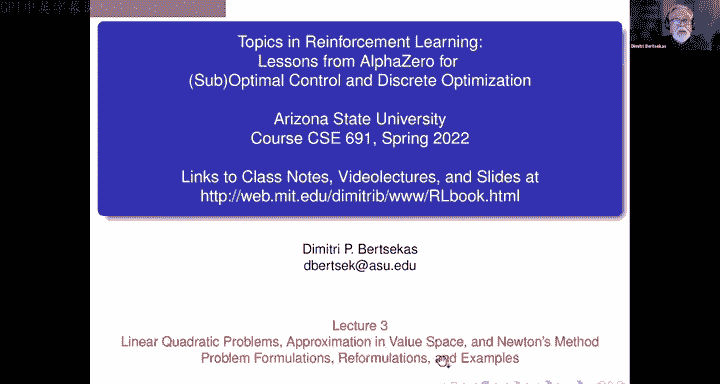
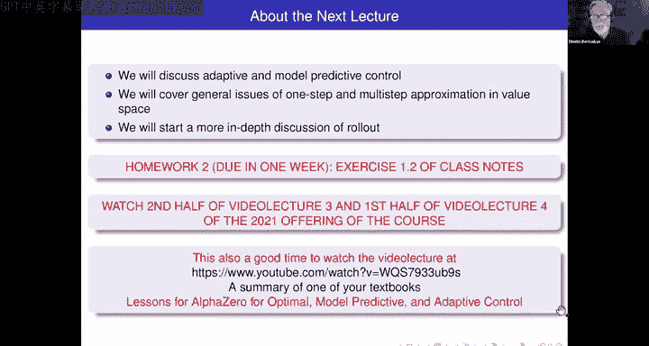

# ASU《强化学习2022-2024｜cse 691 Reinforcement Learning Course at ASU》中英字幕（deepseek - P32：[35]Lecture 3, Spring 2022_ Approximation in value space as Newtons method - GPT中英字幕课程资源 - BV1zcfVYdErD

Okay， so let me welcome you to this third lecture of our course on reinforcement learning。Today。

 we are going to continue our discussion on linear quadratic problems。

And our more general discussion of infinite horizon problems。

And we are going to introduce an important conceptual framework that I alluded to in the first lecture。

 approximation in value space in its connection to Newton's method。

 we're going to use the linear quadratic problem as a vehicle for visualizations that will be important throughout our course。

Then in the second half of the lecture， we're going to talk about examples of problem formulation and reformulation。

Yes。

So here's my outline， first we're going to do an overview of Ar horizonoriz theory。

Then we're going to apply this theory to linear quadratic problems。

 and then we're going to use visualization to look at things like the solution of Belman's equation。

 approximation bad space， various forms of rollout and so on。Then we're going to take a break。

 this number two part is going to be quite long。And we're going to take a break and then come back to discuss how we formulate dynamic programming problems and give some examples。

One technique that's very common is state augmentation。Another reform formulation。

Is for multi Asian problems， we're going to discuss those now a little bit。And more later。

And then we're going to talk about partial state observation problems。

So let's go to an overview of infinite H problems。And I have managed to put almost the entire theory。

 both analytical and algorithmic on a single slide。嗯。Thanks to abstract notation。

 using Belllman operators。So here's the problem， we have a system that evolves according to an equation like so where Xk is a state。

 UK is a controlled WK is a random quantity， a random disturbance。

 and the state evolves from xk to xk plus1， according to this equation over an infinite number of stages。

At the case stage， there's a cost G that depends on state control and disturbance。

And it's also discounted by a discount factor， which could be equal to one。

 in which case we have an undiscounted problem。And。

Important notation that we introduced last time and it's going to be convenient for us both for visualization and also your class notes and books。

 textbooks for analysis。Is that of a Belman operator？There are two Belmont operators。

The min Belman operator T and the new Belman operator T mu that corresponds to a stationary policy mu new here is a policy map states to controls。

So T now maps。Funs J functions of the state into other functions， T sub J of the state。

According to this equation。Now you'll recognize here this expression as the right hand side of Belman's equation and also all kinds of dynamic programming expressions。

It involves minimization。Over。First stage cost， the expected value of the first stage cost plus the expected value of the cost to go from the next state that we land using U and also as measured as represented by the function J so this J is like a cost function and P sub J is another cost function that's obtained by the minimization that arises in dynamic programming kind of expression。

Now the mu Belman operator corresponds to a policy mu is the same thing except that instead of minimizing overall U。

We use the U that corresponds to。To mu。We use new Cx in place of you and we focus on just a single policy。

And now with these two operators， it's possible to write a theory in the algorithm using the Belgmon operators。

J star， the optimal costs function is a fixed point of t satisfies this equation。

 equal this the min Belman equation。Also。This equation。Characterizes optimal policies in particular。

If mu of x attains the minimum in this expression， then the policy mu is optimal and we represent this like so t mu of j star equal to Ts sub j star。

There is another Belman equation that corresponds to a policy mu we call this the mu Belman equation。

 and it says that the cost function of mu， which we denote by J mu is a fixed point of team mu。

Then we have the value direction algorithm。It starts from some function J0。

 applies the min Belman operator to it to obtain plane J1， then J2 and so on。And generally speaking。

 it converges to J Star。There is also a value algorithm that corresponds to a policyU。

 it starts from a J0 generates J1， J2 and so on by applying the mu Belman operator and this sequence that's generated converges to JU generally speaking。

And the policy duration are written。Can also be described by using the T and TU operators。

Poency evaluation can be written like so for a given policy in UK。

It evaluates it by finding the fixed point of the corresponding new Belman operator。

And then it improves it。By applying。T to it to obtain a new policy in UK plus one。

 so it generates a sequence of policies and the hope is that it converges to an optimal policy。

So over theory can be written in one slide by using T and TU。

And now what we're going to do is specializes operators to the linear quadratic problem。So， here。

We have a one dimensional linear system， there's no disturbance。

A and B are known scalrs use the control one dimensional sur number。

 xk is a state again a real number。And the cost function is undiscounted quadratic。

There's a quadratic cost on control with R R is a positive number and there's a called quadratic cost per stage for the state。

 Q is a positive number again， and we take the limit of an infinite number of stages。Okay。

 so this is the system equation， this is the quadratic cost per stage。

And the min Belman equation is obtained by the formula from the preceding slide。

 this is optimal cost to go from the next stage， this is the cost per stage and we minimize over you。

And the nice thing to note here that if J star is quadratic。

Then this becomes a quadratic minimization in U and can be done in closed form and as a result。

 the left hand side， the result of this minimization is also a quadratic function of x this is the key to linear quadratic problems。

 a favorable quadratic minimization in the Belman equation。For the linear policy。For啊。

Multiplying the state。So for a scalar L， this defines a linear policy。

The corresponding new Belman equation is given like so。

 so we plug Lx in here and we obtain rs correct squared and so on。

 so again for a J U that quadratic this expression here is also。Qudtic in x。And。

And can be done in closed form。So here's the important fact， and we went through this last time。

 the Belman equations admit quadratic solutions。K star， the optimal cost function。

 has this form where K star is some scalar。And for a linear policy。

The corresponding course is quadratic to some coefficient KL or a given L。

And K star and KL saw the ricadedi equations。Now here's the rikai equation for the main operator。

 the one that's sold by K star。It involves this right hand side。

 which is obtained from this minimization when we plug in K star K x squared here。And。

I denote this entire function of k by f of k。And we call thisterrikati operator。

And the ri equation is k equals to f of k。Now for a linear policy with health coefficient。

 there's a corresponding。A riti equation obtained from here， it has this form FL is of k is this。

And the corresponding coefficient KL is a solution to this。E equation。

Notice that this is a linear in k okay， what is this is quadratic in K， no linear。

 this one is linear in k， that's not going to be an important fact in what follows。Now。

 if you minimize it here in the Belmon equation and you do all the calculations and you obtain the optimal policy as a linear function of L。

 there's an L star coefficient that characterizes the optimal policy。And from this minimization。

 it is obtained in this form with L star given by this form like here。Also。

 the value duration algorithm。Is obtained by repeated applications of the Belman operator or the rekati operator by factoring out the x squared terms。

嗯。If you start with a quadratic cost function like quadratic initial condition for value duration。

 you are going to obtain itates that are quadratic of this form and the sequence of this case is given by this form like here this。

We'll notice the resemblance here， it all comes out very easily from elementary calculations。

So this is the basic theory of linear quadarti。Problems， and now we are going to try to visualize it。

So we want to see how the Min riad equation and the elder riad equation are solved graphicly。

So here's the minrickkati equation。This is a faithful representation。It is concave， differentiable。

Approaches a horizontal asymptote on the right and approaches a vertical asymptote on the left。

And now。The ri equation is k star equals f of k star in other words， k star。

 the quadratic coefficient of the optimal cost function is obtained as a fixed point of F。

In other words， it is the point at which the red graph。Intercepts the 45 degree line。

 the red graph is f of k， the 45 degree line is k and K star satisfies this equation。

So that's the way to view the construction of the fixed point of F。

 the optimal solution of the optimal periodratic cost coefficient。Now the L ri card equation。

 remember is linear， it has this form for a given L。This is Fl of K。

And the cost coefficient of the policy corresponding to L is obtained as the fixed point of this。F。

 L。Function， this linear function。The fixed point is this one here， this is KL。

This is the cost function corresponding to a policy else of x。Now this picture。Depends。one。

The slope of this green line。If the slope is less than 45 degrees。

 then there's a legitimate interception with a 45 degree line。You can see this from this expression。

If A plus B L。Squared is less than one then the slope of the green line is less than one。U。Yeah。

A plus bL squared being less than one corresponds to a stable policy Now that's important to understand。

When you plug in。This policy corresponding to L into the linear system。

 then its trajectory can go down towards zero or it can explode to infinity。

 and when it Xk converges to zero， we say that the closed loop system is stable and this corresponds to this coefficient here。

 which appears in the closed loop system being less than one。On the other hand。

If this is greater than one which corresponds to in this case here。

 then the trajectory of the system explodes to infinity and the cost is infinity。

So even though this linear， this line intersects the 45 degree line。

 the point of interception is unrelated to a problem。

 it does not give you the cost function of the policy， the cost functional policy infinity。

So we are interested in graph like this for stable policies because the unstable policies give us bad stuff。

嗯。Okay。So this is how we solve the minrickti and the L riadti equations this one is linear and for a stable policy it does give you the cost of the policy and this one is concave。

And notice also that the green lines， all of them lie above。

The red because these red lines obtained by minimization of policies and which must have graphs line above。

So we're going to see later that this green lines and also these purple lines envelope the red graph。

Yeah。Before we do that， let's look at value duration。😊，Remember value duration。

involves a generation of functions if you start with a quadratic function。

 you get a sequence of quadratic functions。Of this form。

 they involve the Belman therickadti operator， so value duration in the space of quadratic functions operates like so。

 it generates a sequence of k scalrs。啊。As follows。At the typical iteration。

 we have the current iterate case of K。Then we compute。Fs of K。Okay。😊，Which is Kk plus one。

 we go up here and this is the level of Kk plus one。

We'll project this on the 45 degree line and then reflect it down。

To the horizontal line to get Kk plus1 over here。So this is the value duration from this point。

 it goes up horizontally and down to take Kk plus1 at the next duration， Kk plus2。Which is this。

 and so on。So it generates a stair case sequence in this graph。

And you can see here that it converges to。Okay， star。

Or does it well it depends on whether you start from the right starting point if you start from starting points that are from here to here。

 it does work if you start from starting points that are on this side it does not it converges to this point。

 but we always start value duration at positive numbers。

 so it will always work for this one dimensional linear quadratic from。Okay。

So we have constructions of solutions of the rikai equations， we have value duration。

And now let's try to visualize the min recovery operator as a lower envelope of the elder recovery operators。

Remember all these blue lines that correspond to linear policies。Lie above the red line。

And I claim that they go all the way down to touch the red the curve。

And you can see this from this calculation。The ERAdi operator involves dis minimization over controls。

And you can break down this minimization into two parts。First。

 minimize with respect to all you for a given level L。And then minimize overall L。

So if you plug in here with u equals to l of x， then what you obtain is this expression。

So you can express the right hand side of the T operator as the minimum of the right hand side of the new operators like so。

So what does this say？First of all， in shorthand， f of k is equal to the minimum of f else of k。

In other words， f of k is obtained as the minimum of all those here and in particular。

Or some fixed value of k， let's say K tilde to obtain f of k tilde。We have to go up this way。

And record the crossing points with the blue lines。And we obtain the minimum crossing point。

So in other words， the some linearar。Some elderly ca operator that just touches here according to this equation。

And moreover， this retire operator is tangent。To the minrickti operator and it is tangent because this F。

Is concave okay， so it cannot cross into it cannot be tension it cannot cross into the under the red curve because all of these because。

Because all of these blue lines lie above the red curve。So from K Tilde。

 we can compute the tangent ricard operator K Tilde。According to this expression。

And this ritati operator， this El Tilda operator。Is a linearization。

 it can be viewed as a linearization。Of the of the main riti operator at this point。

So by obtaining the corresponding by doing this minimization at K Tilda， we obtain a linearization。

 this will connect with approximation in value space and also with Newton's method。Okay。

So now since we're going to talk about Newton's method， let's review it。呃。

You have seen it at sometimes because it's part of culture sometimes it's starting in high school and you can。

Newton's method is usually presented。As a method for solving equations， nonlinear equations。

Let's view it for the context of a fixed point problem。

 let's apply to the solution of finding a fixed point of a generic。

Function G of a variable Y G stands for Gene。Okay， so here's G。

And the sixth fixed point is this point here。The point here， y star equals to G sub y star。

And Newton's method works by solving linearized fixed point problems。At the starting point。

 it finds a linearization of the。Of the G operator at that point。Then solves the linearized problem。

 the linearized fixed point problem to obtain the new point y1， then linearize again and so on。

So here it is。As a current idiot it， YK。The typical Ether it will linearize the problem by using a first order tail or series expression of G。

Here this is the gradient of cheek， so we obtain a function of why。

That is linear and it depends of course on Y k。And then we solve the linearized fixed point problem to obtain y k plus1。

 in other words， we obtain the point y k plus1 that satisfies this equation。

This is newanceous method。And you can see that it converges very fast， it has nice properties。

 particularly when the G function is concave， which it is fortunately in our case。

Now you may have seen the Newtons method。For the case of solving equations。

 this is an equivalent method。You can convert a fixed point problem。

Into a problem of finding a zero of the function H given by G minus y。

And you can apply this method to this context and it's a similar figure except it's just rotated so that this line here becomes a horizontal。

This calculation is isomorphic to this calculation here。

 there are the same calculations which just are represented differently using the equation solution format versus the fixed point solution format。

Okay， so this is Newton's method， it has extensions。呃。To the problems， to multidimensional problems。

 solving systems of nonlinear equations or multidimensional fixed point problems。啊。

And you have probably seen it for the case where thisG is differentiable， okay？However。

 it admits also an extension to nondiiable problems。

 which is important for our case because the Benman operator is differentiable in the case of a linear quadratic problem。

 but it is non differentfferentiable in general。So here what's happening。

 here's how Newton's method works for solving non differentiable equations。This theory， by the way。

 relates to the theory of non smooth analysis， which is relatively recent applied map。It dates to。

 let's say。Around 1980， it's about 40 years old， and people don't quite realize that Newton's method can solve non differentiable problems。

And the simplest case is when you have。An age function that's the minimum of several other functions that are differentiable。

So here we want to find a zero of this minimum and you can see that here's H1， okay？

Here is H2 and here is H3 and the minimum of all those are non defiable function。

How do you apply Newton's method for finding a zero？Y star of this non differentiable function？Well。

 it's a similar rationale。We linearize the problem at the current it， so if we're here。

 we linearize like so， we're here， we linearize like so。We use linearization。

By a first order table of series expansion of any one of the active components of age atYK。

The hs that attain the minimum here， so the active components here in this region is H1。

 the active component in this region is H2， H3 and so on at the corner points both of these are active components and would use any one of them to linear eyes and similarly here。

Once we choose a component that is active like a current iter it。

We solve the linearized problem involving just that component and we obtain Yk plus1。So we are here。

We linearize a corresponding active component and obtain y1， then we uize a different component。

 whichever is active。And if we had a corner， if we go over here。

 we could choose any one of the two components， any one of the components that active。

And it's not difficult to see in this simplified picture that the method works fine。

 Newton's method works for this function here， works for this function here alone。

 and so y1 is going to be closer to y star than y zero。

 assuming of course that Newton's method works for this function。

 the important thing is that near the solution， we apply Newton's method for the active components at the solution。

 and all of these Newton iterations bring you closer to y star。

So that takes a little bit of getting used to。That's the an important fact here that Newton's method not only generalizes to multidimensional problems。

But also generalized non differentiable equation problems。

 six point problems in equations such as the Belman equation in general。

So this is the method for equations and can also be used for the fixed point。

 a fixed point problem of this form where each one of these Gs define an H function。Okay。

 are there any questions about Newton's method？Okay。

So now we're going to go into something important visualization of approximation in value space with one step look ahead。

 no rollout， just a cost functional approximation， then and use that in Belelman's equation to obtain a policy。

Okay， so I have drawn here the Riadi equation。This is the。The look ahead function。

 look ahead cost approximation， J Tilde， what we have called J Tilde。

 it's a quadratic involving a K tilde quadratic coefficient。

And what we do here is we minimize in Belelman's equation with the J tilde used as co function approximation。

 and we obtain the one step look ahead points without roller， just one step look ahead points。

Now for linear quadratic problems， this is just the tangent。A reta operator at K Tilde。

 it is this F tilde given by this formula that attains the minimum here and it is dis blue line。And。

😊，What is the？The cost function associated to this associated with this L T del tilde policy， well。

 we've solved the fixed point problem corresponding to this FL Tilde。

 and this is the quadratic cost coefficient of the one step look ahead policy。

The one step look ahead policy is L Tilde。And its cost function is J mu tildaus of x。

 It's a quadratic function with this KL tilde coefficient。So。

We start with cost approximation like this and by approximation in value space and one step look ahead。

 we end up with a poency that has this cost function。

But now if we look at this figure and look back to Newton's method。

 this is exactly a Newton step starting from this point。So。

The cost function of the look ahead policy is obtained by a Newton step。

Starting from the cost function approximation that you have obtained likely by offline training。

 and this is the online play policy that you have obtained。

So that's a very basic picture connecting approximation to in value space with a Newton step。

Now this corresponds to the simple case of one step look ahead， but and no rollout。

Suppose you've had to two step look ahead and again， no rollout。

So you start with a cost function approximation like this。Two step look ahead means that we。

Do one step look ahead on the result of another one step look ahead minimization now one step look ahead minimization is a value iteration so you start from K tilde。

 do a value durationeration you go up here and you use this to do the linearization and solution of the corresponding the corresponding linearization minimization and obtain a two step look ahead policy starting from K tilde。

 this is the result of the cost of the resulting two step look ahead points。

And in the case of modest step look ahead， we simply have more value directions leading up to the start of the Newton step。

And the longer the look ahead， the better， because with value iteration。

 we tend to converge to K star and Newton's method works better if we started。

 the Newton step works better if we started close to K star。

So this is a little bit more complicated picture of which factors the effect of multi step look ahead。

If now。Let's。Let's look at an important issue for control theories， but also in general。

 the issue of stability move the one step look ahead policy。Okay。So。

We can start with a cost function approximation K tilde。诶。To the right of K star。

And then the policy that we're going to obtain。Is this tangent policy， which is stable？嗯。

We're going to update an unstable tension point and see if we start。

To the left of this threshold point where the slope is equal to one。

 everything to the right of this threshold gives you a state policy， a stable policy。

So we call this origin stability。And it also happens to be the region of attraction of Newton's method。

 the set of starting points for which the Newtons method works。嗯。So when doing one step， look ahead。

It is important to pick the cost function approximation in the right regions so that we obtain a policy that's stable。

or has finite cost， however， if we are careless and we pick K tilde in the region of instability。

 then the policy that we obtain is a legitimate policy。

 but has infinite cost in this particular case of a linear quadratic。

And there's a corresponding extension of conceptual extension to the more general problem。

So this is the issue of stability and the issue of choosing properly the cost function approximation K tilde。

Okay。So now let's go into。Put on out。rollout is simply。One step look ahead。

 starting with the cost of the policy of the base policy。So here's a picture。

 we have a stable point Cu， which is linear。And it has。A。Aat the operator， which is linear。

The cost of that policy， J Muu is this point here is the fixed point of a corresponding recovery operator。

And Newton's method linearizes at this point and gives you a look ahead policy。

 which is what we call the rollout policy that has cost function that is called JU tilde。

 it has a linear postsco L tilde， and it has a cost function。

 which is at the end of this Newton step。So roll out with a stable linear based policy is just a mutant step。

From J Mu to J Mu Tilda。And it brings you closer to K star than the base policy。

And also a lot closer because Newton's method has very fast convergence and when you start close to。

The closer you start。Much the us， if you start close， you get much， much closer to K star。

 it has a quadratic convergence rate。But in general。

 particularly since the base policy cost lies on the right of K star。

The initial improvement tends to be very big this is consistent with what you observe in practice one step of roll out can give you a very big improvement and it's due to the fact that it's。

It involves it a Newton step and also the starting point of the Newton step is in the good region。

 the region of stability， and also on the flattered region of the Belmon operator。

 Portto Ri County Opera。Okay， so now let's look at a more difficult picture。被话。

Let's look at thankd rollout。With some baseball bonus。

But we use only M value duration steps rather an infinite number of for value durations starting from some K tilde。

So we have this linear based policy and it has a。A linear graph like so。

 its cost function is given as a quadratic function involving this quadratic cost coefficient。

And we started some Kate Tilda。And。We do roll out with。M steps。Using this linear policy。

 this corresponds to value duration is going to bring us somewhere here。

 somewhere closer to to this point。Dep on where we start， we may going be making different progress。

 we may start from the right or from the left。And。Now， when we do the truncated rollout step。

We start the Newton step from the end of the value directions in other words。

 these value directions with U enhance the starting point。

So to bring it closer to the Equatic cost coefficient， the correspondingequtic cost coefficient。

 and then we do the Newton step to obtain。The cost of the truncated rollout folks。So。

Trank the rollout operates similar to multi step look ahead it just looks ahead with the rollout with the base policy as opposed to using the rikati operate it uses the。

呃。三诶。是啊。E Tilda Rikati operator。Okay， there's an interesting question， how many steps should I do。

 do I do well with many steps or fewer steps should I try for more steps and also more steps cost more computation。

 so this is something to think about。And we will consider it a little later。So now let's。Look at。

F see that。For the linear或ク。Policy iteration is。It's just repeated rollout。

 you start with a base policy new zero。And which is linear and stable。

And then you obtain another linear policy， mu one， and then another by rollout。

 and then another linear policy L2 mu2 that is obtained by rollout on the preceding policy and so on。

So it starts with a linear quantity mu zero。With our linear cost coefficient。And。

Generates a sequence of linear policies。Buy it out loud。

And now one thing that I want to note here is that for allout， if you start with a stable policy。

 you end up also with a stable policy。So by a repeated roll allow。

 you obtain a sequence of stable policies。And the calculations for doing the policy evaluation are given here。

 we have gone through this formulas before。TheU has a cost coefficient case of K。

 which is given by this expression。And the policy improvement is obtained by minimizing in the Rikadi equation with k equals to Kk and gives Uk plus1 another linear policy。

 and its coefficient is given by this expression。Enlo is just a single mutantton generation。

Policy duration is a full fledged Newton's method， an infinite number of Newton generations for solving the Riaddi equation。

There are also some variants of consideration。One is called optimistic policy duration。

Where instead of using a rollout， we use truncate the rollout。

And basically this amounts to policy evaluation。By value duration， by a finite number of value。

Valu its。And it can also be viewed as a mutantton step。

 there's always a mutantton step at the end and。And the preceding value durations。

Deine the starting point of the newton step。And in the Department of numerical Ana。

This is called a Newton SOR method。Which is a mixture of。えニトンイeration。With first order iterations。

 SOR stands for successive over relaxation。It's essentially a method that has quite a bit of literature and has seen a lot of practice。

We're going to get to optimistic policy duration later。

 just start to make you aware that there are variants of policy duration and one of them is this optimistic and there are other variants that we're going to encounter。

Okay， are there any questions so far？Pros。 Yes， so how many of these results would hold if the if the function curve for the。

What's the word， Yeah， the minimum rikaati equation if。That that function was not concave。

If it was not concaved， then all sorts of anomalies can happen。🤧う。For example， the the。Okay。

Newton's method。Would work。But the original convergence of Newton's method would be a lot different than it is here。

Here， the reason of convergence of mutant's method is。

Defined by a certain threshold and it's the right hand side of the rear line on the right of that threshold if you had a ri equation that were a mixture of。

Convex and concave segments， this would not be true。However， in dynamic programming。诶。

The Belmon equation is concave always， so we have that benefit concave and monotome。

 the Belman operators concave and monotone， this is something that helps a great deal。Oh okay。

 I didn't know that Okay， sorry， yeah， yes， thanks what I should have mentioned here。Is that？

Even though we look at these pictures。For the linear quadratic problem。And in fact。

 the one dimensional linear quadratic problem。Because otherwise we would not be able to do visualization because there's one equation for every state。

 so if we want to look at two state problems。In general。

 it would be difficult and here were looking at the case of linear quadratic problems。

 we look at Belman's equation within a subspace of quadratic functions。So。

So we're looking at a special case。However， the nice thing is that the insights that we obtain from the special case carry out in great geneity for arbitrary dynamic programming problems with optimizer。

 not two person player， but for a single player。For regardless of the state space。

 the state space can be discrete。A finite number of states， where it could be continuous。

 like Euclidean space。What is important is that the Belman equation is always on a function space。

 it's not affected but it's just a matter of whether the Belman equation is multidimensional or。

finite dimensional or infinite dimensional the insights carry through everything i'm going to discuss i'm discussing today for the linear quadratic problem has analogs and and that have that that for the more general case and the insights are very similar that's the nice thing about this linear quadratic problem it's really a good friend in our context。

So let's take a 15 minute break。And you can collect your questions。

And here's a question for you to think about how long should the length of the truncated rollout be？

And issues of performance stability of the look ahead policy in conjunction with how long the truncated allowed is。

 the picture that's relevant here is this picture here that I showed you earlier and I'd like you to look at this picture with this question in mind。

 how long should be the length of the truncated allowed and how does it affect performance of the look ahead policy and how does it affect stability。

So let's break now for 15 minutes and we will come back at 741 Arizona time。Okay。

 so we are ready to start。Are there any questions？Hey， professor， I have a question here。 Yeah。

 what's the difference between truncated rollout and multi step look ahead。In multi step look ahead。

 minimization， you do the minimization， you minimize over。All possible。

Sequences or all possible controls。Where is with all argue you， at each stage you use Z。

You don't have a choice， you use the control specified by the policy。

 the base policy that you're using。So。Rollout with a policy is much cheaper than look ahead minimization。

It's a much cheaper computation。Using the multi state agent example。

 what does the multi step look ahead？A procedure。Using what example， I'm sorry。The modestity travel。

 travel agent agent。Good trouble agent。The homework you mean the homework problem yeah yeah yeah。

 not necessarily that problem， but in that concept what is the multi step look ahead for there's no multi step look ahead in that problem it's all one step look ahead one step look ahead minimization and then the base policy。

If we were to optimize over all three of two city choices or multi city choices。

And then use the base heuristic， then that would be an example of multi step look ahead minimization。

诶。But the minimization over a multi step， multiple steps， multiple cities is much more difficult。

Then them。Then minimization over one city the next neighbor。Okay， okay， thank you， Professor。ok。

And the other questions？So briefly， let's look into this issue here。We have a。

Interpretted trunccateated rollout。With M value directions using the base quantity。Using this figure。

And。We started from some。Initial condition Kate tilda。

For the value directions with mu and we execute these directions here， one， two， three， four。

And then we obtain some point here， which is the cost approximation that's given to the one step look ahead。

 it's a Newton step and it takes us from here to here。

 so we started from here with all this trancated rollout we got to this point and we ended up at this point through the Newton step。

Now， if we were to use untncatedated drawout， we would start from here。And then do Imute them step？

However， in this way with the value durations， we have avoided the evaluation of KL Tilde。

 we've done it through this approximately through this value durations。

 but the question arises where should you pick K Tilde and how many steps of rollout would be good to use？

So what do you think about that？Should I choose Catil over here that would it help me？

And how many steps should I use， what is the best number of steps that you use？

If I pick it in this region here。Well generally speaking。

 the answer is I should use as many steps as they bring me closer。

They improve the starting point and they bring me closer to K star。So if I start somewhere over here。

 K Tils over here and do Newton steps and do the value duration steps。

That will take me close to this point here， it will not cross over to this site。

 we just converge as M goes to infinity， I would converge to this point here。Which so the more。

Value durations I do， the better off I am。Now， how about if I start writing here in this interval between K star and KL Tilde？

And do values， okay， value durations would move me towards KL tilda， right they move this way。

Does it help me？Well， it doesn't help me because if I start anywhereating here and I do value thes。

They are going to push me towards more unfavorable starting point for the Newton step。

On the other hand， it's not so big a deal because the Newton step is very powerful and doesn't。

doesn't lose all that much。What if I start？To the。To the left of K star。

 K tillilda is like it is in this picture， to the left of K star。

How many steps of value duration steps should I use？Well。

 if I choose an infinite number of value directions， then I'm going to converge to KL Tilde。

So there is some point that I will cross into this。

Region here and extra value directions do not help me actually take me further away from K star。So。

The answer is。That。I should use。A fairly large number of value generation steps。

 but after a certain point， they don't help me very much。Or they don't help me。

But the damage is relatively small again。There's one consideration extra consideration here。

Suppose that you have。A stable based policy and K Tilde is in the region of instability。

 in other words， if you were not going to do any rollout， you would get an unstable policy。边。

You're in bad shape then it's a problem。And the value duration steps have the advantage that they push you towards the right。

 towards KL tilde， so they push you into the region of stability。So in this case。

 the truncated rollout not only improves the starting point for the hidden step but also enhances the stability of the look ahead policy。

 it's more likely that you will get a stable look ahead policy if you choose a large number of value duration steps。

Okay， that's a little complicated， the figure itself is very complicated。

 but it's worth studying it after you have understood the mechanics of these figures。

 but there any questions？Okay， I， I have a question， yes。So in the value ittion。

 you mention like at some point， we go。We cross the optimal point and we go ahead and we use some extra computation that does not help us yes。

But what makes the Newton step to come back to the optimal cost？But is。

The Newton step is not like value duration， the Newton step works much faster than value duration and also the Newton step is a different algorithm works it works within the region of stability within the region convergence of the method and it is。

It is not。对。It will go towards K star under as long as we are within the region of stability。

 so that's what helps Newton step， Newton step works very fast， very well from a large region。Now。

 when I said that many value durations will not help， that doesn't mean that a method will not work。

 it will simply push us to a more unfavorable starting point for the Newton step。

And that's the point I want to make。But if I take M to be very large。

 I may get slightly somewhat worse results than I would with a relatively small value of M。Of course。

 knowing the right value of M is not easy in given situations。

 but in some cases it can be obtained through some experimental computation preliminary experimental computation。

It's good to understand though， why， what is the role of the length of the rollout in terms of this figure？

All right present， Thank you。Okay。Okay， yes， I'm sorry and also in general there's no way for us to know what K star is right off the bat and so in that sense there's no real way to get a good estimate of an initialization value for k right like the K tilde value at the end of the day there's no real way to。

Kow where like what is a good guess to start from， right。That's a good question。

 but there are ways to select good values for Ta Tilda。

One way is to start from an arbitrary tilde and then use a stable policy。

 assuming you know a stable policy， you can do a lot of value directions to push it into the good values area。

That's one way。And the other is to simply use as initialization。

 the cost function of some base policy。Okay， if I start the Newton step from here， it will work。怕。

It's because the ratio of stability includes all of these points that the。

It includes this entire region， starting from a base policy that is stable is a good initialization。

 the only thing is that it costs you a lot to evaluate the rollout use a stable policy to evaluate the rollout policy。

 to evaluate it and use it generate the rollouts。So there is always this regions here that can be this region and these values that correspond to stable policies that are good starting points for approximation in value space as well as some。

Points over here， which can be improved with this value variations。

So there's a good one can have a pretty good handle on how you start a newton step。I see。 Okay， yeah。

 thanks。 Make sense。Okay。So before we go into the second half of this lecture。

 I want to give a summary figure of approximation in value spaces a Newton step。

 and this is for linear quadratic problems。And this figure shows the two step look ahead minimization case。

 two step look ahead minimization followed by trincated roll allowed。

 and then a cost function approximation that involves some K tilde coefficient。Okay。

 now this relates to the very first figure that I gave in this class of alpha zero。

 Al zero and related designs related schemes。Involved of a current state。

A multi step look ahead minimization。Possibly trunccateated rollout and cost function approximation at the end。

And the online play algorithm is the one in blue here。And it uses the results of offline training。

At two steps to obtain the terminal cost function approximation。

 which is quadratic in this linear quadratic case。And to obtain a policy to roll out in the middle。

Assuming that there is truncated rollout of the scheme。你好。Newton step。

Starts from here and involves just the first look ahead minimization step。

All the rest up to this point are value directions of one form or another to enhance the starting point of the Newton step。

If you consider the case of one step look ahead with cost function approximation。

 just one step look ahead minimization， and not all out， then this entire part goes away。

We have one step look ahead minimization with a terminal cost approximation。

 and this is a pure Newton step for solving the Belmon equation or the Riaddi equation in our case。

If you have two step look ahead without any rollout。

 then this middle part is just this extra step of looking ahead。If you add rollout to it。

 then there is this other value variations that involve the。The base policy。

 the lingistic stable policy。And。All of these parts can be designed in different ways and all of this is part of online play and offline training comes only at this parts here。

Now the Newton step is the one that does most of the work。

 it is the one that gives you the large cost improvement。

 it is an exact Newton step where these parts may involve approximations if there are approximations in here either due to offline training or you get an approximate policy that's not very good then。

This weding will affect the quality of the starting point。

 but the Newton step has the power to correct a lot of the mistakes that you may make in this part of the process。

So that's a point that I want to make and particularly since even though we have presented。

 we we have given justification for the linear quadratic case。

 actually this figure and the corresponding insights go through in general， very generally。

Finite state space， discrete optimization problems， infinite state space stochastic problems。

 deterministic problems， anything goes the figure stays the same and the inside stays the same that's the important。

Pointed I want to impress on you。Now of course， I still have to justify this very broad statement。

 but as we go along， we will see that there are justifications and if you think through it you'll find that actually this is a very general figure with a first mutant step and then。

Enhancements to the Newton step， to enhancements to the starting point of the Newton step through extra look ahead minimization and also truncated rollout。

Are any questions about this figure？Profess， I have a question thing here。Regarding the new step。

 my understanding is it will only point you to a new point。 But in the figure。

 I see a fork out of the starting point。I'm wondering why the new time method would give me two states。

To me， the two days are more like a。Ro了。That's why I'm confused。

don't know what you mean two states I don't understand what you mean by the Newton step will give you two states what do you mean in this case it's two steps look ahead okay so you're looking at the next states and then the states two steps after is that what you mean。

II'm talking about the the Newton step， like the bidirectionalarrow， right that the zone。

 the zone for Newton step at the bottom。On your diagram， you said Newton step for Belllman equation。

Right in your diagram。 So my question， yeah， right here。 exactly。 So I'm confused because in my mind。

 a newton step would only move from one state to the next state。 is point to point。

But in the diagram， I see a fork。Now it doesn't move from one state to another state。

It moves from one function to another function。Okay， here。There are no states here， okay。

 in this figure。We represent cost functions and in this particular case because it's a linear quadratic problem。

 the cost functions are quadratic， so it's 1k for all states。

So this is a cost function that we're plotting on the horizontal and from one cost function。

 the cost function approximation K tilde， we go into another cost function。

 which is a cost function of the one step look ahead policy， so we move from function to function。

With this newton step。And the idea is that because Newton's method is very powerful because quaratic convergence this。

Step is。I。Brings us very close to K star， its very has very fast convergence rate。Okay。

 I think you should take a look at this video and try to understand it done better Okay。

 thanks professoror。Okay。Okay， coming back to this figure。嗯。😊，If there are no questions。

 are there any questions？Okay， so now let's go into problem formulations practical problems。

 how do we formulate them as dynamic programming problems in practice you're not given dynamic programming problems you doing you're given a practical application and I said earlier that dynamic programming is very powerful in terms of formula in terms of its range。

You can it applies to just about any optimization problem that you can think of。

 but how do you make the formulation from some nebulous application into a mathematical problem where you have states control stages and so on。

There's no one way to do it， I can only tell you how I do it。My recipe。啊。

I first define the controls because these are easy to define in a given practical situation。

 you know what kind of means you have to affect it what your decisions are。

You also pretty much know when you apply your decisions。

And the information that's available at every。With every decision。

 so that helps you to define the stages of the problem。

And then the hardest part after you define controls and stages is how do you pick as states？

And there is a reliable recipe here。You define a state。A summary of all the relevant information。

Something that summarizes the past for the purposes of future optimization。In other words。

 a state should have some kind of a mark of property whereby if you know its value。

 then it separates past from future， whatever past information you receive。

 whatever happened in the past is not relevant for the purposes of future optimization。啊。

And the rationale for this is that the controller applies action that depends on the state。So。

We should include in the state all the information that's useful。

And that's something that makes sense， it's also a reliable guideline。On the other hand。

 there are many different summaries that can serve this purpose they have equivalent information。

 but they are different。So which one do you choose， for example？

In the Tra and sales one problem that we formulate as's a dynamic programming problem。啊。We。The state。

诶。That we took was the collection of the cities that we have visited so far。

 the partial tour that we're in。Now there may be additional information subt for example。

 the cost incurred so far， but that's not relevant and we did not need not include it in the state。

 this is only what's relevant。We could add additional information。

 but there is no it may not be irrelevant， it may not be useful and we don't want to add information that's not really useful because that increases our state space and makes the programming algorithm more difficult。

Now， there is a class of problems called partial or imperfect state information where。

We have something that we would like to call state。

 the only problem is that we don't know it exactly， so we cannot base control on its knowledge。

Instead。We may have measurements。嗯。Of some quantity of interest。

 like what we would like to call state。回车。Evolves over time。

And we collect these measurements and we can use them to estimate a quantity of difference。

For example， we may be interested in controlling a moving object and the state may that you would like to know is the position velocity vector of that moving object。

 on the other hand， you may have only radar measurements that are noisy measurements of position and not velocity。

 so that's a situation where you have partial state information。Now。

 what do you pick as states in this context？Well。The state is something that summarizes。

All the past information that's。That's useful for purpose of future optimization。

So the entire collection of all the measurements that you have received at to time K。

It is a legitimate state， it's correct to use that and write a corresponding dynamic programming formulation where the state is the state of information。

 so to speak。And it evolves over time with the addition of new measurements。

 and you can use it to apply controls。However， there are also alternative。States。

 alternative possibilities of state choice that contain the same amount of information。啊。

And one such possibility is a probabilistic state， so to speak。

 the conditional probability of the quantity of interest like given the information we have obtained so far。

So we would like to know YK， but we don't know it， we get measurements about it。

 and with an estimator we can estimate the probability distribution of YK。Now this is also。

 it turns out a legitimate state， it's called belief state。

 this conditional probability distribution are called beliefs and the using this as state is called it's like using belief states。

And it turns out with some proof that we're not going to give here。

 that it subsumes all the information that's useful for the purposes of control choice。

So now I'm going to give some other examples of problem formulations， including the choice of state。

And。Let's start with a technique called state augment that's very useful。

One example is when the system equation does not involve just the current state and the current control。

 but it may involve delayed states and delayed controls。So the next state may depend not only on xk。

 but on xk minus1， xk minus 2， perhaps Uk minus1 and so on。So。That doesn't fit our framework。

 so what do we do well？We introduce additional state variables。Let's call them YK and SK。

 but YK is the delayed state and SK is the delayed control。

And then we can write an expanded system equation where the state is augmented to include。

Yk and Sk and the augmented state at time k plus1 evolves according to this this equation okay remember yk is xk minus1 y k plus1 is xk and so on so this is a correct equation。

And now we can define as augmented state xk together with Yk and Sk。

And then if we call this overall function。F tilda， then the new augmented state evolves as a function of the preview augmented state to control and Wk。

So we can get into a framework and we can write a dynamic programming algorithm for this augmented state problem。

We start from the terminal cost function。And then we have。A cost optimal。

Costa go calculation that involves not only the current state。

 but also the additional artificial states that we have introduced。

A bigger state space over to execute this minimization that involves。Xk minus1， UK minus1 here。

 and when you take the expected value and then the minimization over UK gives you a function of xk。

 xk minus1 and UK minus1。And then I'd be last。诶。Stage at state zero。

 then we don't need to include the delayed state and control。

 it takes the usual form that looks like this。So it's possible to do it。But。

The size of the state space has increased and so have the computations of the dynamic programming algorithm。

And this is generally true with this state augmentation technique it can model just about everything you just introduce additional state variables according to the rationale of what is useful information to know at time at a current time。

 however state augmentation can increase。The amount of computation that you have to do in the dynamic programming algorithm。

 and it can also complicate approximate dynamic programming algorithm techniques and reinforcement learning techniques。

Sometimes reinforcement learning is very useful in simplifying this the consequence。

 simplifying this。Dynamic programming algorithm so that you keep the size of the state space relatively small。

So we are going to be revisiting state augmentation techniques as we go along and your class notes contain quite a few examples of state augmentation。

 including the casequeer。You have forecasts of future uncertainty like this WK。

Ca does not have a fixed probability distribution， but it may be changing depending on forecasts that you receive during the process of control。

You can deal with such situations with state augmentation。

And there are examples like this in your nose， you may look at that。Okay。

Let's look at another reformulation。Will you have a cost free and absorbing terminal state。

Basically where the problem the process of control stops at some state and there's no more cost to be incurred。

An example of this type of situation is in games where you lose the game or you win the game and it stops。

 you don't have to make any more decisions and there is no further cost to be incurred。啊。

Generally speaking problems with a termination state。

 you can view them as infinite horizon problems because you don't really know what the horizon is。

 you may not know how many steps it's going to take you to terminate。

 so you view them as infinite horizon problems and you introduce this absorbing terminal state as part of your state space and you encode all of this within the infinite horizon context。

Now there's another possibility that's useful that's often useful。

Is to convert the infant H problem that involves the termination state into a finite H problem。

By introducing a horizon an upper bound to the optimal number of stages， assuming that。

 you know such a plant。And then add a big penalty for not terminating before。AtThe end of the。

A horizonoriz。And that will provide an incentive。To terminate within the finite fer problem and no loss of optimality is incurred。

IHere's an example。This is a multi vehicle routing example。

Where you have a number of vehicles that move within a graph， let's say a road network。

 if you'd like。And they want to execute some tasks collectively。

 the tasks are what you see here with a dollar signs。

And the several of those tasks and once a task is completed， then you don't have to do it anymore。

 a task is addressed is only once。So after all the tasks are done， you reach a termination state。

On the other hand。What would be？What would be？How can we convert it to a finite cor problem？

There are policies not very intelligent that take you can execute for an infinite amount of time。

 for example， let's take a vehicle that goes back and forth between two and five here forever and ever okay and similarly。

 there are policies for other vehicles that just go around aimlessly。

 and there's no way you can bound the number of stages needed for policies like that。

On the other hand， for an optimal policy， you can easily， within this context。

 estimate the number of moves that are necessary to execute all the tasks。So if we。

If we want to minimize the number of moves to perform all the tasks here to reach our nation state。

 we can provide an estimate of an upper bound of the number of moves needed。No。

Here's another question。What do we pick as states in this problem let's take a problem is deterministic and there are a number of vehicles located at different positions within this graph and there are also a number of tasks located at different points and let's assume that the tasks are deterministic in other words they don't change there are no new tasks that are created or all tasks that are eliminated by chance。

Still， it's a very difficult problem。啊。As part of the state。

 we ought to know the collective location of the vehicles。

 that's certainly useful information for future optimization。

We also need to know how many tasks are located and as well as where they are。

So that's also useful from a point of view of future optimization in moving the vehicles around。

So very quickly。The number of states becomes astronomical。Is exponential in the number of vehicles。

 exponential in the number of tasks。诶。How about controls？Well， the natural controls here are。

The joint moves of the vehicles so one choice， for example。

 in this situation is for vehicle two to go here for vehicle one to go here and another possibility is for this vehicle to go here and this vehicle to go here。

All the possible combinations of joint moves of the vehicles are legitimate controls in this setting it would seem。

On the other hand， the number of joint moves of the vehicles。

Is also close exponentially with a number of vehicles。And so。It's a real problem。

 even if you want to do rollout， the size of the control space is astronomical。是。

It turns out that there's a general category of problems which we call multi agent and include this problem。

And the。They。And they alleviate the。语。The difficulty with a large control size。

So let's look at multi Asian problems。Okay， it's a very old class of problems。

When I was a PhD student， was still around， in fact I worked on these problems when I was a PhD student until I realized how hard they were and I gave up and went into a different topic。

诶。These problems involve multiple decision centers。In code agents。

And each agent has a decision to make at each time period。

So the collective control of all the agents is what you see here。It consists of M components。

 one component for agent。Now these agents。Collect information。From the environment。

 they share information among themselves。Selectively， some Asians may computer it。

Communicate with some agents， but not with other agents and then after collecting this information at。

At the beginning of this stage， each agent applies a decision。

And then it collects more information up to the next decision and so on all of this happens in discrete time。

 either over a finite or over an infinite horizon。Now。

 one important characteristic of the situation is that。你。The control consists of multiple components。

 so even if each U can take only a small number of values， if M is large， the search space。

 the control space can be very large。There's another interesting characteristic here。

Is whether the agents？Have the same information。Or whether they act with different information。

The case where the agents share the same information and also are fully cooperative is called the classical information pattern。

They fully share information， they cooperate， and they never forget information。And this is。

A code and code tractable problem。Because it can be treated by dynamic program it's just a special type of dynamic programming problem that has this type of structure。

 you can view all of these agents are being one because they share information and they cooperate。

A much harder case is the non classical information pattern。

Qu the agents do not share the same information， they may share some information， but not all of it。

And also possibly may be antagonistic。These problems are very hard， extremely hard。

And the main reason is that they cannot be treated by dynamic program。

One example is that class appointment called？Noncooperative games like Nash games。

 there is no dynamic programming algorithm for that context。

 even though there may be sequential decisions， choices of control and so on。

 there is no starting point with dynamic programming that can serve also as an entry point or reinforcement learning techniques that are out of the approximate dynamic programming type。

Now， I will going to focus for the moment on this classical information pattern and I can show you how you can reformulate them in a way that approximation techniques like rollout are easier to apply。

So let's take the classical information pattern and we're going to deal with a nonclass information pattern later in quite a few lectures into the future。

And。Because of the sharing of information， you can view it in terms of this picture。

So at each time period， the agents have exact information state information and they choose their controls as function of the state。

And this。This state is collected in some kind of a cloud， a sensor cloud。

 which sends back conceptually this informationformation to all the agents。

Now the mathematical model for this is still a discrete time system with state x。And control you。

 but the control has multiple components。Corresponding to the M agents。

And I should point out also that patience is just a metaphor here。诶。

It may be that the ocean are spread all over a geographical area。

 like the multiple vehicles of the problem I talked about earlier。

Or it may be that these ancients reside within the same computer or within the same robot。one。

Control may。May control the left hand， another one may control the right hand。

 another one may control some joints and so on。It's best to view this as mathematical mathematically as a multi component control structure。

Yeah。You can still use dynamic programming in view of this classical information pattern。However。

 it's possible to reformate the problem so that the computations become faster。

So we will first aim to deal with the exponential size of the search or control space。And later。

 we'll come back to the nonclass information pattern and also the possibility of computing the agent controls in some distributed fashion。

So let's deal with this question here。In the context of one example。Okay。

 so this is a canonical exam it applies to vehicle roing。Multi robot maintenance。

 search and rescue problems， firefighting。And many others。Up and。To make it a more interesting。

And genetic， I'm going to form late in terms of spiders and flies。

So there are spiders and there are flies， and the objective of the spiders is to catch the flies。

And in this figure here。There are 15 spiders。That move with perfect vision。

Of where the other spiders are and where the flies are。They have perfect vision。😊。

And each one moves in four directions up down， right left， and also can state what it is。

So it has each spider at each time step has five choices。啊。对。We assume that the flies are blind。

 they don't see it all the spiders and they move randomly。So。

The objective here is for the spiders working as a team to catch all the flies in minimum time。

So the optimal policy may be for this spider is here to move towards this fly and for other spiders to move towards this fly and so on。

 and to encircle it and so on， you can imagine the character of the optimal policy。However。

To compute the optimal pulse by dynamic programming is just impossible。

The reason is that at every time step。The control is。The collection of joint moves of the spiders。

And each one has five options。And there 15 of them。

So the number of possible joint moves is five to the 15。It's astronomical。

Now we are going to reformulate the problem。So that the control space is much smaller。And altogether。

It involves。A polynomial number of choices。75 instead of five to the 15。

And still with this reformulation， be able to apply rollout and have。And maintain。Good properties。

 good performance guarantees for this roll algorithm。

And the idea is instead of considering joint move decisions to break down the control into a sequence of one spider at a time moves。

So in this reform， instead of all the spiders choosing a move collectively。

 they choose moves in sequence。So let's say first this spider here。Make a move。

Then another spider makes a move， having seen the move of the first spider。

Then a third spider may choose a move， having seen the moves of a proceeding to spiders。And so。

In this way， there's only five choices per step， so it's five choices 15 times。And。

Now we're going to give a theoretical framework for this and also an algorithm but。

Let me give you also a reference of discussion and videos of these problems in theres a YouTube video here。

So how can we pass from？Collective choice to sequential choice and still stay within the boundary of optimality。

Professor， yes， is this like one at a time sequential optimization like some sort of Gaus cial optimization or yeah。

 it is related to the idea of Gaus hit Sidal yes。诶。On the other hand。Okay。

It's in the context of dynamic programming and even though there's a conceptual connection。

Theres okay， it's not quite the same。Thank you。😊，Okay。So。I'm going to reformulate my problem。😡。

By making the control space simpler while complicating the state space， and this is an old idea。

That days back 2 25 years， but incidentally this idea stayed dorm for a long time。

 it's only recently that has come to the forefront and has become useful within an interesting context like this multiasian province。

Now a state of the problem。Call it x in a single stage， goes through some other state。

By choice of all we controls all the components。Let's break down the application of components one at the time and we break up。

The stage into multiple stages， M stages by unfolding the control action。So from this state。

 we choose just U1， the first component and go to another state。Which is x of u1。

 remember a state can be anything right， our formulation is very general。

 so that's certainly legitimate。Now from this state， I choose a control U2 and you go to this state。

That involves both components。This is a deterministic transition。

And I assume zero cost here in my reformation。Then I choose Q3 and after M minus one choices。

From this state， I have gone to this complicated state， but with simpler choices of controls。

At zero cost and here I choose the last。Control U M。And that's when I make the random transition。

To the new state， according to the system equation， and I also incur the random costs。

So it's pretty evident that by breaking down the stage into a sequence of component stages with application of component controls in between。

 you obtain an equivalent problem， it's the same problem。啊。

And what's happened here is that the control space has been simplified at the expense of m minus one additional layers of states and corresponding cost functions if you want to execute a dynamic programming algorithm with these expanded stages。

 then you would have to calculate。Tale sub problems for each one of those states。

 and this becomes very complicated。On the other hand。

 if you wanted to just roll out with a base policy as opposed to doing to computing an optimal policy。

呃。This。Commun with the。With the more complicated state space does not matter。😡。

Because Roout does not care about how complicated the state space is。

 it only cares about how many how complicated the control space is。

 because it has to choose at every state that it encounters online， it has to choose a control。So。哦。

We can use rollout whereby at a given state like that we use。

We know the current state because are the previous control that we have applied and we use a base policy。

To assume values for the future controls， that's what Roup does。And in this way。

 we can do calculations。Only one control component at a time。So that's what I'm saying here。

The increase in size of the state space does not adversely affect all art。

Only one stage a stage is looked at during online play。And there's a huge complexity reduction。

Because the one step look ahead branch in factor is reduced from。

N to the M where n is the number of possible choices for each component。

From this exponential number to n times n， I choose between n choices in this step and choices in this step and so on is n times times n。

So that's what I gained computationally by breaking down the problem within the context of layout。

 the reduction in computation is very， very， very significant。Now do I lose something？Okay， well。

This is not some kind of。Inerfect rollout is it's leg rollout， but for our reform data problem。

So it is still covered by a newton step and by the cost reduction properties of a rollout。

 everything that you can prove for this all controls at once rollout。

 you can also prove from the one control at the time rollout。

 it still has the Newton interpretation and the cost reduction property。

In computational examples that we have done you can also see in reference papers and also in the in the video for the。

For we。Spids and flies a problem and also for other problems involving multiple robots maintenance and repair。

We find that really there's no difference between the。All at once。

Controrolll choices and one at a time control choices in terms of performance。

 you still have the characteristic cost reduction property of rollout。So thiss a very。

 very important reformulation and a good starting point。For addressing multi Asianial problems。

Not only the context of ruralad， but also in other contexts as well。

We're going to return to multi Asian problems in future lectures。Are there any questions？

I had a quick question， so outside the context of rollouts， if we don't have a good pace policy。

 if you're doing like normal value creation with some initialization over the value function。

 this reformation would be still be as hard as the original problem right because you've only moved the complexity to the statess。

Could you hear me？ Yes， I can hear you It depends on whether。

It depends on whether you do a computation that involves all states， for example， okay。

 but all allowed is one possibility， but you can also do approximation in value space。

with online play， online play involves only the state where you're currently at。

So for an end stage problem， it involves only n stages and n calculations。

So as long as you can decompose the minimization involved in the look ahead。

 looking in the value direction， it you can decompose into components。

You gain in terms of computation。Now， the properties of approximation in value space in this one control at a time context。

Are not so clear as they are in the case of Rola， I have a paper that you can consult on value duration involving multi Asianian problems in approximation in value space。

So we can discuss that at some time。Thank you so much。😊，O。Okay。

 so let's go now into perfect state observation problems。And I'm going to start with an example。

Remember in perfect state in problems there is some quantity that you would like to view a state which summarizes all the information that it's a convenient state。

 on the other hand you may not know that and you may only have some measurements or some observations relating to this quantity of interest。

In this example here， you have。A car that wants to park in one of the M spots of a linear parking lot。

So this surlist here denote parking spaces。That may be taken or they may be free。

And the driver wants to park in one of his parking spaces within some time， okay， within some time M。

And he looks around for a parking space that has low cost， okay。

 there's some cost structure shown here each。Partarking space。

 let's say M has a cost associated with it， Cs of M。So upon reaching M。

 the driver looks first at whether the parking spot is empty or is taken， if it's taken。

 then it goes either to the left or to the right， that's the decision。However。

 if the parking spot is free， then he can go to the left or go to the right without parking。

 or he can choose to park at this cost C sub M。Now。If the driver had a map of the parking lot， okay。

 it was given。To him， a map of all the spaces and their status。And and。Then。

At the beginning and is given this information at the beginning of each stage。

 then that would be a problem of perfect state information。However。

 let's assume that the driver can only observe the free or taken in status of only the spot that he's in。

 so he's at StateM he cannot observe the status of other parties but except this particular spot。

Moreover。Even if he has seen some of the parking spaces to be free or to be taken。

 their status may change over time。At steps the next time step。

The parking spot can change from free to taken or from taken to free with some probability。

So the information that he has collected from previous observations is not reliable。

 it's not certain information， the status may have changed。So what would make sense here？嗯。

We can estimate the status。Of the spots in some probabilistic sense， in other words。

 we may have the probability distribution of the state of the parking lot。啊。

And the probability of whether each individual state is free or taken。

 and we can update this probability distribution as we collect more information。

 we visit more spaces and take a measurement of whether they are free or taken。Now。

 is this a legitimate state？Well， the states should summarize all the information that's necessary for the purpose of future optimization。

And I can argue that all the information that has been collected through visits to different parking spots。

Can be summarized in this estimate of probability distribution。

There's nothing else to know if you think about it。That's this probability distribution。

Is the only contains all the information that's necessary for the purpose of future optimization。

 proving it， of course is another story you have to prove it mathematical。

 but intuitively it makes sense。It's also possible to use a different state。

 which is a set of all observations so far， the list of the status of all the parking spaces that he has visited in the time that this has happened。

On the other hand。This state can expand over time and for a large number of steps， it can become。

Hard to deal with。So another possibility is to use a state we belief state。

 the conditional probabilities of the free takings。

Status of all the spots so this a vector of probabilities that's maintained and updated at each time step is conditioned on all the observations so far。

So with this new observation， this probability distribution is updated， some kind of estimator。

That the driver maintains and looks at this belief state and makes a decision of whether to park or not to park and whether to go right or left。

So for example， this pro distribution says that likely there are quite a few。

Free spots in this region and this region here also contains spots of low parking costs。

 then the driver can usefully make take this into account and move in that direction。And similarly。

 this probabilistic map of the state of the status of the。

Parking spots can guide fruitfully the decisions of the driver。

So that's basically the context within which。嗯。Problems of partial state observation are formulated。

We introduce。A problem。That has all the dynamic programming characteristics that we have discussed so far。

 including a system equation， control， stochastic disturbances。The state， however。

 of the system is the belief state， which we call Bk。

The belief state is a probabilistic estimate of the unknown state。

 it's the conditional probabilities。Of the different states， given the observations obtained so far。

The observations are this ZK。Plus one。And the new belief state at time K plus1 is obtained as a function of the current belief state。

 the control， and the observation that you have obtained at time K plus1。

This is a legitimate system of the type that we have been discussing involving state control and disturbance。

And also， you can formulate a certain cost that depends on the current belief state and the control。

So this is our use system now and the state is the belief state。

 and then the controller observes this belief state and applies a control as a function of the belief state。

So this is the type of reformulation we're going to see in the future examples of this。

 but for the moment we have gotten into the framework where we can apply our dynamic programming algorithm with perfect state information because the controller knows the belief state so it knows the state of the reformulated problem。

And this dynamic programming algorithm is given by this form。

The optimal cost of the tail subprom at time K using。

 given that we are at belief state Bk is obtained by minimizing overall controls。

The cost of the first stage plus the expected cost to go from the next belief state。

 but also the expectation because this quantity involves the unknown observation。

 the probabilistic observation that we have here。So。啊。That's the dynamic programming algorithm。

 this is the reformation， but's a much more complicated problem。

Because the belief state is something much more complicated than the state that you started from。

The state is a difference between states and probability distributions over states。

 which is a much more complicated object。And doing a。In doing。

An exact dynamic programming computation is simply out of the question， is's impossible。

Except for some。Trivial， entirely trivial and contrived problems。

 you cannot do exact computations within the exact dynamic program。However。

 reinforcement learning allows you to deal with problems like that by introducing cost function approximation。

 by introducing your allout， by introducing approximate policy duration and all that。This， of course。

 is very complicated because of the more complicated nature of the belief space。

 but it has been done in it possible and and。The methods that we're going to be discussing are suitableable for this purpose。

So that's all I'm going to say for the moment for partial state observation problems。

 they involve body formulation。A belief estimator and a reformated cost。

And some kind of approximation to the dynamic programming algorithm。

 likely using approximation in value space and quite a bit of computation。So are they any questions。

 this is our last topic。嗯。Okay， so let's go to the next lecture。

 we'll discuss adaptive and model predictive control。

Within the context of approximation in value space。

 Newton's method and roll out approximate policy duration and the like。嗯。And。When。😊。

We're going to go into。More general problems， we dealt with one step or multi step approximation in value space in the context of alpha zero。

In general， and in more quantitative terms and with visualization in connections with Newton's level。

For the case of a linear quadratic problem。Now we're going to go to more general problems involving finite and infinite horizoniz。

And we're going to。To the extent that we have， we're going to give visualizations similar to the Newton visualizations that we gave in this lecture。

 but for more general Belmont operations， more more general。Belmon equations。

And we are going to go into。Yes。A more in depth discussion overall out。

 starting with deter deterministic problems and discuss various variants and some of the properties of the variant。

There is another homework， your first homework is due today。

 there's another homework due in one week， which is exercise 1。2 of your class notess。

The class notes have been updated and they include now a new exercise 1。2。

And this is the subject of your homework。It would be useful to do some advanced reading and watching。

There are a couple of video lectures。That are we're 11 to the next lecture。

And this is also a good time to watch the video lecture that summarizes one of your textbooks。

This is the new textbook that I am now finalizing。And it involves a lot of these visualizations and the connections with Newton's method。

 and there's an overview lecture at YouTube and it would be a good time to watch that in preparation for the next lecture。

对。So are there any questions？Okay， when expecting your home works。

And we'd like with an next homework。See you next week。

