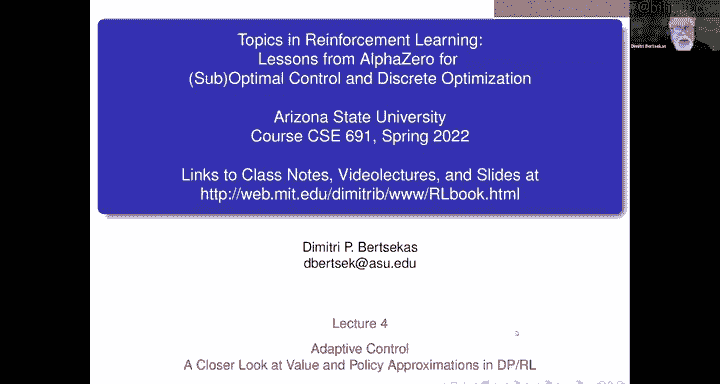

# ASU《强化学习2022-2024｜cse 691 Reinforcement Learning Course at ASU》中英字幕（deepseek - P33：[34]Lecture 4, Spring 2022_ Adaptive Control. Value and Policy Approximations - GPT中英字幕课程资源 - BV1zcfVYdErD

Okay， let me welcome you to this fourth lecture of our course。

This is the last lecture that is going to be of a general character and then after this lectures we're going to get into specific topics in more detail。

So。We're going to do a review of what we have done and where we are going。

Then we're going to talk about problems that involve parameters。That's changed over time。

 this is a subject of adaptive control and we're going to see how we can approach it。啊。

Then we are going to go back to approximation in value space in generality。

And talk about another type of method for approximation called approximation in policy space。

And we are going to see how these two interact with each other and can be combined。

Then we're going to discuss various general issues of approximation value space like Montete Carlo simulation。

 how it enters the picture， model three implementations and things like that。

So let's go back a little。And。But of you， what we have done so far。

The first four lectures of this class， including this one。

Our sort of big picture lectures overview lectures that aim to draw the broad conceptual framework of our subject and also what we aim to do in this class。

And our focal point has been approximation in value space。

Motivated by the alphapha0 and Kit Gamon paradigms。Generalized of course。

 and the general idea here is that we have two algorithms。

 online play and offline training algorithms， and we use online play to improve making decisions in real time to improve on the results of offline training。

Now， future elections are going to go into great depth in selected parts of the big picture。

So let's summarize。啊。Our lectures in lecture 1， we introduce alphapha0 as an motivating example。

The offline training and online play portions。Various generalities about reinforcement learning and its connection to dynamic programming。

We。Developed we。Exact dynamic programming for finite corion deterministic problems。

 and we also gave a couple of examples。In lecture two。

 we went into finite Horizon stochastic dynamic programming， developed an algorithm。

And then we went into infinite horizon problems。We didn't cover them in real depth。

 but we gave an overview of the analytical aspects and the algorithmic aspects of them。

 value duration， policy duration， the like。We gave various examples and we focused on the linear quadratic problems。

Whi is an important application for us， it is important in general。

 but also particularly important for our course because provides the basis for visualizations。咩。

In the last lecture， we went into approximation value space and visualizations based on Newton's method。

And we did this in the context of living aquadratic problems which are well suited for this purpose。

 but the ideas generalize very broadly and on occasion we will have opportunity to return to them。

Then we gave examples of problem formulations and formulations， the state ofation。

 multi agentent systems， P DP， and so on。And now today we going to start with we're going to complete the subject of problem formulations。

And look at issues of adaptive control and also model protective control。

We are also going to go into the implementation aspects of approximation value space。

 we're going to see that there are many different ways to implement in approximation value space。

 and together they form a very large part of reinforcement learning。

We're also going to talk about approximation policy space and the connections。

That it has with approximation in value space。So all of this is big picture stuff。Now。

We are going to cover in more depth and detail some parts of this picture。And views are。It' all out。

That we have discussed in some detail so far， roll out。

And its various variations for finite horizon discrete， deterministic and stochastic problems。

Then we're going to say a few more things about model predictive control。

 we're going to say a few more things about multi Asian problems。Then。

We're going to switch the emphasis to offline training and we're going to discuss how you train neural networks to be used either for value approximation or policy approximation in the context of reinforcement learning。

And also， we're going to discuss other approximation architectures。

 like architectures that involve a linear combination of features or combinations of feature based architectures with neural networks。

Then we're going to spend some time going into infinite cor problems。

And develop the theory in greater detail with a little bit more rigor。

And then after we have this background， we are going to use it to discuss。

Approximate methods for imp horizoniz problems。And our emphasis here is going to be on policy duration and its values variations has many variations。

 and we're going to see that this is really a fundamental method in the context of infant correlation problems。

When we're going to spend one lecture on an approximation in policy space。

 the offline training of policies。Selecting policies from within a parametric class。

 such as the one provided by a neural network。Finding the parameters of that parameter class that give you policies that perform well for our problem。

And methods that are used in this context are policy gradient methods and random search methods。

 I going to spend one lecture of that。And our last topic is going to be aggregation。

 how do you simplify a problem？reduceuce the state space， solve that problem。

 can then use its solution for approximation in value space over the original problem that you started with。

So we've done four lectures so far， including this one and we have another。

Eight or nine lectures on the topic here。So let's go into adaptive control。

We have a problem where the parameters change the parameters of the system equation。

And perhaps the probability distribution involved in the problem。

And so the problem is changing on us and the question is how do we deal with that and how do we adapt to it and that's the subject of adaptive control。

 a very old methodology with a rich history of practice and theory。Just to give you a simple example。

Suppose that you have a cruise control type problem where you have a car and you want to keep this velocity close to some target level。

 like you said， 60 miles， 70 miles an hour。Now， the car's velocity， a simplified model。

 is given by an equation like this。For x ks the velocityiaine K。Now， at the next stage。

 this velocity is affected by the current velocity。There's a coefficient A here。

 which is less than one in modern s slot， like friction on the road。Wind drag and things like that。

UK is a control。The propulsive power that you apply on the car， how far you press the gas。

And it has a coefficient that determine how it affects its velocity。

 but that coefficient depends on things like the road that you're in。

 whether it's uphill or downhill。The number of passengers and all of this affect P。

So as we travel on the road， these things change， these parameters change。Moreover。

 let's adopt a quadratic cost function， which is not unusual in this type of problem。

Where you want to keep the velocity close， some target velocity， a target level。

 this x bar is a target level that you set。And this quadratic objective penalizes deviation from that target velocity。

It also penalizes large controls， okay， both because we have a limited amount of control and also because it leads to a more smoothly functioning system hard here is some positive parameter。

On the other hand。A and B changes and also X bar changes X bar the target velocity。

 sometimes you want to go faster， sometimes slowly， you have to change8 x bar。Moreover。

 in adaptive versions of this problem。There are other cars on the road。

 So if you could get too close to another car， you want to set the target lower， okay and。

Perhaps it' is radar to measure the distance， perhaps there is radar to measure also to estimate the velocity of the cars ahead that and there are algorithms to change this x bar。

Now A B and X bar， okay， some of them may be measured， some of them may be estimated with some error。

This is a question mark as to how you estimate this parameters。

But suppose now that you are able to obtain estimates of them。

So how do you do in a context like this？Well， some possibilities are here。

Ignore the changes in the parameters， that's one possibility。Let A and B vary。

 but have a controller that's robust。Works reasonably well， not optimally， of course。

 works reasonably well for a broad range of parameters。This is， if the parameters change a lot。

 then this may not work very well。However， it's still this type of control is used quite widely in the control system design。

And a time honored methodology in this context is PID control。In PID control。

 there are three parameters that you set。And you keep those parameters the same regardless of whether the parameters of the system change themselves。

 this is used very widely， it's been around for 100 years。And it has served well。However。

 in many situations， it's not adequate。So people have been looking for alternatives since a long time ago。

So that's one possibility。Just ignore the parameters and then design a controller that's resilient to changes。

The second possibility is to try to estimate the parameters。

And then use the estimates to reoptimize or to change the controller。Now， one possibility is。

Online repplaning by optimization。In other words， you measure the parameters。

 you have estimates of the parameters， and you modify the controller to make it optimal for the current set of estimates。

Now， this means that every time the parameters change or the estimates change。

 you have to reoptimize the system and that can be very time consuming。

It requires online system identification and optimal control computation。

 it has also some theoretical pitfall that we're not going to get into。

 but generally speaking this is not so easy to do。A simpler alternative is to do suboptimal repplaning。

Online replaning with some suboptimal control method like we all allowed。😡，Or some base bonus。

Whose cost function is computed using the current parameter estimates。

 so again you measure the parameters and you introduce the changes into the rollout algorithm。

 it will not exactly optimize the system for the current set of parameters。

 but it may do something close。And this is simpler， less time consuming。And。

Let's let's look into it a little further。Okay， online you planning by optimization， this has how。

The name that's used widely in control here indirect adaptive control indirect because you go through system identification parameter identification before you change the。

We controller parameters in the response。So here's a figure。We have a system。

And its state is measured by the control is known， it's assumed to be known by controller。

 and this controller applies through a policy that it has a control at every time step。

And we also get data from the system， we follow the system， we monitor it for changes in parameters。

And we have a parameter estimation or system identification algorithm here that on occasion feeds new parameters。

As they are needed to the controller。And。😊，嗯。Controller adapts itself so that it's optimal for the new set of parameters。

So。Masur to identify parameters given to the controller and the controller re optimizetimizes。

And like we said in the previous slide， this can be time consuming consuming。

So that motivates using a subopinmal controller instead， for example。

 one that's based on approximation in value space。嗯。So here's a picture for that。

Here we assume that there is。An estimation cloud or system identification cloud。

That monitors the change system。And perhaps other things such as constraint parameters。

 probability distributions， and so on。And feeds this。Estimates into。The control algorithm。

And now the control algorithm is not optimal， it does not re optimizetimize， but that's something。

Subopti， which is。Approxiation in value space uses an alpha zero type of algorithm。

Whereby it looks ahead for several steps from the current state where it is。

Then uses a base policy and does roll out with that and then use a cost function approximation at the end。

Now， this in many cases， most cases is faster than online planning with re optimizationization。

And as the parameters changed， we look ahead， minimization adapts itself。あ。

It can continue to use the same base policy for rollout。

And there's also the possibility of recalculating the base policy in the background。

 so there are these parameter estimates that are given to the algorithm and there's a base policy as either given some originally computed robust policy or it is recalculated as we move forward。

So here we're not doing optimization， fully optimization， we're doing something suboptimal。

 and the question is， how much do we lose？So let me go into an example here。

This is a linear quadratic example， and we're going to look at online repplanning as the parameters of the system change。

Now the example is splified， there's only one unknown parameter， B， it's only this B that changes。

And the cost functions quadraic and willll use an infinite for here。

So that we can use the riadti equation calculations for this exam。Now。

B changes and we use a base policy， a code unquote robust policy that's optimal for B equals to two。

So in this example， in this figure。We have the changing parameter B。On the horizontal。

And the cost function， the quadratic cost coefficient of different policies on the vertical。And。

We have a base policy that is optimal for。B equals 2。

And the bottom curvy here gives the exactly the cost of the exactly re optimizeized points。

 So this is the optimal that you can get for every。Possible parameter value。

And the base bonus is optimized for two， but it's left at two as the parameters change。

And then you lose that much， okay， because this policy is not optimal for the new parameters。

And it incurs a certain loss ofity loss。Which， of course， you as the parameters。

Deaviiate more and more from the nominal value， this difference。Becomes larger。

So now instead of doing。Adaptive control by reoptimization let's do approximate re optimizationization by using the rollout policy。

 using this as base policy。And you see there is no difference between the two。

 the approximate and the reization and the exact optimization give you the same result。

And how can we interpret this， what we gave the reason last time is Newton's method。

The approximate rollout policy is a Newton step instead of finding the exact solution of theaddis equation。

 it finds it approximately through a Newton step and what you see here is the power of the Newton step a single Newton step is sufficient to reoptimize almost exactly。

We policy over a broad range of parameters。Are there any questions here？Professor。Yes。

 so the you know the exactly re optimizeimized policy and approximately re optimizetimize the rollout policy almost match because we can think of this is a Utahtons method this is a quadty function so is almost matches is that correct。

Okay。The cost function is quadratic， but the rikati operator is not quadratic。

 it's simply concave and smooth。The Newton step is a Newton step from。The cost of the base policy。

To the cost of fee。Adaptive ownership。And that is a Newton step for solving the rikati equation this goes to that cost。

 and that's not quadratic。And so okay。Any other questions？Hey， professor， my question is。

 why is the curve so smooth？Why isn't there any zigzas up and down。During the optimization。

 it is as if the curve or the optimization knows exactly which direction to go。And why is that？

What you see here。Is the solution of the rikati equation。For different values of B。

Now the riadi equation， the solution of the riad equation varies continuously with its parameters。

 so that's why you see this smoothness。I don't know why you would think that this would be exact。

 there's no randomness here， you plug into the riad equation a certain value of B。

 you get this as a solution， you get a different value。

 you get this as a solution and as the parameters of the riadi equation change。

 so does the corresponding solution。So that means it this is a deterministic problem right yes it is a yeah besides that we're looking at the riad equation which does not involve any ir randomness。

Okay， thank you。Okay。So。Let's look at model predictive control。

It deals with a classical problem in control theory。You have a discrete time system。

 I'm giving you here the deterministic version。We have a deterministic discrete time system with state and control。

And we have a positive cost except at zero at the origin， okay， x is an n dimensional vector。

 and we want to keep the state xk near the origin， that's the classical control regulation problem。啊。

And so we formulated， it is a common formulation， we formulate by introducing a cost function that is zero at the desired point of goal。

 which is the origin and is positive outside zero， okay？So。

We provide an incentive for the controller to drive the state of the system towards zero where we want to be。

It is of course also a constant of control， we want to do it with not too much control。

And there are some constraints here on UK and perhaps also on XK。

I'm giving you here an oversimplified version。And let's consider an undiscounted infinite horizoniz version of this problem。

And the general objective is to keep the state of the system near zero。

 to bring it to zero or keep it near zero up。A symptomically made it approach zero。Now。

The optimaltmost solution of this problem can be quite difficult。

 particularly if you have to do it and do it again every so often is quite difficult。And。

NPC model Pro control。In its original form。Works as follows。

Instead of considering minimization over the infinite horizon。

 we consider minimization of the cost function over the next L stages。Three stages， five stages。

1 stages， once， two stages。However， we also require that at the end of the L stages。

 we drive a state to zero。So we are at the current state and we calculate our control with the idea of bringing the state n steps ahead to zero。

Now， in the infinite cor problem， we want to bring the state to zero over an infinite number of steps。

 but this one goes L steps， which is an easier calculation。

And then what we do is we obtain a sequence of controls for the first stage and for the subsequent stages。

 and we apply the first control of the minimizing sequence and we discard all the other controls for this time period。

Then move to the next state and then we do this optimization else steps ahead。

And then apply the first control in the optimize sequence， then go to the next stage and so on。

So we always look L steps ahead while keeping the state up L stages to zero。

That's the way this works。So what is this and why should it work？Well。

 if you you look at this figure， you'll see that this is just but all loud。

It's an approximation in value space with look ahead， one step look ahead。

 and at the end we have a heuristic， a suboptimal policy that drives xk plus L to zero。

In optimally using taking into account the cost involved， and does is in L minus one steps。

 not L steps， L minus one steps。So there's a clear connection。With little allowed here。

And also a clear connection with multi step look ahead。And。Professor I have a question here。Yeah。😊。

My question is what is the significance of having Xk plus L being0， in my mind。

 I'm trying to map this to the example of the driving car So Xk could be 60 miles per hour right。

 That's the speed of the car So why would I drop the car speed to zero。Okay。

 you will not do it actually， you will do it with the purpose of calculating a control at the current stage。

 you will sort of push the system in the direction of getting to the origin。So。

 so can you use one example to describe X， K and X K plus L。In the， in the car example。

What is Xk Yeah， you want to be at at you want to go to 60 miles an hour。

And you are at 70 miles an hour。So over， let's say， 10 time periods， you want to slow down。

To near near。60 miles， but in NPC you calculate a sequence that takes you exactly。

to 60 miles an hour after 10 steps and you apply the first term of that sequence。

 the first element of that sequence for the first stage， and then you redo the calculation and so on。

And this calculation is simpler than calculating solving the problem over an infinite horizon。

Particularly if you have constraints on control and state。Okay。

 so my understanding is X K plus L is really the the speed difference。

 right away from the target speed。Is the Dlta speed。Yeah。

 if you want to connect it with the adaptive cruise control problem， yeah， you might say that okay。

 thanks。Okay， a nice thing to do now about NPC and in fact。

 an important point for its acceptance in practice is that's very well suited for online re planningning as the parameters of the system change。

 you simply change this optimization， it's an online method。And it can adapt。

 it can do replaning on the fly。啊。And so。There are a lot of other things that you can prove about this including stability。

 there's a nice stability analysis of NPC that shows that the NPC controller， which is suboptimal。

 is still stable for a given problem under some conditions that are usually satisfied。Now aC。

 a professor， yes， yeah， like when you say suboptimal。

 you mean like suboptimal as an approximation to the infinite horizon problem？Yes， okay， thank you。

Yes， the original problem is infinite horizon。And has this cost function over an infant correction here we do something different and as a result。

 there is some opt。Okay， there are many variations of NPC， there's a very wide literature and。

MPC for deterministic problems， for stochastic problems。

 different treatments of constraints and so on， but a major variation is the following。

Instead of driving the state of the system to zero， L steps ahead。

 we just use a terminal cost function approximation that penalizes deviations from zero。

So now what we have is approximation in value space with L step look ahead and cost function approximation。

And we can also extend the look ahead by using some kind of a base policy for rollout。

And this is within this broad context， this is a broad context for applying NPC and in fact。

 the MALb toolbox for NPC uses this type of。Of。Of scheme with terminal on cost approximation and also with the rollout。

 which is exactly the alpha zero type of architecture。Okay。

So now we are going to broaden our discussion and look at approximation in value in policy space。

Let's go back to this stochastic dynamic programming algorithm， its exact form。呃。It's given here。

 it produces the optimal cost。Of retail tail sub problems that start at any stage in any state。

Going backwards， starting at the end and going one step。Earlier， using this recursion。

First stage costs plus optimal costs to go， minimization and goes all the way back from n minus1 to all the way down to zero。

And the optimal cost function is obtained at the last step of this algorithm。Now。

 once we have this optimal cost to go， we go forward to obtain online。The optimal controls。

By minimizing y this expression。At any state that we can be。

 we observe the state and we apply this control。Now you can view this as an offline training type of calculation。

And you can view this as online play using the results of the offline training。

But the main difficulty here is that the offline training is just very often a horrendous computation。

 its impossible to do it because the computational requirements explode as N goes to infinity as the size of the state space goes to becomes larger。

And moreover， even if you could do this computation。

 you would need a lot of storage for this JK star function， the lookup tis would be too big。

So the whole point in the reinforcement learning is to simplify this calculation without losing too much optimality。

And in particular， approximation value space uses a J tilde function。

 however obtained in place of J star for each one of these time periods。

So here a schematic of approximation in value space with one step look ahead and no rollout。

At state Xk， we performed this minimization。Invodlving the first step and an approximation of your future costs。

U。Were represented by this J Tilde function， which we assume that we have gotten in some way。

 we compute in some way， there are many different ways to do that and one possibility is to get it through offline training。

So we do this minimization and the control that we use at state x is the one that minimizes here。

And this is done during online play。And。After we do this at state X K plus one。

 we go to the next state and wedo it again at each time step we can computer control。

Now this provides you a control to apply for every possible state and stage， so it defines a policy。

 a suboptimal control law， which we denote by Muk Tilde。So muk tildas of xk。

Gives you the control that is obtained from this minimization at Xk。Okay。So professoror。Yes。

 question here， so for this approach you only look forward right one step at a time。

 you don't go backward because that is not achievable right。Okay。

And the look ahead step can be one or can be K or can be L， right。Okay。

 in this figure is one step look ahead in the next figure is going to be many steps ahead。And and。

This figure， okay， there are two other slides that sort of complement this figure and draw broader picture。

Then can I conclude that approximation in value space is only applicable in a forward looking。Mology。

You only need it when you look forward。Or you only need it in combination with rollout， right。

 If you don't have ruleout， this is not applicable applicable。啊。Okay。

 I don't see why you bring all of these things together， there's no allowed in this picture at all。

ButBut you're right that this is a forward calculation。Okay， thank you。Okay。

 now this is an important picture。With all the other stuff that I'm writing here。Altoge。

 together with the next two slides， it paints the picture for 80% of。Reinforcement learning。

If just to throw a number。What we're going to be doing is fleshing out this picture and introduce the various methods that you use to。

Compute the approximate cost to go， the J t us。But also。

 there's an incentive to do some further approximation here。There are three approximations。

 the first approximation is constructing cost function approximations J Tda。

Another approximation that is often done is to approximate this expected value now this expected value may complicate this minimization。

 maybe time consuming。So。Sometimes there is an incentive to approximate this expected value。

 and we're going to see ways of doing that。And the third approximation is to make this minimization a little cheaper。

 make it sometimes it's very complicated and we may approximate it to make it tractable。Now。

 the big questions and in fact， the focus in a lot of the remainder of this class is how do we do all these things and there are many different ways of doing it。

How do we obtain J till this well， one possibility is problem approximation。You start with a problem。

That is difficult and you construct an approximate version that's easier to handle and in fact。

 may admit an exact dynamic programming solution。How do you do this， well you reduce the state space。

 you simplify the stochastic probability distributions of WK。

 you may simplify the constraints of the problem。But you approximate the problem。

 it becomes easier and the cost function of that approximate problem。Is used as J Tilde here。

Aggregation is a method that's based on problem approximation， but other possibilities。

 there are other possibilities， various heuristics for the problem can be used to define an approximate cross function。

Rollout with a base policy is one possibility， and you can calculate these values a number of different ways。

 analytically or by simulation as you need them for this minimization。

Here's another broad class of methods。😡，嗯。😊，It is based on parametric approximation。

And neural networks， generally this type of approximation require offline training。

And what we do here。Is we have this function， J Tilda。

 which is selected from a parametric class of functions， a class of functions with a given structure。

 but also involving some parameters。And this parameter is， for example。

 in the context of a neural network， may be the weights。

Offer the various layers of the neural network。Or in the context of a feature based architecture。

 maybe be the parameters multiplying the features that give you this cost approximation。And。

You introduce a parametric class of functions。To approximate this target function here。

And then we collect data and we do training to select parameters that give you good elements from this class。

 and that's what you use。So we have problem approximations， simplifications。

 neural network clgregation， rollout， and model predictive control ordinarily uses just rollout without。

 but also modest step ahead。So that's already a pretty broad methodology and we're going to cover it selectively in various levels of depth。

啊。Here。A very common approach for simplifying we expect the calculation of the expected value is actually very old。

 it was still very much around when I was a PhD student。

It's called a certainty equivalentvalence approximation and what we do is we replace this WK that has a probability distribution that bothers us with a deterministic quantity。

 we simply fix it at its expected value or some kind of a certainty equivalent value。

And we plug it in here and then we get a deterministic minimization， which is simpler。

So that's a certain equivalent approach and has various variations。嗯。😊。

One possibility is to calculate this expected value by some kind of adaptive simulation。

 Monte Carlo simulation。Sometimes we simulate over。Sometimes we we。

We may simulate extensively to obtain almost the expected value but。

For controls that may not be very promising， you may want to do a more limited simulation。

And there's a concept called adaptive simulation， whereby you simulate this expected value for various values of control and you figure it out based on the preliminary results of the simulation。

Which controls are promising and which are not and you throw away some of these controls that do not look promising。

And do not simulate them anymore。And that's the idea underlying this Monte Carlo research that we are going to discuss a later Monte Carlo research is a particular type of adaptive simulation method that has as objective to minimize this expected value。

Let's go to the third approximation here。啊。To do this minimization。

may be difficult for a number of reasons， it may involve a continuous control space。

And we may not have a good method for dealing with that。

So one possibility is to discretize this control space。

And reduce it into a calculation that's finite rather than infinite。

Another possibility is to simplify this minimization in some way in we're going to see it。那 a major呃。

Major version of this type of idea applies to multi Asian problems。

 which have are particularly nasty。Control space。Involving the Cartesian product of components corresponding to different agents。

We sified the minimization using a one agent at a time type of minimization。

 and we're going to see that still we obtain a legitimate。Approximation in value space method。

So that's an important picture and it packs a lot of methods。Three types of approximations。

With different methods that can be applied in each one， depending on the structure of the problem。

And the nice thing is that typically。These three approximations can be addressed separately。

 in other words， you can make combinations a mix and match type of methodology by selecting some stuff from here。

 some stuff from here and stop some stuff from from there。

So that's the big picture corresponding to finite horizon problems， one step look ahead。Okay。

 now we can expand this very simply to multistepput ahead。Here at State XK。

We do a minimization involving multiple steps。Helll steps in particular。

And we add that we end the terminal cost approximation。

That represents estimates the cost of future stages using this J tilde function。So。

We have an infiniteizal problem。But at state XK， we solve an L stage version as opposed to one stage version of the dynamic programming problem with XK being the initial state and J tilde K plus L L steps ahead being the terminal cost function approximation。

Then we obtain a sequence of controls to apply at the various stages。

At state Xk a control UK and then policies control functions for the remaining L minus one stages。

 this is the result of this finite horizon problem L stage problem that you solve and what we do is use only the first element of this optimal sequence and throw all this new stuff away。

Now this UK is going to take us through Xk plus1， and then we solve again an L step。

 look ahead minimization problem and use the first element， UK plus one and so on。

But the thing is that for any UK， I obtain any XK I obtain UK。

 so that gives me the multi L step look I ahead points。And of course。

 we can view end step look ahead as a special case of one step look ahead how so because we can lump the cost of these stages into。

We J till that cost function。So。It's effectively a one step look ahead， approximation vage space。

With a look ahead terminal cost approximation that involves the optimal cost function of an L minus one stages problem with terminal cost J tilde。

So while this step look ahead is a special case of one step look ahead。

 on the other hand sometimes useful to look at it separately because its some aspects that it reveals provide some insights that are special for this type of structure。

Bye sir。Can I ask a question？Okay， yeah， why do you use policies for the K plus one instead of values of。

 I don't know， U plus one， U plus L minus1。If we had the deterministic problem with no expectation and no Ws。

 we could use sequences。However， generally in stochastic problems。

 we need to look policies because with policies， we can get something that's better， right？

That's why we use policies here because we want to get a stochastic。Problem to solve with。

With L steps horizon， rather than infinite horizon。

And we would get a better sequence solving this problem with control functions。

 view it in other words as a stochastic dynamic programming problem rather than view it as a deterministic problem and obtain a sequence it's the power of feedback we you want to get this。

Ms to involve state feedback in order to obtain a better sequence for this minimization。Thank you。😊。

Okay。So the last point I wanted to make here is that。Its small this step look ahead。

 but there are still three approximations that can be used， one right here。

 one right here and one right here， and again these approximations are largely independent the only difference between this and the previous one is the length of the look ahead and of course the difficulty in doing this minimization as the length of the look ahead increases。

对。Okay。So the preceding two slides showed approximation in value space for finite Hizon。

 we also have approximation in value space for an infinite horizon。And here。Okay。

 the cost function is stationary， the system equation is stationary， and we have cost approximation。

 let's consider discounted problem called the discount factor in the optimality equation comes in here。

And what we do are a given state X。We minimize of the expected cost of the first stage。

 plus the discounted cost function approximation for the remaining stages。

Starting from the next state。And there are still three approximations to consider here。

 J Tilda expected value in the minimization approximation。啊。There's also。

 this is for a one step look ahead。For multi step look ahead， health step look ahead。

We solve this instead。啊。N stages minimization problem。With this terminal cost function approximation。

And we apply the first control。We get this UK hot the state Xk， and then we go to the next station。

 so on。So this is very similar to the finite horizon case except that。

What we have here is stationary quantities that don't change over time。

 state and control spaces are the same over time， and that's about it。对。对。Okay。

So whether you're looking at this figure or whether you're looking at this figure or whether you're looking at this figure。

 you obtain a look ahead policy。A suboptimal control law which applies which assigns a controlled new tde of xk at state Xk。

 so this is the look ahead policy that you obtain。And the question of interest here is how do this shade till us？

relatelate to the cost function of this subopmal control law。

We want this course function to be small， to be good。

How does the choice of J Tilda affect the quality of the look ahead policy that way of day？

And this is where the Newton interpretation comes in。

 and that's what we talked about in the previous lecture。There is this figure。

Which relates J Tilde to J Muililde， the cost approximation that you use。

In relation to the cost function of the look head pointss。Okay。

 let me spend some time here on this figure。It involves the Belman operators of the problem。

Whi in the previous lecture where we talked about linear a quadratic problems where the Riaddi operatorss。

 this is the min Belman operator and this is the mu Belman operator， a fixed point of T。

Is J star the optimal cost function of the problem？

And we visualize this by drawing the graph of this T operator， the red graph。

 we intersected with the 45 degree line， which is the graph of J。

 and we find the point where the two intersect and this is where J tilda lies。I'm sorry。

 this is where Jay Star lies。Say Tilde can be something different if we knew J star， we would use it。

 okay， but we don't know it， so we start with some J Tilde that may be to the left or maybe to the right。

And we do approximation one step， look ahead minimization。And it has this interpretation。

 which is very general。Because this TJ is always concaed within that contextex and this team use of J is linear。

And what we obtain by minimizing？In。This equation here with J replaced by J Tilde is this tangent policy。

Milde， which has a graph like this and its cost is given。By the fixed point。

 the intersection with a 45 degree line。Yeah。What this is is a linearization of the Belmon operator we solve the linearized problem to obtain its solution and。

This is just the。What Newton's method does。So passing from a course approximation J tillil there。

To the cost function of a one step look ahead policy is a new step。

And the idea here is that if you manage to that Newton's steps are very effective。

 if J Tilda is close to J star and the closer they are。

 the closest J Muilda is going to be J star if J Tilda is within the region of convergence of Newton's method。

Then。You have an excellent prospect for obtaining a good look ahead points。Okay。

 so that's the interpretation， we're not going to focus on this for analysis。

 but it's always going to be in the background。Interpreting why some results hold and some do not hold and why some methods are good and some other methods are not so good。

And speaking of results， let's look at what we can get from this picture。This picture， of course。

 is about performance estimates， how does the one step look ahead scheme perform？Okay。

The Newton step provides a local estimate， okay， the Newton step takes J Tilda into J U Tilde。And。

It is governed by a local and super linear convergence estimate。

At least for which is local in the sense that it holds for J Dda near J star， it has this form。

It says that the a priori error between J Tilda and J Star。啊。

Gives you an upper poststeriio error or after you do the one step look ahead minimization that is tiny relative to that。

This is。A constant times this， but the constant。Is very small and tends to zero as J Tilde approaches J star that's the meaning of a super linear performance。

So once you're close， this error is very， very small。

 you're almost optimal and we saw this with this adaptive control example that we gave earlier。

On the other hand， when J Tilda is far from J star。Then this difference。Can also be large。

And it can even be infinite when newil there' is unstable， okay？

So this type of estimate is valid and makes sense only when you're close to J star now how close is close is unclear for a given problem。

But this is a starting point for interpreting behavior。Now in the reinforcement learning。

You see a lot of other estimates for one step， look ahead。That are global， in other words。

 they do not depend on J Tilda being close to J star， they hold for all J Tilda。

One of the most popular ones is this one here。Where。It gives a bound on the。

Cost function of a one step ahead of the L step look ahead policy。That depends on。

The error between cost approximation and J star。And this is value for alpha discounted problems。

 finite state。Finite control， alpha discounted Markovvi and decision problems。

This is the estimate that you are going to see in textbooks。However。

 I want to argue with you that this is not a very interesting estimate。

 and I say this with some sadness because I had a hand in developing estimates like that。For example。

In my book with Johnson Sicklis， we have a lot of the assessments for this context in partvo related context。

 and they always have this。Constant factor here that。

Has in the denominator one minus alpha or one minus alpha squared， which can be very， very big。

If alpha is close to what？Generally speaking， this type of global estimate。

 which is the standard in reinforcement learning。Tend to be overly conservative。

 they're conservative because they hope for the entire range of shade tillil that。

Close to J Star and far from Jstar。And they are not a representative or the performance of approximation in value space schemes。

 when J Tilda is near J Star。So what's happening， this type of estimate is interesting when you're far away from Jstar。

 but once you get close to Jstar， then it is this estimate that's the one that's interesting and descriptive of what's happening in practice。

And to give you an example where this this estimate is really bad。Let's consider a finite spaces。

State and control spaces， alpha discounted Markovvi and decision problem。We have muted that。

Can be shown to be optimal。😡，If J Tilda is close enough to J Star。Okay， this is a result。If。

You can show that if you choose J Tilda within some neighborhood of J Star， some small neighborhood。

Then。What you get， the mutilde that you get not only satisfies this relation。

 but is satisfied with zero here， is's exactly optimal。

So this global performance bound near J Star is way off。

 doesn't tell you anything that's useful or even something from which you can get intuition。

And what's happening here is okay， for those of you have。

who have looked into this Belman equation and Belmont operator stuff a little more closely。

 what's happening is that for this type of finite spaces， Al discounted MDP。

 the Belman operator is piecewise linear。So the Newton step is exact。

 finds you the exact doal solution if started within a neighborhood of the。

Of J star within which the linear pieces that are active do not change， basically。

We're going to get into developing estimates like that later when we talk about infant cor problems and we see how they come about and how they relate to one step look ahead and how they relate also to police duration。

 but then again we're going to bring up that these are global estimates that are very pessimistic and they are not a representative practical of practical behavior。

Okay， are there any questions？Professor， if you don't mind， I I won't ask my earlier question。

I think I'm conceptually confused between one step， Look ahead and roll out。

 My understanding is the one step look ahead is equal to roll out。 In other words。

 for me to look ahead one step。I cannot just make one choice。

 I have to roll out so that I have equal opportunities。That's why I think aware I'm confused。Yeah。

 I can see why you're confused。In the， the general approximation in value space scheme that we have been discussing。

There is one step look ahead minimization minimization is a key word here。

 one step look ahead minimization and the remainder is rollout with a given policy。

 you don't minimize over different policies in the rollout part。

This is for one step look ahead with rollout。One step look ahead。

 multi step look ahead with rollout involves L step minimization again minimization is a keyword here after that is rollout with a given policy。

 a much cheaper computation， so that's the difference between the two。

And that's the best way I can explain it。Okay， thanks， Professor。Okay。

 so let's take a break now and I want you to consider the following question。The general question is。

Is longer look ahead， better than shorter look ahead。Well。In our discussion。

 we have been treating it as being better， okay？Certainly。

 long look ahead costs more to implement more computation。Then short look ahead。は。On the other hand。

 is it always better？I say it's usually better。Almost all the time。Think of alpha0。The chess program。

With one step look ahead versus。Many steps look ahead， like 20 steps ahead。30 steps ahead。

I can tell you that chess players know very well that the longer you look ahead。

 the better moves you're going to select。However， from a theoretical point of view。

 it's an interesting question， will longer look ahead produce a better policy than shorter look ahead？

So I want you in the next 15 minutes of the break。If you wish。To look at this question。

Involving this simple problem。This is a problem involving an initial state four stages。However。

 there is a choice only at the first stage in the first stage you to either choose between this branch or that branch and after that you are forced to follow without any。

Any choice， this paths here。So you have to compare with this path and this path。

 and you can see by looking at the numbers， particularly this 10 over here。

 that the top branch is better than the bottom branch。However。So that's the optimal solution。

 this is the optimal path。On the other hand， let's try to use。

Two step look ahead minimization and three step look ahead minimization with terminal cost function approximation zero。

 okay， let's do this calculation without any rollout and stuff like that。

 just two step look ahead and then take zero costs。Or three step， look ahead。And。See which。

Of one of the two policies， the two step look ahead and the three step look ahead policies comes out better。

And let's discuss after we convene back again in 15 minutes。

Which would be it would be two minutes to five in Arizona。

So we had this challenge question and does anyone want to describe what's happening in this figure here and how to compare。

Two step and three step， look ahead。P， can you hear me。Yes， please I can hear you very well。

 but go ahead Okay， so here the two step look ahead is giving us the optimal route。

 but the three step look ahead is giving us the sub optimal。嗯。

And this is happening because the the one cause that is actually。

The 10 units is actually after step the third stage。

 that's right the three step little ahead is not being able to capture that。Yes。

 that's exactly right， you have explained it correctly。Generly speaking， longer look ahead is better。

 but not for this example。It's an exceptional example that is somewhat artificial。But you're right。

 three step look ahead， looks three steps ahead and then looks at the cost to go。プランマ。Oh， I'm sorry。

Okay， in tip two step， look ahead， I compare this。Branch and this branch， two steps ahead。

 and then I add a zero terminal cost。So I find that the optimal。Branch is preferred。

 so two step look ahead finds the optimal first solution and then follows the path to the。

Now in three steps， look ahead， we look at these three states that are these two states that are three steps ahead。

And。Getting where has cost three， getting here has cost two。

 and then when adding a zero terminal cost。I prefer this suboptimal branch。

And what's happening here is that。Mulultti step look ahead has。

Has perhaps sometimes problems with edge effects， what's happening at the edge of the look ahead？

In this case at the age of three step look ahead， there's a bad transition waiting to happen。

 but we never take it into account， we just look at the three transitions here。On the other hand。

 with two step look ahead。😊，I look up to here and up to here。

The suboptimal policy happens to have a small transition cost weight after that。And we。And and and。

And okay， so this branch is preferred than this and basically it's the difference between this transition being two having a larger cost and next transition。

 but the bad transition for the suboptimal policy happens after the reach of the three step look ahead。

So that's an artificial example， but it's also interesting to have in mind that there is no。

Theoretical result that says that longer is better。Okay。Now let's consider broad issues about。

About approximation value space in particular， let's look at now this step look ahead with deterministic optimizations。

Remember， multi step look ahead involves an L step minimization and then cost function approximation after that。

So if the problem is deterministic to start with with a finite control space。

This look ahead minimization involves a shortest path problem with this type of tree。

Quer at each state we have the finite number possible control leading to next states and then again a finite number and all of these transitions are deterministic and so。

It's a shortest path type of problem it's an easy minimization。

 that's the big advantage that you have with the deteristic type of problems。

In many that type of problems like。Alalpha zero， we also have this advantage type of advantage by contrast。

 if the problem is stochastic。Then the expansion factor of this tree grows very quickly because of the stochastic transitions。

 which is why TD gamut for the stochastic game of back gammon does not use long look ahead because the computations very quickly become formulaable with the increase of look ahead。

Okay。If the problem has a continuous state and control space。咩。We。El step look ahead minimization。

Is a continuous optimization。It's not a shortest spa type of calculation。

But sometimes it can be solve quickly by continuous optimization techniques like No nonlinear programming。

And perhaps also into your programming。And in model protective control， that's an important issue。

 how do you choose the health step ahead minimization method so that you can do the online calculations in time taking into account the real time constraints of the problem。

In a stochastic problem。There is also a possibility of doing the lockhead minimization by something called stochastic program。

Thiss some mature methodology in optimization， which applies here。

And it's more like a deterministic optimization method in its essence。

han stochastic dynamic programming type of method。That's a possibility which we're going to discuss later。

Now here's a suboptimal possibility that's interesting。

Suppose you have a stochastic problem with finite state and control spaces。

And you're looking at L step look ahead。Now suppose you do the following approximation。

You split the look ahead minimization into a first step which is stochastic and then a deterministic remainder。

 for example， by certain using certainty equivalentence。So。

Now what happens is that there's a deterministic short path approximation for the steps after the first。

And this is easier than having a full stochastic problem for all the steps。On the other hand。

 it retains the advantage of the Newton step。Because remember。

 the Newton step is the very first step and the remainder is approximation cost function approximation。

So this type of technique works much better from the point of view of performance than having。

Then converting this L step minimization into a deterministic optimization by certainty equivalentence。

Okay， so that's one issue here that enters the。The calculus of how we implement these methods。

Now let's go into a conceptually different type of approximation。Approximation in policy space。

 this is a major alternative to approximation in value space。And the idea here is we have a system。

We measure the state。And we apply a controller。😡，Whi we choose from a restricted class of policies。

 a parametric， usually a parametric class that involves a parameter R。An example is a neural network。

That provides you of maps。Maps from Xk， from state to control that depend on the weights of the neural network。

And。In approximation policy space。Invoved in such a parametric family of policies。

 we you optimize with respect to the parameters。So that we get a controller that's good for our problem。

Now， of course， an interesting question of what kind of method we're going to use for this optimization。

And that are。Methods based on random search， searching within the space of parameters。

Semi randomly with some purpose， of course。Policy gradient methods where we move RK in desirable directions involving the gradient of the cost function with respect to RK。

There are classification methods that I'm going to discuss in future elections。

 but also briefly in the next slide。All of these are machine learning methods for training。

Control functions。So that they achieve a useful objective。Now。Suppose that you have。

Perform the training problem and you have determined this parameters。

There's an important advantage then。That the online computation of controls is much faster。

Once you have computed offline this parameters and you have this controller。

 then finding a control in response to a given state is very quick。Just feed it to a neural network。

 feed the state to a neural network， and instantaneously it computes a control to apply。However。

 it does have an important disadvantage。All of this approximation in policy space has to be done offline。

 so if the problem changes on you， you cannot do online re planningning。

And there's no newton step to take advantage of。So。

Now let's look at approximation in policy space in conjunction with approximation in value space。

 Profesor， yes， could you do an online replaning by considering the parameters are as controls or it doesn't make sense？

Well， it's very difficult because this training takes a long time and you don't have enough time online usually。

If you apply decisions say one every week， then you do have time。

 but if you apply decisions one every minute， you don't have time because this is a difficult training problem。

Okay， thank you。So ordinarily approximation policy space。Is viewed as an offline training process。

And as such its not suitable for online rec， but okay， it depends on the circumstances also。Okay。

 so we want to connect approximation in value space with approximation in policy space。

How do we go from values to policies？Well。Suppose that you have approximate cost functions， J Tilda。

These define a suboptimal policy through one step or multi step look ahead minimization。However。

How can we store， how can we represent this mut tde k function。

 it may have it maybe is defined for every state， but how do you represent it and use it on approximation in policy space context？

So one way to do this is to take this。One step look ahead policy and approximated by using training。

 using data。So。You generate。Data pairs of states and controls where this is UK of S is the control that corresponds to state XkS through one step look ahead。

Remember， we have Jay Tilda。And we look at many states。

We sort of sampled the state space with a sufficiently。Rich number of states。

And we do this calculation offline。So we obtain data of state control pairs。

 this is not the entire control function， the entire policy， but it is data relating to that policy。

And then。We do some kind of training offline to obtain an approximation in policy。

To obtain an approximation to this mut delde points。As an example， suppose you have this data pair。

 you use a machine learning type of algorithm。嗯。We introduce a parametric family of policies。

For example， through a neural network with RK being the parameters。

 and then we estimate the parameters by fitting the data that you have。With the result of the of the。

Of the parametric function。So we find R， which we call RK。

 the parameter RK that makes a good fit between data and functional form of points。The type of。offer。

This square type of problem is typical of classification methods in machine learning。Basically。

You view the controls as categories， as classes， and you're assign to every category。

 which is a control。And there is a connection between policies and classifiers。

 which we're going to go into later。But the important point that I want you to get out of this is that。

We can precomp offline。Policies， starting from。cost approximations by generating data and doing least square fits or other kind of approximations。

 machine learning type of approximations。Now one thing to learn to note here is that the Newton step interpretation is lost once you pass into this kind of approximation with based on this square fit the policy that you have and its cost is not obtained by a Newton step so something is lost here and it's not entirely clear what it depends on the quality of this。

Of this list west fed， but it's something to be concerned with。Okay。

 so here's how we go from J Tilddes to approximations of new Tilddes。

Let's go the other way too in the other direction。How do we go from policies to values。

 where we know a way to do that is by it allout。We have we have。We use a。是。

Some policy as a base policy。Perhaps obtain in some other way like approximation policy space。

 perhaps some heuristic。And we use one step or multi step look a ahead approximation where J Tilde is the cost function of that function。

So the policy is the truncated perhaps truncated rollout policy corresponding to。To this base policy。

So you start with a base policy， generate cost functions of the corresponding one step or multi step look ahead policy。

And。And now， how do we represent this policy if we can't store it very easily if we are to go into if you want to。

To use than online fashion。So how do we compute that well for deterministic problems we run pi from xk plus1 to the n and accumulate accumulate states cost for stochastic problems we may use from Xk plus1 Monte Carlo simulation many times in average the results to obtain these values here。

So now we can use this。As in an offline training method to obtain new policies。

 we can go from policies to values and then to new policies。

And that's the idea of combining approximation in value and policy space。

We have seen this figure before in the context of approximate policy duration。

We have a base scholarship。We have。We simulate it。And we approximated by doing a risk square fit。

And okay。And then we obtain。Data。Using that policy， and then we use approximation policy space。

So from our policy。We go to。To an approximation evaluation space and from approximation evaluation space。

 we obtain a new policy by training a classification or risk or policy gradient or whatever you want to use。

 and then that gives you a new policy which you can use as a new based policy at the next generation。

So that's how these two couple， and that's the way it's done actually in alpha zero。

 a base policy translates into a cost function and a cost function produces through rollout and multistep look ahead a policy which is approximated again by a neural network and back again。

Now， in a。If there were no approximations。And the policy method were exact， then we would obtain。

A cost improvement， the new policy would be better than the original policy for every state。

So the algorithm is capable of self improvement and self learning。

And the natural it's natural extension to infant horizon problems， the policy method。

 this is finite horizon problems， this in quality， but it also holds for the infant horizon version。

 which is consideration。Now， if you have approximations in value space and policy space like you have here。

 this property does not necessarily hold and there are some error bounds that relate the cost function of the rollout policy we have obtained by approximation in the base policy and we're going to get into those a little later。

嗯。There are also many variations of this scheme， optimistic policy。

 policy evaluation methods based on temporal differences， methods of Q learning， and so on。

 all of this is part and parcel of the reinforcement learning methodologyology。

 some of this we're going to cover and some of it we will not have time。Okay。

So now let's look at some other general issues of approximation in value space。

And let's return to our figure。This is the figure。Involving one step， look ahead without drawout。

But it applies also to multi step look ahead。There are these various approximations。

And some of these approximations may have to be done online and some others may be done offline。

So in enforcement learning， some methods are characterized sometimes as offline methods and online methods。

There is no real。Purely offline method or purely online method。

 there's always something that you have to do offline before you do anything online and vice versa。

On the other hand， we can talk about methods that are primarily offline。

 most of the computations are offline。And these are characterized by things like the J Tilda functions are computed by some kind of training。

 neural network training or some other training。And base policy may be involved。

 but the main thing is that these J Tiders are mostly computed offline。And examples of this are when。

A neural network is involved， aggregation is also an offline type of method。嗯。Also。

 approximation policy space to obtain policies to roll out is again， primarily an offline method。

Now the online methods。Primarily online methods are the ones for which this。

Values are computed as needed only at the relevant next points。

And they are used online to compute the control at the end type steps of the horizon。

Examples are put all out。Where you compute these values by doing simulation。

 follow what the base policy。MPC is also primarily an online method because it doesn't rely too much on offline training and。

Most of the work is done through the look ahead minimization。嗯。嗯。

Other things that contribute to an online character of a method。

 if there is approximation of this expected value， this has to be done。Online。

Sometimes this approximation of the minimization is also an online operation。So。

Depending on where views。Parts of the scheme are done。

 we can have offline and online methods and mixtures of the two。Okay。

 let's focus on simplifying the expected value calculation。诶。

Let's consider a case for while given these proable distributions。But they are difficult。

 but they can be used to calculate expected values， but this calculation is difficult。

Then we can modify the probability distribution to simplify。

 we look ahead minimization and the calculation of the expected study。

And one possibility that I mentioned earlier is to replace the uncertain quantities with deterministic nominal values。

Then what happens is that the look ahead minimization。啊。Problems become deterministic。

 as I mentioned earlier。So they could be solved by shortest path type of methods or special methods that deterministic type of methods the advantage here is that deterministic multistep look ahead minimization for deterministic problems is much simpler so what we do here is replace the random quantities deterministic quantities and matrix the calculations deterministic and simpler that way。

嗯。Another type of。Of。Well， in this context。We can determine nominal values。By of the the。

The parameters by using forecasts or by using their expected values。

 a common approach in the probabilistic approximation。Yeah。And。We can also。

 if we have forecasts that change over time， we can update the policy as the forecast changes and it's a form of online treatment planning。

Now， a major possibility for probabilistic approximation is when you have form DP。In which case？

The real state of the system。Is the belief state， the probability distribution of the current state。

 but that's difficult to handle in dynamic programming computations。

So we use deter deterministic substitutes that are state estimates。

So you turn the problem into a perfect state information problem using perfect state information calculations by using the deterministic substitutes to the belief states。

And there are some variations here involving socalled partial certain equivalents where some of the certain quantities are fixed at nominal values they are made into deterministic and some others maintain their stochastic character。

And that may simplify the expected value calculations。

And a generalization of certainty equivalentence that I mentioned is to approximate the expected value by limited simulation if you were to do exhaustive simulation by Montelo by Monte Carlo method you would obtain the exact expected value if you take just a few samples。

 you can approximate the expected value with the corresponding limited sample average average value。

So all of these are tricks that you can play within the context of approximation in value space。

 but there's always a price to pay in that。They introduce approximations that you'd have to judge in a given practical context。

 whether're there。Save use or not。Oh。In reinforcement learning。

 a lot is made about model based methods and model free methods。诶。Genly， when you hear the term free。

 you have to be a little suspicious。诶。Is it good to be model free what's the price to pay for the free usually they don't tell you what the price is。

 but they're always a price there's no free lunch it's always a price for something that comes free to you。

NowIn this context。A model free method is one that does not use a mathematical model。

And a model based method is one that has， there is a mathematical body。

 there are system equations there are。Probability distributions， if you have them。

 my suggestion is that you should use them。However， if you don't have them。

 you may consider a model free alternative。No。The important thing to keep in mind for this course is that all our methods are model based。

But。The model may not be a mathematical model。Maybe it may be a computer model that'll give an example a little later。

 course a computer model implements a mathematical model， but it's sometimes easier to construct。

Than a mathematical model。Now， when you have a computer model and you use simulation。他。

This is useful。欢。The mathematical model of the probabilities of underlying the problem。

Am not available。But you have the simulator and then you can simulate sample transition probabilities and in principle。

 in fact using the simulator， you could compute this point here。

 although that may not be the best way to proceed。So that's one context where you want to use a Monteos simulation approach and a computer model。

Sometimes Monte Cargo simulation enters reinforcement learning。For a different reason。

You may have a problem with that。😡，That's perfectly deterministic。However。

 you may want to use Monte cargo simulation in order to compute things like。A large sum of numbers。

That may be an over quality calculation， but you can use Monte Carlo estimation。

To approximate the sum of numbers。Similarly， if integrals aren' involved。

People often use Monte Carlo integration to approximate a difficult to compute integral by sampling。

This also happens in a number of contexts。And that's another context where Montecarlo simulation is useful。

So now let me give you。A context that often arises in reinforcement learning。

Now remember it that an approximation in value space at a given state Xk。

You minimize this quantity with respect to you to get the one step look ahead policy。嗱 this is some。

With a given J Tilda so given J Tilde， you want to perform this minimization there is also a multi step analog。

 but let's focus on one step look ahead minimization。

How do we do that if we don't have a mathematical model for G and we don't have a mathematical model for F。

 and we also don't have a mathematical model for the distributions of WK。

That's where we can use a model free approach involving a similulator。So here it is。Remember。

We have J Tilda， we have computed somehow， or we use some kind of heuristic J Tilde。

 and what we want to do is compute for different values of UK。And for a given xk。

 we want to compute this quantity here。How do we do it by simulation？Well。

 suppose that we have a simulator that when you feed it at state and you feed it at control。

It generates a new state。Taking into account of whatever stochastic quantities are in here。

And also produces a transition cost， so these are samples。

 perhaps for obistic samples corresponding to state control pairs。

So we use the simulator to collect a large number of representative samples of state control successor states。

And stage cost quadrups。 So these are some who collect a lot of those。And。

What we want to do is construct samples of the Q factor from the preceding slide。

 we want to construct samples of this。And we get samples of that， samples of that for given x and U。

So this point is here。Cost。Plus， cost to go for the sample is viewed as a sample Q factor。

And we collect lots of those。And then。We fit them to some kind of parametric architecture。😡。

We introduce a paramedtic family of Q factors。That depend on state control and also a parameter。

And through all these squares fit。We fit the Q factor samples。To the parametric family to obtain。对。

Optimmal parameters。By solving this list waste problem。And then we have approximate two factors。

Which we can use online to calculate controls。If we had the exact two factors。

 we would obtain the exact one step look ahead minimization policy。However。

 this is an approximation that is。Convenient in some ways because this miniization is very fast once you have trained offline this s factor and you have obtained this。

For ametric approximation， then this minimization may not be very difficult。On the other hand。

 here you don't obtain the one step look ahead policy， you obtain an approximation to that。

 an approximation from some parametric class， from something given by like a neural network。

And this three square fit here introduces error。And the Newton step property is lost。

 you can't expect this kind of policy obtained through this simulator bottle free training。

To be equally good in quality as what you obtain。By honest of goodness。

 one step minimization would be exact。Cost the stage and the exact cost function and the exact system function。

🤧。So model3 is nice because。Sometimes it's easier to use a simulator than construct a mathematical model of the system。

 but there's something to lose in all this in one of these things is。The Newton step。

Performance again the performance bound the Spin performance bound。Okay， so this was our last slide。

 are there any questions？Okay。So starting with the next lecture。

 we're going to get more in depth into various topics。Our objective is to fill out。This figure。

 this figure here and its infinite horizon version。

We're going to talk about various ways to compute JTilde。

Various ways to do this minimization and various ways to approximate。

goingWe're not going to cover these topics fully over time。

One by one we stop checking out various possibilities。And next time we're going to talk about。

Deterministic or all loud。And also a form of rollout where you have made a certain equivalence approximation so that this minimization here。

Is deter deterministic。Which also relates to the problem approximation of certain equivalent we replace the original problem with the deterministic problem。

So that's the。Well all out is。And now good that。very useful。

 very reliable and becomes an important part of more complicated algorithms。

 we're going to talk about it and we're going to discuss issues like under what circumstances is the rollout policy a better policy than the heuristic that you start from。

We're going to look at the variations， we're going to focus on。

Finite state deterministic problems that arise in combinatorial settings like the travel sales problem。

And。We may have time to go a little bit into stochastic later for stochastic problems。诶。And。

There will be no homework for this week， there will be a homework announced fee。

Lectureture it next week。And there's a video lecture that will cover covers。Reasonably faithfully。

 this speak from 2021。So that's all I have for today， are there any questions？嗯。

I have a question here in the chat。Has to do with the homework， which is due today。

 the homework had to do with them。With a comparison of our roll out policy for a stochastic problem。

With the base bonus。And the question has to do。Cardo would do the Monte Carlo simulation。

 do you program do we program the Monte Carlo simulation。

 yes you have to program the Monte Carlo sulator， of course it's simple programming exercise。

 but you should get many samples to obtain faithful Monte Carlo estimates and perhaps an interesting exercise would be to see how the accuracy of the Monte Carlo simulation affects the quality of the rollout policy that you obtain。

Yeah。Okay， so if there are no questions， we'll adjourn and get together next week。

