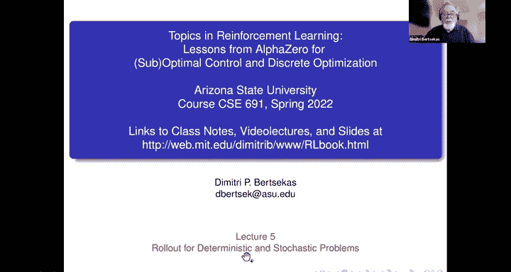
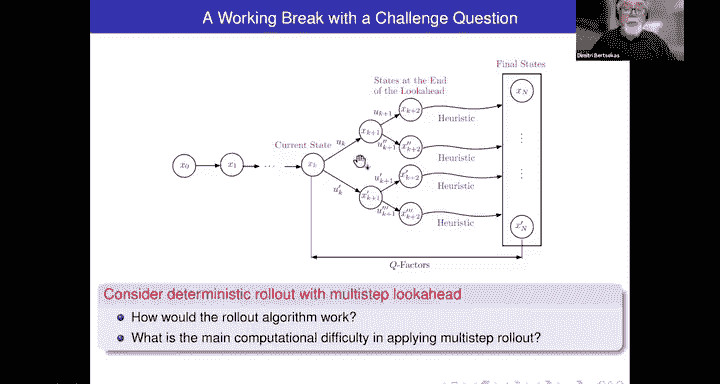
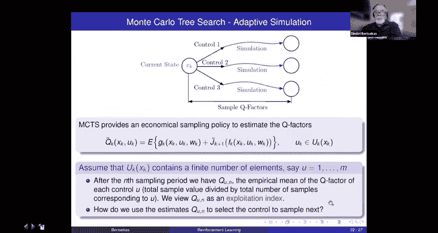
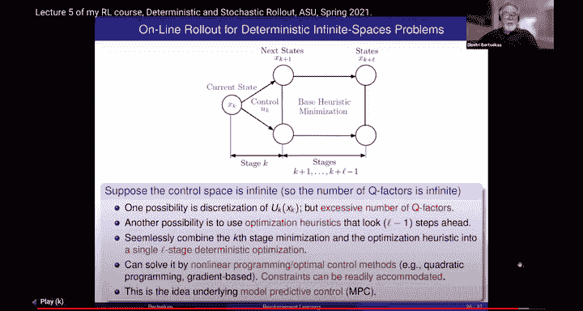
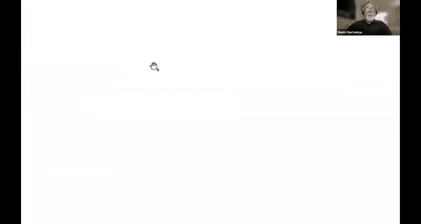
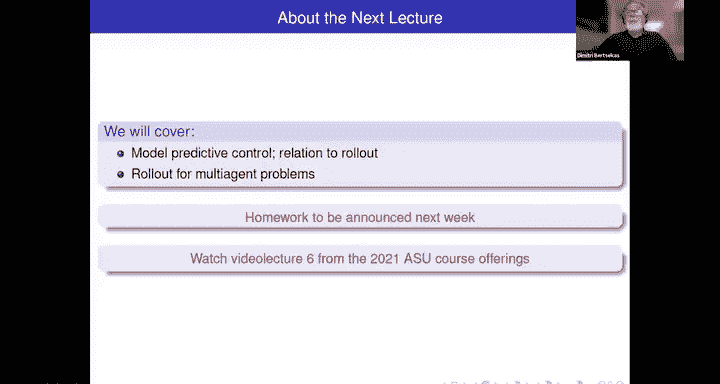

# ASU《强化学习2022-2024｜cse 691 Reinforcement Learning Course at ASU》中英字幕（deepseek - P34：[33]Lecture 5, Spring 2022_ Rollout for Deterministic and Stochastic DP - GPT中英字幕课程资源 - BV1zcfVYdErD

嗯。Okay， so let me welcome you to this fifth lecture of our course on reinforcement learning。

And after four lectures that were sort of overview and a big picture type of lectures。

 we're going to get a little bit in more depth on various topics and we are going to start with rollout today first for deterministic problems and then for satorcchastic problems。

So here's our outline。We start with the rollout for finite state deterministic problems。

 like the ones that we have discussed so far with the traveling salesman problem and so on。

Then we're going to discuss an important question whether the rollout algorithm improves on its base heuristic。

 that's what we mean by the cost improvement artwork。

 whether we're getting cost improvement through rollout。

Then we're going to discuss various variants and extensions of the。

Roll out algorithm that are aiming for greater generality and greater computational efficiency。

Then we're going to take a break。And go into stochastic rollout algorithms and the method of Monte Carlo research。

And I'm going to use here a video clip from last year's course。And finally。

 we're going to talk about rollout。For problems that involve infinite spaces。

Infinite state space and infinite control space， in which case the finite state methods that we gave earlier are not are very cumbersome and we're going to discuss alternative methodologies that will also lead into the。

Model predictive control design schemes that we're going to discuss in more detail in the next lecture。

So。So one thing that I want you to remember。😡，About the rollout algorithm is a special case of approximation in value space。

Our general umbrella scheme for online generation of controls。We have one step。

 look ahead approximation value space and multi step look ahead。

 I'm showing here the multi step look ahead version。

And the rollout algorithm basically is a special case of this J Tilde J Tilde is the cost function of some base policy。

So we have all the other aspects of approximation value space we have at a given state Xk。

Do this minimization that involves the first L steps and the future stages。

As represented by the base policy and its cost function。

And we do this minimization and we obtain the rollout control that we apply at state Xk。

And our rollout policy， which with not by new tilde k of xk， iss just this control UK。Of course。

 this minimization involves a finite horizon stochastic problem。

 we minimize over UK the first control at the state that we know and the。

Policies for the future states that we do not know cannot predict because they involve randomness。

We get this thing here， we throw away the new stuff， we keep UK。

 and this is the rollout control that we apply and defines the rollout points。

And of course we have one step look ahead minimization， multi step， look ahead minimization。

 I'm showing here the multi step case。In either case， we obtain a rollout points， this mutilder。

 which。which produce the snake to roll out policies， an honest to goodness policy at every state。

 at every possible state， it defines a control of this minimization。

Now there may be some approximations in this scheme。For example。

 the minimization here may be approximate， the expected value calculation may be approximate。

 we'll get into this in time。But we。An important approximation variant is truncated roll out where this J tilde is approximated。

By truncation， simulation over a number of steps and then taking a cost function approximation。

So with all this approximation variance， starting from this base case， we cover a lot of ground。

 a very large part of approximation in value space。

So now let's go into deterministic finite state problems， no expectations， no uncertain quantities。啊。

Why do we want to cover overall out and why is it important for our course？Well first of all。

 it provides options， important options for cost function approximation in the context of approximation in value space。

So it's one possibility and with these variations， quite a few possibilities。

Then rollout is also a building block in the policy direction algorithm， which is fundamental。

 primarily for the infinite Horiz case。The policy duration algorithm involves a repeated rollout。

 evaluating policies， and then applying your rollout the rollout algorithm for policy improvement to obtain a new base policy and so on。

Now here's some reasons why it's significant， it occupies a significant position within the landscape of methods。

First of all。Rollout is the easiest method to understand and also the easiest to implement。

Once you know your base heuristic or your base policy。

 then it's very easy to write a program to implement rollout algorithm。

 other methods are much more complicated。It's also easy to understand what's going on there are no neural networks involved which are sort of opaque and you don't know what's happening。

The other thing about our lab is that's very reliable is by far the most reliable method in reinforcement learning。

Okay， with correct implementation， okay， because there are some pitfalls， but generally speaking。

It's easy to apply and you can expect that it will work almost every time。

In my experience over 25 years with all these reinforcement learning methods。

 I have found out that all of them are flaky， but but Roout has never let me down。

 it has always worked for me and I think this has been an experience that has been shared by many other people。

So it's very reliable， simple， reliable， you can try it out and then you can try for something more ambitious。

 perhaps， but it's a good place to start。Then。It is very general it applies to deterministic problems。

 satorcchastic problems， finite horizoniz problems， infant horizoniz problems。

 it can be applied to just about。Any kind of dynamic programming problem。

It has a connection to Newton's method as we have discussed。

 because the special case of approximation in value space。

 an approximation in value space with one step look ahead or multistep look ahead relates to Newton's method。

 so there is this connection to guide the implementation and the intuition。Okay。

 some special domains like in adaptive control。Where the system parameters change over time and as they change。

 we estimate them using some kind of a system identification algorithm， for example。

And then the method of indirect adaptive control。Takes the new parameters that you have estimated and then reoptimizes the entire controller based on these new parameters。

Well， rollout provides a cheaper alternative to reoptim。to adaptive control by reoptimization。

 namely adaptive control by approximate reoptimization that involves rollout。

 and that can be useful in some cases because this reoptimization can be very expensive in practice。

There's also a connection with model predictive control。

I mentioned this connection in one of my earlier lectures， rollout。Following truncated rollout。

 following a multi step look ahead。Or one step look ahead minimization。

 it can be used to bring J Tilda within the region of stability。Of the problem。

and the issues of stability are very important model predictive control。

 how you pick J Tilde so that it produces a stable approximation in value space policy。

 look ahead policy， that's a big question， and truncated or allowed can help to bring the J Tilde within the good region of stability。

We may revisit this later in another lecture。Finally， rollout is a building block。

 a piece in many other reinforcement learning methods that are used in practice。

Q learning may involve using a policy to generate samples and also estimate the cost functions at some at one point or another。

Self learning or approximate policy duration， as it's called in it is a name more appropriate for our course。

Is similar， it involves repeated rollout and other methods。We all out plays a part。

So all of these are compelling reasons。And because of the simplicity of the approach。

 we discuss it first in the course。Okay， so we'll start with deter deterministic rollout。

 deter deterministic problems and finite state。And we have gone through this figure before。

We generate。State trajectory， one state at a time， one stage at a time。At the typical stage in state。

 xk， suppose we have reached state Xk。What we do is we consider all possible controls and we assume a finite finite number in this picture。

And for every pair of state and control， we generate a Q factor。Which is the cost of the transition。

Using UK。Plus， the cost of the heuristic policy， starting from this state and going all the way to the end。

The sum of the cost of this and of that is the cu factor of this control。

And there are several of those cu factors。And what we do。In the role algorithm。

We select the control that has many multi factors， we minimize over here by exhaust comparison of all the controls。

Then we move to the next state and do the same thing。

 considerable controls random heuristic from the end of each one and so on。There are also multi step。

Look ahead versions。Of this where we look multiple steps ahead。And the big question here is。Whether。

Rollout is cost improving。What do I mean by that？If you run the base heuristic from the initial state x0。

 you obtain a certain solution， a certain state and controlled trajectory with certain cost。

If you' on the rollout algorithm， go all the way to the end。

 you generate a different state trajectory in a different controlled trajectory。

Will the rollout trajectory have smaller cost than the trajectory corresponding to the base heuristic that's what we mean by this question。

Is the rollout improving the cost of the base heuristics starting from x0 that's an important theoretical question as well as a practical question。

So that's what we're coming to now。The first thing to note is that cost improvement does not come automatically。

 it's very easy to construct base heuristics that do not have this for crystal role at Al does not have this base this cost improvement property。

There must be some special condition that should hold in order to guarantee this cost improvement property。

And there are two such conditions， one is called sequential consistency。

And the other one is called sequential improvement。

Sequential improvement is more general than sequential consistency。

 and we're going to focus on this one。There are rollout algorithms that have the sequential improvement property。

 but not sequential consistency， and importantly model predictive control of the better predictive control context is one of these cases。

But let's first say， what would we mean by sequential consistency？We say。

That the base heuristic is sequentially consistent。

 if at a given state it choose a control that depends only on that state and not on previous states。

 how we got to that state。More precisely， it has the following property。

If the heuristic starting from state Xk generates this sequence。

Then after you move to state xk plus one， we generate by the base heuristic。

 the tail of that sequence。In other words， a sequentially consistent heuristic does not change its mind。

 and after it goes to xk plus1， starts choosing some different sequence。It stays the course。

 it stays with the trajectory that it generated。So that's what we mean but by。

It applies the same control at the same state， no matter how we got to the state。😡，Yeah。

It's easy to see that if the basicuristic is implemented by some legitimate dynamic programming policy。

That uses a controlled new case of Xk and state Xk。

 then it is sequentially consistent because that's what a policy does。

And it's also possible to show that this is an if and only if statement。

So the sequentially consistent basicur are the ones that are represented by legitimate dynamic programming policies。

And for practical examples of sequentially consistent heuristics。

 greedy heuristics are of that type and an example of a greedy heuristic is the nearest neighbor heuristic for the travel and salesman problem。

 it depends on that state but not exactly on the precise sequence that it got to that state。

 the state being a partial tour。For solving the problem。

But we will focus on sequential improvement now。Which is less restrictive more general。Professor。Yes。

Can I compare sequential consistency with the general example you gave in the initial classes where you're trying to go from Boston to Phoenix？

But。Through St Louis。Yeah can I compare that with equilibrium consistencyency？Okay。

 what going from Boston to Phoenix Los Louis is a problem， but what is the heuristic that you use？

If it is the nearest neighbor type of heuristic， you go to the nearest city， okay？

Or some set of nearest， it may be sequentially consistent。ok。

So you can think of it in the context of that travel problem。

 in fact it's convenient to think of it in the context of that travel problem， but you have to。

 but there are many different heuristics that you can use in the context of that problem。

Like for example， okay。Find the shortest route that goes through through Chicago okay that's also one possibility there are many different types of base heuristics that you can use within this context。

So I hope I have answered your question。Yes， thank you。

Okay so we covered sequential improvement and now we're going to look at something more general。

 which is the sequential improvement condition that guarantees this cost improvement property that's what we want to guarantee we you want to prove a theorem that says that if this condition is satisfied then we have improvement from going from base to rollout。

So what's the definition of the sequential improvement condition？

It requires that the best heuristic cu factor。Is less than the heuristic cost for every state Xk。

Now the notation used here is hk of xk is the cost of the trajectory generated by the heuristic。

Starting from xk， so you run the heuristic from Xk。

 it runs it to play gives a certain trajectory the cost of that trajectory we denote by Hk of xk。Now。

 what is the left hand side？You will recognize for every given you。

 this term here as the Q factor corresponding to you。

So what this says is that if you calculate all the two factors and find the minimum one。

 then you are going to obtain a cost in a corresponding trajectory that is better than the cost of the heuristic starting from Xk。

 better or equal。Okay， so let's interpret this condition in terms of this figure here。啊。

At the typical step of a rollout， we have reached this state X till decade。

And in the process of getting there， we have calculated the cost。

 the heuristic cost starting from X till decay。Now， once you reach x till decay。

 you consider all possible controls， evaluate the Q factors corresponding to each one。

 and you find the one that has minimum Q factor。Which is the cost。

Plus the heuristic cost starting from x t to k plus1。So what this。

Condition says is that this trajectory is better than this trajectory in terms of their cost。

So why does this condition imply that altogether， after we run the rollout algorithm all the way to the end。

 we're going to obtain a smaller cost than if we just stop at the very first stage of the base heistic。

So。What this condition implies is that the cost of this trajectory。

 which is the current trajectory that goes at X till deta and uses the basic risk after that。Is。

Greater than the cost of this trajectory that deviates at this point and goes along the control of the minimal Q factor。

So what this condition implies that at every step you're generating a new trajectory from RK to RK plus one to RK plus2 and so on。

 with a monotonity property with every step， the cost of the trajectory。

 the working trajectory that you have is smaller than the one before or equal。

Now r0 is the cost of the base heuristic starting from x0。

RN is the cost of the rollout after we have reached the end and RN therefore is smaller than R0 and it's also smaller than all the intermediate trajectories and that proves the result this is a proof of this cost improvement property。

And have。The thing to note here is also this figure。

Also illustrates why sequential consistency implies sequential improvement because with sequential consistency。

 one of these Q factors that you calculate upon reaching x till decay is precisely this heuristic cost。

 so the minimum Q factor is。Is greater， is less or equal to the cost of any one of the Q factors。

 including this one。So let me give you an example here in terms of the travel and sales problem。

 and then you can ask questions。😡，I think questions now that I should answer it right now。Okay。

 so let's go to this traveling and salesman example。

 you have seen this figure of something similar with different numbers。

 perhaps in the earlier lectures。And we have we want to find the optimal。Cost tour。

 the minimum cost tour that goes through the fourth it is ABD with going once and only once through each one。

And we have formulated this as a dynamic programming problem。involvingvolving these states。

 starting at state A， going to partial tours， adding a state in every step。

 and we have included these numbers give the cost of each branch here， the intercity travel costs。

 and we have marked them in black here along the branches。

And we have solved this problem by dynamic programming going backwards。

 and the red numbers are the optimal costs to go。嗯。And now。

Let's consider the nearest neighbor heuristic。And you can verify that this is both sequentially consistent and also sequentially improving。

呃。As it should， and let's calculate the trajectories generated by this by the rollout algorithm。

 R0 is the trajectory generated by the basepheristic R1 after one step of rollout r two after two steps and so on。

So let's see how we do that。At state A at the initial state， we run the base heuristic。

 the nearest neighbor heuristic， and it gives us this trajectory， which we call R zero。

Then for the first step of rollout， we generate all possible next states。

We go to each one we calculate and we run the base heuristic。

 the nearest neighbor heuristic from each one。We get this one。We get this one and we get this one。

And the one that gives smallest cost is this one here。

Because it has cost 27 and this one has cost 28。So this is the one that wins and this is the new trajectory we switch from r0 to r1。

And it has smaller costs。So we have reached this state here， we generate the two possible controls。

And from each one。We run the best heuristic。From this one and we compare it with this one and this one is better because it doesn't have a 20 like this here。

 so the next state is going to be this one selected by rollout and the corresponding trajectory is going to be this R2 trajectory。

Which has smaller costs。Then we could go to the next state and so on。

 but this problem after after the second stage becomes trivial because there are no choices。

 there could be r3 is going to have a cost equal to r2 and it is the。

And art2 is the one that generated by the。By the rollout。

 and I think it also happens to be optimal in this particular example。So that's the key thing。

If you have a base heuristic that has the right property。

 sequential consistency or sequential improvement， and the nearest neighborval heuristic has both of these properties。

Then。You can view the rollout algorithm as generating sequences of trajectories， complete solutions。

 complete tours， each one with a better。Cost than the preceding one。

 it is cost improving from beginning to end and everything in between。Now。

 this intuition we're going to use when we're also in other contexts where we're going to discuss variations of the rollout algorithm。

So are there any questions here？So。Let's now go into variations of deterministic rollout and extensions。

 we're going to discuss two or three variations。The first one we call simplified it all out。

The idea is that there are too many key factors perhaps to calculate at any given stage。

 so we would like to make the number smaller。Let's assume that we have a base heuristic that's sequentially improving。

 so it has the cost improvement property。The simplified algorithm。

 instead of finding the minimal Q factor at a given stage。It chooses any control that。

Improves over the heuristic cost has a Q factor that's smaller than the heuristic cost。

In other words， at a state Xk， we choose a rollout control。

 any control that satisfies this inequality。We don't necessarily pick the minimum。

 the one that gives us the minimum Q factor， just any Q factor that crosses this threshold。

Then by the previous heuristic， by the previous。The previous logic that we have， again。

 we generate a sequence of trajectories with decreasing costs and we improve over the preceding trajectory。

Now the motivation for all this。Is that。We don't have to examine all Q factors and compare them。

And this may save a lot of computation。In the prime example。

 there are many different examples where this kind of scheme can is helpful。

 but the prime example is in multi Asian drawout。And I gave an example of that a couple of lectures ago。

回。The control space is enormous， it's finite， a finite number of controls， but a huge number。

 and therefore also a huge number of Q factors we don't want to compare all of them。

The reason why this number is huge is because the control has multiple components。

 one component for each agent， so if you have， let's say 10 agents and each one has two choices。

 the size of the control space is two to the10 okay and you can easily construct examples that are meaningful and useful but the control space is humongous。

Multi agent rollout reduces the search space by looking at only a subset of controls。

Instead of looking at all the joint choices of the multiple agentss。

 it considers choices one at a time， and as a result from exponential number of Q factors to compute。

 we have a polynomial number of Q factors to compute。And。

This logic here indicates that we maintain the cost improvement property assuming sequential improvement of the base uristic。

Okay， a quick proof of this cost improvement property。U。

This is the statement that the rollout policy， which we call P Tilde。And it's cost。

Which we denote from a time k by Jk I tilde starting at Xk。

Satisfies this cost improvement inequality for every K and state Xk。

 the rollout cost is smaller than the cost of the base heuristic。

And the proof is exactly what I gave in the previous slide because this property here。

 this requirement still allows the proof to go through。

 namely that the sequence of trajectory is generated。

 has cost of that are monotonically decreasing and you start with the cost of the basicuristic。

 you end up with the cost of the rollout and this monotononicity property is maintained and implies this inequality。

So are there any questions here？Okay。Here's another variation that's very useful in practice。嗯。

In many practical contexts， you have multiple heuristics that seem good。

 that they look suitable for use in the context of rollout。For example。

 some heuristics maybe they perform very well from some parts of the state space but not from others and there may be some other heuristic that makes more sense to use in this other parts of the state space。

 so you may have multiple heuristics and you may not even know which one is better and from where。

But we can combine them。In the context of Ro art as follows。Instead of running only one heuristic。

 we run all of them at each state that we encounter and we select the result of the best you choose the best results in other way we select to follow the best out of the trajectory is produced。

So this can be very powerful because the superheuristic may be much more effective。

Than each one of these heuristics individually。Now you can view this superheuristic as a base heuristic for a rollout algorithm。

And the important。Fact here is that if all the heuristics are sequentially improving。

 the same is true for the super heuristic。So if all of these heuristics satisfy we cost improvement property。

Because cost improvement property is maintained for the superfuristic。

And how do we prove this well we prove it by verifying。That。

The superheuristic is sequentially improving。We verify its definition。

So the sequential improvement proper condition for the M heuristics。

 our hypothesis is that each one of those heuristics。

 say M out of capital M satisfies this condition， this is the sequential improvement condition for heuristic M。

This is the cost that it produces starting from XK and this is the minimal Q factor that it produces starting from Xk again。

 so this is a sequential improvement condition for every one of these heuristics。

And now in this inequality， let's take the minimum over M， okay， minimum of this right hand side。

 give us this。which is the cost of the supercuristic starting from Xk。

 the minimum over m of the left hand side is mean over M and then mean over U。

 but then we can interchange the order of the minimizations。

 minimize first with respect to U and then with respect to M。

 the result is not changed and what we have is this。

So taking the minimum of both sides with respect to M in this inequality and interchanging the order of minimization on the left hand side。

 we obtain this expression here。But if we look at what we have。

This is the cost of the super heuristic starting from Xk。

 remember is the minimum cost that you get by running over all of them。

And this is the minimal Q factor of the superheuristic because the Q factor of the superheuristic is G plus the minimum。

Of the heuristic cost from the next state。So this is the Q factor corresponding to UK for the superheuristic and the minimum of these Q factors is less than the cost of the superheuristic。

 and this is the sequential improvement condition for the superheuristic。

And this is the end of the proof， this a legitimate proof that sequential consistency is maintained as you pass through the superheuristic and therefore also the cost improvement property。

Are there any questions about this reasoning？Okay， so we have seen。Simplified rollout。

 multiple heuristic rollout， and now let's consider the case。Another case。

That addresses a situation where。Cost improvement does not hold。😡，啊。

Let's consider an example where sequential improvement does not hold and we do not have cost improvement as a result。

So in this example。We have two stages。An initial state x0。Two intermediate states。

 x1 star and x1 tilde。And the two final states。And there are two controls at x0。

Two controls at x1 star and one control at x1 tilde。Now。Okay， the structure here is such that。

This particular transition is high cost， okay？And the other important thing about this example is that we assume that the top。

Bath。X0 u0 star x1 star u1 star x2 star， this trajectory is the optimal trajectory。

 the unique optimal trajectory for this problem， okay， because this is a small cost and okay。

 whatever it is， we make the assumption that the numbers are such that this is the optimal trajectory。

And now suppose that the base heuristic by accident or whatever reason。

 produces this optimal trajectory starting from X0。So if you study that x zero。

 it generates this trajectory， which happens to be optimal。How do I do that well， okay。

 it happens by accident they say and the basic heuristic can be anything right。

 it can be any control assigned at any state。So it's possible certainly to generate by accident the optimal trajectory。

Now， what will the rollout algorithm do at x0 it will consider。

One control and the second control and then around the heuristic from each one。Now， the heuristic。

At x1 Tilde has no choice but to bring you to x2 tilde。

So one trajectory corresponding to one Q factor， the Q factor correspondinging to u tillil the zero is this one。

Now。If we choose x0 star and get to this state， we have to run the base heuristic from this one。

 but suppose that the base heuristic， except again by accident or by design， chooses this。

A red branch to go and goes to X2 tilde。This is the high cost transition。

 and we assume that it is chosen by the heuristic at State X1 star。And because this is high cost。😡。

It violate sequential improvement。Because this trajectory。

 this Q factor is high and this Q factor is worse than。对。Coour of the basicistic。So。

The rollout choice is going to be this one。And also。

The Q factor of u0 star because the Q factor of0 star is great like Q factor of U0。

 so the rollout algorithm will select this u tillilde zero and move to the non optimal state。

So the base heuristic goes optimally， the rollout algorithm deviates and takes the wrong turn and gives us a worse trajectory。

And what's happening here is sequential improvement is not satisfied。

 the base heuristic gives smaller cost than all the few factors。

🎼So in the absence of sequential improvement， the rollout algorithm can take the wrong turn。

 it can deviate from an already available good trajectory。

This example also suggests a remedy for this situation。

We keep track of the current best trajectory that we have found。😡。

And even if the rollout suggests following a different but inferior trajectory。

 we reject that and we keep following the current best trajectory。So。We already have a trajectory。

And the rollout algorithms suggest some additional trajectories。

 but all of them are worse in that case we continue to follow the previous best trajectory and we avoid following the inferior trajectory suggested by rollout。

Professor can I ask us something here， yes？So I know that here the rollout is giving us a worse option but it's actually depending on the heuristic itself right because that the wrong choice that red car was suggested by the heuristic itself so does the like the performance of the rollout depend on the performance of the heuristic that we are choosing right Of course yes。

Yes。And this example is designed so that we basically this is kind of weird and even though it starts optimally it takes at the wrong term。

 it's not sequentially consistent it doesn't。It doesn't stay a course， it deviates from itself。

And it violates also the sequential improvement condition。

So this is a counter example it's designed to illustrate what can happen if you don't have the right condition and so that。

So that you can expect cost improve。Does that answer your question Yeah。

 so that means like a rollout cannot actually like deteriorate the result that is obtained from our from the whatever heuristic that we are using。

 right？Yes， in order to guarantee that， you have to verify that sequential improvement is satisfied for something similar yes。

 that makes sense。Any other questions？So。This example suggests a fix。

 so now we're going to formalize this fix and apply the fixed algorithm into this example。

This is called 45 rollout。啊。Fortified in the sense that we add some features to it so that it doesn't go wrong in situations like the one of preceding example。

It restores the cost improvement property when you have a base heuristic that is not sequentially improving。

Now this fortified it all out。Applies with any base you is it and fixes it it's a very simple fix and the fix is you keep track of the best trajectory that you have obtained so far and when the rollout tries to push you in the wrong direction you reject its advice。

So that's the idea。At each step， follow the best trajectory that you have computed so far。😡。

And the way you mechanize that is in addition to the states that you have visited so far。

These are permanently part of the rollout trajectory。

Let's call this the permanent trajectory up to the current state Xk。

You also maintain another trajectory， which is end to end。

 and it is the best trajectory that you have found so far context in the process of calculating various applications the context of various applications of the heuristic。

So here's the algorithm at state Xk， you assume that in addition to the permanent trajectory。

You also have a tentative best trajectory。😡，Which involves beyond Xk。

Control UK bar and also a trajectory that takes you X to a final state， which we label like so。

So we maintain this trajectory。And now at Xk， we apply rollout， we apply all the different controls。

 we calculate their corresponding Q factors。And we find the one that has the minimum Q factor。

 and let's say it's this green control here。This has the best cu factor over this over that and so on。

 and now we take this trajectory。And we compare its cost with the cost of the tentative trajectory。

 the best we have found so far， and if it is inferior。

 we reject it and we keep following this control， the red control suggested by the tentative best rather than the green control。

So that's what this bullet says， we reject the minimum cu factor choice。If it's complete trajectory。

Is more costly than the current。Tentative best trajectory。Otherwise， we just accept the。

The green control， the suggestion of the rollout based on comparison Q factors。

 and we adopt this trajectory now as the new tentative best。

And we have obtained cost improvement from every every tentative best trajectory that you generate is。

An improvement over the preceding one， and in the end。

 you get one that's better than what you obtained at the beginning using the basic risk。

 the initial tentative best trajectory is the one given by the basic risk starting from x zero。

So this is a very， very simple fix and it fixes everything。Now。

 fixing everything does not mean that you're doing well。

 it simply guarantees you that you're not going to end up with a trajectory that's worse than what you started with。

In order to get a good final trajectory， you not only need to improve the cost。

 but you need to improve the cost by quite a bit， okay。

 you need good performance and that depends on the quality of the base heuristic。

But this will provide some insurance that if you have a base heuristic that's generally good。

 but sometimes it can go wrong， then because of the lack of sequential improvement。

 then this fix of the fortified rollout will make things right again。I think questions here。Okay。

 so now let's illustrate the forified algorithm for the example that I had in the previous slide two slides back。

Remember， we have this two states problem， initial state states x1 states x2 and the best the。

The optimal solution here， the optimal trajectory is the one at the top。

 and by accident it is generated by the base heuristic starting from x0。So we go to rollout。

 rollout will go over here and then we'll follow the base heuristic now the base heuristic by because it it violates sequential improvement and follows this red branch。

And so it calculates this Q factor， it calculates this Q factor and both of them。

Give you trajectories that are worse than the tentative best， so the choice。

 which would be their wrong choice。Of the rollout algorithm is rejected in favor of maintaining the tentative best trajectory。

So that's what this bullets say。The optimal trajectory is generated by the base heuristic at the initial state。

In the first rollout step， we compute the Q factors of U0 star and u tde zero。

By running the heuristic from x1 star and from x1 tilde。

And even though the rollout prefers u tillilda zero to u zero star because of this high cost transition。

It discards u zero tilde in favor of U0 star， which is dictated by the tentative best trajectory。

So this fortification has fixed the problem for us in this particular case。And then， okay。

 this a two stage example， if we had a many many stages example。

 we would do the same thing at every step， we would maintain a tentative pest trajectory and we will reject the advice of rollout if it does not improve on the tentative pest。

So are any questions here？So we have considered。啊。Three variations of rollout without trancation there are also other variations that involve trancation。

 other variations that involve limited simulation when it comes to expected when it comes to stochastic problems so and all of these things can be combined in different contexts including context of。

Policy duration， Q learning， as we will discuss later in the context of infant Hiz problems。

So here's another variation now。A model free variation of rollout。

Which applies to problems where we don't have。We have a computer model， but not a mathematical model。

😡，Of the problem。And we're going to consider it in the following context。

In the context of the general discrete optimization problem。Well we have M variables。

 use it up the UN minus1。That all enter into a cost function， a general cost function G。

 that's the problem we want to solve， we have already discussed that we can formulate this problem as a dynamic programming problem where we pick the components of the components of the solution one at a time first U0 then1 and so on。

And with the state being。The current partial solution so from u zero we go to the state u0 u1 with choice of u1 then u0 u1 u2 and so on。

 so coming down from the initial state。Some artificial initial state。We go down after case steps。

 we end up with this partial solution， and we want to apply it roll out using some base heuristic。

But here's the problem。😡，We don't know G。And we don't know the constraints of the problem。

So we can't use the usual calculation of two factors。

What we assume instead is that even though we don't have a mathematical model。

 we have a computer model that will do all the work that's necessary to apply it all out。

In particular， in the roleout。What we need to do is generate all the possible next controls that satisfy the constraints。

And then run a base heuristic from each one。Up to the final choice of utilde n minus1。

Then at the end of at each one of those circles here， each one of those nodes。

 I'm going to have a complete solution， and then what I need to have is some way to rank the solutions to say that this one has smaller cost or larger cost。

In other words， we need some software that will rank complete solutions。

If we have a computer model that implements a base heuristic。

Enforces the constraint of the problem and also generates trajectories in some way that's internal to itself。

 but perhaps is hidden from us。And that will generate complete solutions that can be given into another software。

 which we call the expert software that ranks the complete solutions。

Then the expert will give us the branch that's best。

And then we will go we select that branch and go to the next node and do the same thing。

 run the base heuristic， the computer version of the base heuristic。

 then run the expert to run the solutions and so on。So here's what we do， we do not do G。

 we do not know the constraints， but instead we have computer software that will do the following for us given a partial solution U zero to UK。

The software outputs all the next controls that satisfy the constraints。

And generates from each one a complete solution。Picks uil the K plus one and completes the solution all the way to the end。

Then we have a software expert or a human expert。That can rank any two complete solutions。

 eyeballs them， any two of them and selects the one that's better。

In this way we can rank all of these solutions， basically we need only the one thats has smallest cost and that would give us。

That will give us everything that we need to apply the Terministic rollout， we have all we need。

So that's another convenience afforded by rollout。It can be implemented in model free fashion far more easily。

Than other algorithms， like the Q learning algorithm， for example， that I gave last time。

This is rather simple type of implementation。And。呃。With some colleagues， ASU colleagues。Peter Sok。

 Julie Perili and。Teng a Lu， Eric Pton。We have implemented this algorithm。

For the problem of RNA folding。RNAN folding where we have a sequence of nucleotides in the context of computational biology。

 and we want to figure out how nature faults them to create an RNA to createate an RNA molecule。

And that。The problem is that there are no mathematical models for RNA folding there are software that will do that that biologists use and there are also expert software that rank different。

Different solutions。And that。So this is an ideal situation for a model3 implementation。

 and I will refer you to that paper， which is you'll find it in the references to this class。

And you can see on a very challenging problem how this model free implementation of rollout has been mechanized。

I any questions here？Okay， so we have considered several variations now let's take a break before we go into stochasticout rollout for stochastic problems。

One variation that we did not consider is rollout with multi step look ahead。

So if you wish you can think about。How to implement deterministic rollout with multi step look ahead we've look at one step look ahead minimization so far。

 multi step look ahead involved generating all the states at the end of the look ahead and running the heuristic after that and calculating Q factors and selecting a control and so on。

And also think about the computational issues， the computational difficulties in this kind of skill。

So we will take a break now and come back in 15 minutes are there any questions so far I'll give you one more chance and you can back come back with more questions at the end of the break。

Okay， so well get back in 15 minutes。Okay， we'll be getting back。吓。And。

Before we get to this challenge question， are there any questions about the first half of the lecture？

Okay， since there are no questions， let's go into。This question of multi step look ahead。

 everything we discussed so far with it all out， simplified it all out。45 rollout model3 rollout。

 all of this was for one step look ahead， what would happen if there are multiple steps of look ahead we're showing here only two steps of look ahead。

 how would the algorithm work。Any suggestions？And also what do you think is the main computational difficulty here so Profesor oh can I answer yes yes please can I like use the heuristic as a terminal cost approximation and run dynamic programming from。

The state K plus to till the state K so that I get and then I apply the first control U1。Yes。Yes。

 this is exactly right is this is the standard form of Ro without any approximations。

 no simplifications and so on。What would be the main computational difficulty here？

It's that you're at each stage you're like exploding the states， like the branching of the states。

Yeah， if the branching factor here is large， then a number of with each stage of look ahead。

 there's a corresponding increase of the number of states。

 so the computational requirements increase exponentially with the branching factor。

With a size of them ahead。However， this is a deterministic dynamic programming， right。

 it's like a short path problem。So that's good because deterministic dynamic programming is much faster。

 can tolerate larger dimensionality than stochastic dynamic programming。So that's work in our favor。

But we。The main computational difficulty is the exponential explosion of the number of states with the size of the look ahead Not aware that there's only one initial state here okay。

 we don't run dynamic programming for all the states just from the current state。Still， however。

 our multi step look ahead broad dynamic programming minimization that you just mentioned。

Is too time consuming， we may not have time。To chat it out online。

So what would be remedies for that case？This is exact to allow of multi step look ahead。

 are there any approximations that would help？How about simplified rollout？

In simplified your all out。We don't evaluate the key factors of all of those sequences。

But we do it only for some。Enough to improve on the cost of the base heuristic or the on the yeah。

 right running the heuristic from here。So if you had， for example。

 a multi agent type of problem or some problem that's amenable to simplification of the look ahead minimization。

 then this。Dynamic programming problem may be simplified a lot and you may be able to reach。

Higher levels， longer levels of look ahead。The4tified version of rollout also applies here。

 you maintain a current tently best and if you rollout algorithm， however you apply。

 does not give you something better you discard the advice of the rollout algorithm。So basically。啊。

All the tricks of the one step look ahead apply to multi step look ahead。

For the purpose of addressing the computational difficulty of doing finite Horizon dynamic programming。

But over a longer horizon。Any other comments on this？Okay。

 so now we will go into the second half of this course that has to do with。

We're all out for stochastic problems and for this。We will use a clip from last year。

 a video clip from last year。And I'm going to pause the clip at various stages and ask for questions。

So let's see if I can manage that now。

Stochastic rollout and Monte Carlo research。Okay。9 stochastic problems。Involving rollout。

Again you have one step or multi step look ahead minimization。

You have approximation of the you have an approximate cost function at the end that's derived from some base policy。

And you have this minimization one step or multi step。

Which defines the rollout control to apply at state Xk。And they're all out policy。And。

The only thing that's different is the expected value here。Over the uncertain quantities。

And we're going to focus on the case where this expected value is not calculated in closed form。

 but rather is calculated by Monte Carlo simulation。呃。If you use Monte carnal simulation also。

It's not only this expectation over this。This expression here that you are considering。

But also you can calculate the cost。Of the base policy。From the state。

 the final state of this look ahead。By simulation again。

 so simulation is used both for the L steps and also to calculate。V。

The values of the cost values of the baseball。And now that's a big problem。

That's because this monocho simulation takes a lot of computation。Okay。

 so now back to the definition。他。There is a certain cost improvement result。

Which says that if the base policy is a legitimate policy。

 it's technologically consistent and that's the only kind that is worth considering in the case of stochastic problems。

 so we have a policy that gives an action a control for every possible state and stage and you use that to generate its cost function values。

If you do that， then you have cost improvement。Starting from any state and any stage。

The rollout policy has a smaller cost than the base policy。

And the proof of this is essentially the same the same induction proof as for the deterministic case。

 which I think I gave in the previous lecture。So some you don't have discussed improvement property。

啊。Of course， this assumes。呃。That there is no trancation， okay， and no terminal cost approximation。

 so it holds under some idealized conditions。嗯。Also。This approximation。

 this value is not going to be exact because of simulation error。

 so in practice this cost improvement property holds within some error bound。

 which is not easy to calculate。Now， a big issue here is how do we。

Save in simulation because the simulation here is daunting。

For every possible control and let's even focus on one step look ahead for every possible control。

 you have to do Monte Cardo simulation， lots and lots of sample trajectories to average， okay？

And it's easy to see that the simulation can be very time consuming。

It can be parallelzized if you have Monte cardo simulation is very well suited to parallelization。

 heavy parallel hardware， on the other hand is' still a lot of computation。

So that's the big issue here and we're going to focus on that but first let's look at an example。

An application。The original rollout application， so to speak。嗯。It involves a game of Bagament。

 I talked briefly about that in the first lecture。B gamon is a game of skill and strategy and also chance because it involves rolling the dice。

It involves two players， the black player and the white player which have these pieces here on the board and they move in in the opposite directions and okay there are certain rules that guide the movement and also when one player wins over another there's no draw here。

 either one player wins or the other player winss there's nothing there's no tie。嗯。

What is the state here， Well， at each prior to every movement of pieces。

 there's a roll of a dice by air the black layer or the white layer。

So let's assume that we are at the white layer stern。

And the state is the board position and also the role that this white player has rolled， okay。呃。

Like six and four or one and three or whatever。Now。

 given the role of the dice and the board position。We can。We can。

Generate all the successive successor positions， all the possible successor positions that correspond to different ways of。

Flave it all that you have。And now the source idea was from each one of those positions around Monte Carlo simulation with some backgamon player。

 a rollout the game， that's where the word the rollout came from， rollout the game。

 but this is a game of chance， so the rolling out had to be done with Monte Carlo simulation。

There is a cost of plus1 or minus1。Only at the terminal position when one player wins sort of loses。

There are no intermediate costs。So。You've got to run all the way to the end。

 the game and then average is a scores and that gives you a number。

 that number is the score of the position can be viewed as some kind of probability of winning from that position。

And。The algorithm。Selects the play that leads to the position of highest score for that layer。

That's the way。B。The sort of scheme worked。And。啊。The player that was used to roll out the games was another program。

Qu tDgabon。Which was an earlier program that the Soul had developed。

Based on approximate policy duration。And a method of temporal differences， which。

We will not explain in this lecture。So there was a neural network that was trained to generate moves at given positions and roles。

 and that's the TD Gamon player and it was used to roll out games for both player， for both sides。

Also， because some of these trajectories to finish the game were kind of long。

Tranation was used at the rollout。And the tran involved cost function approximation at the end。

 which was again provided by TD Ga。Now Tidy Gavin played a pretty decent game。

Not quite at the level of forward world champion， but close to it。But this all out much better。Okay。

 but extremely good。In the back gamut community， in fact people think that our rollout player is the optimal player。

 that's not true okay， it's still suboptimal but it's so played so well that people think that it is optimal。

 exactly optimal。Now， the problem with the rollout back gaut player。

Was that it took awful lot of simulation time。So for a given at all。

 there may be like 20 positions or so， okay， I'm guessing here， 15， 20，30 positions。

That are possible and from each one of them you have to run hundreds of games， okay？

AndThat's a lot of monocarlo simulation。And given that this work was done in 1996。

 it took an awful lot of parallel computing power to get any results。Even now。

 I could not find a rollout player on the internet。That。That could play sufficiently fast。

To have a game with you。There are a lot of players based on neural networks like the TD Gamma。

Like the son of TD Gama。 There are several of those on the Internet。

 and you can play against them and。And they will generate moves in seconds almost instantly。啊。So。

That's the Bagamin example， very impressive at that time。Very motivating。And also。

Highlighted the difficulty with excessive simulation time。Now Monte Carello research。

He's one of the methods that can be used to alleviate the simulation problem。

One way to reduce the simulation requirement is using plantation， okay。

 Montecalo research is a different way to do that。Any questions？Okay。

 the motivation is to save simulation effort。So so far， we have assumed。That。

Equal effort is made to evaluate the key factors of all controls at a state X。

 equal amount of simulation， in fact in Tzo's program it was an equal amount of simulation。

 the number of trajectors was the same for all possible plays。Well， on the other hand。

We may try to be more clever than that。In particular。

Some controls may be clearly inferior to others and may not be worth as much sampling effort。

 as much simulation。We may not need to calculate。The two factors of this controls。Very accurately。

 because after a few simulation runs， they look so bad that okay。We don't want to bother with them。

Also， we may have some kind of heuristic criterion to decide which controls are clearly inferior。

So that's one game that we can try to play。Also。Just as some controls can be clearly inferior。

 some controls may also appear to be promising。On the basis of some limited simulation。

 they seem to have nice Q factors。So they're promising they may be worth exploring better through the use of multistep look ahead。

Okay。😊，So that's another idea involving Monte Carlo research。

It can be viewed as a randomized form of look ahead where we explore the look ahead three with different based on some kind of randomization based on some criteria。

In particular， adaptive simulation is a term that's being used here。

Sivilulation effort that's adapted to the perceived quality of different controls。

That's what adaptive simulation refers to。And in doing adaptive simulation and exploring some controls more than others。

We may try to balance。Exploitation and exploration。

It's a classical trade off that people talk a lot about in the reinforcement learning。

In this context here， exploitation refers to。Extra simulation effort on controls that look promising。

Trying to exploit the potential of these controls。😡，Exploration refers to。

Exploring adequately the potential of other controls， for example。

 we want to make sure that we don't neglect any controls that may look on the surface to be not so good。

 but on closer examination， they may turn out to be more interesting。

And if we were to do more exploration， then we might discover their potential。

So that's the you have a thumb nail some of the basic characteristics of Monte Carlo research。

 and let me also make one more point because there's a lot of confusion in the literature about that。

People think that Monte Carlo research improves performance。That's not what it does。

 at least in the context we are discussing here。It just tries to save in simulation effort。Of course。

 if you save in simulation effort。That means that you can devote more effort to other parts of the algorithm。

 so in that sense it may improve performance but by itself the best performance out of rollout is obtained by doing exhaustive simulation。

 the more simulation you do， the better Q factors you're going to obtain and the more informed decisions you're going to be able to make on the base of these Q factors。

Okay。So let's look at this landscape a little closer。Let's look at one step， look ahead。

At the current state， we consider various controls here in this picture we have three controls。

We simulate sample trajectories to the end。These are sample Q factors。

And these are samples of this expectation here。For a particular state control pair。

We obtain a sample， okay， by simulation。A sample of it， if we get enough samples。

Can average them and give a close approximation to the expected value。

So let's assume now that there are a finite number of control elements。我。Deote them by1 up to M。

And suppose that。We simulate trajectors here and each time we decide we're going to simulate this control or we're going to simulate that control or we have neglected this control。

 let's simulate that okay， how do you decide which control to simulate。

So suppose that after the F sample， the F sampling period。We have Q U N。

 which is the empirical mean of the Q factor of control U。Now， what does that mean。

 this means value of Q factor， total sample value divided by total number of samples。

So it is the running average of Q factors corresponding to you and the state that you are， okay？

Now we want low values of that if this value is low， that indicates that views are good control。

And we view this as an index for exploitation， an index about the potential of control U。

 a numerical value。So we do the simulation and we get。Exploitation indexes for base controls。

Some of them are going to be high， some of them are going to be low。

 how do we use these exploitation indexes， the running indexdices to select the control that we're going to sample next。

That's one of the things that Monte Carlo research does。

 it decides which particular control to explore。

With simulation。And one way to do that is on some kind of statistical test。

 bear in mind that none of this is very precise。There's a lot of voodoo stuff that goes on here in this area。

And people will draw conclusions from one problem and apply them to a different problem。But。

This scheme that I'm going to describe makes sense and is also widely used。So。

From the previous slide。We are at a given state， we have generated n samples。

And we have exploitation indices for each one of these controls。However。

 the problem is that some of the other controls that may have bad exploitation indexes may not have been explored sufficiently。

 they may not have been allocated a sufficient number of simulation samples。

So Monte Carlo research tries to balance the two。Sample controls with a small sample count and sample controls that seem most promising。

And a popular strategy。Is to introduce in addition to the exploitation index and exploration index。

Which indicates。To what extent a particular？Control has been the the control here has been has been sampled。

Has been explored。And people have different formulas for this exploration index。

 the formula for the exploitation index is pretty clear is the running average of cu function values。

 cu function samples。The Expation In， a lot of people have different proposals。

And there are statistical consideration， statistical tests， confidence intervalable type of tests。

And。The RUN depends on the sample count of control U。

And an analysis that figures prominently in this area is the analysis of multi armed bandit problems。

So a particular type of dynamic programming problem where the trade off between exploitation and exploration becomes particularly vivid。

And for arm banded problems， people have developed。Aregoly。A rule， a confidence。

 interval based rule for setting we。Exploit exploration index。

 This is called a UCB rule upper confidence bound。And the formula is this expression。

Depends on the number of samples。It depends on S。Which is a。Which is the sample count of control U。

And it depends also on a constant， and the multi un banded analysis suggests c equals square root of2。

However。呃。People play around with other values， also。嗯。Assuming normalization。

 there are a number of rationales here。For selecting C and also for this formula。好。

Upper confidence bound rules。Have been extended。To mount step， look ahead。

There's another rule called UCT， upper confidence tree bound， something like that。However。

 Alpha zero uses Monte Carlo research and does not use any of these。

 uses something different again based on heuristics， semi heuristics， some things that make sense。

 some that are kind of voodoo mysterious。嗯。I would trust， of course。

 the alpha0 rule very much because of its apparent success。

But why they have picked this particular formula which you can find in their paper is not very clear。

 nor do they explain fully。Needless to say also that this formula here。

 this UCBru is based on multiar bandit problems， but it's applied to other problems that are not multiarmed bandit that have different characteristics。

So is this legitimate？Okay， seems to work for many problems。

 but I would would I would also not be very。Trusting。In the。In the validity。

Of these rules here or that they are they represent some kind of absolute truth。In reality。

 Monte Carlo research。呃。Works very well for some problems where it's well suited。

But there's no guarantee that's going to work on your problem。So trust。

 but verifyify is the model here。A have any questions？There are some other issues。嗯。In the。

Sttochastic are roll out that we have not discussed。And。You can find the discussion here and there。嗯。

That is。Here， we said that this expectation。He's obtained。With Monte carlo simulation。

But in Montecar simulation， there's a significant issue having to do with variance reduction。

The average that you get based on simulation samples may have large variances or small variances。

 how you do the simulation can play a big role in reducing the variance。

 and you can save simulation effort by using variance reduction techniques。呃。

Taiored to this context of。Well stochastic rollout。We're not going to get into the details。

 but I want you to be aware of the fact that there's more than Mi CI and that we have covered in this field。

And with that being said。I'm going to go to the last topic。Let me pause the video here。

 are there any questions about Monte Carlo research and the segment that we just concluded？Okay。

 since there are no questions， we'll keep going。Which is a different kind of problem。

 infinite spaces， problems， including infinite control space。

And these are the kinds of problems with arising control theory， control applications。嗯。

In the classical control problems， the control spaces and the state space have continues。

 typically vectors in Euclidean space。And they evolve according to a discrete time equation or a continuous time equation。

呃。And。Two of the most prominent types of control problems are these。The regulation problem。

And the path planning trajectory following type of problem。

You may have seen this particular example is very popular， particularly in academia。

But you can also try it yourself。By balancing a stick on your finger。

And or in this particular picture， balancing a pole that has a mass at the end in the upright position by moving a car to sort of compensate for the moves of the pole。

 the tendency to fall over this unstable equilibrium at the upright position。

So if the upright position corresponds to the origin a zero of the problem， okay？嗯。

The control is the force that you apply on the car and these are systems equations that you can write here。

 differential equations。And there's an interesting control problem。

 it's interesting not because it has many applications。

But because it's kind of cute and easy to understand。And still quite complicated。

So that's an example of a regulation problem， keeping a system around the origin or around a set point。

Very， very common problem date to。Do。More than 100 years。Since Maxwell's dying， actually。嗯。

Another problem。Is instead of keeping the state of a system near the origin。

 keep the state of a system around a given trajectory or even designing the trajectory。

Like an automobile wants to move。From point A to point B， but there may be。Some constraints。

The constraints may be velocity constraints。You cannot。But I'm too slow。In some places。

Or too fast because it will get out of the track。There may be acceleration constraints。

And there may be obstacles like it has to stay on the road， and there may be moving obstacles。

 also something that's particularly vexing and。And it requires online planning， right？And。

There are these constraints， state constraints and control constraints。And the classical formulation。

Of linear quadratic problems does not deal very well。With state and control constraints。呃。So。

That has some。That has motivated alternative methodologies in particular。

 model predictive control has the ability to control systems。关。

Respecting state and control constraints in a reasonably efficient， computationally efficient way。

I think I mentioned the I covered。Model predictive control in lecture three。

I'm going to discuss here just the principle。On which model predictive control is based。

 and we're going to come back again to it in the next lecture。嗯。

It is a general principle for dealing with deterministic。Infinite spaces， problems。

 including infinite control space。So let's suppose that the system we're running。

 we are at a state Xk and we're considering what control to apply out of the infinite number that is available now the fact that control space is infinite means that the number of Q factors is also infinite。

So we have to compare an infinite number of Q factors as well as compute them。

Now one possibility is to discretize the control constraint。

But to do a good job of discritization may require a very large number of Q factors。

So that may be inefficient。Now， here's the other possibility。

Instead of discretizing and using some kind of heuristic in the context of Roout。

It's possible to use。Huristics that are based on optimization and look L minus1 steps ahead。

In other words。Consider here a base heuristic that involves minimization over L minus1 stages。

 so this is the base heuristic， an optimization problem that involves L minus1 stages。And now。

You have also optimization of。This cost of transition over UK plus the heuristic。

So you can lump together， you can combine the base heuristic minimization。

 which is L minus one stages with a first stage minimization。

 which is one more for a total of L stages minimization。

So a form of rollout involving a minimization heuristic。Is to look。

Forward L steps and do a continuous space optimization。Over control sequences。Within this。こ来。

And we combine the catthe optimizationization and the optimization heuristic into a single deterministic optimization。

 and now how do you solve this optimization？El step optimization， well。

 that's what No nonlinear programming does well deal with continuous spaces。

Over a limited number of stages。And that's what people have been using in this context。

 as well as in model predictive control， use some kind of a quadratic programming formulation that takes into account the state constraints and the control constraints as well as the dynamics of the system。

There are gradient methods， conjugate gradient methods， these are very well developed。😊。

Howgoithmic theory of optimal control problems that dates back to the 60s， okay？

The 60s and even before that。Which was developed in parallel with dynamic programming。啊。

the 60s were were were a very。Active period for optimal control。

 you may have heard of Pontgon's minimum principle。

 all of this research was fueled by the space program getting a man to the moon。

And getting spacecraft and satellites in orbit。All of this involved optimal control methods involving continuous spaces that were basically involving vehicle dynamics。

 Newtonian dynamics。5圈。Of course， continuous space formulations。

So this methodology has been available for a long time and is still very。

 very potent and very useful today and has been used in this context for solving these continuous space problems。

And that's the idea that underlies model predictive control。

 and we're going to get to that in the next lecture。So that's the end of today's lecture。

Havere there any questions？I don't have a question， I have a comment。

 it seems that the latest version of the lecture notes。

 the images are not showing the figures are not showing it's only the text。Okay， good。

 so I'm going to correct that。I'm going to post the latest slides and the latest lecture notes。So。

So looking in an hour or so， they will be there。Thank you。

Okay。嗯。I am a。诶。Stopping the very clip。And going back to。The last slide。

Okay， so that's the end of this lecture in the next lecture we're going to cover model predictive control。

 some relation to rollout， the slides that we looked at just just the last slide in the video clip had to do with general continuous spaces problems。

And the issue of how you address the look ahead minimization problem。

This problem also arises in the context of model predictive control。

 but it also has it's more specific within the context of that type of application。

We're also going to discuss multi Asianian problems and roll out for these problems。

There is no homework for next week。What we're going to do now is we have two homeworks so far and we're going to consolidate these homeworks。

 we're going to provide solutions that will be posted online。

And we are going to organize some kind of tutorial restation around homework problems。

 make sure that this。That homework was understood。So that's our plan for next week and you may want to watch video lecture6 from the 2021 Off of the course。

Are there any questions here？ImPerhaps can I ask a question。

So it's regarding how you calculate the exploration and exploitation index。

So I know that the path that hasn't been explored yet will have like a higher index for the exploration。

 but is that only it， for example， let's say if like five different nodes haven't been explored yet。

 will they have exactly equal exploration index in that case？Well。

 if there are zero samples that have been devoted to those controls， yeah。

 they will have very equal exploitation index in lack of any other information。

Once you start getting samples from these underexored controls。

 then there will be a way to rank them。Based on the sum of the two indices。

 or at least that's the kind of scheme that people have been using。ok。😔，Does answer questionYes。

 partially yes， thank you。Any other questions？Okay， so we'll see you next week。

