# ASU《强化学习2022-2024｜cse 691 Reinforcement Learning Course at ASU》中英字幕（deepseek - P35：[32]Lecture 6, Spring 2022_ Model Predictive Control; Multiagent - GPT中英字幕课程资源 - BV1zcfVYdErD

Let me welcome you to the sixth lecture of our coursese in reinforcement learning。

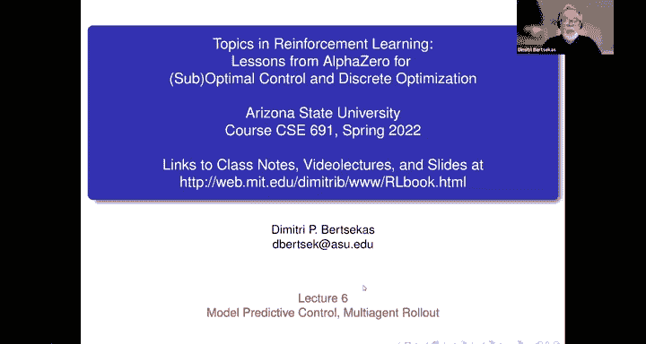

Today we're going to talk about two subjects， model predictive control and multi agent problems and rollout algorithms for them。

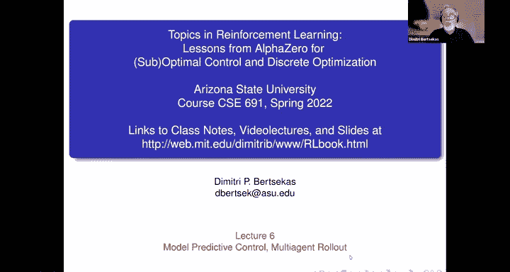

Okay， here's the outline。First， we talk about model predictive control。

 a major methodology in control system design， and also of particular interest to us because it involves a lot of the elements of reinforcement learning。

 and in fact it has a lot of commonality with the Al zero architecture and O TD Gammon architecture that was the starting point for our course。

We're going to talk about issues of stability。Wch are very important control theory。😊。

And also discuss a few variations of the basic algorithm。

Then we're going to talk about multi agent problems。

 problems involving a control that consists of multiple components corresponding to different agents。

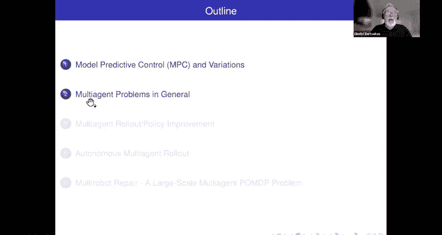

We are going to discuss them in general， and then we are going to。

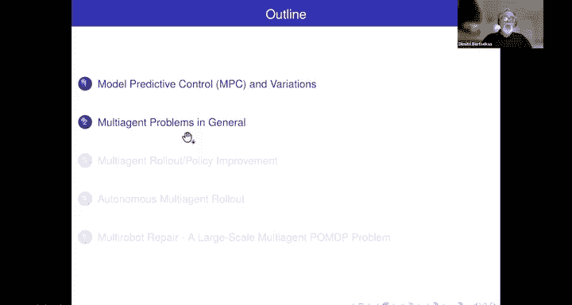

Develop a rollout strategy for these problems that is economical from a computational point of view。

 discuss policy improvement issues around that。Then we are going to discuss the case where the agents have some autonomy and they may be on their own not fully sharing their information and we'll see what happens under these conditions。

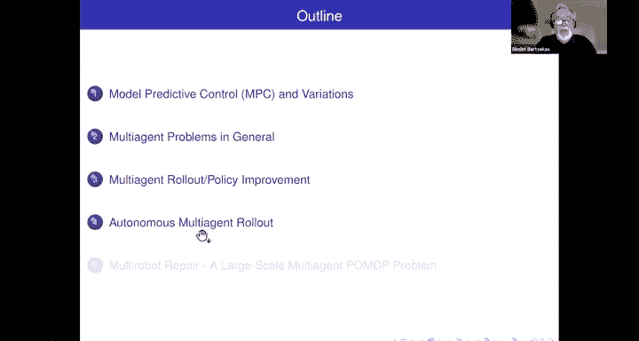

Then we are going to discuss。An application I'm going to show you a demo， not a demo， a video。

 it's not very sophisticated， but I think it conveys a lot of intuition。

 it involves a multi Asianian problem。

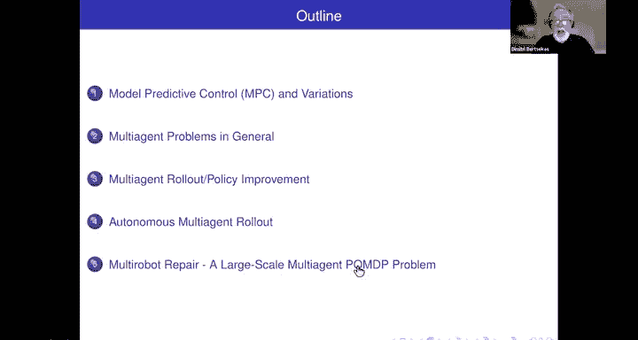

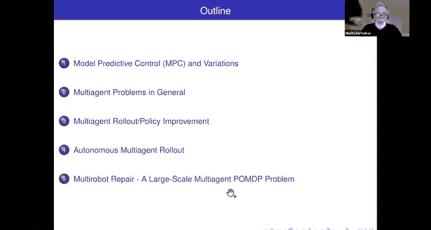

啊。And a challenging pump DP situation， partial。Partial state observation。

 Markgovian decision problem。And actually， I have two videos and the one that's going to be longer is this last one。

So。We're going to go into model protective control now and in this lecture i'm going to use clips。

 video clips from last year's lecture and I'm going to go now to the。

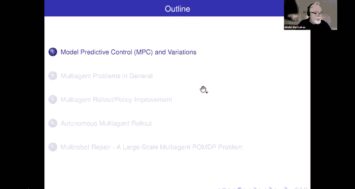

liplip。Its principle area of applications is in control system design。

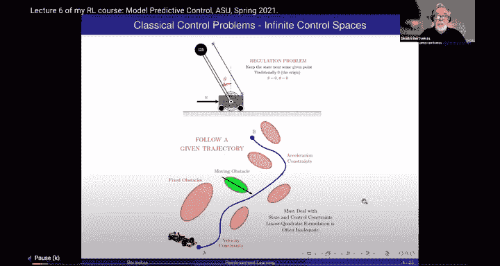

And in particular， it's problems that involve infinite control spaces where some of the ideas that we discussed in connection with the deterministic rollouts do not apply because the number of Q factors is infinite here at any one state。

And there are two major types of problems in control system design。

 one is called the regulation problem where you want to keep the state of the system near some given point。

Traditionally this point is taken to be the origin zero of a Euclidean space。

 if it's some other point， then we can make a translation of the coordinates so that that point of interest becomes the origin in the new coordinate system。

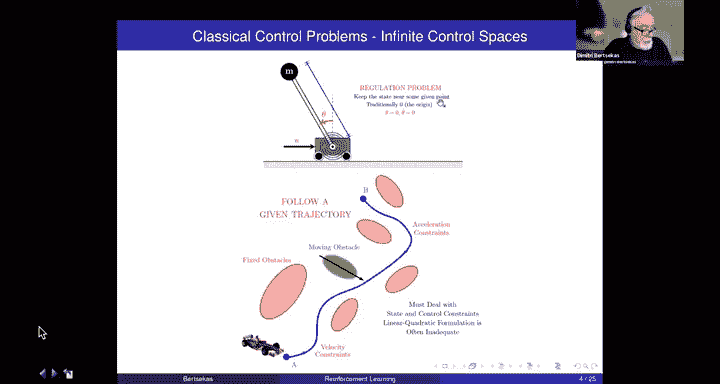

So for example， this。

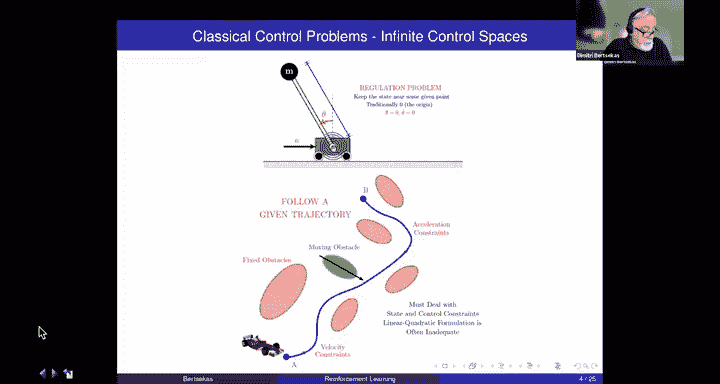

This inverted pendulum problem， a classical problem that is a good test bed for algorithms。

 but also is intuitive， and it relates to keeping this。

This pole that has a message together bit keeping it upright。

Which corresponds to this angular velocity being zero。

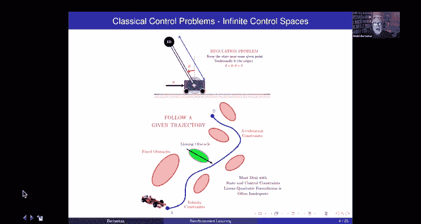

And I'm sorry v angular position being zero and the angular velocityity being zero。

 that's the place where we want to keep this pole and we want to do this by applying control horizontally on this car。

 we move the car so that this mass gets to the upright position and stays there。

啊。So this is a regulation problem and another major problem involves following a given trajectory。

 controlling the system close to some given trajectory， like for example。

 we have this card here and we have a trajectory that we wanted to follow that course from point A to point B。

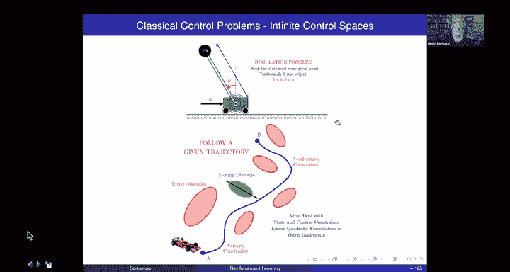

And。呃。We want to do this with minimum cost， but also observing various constraints。In a。

Automated car。

Theseines， there are a lot of constraints that you have to observe。

For example， that are control constraints like。There are velocity constraints how fast or how slow the cat can go。

 acceleration constraints， and display also with the state constraints and the state constraints may be staying on the road。

Avoid some fixed obstacles and also avoid moving obstacles like other cars that may be crossing into your path。

And。So。We have to worry about things like going too fast into a turn and we have to reduce velocity before we go into the turn。

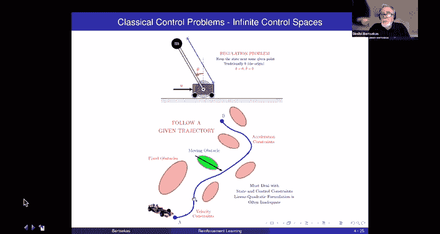

Similarly， we have to worry about cars crossing into our path and we have to do online planninging。

 just get around of those moving obstacles。

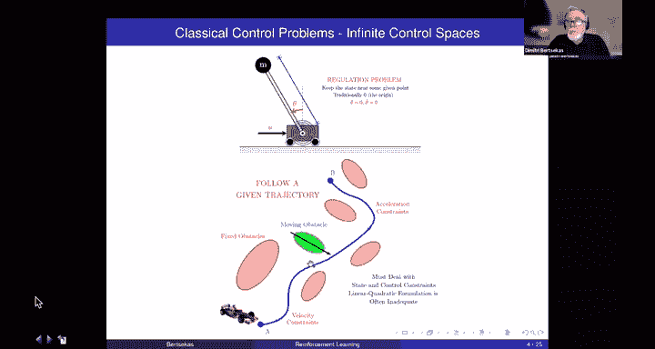

Now， when these constraints are critical， there are safety constraints and you can't deal them in a soft manner。

 deal with them in an indirect way， you have to deal with them directly。

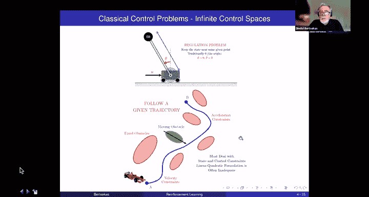

Unfortunately， the linear quadratic formulation， a classical control formulation that we have discussed in this course。

 is often inadequate in this context。Because it does not deal directly with state and control constraints。

 it deals with them indirectly by using these quadratic penalties that may be violated in the formulation of the problem。

This is not acceptable in situations like this。And this has given rise to the to。

Methoddologies that they respect。Fully respect the state and control constraints and model predictive control is one of these methodologies。

 a principle one。

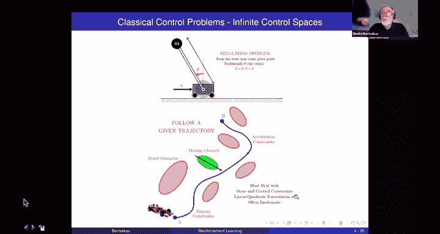

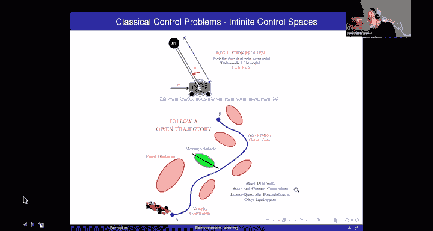

Okay。So now we're going to do there are many different formulations。

 the model predictive control problem， and we're going to call the NPC abbreviate NPC。

 it's a popular acronym。So there are many different types of NPC formulations。

 but the one that we're going to deal with is the original one， which dates back to the late '80s。

We have a system that's deterministic。State Xk control UK and this can be linear or no linear。

But it has。An origin， an absorbing state zero is a state that once you go into you stay there okay。

 that's what this means no matter what control you apply， once you reach the origin you stay there。

 Of course， this is an idealization that would not be true if the problem was stochastic and there was some noise here。

 but we consider in this formulation and deterministic problem。As of approximation。ス。Okay。So now。

The cost structure of this problem encodes our desire to go to the origin with minimum cost。

So there has to be an incentive for driving the system to the origin and this is encoded by positivity of the cost。

 except at the origin where there's no cost， the origin is cost free no matter what control we apply once we are at the origin。

 we stay at the origin at no cost。And we have control constraints。

We don't have any state constraints There are extensions of this formulation that involve state constraints。

 and I'm going to discuss them a little later， but for simplicity， we are going to。

Keep state constraints out of this formulation。We also assume perfect state information the control is applied with full knowledge of the state in practice when this may not be satisfied。

 but what people often do is to use estimate of the state as if they were exact so in other words there may be an estimator that tries to figure out where the state is and then formed an estimate based on observations which are used then by the controller as if by the NPC controller as if they were exact there are also other formulations involving in perfect state information but this is a common one it's easy to explain。

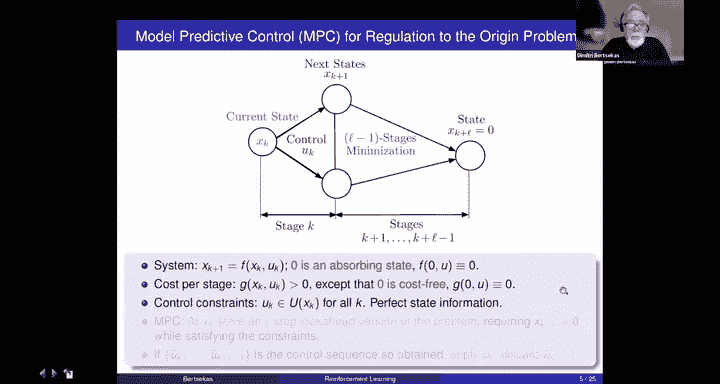

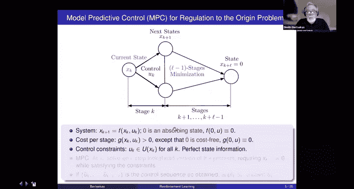

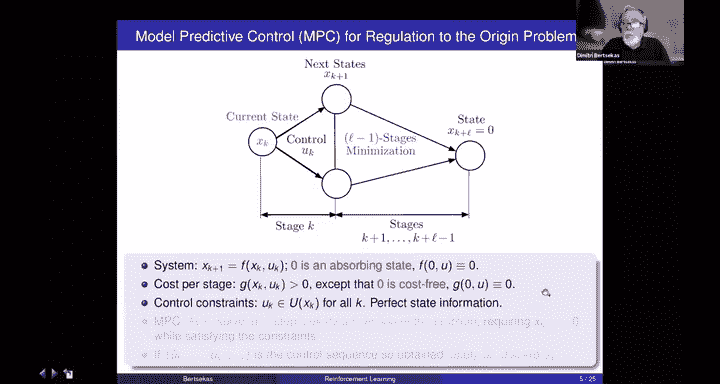

Okay。So this is the problem and what does NPC do？Well。At a state Xk。

 it solves an L step look ahead version of the problem and requires that the terminal state is exactly zero。

Quhyite satisfying the constraints。

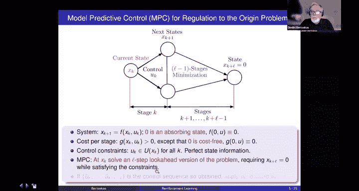

In other words， at Xk， it looks ahead L steps and tries to bring the state exactly at zero。

Minimizing the intervening cost and of course， once the state is at zero， it stays at zero。So。

Then assuming that it can solve this problem， of course。

 the original problem may have much longer horizon may have an infinite horizon。

 so this problem is easier， okay， it has shorter horizon。

And there are ways to address problems like that， particularly since it is deterministic and the the step problem is deterministic。

 we assume that this can be done。Now， assuming that at Xk， you have solved this L step problem。

You have obtained a control sequence， an optimal control sequence for this problem。

And then you apply at Xk， the first component of the solution， and you discard all the rest。

It's like a rollout where at a some state you apply a heuristic and you obtain a trajectory。

And then you keep the first step of the trajectory and you discard the rest。And indeed。

 there's a close connection between MPC and rollout。Which I'm going to discuss now。

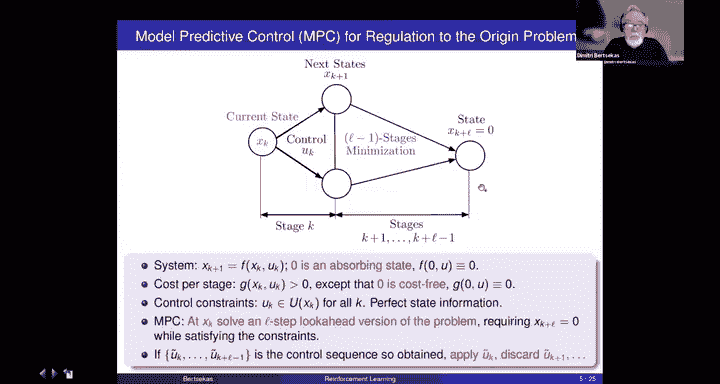

Okay， so what does rollout do it minimizes over Q factors and these Q factors involve minimization over the first stage。

Over if we control the Q factor at Xta in UK calculates this Q factor。

 it then applies a base heuristic。For the remainder。

So this looks pretty much like what we have in NBC and in fact you can。See that。

A PCC is rollout with a base heuristic being an L minus1 minimization to0， okay。

 not L step minimization， the base heuristic is the L minus1 minimization that is at the tail end of this figure。

So this is cost first step minimization and then base heuristic and L minus1 h stages minimization。

And we can fold the first stage with the remaining L minus1 stages into a single minimization to obtain an L step minimization。

 which is exactly what MPC does。So NC does this health step minimization。

 but the base heuristic starts from V。State Xk plus1。And the。

Let's call h of x the optimal cost of the base heuristic。Startving from X。So we are at some state x。

 we do this l minus one step minimization and the cost of this minimization is denied by h of x。

Similar to the notation that we have been using for our lab for base heuristics。

Now it turns out that this heuristic is sequentially improving okay。

 we talked about sequential improvement and sequential consistency also。

 it turns out that this heuristic is sequentially improving， it is not sequentially consistent。

And I can explain this briefly， but we're not going to insist too much about that。

 it's not question consistent because if I start here and apply this base heuristic and then move to the next state here。

The base heuristic from this next state is going to take you one step forward。

 so it's not going to be the same trajectory as the one that the base heuristics generated from this state。

 so it's not sequentially consistent， but it turns out that it's sequentially improving。And。

The definition， of course， of sequential improvement is this inequality here。

The minimum Q factor at x is less than the cost of the base heuristic。Minimal heuristic Q factor。

 going one step and applying the heuristic from the next state。And this calls trivially， okay？

It's very simple to see why this holds why because。

The right hand side is the optimal cost from x to zero in L minus1 steps。

 okay from x to0 in L minus1 steps。And then stay at zero for the additional steps。

Now the left hand side involves the first step minimization and then L minus one step miniization。

And then stay at zero for the remaining steps。So。This optimal cost to reach zero in L steps is less than the optimal cost to reach zero in L minus1 steps。

Because the solution of this problem is a feasible solution for the solution of this problem。

A feasible solution for this problem。😊，The optimal solution for this problem is better than the feasible solution。

So we have this very simply。And now once we have this base heuristic being sequentially consistent。

Be sequentially improving， a lot of nice things follow， including。

Cost improvement。The cost of the rollout policy is less than the cost of the heuristic apply for the same initial condition。

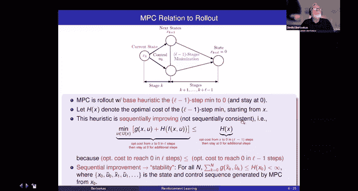

And this translates to this inequality here。This is the cost of the rollout。ok。

For a given initial condition here， let's consider the state and control sequence generated by NPC。

 okay and the rollout algorithm that underlies NPC starting from x0。

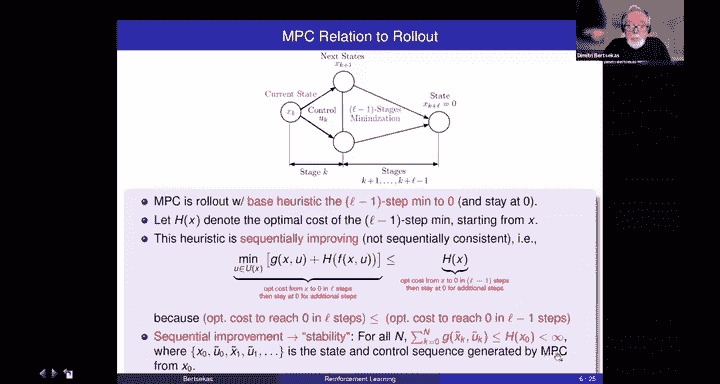

Then sequential improvement implies that over N steps。

This cost is going to be less than the cost of the。

Base heuristic L minus1 miniization starting from x0 and this is finite。

So as you go forward and you generate more and more controls in states。

 this sum remains bounded and because the cost is positive unless you are at zero。

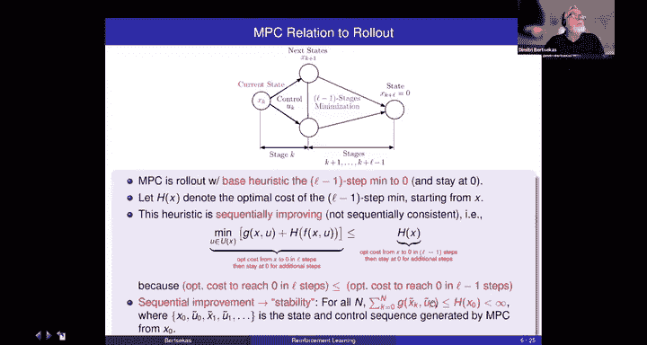

The only way this can stay bounded is if you approach either reach zero exactly or approach it at a fast enough rate。

Controrolled engineers define this as stability okay。

 bringing the system to zero the reference point regulated there at small cost bring it and keeping it there keeping it there That's the notion of stability。

 which for control engineers is paramount Control engineers don't care nearly as much for。

Optimal cost or low cost as they care about stability if your system is not stable， forget it。

 we don't even we're not going to even look at it。So that was the main selling point of NPC。

 it's not just that it reduces cost through rollout。

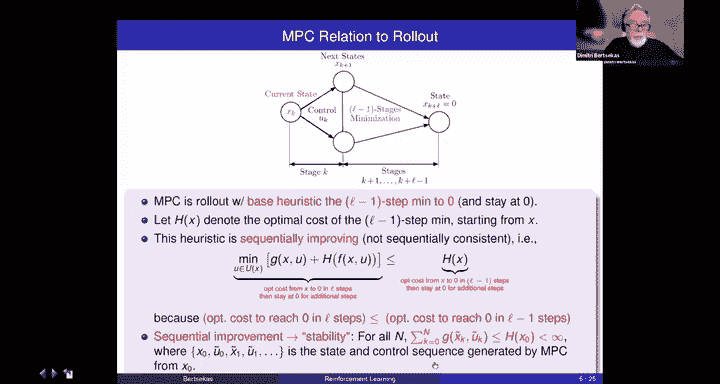

But it。Generates a stable controller。And。People have been playing around with different versions and PC trying for the most part to。

Keep the stability property intact。😡，Okay， are there any questions so far on NC and how you relates to rollout？

I have a question， so you don't necessarily know if you're at state Xk that you will be able to reach state zero within L steps。

 right？嗯。Right， so you don't know that Okay so you're right， it's a good question。 Yeah， go ahead。

Well I was is the idea just to try to make as much progress towards state zero as possible。

 but if you happen to reach state zero before the L steps are up， then you just stay there。

 is that the idea？No， this constraint that you reach the speak。

The reach is zero in L steps is a hard constraint。It's part of the method， Okay。

 now I'm going to get into。A variant of NPC which does not have this requirement。

 but in this formulation of NPC， it is a requirement that you reach the the origin in L steps and if L is not enough。

 you just increase it okay， and there's a certain。This is an assumption here in our context， however。

In control theory， there iss a concept of controllability。Being able to reach from any one state。

 any other state in a certain number of steps and the number of steps for any dimensional system is typically n otherwise we don't have controllability so implicitly here we assume controllability that you can get from any state into the origin in L steps and L must be large enough to be able to do that Okay and then like you brought it up yeah go ahead L doesn't need to be constant from from iteration to iteration right？

Well， in this slide it has to be constant。It is constant， at least for the basic heuristic now， okay。

Okay， for this slide it's supposed to be constant in variance of the method， it may not be constant。

Okay， so there's just an assumption that you will always be able to reach zero within L steps。

exactlyactly， this is， this is an assumption here， and I'm glad you brought it up yeah， Okay。

 thank you。

诶。Okay， guys， I'm going to switch back to slides now。

And this is a good time to ask some questions on what has on the lecture so far。

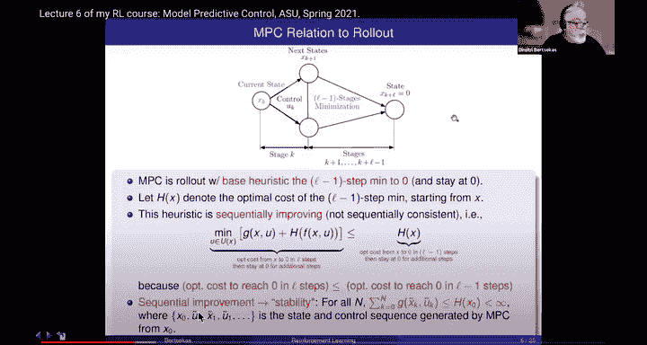

See， yes， I have a question yes， so like you're assuming controllability。

 but is there is there any assumption on like the dynamics can be generally non nonlinear？

Nots of controllability。诶。Become much more difficult if the dynamics are nonlinear。

Usual controllability is easy to deal with for linear systems。啊。

There's also an additional difficulty here that if there are state constraints。

I'm sorry if there are control constraints， then there may be some states that you may not be able to reach from the origin because your control。

 the available control is not enough， basically it cannot do it for you。So。

All of these questions need to be looked at in greater detail。

 but certainly if the system is not nonlinear， then these questions become more difficult。Okay。

So now we are going to discuss a major variation of MPC。

Where instead of requiring at the end of L steps to reach the origin exactly。

 we impose instead a terminal penalty for missing the state， the origin。

So this becomes L step minimization without a terminal state without the constraint that at the end of L steps we hit the origin。

 but instead there's a terminal cost that is positive for x different than zero and zero if you do hit the origin。

So the solution is of this problem is similar to the solution， the previous slide。

And the control constraints are the same， the system equation again， deterministic。

 everything is the same except for substituting this constraint with a terminal penalty。Now。

 once you do that， then we are in familiar territory。

This is just approximation in value space with L step look ahead with terminal cost function G。

 so this is the kind of scheme that we have been studying so far without any rollout but just L step look ahead minimization。

Now we want to discuss the stability of this scheme and more generally how it behaves。

And there's a certain condition。That we would see that it guarantees stability。

This condition is on G， not every G works and gives you a stable policy。However。

 we are going to show that if G satisfies this condition here。Okay。

 you have to interpret this condition as follows。T is the min Belman operator of the problem you remember from a few a couple of lectures back the min Belman operator and the new Belman operator and the abstract framework that we use to interpret various various methods including one step and multi step look ahead。

So this condition translates to this。For all x and this expression is the。嗯。

encodes the T operator acting on G， it's a function of x。

So G is a function of x and tgs of x is another function of x， and we require this condition。

And you may notice also that this condition looks quite familiar and in fact。

 pretty close to the sequential improvement condition that we've been dealing with rollout。Now。

 we can show that this condition here implies stability of the MPC controller that solves this problem at every。

At every step and uses the first control of the optimal sequence at that state。啊。Your your textbook。

Has an analytical proof of this。But what I'll do in this lecture is give you a graphical argument that's far more intuitive it's not quite you can be made rigorous but buddy。

The way I'm going to present is not rigorous， but it's far more intuitive。

And this argument involves the graphs of the Belmont operators and also it involves the concept of the origin of stability。

 okay？In one step look ahead with cost function approximation J Tilde。

We say that J Tilde belongs to the origin stability if the policy obtained by one step look ahead minimization is stable and a stable policy is one that has a cost function that's finite for every state。

 the cost function doesn't blow up。up。All of these concepts。

 original stability and the like make sense。Basically for the case where。

That NPC applies non negative costs and zero a theology。

So that's how we define the region of stability and we can visualize it。As follows。Okay。

 so this week you should be familiar for a couple of lectures ago。

 and it involves the graph of the min Belman operator， the T operator。

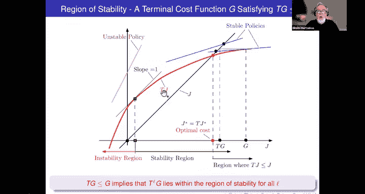

It's a function of J， the terminal， the cost approximation。

We are showing it here in one dimension so that to be able to visualize it。

But it is monotonically increasing。It is concave。And its fixed point。

 the fixed point of T is the optimal cost function。

The Belman equation is j star equals to Tj star。And J stars obtained thing at the intersection of the graph of Tj and J。

And in addition to the men Belman operator。We have the new Belman operators corresponding to various policies。

Now， the new Belmont operators。At linear， they have linear graphs。And they are like so。

 and we have shown that the。

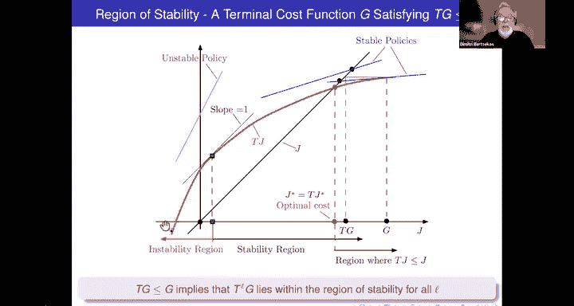

Men Belman operator the red curve is the lower envelope of these new Belmon operators in other one。

 if you draw all of those and take the what lies below you're going to obtain a hypograph of this。

T operator。And。We have interpreted now one step look ahead with cost function approximation some J Tilde as follows。

 we go up here and we find the tangent policy， the policy that comes the lowest towards approaching the point piece of J Tilde。

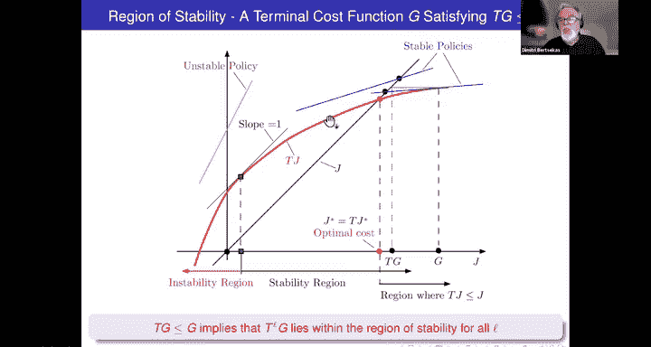

And that is the one step the graph of the one step look ahead pulse。

So for different cost function approximations， we obtain various one step look ahead policies。

And some of these policies are going to be stable and some of them are going to be unstable now in this figure。

 you can see that the ones that are stable are the ones that correspond to cost function approximations that are to the right of this threshold point。

And this threshold point corresponds to the slope here being equal to one。

If all the tangent policies that correspond to points to the right of this have slopeed less than one because of the concavity of the red curve。

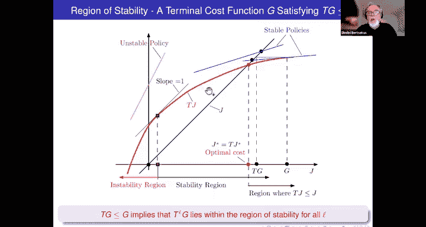

And all the policies that correspond to。To。All the attention policies that correspond to points to the left of this threshold point are unstable。

 they do not intersect the 45 degree line， they have infinite cost at least for some initial states。

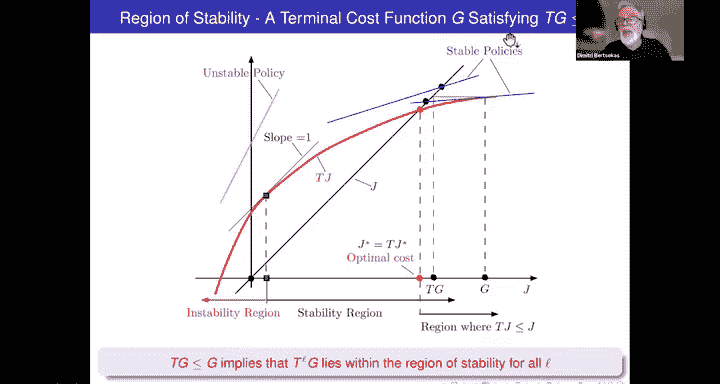

So this is the region of stability and if we pick G。

Within this region， then we are going to obtain a stable MPC policy。

Now let's look at the condition。T G less or equal to G。 What are these Gs？

They are the ones that lie to the right of J star， okay。

 because that's the threshold point where the curve goes below the 45 degree line。

So the region where TG is less than G and more generally， Tj is less than J is this region here。

It is a subset。Of the age of stability。However， if you pick G within this region。Then。

What is the one step look ahead minimization policy， we go up here， we find the tangent policy。

 and the cost function of that policy is bounded。

Above by G and given that G is finite for all x， the same is true for the one step look ahead policy so it is stable。

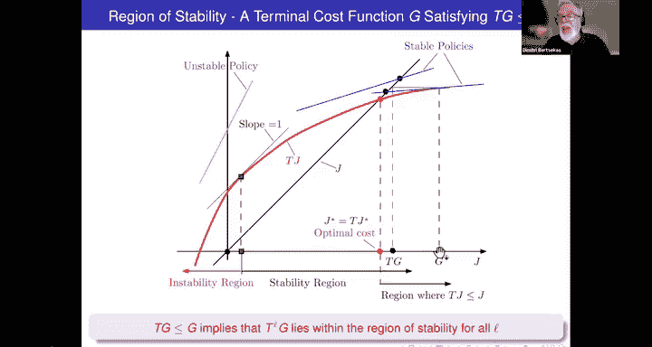

All of these points here。Satisfy G less or equal greater or equal to Tg and also give you stable one step look ahead policies。

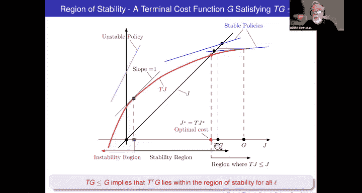

。Now， even if you do multi step look ahead and instead you construct Tg and then T square g and so on。

 you're still going to be in the within this region of。

Within this region here， always line above J star。

So even if you do multi step look ahead， starting with a G that is within this region。

 you're going to obtain a stable policy。So that's the interpretation of this condition here。

In control theory it is often called aapov condition， we have called it also sequential improvement。

 basically it relates to this figure as you see here。I take questions on this figure。

Okay， so let's work on this figure in a little bit more detail and how it relates to stability。

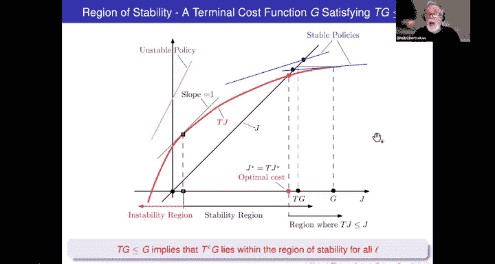

Now we're going to look here at an abstract visualization of NPC with L step look ahead minimization and a terminal cost function G satisfying this condition。

Okay， this picture is a little complicated， perhaps you'll get out of it without understanding all the fine details。

 however it is important to study this figure and the one in the next slide because it will tell you more。

 it will give you more intuition than reams and rims of equations and analysis。

So that's my advice， what I'm going to try to do here is go slowly through this figure and please ask questions if there's something that's unclear。

So we have a terminal cost approximation at the end of L step， look ahead minimization。

 and we assume that this terminal cost approximation G satisfies its condition。

Now， how do we visualize NPC？Okay， so we have again the min Belmon operator， the red curve。

 it has this fixed point， which is the optimal cost function of the problem。

The region of stability starts to the left of J star。

And the correspond to this point for the slope is equal to one。

The region where this condition is satisfied。Starts to the right of J star。

And now let's consider NPC with three step look ahead。

So three step look ahead minimization and terminal cost function G， how would that work？

We go to G。Construct peaceology。And then this square of G。

 and then were ready do the first minimization， that first minimization will give us a tangent policy and that tangent policy is precisely the NPC policy。

 and it has cost function J tilda mu that is smaller than G which is assumed to be finite。

 so the NPC policy is stable。

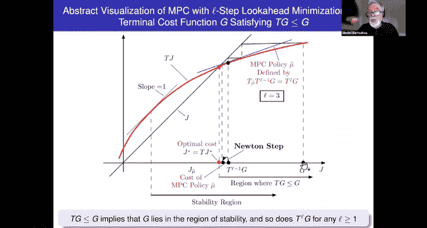

Okay， let me go through this once again， start with G。One step look ahead， second step look ahead。

 the third step look ahead will bring us horizontal to this point。

 but the third step which is the first step of minimization。Finds this tension policy。

Which intersects the 45 degree line at this point and gives you this。Cot。

This is the cost of the MPC policy。

And the very last。

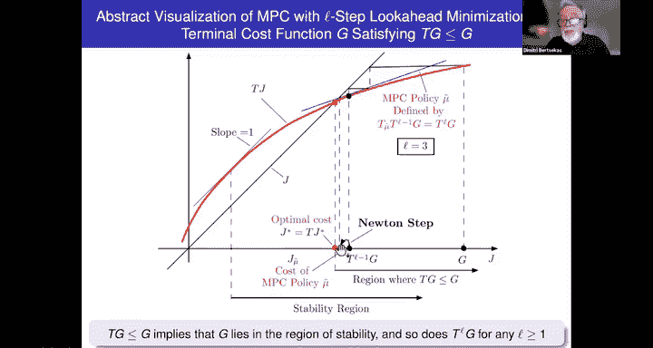

Or perhaps the first， depending on whether you look at it from the beginning of the end。

 the very last minute that is the Newton step。

The rest is preparation for。For the Newton step adjustment of the starting point。

So this condition guarantees stability ofC of the NPC controller。With L step look ahead minimization。

Are there any questions here？Yes。I urge you to understand right to understand this figure。

 I think you'll gain a lot from it。

呃。

Much more than you can get from analysis based on equations and things like that。Okay。

 now I'm going to take you one step further， if you thought that the previous figure was complicated。

 this is even more complicated。😡。

It deals with the。MPC with L step lookhead minimization and M step truncated rollout before reaching the terminal cost function approximation。

So here's a diagram。At a state X， we do L step look ahead minimization。

Operating on the results of MT truncated rollout with terminal cost approximation G and the truncated rollout is done with a stable policy new。

So the operation is abstractly denoted like so teamU M steps of that。

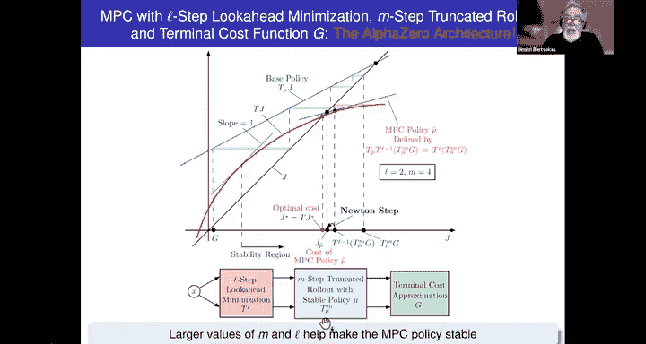

U operating on the terminal cost approximation。And the results of that， which is this thing here。

This thing here。We apply TL L steps of look ahead minimization to it。

And the very step first policy that's obtained from this minimization。Is precisely the NPC policy。

With L step， look ahead miniization and M step transed allowed。Now this figure here。

Involves an extension。And the extension is PM step truncated roll allowed。

 if we didn't have this M step truncated roll allowed。

 it' would be exactly the same as the figure of the preceding slide。

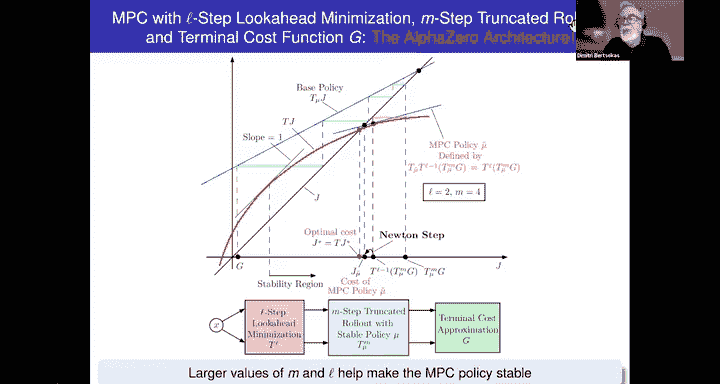

However， now we have a one to one mapping to the alpha zero architecture。

And moreover， this type of NPC。Is very well known and widely practiced in control system design。

 In fact， it is the method that you get。

When you use。TheThe NPC software at MALb。This is what you get the options to set LM and the policy and so on。

And basically。

The NPC people have been doing。About the same thing as the reinforcement learning people have been doing with chess and backgamon and the alpha zero type of architecture。

 it's really the same thing it's matter of emphasis， different emphasis。

 most of the emphasis in reinforcement learning type of applications goes into the training。

 the offline training， the NPC people have been looking far more on the issues of look ahead minimization。

 how you implement this look ahead minimization， and also how do you guarantee that the NPC controller is stable。

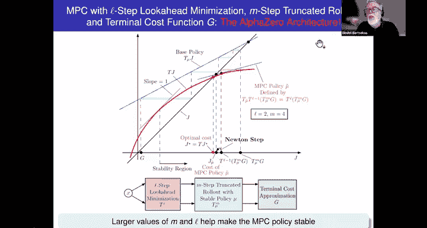

Otherwise。The methodologies are very， very similar。

 and one has to gain a lot from crosspectization of ideas from the other。

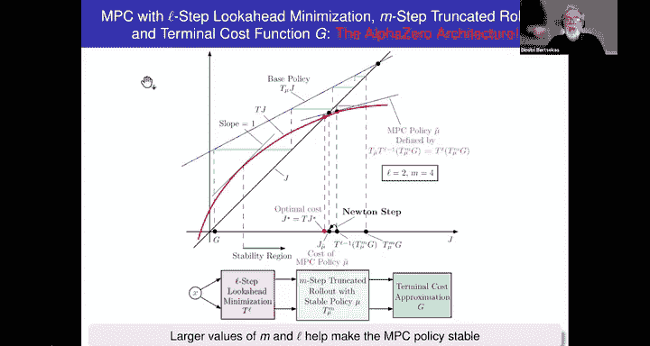

Okay， so now I'm going to try to explain this figure here in terms of the Belmont operators。

 are there any questions as to what we're dealing with here？

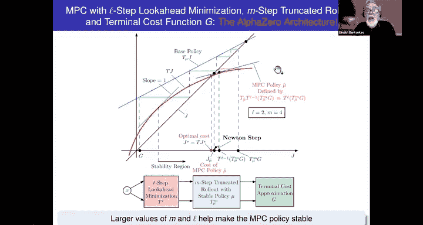

是个什样？Okay， so here's the main Belgmon operator sorry I have a question yes that was a little bit late like when you say like truncetted rollout is what in NPC it's basically the like it's an horizon where the control is fixed。

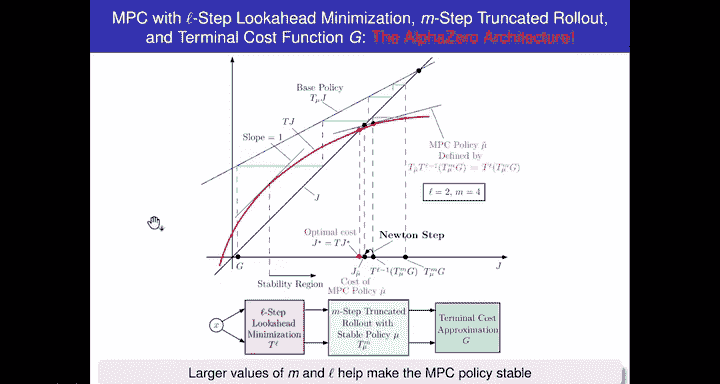

But we still like simulate the system for that horizon。

That's right， Yeah， okay， thank you。 Yeah， yeah， there is a something called the control horizon。

 which is this in the prediction horizon， which is this entire thing， okay。

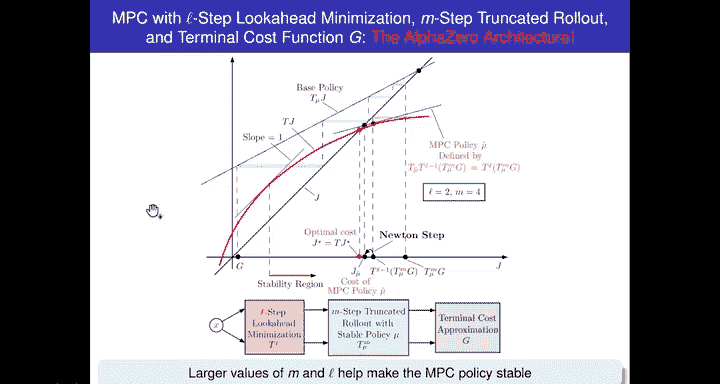

And this part of the horizon involves a fixed stable policy。

So you connect the state policy with terminal cost function approximation G。

 and this is fed as terminal cost approximation to the control horizon。

This is of course a much more difficult minimization than this part。

 okay that's the good thing about rollout it is much a much cheaper substitute for look ahead。

Looks forward with less cost because we use a single policy as opposed to minimization。Okay。

 so let me go now into this figure。We want to translate into this figure， this block diagram。

And we want to construct whatever comes out。As a final cost approximation to the L step， look ahead。

So how is this done， we start with G and we apply value iterations with the stable policy mu。

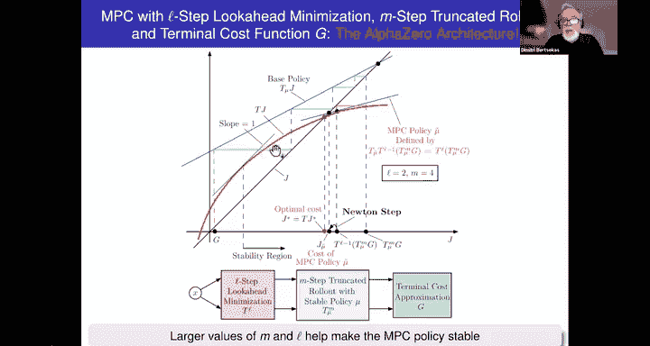

This is the base policy。

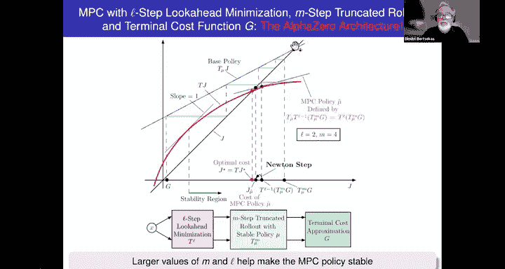

Okay， it is it has a。It has a linear mu Belllman operator。

And the cost function of mu is this point here。I don't show it， but this is what it is。

 is at the intersection。Of this line with a 45 degree line。And。Let's take a G here。

 which incidentally is not in the origin of stability， however。

 we apply truncated rollout to it and then we push it towards the region of stability。

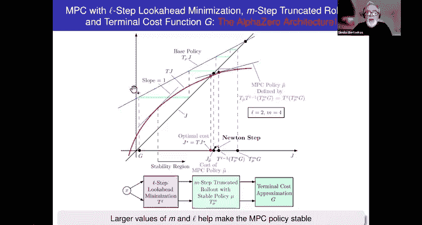

This point here certainly is within the origin of stability。And with the value directions。

 we move towards the region of stability。

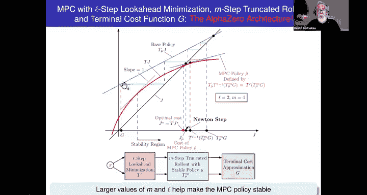

And then we do M here is equal to four。One step。

Take us here。Two steps take us here， three steps take us here， four step takes us here。

This point is team mu to the fourth power of O G。And now this is what's being fed。

As the terminal cost approximation to the L step look ahead minimization。

And now the L step look at minimization does value its。L equals two here。

 So it does one value duration， and then it does。

The initial value duration， which finds the tangent policy and the NPC policy。So in this figure。

 the cost function of the NPC policy is obtained through this journey starting from G。

Roll out four times going here， then coming down here and then look ahead minimization。

Twice once and then。Obtaining the NPC policy。And the last step is a Newton step。

 the remainder is determining the starting point of the Newton step。

And now the nice thing about it is that。It's clear that by doing the rollout with a stable policy。

 we improve the stability properties of the system。We push。The starting point of the Newton step。

 we push the effective approximation at the end of the M step look ahead into the stability region。

 and then whether we do one step look ahead or else step look ahead。

 it doesn't matter once we are in this region， then we get a stable NPC po。

So larger values of M and also L， if you look at variations of these figures。

 make the NPC policy stable。Large values of M pushed the starting point of the Newton step towards the cost of the stable policy。

 large values of L pushed the starting point of the Newton step towards J star， okay。呃。

I know it's a so confusing， but if youve studied this figure。

 youll learn much more than you would by looking at analysis that take pages and pages in complicated equations。

Professor， I have another question like。Here J star like the optimal cost is for an infinite horizon problem or that we try to solve with NPC with L step look ahead or like what is it the optimal cost J star in this case。

 problem that we're considering here is infinite horizon okay？In other words， it's the。The the sum。

Of all the course over an infinite horizon。Now in NPC， we look at L steps， look ahead。And。

We have to assure that J star is finite， okay， this is part of the assumption。

 but this can be guaranteed as follows if we can bring the initial state to zero。

 then we can keep it at zero。For all the remaining steps， so the infinite horizon cost of。

Of that kind of control sequence that brings you to zero is finite， okay？

The main assumption here is that from a given initial state。

 you can bring the state after L stepped to zero， and then after that over un em horizoniz。

 there is no additional cost。So this figure is for an infinite horizon problem。

With positive cost per stage， okay， a lot of this analysis here is predicated upon a positive cost per stage as it is in the case of NPC。

嗯。And， and the。Whereas there are figures like that for finite horizon versions of the problem。

 they are more complicated and we're not going to look at them for the time being。

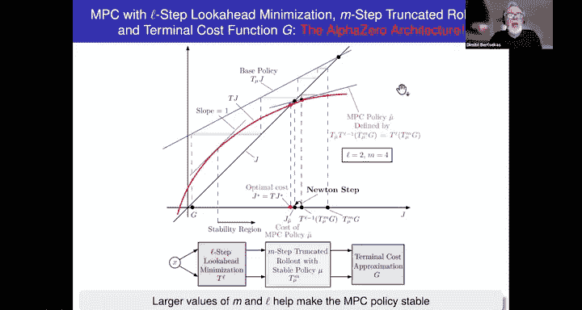

嗯。Any other questions？Okay， so we look at one variation of MPC involving terminal cost function approximation with and without truncated rollout。

It's very closely connected to approximation in value space。

It maps directly onto the alphaze architecture。And it is quite standard in NPC。

So now we have omitted a few things here and NPCs are very。

Very broad subject， it has been the research for now 35 years or so there are many variations we have focused on deter deterministic problems。

And we have omitted something significant。Which is state constraints。

We have not addressed state constraints at all。In practice。

 state constraints can be very important in fact， if there were no problems with no significant problems that involve state constraints there would be no NPC。

 the reason for existence and prominence of NPC is precisely because it can deal with state constraints in ways that a linear quadratic formulation cannot deal and so we have sort of assumed a way this part of the problem。

And it actually。It imposes significant difficulties。Here's the difficulty。

Suppose you have an unstable system okay you look at the system， you see this two here。

 it's unstable if left and control it takes off okay。

 by a factor of the state increases by a factor of two at every step。Now， of course。

 you can use control to bring the state down， but suppose that you have control constraints。

 your control is limited。To be between one and minus one。Then if the state goes off。😡。

Significantly away from zero， then you can't break it back， you just don't have enough control。

So suppose that we have a state constraint。Of this type。But。

The state of the system has to be kept within a cube。A cube is a sequence of sets。

That constrained the states， the successive states of the problem。啊。If。

A is greater than one。Then。If we start close to a or absurd above a。

 the state of the system cannot be kept within the constraint。We're going take off to infinity。On。

 the other hand。If a is less than one， then we can keep the state of the system within the tube。

 no matter where we start within the tube， okay？So that's an important property。

 we need to have cubes that when we start within them。

 we can keep the state of the system within them。And the initial constraints may not be such a cu。

So that's what we need to construct offline。An inner tube from within which the state constraints。😡。

Can be met。other words， if you start within them， you stay within them， you can stay within them。

And this leads to methods of reachability of target cubes。

Cubes with this property are called reachable tubes。😡。

And so subject here to my heart was a significant part of my PhD thesis， long， long time ago。

 you can find all this that my thesis online was the first to deal with this issue of reachability and the ideas found application much。

 much later within the context ofmpC， for like 15 years nobody ever looked at my thesis。So。

All of this is explained in much greater detail。In the textbooks for this course and also。

In the videos。From the previous from two previous offerings of this course， from 2019 and 2021。

 there's a lot of discussion about reachability and how it plays an important role in model protective control。

But。In this version of the course， I'm not going to discuss it any further。

There are other variations。We talked about terminal cost function approximation and doing truncated or law with a base policy。

 how do we get those when it's possible to get them by training with data？

using neural networks or using some other kind of approximation methods to construct them。

 and this ties in with the second part of the course that and the training methods that we're going to start discussing in a couple of lectures。

We have assumed that the problem is deterministic。😡，However。

 there are versions of MPC formulations that involve uncertainty。

 both the cast uncertainty and also mini Max worst case uncertainty。

Now the difficulty with this type of NPC is that the L step look ahead minimization problem is stochastic。

 it's a stochastic dynamic programming problem with the L step horizon。And to solve it online。

 it may be difficult。There are ways to deal with that to some extent。For example。

 simplification of the minimization and a major form of simplification is certainty equivalent approximations。

Whereby we replace the stochastic quantities with deter deterministic ones。

 and we solve the corresponding deterministic problem。

 which is much simpler to solve than this stochastic L step problem。It's important， however。

 to keep stochastic uncertainty for the first stage in order to take advantage of the power of the Newton step。

 it's only if you have for the first step stochastic uncertainty that you maintain the Newton step Newton step interpretation。

So this is something I talked about in in the last lecture， and you may want to look at it some more。

Okay， are there any questions here？We are done with the with NPC， we're going to go into multi agent。

roll out now。

And。And I'm going to switch to a video from again， last year。

就。Multti Asian problems。I talked about them briefly in lecture three。And as I said there。

 it's a very old field， goes back to the 60s。And in fact， my PhD work。

 I spent six months working on this field and got discouraged because it was so difficult。

 at least for those times。

呃。But the field has gathered a lot of steam， a lot of popularity with the advent of reinforcement learning。

It refers to。Multiple decision making entities， which we call agents。Now。

 each agent has a control that it applies。Patient one applies to decision view， one。

 two applies you two and so on， the overall control is the collection of these decisions。

And the agents apply these decisions by using information。

 the information is obtained from other agents or from the environment。And。

And so it's a sequentialial decision process。At time zero， agent one applies a control U1。

 all the agents， U I apply to decision UI， some information exchange takes place。

 a new state is generated。Then there is decision making around again。Information exchange， new state。

 and so on。So we are looking at the sequential decision making framework。呃。Applying decisions。

By this collection of agents in discrete time， based on the information that is received between applying this decisions。

Yeah now this not。

Complicated problem。That involves many applications cases。

But it's very important to keep in mind the major mathematical distinction between different structures of this type。

The first one is the classical information pattern， I mentioned this in lecture  three。

In the classical information pattern， the agents are fully cooperative。

 they fully share information and they never forget information。So they're really part of a team。

 a collaborative team， and they share all the information。Now， if this is the case。

 then we can view the collective decisions of the agents as a single decision essentially applied by a single super agent if you'd like。

 and with that view we can apply dynamic program。So that's the main main consequence of assuming this classical information pattern。

 it can be treated by dynamic programming。Therefore。

 bringing into play the algorithm that we have been discussing。

And the full methodology of dynamic programming。A far more difficult case， relatively speaking。

 is when you have a non classical information pattern。

where the agents do not fully share information， they have some private information and they may also be antagonistic。

 like in a game a game type of problem， either zero sum game or。

A a type of gay。Now， when you have a problem with this type of innovation pattern。

 it immediately becomes very hard because it cannot be treated by dynamic programs。😡。

Not only are approximations essential， but。You have to be， they are very difficult to solve。😡。

In our course， we're going to stick with dynamic programming。

We're going to assume a classical information pattern。But at critical points。

 we're going to venture into the nonclass information pattern case through various generalizations。

But the starting point is a class confirmation pattern。

Whereby the agents have exact taking information。They share all the information that they need and they choose that controls as functions of the state。

So conceptually， you can view this structure as involving some kind of information collecting cloud an information clearinghouse。

 so to speak。Collects information from the agents， collects information from the environment through various sensors。

Condenses this information in all the。Information that the Asians need and passes it on to the agents in the form of state information。

So the state， the exact value of the state that I'm talking about here is given by the cloud which connects all this information that's a conceptual view and of course it may be unrealistic in a given problem。

 but it's a good starting point to understand the classical information pattern structure。

Okay。So now our model is going to be a stochastic dynamic programming model that we know and love from our early lectures。

 finite or infiniteite horizonoriz。

With state noted by Xxk for time K， control UK at time K。

And the only way in which multi Asian problems differ from what we have been discussing so far is that。

The decision。Has this component structure， U， the control involves M components which correspond to M agents。

Now， the term agents may be a little misleading。Agenency is just a metaphor。

 the important structure is just components and components。

And these components may correspond to agents that are。

Geographically distributed within a certain area or the components may reside on the same computer。

 okay？They may control different arms of the same robot based on computations that are done inside the robot。

So agents is just something to gain intuition from。

 but it not the only characteristic is this multi component structure。Yeah。This type of structure。

Involves a lot of difficulty with computations， lots and lots of computation because。

The search space， because of the multiple agentss， may be enormous。

So what we're going to set as our initial goal is to apply approximate dynamic programming and rollout ideas aiming at faster computation。

In order to deal with the exponential size of the search space， the control space。

Even if this used take two values at piece， the search space becomes2 to VM。

 the size of the search space and pretty quickly it can get enormous。

So we wanted to。Deal with that problem in various computations。

 involving law layout approximation value space and so on。And there's a second。Idea here。

 where you want to。To allow these agents to have some autonomy。To be able to apply their controls。

してもテす。Now， of course， it's a bit of a conflict here because they have to exchange information before they before they apply their controls。

 but we're going to try to。

To deal with this difficulty and in the process we will deal in part with issues that stem from a nonclass information pattern。

 nonclass information patterns very much arise in systems where agents are autonomous and they don't quite have time to share that information。

But we view this problem， this issue from the point of view of speeding up the computation through parallelism。

 parallelize the decisions of the agent controls。

Okay。So now we are going to apply rollout to this multi Asian problem setting。

And the only thing that we are going to assume that's different is that U has this component structure。

And to。What I'm going to talk about applies in finite horizon problems as well as infinite horizon problems to simplify the notation。

 we're going to consider infinite horizon problem and notice that the standard rollout operation in the exact form is this。

What do we do here， we do at state X， we do approximation in value space。

By minimizing the approximate Q factor of a base policy mu， in other words。

 we use one step look ahead with cost function approximation that is given by the cost function of this base policy mu。

Now because it's a base policy sequential consistency holds， which is important for the analysis。

However， when we look at this operation， we see that it's a major problem in the multiage setting。

 the search space， the minimization grows exponentially with M。

So there may be just too many Q factors here to compute。And this is a difficulty。

What comes to mind is simplified rollout， where instead we simplify this minimization。

And one form of simplifying rollout is this multi agent rollout methodology that I'm going to discuss now。

Remember that simplified rollout under sequential consistency implies cost improvement。

So I'm going to plan cost improvement at the end of the day。Now， how does this superify rollout work？

Instead of doing minimization over the joint decisions of all the agents taken together。

We do minimization one agent at a time with intermediate communication of the controls chosen between the agents。

So。We are at state X。 we want to simplify this operation What do we do Well。

 we have a base policy and we minimize over the controls of the first agent。Okay。

 so this de miniization not over the combined vector。Of agent controls。

 but just over a single agent control。And how about the controls of the other agents well we used for the subsequent agents。

 we used the base policy controls given x we can compute the base policy controls for agents2 up to M and we can set up this miniization with respect to the。

Control of the first agent。Now this may be a vastly simpler minimization than this。

 if has potentially a much smaller st space。So we do this minimization and we update mutilde one of x。

 this is the rollout control of the first agent。And then we go to the second agent。

 we communicate to that second agent。The rolledout control that agent one has chosen and we do a minimization over the control of the second agent only。

With。The previous agent control chosen already by rollout and the future agent controls chosen by the base policy。

So it minimizes， this gives you the rollout control of the second agent。

 then we go to the third agent， the fourth agent and so on。

 up to the very last agent where we have already computed the rollout controls of hs1 up to m minus1 and we minimize over the last。

The control of a last agent。So starting from X， we have computed the rollout control by means of this one edge and at a time minimization process。

Now let's count the key factors that this process involves。This is exponentially in M。However。

 the number of Q factors is the linear now in M。Assuming a fixed number of controls for each agent。

A search space that' involves like say， two controls or a finite number of controls。

Then the number of few factors goes linearly with M M times。😡，Single agent minimization。

And that's a truly enormous speed up。But the other nice thing here is that this is simplified rollout with sequential consistently holding as a result。

 we have cost improvement， which is sort of a good property to have。

I'm going to explain this cost improvement in a different way also， but I think it's。It's。

It's useful to keep in mind one way， one avenue through which it is implied。

 which is the fact that we are doing simplifying and rollout here。Okay。

 now your class notes do not talk about multi agent problems very much。

 but there's a long survey paper that I have published recently， it's about 70 pages or so。

 and it has a lot of material， both on multiageent rollout and also multiageent policy duration。

 a subject that we're going to talk about later in this course。

And the paper can be found from our website and。This is a survey paper。

 but there were earlier papers from the last two years that are coded there with various variations of multiage rollout。

 various theoretical analysis， and so on。There's also a computational paper with multi agent rollout。

 which I'm going to discuss later in this lecture。Okay。

 so are there any questions on what we do in multi agent rollout in this one agent at a time process？

Okay， so let me just pause the video here and ask for questions do you have some questions about pal agentout。

Okay， we'll keep going with this example， the Sps and flies example。

Iustrate multi agent rollout in the context of this spiders and flies example。

 I think I mentioned this example。In lecture three as well， we have okay。

 we have a grid and there are 15 spiders somewhere within its grid。

And they can move in the four directions up down right left。

Or we can speak where we are。And the objective is to catch。

A number of flies in minimum time。And this flies are the various。

Places in the grid， and they move randomly。In fact totally blind， on the other hand。

 the spiders have perfect vision。They can see where the flies are exactly。

 even though they each time they change position， of course they can update the location。

 they can follow， track visually， the flies。

And。Moreover， they can see where the other spiders are， so at least they can visually coordinate。

 so to speak。

So now we have a multi agent problem， right？Because they have 15 agentss， the 15 spiders。

 and each one has five possible moves， so the number of joint move choices is five to the 15 okay。

An astronomical number。Now， multi Asian rollout would reduce this to five times 15。

 which is just 75 Q factors as opposed to that many Q factors while maintaining cost improvement。

And it works by applying a sequence of one spider that time moves， so the way it works。

We have an order。One to 15 on these 15 spiders。

And the first spider。呃。So next's。It's a move。By doing a rollout minimization。

Assuming that the other spiders use a base heuristic and the base heuristic that they choose。

 we are going to assume here is some kind of a shortest path heuristic each spider moves to the nearest fly directly along the shortest path。

So there is a basic heuristic， a shortpat type of heuristic。And sp down number one。

Assumes that the other spiders are going to follow this base heuristic。

It's going to select one of the five possible choices。Communicate this choice to spider number two。

 which does the same， take into account what spider number one has done and using the shortest path。

呃。

The shortest path moves that for the other spiders。

And then Sp number two chooses one of the five moves， communicates。

 broadcast this move to all the other spiders， and then Sp number three moves， four， or five。

 all of them go in turn。Each time there's five choices and the total is five times 15 for 75 choices。

Now。Here the spiders。Make their moves sequentially。So that slows down the process， in other words。

 spider number two cannot make any decision before it hears from spider number one and so on。

 because these choices are serial in nature。And they are important because they apply coordination。

 basically flight spider number one tells spider number two， I'm going to go to this one。

 you better go somewhere else because I'm going to catch this one。

Within the proper amount of time。我 the other hand。We're going to try to。2。

Introduce a limited form of coordination。By using。Signing information like some imprecied information about that coordinates the moves between the different spiders。

And。We hope to gain some speed up because of the simultaneous choices of the spiders and the speed up is going to be up to 15。

 okay。And so for the moment， we're going to assume that we have full communication of the spider moves to other spiders。

 and later we're going to come back to this。

Okay， so I have a video illustration of this process。

And before I go into that， are there any questions about this？

呃。This problem。Did someone ask a question？Is Pro asking if that is going to be like the classical type。

 like every spider will know the other spider's decisions and the conditions。Yes。

 the video is going to be of that type。Every spider observes。

where every other spider knows where every other spider is and knows the location of the flies and also there is this assumption of one action at a time。

 one spider at a time， whereby each spider learns the moves of the predecessor spiders in the order。

And assumes that there will be the other the。The choices of the following spiders and the order is going to be done according to the base policy。

Okay， so this is the video that I'm going to show you。

And I'm starting it now。Okay， so let me go into the video。 Now I have to。

I'm going to show three possibilities。啊。Two spiders and two flies。

Using the base the spiders use the base let shortest path。

The standard form of rollout and the multi agent form of rollout。

And the base policy is going to be to move along the shortest path to the closest surviving fly。

And I'm going to use the Manhattan distance metric for calculating shortest paths。

And this space policy uses no coordination。All the spiders act the two spiders。

 the first spiders act as if they were by themselves， there was no other。Spy there by themselves。

So now let me see if I can， if I'll manage to show you this video because I'm not very experienced。

 I'm digitally digitally challenged， I should tell you that。

 but you probably have figured that already。

So now I'm going to show。This one here。The base policy。Okay。So。Okay。啊。

So we have four spiders and for this example， they are located right in the middle。And there are two。

Flies like move at random， okay？And this four spiders tried to catch the spider the the spiders tried to catch the flies in minimum time。

 so what would be the reasonable thing to do or the reasonable thing to do would be。

To split off the spider this and two of them go one way， to go the other way。And also。

 since there are two of them and the flies move randomly， it may make sense to sort of try to enci。咪。

The spider， so if randomly goes away from one of the fly of the spiders。

 it can be caught by the other spider。Okay， on the other hand。

 this basic heuristic shortest path is selfish no coordination and let's see how it works。嗯。Okay。

 so now we see that the spiders do not split off， they go towards the closest。Fly， okay。

 in the Manhattan distance。Despite this brake tie by moving along the horizontal or moving along the vertical。

 two of them prefer the horizontal and the vertical so now。With no coordination。

 they have all done the same thing， caught this fly， and then they rush off to the other。

The other surviving fly along the shortest distance is based on the Manhattan metric and the preference that they have between horizontal and vertical。

Now， this guy here moves back and forth up and down and so on， but eventually。

The spiders are going to get him okay， there's no way it can can escape。

 so I'm going to advance the video a little bit。Okay， so now。Okay， they get him okay。So。

That's not very smart， okay。And it took 85 time units to capture both。Both the flies。

So let's see now what the standard rollout will do， okay， this is not multi agent， this is standard。

So this minimizes over。625 Q factors。At。At each move。

It's going to take 34 moves at each one of these 34 time units is going to minimize over 625 Q factors。

Moreover， these Q factors involve a stochastic system because the flies move randomly so it will involve Montecarous simulation。

 so it's quite a bit of computation to compare 625 cu factors but we're going to show the results here and see what kind of。

Policy you get， you expect it to be smarter， right。

 they're all loud is supposed to be smarter than the base heuristic。

 given particularly that we have cost improvement， so let's see what we get。显示。Here's what happens。

 whoops， sorry。Okay。So they both start at the same place。

And what where you're going to see is that they do something more intelligent。

 two of them go that way and two of them go that way。

 they split off because they coordinate with each other through this joint move selection。Okay。

 two of them are going towards this one and two of them are going towards this one。

 They have perfect vision， but the flies move randomly now。

 right And you see that they try also to do something that's a bit intelligent in that。

They try to okay still this has not been caught yet。

 this one has started going in the other direction， okay， having caught this one。

 then it realized a good idea to go try and catch this one。

 but of course it's unnecessary because these two are perfectly capable of catching this eventually。

The expected time to catch is very small。So that's what the standard rollout will do。

And now let's Steve what we。The multiation rollout will do Now this involves a lot more computation。

 only 20 Q factors for each time step and gives you the same capture time performed just as well。

So let's see how this works。Again， the behavior is indistinguishable between multi ancient and standard rollout。

Again， we have split off between the spiders to the doors。

 the two different flies and theres some attempt to。They get close to a particular fly。

And we capture time is the same， must first that drone lives。Okay。

So are there any questions about this demo， I realize that it's nots kind of primitive， okay but。

Okay， I haven't done many movies that。In my presentations I haven't used them in my presentation so far。

 so I'm still a novice and it's a little primitive， however。

 I have heard from one of you whos interested in doing，A project。

 a term project involving spiders and flies， but a much fancier。

 much fancier problem formulation involving a better video among others。

So hopefully in next year's offering of the class， I'm going to have a better video to show。

 but for the moment that's all you get okay how any questions？

Every question so how what would this look like in like a non classical setting if if the agents were being antagonistic would it be somehow like a competition to capture all the flies or is that what。

You sort of meant by that antagonistic agents？Ha。Okay。

This problem does not lend itself to an antagonistic setting， I mean what would be antagonizing here。

 the only way you can have a zero sum game out of this is when you have attackers and defenders。

 so some spiders，are attacking。The flies in some spiders defend the flies， okay。

 that the analogy doesn't hold up very well。Okay。So however。啊。It's a legitimate question。

What do you do if you have both felt？We have multiple agents。

 some of which form a vector of minimizing a cost function that minimize a cost function and some of which form another vector that maximize the cost function。

So that would be a legitimate problem， it's an open question。

 it's an open research question of how multi-ageent rollout would apply to this setting。

 it has not been done， so if some of you want to look at this that could be an interesting subject to explore either analytically or computationally。

Okay。Any other questions？Okay， I'm not done with demos and the next demo is a little better according people I'm sorry。

 I use the word demo and the I meant video video demo is something that's supposed to much more high brow。

嗯。So let me go back to full screen。

Okay。So now。

Let's take a break， take a break for like 15 minutes。And I want you to， if you， if you wish。To。

To think about。How we might approach this multi agent setting in multi agent rollout analytically。

 and I gave this figure in lecture number three and I explained it very quickly but now I want to go to into it a little bit more in depth。

This involves a reformulation of the problem。Whereby。Each transition from state Xk to xk plus1。

Is split off， is unfolded into multiple transitions。

The first transition involves choosing the first control component by agent number one。Without cost。

 we move to this state here， then choose a control the control chosen by agent number two。

 it leads to this state and so on， so we choose controls one agent at the time and the last control involves the system equation to state xk plus one after here we have xk in the first m minus one components。

Having chosen the M component， we are ready to move into state Xk plus1 according to this equation。

 because this UK involves all the components。And this last transition involves also。

The cost of the Xk to xk plus one transition with a discount factor here。

 the preceding transitions involve no cost。Now I want you to think why this problem formulation involving a different state space and a breakdown of the transitions in this way。

Why this is equivalent to。The problem that I have been discussing。And。

I want you to think about applying standard rollout。

 not multi agent standard rollout to this reformulated problem， which involves choices of one。

Component at a time。And also think about cost improvement。

 how it comes into play in the context of his standard rollout。So think about all this。

 the transition from standard rollout to multiage rollout， dis reformformulation。

 which involves a more complicated state space， but a simpler control space。

And。We're going to take this break for 15 minutes and come back at6 o'clock， let's say。

Okay， guys， we're taking a break for 15 minutes and we'll get back。

 think of this question if you wish and we'll discuss it after we come back。

There was a question in the chat。About。The homework， the homework has to do with spiders and flies。

A problem of that kind。The question was whether you're supposed to do videos of your results。

 no you're not supposed to do videos， you can just report the results in any way you prefer and you can use any software that you want to do your calculations。

Are there questions about the homework along that line？Okay， there's some comments in the chat。

Naturally。You're welcome to do videos and present the results in whatever way you wish。

Actually we could use better videos than the one that I have presented in use them in the future。

 so if you want to go into more sophistication， you're most welcome and also if you want to do a project relating to more sophisticated versions。

 more elaborate versions of this type of multi-age problem as the spider supplies。

 you're welcome to do that I think it's a fruitful area where you can learn something from。

Let's get started and。Let me go to。Any comments about？About this formulation？Why is it equivalent？

And how does it relate to？To how does it connect standard drawnout with multi Asian drawnout？

So it's using state space augmentation。For every state。In the multiagent rollout problem。

You're sort of replacing it with。Every possible sequence from one to M -1。

 but also from1 to M -2 of these possible decisions。 So， for example。The， the number of。

Sequences for M -1 agents is going to be the size of the largest control set to the power M -1。

 But then you also have to add all the ones for M-2， M-3 and so on down to one。

 So you have this sort of enormous explosion。In the size of the state space。

 when you are converting it to a standard rollout problem。Yeah。Yeah， the two problems are equivalent。

 In other words， the one where the transition is just straight from xk to xk plus one using。

U control， that's a joint control over all the agents， okay。

 and the one that we're breaking down the decisions into multiple decisions。U。

Policies for this problem， the reformative problem。

Can be represent also as policies of the original problem you take a policy here that's a function of the current state。

 let's say this one is a function of the state Xk and UK1 UK1 is given by some policies so altogether U two is also given by a policy so you're not gaining any new policies here the in the。

be a reformated problem。And for every policy of the reformulating problem。

 there's a corresponding one of the standard problem with the same cost function。Therefore。

 the two problems are equivalent from the point of view of optimal policies and optimal cost。

But as Jamieon mentioned， there is the。The state space grows enormously in this reformulated problem。

W is the control space is simplified anonymously at the same time。

 so we're trading off control and state complexity。It's an old idea， by the way。And。

And what's happening here is that。If you were to solve this problem exactly。

 you would have to deal with cost functions that relate to these parts of the state space。

Additional cost functions in addition to J of X。呃。However。When it comes to rollout。

 that doesn't bother us because rollout does not look at the size of the state space at all。

 All it looks is just a current state and looks to apply control out of one control out of the admissible controls。

In having to do that in stages makes things simpler for rollout。Moreoverover。

If you look at the structure of multi agent rollout。

 it's just the same thing as standard rollout for the reform rated problem。And whereas， as I said。

 the size of the state space does not adversely affect the application of rollout。

So we gain from this， we gain the cost improvement property。The multi ancient rollout。

 the standard rollout of the reformated problem， therefore it improves the cost function of the reformated problem。

 which is the same as the original problem。So that's one other way to verify the cost improvement property for multi agent rollout。

There are three different ways， one is through simplified rollout analysis。

 the other one is what I just mentioned here， in the third one which is analytical。

 you'll find all this in this survey paper that I mentioned earlier。And of course。

 the main benefit here is that the one step look I ahead branching factor is reduced from。

And to the M to end type exam， where n is the number of possible choice for each component。Okay。

So let's go now into a special case。Multi agent MPC， okay， NPC is like Ron。

So what how can NPC benefit by applying multi Asian rollout？Well。

 there's one case that I can think of， but perhaps there are others。Suppose that。

That you have NPC where the control consists of both discrete and continuous components。

So it has a continuous component， which I call V。It has some discrete components。

 like inger variables。Now。We motivated NPC based on problems with continuous control space。

 but we made no assumptions about the structure of the control space NPC， the analysis I gave you。

 the stability analysis applies to discrete control spaces， continuous control spaces。

Or mixtures like here。This kind of situation can be useful in a number of settings。For example。

 this wise may be system configuration variables values。Of Y K being1 or0。

 make correspond to different parts of the system being configured in the position one or zero。

Like for example not。You know， our system。不不了。Where you want to address。Economic power generation。

This YK eyes may correspond to the I unit， the I generating unit being online or offline。

 being on or off。And in power systems very often， in fact， that's a matter of course。

You have generating units turned on when the period of high demand turn off when period of low demand。

So turning a unit on and off is part of the optimization。

And then there also continuous fire which how much electricity to generate from the power plants。

And okay， so this is a。This is an example where this situation may occur。Now。

 if you're trying to apply。Playing vanilla NPC with a control space like that。

 you have a serious problem。Because the NPC problem。

 the NPC minimization over L steps becomes an integer programming problem with a potentially largest number of integer variables。

 this why it's complicate a solution a lot。啊。And therefore。

 it would be nice if you could treat this wise one at a time。

 as you would in a multi ancient type of runout。So how would you apply that kind of rollout in this setting。

 you need a base policy which may consist of a nominal configuration that depends on the state。

 so the base bo gives you for each state， a set of discrete components and a continuous component continuous control pointss。

And in a component by component， that multi Asian version of NPC at State Xk。

We first choose the discrete variables one at a time。

 an easy optimization problem with all future components fixed at the value determined by the nominal configuration。

And then after you have chosen this y values， choose the continuous component to drive the state to zero in L steps with meaning cost with the discrete components fixed at the values that you have calculated earlier。

So this simplifies a great deal， the NPC problem and separates the difficult minimization over the y variables from the continuous minimization over a VK。

 and these minimizations can be approached with different methodology。

 like the continuous minimization may be approached with known nonlinear program。

 whereas the integer minimization may be approached with compial integer type of integer programming type of methods。

So。That's the you a nutshell， we。The idea here making we look ahead minimization simpler by separating the components and treating them one at a time。

And。The stability property and the cost improvement property of NPC is maintained because multiage rollout has a cost improvement property and its also a simplified form of rollout。

 simplified form of NPC。So are there any questions here？Okayケ。

Let me go into the question of autonomy。We want the agents。

To act more or less independently and not to wait for each other to apply their controls in sequence。

On the other had the multi agent rollout operation。Is inherently serial。

So how can we parallellyze it？First， to get excellent speed up and also be able to introduce some agent autonomy into the process。

Okay， so what's the obstacle to panelization？To compute the agent L rollout control。

 we need the rollout controls of the preceding agents right this is how multi agent rollout works。

We choose the rollout controls of the ages one at a time。

 and we pass on the values to the future agents， to the next agents。

So the reason we have to wait and do things seriouslyly is because of this need to communicate of early Asian communicator controls to subsequent agents in the order。

Now。The idea here to remedy this is。Is to use pre computationut。Precomp。We rollout controls。

And use guesses。These mu hats in place of the preceding rollout controls。

 do some preconutation and figure out what are the rollout controls。

 roughly that the multi agent rollout algorithm would apply at state X。

And give them to the Asians so they don't have to wait to hear from the other Asians in applying their own controls。

 they use these new hats in place of the mut Tiness。Now， this opens a great deal of。

A great number of possibilities。One possibility that comes immediately to mind is for the agents to use instead of the rollout controls of the preceding agents。

 use the base policy controls。In other words， users new hat， the base policy。Mu。For each agent。

But I'm going to argue that this may not work well， maybe quite unreliable。😡。

Because essentially that throws away all kind of coordination between the agentss。

Another possibility。Is to do some pre computationut and train a neural network。

To emulate approximately the rollout policy controls and use the output of the neural network。

And thereby obviating the need for serial computation。

The agents do not wait to hear from other agents， they simply use the neural network output。

 which has been trained offline。And there are also other possibilities that are problem specific。那。

I'm going to show you what will happen， first what will happen if you use this approach。

 which is the simplest right， you don't have to do any preconutation。

 you use base policy controls in place of rollout controls in a multi Asianian setting。

And here's an example。Using the base policy for signal and what's the pitfall with that？

Here we have two spiders and two flies。And theyre on the line。

In the spider tried he cast the flies in minimum time， and the flies are stationary。

 they are not moving randomly as they were moving in the in the grid example。

The spideries have perfect vision， perfect information and the flies did not move。

And let's consider our baseball is here。Whereby。Each spider moves one step towards the closest surviving fly。

So let's say that this is the state， the two spiders are in dislocations and okay。

 so Spid one looks at the two flies and says which one is closer to me， let's fly number two。

 so it moves one step towards that。Spidder number two。That the same thing。

 looks at this fly number one， fly number two， and moves again to its closest one。And。

They don't make any attempt to coordinate， that's the base policy。So given a state。

We look at the closest flies and we move the spiders one step towards them。On the other hand。

 this is not optimal， right， because for example， for this state here。The base policy would move。

Both fly both spiders towards this fly， this spider is going to arrive first and at that point they both reverse course and go towards fly number one。

 right， they move one step towards the closest surviving fly。On the other hand。

 the optimal thing to do。Is clearly to strip the spiders and have one go in one towards one fly and the other one go to the other fly。

The split has to be done so that this one does not go to this and this one goes to that。

 they split towards their closest flies。That's clearly the optimal points it require it。

Catches the flies in minimum time。Is this clear are you guys following what's happening？

Are there any questions？I think it's pretty clear。Yeah I'm glad to hear that。

Ask questions if it is clear， okay？😊，Because I just get to speak to myself only and that's not very good。

Okay。So okay， so that's， pretty easy to see that the optimal solution is to go towards the closest flies。

Now， something that's not obvious is that if you apply the standard rollout， not multi agent。

 but just the standard rollout where the spiders jointly。

Choose their moves it turns out that the standard rollout is optimal for all the initial states。

 no matter where you start it will be optimal。Of course。

This connects to the cost improvement property of rollout。

 but it's nice to see that it actually works optimally for all the initial states。And okay。

 so I'm going to go through this very quickly， but I'm going to ask you to do this as。

As an optional homework。To verify that this is indeed true。Okay， it's time to draw out。Okay。

 I'm going to do this， it turns out that the Asian by Asian。

 the multi Asian rollout is also optimal for all initial states。

And this can also be verified and let me sketch the proof of that。

Let's say spider number one selects a move first and then spider number to select。

Then spin number one looks like the two Q factors going here。And then going here。

And going here and then going again here， because the base heuristic is got towards the closest。

The closest fly。那。It assumes also that the。So it contemplates these Q2q factors and it assumes that spider number two and subsequent choices of spider number。

one are going to be based on the basic heuristic， go towards the nearest flag。

So if we go and choose this move， this Q factor， we're going to end up closer to this fly。

 but fly number two is going to end up catching。That fly first so this move was wasted on the other hand。

 this move here is going to gain a leg up is we're going to be once spider number two catches fly number two we're going to be one step closer to catching fly number one And if you compare this cu factor and this cu factor this one will win as a result spider number one is going to move。

Where're going to choose this move and then it's pretty easy to see that spider number two is going to choose that move。

So。In with this implicit coordination。Trying to take into account what the other spider is going to do based on using the base policy allows us to differentiate between the twoq factors and choose the optimal one。

So that's roughly the idea， but I want you to verify that it's going to be a good exercise of whether you understand the definitions if you can figure it out。

 if you can figure out that this，These two statements are indeed true。Okay。

 so this is agent by agent rollout。Taking into account the rollout control of the preceding policies。

Now， suppose that we use signaling using the base box。Then there is no coordination between spiders。

And it actually turns out that it roll out with this base policy。Workch optimally。

For most of the initial states。But there's a significant exception。

Suppose that the spiders start at the same location， one on top of the other。

Then if they have no coordination， they're going to move towards their closest。

The rollout algorithm with this signaling policy。Yous not going to be able to differentiate between the two directions and if one chooses in one direction the other one will also choose in the other direction。

 so they will always move in unison and they will be oscillating and never catch the flies。

In particular。If both of them start in this location。

Rollout with base policy for signaling is going to move in the wrong direction。

 it's going to take us all the way to the left up to the point where we reach the middle and at that point we reverse course and then go back and forth like that。

You can， if you wish to try to write a little software program。To test this behavior。

 and that would be a good exercise if you prefer that for analysis。

 but you can see this from analysis as well。So let me not。Discuss this point further。

 Ill leave this to you as an exercise to verify it。

 but I'm going to show you a similar phenomenon in the video that I'm going to to to。

To go into it now。Are there any questions？Okay。So。This is so。

This is the recent paper that I did with four of my ASU colleagues。who by the way。

 is are great for this course。Professor Stephanie Gill who has moved now to Harvard。And。

This is a paper that we wrote a few months ago。And you can find a copy from my website。

And it deals with them。Multi robot repair。Of a network of damaged sites。Okay。

 so we have here a network of science， figure of a pipeline here。Pikeline network。And some parts。

 in these locations， there are several locations in this network that may be damaged。

May have sustained some damage and there are five different levels of damage in their。

Co there there are。They are illustrated here by this symbols。

 so this corresponds to damage level zero， which is like this site is， not damaged。

Level one like this one， slightly damaged， level two。

A little more damage， level three， even more damage， and that's the worst kind of damage， okay？

Now there's a cost to be paid for leaving an unrepaired site。呃。🎼But for living aside un repairpaired。

And a big complication here is the fact that。We don't know。The damaged level of its size。

We can only find out about it if we actually the robot goes there。And inspects the location。

 in which case it finds out the level of damage。Moreover， the damage level changes over time。

 it deteriorates according to a known markov chain。So from。

Slightly damaged can go to more damage and even more damage and so on over time。

So what we have here is upon VP。呃。A partial state， partial consideration might be a decision problem。

where the exact state is not known， but we receive observations about that state。

 and what are these observations， there are these inspections。

 when the robots go to the different sites， they observe the condition of the site and they ascertain which level of damage it has sustained。

So， here。The state。Is the set of robot locations here we have four robots。

 okay this this four of them and。They can be anywhere in the pipeline and they move one step。

Per time unit， one step at a time。And the state of the system is a set of robot locations and the conditions of the damaged level of the sites in each one can have five different levels。

So the number of states is astronomical， even if you had perfect state information。

 the number of states would be astronomical。Moreover here you have partial state information。

 which means that the state of the system is actually the belief state over the state。

 the set of probability distributions over the site damages， plus of course。

 the set of robot locations。

So we have upon Dp the belief state。Evolves according to a known process because we assume that there's a mark of change here that's known。

How the damage levels progress。Probabilistically。And the controlled choice of each robot is to。

Given that it is a certain location。Either inspect and if it's damage to repair。

Or to inspect and move to an neighbor site。However， repairing takes one time units。

Which is time that you may need to go and visit a more damaged location。So trade off here is。

Fixing damages early， spreading other robots。

More or less evenly within the pipeline。And also， take care。Of urgent。Damages。

 damages at the highest level which cost more per unit time。

 You want to rush robots towards this highly this this most damaged locations so that they don't cost you as much。

So that in a nutshell is the problem。It's a very， very challenging problem。😡，UpAnd up and。

We have addressed it with。

With rollout but。Unless you use multi Asian rollout。

 the problem becomes extremely difficult because there are just too many Q factors here and this Q factor to calculate cost you because you need one kind simulation。

Here we have shown， I'm showing four Asians， but the number of agents may be larger， maybe。Maybe。

 then。15，20 were really very high numbers。 but in other versions of this problem， in other settings。

 the number of agents may be。In the hundred its okay。So， any。

Any thought of standard rollout is out of the question and multi Asian rollout becomes。B。

The only hope that I know of， at least if you want to apply an approximation in value space type of method。

So that's the problem and I'm going to show you some videos of solution。

To give you an idea of how this multiage rollout works with possibly signaling or without signaling。

Are there any questions？Is the problem for nation clear？

We have upon DP with an already very complicated but discrete state。And。However。

 the poP involves a belief state， that's the one that we are operating on and this a state space of probability distribution。

We have multiple agents。And。We have。We have a system equation that involves the belief state。

And the Q factors are calculated by Monte cardo simulation using the known Markov chain。One question。

 are all agents aware of the same most up to date belief state。Yeses。呃。Yeah， we assume that。

That the inspection results go up to some computational cloud。

That calculates the belief state and passes it on to the agents。Okay， and there's stood。And。Now。

In our formulations so far， we have considered。啊。Damages that are uncorrelated with respect to location。

 in other words， the damage is this location is uncorrelated with damage in neighboring locations。

This simplifies the problem because the belief state becomes。

Becomes a Cartesian product of probability distributions。Corresponding to the different sites。

 this is called a decentralized pond DP or de pump DP in the literature of pump DP problems。

The more complicated problem is when there are correlations。

Between the probable distributions of the different sites。

And then there's no way to pass on the probability distribution。To the agents。

 because it's a very complicated object。

And that would therefore necessitate like a computational cloud。

Pass uses some kind of neural network to represent the。

你。The belief state and passes on the neural network output。To the to the Asians。

Of course that's a more complicated version of the problem。And I don't know how it would work out。

 but is。It's one step。He them。哎。Is the next step， one of the next steps from what we have done so far。

Okay。So， now。I have。I' got you three videos， three of those four。One is the base policy。

Where all the agents。Auththor Roberts。They go。To the nearest site。

 each one goes to its own nearest site that has some damage。

 in other words has a probability distribution that indicates that some damage is possible。

And that's the decision it makes and also the base policy， if it finds a site that has damage。

 it fixes it， it doesn't skip it to go to a more urgent to go and address a more urgent repair。

So the base policy is pretty naive， okay， shortest path the greedy and so on。And。

And then the other video has to do with multi Asian rollout。Where the robots。

They choose they make moves， control they make choices serially one after the other。

 so Robert number one chooses what it wants to do and then sends the information to Robert number two。

 three and four， okay so this is the multi agent rollout algorithm。Now。

 this algorithm here is multi Asian but trying to cut corners， introduce signaling。

 and in particular the base policy signaling， like in this two spiders and two flies example that I gave earlier。

Now we're going to see some pretty bad stuff from this one。And we also have another。Another video。

Where the signalling has been calculated with a pre traineded policy network。

And I'm not sure that I can show you that， but here are the results， okay。The base policy cost。

And this is a discounted problem， we formulated it as a discounted infinite problem。

The base policy cost is calculated to be 50 to 94， takes 30 steps to fix all the damages。

Assuming that once you fix a damage， it doesn't become the site does not become damaged again。

 so fixes are sort of permanent。Multi agent rollout takes a lot less。嗯。

Nice steps。This one with base policy signaling works pretty bad， okay， and I'll show you why。

And with signaling。呃。Based on a pre computeutd neural network policy。

Is in between these two he tries to emulate this， but it does so。

Approximately， only approximately， therefore it loses some performance。

 which is reflected both in costs and in number of steps to terminate。

Now I'm going to discuss Roland here。But I will return to this problem in the future。

In the context of policy duration。Infinite horizontal policy duration。

A multi agent type of policy iteration。So now let's see， I have to show you the videos。

I'm going to show you this one first。

Okay， just one moment。Okay， the base policy。Okay， it's a higher quality video than one I had before。

And。I have deliberately started all the robots in the same location。Now， this base policy。

 the shortest path of greedy policy， has no coordination。

And what you expect it to do is the robots ignore what the other robots are doing。

 they all go to the closest damage， right？And because they start at the same location。

 they will all be doing the same thing， the exact same thing。So let's see if that happens。

They start here and they all do go to the same place one of them fixes the。嗯。

Bes while others have to wait。Notice that new damages pop up become worse。

 but this one has perfect vision about which sites are damaged。

 some will are damaged and it moves accordingly and now it's finished。And。

Here's the cost accumulated cost in this 30 stages。Okay。So the base policy has no coordination。

 Let's look at the。Let's look at the multi Asian rollout。Without signaling。O。

So now all of them start at the same location。But they tell each other what they're doing。

So we expected we expect to see the robots spreading up and say， like number number one say， well。

 I'm going to go this way， you go some other way and this guys and then all this information is passed around and they intelligently divide their tasks among themselves and spread out throughout the pipeline。

So there you see some of them go one way， some of them they split off。And。Pretty quickly。

After nine stages， they have cleaned up the pipeline and the course is much lower。Okay。So now跟一小 you。

Oops， that's not the one I went。Okay。So this is multi agents roll out with base policy signaling。

 in other words， the Asian don't wait to hear from the other agents。

 but instead assume that they will be using the base policy。Okay。

 now this is like the bad case of the two spiders and two flies example， let's see what happens。

They just can't make up their mind and they go back and forth。And the and the。ok。

 they never go do anything。And the cost will stay finite because this is a discounted problem， okay。

 well discounted problems have finite costs， but it's clearly very bad and so obviously this policy is doing some very。

 very bad things。What's the reason that it goes back and forth like this？Well。Let's take。

The first one agent。The ancient considers its Q factors。

 the Q factor of going here and the Q factor of going here。Now。Okay。So。

This is agent number one that's considering these two Q factors。

 and it has to figure out what agent number two is going to do。

 Now it assumes that agent number two is going to use the base policy。

 So agent number two is going to go here。The closest damage。

So agent number one says that this agent is going to fix this damage。

 so I shouldn't be going this way， I should be going that way。

 and that's why he decides take to make this move。Now。

 agent number two is going to think exactly the same way。And it also is going to move。To this site。

Because he thinks that this one is going to go that way。And similarly。

 all of them have group think they all think that somebody else is going to do something different than what they're actually doing and they move back and forth like this。

 so that's the danger of using signaling with a base policy that that it's just neglecting any kind of coordination between the agents。

Okay， are there any questions about what's happening here。

 what's the confusion and what the difficulties are with this？Okay， so。Let me show you the last one。

 which is。Which tries to emulate by using a neural network。

 it tries to emulate this multi agent rollout function。Okay， I'm going to go quickly through that。

It's going to do similar things， but less perfectly。Again， you can see that the Asians split up。

They have split up。But they're doing it less intelligently with less efficiency because the neural network is not passing correct information。

 entirely correct information。So as a result， you have。

You have that with neural network ciing， we get something we got performance。

That's in between these two。Okay， so this was my last slide or the next to last I have one more slide about what we're going to do the next time my there questions here's your last last opportunity to ask questions I have one how what kind of data is used to train that neural network in the last example。

Yeah， okay。Well。嗯。We wanted to obtain a policy network that emulates the rollout policy。

So we simply run the rollout policy。Otain training data from the rollout policy， in other words。

 at different states， we obtain data as to what the rollout policy， the exact rollout policy will do。

multi the agent on outes。And then we train the neural network on that data。

 it's going to construct a policy， that's going to be sort of similar to the rollout policy。

 but not exactly the same because the training is imperfect， okay。

So the data is based on multiple runs of the multi agent rollout policy or yeah。

 the multi agent rollout example。Yes， and this is all done offline you do a lot of computation offline in order to be able to do faster computation online in order to avoid to have an ready made precompd coordination。

 basically。Okay， that makes sense。Okay， excuse me， Professor。 I have a question。

 I just wants to know， is it possible to solve this problem with the I mean。

 rollout itself the one that all agents decide at once。Yes， yes， but it's very time consuming。

 but it's possible in principle to solve it。Oh， okay， okay。

 And then we should expect it to have better results。

 or at least the same results as multiage rollout， right。

The theory does not tell you whether one form of rollout is better than the other。

The standard drawout or the multi Asian versions， there is no clear superiority of one over the other。

What's going to happen an individual in a particular case like this problem？It's not very clear。

 we haven't tried it because the standard of rolled out is too time consuming。 Okay。

 a lot more Q factors to calculate。Basically， it requires four。Okay， this。Okay。

 each agent has a number of degrees of freedom， right and also fixed or not fixed。

 So it's something like like。F to some power， okay？That depends on the branching factor here。

With10 agents， it becomes overwhelming with foreign agents， perhaps we could have done it， okay。

 but we just haven't done it。2。So in principle， there is no clear superiority， analytically speaking。

 there is no clear superiority of multi agentent rollout versus very the standard rollout in practice。

 however， the two， at least for this type of problem and for the spiders and flies type of problem。

That pretty much the same， okay？There's no。There's no intuition that would favor one type of algorithm over the other。

That's all I can say for the moment and we're doing other experiments at the moment。

 and we hope to have more insight into this question going forward。Okay， thank you。

Any the other questions？I have a question about a neural network。 So。

 so because your policies is change with time。 So when you， when you generate new policy。

 the the network will also change， right。Well， for a given problem in a given base policy。

We assume that the base policies sort of fixed。O嗯。If we change the base policy， of course。

 there are a lot of policies going to change and the neural network will have to change。

 but organic the base policy does not change okay。And here。

 if you try to make the base policy more complicated， you're going to have difficulty。So the。

So the new network is just to use to fit the best policy。The rollout policy。

 not the base policy the base policy is sort of something simple， like a shortest path type of。

Go to the nearest damage site type of policy。It's the rollout policy that's hard to calculate because it requires a lot of computations and we precompute an approximation to that using a policy network。

O， O。Okay。So guys， I'm stopping the video going back to my last slide。Are there any questions， okay。

 we had a lot of questions， but from the previous class of last year。

 are there any questions that you have about the video that I showed？So I had a quick question。

 but it's a slightly question regarding as or general case。

 so in the most general version of decentralized palmDP each agent is meant to act based only on their observations right so there need not be any mechanism for the agents to communicate what actions they select in those cases would multiageent rollout not be possible。

嗯。啊。Okay， that's not a problem of a classical information pattern， okay。Okay， yeah。

 because the agents do not share the same information here we assume that the belief state is calculated by some cloud and it's passed on to the agents。

But this belief is simplified， has a decentralized structure， has a decomposable structure。

 one site uncorrelated with belief the belief state of one each side is uncorrelated with the belief state of the other sides。

So I was just I thought it was interesting because you had mentioned the centralized form in the video and also if each of the agent had some access to some kind of signaling based on neural network it would still be helpful there even though they don't have access to the other agents so I just thought it was interesting this。

Yeah， there are many possibilities that suggest themselves in context like this and there's such great variety of problems。

U。I mentioned that we're doing more work and so on， indeed with the same team of Professor Gild's。

 students， slightly different who are working on other problems that have similar flavor。

 for example， a taxi dispatching type of problem。Like anber Uber routing type of problem。

And there the number of agencies enormous， okay， because there are a number of taxi in the road network。

And however， theres a different structure of observations， different belief state structure。

 and so on。There are other types of problems involving firefighting， for example。

 where the agents are the firefighters， so teams of firefighters。

And there you may have observations of the fire location and spread from overhead observers and you may have even exact state information at each time okay so you may not have to rely as much on the observation of the agents。

 so okay， there are many different cases， each case may be slightly different。

 but it makes enormous difference， even slight differences in the problem formulation make enormous difference in the methodology that's suitable for that problem。

Thank you yeah let us make。Okay， so in the next lecture。

 we're going to close our discussion on rollout algorithm by considering constrained deterministic problems。

 problems where there are constraints not only on the actions on the controls available at each state。

 but also on the entire trajectory of the system。And there are applications of this type in combbininatory and discrete optimization work on coverable and we've go to a variety of other material clothes and a discussion of rollout algorithms。

And preparing the ground for getting into neural network approximation and training two lecturees from now。

Some sources for today's and the and next week's lectures。啊。The draft of my book。

 lessonsssonons from Alpha Ze has more material on both rollout and NPC。I gave this。

Survey paper reference earlier。From my website， and there's also a video in my website the same。

Same website that contains all the class material。Whi those of you who are interested in multi Asian stuff may watch it's more extensive than what I gave in this lecture。

About homework。啊。There is homework solutions as part of the class notes， for the first of whom。

 Mark the third homework where you exercise 1。3。And our last homework is due。Okay。

 February 27 a couple of weeks from now。好。It's time for you to look into options for your project。

Other term paper of the reading report type or a mini research project。Whatever you're thinking is。

 don't hesitate to send me email and I'll provide suggestions and advice as to whether this might be suitable。

And depending on our communication by email， we can make an appointment to talk by Zoom。

And either one on one or myself with a team of you， whatever you， whatever is appropriate。

So that's that's。All for today， are there any questions on this agenda that we have？Okay。

 so I'm going to。To now un share my screen。And well see you next week。

