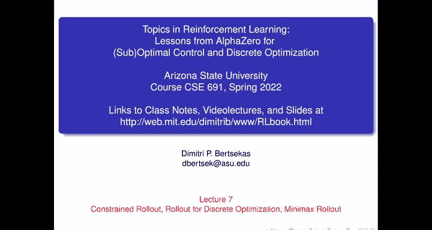
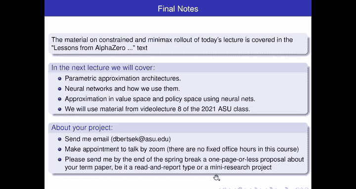

# ASU《强化学习2022-2024｜cse 691 Reinforcement Learning Course at ASU》中英字幕（deepseek - P36：[31]Lecture 7, Spring 2022_ Constrained Rollout - GPT中英字幕课程资源 - BV1zcfVYdErD

Yeah。

Okay， let me welcome you to the seventh lecture of our class on reinforcement learning at ASU。Today。

 we will conclude our discussion on rollout algorithms before going on to the second part of our course。

 which will focus on offline training algorithms。In particular。

 we will discuss variations of rollout algorithms。For constrained deterministic dynamic programming problems。

Where in addition， there are constraints of the whole trajectory of the system。

We are going to apply these algorithms to discrete optimization situations。

 including integer programming problems， we're going to give some applications and then we are going to discuss rollout algorithms for the case for various antagonistic opponent。

There is no stochastic uncertainty， but there is uncertainty about what the antagonistic opponent or nature may do in order to to。

To deteriorate our cost。This is also related to game problems and we're going to discuss this relationship。

So first， we're going to talk about constrained rollout algorithms。

 we're going to extend the methods such as the use of a heuristic and the versions that guarantee cost improvement。

 including fortified rollout。Then。This type of constrained optimization problems arise in discrete combinatorial type applications。

And we are going to give some examples。And then finally， mini max control and rollout for that。

 including the relationship with gang situations。So now I'm going to use the video from last year's class and then we'll come back again to discuss at the end our future plan。

So let's start with a constraint that all allowed。And I'm going to begin with an example。

An example that you know and love， this is our four city traveling sensor problem。

That involves travel costs， which are shown here， the numbers are， I think。

 pretty much for the numbers we have been using。呃。We have been trying to obtain the unconstrained minimum cost tour。

 a tour is trajectory from a through the cities and back to A。

 and the unconstrained minimum cost tour is this one here。Now suppose that。

There are some constraints here in particular theres a safety constraint that we have to obey and each tool has a safety index or costs associated with it。

 which is numerical。And we require that were required to find the minimum cost tour out of those tours that satisfy this constraint where we。

The safety index is less than 10。So this will disqualify this tour， which happens to be the optimal。

 it will disqualify in another tour， this one here。And the other toolss are allowed， okay。

 so out of those that are allowed， we want to find the best one。

So how do we deal now with this extension of the problem？Okay， so let's。Let's。

Review the unconstrained rollout algorithm and see at what point we have to modify to deal with constraints。

Remember that。The algorithm constructs a sequence of trajectories。

In the case of the traveling and settlementment problems that trajectory a tour。

 starts from the initial state and ends at the final state through a sequence of controlled selections。

And the whole algorithm construct a sequence of trajectories， one at each event's steps。

And these trajectories under a sequential improvement condition have a monotonically non- increasingreasing cost。

 and that's really the core of the theory that in this way we are able to look at trajectories that go from beginning to end。

 have vision， but also decrease the cost as we go along in particular we decrease the cost if we start from x0 and user heuristic。

Now。At any stage K， the trajectories from K onward。

 they share the same initial portion In other words， at the time K we have already selected。

K controls and we have gotten from the initial state to this state x till decay。And now。

We look at all possible。Next controls。And we ran the basic heuristic to generate candidate trajectories。

Which correspond to the different controls that you can apply？So at text till decay。

 we have this trajectory Tk， which is the cost， which involves this initial portion plus the。

The remainder is completed with a base heuristic。And then we construct candidate trajectories that。

Go up to Xk in the same way。 and then we get a choice of UK and then we run the basic heuristic and we find。

V。City the trajectory that has minimum cost， okay， out of all those here is the one that has minimum cost。

 first stage cost plus the cost of the base heuristic。And under the sequential improvement condition。

 we have that each time the new trajectory is no worse than the preceding one and in particular the last one。

 the one obtained by rollout， is no worse than the initial trajectory。

 which is the trajectory generated by the base heuristic。

So now as we generate these candidate trajectories， when we have constraints。

 some of these candidatedid trajectories may not satisfy the constraint。

So the an is very simple and fairly obvious。In order to deal with the trajectory constraint。

 we discard all the candidate trajectories that violate the constraint and we choose Tk plus1。

To be the trajectory that is best out of the ones that satisfy the constraint。It's very simple。

We get a number of trajectories， some of their evaluate the constraint。

 we throw away the ones that do and do the best we can with the others。And we still maintain。

 obviously this property here as long as。We can always find at any Xk that we generate。

 we can always find a candidate trajectory that satisfies the constraint in other words。

 as long as we don't make some choices that are irredeemable the once we move here we cannot find that Facebook trajectory anymore so we have to guard against that imuality through assumptions or modifications in the structure of the algorithm。

So， this is the。对。Constraint it all out I with him。And。呃。

I'm going to illustrate now with the traveling salesman problem Oh I'm sorry I'm sorry， I'm sorry。

 I have one more。And then I'm。Let me ask a question。 I have a question。 Yeah， yeah。

 What if the trajectory generated by the base heuristic itself while its constraint。跌记。

What do you do then。The first one， t zero， you mean yes， t0。

20 is's an assumption that you get that the basic heuristic starts from generates a feasible trajectory from the initial condition。

 okay。We have to make some assumptions because everything else is pretty general here。

Are there any other questions？Okay， so this is a basic idea and now we're going to formulate the problem precisely。

😊，We consider a deterministic optimal control problem with the system equation。

And we defined a complete trajectory to be a sequence that goes from zero to the initial state to the final state。

And we have a cost function that's very general， it depends in an arbitrary way on this trajectory。

And we also have a constraint that the trajectory is one out of a given constrained set of trajectories。

So this is as general as it gets at this point。😡，Now， the problem is that with constraints。

Couping stages like that in an arbitrary way and costs also coupling stages。呃。

We can't rely on going state by state because。We may have made in the beginning some choices that may affect。

Choice is far into the future。So we turn to the idea of state augment。

And we redefinine the state to be at time K， the partial trajectory。

 everything that we have chosen so far。And now this partial trajectory evolves according to a dynamic system。

Like so， the new partial trajectory is obtained from the old one by adding U and。

Somebody save something。Okay， I guess somebody should be。说姐。Himself or herself muted。Okay， so。呃。V。

New trajectory， partial trajectory time take is what obtained from me all by adding the control by adding the new state。

And now the problem becomes to minimize the final state of this system subject to a final state constraint。

So in this way， we don't have this coupling across stages where the cost function involves previous states。

 it only depends on the final state and the same thing for the control。

So this is one trick that we use in order to redefine the rollout algorithm to deal with this couplings across stages。

And here is the。And here is the algorithm。We start at the initial state and we keep adding controls in states up to the point where we get to x till decay。

 decay stage。Then we have generated this partial trajectory。This white tilda。オ父ケ。

And now we extend this partial trajectory by one control and one state。

We extend way two decay to update all these partial trajectories lets start from here and end up at this points here。

 okay， we add UK in the corresponding next state and we do this for all feasible controls。

And now we run the bas heuristic from each one of those。Now the basic risk generates。

A partial trajectory R of y k plus1， okay， this one here， this shrink and so on。And now we join。嗯。

This part with this part， and we do it for every UK。

We join the partial trajectories Yk plus1 and R Yk plus1。For all the different values of UK。

 and we obtain complete trajectories of this kind。Okay， so we have now these candidate trajectories。

 some of them are feasible， some of them are not feasible。

So we calculate the set of controls for which this trajectory here is feasible。Satisfies。V。

Constraint of the problem。And out of those thinned out set of partial trajectories。😊。

We find the one that is best， the one that gives you the minimum value of cost。

 but we minimize not over all controls， but only over the controls for which I get feasibility through application of the basic heuristic。

I think could raise are there any questions here？Yes。

 professorfess a question for you in the past in the past we had talked about problems where we augmented states to take into account time delays is this essentially equivalent to those。

Running rollout from those kind of augmented problems。Yeah， yeah， it's the same idea。

 not exactly the same， but it's the same idea augment to state in order to take into account couplings with previous states。

It's the same idea。Okay， so let me now demonstrate the algorithm of using the。

Travellling sales for example， This is the same one that we had at the first slide。

We want to minimize find the tour that minimize the travel cost， okay given by this matrix。

 but also meets the safety constraint and two of those tours do not meet it， okay。So。

We have the cost function， we have the constraints。And we also have a base heuristic。

And this base heuristic， of course， the base heres can be anything， and I've drawn here with blue。

So at state x0， the base heuristic generates a complete trajectory。Hence this one here。Okay。However。

The best heuristic when it is at this partial tour。

It's not sequentially consistent and instead of generating this trajectory。

 it's generate this trajectory， okay？Now I did this because I wanted to make the example more cut more variety。

I'm free to do that because like I said， the past heuristic can be anything。Also， the best heuristic。

From this partial tour is this blue here。 Okay， is this heuristic from A B， heuristic from A C。

 the heuristic from A and the heuristic from A D is this one。How about the other tours。

 well the heuristic from ABC， its this one right， because there's no choice。

 similarly the heuristic from ABD is this one， there's not a choice and so on。

So I have indicated here the heuristics from A， A， B， A C and AD， and not from the other。

Partial do it because there's no choice。It's implied what the basic is。Okay。

 so we're going to go through constrained rollouts step by step now。

This is basically the algorithm from the previous slide。And we start at the initial state。

 and we will do roll loud at A。How will this be done， we consider the partial tour A B A C and AD。

 we consider this partial tour， this partial tour and this partial tour。

 and then we run the heuristic from each one from this one the heuristic gives me this。

 that's a candidate okay。From here， the heuristic is this one。And from this one。

 the heuristic is this one。Now this one happens to be inas smooth。

 so we just throw it away and we compare this tour。In that store。And the one that wins is this one。

So we move from A to A B。That's what this bullet says。We start at a。

 consider the three possible choices。And we obtain by using the base heuristic。

 we obtain this tools here， ABC D A， A， B， D A。And A， D， C， B A。Discard this one as being feasible。

 compareare this one and this one。And find this one here to be better and we select AB。

So we're now done with the first step of rollout。Is this clear？It' a some question。Okay。

So we have made this rollout choice and now we move to AB and we do rollout from here again。

So what do we do， we consider this possibility and that possibility and random basic heuristic from each one。

Okay， now。This trajectory here is infeible because it violates this constrain here。

 so we throw this one away and we select this one in other words， we move to ABC。

That's what this bullet says， we consider the partial tours， ABC。

And A B D random the base heuristic to obtain the complete tours， ABC D A and A B， D CA。

And we discard this one as being infeible and we select the complete tour。This complete tour。

 of course。To be entirely formal and we have to go from here to here and but there's only one choice so I'm not showing the completion of rollout this is the rollout choice at AB。

 this is the roll Shaout choice at ABC this is the rollout choice at ABCD and we have reached the terminal state and we have the rollout。

Projectory。Okay， is this clear？If we did not have this constraint and we did not have this。

The violation from these two tours， the rollout would choose this trajectory。

 which would be the optimal and constrained trajectory。啊。However， because of the constraint。

 this was recognized at this point here and we went the other way。Okay。

So now let's go back to theory。嗯。What are the properties of this constrained rollout？あこ。Well。

 obviously， we will need notions of sequential consistency， sequential improvement。

 and so on in order to be able to assert anything。So there are extensions of the definitions of sequential consistency。

 sequential consistency and is's the same as the consistency of the unconstrained version now sequential improvement is a little different。

As part of the definition。We require that the set of feasible controls。

 the ones from which the candidate trajectories。To satisfy the constraint。

 we assume for sequential improvement that the set of feasible controls is not empty in other words。

 at this step here there's at least one out of those trajectories that satisfies the constraint。

So that's the sequential improvement condition。First， that the set of physical controls is not empty。

 there's at least one that is。Feasible and moreover。😊，Out of those that are feasible。

 the Q factor of at least one， the minimum Q factor over those is no larger than the heuristic cost from here。

O。Now your notes have this。Your notes have the。The details of this。

 but I'm just summarizing this here。In other words。

 it's the same kind of definition for sequential improvement as before except that。

This property here of minimum heuristic Q factor is no larger than heuristic because that qua Tilder is satisfied with the minimum taken over the ones that are feasible in other words we just discard the in feasible trajectories and we do and we define sequential improvement in a natural way。

Now a lot of things can go wrong if the sequential improvement condition is not satisfied。

 in particular， there may be no feasible trajectory， you went me along here。

 but all of a sudden you realized that you reached the point where that you can't satisfy the constraint anymore。

So to deal with this， there's a fortified version whereby once you find a feasible trajectory。

 you keep it for later， just in case you can find。Another one that's feasible Moreover。

 you replace it with a neutral trajectory once you find one that's better in terms of cost。So。

For the case where sequential improvement is not guaranteed to hold， it's not known to hold。

We use this4ified version， which maintains a tentative best trajectory and follows it up to generating a better trajectory through runout。

And now。We restore the cost improvement property。Assuming that the basic heuristic generates a feasible trajectory starting from the initial condition。

In other words， if our initial trajectory is feasible， then with this fortification。

 we're guaranteed to always follow a feasible trajectory。And one that has no worse cost。

The details of this are a little tedious， but they're natural。

 and you can guess them already by just looking at this bullet if you think a little bit about it。

Okay， so there's a multi agent version also， which I'm not going to go into the details。

The multi agent version applies for the case square。Each control。Has multiple components， okay。

 and therefore the search space is very large。So what we do in this case。

 we play this trick of reformulating the problem with the control space unfolded。

So that the components are chosen one at a time。And then we apply constrained the rollout。

On this equivalent reformulation。So this extension is natural it simple to。To deal with we simply。

Each one of these decisions is broken up into M decisions where M is a number of agents。

 and then we go one step at a time with the base heuristic and all this procedure here that I described。

Okay。So now let me return to the traveling salesman problem。

This picture is exactly the same as the one that you saw in the previous slide。呃。There's a。

Cost function associated with the travel costs。There's a safety constraint or a constraint that from the trajectories。

There's a baistic。Which from each partial tour gives you complete the。But completes the partial tour。

And。Let's look at the issues of sequential consistency and sequential improvement。Okay。

Is the heuristic sequentially consistent at A？It's not， and why is that？Somebody。

Why is it that this heuristic is not sequentially consistent at A？At A is generates this trajectory。

Once it goes through the first step， it generates a different trajectory。

 well that violate sequential consistency。Is the heuristic sequentially improving？Well。

 we have to check two things。Whereever。From everyone one of the。Partial tours。呃。It can find。

A feasible。Candidate trajectory。And indeed， this is so at A B， you can find this trajectory at A。

 can find this trajectory at A C， you can find this trajectory。And that trajectory also， and at AD。

 you can find this trajectory。But not this one， this one doesn't qualify。

So the feasibility requirement for sequential improvement is satisfied。

But there's another requirement for sequential improvement， namely that。If you run the base。

 heuristic。From any given partial tour。I'm sorry。If you run the basic heuristic from some partial tour。

 it this one here。And there is。There is a neighbor such that running the basic heuristic from that neighbor gives you a better or equal value。

And it turns out that this is true for a， it's true for ABS and AD Prily， why。

 because this tour here has a cost of 27。Who is the base heuristic has a cost of 28。So。

The sequential improvement condition is satisfied at A is also satisfied that the other node fairly materiallyly。

Because of the simple structure of the graph here。So。

We have sequential sequential improvement and indeed the rollout constructs this trajectory with cost 27。

 which is better than the cost of 28 that the base heuristic constructs from the beginning。However。

If we were to change this one。Travel cost and from 20， make it to 25。

 then the sequential consistency。Sequential improvement condition。At a would be violated why。

 because when I compare this with that， I find that I compare this with that one。

 I find that this one is worse than that。This one is also worse than that， okay。

 look at the numbers here。And also， this one is worse than that。 This one has cost。

45 is from Health Co 28。So if I were to change this one number。

 then the sequential improvement condition would be lost。And in that case。

 you would have to resort to the 4ified television。Which whatever generates a new trajectory。

 it compares it to the best tentative that you have。

 which in this particular case is the initial trajectory。

And if you apply fortification to this example， you'll see that the rollout algorithm。At a。

Tries to find a better trajectory， but it cannot。 The reason is that this one is worse and this one is worse and this one is worse or inible in this particular case。

 so it sticks with the。Huristic trajectory with the trajectory that was generated at a and rejects this one。

So that goes back to the question that was asked by one of you。

 I'm not sure who was that what happens if。If you。What happens if the heuristic is not feasible from the initial state。

 well， you have to assume that。And you have to assume that to prove anything。

And if that is not and if that is assumed， then by more fortification。

 you're guaranteed to get a better or no worse trajectory than the one that the heuristic generates from the initial state。

Now。Okay， here's one more thing。How do I find a base heuristic that generates a feasible trajectory from the beginning。

 Sometimes this is very hard。But we just skip this question and we just assume that we have a basic risk that at least from the initial state。

 it can generate a feasible solution。That's part of the assumption for this problem。

I there any questions here？I went slowly here and also in terms of pictures。

To give you the opportunity to follow all the steps。I didn't see any reaction from you。

 so that can mean one of two things either you got very bored with the details and tuned out。😊。

Or the slides are so complicated that you lost track of what's going on。But anyway。

Since there are no other questions， I'm going to go forward。And summarize， what we are。嗯。Okay。

 a constraint。Problem， constrained deterministic problem。

And the rollout algorithm written for it involve some ingredients， all of which are quite。Candネル。

Okay， some of you are saying that it's very clear thank you for the details。

 so I'm glad to hear that。嗯。Okay， so what are the structural components of the framework that we have developed so far？

嗯。First of all， we have trajectories。Which are defined by a graph， a layered graph。

Showing the transitions from states in one stage to states in a next stage through the use of controllers so this。

There is this optimal control graph that we are using and the assumptions here are that the problem is deterministic and it's also finite state。

 finite state and control we will not be able to go through all these argumentation that of the previous slides if we had an infinite control space we have a finite control space and a finite state space and we have a graph that defines the transitions。

So this is the dynamic system defined by the graph。And we have a cost function。

That can rank trajectories either numerically or possibly through the use of an expert。

 we may have an expert that we ask， given this trajectory and that trajectory。

 which one is better in the in the in the。And the expert has some kind of way of rank trajectories。

So we have a cost， but we'll just assume that we have a cost function， a very general cost function。

We have a very general set of constraints。呃。hi缺。By which you can check。

 we assume that you can check it and determine feasibility of the trajectories。

And we have also a base heuristic。That starts from a partial trajectory and completes it。

 generates the remainder to form a complete trajectory。So these are the ingredients of our framework。

The problem。😮，The probability structure， the dynamic system rather。The cost function。

 the constraints， and the base heuristic。And now once I give you。V。Dynamic system。

I give you number one， then the other choices are independent on each other。

 I can choose anything I want and this does not have to depend on that。

 this does not have to depend on the other too。Moreover， given one， two and three。

 which is the problem， you can try several different base characteristicsur。

Or you can combine the heuristics into a super heuristic whereby which naturally chooses the one that has minimum cost out of the ones。

That are feasible， okay， some of the basic heuristics given from a given partial tour。

A given partial trajectory may not be feasible， so you discard those and use。

And check and compare the ones that give you feasible trajectories and then pick the one that gives you best cost。

So you can have multiple heuristics combined them together。And these。

And all of these choices are independent of each other， so given a particular type of problem。

 there are a lot of different problems that correspond to it and also a lot of different basic heuristic and therefore rollout algorithms that can be used。

So that's the。So that's the constrained overall algorithm in structure。

 and now I'm going to look at a particular type of problem。😊，Involving discrete optimization。

So here's the problem。It is very general and very useful， an awful lot of optimization。

Just has this structure here。呃。The problem is to minimize a general cost function Gs sub U subject to U lying within some constrain set。

 and the only thing that we assume here other than finite night，Control space finite choices for you。

 the only thing that we assume is this component structure U has multiple components that we arrange from zero to n minus1 in the way of stages。

So the problem is laid out， the problem structure is laid out like so we have seen this graph before。

There's an artificial initial state which use the first control in the states of the first stage are theses。

 stage two there are theses， pairs， stage three， triplets and so on。

 the last stage marks the completion of a solution， these are all partial solution。

 this is a complete solution。And it has a cost de of U， okay， this cost enters here。Now。

 if we didn't have these constraints， then we could this would be a shortest path problem， okay。

 if we had costs only on the arcs， this would be a shortest path problem。

But now we have constraints in some of these trajectories。Are feasible and some of them are not。

 so we have to pick our way out from the beginning to the end。Through while maintaining feasibility。

Okay， so that's the problem。And we can view it as a special case of a constrained deterministic optimal control problem where the states are not really significant。

They're just artificial， just a single state at every step。

 and only controls in a single state which is equal to of some artificial x0。

So for problems where states do not have some kind of intuitive meaning。

 we may prefer to sort of abstract them out of the problem and use this type of formulation。

On the other hand。The range of problems of this is just enormous。😡。

Any kind of combinatorial optimization problem that you can think of matching， routing， assignment。

 scheduling， binpacking，Any kind of problem。Including the very difficult ones that are emptycomplete and so on。

Fits this framework。They， as long as you have this component structure and you usually do， okay？啊。

Furthermore， any integer programming problem can be put into this framework in integer programming。

 we have some variables which are these usually， and they can take a value that's integer。

 usually zero or1。So。In an integer programming in a 01 integer programming problem。

 the solution is a sequence of zeros and ones， and I'm going to give an example shortly。那。

Because this problem is a special case of the one we had before。

not really a very narrow special case， actually this problem is equivalent to the deterministic optimal control problem that we had before。

 but we can view it as a special case in the sense that there's only one state。啊。

Because this problem is a special case， we can apply。The all algorithm that we saw up to now。

And this is the way to provide an entry point。For reinforcement learning。

Into the solution of discrete optimization parameters。啊。

What we're doing here is allowing the use of methods of approximation in value space。

 proagation policy space， dynamic programming， we allow these methods to come into this broad range of problems。

Now， as I said， these is a very， very broad class of problems and there are many。

 many methods for solving them。For example， random search is one such a methodology where you start from some initial feasible solution and you generate a random some other a collection of other neighboring feasible solutions and you move to one that looks promising and then you search at random within a neighborhood of the place where you are and you find another solution that's promising and so on。

 and of course you can do this in many different ways and intelligent ways in particular。

But in random search， if you go from a complete solution to a complete solution and then to another complete solution。

 you don't go from a partial solution to a less partial solution up to a complete solution。

 which is what we do in roll La， so random search in roll lab are quite different in the structure。

And this is true also for other methods， local search methods。In local searches like random search。

 moving from one solution to a neighboring solution into another neighboring solution within some neighborhood and the method is defined by the neighborhood and by which you move。

 which candidate within the neighborhood you select。Again。

 these local search methods have this complete solution structure。

 you go from a complete solution to another complete solution and so on。

 you don't build up the solution。Component by component。Genetic algorithms are another。Yeah。

 popular class of combinatorial discrete optimization methods。And again。

 they have the same kind of property as random search and local search。

 you generate you operate on a sequence of complete solutions。

 and you go from one solution to another solution by generating some successor candidate successors through mutation。

 extension， there are various operations that you can apply and and，Okay。

 if you have some intuition about your problem， you can generate interesting ways to interesting neighborhoods from within which to search。

These algorithms have their successes and also their failures。

 and they are important classes of algorithms， but the main thing is that the rollout is different。

Integer programming also has a large variety of a larger rich methodology。

And the part of integer programming that's closest to rollout is branching bound。

 I don't know if you've heard this but I'm not going to describe it here。

 but it involves fixing integer variables one by one and finding which candidates to fix in an intelligent some intelligent way using upper and lower bounds and so on。

That bear sum similarity to what Roout does。So rollout is different， is different better or worse。

 I don't know if it's better or worse， but it is good to have different algorithms because this algorithms are flaky and sometimes they don't work so it's good if your algorithm your favorite algorithm does not seem to work to have some alternatives to try。

So now let me go to an example， this is an integer programming problem。

And it's one of the classical ones it' called the facility location problem。

And I'm going to go slowly， there's a lot of formulas here。So， you can。

Ask questions if something seems to be unclear。Okay， so what do we have here？

We have some candidate locations。In which we want to place facilities like power plants if you're talking about electric energy production。

Or some other kind of facility， service centers。And there are some candidate locations。

 and we want to find the most promising locations。啊。So if you place。A facility in location K。

Then UK is equal to one。If you don't place a facility， then UK is zero。

So placement of a facility at a particular location correspond to a01 integer value。

Now these service centers， these facilities are set up there in order to satisfy some demand。

 satisfy certain clients。These blue circles are clients that are going to be served at these facilities。

And this clients have a certain demand。嗯。Client I has demanded Di eye for services。😡。

And this demand can be satisfied at a location K。At a cost AIK per unit。And。

A client can actually split his demand between two centers and send a piece here and a piece here。

Similarly， in other words， there's infinite visibility we assume here of the demand of a client between the various service centers。

 the ones that are up， of course， that are operating。Okay。Back to facilities。

If we place a facility at location K。Then we provide capacity CK C is the capacity of a facility at location K。

And it also has a cost BK， this is cost to set it up， okay？A UK takes a value 01。

 depending on whether a facility is placed at K or not。So this is the overall constraint structure。

And the cost。Is a linear cost， Okay， it's a bit of a handful。There's a。A cost for services。

 This is a service cost。And。Theres a cost AIK unit per unit of client I。That is served at facility K。

So this is a linear cost。That depends on the y's， the y's are valuable also， okay？

Optimization variables in addition to the use。There is also a linear cost that penalizes the placement of facilities if you build a facility at location K。

 you have to pay a cost Bk。And if you don't build a facility， UK is equal to zero。

 so you don't have to pay that cost。So this is a linear cost function in the variables y。

And in the variables U， except that the u are not imply divisible。

 and they can take only the value zero or1。And what are the constraints here， well， of course。

 we have the integer constraints that the use can only be zero or1。And。

The service and location and the facility assignments。

Must be such that the total demand is satisfied。In other words， these wives have to be。

vice serviceseres have to be done negative。They should add up to the。Demand of client I。

 so for every client， the portion that allocates the various facilities should add up to the total demand in DI。

So we have this constraint， this constraint， this constraint here and also。The constraint that。At。

Location K at facility K， assuming the facility is built at location K。

 this can only serve demand up to a level CK in other words。

 the total demand that's being served at location K should not exist CK if UK is equal to1 and no demand can be satisfied at location K if there is no facility that we have built at location K。

Okay， so this is the classical version of the problem， but we can make it even more difficult。

There may be additional constraints on you， but we will ignore for the moment。

 but let me give you an idea of what these additional constraints can be。Okay， let's go back here。

This is the definition of the problem。And a transcription into our standard form of minimizing Gs of U over U belonging to C。

What is C now？The constrain set is the set of all the use that are in zero or one and also can satisfy the demand and perhaps some other constraints。

 like some public policy constraints like zoning constraints like。Did I hear someone？

Zoning constraints。That the。Say that within a certain geographic region， you cannot build。

Any facilities？Or you can build only one facility and no more。呃。And。And。

And so there may be groupings of locations that have special properties that are not shared by locations in other places。

 this is what we mean by public policy constraints or additional constraints。

But let's not worry about those， although our methodologies， it can address those， okay？

Which makes it which actually it's generality。So， this is the。Constraint set of the problem。

 and this is the cost function of the problem。Now， okay。

Here's the cost function I told you that's this one。

 however if you look at this problem and you look at the variables U and the variables y。

 you realize that the really important variables are the U variables。

If I give you the facility locations， then the remaining problem is a linear programming problem that can be solved very quickly。

It's what's called。A linear transportation problem okay。

 it's a classical network flow problem that can be solved in polynomial time by very efficient algorithms。

So if the placement variables are known， the remaining problem is easily solvable。

So we are going to formulate our problem in terms of the difficult variables and the others。

 the Ys are going to be determined automatically through this optimization。With H。

Is the set of all feasible demand allocations？The ones that are not negative and satisfy the constraints。

So once I fixed the use。The constrain set of this problem is determined。

And this problem becomes a linear programming problem and its optimal value。

 I'm going to call it Gs sub u。In other words。I have eliminated the variables y from the problem by saying。

 well， they're automatically determined once you determine this location variables U。Okay。

So now I have the problem in the way I want it， I have a cost function。

Involving a sequence of decisions。And I have a constraint set。And I can check。

Whether for a given sequence of decisions this constraint is satisfied。

And now I'm going to apply it all out whereby I will first pick。

The variable of the first location do I build or do I not build at school location zero then I go to location one。

 do I build or not build and so on go all the way up to the last one in that while applying some kind of。

Base heuristic and checking also for constrain satisfaction。So are there any questions？

Is this an example of a problem where certain equivalence has been applied。

 because I would assume that the DIs in general are random variables。

 but in this case we're just treating as some known constant， right？Okay。

 this is a deterministic problem。Now how you have arrived at this problem we don't examine here。

 it may have been the result of certainty equivalentvalence， in other words。

 there may have been some random variables here， for example， this demands DI。ok。They are random。

 and they probably are changing over the calendar year。

But we assume here that they have been replaced by deterministic quantities。

 so we're using in a practical sense， we are using certainty equivalentvals。However。

 from a mathematical point of view， we assume that these are known， they are not random。

Does that actually answer the question。Okay， yep， thank you。O。Okay。

 so now we are going to apply this constraint to rollout algorithm。

Consider it places one location at a time， that means we first fix u0 then u1 and so on。

So at stage K， we make the placement decision Q from zero to1。

At this location and that end altogether stages。And here's our basic heuristic。

 I could use any of a number of basic heuristic， but here's the one that I'm going to be using here。

The best heuristic。Complettes a partial trajectory right， so given a partial trajectory。

 it must have a way of completing this trajectory with additional U variables and it chooses to place a facility in all the remaining locations。

In other words。Having fixed user up to UK， there are two。Candidate trajectories to consider one is。

Where we set the next facility to one and all the remainder facilities to one。

According to this ba heuristic。And the other is， the other candidate trajectory is not to place a facility at the next location。

But set the。But the place of facility in all the other remaining locations are as per our base heuristic。

And now。At U0 up the UK， we have two candidate trajectories。And we check for feasibility。

And this one is going to be feasible。Why， because。It builds up everything， okay。

 if we have reached up to here with with a state feasible so far。

 we're going to remain feasible because the basic heuristic。😊。

Is very very generous and allows us to build a facility in every location。On the other hand。

 this one。😊，May not be a feasible trajectory。Because this indicates that we do not place a facility in this location and this location may be a critical one。

 this particular。And without building it， then we can't satisfy the demand。Okay。So。

We looked at this too。😮，And depending on which one yields feibility and minimum cost。

 we move to UK plus one， it may be zero or it may be1。

And now we note that because of the nature of the space heuristic。

Sequential improvement is satisfied。The reason is that。Okay。

 it really satisfied because of the particular choice of the basicistic and also。Okay。

 it's easy to see that the minimum Q factor。Between these two is has to be less than the。

Than the Q factor of。我发。Well， the cost of the basic heuristic starting from this location， basically。

 the basic heuristic here is not only sequentially。

Improving but given feasibility is also sequentially consistent in other words。

 it keeps it stays the course you start out with a basic heuristic that sets all to one and then as you move forward it continues the take of the trajectory generated by the basic heuristic also consists of ones。

So it's easy start to verify that sequential consistency satisfied and also feasibility satisfied。

So you get。You get。Cost improvement。Over the initial choice which would be to build everything。

 build a facility in every location that's what the original that's the what the base heuristic would give you starting from the initial state so trivially you get cost improvement and generally this algorithm in my opinion works pretty well。

Particularly system it can handle some very， very difficult constraints。

 which would not be possible to handle with other methods。Like into your programming type of methods。

Okay。And any questions now on this example。I have a question。

So setting dynamic programming aside for a second， if I'm just looking at this problem as an integer linear program。

I would be finding like the total number of variables I would be finding values for would be all of the U1 through UK or all of the UK values。

 but also all of the y sub by k values right like okay。

 so so this cost function has two parts that has。嗯。

Trying to minimize the demand and also trying to minimize the number of。

Facility locations that you're going to put down in total。 So you said that。

So we have our control space corresponding to only putting down facilities or not。

 and then you said once you have a facility assignment。

 then at that point you feed the rest of it into a linear program to figure out what is the best way to allocate the demand。

 right？Yeah， okay。 and so I we've seen before that， like， for example， in the， in the case of。

The linear quadratic case that。Sometimes your controls。Can be continuous as well。

 So I guess my my question is， is there any way to adapt this framework just to just purely solve a linear program where。

 for example， if if your controls were in some continuous range 0 to1。

Because I know we've seen that before。The answer is。嗯。That would not。

 that would lead you to a different kind of methodology。😡，Branch and bound。

So major methodologythologies and Instituteship programming， as I mentioned。That's this。

Now there was branching bound at any one state。Allow at any one point has variables that are fixed to integer values。

And those valuable that that。That are free to take by using the range from zero to one。So。

So there is this feature of relaxing the integer constraints and solving corresponding linear programming problems in branch bound in rollout that's not done Okay we here we treat the variables are zero or one and the remaining variables are automatically determined by solving this。

This linear transportation problem， minimizing this objective here， subject to this constraints。Okay。

 so we always operate with integer variables。And that's the difference。

 that's an important difference between this methodology and the branch and bound in your programming methodology。

Because for example， if your y variables were restricted to be integers。

 maybe not zero or one but zero through 10 integers。They could also be a part of your control space。

 couldn't they？they could， yeah， it's all a question of whether you can solve this problem here easily or not if the wises are not restricted to be integer。

Then。呃。Then this problem is very simple to solve relative to， you know， rather speaking， right？

However， if there are additional difficult constraints on the why which make this problem nonpolynomial and hard。

 then you're faced with a different type of animal and you have to treat it differently and you have perhaps to consider simultaneously。

 the choices of UK and YIK， but because here this problem is simple。relativelyly speaking。

 you can follow the solution methodology that we have discussed。

There's something else about these transportation problems。

They tend to have integer solutions under some conditions。

So even though we have assumed assume here that the Ys are。Our呃。

Are fractional could be fractional in reality， if all the other data of the problem is integer。

 then these transportation problems also have integer solutions。And okay。

 that takes us into different territories and I'm not going to go any further。

But there's one thing that I want to mention， and it's the last bullet here。

There are a lot of transportation problems here， right for every new value of you。😊，Zero or one。

 you have to solve a transportation problem。And， and the。On the other hand。

 these transportation problems are similar， they have similar data。

 and then you can use the solution of one transportation problem to hot start the solution of the next transportation problem。

And there are algorithms in network flow theory， network optimization。

This auction algorithm in particular that are very well suited to hot starts starting。

The solution from an already good solution。And。And this auction algorithms are very。

Are very suitable for us intermediate solution methods。For obtaining the values， the cost values。

Okay， thank you。Okay， guys， so we'll keep on going。And now we're going to go into mini Max control。

We have been minimizing either deterministic cost functions or expected values involving probability distributions。

Now in mini Max control， there are no probability distributions。Instead。

 the disturbances are chosen by an adversary。An adversic who is also very smart and can see what we are doing。

So in mini max control， we guard against the worst possible decisions of some adversary。And。Okay。

 so we'll take a break first， but let's take a working break。IHope you like my picture。

It's meant to impression on you the nature of worst case。嗯。So what I'd like you to do。

 we'll take a 15 minute break and what I'd like you to do is think about how you'd formulate this adversarial type of problem。

Where the disturbances do not have a probabilistic description。

 but instead they have a set membership description， they're just known to belong to given sets。

 which you know。And then。呃。We have an adversary that chooses this malevolently。

 so adversarial in those omnici knows what you're going to do， so no matter what I do， this guy。

 I have to assume that he knows what I'm doing and will choose the best possible the worst possible decision for me the best possible decision for himself。

Now all of this can be implemented， can be thought in the framework of dynamic programming。

And there's a principle of optimization， a mini max version of the principle of Op。

And as you take a break and you're having some coffee or tea。

 you may think about this and we will come back in exactly 15 minutes。Which would be6 o'clock。

6 o'clock Arizona time， okay。Okay， so I'm going to mute myself。

We're going to spend the remainder of this lecture on minimax control。And。Like I said。

 there is a different description of the uncertainty。

Do you have any thoughts as to how we would deal with that？Okay， let me just say that。

The change from a probabilistic description。To a membership description。

Is going to manifest itself in instead of minimizing an expectation of the present plus the future。呃。

We minimize the maximum， the worst that can happen for the combination of present and future。

Assuming that we act optimally in the future。And the reason a principle of optimality holds sort of。

 you can view it as a principle of optimality。It's because it's a manifestation of a property that's preserved a mark of property namely that。

If you know the present。You don't have to know the past， how you got to this present。

 all you have to know， all you have to deal with is the future and the future can be broken down into once the first stage and the remaining stages assuming we act optimal。

This is all at a heuristic and intuitive level， but can also be verified by mathematics that are very similar to the ones that we use for probabilistic descriptions and expected values and stochastic optimal control。

嗯。So。Okay， about the name， first of all。The name that I'm going to be using is mini Max control。

And for a while person known， it was the dominant name。In for this type of problem。Nowadays。

 you see the name of robust control， which is about the same thing， robust optimization。

 it deals not only with control， but also with the other optimization problems like the combinatorial optimization problems that we have been discussing or linear programming type of problems。

The original name was games against nature， okay， it was used in the late 40s and 50s and that was the。

The period when game theory was very prominent， it was sort of the queen of the sciences or the applied mathematical sciences。

And。And so people tended to describe theories in terms of games。However， as this picture suggests。

 I don't think it's wise to play games against nature。

Beit in Indonesia with tsunamis or beat in in New Orleans with with flooding or。

Texas with Ro blackouts， so it's not a game， but we certainly need to guard against the worst case in many settings。

So let's go into the mathematical description and I'm going to talk about finite horizon problems。

 the infinite horizon problems are very similar。呃。In along the same lines to finite horizon stochastic control versus infinite horizon stochastic control。

So in terms of from chrom formulation， everything is the same。

 you have an system prepared by disturbances。And you also have a cost function。Over the end steps。

And you assume that。The disturb satine K are going to be chosen from some set。

That may depend on the current state and control this allows。

This local dependence allows the development of dynamic programming algorithm。

So the many much control control problem is to find a policy we dealing still with policy。

Functions of the current state that satisfy certain constraints。

That for all xk and k that are satisfied for all xk and K and minimize this cost function so what is this cost function？

We have the policy， this is a number here that corresponds to using that policy at stage K。

And the disturbance being WK as before。So this whole thing is a number。For the given policy。

At a given initial state。We consider the maximum the worst possible value of this standard。

 maximized by。Optimal choices of the Ws。From within the constrained sets that they're supposed to lie。

So rather than try to parse the details of this notation here just just。See that。

Whenever you had expected value stochastic control。

 you now have maximization instead of expected value over with with respect probability distribution that depend on current state and control。

 you have maximization over sets that depend on state and control。Good。

Using a similar rational for the stochastic case。We have a dynamic programming algorithm that uses。

 again， maximization in place of expected value。The optimal cost of the tail problem that starts at XK involves minimization over the first stage cost and the cost of the remaining stages。

 assuming that the disturbance acts malevolently is as bad as possible and assuming also that we're going to be minimizing in the future。

So this is very similar dynamic programming algorithmally has the same difficulties。

 namely lots of computation to find these J stars， lots of memory to store the optimal policy and the J stars and。

It has some additional difficulties。The expected value operator here。Is linear， in other words。

 expected value of a sum of two numbers is equal to the weighted。

Is equal to the expected value of the sum of the expected values has a linearity property。

 is's a linear weighted sum weighted by the probabilities of the distribution。

Now the maximum operation is not linear， is nonlinear。

That's one thing and another thing is that whereas as you could compute expected values by using Monte Carlo simulation。

 this is not possible with maxim， you have to solve an optimization problem for each of you。

To calculate this Q factor， you have to solve a maximization problem。

 which is generally more difficult than。Computing and expected value by simulation。

And now this is the kind of thing that affects rollout and also policyit duration because they involve this they involve before expected value operations now they're going to involve maximization operations。

So it will be possible to define。I roll out algorithm and define also policy in the context of an infinite horizon。

 but executing it has to be done without Montecarro simulation。

Now once we have this dynamic programming algorithm and of course we recognize calculating these J stars is very difficult。

 we are led to the idea of approximation in value space and with one step look ahead。

 it looks like this。It applies at state Xk。V。Control that minimizes this expression here。

 which involves a maxim and also an approximation of J star by J Tilda。So this is like the optimal。

Bacy generation。Except that we use J Tilda with J Star。

And we can view this as being offline training。And we can view this as online play。

 calculating optimal controls subopmal controls online by using JTilda approximations。

And this is one step look ahead， it's also possible to do approximation evaluate space with multi step look ahead。

And let me get to that。Are there any questions about the slide？

So it seems like the principle of optimality suggested here would require us to be able to swap the order of minimization over their future controls with the maximization over WK。

I guess I' just wondering， is that possible in general？Okay。

 this miniization involves this minimization here involves。

The definition of JK star involved minimization over UK and UK plus one and all the remaining controls。

 and maximization involves maximization over the future in WKs。

The min Max can be taken inside the bracket， I think that's what you're referring to can be taken inside and that's how this J star here comes in。

And the reason is that。The cost is separable in the components and。

One component for each stage and also the constraints are not coupled over stages and that's how you take the min Max inside that's the that's how you prove actually this this。

The validity of this algorithm。Does this answer your question？Yes， thanks。Okay。

 so now let's go to approximation aboutage space with multi step look ahead。

We have Sham Ja till this。And at state Xk， we do an optimization involving the first L steps， L step。

 look ahead。So this is the L stages cost。That depends on。On UK and also the。B。不。

The control functions for the remaining stages。Invol also the WK。And we maximize this expression。

 and then we minimize over this L step policy。So instead of using and instead of addressing and。

And step。Horizon end step horizon problem， which is the original problem。

 we truncate the horizon to just L steps and use a future cost approximation with this J tilde。Now。

 in general， anyj the function is permissible。including ones that are obtained by forms of offline training。

 you may find some data， you may get some data from which to construct this approximation using a neural network。

 for example， where you may solve a related problem。

 anything that we have learned about constructing J Tilda functions。

 for the stochastic case applies also to the minimax case。Moreover， in these pictures。

 there are potentially approximations in three places。The three approximations。

Approximate this minimization by a simpler one。Like a multi agent one， for example。

Approximate this maximization。My something。house。In approximately J tilther。Now。

 these three approximations can be designed independently of each other。

 and that's a nice thing about them。 like in the stochastic case here also we can。

We can mix and match schemes for these three minimizations， these three approximations。

How about this L step mini max problem， it can be solved by dynamic programming because dynamic programming can solve any finite horizon problem so it can solve this L step problem。

And of course， this can be。Not so easy， but if I started at a given state。

And the number of possible controls。P stage is relatively small。

 the number of possible ws is also small， then the look ahead three for this mini maxax control problem does not grow so fast and we may be able to go a number of steps forward in it may be feasible to have a relatively small look ahead。

 it's always a problem to decide how many steps of look ahead we should use。

Now there's an interesting technique for solving this min Maxrop problem called Alpha beta pruning。

 some of you may have seen it in Alberta's courses。

It's used to simplify minimax search over a finite number of steps。

It's basically a technique that allows you to decide that it is not necessary to search forward from a particular point。

 because that would not the outcome of the solution would not change the solution。

This is used in games like chess extensively。But I'm not going to go into that。系。And by the way。

 this is not an approximation technique， alpha beta pruning is exact， in other words。

 the solution of the problem with or without alpha beta pruning is not going to change。

There are variations of this look ahead process using selective step look ahead。

 so for some controls you may use a relatively shallow search and for other controllers presumably more interesting。

 you may use a longer search。And generally speaking。

 this is a type of algorithm that people use in nontochastic games。

 mini Maxup type of games like chess。And this is the algorithm most test programs use for online play。

They may do offline training to obtain this， but for online clay， they use this type of algorithm。

And so there's a lot of experience with this type of approximation and value space。

 particularly in the context of games。Okay。Now， rollout is a particular way of choosing this J Tilde that uses a base policy。

So let me go into that。And I'm going to talk about one step a out， okay。

For mini in discrete spaces problems so that all the minimization。

 the maximization here can be done over a finite finite space。嗯。

So what does Roout do at a given state？It forms a Q factor for every one of its feasible controls。

Now， this Q factor is not what you know you have seen before。

It involves maximization instead of expected value。But it involves the same first stage cost。

And then a cost approximation that involves using UK to go to the next state。Using the base policy。

 the base policy is just a sequence of functions of the current state。

And it involves also the Ws that are going to occur incur occur between。J and the end。

So all of this expression here。Can be viewed as something as what we。Maxxiizer。O to buy this over。

And it may be viewed as a Q factor of control UK。So that's what this。But let's say。

At state Xk for every possible control。We compute a cu factor。By this expression here。

 and then we choose the control that gives you minimum Q factor。On the other hand。

 this problem is not an expected value calculation， which you can do by simulation instead it is。

An optimal control problem。With the control variable being the Ws now。

And it's a maximization problem。It is not a shortest path problem。

 it is instead a longest path problem。Assuming everything here lives in a finite space so there's some kind of a look ahead three and the ws are obtained by weeding through the three are root to find the longest path。

 not the shortest path， the longest path。Now， some of you may have heard that long dis paths are nasty we short dis paths。

Are nice longest path problems are nasty。But not for acyclic graphs， if you have an acyclic graph。

 you can convert a longest path problem。Into a shortest path problem by simply changing the sign of the length of the arcs。

So this longest path problem is like a shortest path problem except that okay。

It's there for maximization over。Over a and。On K minus n step graph。

So we have few factors obtained by longest path problem solutions。

 and we have the rollout control computed like so。And any policy can be used as space policy。

But it has to be a legitimateitite policy， it has to consist of a sequence of functions。Of the state。

 not a heuristic like in deterministic problems， we make this distinction between the rollout for deterministic problems and the rollout for stochastic problems for deterministic problems we can choose a heuristic that doesn't necessarily have to be sequentially consistent。

 doesn't have to correspond to a policy， it can be something something more general than that。

But here， the base policy must be on the Zig policy and the national form of sequential consistency holds。

Assuming that， okay， we don't use a terminal cost approximation。

 we don't use a tranccade that all allowed。And sequential consistency life cost improvement in the usual way that we are accustomed for mini Maxax for rollout algorithms。

The same kind of proof goes through for the minimax case as well。

And there are similar variations truncated or allowed with terminal cost approximation。

Additional constraints， life constrained are all out。But once you introduce this。

 there's no cost improvement guarantee。So in principle， mini maxs rollout is similar to。To。

To roll out for stochastic problems。And。And。However。

 there's not much experience that is available with this kind of mini Maxax rollout。

 if someone has an interesting problem to do for a term project that would be welcome because I really don't think that there have been many implementations or any implementations of mini Maxax rollout。

Okay。Let me say a few things about。Trajectory constraints。

 like in constrained rollout for the deteristic problems that I talked about earlier。Okay。

Here we have to consider。Partial trajectories， because the constraint may be coupling the previousview applied controls and the future applied controls。

So for a given partial trajectory， we calculate。The corresponding Q factors as earlier。However。

The longest path problem that you solved here。May not violate feibility， this constraint。

 remember we're dealing with a malevolent opponent and the malevolent opponent will do everything possible to get us off feasibility。

So we calculate the Q factor for every control in a restricted set of controls。

That depend on the partial trajectory so far because of the constraint may depend on the previous values of states and controls。

And these are a set of controls that guarantee fe， no matter what the malevolent adversary will do。

He cannot get us to violate this。😡，This。嗯。This constraint if we use the base heuristic。Okay。

 so this is again longest path problem， we can solve it and find the minimum Q factor and the control that attains this minimum Q factor and this is what the rollout algorithm will apply at。

This partial trajectory。And there's also a fortified version of the algorithm。嗯。And。

The assumption that's needed here similar to。The case of deter deterministic constrained rollout is that at the initial state。

 the base heuristic produces a feasible trajectory。

 one that's feasible for all possible disturb sequences， okay。Once you have that。

 then you can introduce fortification and guarantee some kind of a cost improvement in feas。

So in a nutshell， all the ideas that we have discussed so far apply in modified form for these mini max problems。

 including the constrained version of the rollout algorithm。For stochastic problems。

 there's no constrained version of the allowed algorithm because of the presence of the disturbances of which are stochastic。

However， for mini Maxs， you can apply constraint rollout。Are there any questions？

Yes Profesor I have a question for you。If we have an adversary who is only affecting uncontrollable state components。

 are we able to form new cost functions as taking the worst case uncontrollable components into account？

And then plug that into the ordinary DP algorithm。I'm sorry I missed the first part of your question。

 what does the atari effect you said？Oh just if they're only affecting uncontrollable state components。

 uncontrollable state components yeah。Yeah， what about that？

I'm just wondering if we can do something similar like we discussed previously。

 I think in the when we discussed uncontrollable state components previously we form new cost functions by taking a conditional expectation over those uncontrollable state components I'm wondering like can we just in this case。

Form the new cost functions， taking the worst case uncontrollable components into account。

 and then plug it back into the ordinary algorithm。Yeah。Well。

 I'm glad that you have remembered uncontrollable state components because this is a little bit and part of the more mysterious parts of this course。

 I'm glad you have understood what that means and you're curious about it。呃。

I haven't thought about your question， okay？I haven't considered it， but I'll think about it。

And if you write me an email message， I'll be able to respond， but I doubt it。Because of。

Because the transcription of the dynamic programming algorithm that where we。嗯。

The uncontrollable state components are taken care of in a more efficient manner。

 that depends on the linearity of the expectation operation。If I'm not mistaken。

And I don't believe that you can have such simplifications in the minimax setting。

But I'll have to look into that。Okay。All right， yeah， thank you。Okay。啊。So now I have a last slide。

Okay， what's the relation of mini max and game theory okay？Usually people talk about games。😡。

Zero sum games， non zero sum games or ma games， non zero sum games。Cannot be dealt with by。

Dynamic programming。And。呃。Except in the case of a team theory problem where all the cost functions of the agents are the same。

嗯。However， non zero sum games involve two directly opposing adversaries and they are related to dynamic programming because they are related to mini max problems。

So according a zero sum game， you have two players in a cost function。

 one player aims to minimize the cost function and the other aims to maximize the cost function by choosing their values。

 the cost function depends on both players values and policies in the context of a dynamic system。

 a control type of setting。Now。Gae problems have a very incomplete theory when it comes to reinforcement learning。

Game problems are studied extensively。So's a very fundamental discipline again theory is a very fundamental discipline。

 but from the point of view of reinforcement learning， I think it's important to keep in mind。

That actually a game problem， a zero sum k problem， splits into two mini max control problems。

The first one is the Min Max problem where the minimizer chooses a policy first。

 and then the maximizer chooses a policy second with knowledge of the minimizes policy。

The maximum problem is like a mean max problem with science reversed， okay。

 but well call it Max and we have the maximizing player choosing policy first and then the miniizing player looks at the policy that the maximizer has chosen and then chooses his own policy afterwards。

Now these two problems are different， okay， and they have different optimal values。And generally。

 it's easy to see。That the maximum mean optimal value。

 the optimal value of this problem from some initial state。It's less than the mean max value。

 the optimal value of this problem from the same initial state， this is true for every initial state。

And this is very easy to see an elementary fact。However， game theory。

Zero sum game theory is particularly interested in situations。Where the two values are equal。

So in terms of value， it doesn't matter whether the minimizer or the maximizer plays first。And。

This is not true by any means in general。😡，It is most of the time not true in the context of mini max control。

However。Game Forists are particularly interested on the conditions that guarantee that this is true。

And there is theory about that involving mixed strategies and so on， I don't want to get into that。

And this theory extends to dynamic programming。However。

 when it comes to practical reinforcement learning。You're not going to have this， okay？

You can't even think of these terms， you can think of these terms as。As that in terms of。

In terms of the theory as a matter of theoretical interest， on the other hand。

 from a practical point of view， you are not interested in achieving this equality。

 nor do the methods of practical reinforcement learning produce equal values mean Max and max min。

In even in setting square。Its mean Max is equal to maximum without approximations once you introduce other type of approximations。

 this is gone okay。Now there are very interesting questions about。Game problems and approximations。

Okay， how do various algorithms work when approximations are used in the min Max or the max main problems？

So for example， suppose you use approximation in value space。

In or you use rollout and you use various types of approximations， base policies and so on。

How will these algorithms work？When you have two players。

There's one thing that you can say and that's about the only one that you can say。

As a practical matter。If you fix the policy of one of the opponents。😡。

You can improve the policy of the opponent of the。If you fix the policy of one of the opponents。

 you can improve the policy of the other opponent by using rollout or policy duration。

Why is that because if one of the opponents has a fixed policy。

 then the problem becomes a one player problem， it's like the ones that we have been discussing so far。

 it's no different。Does it pay to consider？An opponent with fixed policy。

 well you may have an opponent that that you want to prepare for。

 you know who you have access to how he plays， you have access to his policy and you can optimize for this policy。

So for example。Consider Alpha zero chess， and suppose that Alpha Ze decides to play with the world champion。

 Max Carlson， a current world champion。Then。It could improve its play。By asking。Carson。

To play with Alpha zero， let's say 10，000 games。Pay him a few million dollars， okay。

 and play 10 thousand games and learn from his play to play better you would get。

An alpha0 specialized to Carlson。That would play better than we claim vanilla officer that would pray against you and me。

😡，Okay， so that's fairly obvious。That's an important thing to keep in mind。It。

That's about just about the only thing that you can say about the reinforcement learning algorithm that are being used in game field。

 including the ones that have been used in Alpha zero。So in particular。

 suppose that instead of having a fixed policy for one of the opponents。

 can we and then improving the policy of the other opponent？Can we improve the policy simultaneously。

 in other words， is it possible to have to play against Mads Carson？And as you improve。

The plain policy against him， he changes his policy， not only do you learn from him。

 but he also learns from you， okay？Then what happens。

 what kind of algorithm would you use and how what kind of guarantees does this have？Well。

There are practical language goods that you can use。

 but there are no guarantees for them and there is no reliable theory for them。要不得住咧。

The kind of algorithm that was used in alpha0， which involves changing。

Training and changing the policy。For both a maximizer and a minimizer， in other words。

 generate new player that's being used by both the maximizer and a minimizer。

That's certainly an algorithm that looks so good。And in fact， has worked spectacularly well。

 but there's no theory about it。Not theory as an approximation。

 as an approximate dynamic in terms of approximate dynamic programming and no theory and very little theory in even if you do exact calculations which you cannot do exact one there。

But for the type of algorithmcros using alpha for zero， there's no theory really。

Because the players are simultaneously changing their policies。

 one does not stay still while the other one improves。So that's all I can say about the。

Use of reinforcement learning in games。 Its not that it's hopeless。 In fact。

 it can be spectacularly successful， as case studies have shown with both。With both of。While。

 with chess and also with go in the related games。But there is no rigorous theory that covers these algorithms。

And。So。We have limited understanding in that respect。Okay， so this is our last slide。

The material we cover today in constrained and mini Max allowed is covered in your textbook。

 the lessons from Alpha Ze textbook， that's where you'll find an account。Then as I mentioned earlier。

 in the next lecture， we're going to go into the second part of the course。

 we're going to go into offline training algorithms and in particular we are going to discuss。

approximationroxiation architectures using either features or neural networks。

 we're going to discuss the training of neural networks in the context of approximation in value space and also in policy space。

And again， we're going to use material from the 2021 class videoide lecture 8。

 you may want to review that before attending。啊。As we progress in our class。

 it is important to focus on our project and。I want you to think about that if you haven't started already and if you have some questions or you're not sure about whether the subject you're interested in is appropriate you can send me email and you can ask me your questions we try to I'll respond to you by email and if this is not enough we can have a personal meeting by Zoom and we can make an appointment and。

So let's think about that and I also want you。Send me a one page or less proposal。

About what you're going to do。Whether it's a written report type of paper。

Or with this immunity research project， I want you to send me your thoughts。

And do this by the end of the spring break so to make sure that you are in the right track。

So this is it for today and I will see you next week。

