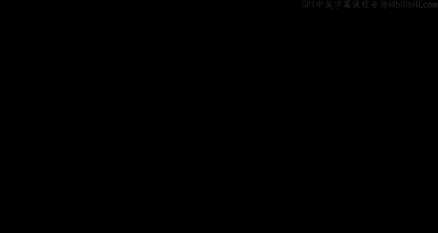
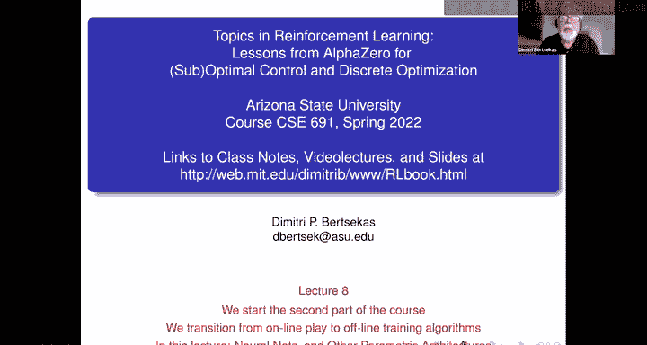
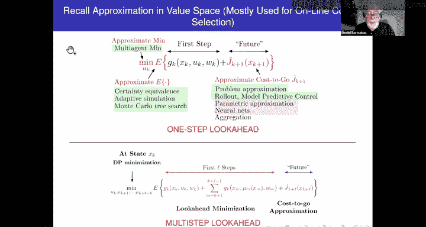
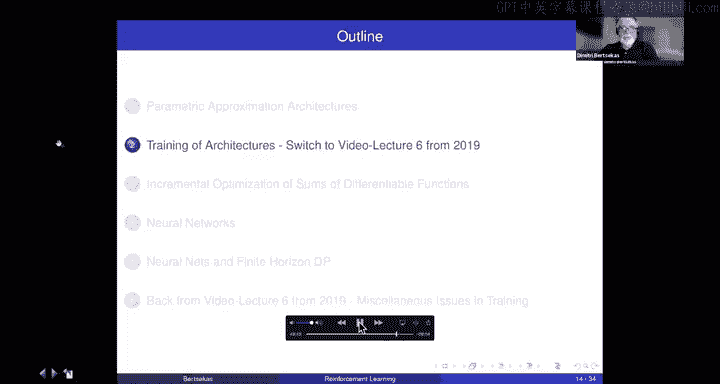
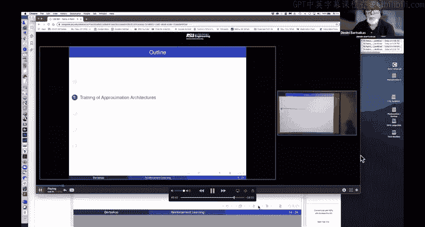
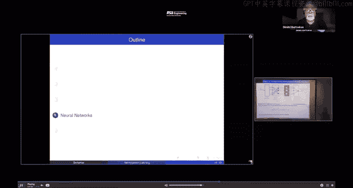
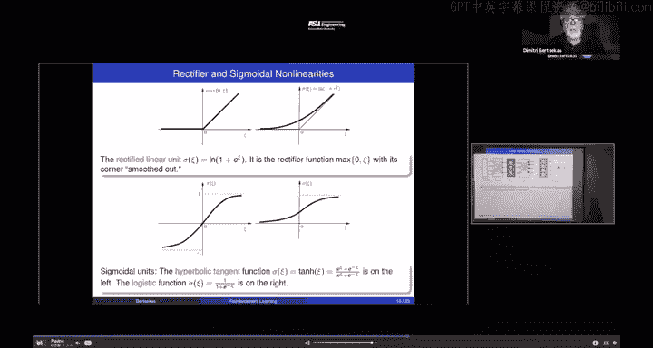
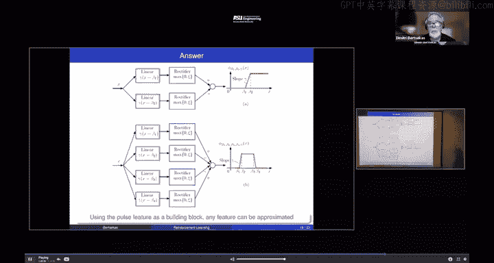
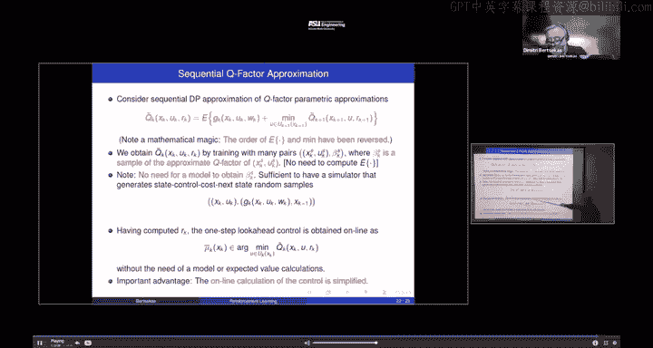
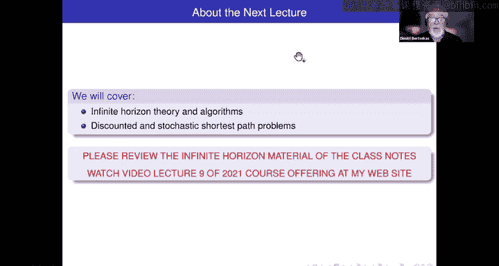

# ASU《强化学习2022-2024｜cse 691 Reinforcement Learning Course at ASU》中英字幕（deepseek - P37：[30]Lecture 8, Spring 2022_ Off-line training algorithms, - GPT中英字幕课程资源 - BV1zcfVYdErD

Yeah。Yeah。Okay， well， let me welcome you to this eighth lecture of our course。

This lecture marks the beginning of the second part of the course。So far， aside from review。

 we have been focusing on online play algorithms。With today's lectures。

 we're going to start focusing on online training algorithms。And in today's lecture。

 we're going to talk about neural networks and parametric approximation architectures。

 and we will also look at how these are used in various reinforcement learning contexts。

Okay， so here's the outline， a few things in the way of review。

 then we're going to talk about parametric approximation architectures， including neural networks。

As well as feature based architectures。And we're going to rely on videos from previous offerings of the course。

Today is going to be a long lecture and it's going to involve several clips。

After we introduced parametric architectures， we're going to talk about how we train them。

 the optimization algorithms， optimization formulations that we use for the training。

Then we're going to talk about specialized optimizational algorithms of the gradient type。

But incremental and I'll explain what that is not the usual gradient methods。

 or incremental gradient methods which have been very successful in the context of training of architectures and particularly neural networks。

Then we are going to say a few things more specific to neural networks and their properties。

And then we're going to discuss how neural networks can be used within finite horizon dynamic programming context。

In future lectures， we're going to focus on infinite horizon context and the policy integration method in particular。

However， today we're going to focus on finite horizon context。So somebody of you。Let's look at the。

Alpha zero MPC model predictive control model that has been our guide for the development of theory and algorithms so far。

Remember that we made。A distinction between online clay algorithms and offline training algorithms。

 Now， the online play algorithm is what you see here in blue。

It involves look ahead minimization for one or more than one stages。

Are followed optionally by truncated rollout， look ahead with a specific policy， the base policy。

And then at the end， if we have not finished， we take a cost function approximation。

 we add a cost function approximation that encodes the quality of the state at this stage of the look ahead。

啊。The very first step of look ahead minimization is also related to Newton's method。

 it's a Newton step and we made an interpretation which we emphasized that the first minimization is a Newton step for solving Belmon's equation and the remainder is preparation for the Newton step。

Setting up and improving the starting point for the Newton step。Now this preparation here involves。

Interaction with the offline training algorithm， the offline training algorithm provides the terminal cost of approximation。

And。Optionally， if there is this middlegle portion。

 it provides the base policy for implementing this truncated rollout。

So most of what we have discussed has to do with the blue part。

 and now we are going to talk about how we construct terminal cost approximations and base policies from data。

 this is called a value network sometimes and this is called a policy network。

 usually when neural networks are involved。So let me。Get the。

Get to you a broad outline of what we have done。We started with four overview lectures。

 which were intended to give you the big picture and to get you started with your term paper or mini project。

And we've focused on online play algorithms。And there were several of those that we discussed。

But roll out our grs。And there are variations in finite horizon and also as the very first duration of the fundamental policy duration method for infant horizon problems。

Now for deter deterministic problems， there are several and for some stochastic problems。

 there are several variations。Fortified rollout to ensure cost improvement。

Simplified minimization for constrained problems for mini max problems。

And one particular type of simplified rollout is the multi agent rollout algorithm that makes。

Approxiation in space and look ahead minimization possible for problems that involve controls with multiple components corresponding to different agents。

We also emphasize the importance of for line youre planning for problems with changing parameters a changing model。

And the context of adaptive control。And we discussed also model proic control。

And related issues to it， special problems。嗯。So。That's what we've done。And this is where we're going。

We're going towards offline training algorithms。And we're going to have five lectures on this topic。

And the five lectures correspond to this bullets that I have here。

We're going to cover in some depth and in some detail。

Approximation of values and policies with neural networks and other architectures。

 This is today's lecture。The next lecture is going to focus on infinite horizon problems。

And the algorithm of policy duration and other algorithms focus a little bit more on theory。

 error bounds lay the ground for。Considering approximations， policy duration。

 approximate policy duration， algorithms and acute learning。For the third lecture。Then。

The first threelexs deal with， mostly with approximation of cost functions。

The fourth lecture is going to do with approximation policy space and algorithms called policy gradient methods and other related methods for training policies。

Finally， we're going to talk about aggregation。Whi is approximation in value space but of a special type that has special properties and we're going to devote one lecture to that。

啊。🎼Now if you compare what we're going to do with the 2021 course is going to be pretty similar。

 so if you want to read ahead or view ahead， you may look at the slides and the video clips from the pre from the 2021 course。

So what I'm going to do now is do a review of approximation value space and how everything fits with that we're going to discuss fits in it。

 and I'm going to use the video from last from the previous。

Offering the 2021。Okay， here we go and I will stop at various strategic points to take questions。

The general context， the general。The structure of approximation in value space。

 you've seen this figure before， this relates to one step look ahead at a given state xk we select control by minimizing this expression involving the first step in the future as approximated by some approximate cost function J tilde K plus1。

And there are also two other types of approximation， the three approximations。

 approximation of the minimization here in approximation of the computation of the expected value here。

And these three approximations can be done reasonably independently from each other。

 and we have discussed several topics in each one of these types of approximation， for example。

 we've discussed multi agentent minimization， which is an approximate form of the true minimization。

 we have discussed making approximations in the calculation of expected values through certainty equivalentence。

 adaptive simulation， Monte Carlo research， and we have also discussed spent a lot of time discussing various methods for approximation of this J tilda functions。

Problem approximation is one of these approaches。We spend a lot of time on it all out。

In the special case， model predictive control。And today we're going to focus on this。Pink。

Colored topics of parametric approximation and neural networks。呃。

And similar things hold for multi step look ahead today。

 we're going to focus primarily on one step look ahead。

Almost everything goes through for multi step look at situations。

So let's talk about parametric approximation architectures in general。There are two things。

 two types of things that we want to approximate in reinforcement learning。

One is to approximate costs in either a finite or an infinite horizonizon setting。In particular。

 we may want。In a fine equalizing setting， we may want to。

To approximate the optimal cost function at stage K or the optimal Q function at stage K。

In the case of an infinite horizon， there's no dependence of the optimal cost on the stage K。

 so there's only one function， optimal cost function to approximate and we may be interested in approximating that or the corresponding。

Q function。呃。We are also interested in approximating cost functions of policies， like in rollout。

 for example。So this deals with approximation of an optimal cost function。

 this deals with approximation of a specific policy。

 either in a finite comparison setting or in an infinite comparison setting。

We're also interested in approximating two functions of a policy in a finite horizon or an ethnic horizon setting。

So all of this is cost approximation。The other thing that we wanted to approximate is policies again in either finite or infinite horizon settings。

And we may want to approximate opt policies or we may want to approximate given policies。

 so this would be the approximations would be mappings that map a state into a cost that's approximately equal to this or that or this or that。

So。All of this deals with approximations and we have several ways of doing these approximations。

However， we are going to focus on parametric approximations。

So a target function J is going to be approximate by another function J tilde that depends on the state。

 but also depends on a parameter。So this J Tilde is a member of a parametric class of functions parameterized by a parameter vector that may have many components right。

 it's generally a vector of scalar components。And。Similarly for policies。

 we want to approximate mu with a number from a parametric class functions that depend on x。

 but also involve a certain parameter。And by choosing the parameter。

 we can obtain different approximations， and the idea is to choose the parameter in some kind of optimal way or semi optimal way that matches data that we have about this target function and this target points。

Now， an example is we're going to give several examples， but one example is neural networks。

And in this case R is the set of weights of the neural network。

 we're going to discuss neural networks and weights shortly。

 but basically this R is a big big vector that involves various parameters of the neural network that encode the various layers of the network and then the problem becomes determining the set of weights so that the neural network provides approximations that are close to the target cost function or the target points。

So this is the general objective and this corresponds to。

A value network that we mentioned in the case of Alpha zero， for example。

 this corresponds to a policy network constructing a policy network。呃。And。

Let's see how this parametric approximation works for the case of costs。

We have a certain target cost function， be it an optimal cost function or be it a cost function of a policy。

And we obtain training data from that target cost function。Wwhich are state control peers。

 there are many of those Q in number， these are selected states from the state space。

 and these are the corresponding cost function values。hi somehow we compute perhaps with some error。

 but for the moment we're going to neglect the errors and let's say that we compute exactly this cost functions similar things holds if these up if the error terms here。

So we have the target cost function， we have training data that we collect somehow。

 and then we also have a family of approximating functions。

 an approximating architecture this found parameterized by a parameter vector like the weights of a neural network。

And we for every parameter R we obtain an approximating function and we want to find R so that this function here matches well the training data。

 in other words， if you compare the training data with what the approximateum function tells you that the cost is the error is small like for example。

 the sum of the squares of the errors is minimized or almost minimized。

So this is the training problem， finding on。😡，And this can be done with。

An optimization type of algorithm， it's almost always done this way。

Specialized optimization software。Based for example， on gradient type methods。

 we're going to discuss these methods shortly and there are also other possibilities like special disque methods。

 we're going to say a few things about those as well。

So that's the general structure of parametric cost approximation， a target function， trainee data。

 a family of functions， choosing an element from the family so that theres good match between this and that。

I have any questions here？Okay， so let's go into the other type of parametric approximation。呃。

Policy approximation。Now， if the control， this a little different because costs are scales， right。

 correspond are。Are controls involve controls from a control space。Now。

 if the control has continuous real valued components， like for example。

 is the vector positions and velocities， three dimensional position and velocity of our airplane。

 okay， has six real valued components。In that case of continuous components， continuous controls。

 the training is pretty similar to the cost function case， its scalrs in one case。In the other case。

 it is multiple scalrs， but the idea is similar basically you replicate the computations for a single scalar。

To obtain approximations for a whole vector component。On the other hand。

If the control comes from a finite control space， can only take a finite number of values。

 then we need to modify the approach of approximation a little bit。

And there's an interesting analogy here， in an interesting resemblance relation between the。Finding。

And approximating policy。In building a classifier， the。Qu is a classifier。

 it's a very well known type of。Algorithm software from machine learning whereby we have a population of objects and we have a finite set of categories and we want to classify objects from this population into one of these categories。

 look at it and then decide which category it belongs to。

Like you have okay diged images of apples and oranges and you feed them to a computer and the computer。

 the classified were classified as an apple or an orange， okay？Now， if you think about it， a policy。

In the case where you have a finite control space is a classifier。

 basically it maps X the states into some category， the categories are these Ms。

 so the category1 are the states， the states that belong to category one are the ones for which the control is equal to U1 and so on。

So basically there's one to one。Identification of policies in this finite control space space and classifierifies。

Now， classification。Or pattern recognition， as its otherwise now is an old technique dates back several quite a few decades。

And one of the first and most fundamental algorithms in machine learning。And therefore。

 it makes sense to use this classification， experience and algorithms in the context of approximation in policy space。

And。The way this will work is shown here in this picture。We have a target policy mu。

 and we collect training data from it， state control pairs。Coction of states。

 x1 up to xq and the corresponding controls from the target policy。Starget policy may， for example。

 the rollout policy correspondinging to a given base policy。

 we have ways to calculate the values of the rollout policy and when you do that for many states we obtain training data。

And this training data is fed into a classifier， which assigns state X。To control you。

 and there's only a finite number of views here or categories。And they depend on the parameter。Now。

Many， not all， but many classifiers actually do not produce。A single。Category。

To assign to any given state。But instead， given a state， they produce probabilities。

 a probability distribution of the different categories。So given x and given R。

 the classifier gives the probability that this。The state belongs to category one or this object belongs to category1。

 and the other probabil is that the state belongs to category2 and so on up to n。

Now in the context of fun。Bonicees。This type of object is what's called a randomized policy。

 assign to a state， a probability distribution over controls to apply。Now you may recall that in Al0。

 Al zero produces a sequence of players and these players are randomized policies for a given chessposition。

 they give the probability distribution over of play of various moves。With desirable moves。

 having higher probability and pretty bad moves having probability essentially zero。

So this idea producing of generating randomized policies through training is central in alpha0。

 it's common in reinforcement learning and。To a great extent。

 due to the fact that a lot of classifiers prefer to produce probability distributions at the output rather than a single control。

Now， once you have a probability distribution， you can obtain a single control by using a max operation。

In other words， you assign assigned to state X。A control that has the maximum probability out of the probability distribution produced by the classifier。

So all of this training can be done with classification software， some of them use neural networks。

 some of them do not， some the great variety of classification software。

 and many of those are useful in the reinforcement learning context。

 if the number of controls is finite， okay in the case where the control components are continuous。

 then basically what applies for cost also applies for controls。

Let me also mention that there is a reason why classifiers produce probability distributions and this has to do with algorithms。

There are algorithms that deal better with continuous outputs rather than discrete outputs but this will not concern us because we're not going to deal with the problem of classification and the algorithms for doing that in this course we're going to leave parametric policy approximation at about this stage and we're going to focus on cost function approximation in what follows in this lecture。

Are there any questions？I'm stopping the video to take questions， so you have some questions。Okay。

 we'll keep on going。Okay， so let me say a few general things about。About。

Cost function Para America approximation。As I mentioned earlier， we select a class of functions。

That depends on a parameter vector that has m components which you can change that tuable。

 these are scalar parameters that you can tune and therefore change J Tilde so as to match the training data from the target function。

And by training the architecture， we mean that we apply an algorithm that chooses R and this algorithm typically solves a regression type problem involving the sum of square errors or something similar。

 errors between data and output of the approximating function。Now。

It's useful to classify different parametric architectures according to their properties and one property of this that that is interesting is whether we the the。

The approximating architecture is。Local or is it global？

By a local approximation is one for which changing a single parameter， only one of those。

Affects J Tilda only in a small part of the state space locally。By contrast。

 a global type of approximation is one where changing a single weight here。

 a single parameter affects the approximation over the entire state space。

We'll see examples of both shortly。Another classification of architectures between linear and nonlinearar if J Tilda is linear in R。

 nonlinearar， perhaps in X， but linear in R， then the architecture is called linear。

 and we'll see that we like linear architectures， if they will work for us because the training is easier with linear architectures。

But many architectures are nonlinear in art， including neural networks， are highly nonlinear。

Another very important concept。An architecture is called featured based。

If it depends on x via a feature vector。 now this is。A vector。

Of individual components called features。That depend on x。

And these features capture major characteristics of x。In other words， if I tell you x。

 and I give you a feature vector， it provides you with a lot of information about a character of x。

 and it's also useful in the context of approximation because you can use p of x as a substitute for x in effect。

Okay。So back to feature based architecture， it is called。

Feature based if J tilde depends on x through the feature vector。Okay。So this is general when linear。

 but this is very specific， it uses in place of exit uses its feature vector。

And JHd is some function。And the intuitive idea here is that this may be horribly complicated it has made very difficult and strange nonlinearities on the other hand。

 this nonlinearities may be captured in this nonlinear features here。And if that's the case。

 then you can afford to use a J hat， which is relatively simple， like for example。

 linear in R linear in r nonlinear in x， but through the features here。

 which capture the dominant nonlinearities of the target function。

So now combining this two quite a linear feature based architecture。

 it is an architecture an approximating function of this form here。Okay。

This is what we use to approximate the target function， it depends on x through the features。

 these are the M features that constitute the feature vector。R is a vector of parameters。

 R1 up to RM。And it is a linear weight that sum of the features with weights being the parameters of the architecture。

And you can write this a hang product in a product of this vector R with of the vector of features p sub x。

So that's a linear feature based architecture， a very major class。

 a very important class of approximating architectures。If you know good features。

 this is a pretty good one because like I said earlier， it can be trained relatively easily。

And here is a picture of an illustration of a linear feature based architecture。Given a state。

We pass it through a feature extraction mapping that calculates the feature vector。

These M numbers corresponding to the state X。Now these M numbers， the feature vector。

 are fed into a linear mapping involving this parameter vector R。

 and out comes this expression which approximates the target cost function。

So that's all there is to it。A feature extraction mapping to give you the feature vector and then linear weighting of the features to give you an approximation to the target cost function。

So we're going to give you now some examples of approximation architectures， are there any questions？

嗯I have a question。so are here me is some weight。 we need to decide， so we don't know are what I is。

 right。We don't know what， I'm sorry please repeat as the value of R。

 the value of R is some unknown weight。Yes， that's the object of training We do it by using some kind of optimization training algorithm that we haven't discussed so far。

O ok。Okay so this is what is needed here is to have an expression for the feature vector to be able to extract features and then after that this is the architecture and then you have to train it to find the right values for R that so that this matches data that you have。

Okay。Okay， so now I'm going to give you an example。

 a simple example of a linear feature based architecture that is also local。Okay。So。

This is a piecewise linear， a piecewise constant function approximation。

 so we have the target function and we want to approximate it with a piecewise constant function。

So what does this mean we partition the state space in some subsets within which the approximation is going to be constant。

And we define as the L feature。To be the indicator function of the L set。

 the indicator function of SL。So this is the feature here， but you see。

It is either one or it is zero， so for L， it is like that with a value of1 Okay， this is a level1。

At a different set， this is another feature。And another feature， okay， and。

When you pick a particular x， then the feature extraction mapping picks out in which。In which。

Set of the percussion here， it belongs and gives you the feature to be one or zero， okay？And then。

This。Features are multiplied with the weights。So the features are all01， okay。

 these are the features， and then when you multiply them with the weights。

 they provide a piecewise constant function。And by picking the weights appropriately。

 you can construct any piecewise linear approximation。Which will be。

 which will approximate the target function。Now this is a local architecture， why is it local？Okay。

 remember that the local architecture is one in which if you change a single feature up or down。

 then。This affects the approximation only on a small number of states okay。

 not in the entire state space， but in a relatively small subset of the state space so if I change one weight here I affect the function only within this set that's why it's local。

Are there any questions？Okay， so that's very simple， but it can be generalized to piecewise linear。

 for example， piecewise quadratic type of function。嗯。And。

Let's give an example of a global type of architecture that's very general， it's generic。

 it doesn't it require that you know features， the features are generic。Suppose that X， the state。

 has n components。Let's consider these features okay and components。

 the first feature is just a constant one。Then there's n features that are just the components。

 the end components。And then there are additional n squared features that involve two components。Now。

 the corresponding linear。Architecture is this one here。This is the weight。

 the parameter that weighs this feature。RI weighs the parameter of P and RI J weighs the is the parameter that weighs the。

The crush product。废去。So that's the parameter vector， it has all these components。

And by adjusting these components， we can build quadratic approximations。off。

Cost functions of states that have n components。 These are pretty general method。

 And sort of we don't need to know special features。 These are genetic features。

A generalization of that。Instead of having quadratic polynomials here。

 we can have higher order polynomials。Like youic， okay。Polynomials in the components， Moreoverover。

 we can decide that we're going to set to zero some of these weights and are' going to look only at selected cross cross product pairs。

All of this is possible， it's a generalization of this quadratic architecture。

Both of these are global architectures because if I change a single parameter。

 then this is going to affect every state， okay， it's going to affect the approximation of every state because it weighs directly the states over the entire space。

And even more general architecture， instead of having polynomials of state components quadratic or higher order。

 we have polynomials of feature vectors of x in other words we construct for x and m dimensional feature vector and we construct a polynomial architecture that weighs the features now that's pretty general and in fact this is a value architecture in many ways because it combines both linear and quadratic features with problem dependent features。

Now， note also that a linear feature based architecture is a special case of this。

If you have instead of a polynom， the polynomial isling is first order。 if you have a first order。

 polynomial of。Features， that's exactly what a linear feature based architecture is。

Any questions here？Okay， so that's pretty general， at least for those you don't need to know any special features of the problem。

But there are a lot of problems where you do know some very valuable issues that capture。

To a significant extent， the nonlinearity of the target function that you want to approximate。

For example， in chss， remember that in chss， the state is the board position。

And then when a ches player looks at a board position， mentally extracts features from the position。

 important characteristics of the position。And these are， for example， the material balance。

 whether white or black has more material and how much more。Whether the pieces have mobility。

 they can reach more squares or less squares。Where the kingin is safe。

 other strategic features like open filess， all of this just player catalogs in in his mind and mentally。

Builds evaluates the position。Well， actually。The position evaluator of a computer program does something similar。

Extracts features。That chess players find important and constructs a feature vector of the position。

And then weighs the features with parameters。Uually2年龄。And builds an evaluation of the position。

 a numerical value that gives。In some rough way， the probability of winning the game starting from that position。

嗯。Every， every chess program before Alpha 0 use the。嗯。

Features constructed heurically from human experience。

Alpha0 is different because it uses machine generated features。

 as we will see through the use of neural networks。

But this is the kind of architecture that was used in the past and will continue to be useful in the future。

 perhaps in combination with ideas that are inherent in the neural network trading of Al serum。

Now here's another example， which I've talked about in the past， Tetters， the game of Tes。

Involving okay， involving a wall of blocks and objects that are randomly generated that are falling from the top and you have to fit them in。

 the wall goes up and down if you reaches the top then you lose the game and you stop accumulating points and okay I'm not going to repeat that but at to spray a human tish player can look at a board position and can evaluate the position by using some features。

And I talked a few lectures back about a 22 feature architecture。

A linear feature based architecture with 22 features that involve important characteristics of the state。

Like the height of the different columns of the wall， the relative height， the height differences。

The maximum height of the wall。The number of holes inside the wall and things like altogether and a constant feature。

 altogether 22 features。And with these 22 features。B。

Approproxiation architectures have been built that allow online play with approximation in value space to reach very。

 very high scoring numbers。Impressively high scoring numbers。

And so that's another example where the features are based on。The characteristics of the problem。

 theyre problem specific。Okay here's another type of architecture that we not just pausing for a second are there any questions and I should add also that the number 22 for the Tris program corresponds to a board with 10 columns okay if you had 20 columns then that would be 42 features so just to make that clear but anyway are there any questions so far。

Okay， we'll keep on going。We're going to discuss a little bit late in the course。

Suppose you want to construct a complicated approximation architecture in particular。

 one that has different structure in different parts of the state space。

So here we partition the state space into several subsets。

And we construct a separate cost approximation in each subset。Perhaps in some of the subsets。

 the target function changes quite a bit different。

 quite a bit different than in other parts of the state space。

 so you may want to have a different architecture to encode the characteristic of to encode to represent the target function that sort of matches its character。

So。One possibility。Is to use a separate architecture in each set of the partition and do training on each side of the partition。

 perhaps with the communication between different parts of the。The approximations and okay。

 we're going to talk about things like that later。But the point that I want to emphasize here is that。

It is possible to use a regular partition。For the state space and approximate within each square of the grid。

But that's not a good idea， generally speaking。Instead。

 it's a good idea to generate a partition by using features。

This is called a feature based architecture Partitioning。

And suppose that you have a set of features that sort of represents the structure pretty well is。

Captures the characteristics of the target function that you want to approximate。

Then you can do a regular partition in the spatial features and map it back into an irregular partition。

In of the state space and the reason is the following。Basically。

 we want to partition the state space with subsets within which。

The target function changes relatively little， is kind of similar， has similar structure。

So the rationale is the following， we want to group together states that have similar costs。

 similar structure of cost function。And we hypothesize that states with similar features should have similar costs。

 so it makes sense to partition the space of features into subsets that are sort of。Regly spaced。

 and then ma back。Into set subsets of the state space。

 which have similar features and therefore according to this hypothesis， similar costs。

So that's the idea， it's a simple idea， but very effective if you want to do partitioning。对。Okay。

So now what we have no knowledge of features or very little knowledge of features。

 that's where neural networks come into play， they allow us to bypass the need for。Haand made。

The user provided features， the neural network does everything。

 provides the features and trains the architecture simultaneously through a training process。

This is the greater role of neural networks in reinforcement learning。

That's where they that's their primary significance。

 they allow you to bypass the notice for features to construct cost architectures and also policy architectures。

So here's a structure of a neural network， I'm going to go through this quickly because I'm going to start pretty soon the video lecture from the 2019 offering of the course。

 which is going to focus on this architecture almost exclusively。

So remember that what we want in an approximation in a cost approximation architecture is given a state to obtain a cost approximation。

And the way we do this with a neural network， a singular layer neural network。

 a simpler version of a neural network。Is we first take the state and we encode it into some function y sub x。

That。So that Y SX is suitable as input to the neural network。Also。

 Y sub X may include some problem specific features that we may know that they are valuable。

 but they are not enough by themselves to train to give a suitableable architecture。

 we want this problem specific features to supplement the neural network。

All of this is done in this box here， we obtain y sub x。And then we pass it through a linear layer。

 that's a linear layer， which is basically a linear transformation。Involving a matrix A。

And the vector B。And these are the parameters of the linear layer。There are quite a few of them。

 right， because this a matrix potentially has a lot of weights， a lot of components。

Now here there is a vector coming out。😡，Perhaps a different dimension than this one。

But this vector goes through nonlinearities， a layer of nonlinearities， single input， single output。

 scalar input， scalar output from the nonlinearity。And additional linearity。

Of course the output of the nonlinearity depends on x。

 but also depends on A and B right so let's call V the combined vector of the matrix A and the vector B and at the output of the nonlinear layer we see that we have M scals that depend on x in a parameter vector。

Now we view this as features and features of the state。

And we combine these features linearly by taking inner product with a parameter vector R。

 these are linear weights the weigh the components of this feature vector， okay。

 so out here is the weighted sum of these nonlinear weight。

 the nonlinear features weighted by the components of the parameter R。

And that's what the single layer neural network is， and that's how we use it for training。

Now we're going to get the。Back into this figure shortly。

 and I'm going to leave it here with just this introduction。

So are there any questions before we go into the video？I had a question。

Regarding the target functions that we're using for training。

 I think you've said at the beginning of the。Assumption that those are given。But in general。

 if we were going to。Try to figure those out from some of the methods we've seen in prior classes those are all based on approximations right so we're using potentially approximations as our targets to do the training。

And that error is just going to accumulate as far as I can tell， is that the correct？

iss that the situation that we're in？Okay， so。The target function may be easily obtainable or not so easily obtainable。

 The optimal cost function is harder to get samples from it。 Okay， on the other hand。

 from specific policies， you can get cost samples by running the policy and accumulating the cost through a simulator okay。

 or through some other calculation。Now a simulator is not exact， it will have some simulation error。

And it it will involve some the training data may involve cost。Function errors。

But this is all taking care into this listquas training process。

 in other words that the training process can work with training data that has cost errors in it。

Of course， the smaller errors are better off we are， but we can deal with errors。😡。

It's generally harder to have access to training samples about the optimal cost function。

 but remember that in rollout and in policy iteration later。

 we can have samples of the cost of policies by simulating the policy。Does that answer your question？

Yeah， it does Thank you Also I had a question about the last slide are those partitions themselves a result of some kind of separate optimization process or are they just created through domain expertise usually。

Well。Like I said， it's a good idea to use features to generate the part and features generally speaking require domain main knowledge。

 right？啊。So now it's possible to use a neural network to construct features and then construct a partition from these features。

 that's a possibility， but of course that's pretty sophisticated stuff now because you have to build a neural network first that will construct the features and then use the features for partitioning。

So this can be simple or it may not be so simple。Yeah， thank you。Okay。Any other questions？

I have a question。 Can you go to the next slide？So。Y of x is a vector that encodes the state， right？

I guess I don't understand why we would do this linear transformation on y of x before mapping it into a higher dimensional space。

 why not just feed y of x directly into the nonlinear layer？Okay。

 there are there are several possible reasons for that。

 One is to be able to include some problem specific features。 Okay so this why would have。

Could be just x plus some additional features， however。

The other are other issues that have to do with scaling， we may want to scale。

Why so that it falls within certain a certain boundaryed region。

 like scaling between between one and minus one， for example。

 so as to make a training process to facilitate the training process。

So there may be problem specific and also algorithmic related issues associated with the construction of this y sub x。

So this，'s it's kind of like a data conditioning layer where you're trying to。Put your dad。

 put the vector into some correct format before feeding it into the non nonlinear layer。 exactly。

 Yeah， exactly。 It's in part。ADa conditioning type of process。かる？Okay guys。

 now comes the critical moment in this lecture where I have to switch the video so I'm going to I'm going to try to do that we go。

Okay， this video is from 2019 for a while it's a little dark， but it will improve shortly。

 but let me also pose to ask for questions are there any questions on we heard several questions from 2021。

 are there any questions that you have？Professor， yeah。I have a quick question。

 so regarding the when we train the neural network like in the last slide。

 we the input seems to be one state， I was just to wonder like the input should be one state or all the states for training the offline training for the offline training。

It will be to approximate the cost function of all the states。However。

 we feed the neural network with samples of states。In this states。

 the number of samples maybe be you know like a thousand or a million or whatever。

 but eventually we will obtain an approximation that applies to all states。Okay， thank you。

 That makes sense。Okay。Any other questions？Okay， I'm starting again。

O from the target function with a parametric architecture。

So the first step is to collect data， to collect a set of state cost training pairs。Where， okay。

 there are Q of those。 Q can be large in the millions， okay。It's lots of data， potentially。

May not be so big， but。Typically， it is large。And it involves pairs of sample states。

 So this is the sample。Space the state space， and we sample it。

through some method that we're not going to get into in this course。

And beta of S is just the value of the target cost plus perhaps some noise。 Okay。

 it's not quite the same， depending on how we do the sampling， how do we collect the data。

 this may contain some noise。But still， it captures the form of the target function。

And we determine R the parameter vector by least squares minimization。Okay。We fit。

The target function to the approximation architecture。

 we minimize the errors between these two and we find R that minimize those errors。

This is the basic form， but sometimes we add here a regular term， a square term。

 this is the norm of r square， a square term that depends on R， something like this。

This is to make this minimization a little bit better behaved， to remove singularities of some sort。

 but there are also other reasons that have to do with more specific subjects to neural network to approximation。

 like overfitting issues and。This is important。But to simplify our presentation。

 we are not going to be adding it here。Okay。Now here's the nice thing about linear feature based architectures。

The training can be done exactly， this training problem can be solved in closed form。How熟。Well。

 if we have this linear feature based architecture。Then this function here is this is linear in R。

 so this is quadratic in R the cost function is quadratic in R and quadratic problems can be solved in closed form and what is this closed form Well here's the formula okay we're not going to be using this formula but I'm going to explain it once This is a vector formula remember we are trying to find a vector of parameters。

Okay， fee is。Is the feature vector at the sample X S， Okay。

 so it's a vector like that and it's multiplied with a scalar。 So this sum here is a vector。

And how about this thing， let's look at the inner product here。It is a vector。

 a column vector multiplyingarrow vector， so it is a matrix。

 this is an M by m matrix where m is the dimension of this R。

And we add all those and we gain another matrix， which we invert， okay。

 so this is the inverse of this matrix here， which consists of sum of matrices。Okay。

So this is the exact formula when we obtain this formula by plugging this in here。

 soratic minimization， we set the gradient of this to0。

 the condition for optimality and we solve the resulting linear equation and it gives exactly this formula here and the derivations in your book and I'm not going to go through it because it's not significant for our future purposes。

Okay， so this is exact， but it still requires a lot of computation。

Where is the computation here that bothers us potentially。The inverse， the inverse。

 the inverse bothers us， okay， when does it bother us if we have a high dimensional matrix here。

 lots of features， let's say 10，000 features。And this becomes a 10，000 by 10，000 medics。

 That's a significant inversion， okay。What else bothers us？

How about this thing about 10 million data points？This means that we have to add。

10 million matrices here before we can start thinking about inverting。And similarly， 10。

000 vectors we have to add。So for a large number of features in large data set。This is in close form。

 but it may not be the best。In practice very often， instead of solving this problem exactly。

 we solved it as if it were a nonlinear。As if it were a non quadratic optimization problem would' be。

ItWould involve long regression。So let's go now into nonlinear architectures and how we change them。

 and this also applies to linear architectures， if we so prefer to to。就做 a。Okay。Now。

 this problem here involves again， potentially high dimension of parameters。

 very large number of sums of terms， very large numbers of terms in this sum。And。

The question is how do we solve it， This is nonlinear also potentially， so this can be a very。

 very formidable problem。However， we may be able to explore the structure of this problem。

 and the key characteristic here is that it involves a sum of a large number of simpler terms。

So let's look at the characteristics of the train problem。Okay， for a nonlinear architecture。

 this is a non convex function here with potentially many local minima。

And it may be horribly complicated。If you look at it， even for very simple problem， just two waves。

 two or three ways， plot in in the screen， in your screen， this expression here。

 and you'll find that it's really very bad looking， you know， it sort of goes flat or going out。

 dips in bulbs and waves like that and。Dips and goes back again， very， very complicated， really。嗯。

You can tie this with our neural network， very simple neural networks。 And you'll see that。Its bad。

Still， however。People have been able to deal with this。

 And this is one of those miracles that I cannot explain to you。 Okay。

 It has been done because somehow this structure is。Is。I。Can't be addressed with gradient methods。

On the other hand， the standard gradient methods would not work for this problem。Why is that？Because。

To calculate the gradient of the cose function。You need to add the gradients of the individual components。

 and if there is 10 millions of those， a single gradient is a substantial computation。Similarly。

 neton like methods are even worse， because then you would need to multiply the gradient with some kind of inversehesian。

 and it's a big mess again。On the other hand， this miraculous methods of incremental versions of gradient methods。

Have worked for neural networks and for nonlinear architectures， not always。

 but they have worked adequately for many problems。What is an incremental method。

 instead of operating on the entire sum at every iteration， it just picks up just one term okay？

And it moves to improve the cost to correspond with this term。Without c。

 without regard to of the other terms。So it operates on a single term， picks a sample。

 operates on this term， and it turns out that this has worked well enough for many of the problems that we want to solve。

And importantly， there's canned software that you can use like this Tensorflow。

 which seems which a good program that people have found to be successful。

 If you try to program your own method， youll see that it may be a challenge。Okay。Okay。

 now I'm going to switch to another video。Just one moment， please。Okay。

 so now we're going to go into algorithms， this incremental gradient type of algorithms for some of differentiable functions。

Of sums of differentiable functions。 And this is really a problem， not in。

In neural network optimization or train of nonlinear architectures。

 it's more of a nonlinear programming， a generic optimization problem。

 and I'm going to discuss it to simplify notation。 I'm going to discuss it in this form。

 So instead of looking at my specific regression problem。

 I'm going to look at the general problem of minimizing F of y why here corresponds to the parameters with perspective。

 which I want to optimize。 So y is。The parameter vector in our context and the cost function consists。

Of the sum。Of a number of differentiable functions。And why is antidial？Okay。

So what is the ordinary gradient method？For solving this problem。It is an iterative method。

At the current iterate YK， it generates the next iterate by moving in the direction of the negative gradient。

 it calculates the gradient of this co function at the current iterate and moves along the opposite of that。

With a step sized gamma K。 So this gamma is a scalar。This is a vector， and this is a scalar。

And should be positive。Now。What is this gradient here？Well， it's the sum of the little gradients。

 the sum of the grades of the components， right？Gradian of a sum equals the sum of the gradients。

So we have here a very large number of components。 and this is what makes the gradient method。Not so。

Not a little bit unwieldy in this context here。Now here's the incremental gradient counterpart。

It chooses just one term， just an index IK that is iteration dependent。

Moves from Yk to Yk plus one in the direction of the opposite gradient of just that component。

Just a single component。This two are day and night in terms of overhead， this is far。

 far cheaper by a factor of M， essentially。Nelative to that。Now， of course。It's not clear that this。

Will work okay we're moving in the direction of some gradient， but this gradient。

 little gradient may have no connection with the true gradient may be very different So what's going on。

 why would this work Well here's my explanation to this。This is an example。Where we want to minimize。

The sum of quadratic functions of one variable。So each one of these little terms in the sum is a quadratic like that。

 one of those， so I is the I term in correspond to the I term hences a quadratic in the scalar y。

 okay， it's a scalar problem。So。These are the components of the summation， and if we add them。

 we get the overall cost function。Now the overall cost function something like that has a minimum somewhere over here that lies between the maximum and the minimum of the components。

So this region here is interesting， it is the region where these quadratics are minimized。

So why star of I is the minimum of the ice？Quadraic and they all lie in some region here。

And now we want to minimize this expression。And let's compare the ordinary gradient method with the incremental gradient。

Okay， how would the ordinary gradient method work？Okay， we are doing a gradientding method operates。

😊，On the basis of the overall function， so if it starts over to the right。

 it moves in that direction towards the minimum。If it starts on the left。

 it moves in the opposite direction again towards the minimum。Now。

 the incremental method picks one of those quadratics。And if it happens to be。To the right。

 it moves in the same direction as the ordinary gradient they would be doing roughly the same things。

If it starts on the left， also it will。Move in the same general direction in the same direction that the ordinary gradient would do。

At least when we are in this region over here， and we approach this。This。This area here。

We would be doing the right thing， the same thing that the ordinary gradient Beel would do。

Even if it calculates the great use of all the components。So that's the thing。

One step of incremental gradient is almost as effective as one step of the full gradient method。

 which costs you m times more work。So incremental gradient is as fast as the ordinary gradient method with one over M the amount of work provided that I am in this far out region。

 the blue region。And also this other side， this far out region in the other side。Now。

 once I get into this red region。Which contains the minimum of the individual components。

The incremental gradient method gets confused。Whohy is that？

Okay the overall minimum somewhere over here that's where you want to go， however。

 if you are over here and you pick this component， for example。

 then you would be moving away from the minimum， you may even start exactly at the minimum of the overall cost function。

 but you'd be moving back and forth depending on which component you pick sometimes you'd be picking the right kind of component that would move you towards the global minimum and other times you would be moving in the other direction。

 the method gets utterly confused。So that's the general behavior of these methods。From far out。

 they are doing the right thing。From the origin of confusion， they get confused。And it is possible。

 however， to make them work， provided you don't make big steps。

It turns out that if you use a diminishing step size， a step size that goes to zero over time。

 then you'd be getting confused with each step， but you'd be getting confused less in。

Confuse steps would average out and overall you would be tending towards。The correct global minimum。

For this， you require dimensioning step size that also dimensions at the right rate at the right speed。

 but there is theory that guarantees this。And the theory is important。

But you can see from this example， what's the overall tend。

 it may be that this region is not too big and even if you get here and you're getting confused a little bit doesn't matter to you okay once you're close。

 that may be close enough。Now this are one dimensional example。

 but similar things happen for a multidimensional example。

 you have all these functions whose mini in a certain area， this region of confusion。

 if you're far away， you pick one of those functions you'd be moving in the right direction as the ordinary gradient so the dimension here does not matter all that much。

 you can play with this example with multiple dimension with dimension two or higher and you'll see that the same kind of phenomenon。

The same kind of phenomenon can be observed。It turns out that this simple picture captures the behavior of incremental methods。

 That's what's going on。 You read analysis about complexity about all kinds of mathematics。

 complicate mathematics， but this is the picture that you should pay attention。 The other stuff。

Is important， but perhaps not so relevant。Okay， are there any questions here？

Let me pause the video and see if there are any questions are any questions。Yeah。Okay。

 I'm going to pose it also that's the third time I'm prop posing for questions。

 you have some questions about this picture， which I think is very insightful if you study you figure out you find out you get a pretty good idea of what's going on with this incremental gradient methods。

Okay， so we'll keep on going。Okay， we'll keep going。Now。

 there are variants of this incremental gradient idea。There's a method called。Incrreemental。

 aggregated gradient method。In this one aims at acceleration。And instead of using a single term。

The value is greater than a single term at its duration， but it uses multiple gradient terms。ok。

This form is a little complicated。Notice that at the current Ierate。

 we're using the sum of gradients， but these are gradients。At the current point。

 but also the gradients that calculated at previous points， and we use those to aggregate them。

 to average them to obtain some kind of an approximation of the true gradient。

So this involves the current gradient of the component， but also the delayed gradients。

 the previous ones， and we use them as if they were evaluated at a current point。Okay， otherwise。

 it's similar to the non aggregated method。But。Both in theory and in practice， this works better。

 sometimes significantly better。嗯。This relatively recent development。

 incremental gradient metals go way back to the 80s to late 80s。 This a development that's maybe。

last 10 years or so， and people have published a lot of hiical research and also supported the findings of the research empirically。

 and it is often preferable than the method that uses a single component gradient。

It involves more overhead， it involves some memory， it has some drawbacks， but this is a method that。

Is competitive and perhaps better in some situations。

Another incremental type method is a so called stochastic gradient method。

Also cause stochastic gradient descent。Now， this method is stochastic gradientding descent。

Is often applied to deterministic problems。And generally speaking， there is no dissent here。

It's often nos stochastic and never it is a decentscent method。

 but nonetheless this name has caught on and this method is also known by its acrony， SGD。

And the method applies not to minimization of a sum of components。

 but rather minimization of unexpected value。Okay。So we have a function that depends on the current vector we want to to want to optimize and the random value of Wminium。

So this is an expected value， you can think of it also as weighted sum， right。

 expected values are weighted sums， so it's not surprising that incremental ideas would apply to minimization of this expected value。

And the way it works at the current it it， we sample this random variable。

And we use the gradient corresponding to the sample， not the expected value。

 which involves the full sum， but just the gradient of a sample。

So this is very similar to the incremental gradient method and in fact。

If you consider the incremental gradient method with a random index selection。

 this is what we want to minimize， we can convert this to an expected value by viewing the index as a random variable that has a uniform distribution。

Then this sum can be written as an expected value， and then the stochastic gradient method is exactly the same as the incremental gradient method。

 These two are very similar， they have similar analysis， similar behavior。However， this one applies。

To problems that。回。The random value is continuous。 doesn't have to be discrete。 Okay。

 so it's a little bit more general。Generally speaking。

 it's not a good idea to take this problem here and view it as an expected value problem here because you may be able to utilize the fact that this is the sum of a finite number of components。

 for example， an incremental and aggregated method would not apply readily。To this formulation here。

So in my mind， incremental。And stochastic， they are not the same， although they're closely related。

Okay， so these are variants of gradient methods。Okay， let me mention a few issues here。

 which we're not going to get into。嗯。How to pick the step size。

 usually the step size is chosen to be diminishing。

 gamma is a constant and with every step we diminish the step size according to a one over a k or 1 plus k plus1 rate。

There are also variants of this。Sometimes。And this is very common in software。That you'll encounter。

The step size is diminishing for a large number of iterations， and then once it hits a lower bound。

 it just stays constant after that。This is also called the learning rate， gamma K。

The method that you picked this learning rate is called the learning schedule or something like that。

It's a step size， step size， a step size rule。And there are several different types。

You and there is a lot of。A lot of analysts are around with different step size choices。

Remember that the incremental method generally gets confused in a region around the minimum。

So how do you deal with that， is it possible to detect when the method is getting confused and reduce the step size？

Okay， that seems like a good idea and indeed there are methods that adjust the step size by detecting whether you are in the reach of confusion or whether you're not。

And can't you actually put the ordinary gradient pencil？

They just know you start using the ordinary breathing。Yeah， you could。

 but you still have a problem with the 10 million components， right？Right， yeah。

 within the original confusion， the convergence rate of the gradient method with a constant step size。

 not a diminishing step size would be faster。That's true。嗯。

But there is an issue of how do you detect that you are in that of confusion， okay。

That may not be obvious。They requirequire an algorithm of criteria。Okay， at each step。

 we pick a component on which we iterate how do we select the order of components？

Well we have a certain number of components， M， we can cycle through them， start at one。

 go to M and then back to1， okay this is a sicklycc， and if you know a good order。

 it may be the best okay， the best way to operate them。

The alternative is to pick one component at random， okay， just with a uniform distribution。

 it's important to use a uniform distribution， otherwise it may be biasing the optimization。

And there are other possibilities like。You start a cycle and you。

You randomize the order within the cycle。 you go through according to this order and then。

You go back to the beginning and randomize again。Okay， so this is。So within its cycle。

 you pick all components， but the order by which you pick them changes from one cycle to the next。

Okay， there is some theory associated with that which is kind of interesting in practice randomization schemes work better than cyclic schemes。

 if you don't know a good order， if you know a good order。

 it may be that a cyclic scheme is maybe better。Diaagonal scaling。

 we have a single step size for all components of y。By which we move white？뭐や 그런。就是就就是改变。

The incremental gradient， we may use a different step size for each component。

 this would amount to multiplying the incremental gradient with a diagonal matrix okay where along the diagonal we have the different step sizes there are good ways to do diagonal scaling and some of the software does that automatically。

There are also alternative incremental methods， which are more ambitious。And often work much better。

 but they have not been popular for one reason or another in general practice they have done not been so popular。

 incremental newton methods and this is described in your textbook and the extended kel filter which comes from control theory has also been used to。

To solve this these square problems。Okay， because I look more literature here。

I'll refer you to the references in your textbook。However。

 the methods that I have described are the ones that are used most often。Okay。

 now let's go to neural networks， I described the neural network last time。And。

We're going to return to this picture， again。Now， what's the big advantage of neural networks？

They provide a nonlinear architecture that does not use explicit features。

 You don't need to know good features for your problem。 It automatically constructs features for you。

 and it linearly weighs them。Okay so what's the structure I went through it last time but I'll do it again。

 we have the state， and then at the end we produce a cost approximation that depends on a set of parameters。

 the R vector and another vector V。And the structure as follows， you take the state and you make up。

I first order。Transformation。To put it into a format that the is suitable for the neural network。

If you know some good features， you can include them here。

But this may be sort of scaling other kinds of transformations。

And then you pass this y vector through a matrix， a matrix A。Which involves。Okay。

 it's a rectangular matrix。 it involves a number。The entries of this matrix are adjustable parameters。

So part of the parametric form of this neural network is this matrix， this is one set of parameters。

And also， there's a constant offset B。So in this linear layer。There are parameters given by A and B。

Essentialtenly， a large set of parameters。And at the output。

 you have a number of scals that are fed into nonlinearities， this is a single input。

 single output nonlinearity， so this is a scalar going through here， produces another scalar。

And so on。 And we obtain these scaleals that depend on x， and they depend also on V。

 and we view this as features， and we weigh them linearly。With。A parameter vector R。

 each one of these features gets its own weight and the inner product of R and this feature vector is what we view as cost approximation。

So that's the structure。And how do we train this while we train them in the way we discussed？We form。

Training pairs。Of sample states。And。Sample target costs， beta。

And we put all of this together into a nonlinear regression。

This is the sum of squared errors they involve the output of the neural network and have written explicitly。

 this is the output of the linear layer and this is the output of the nonlinear layer andsed with the parameters R。

听。So this is the structure that you see here， I just written it in this complicated algebra break form。

And we compare this with the beta， and we minimize the solid squared  errors。

So this is a nonlinear course function。A sum of squares。

And we can use the incremental gradient method to do this minimization。And。

And that's the way usually it's done， an incremental gradient let go on this thing here。

 plus perhaps some regularization， sometimes its a regularization term that's being added here。

And we find the minimum。Which gives us the parameters of this linear layer and the parameters of this。

Final linear layer again。And。That's our approximation， architecture。Now。

 this neural network in the literature neural network was are。I treat it as magical objects， okay？

Like they have magical properties， they can solve just about any problem。

It's true that they have been very successful， but the most solid property or neural networks is this property here the universal approximation property。

 which says that with a sufficiently rich linear layer and nonlinear layer。

 you can approximate arbitrarily closely， just about any function that you are likely to encounter。

This is a universal approximation property This thing here can be as close as you want to your target function provided you choose sufficiently many。

Weights here insufficiently and correspondingly sufficiently many nonlinearities here。

That's a solid property and a fundamental result about neural networks。

 particularly as it relates to our subject， there are other results about neural networks but they don't relate to our subject here。

 which deals with cost function approximation。Okay， so what do we use for nonlinearities？

The most popular these days is nonlinearities of this form。

 which is shall called rectified linear units。U。Some people call this function here the max function。

Okay， the positive component。Of pi they call it rectifier okay this rectifier is this dysfunction function here in smoothed out another name for this function would be a smooth rectifier with its corner smooth up in some way and a popular way to smooth it is using this exponential if you plot this you'll see that it is what you shows here asymptotically it approaches on both sides to rectifier but its corner is smooth and we need a smooth。

Not linear your unit， because we want to use gradient methods and gradient methods require。

Differentiability。So this is something that has come into play for the last， I don't know。

 relatively recent in the past。The most popular type of nonlinearities。

 were the so called syigmmodial nonlinearities， which have this form。They go to asympts。

 they flyten out on either direction， the hyperbolic tangent function。Is this one here？

Has a slope of one here and naympal goes to one and to minus-1 on the two sides。

The logistic function is this by your translation gives you something that's pretty similar to the s mod function。

Gally speaking from a theoretical point of view， from the universal approximation。

 property point of view， it doesn't matter which one you use。

 it just may happen that one type of nonlinearity may work better on your problem than another type。

Now， in recent years， there's been a lot of discussion about deep neural networks because deep neural networks have achieved great success in certain domains。

 for some problems they have worked very well。And what is a deep neural network is just a shallow neural network replicated many times。

So we have x， it goes through a state encoding layer and goes through a linear layer and then through a nonlinear layer。

 and over here instead of going straight out and pick up those features and linear weigh them。

 we use them as input to another linear layer。Which。

The output of which is fed into another nonlinear layer and so on。

 And you can have quite a few nonlinear layers。 you can have you can have the tens， okay。

In the old days， people were using just a single layer or maybe two layers。Very seldom。More than two。

 like three， okay。other， reports of people having tried。More layers， but nowadays these are。

More popular。And have a lot of success to show in certain domains。

Why is this true people don't quite understand， but people speculate about why deep neural networkss may perform better。

 they don't always perform better， but you may try them and you may find great improvement。Well。

 a multilayer network。Provides a higherer of features instead of just single features at the end of the first nonlinear layer。

 gets a set of features here， which I used as inputs to produce a new set of features。

And then a new set of features。 So we have features on top of features building on top of features。

 and that creates a richer set of nonlinearities in some sense。

Some of the early features may capture some gross effects that may be defined by subsequent layers。

 I can only speculate about that and it's not very clear。

 but that's the way that's one common explanation that people use that people give for the success of this day。

Another possibility here is to make this layer specialized。

 like the matrices here may involve special structure which focus on particular characteristics of the target function。

So。Special linear operations such as convolution， can be built in here。

This is popular in image processing with convolution。

 you can sort of focus on particular types of objects in your image。

And the upshot of all this is that if you design if you're able to design this deep neural network。

And specialize it to your problem。Then it may become easier to solve this strain problem because the number of parameters in the linear layers may be drastically decreased。

In other words， if you use 10。10 layers here。You may need overall fewer parameters than if we were to use a single layer with many。

 many parameters。Because this is more sophisticated， basically。

So they have been found to be more effective than shallow neural networks for some problems。

 not for all problems， for example I've mentioned in past lectures， the back came program of Tor。

Which use our neural network。In the internet， you'll find descendants of the back command。

Program of the soil that use neural networks。 but people have tried。Many layers。

 and it didn't make a difference。 Theaurus himself tried several layers， but he ended up using two。

 two layers。And in fact， she found little difference between using a single nonlinear layer versus using two。

Nowadays， back government programs use two layers。That's not because of lack of trying with more layers。

Okay， now one thing about deep neural networks is in order to use the incremental gradient method。

 which is still the most popular， you have to calculate gradients that propagate through all the way through this complicated structure。

How do you calculate this gradients， Well， with a single layer。

 it's pretty straightforward to calculate the gradient with respect to the parameters， but here。

You have this concatenation of layers， miscomposition of functions。

 and you have to use the chain rule to calculate the gradients with respectively parameters of each one of those。

And there is a clever algorithm， a clever way to use the change rule called back propagation。

Which calculates which gives you the gradient of。This thing here or rather least square term with respect to the parameters of the layers。

So propag's back propagation， it's just an intelligent way to use the chain rule to calculate the incremental gradient of each component term at every iteration。

And your textbook has a derivation。我。Of this the formula for the for the incremental gradients。

 and you may want to read that or the other。Other ways of explaining this background proation rule。

It's just the chain rule。Of calc。Okay。So here we are with neural networks。This is the one layer。

Network， the idea is to generate features， incremental gradients argues universal property that your best approximation property holds。

There are several different kinds of nonlinearities。

And there are deep versions for which also the universal approximation property。

Holds。But。Why is it？That indeed， neural networks have this capability。

 Why is it that by stacking up a lot of parameters。

You can approximate any function that you might be interested in。So。

My challenge question to you is this， okay？嗯。Let's look。At how neural networks generate features。

And I'm going to look at a single。Valariable problem by one dimensional state， x。

If you pass three through a linear。Function。Then， from x。It becomes this function here。

 It involves a different slope of gamma and a horizontal shift。To beta。

 So if you pass x through a linear layer and then you rectify that。

Then you are going to get this red function。So let's view this as a fundamental operation。

And my question to you is， how can we use linear units and rectifier units to construct？

Another feature vector， this feature vector。Whereby you input x and at the output。

 you get this this function。So I want you to think of how you can use。Units like this to produce。

A pulse type of feature。And let's ask also the question， since you have this capability。

 what are the kind of features that can be produced by neural networks， at least in the scalar case。

 scalar X that I have here。And then go even further。

 why do neural networks have a universal approximation property？嗯。Okay guys。

 this was a long clip and a lot of material to digest we're going to take a break for 15 minutes okay。

 we'll come back in 15 minutes。And then I'm going to discuss this question。

 and it would be also a good opportunity to ask your own questions。

But if there are some questions right now that you want to ask， why don't you bring them up？

I saw in the slides that you had engineered features being included with the learn features at the final layer in the network to your knowledge。

 do you know any sophisticated means other than concatenation that have traditionally been used to accomplish that combination of features？

Okay， I had engineered features， you mean and learn features learned through the neural network。

 but in my diagram， like for example， I hope you can see my my screen in my diagram here in this encoding we can this encoding produces。

Both includes engineered features， what you call engineered features but we don't add them at the end。

 okay， we could have added them at the end， but not in this figure it's possible to pass them straight through to the linear layer。

If， if you wish。And okay， I mean， that's a plaus， a plausible approach。

 I don't see anything wrong with it。Does this answer your question？

I think so yeah I was talking about combining two channels basically and then I don't know if you've come across that very often I've seen concatenation used to do that I didn't know if there was other more sophisticated methodologies for doing that。

You can introduce engineer features anywhere in here， it's not going to hurt you。

 but it's complicated things perhaps with little effect。I see。

I'm sure that people have tried all sorts of schemes within the structure。

 and I'm not familiar with the entire literature， which is vast， like I said。But if you look around。

 I'm sure you'll find a variety of schemes along with。嗯，你是。Around this figure here。Co。Thank you。Okay。

 so in the 15 minutes， let's get back and we're going to take up this question and then discuss additional issues regarding neural networks and training。

Okay， guys， we should be getting back to our lecture。 you can you hear me。Yes， yes。Okay。So。

And you're seeing my screen， right， what I'm pointing now。this slide， okay。So。

I want to address this challenge question， okay， how can we with a linear layer in that followed by rectifier producing the simple function。

 construct more complicated features like the pulse feature here， which we can use。

 we can concatenate several of those and we can have features that are more complicated。

But before I get into that， are there any questions about the previous part of the lecture？Okay。

 so I'm going to。Now， get the。It's part of a video， okay。

We take X and feed it into two different linear。lineinear blocks that are followed by erectifier and these blocks have parameter the same slope。

 but a parameter beta 1 for the top and beta 2 for the bottom。So。

 and then you subtract them at the output。 Okay， you multiply them with plus  one and -1。

And then what you get is this thing here， and then at beta 2。

 the other one kicks in and flattens the slope。So with two linear blocks。

 I can construct a feature like that。And now if I take this one and take another one。

 shift it to beta 3 and beta 4， like so， I'm going to construct this pulse feature。Okay。

 let's go through this again， x goes through a linear layer that consists of four units here with parameters beta 1。

 beta 2 beta 3 beta 4 in the common slope。I mean you can play with a slope。

 but I have a common slope here for simplicity。The output。

 the outputs of this linear layer are fed through rectifiers。

 and what we get is from the first two we get this plus minus。And then from the bottom to。

 we get the opposite。W are。Subtracted。Multiplily with plus one and minus once appropriately。

 and then you get this function here。So it is possible with a linear layer and this nonlinear rectifier layer to construct this fundamental feature。

Now， if I have this fundamental feature， how would I construct more complicated features？

We take this one and we have some more stuff here that contracts another feature。And moreover。

 I can multiply the output of this and make these pulse higher than the other pulse。

And then have some negative pulses too， so I can construct essentially any piece linear piecewise constant approximation as a feature。

Now if I have the piecewise constant by making the width of rep pulse。Now over an hour。

 I can approximate as closely as I want， just about any function。你。What would that mean。

 that would mean that to cover a certain area here， I will need more。

A richer linear layer and corresponding linear layer， would need to stack more of those。Now。

 that's not the way the neural network works，But it is， it is a proof that it is capable。

Of producing arbitrarily complicated features in practice。

You optimize the parameters so that you can get even better approximations。

 but the universal approximation property says simply that the neural network is capable of approximating。

Any function。And by optimization， it can do it better。

Of course， if the recifier was。A linear unit， an R U， rectify linear unit， then you would have。

Some smoothing out of these corners， smoothing out here too， but it doesn't make much difference。

 by making the pulse sufficiently narrow and the slopes sufficiently high。

 you can still get all the as adequate approximation as you may need。Yes。那个す。You can make a what？

いう性がねい。反。Okay， perhaps that's where the rectifier name comes from yeah， yeah。

 I'm not quite sure where it comes， but I know it has an origin。Yeah。Yeah， yeah， yeah。

 so they use for image representation， they use superposition of puzzle。

Of fundamental blocks like that pulses， right？Okay， maybe you can explain to me at the end。Okay。

Let's go into a final topic for today。We have these neural networks that can do cost function approximation and can be trained with incremental gradient methods and other methods。

 how do we use them in dynamic programming？In finite horizonoriz dynamic programming。

 remember in dynamic programming。Start at the end and construct course function approximations。 Well。

 we can do it step by step。By using neural network， a neural network for each stage。

geneerate data using the preceding neural network and then to build a neural network for the current stage。

 and then use data from that neural network to go one stage track and so on。So here is the algorithm。

This is also called fitted value duration。And。It does dynamic dynamic program approximation sequentially going backwards。

We start。With the terminal course function。And then using this cost of approximation。

 which may be construct by using a neural network or a linear。Feature based architecture。

We use one step look ahead。To construct。A data set consisting of state cost peers。 So we want。wo。

Approximate this expression here， right， the dynamic programming expression。 So we pick。

A large sample of states XkS。Q of them， Q can be very large。

And we calculate this expression here using J Tilda from the preceding stage。

Okay so for just the states in my sample set， I do this minimization， this expectation。

 because this involves quite a bit of computation， but let's suppose you can do it and or we can do it approximately and you can get this beta case of S so this is my data and then we train an architecture for J till decay using JT decay plus1。

 we get an architecture JT decay by solving。This risk square problem。So I have this data。

 I put it into this list square problem， and I solve this minimization by some form of training algorithm。

 be it incremental gradient or be an exact calculation in the case of。

A linear architecture and so on。This is very simple and very straightforward。

 one neural network or one approximation at each stage。

 and we use the one at 10 k plus 1 to form approximation at 10k and we go backwards and we obtain these approximations and by minimization。

嗯。One step look ahead， we can get a policy an approximation to the policy。

So what do you see that bothers you here， perhaps？What's kind of bothersome here？

The approximation may be propagating so it get it may be bad after a few iterations and may keep getting worse。

 indeed this is true and this method has serious problems for long horizons for example in infinite horizon problems。

 this method has been suggested， but it turns out that and will give examples of that can go unstatable。

Even for very simple cases， you cant just go un save with the approximation。

Having errors that grow over time。 Okay， so that's one potential problem。

 But if you have a finite horizontal problem， this may not show。

What other difficulties do you see here？S的空。I love computation， why？有责任的。Yeah， I may have like 100。

000 states here， and that means that for each one of those I have to form this expectation。

 which may be a substantial computation and moreover I have to minimize overall controls。Okay。

 so maybe I have reduced the amount of computation the number of times I minimize an expectation。

 but still it may be very large。Yeah， that's a major problem。First。

 it may be that you're lucky and you have an easy problem for which this is possible。Okay。

 so how are we going to circumvent this well here's where Q factors can come into play okay？

We have talked about approximating cost functions， but Q factors are also cost functions。

 that are the cost of state action pays， okay？So we might as well。

Approximate two factors and do the same thing， go backwards starting from the end。

So this is what this is， this slide is about。Sequential cu factor approximation。Now。

The basic Q factor equation is this or now you would have the optimal Q factor here to generate the optimal Q factor of the preceding stage。

 however， suppose you approximate。At the end at the and then you go backwards and you generate a sequence of approximations which are parametermetric。

 there's a parameter vector for each stage。So you do this， you this， you go backwards。

 starting from the end and first up。Determine an approximation。R n minus1。

 at the next to last stage and then use that to determine a set of parameters for stage n minus2 and so on。

Okay。Now， this involves also an expectation and involves also a minimization。

 but there's a nice thing here。Okay。The order of expectation and minimization has been reversed。So。

 that means that instead of。翻云。The the expected value of this。This expression， I can just sample it。

I can just use samples of WK to put together into myli square sum。

Thats a key mathematical idea in Q learning using Q factors。

That minimization of expectation cannot be sampled easily。

 but expectation of minimization can be sampled。 that's the trick。So， specifically。

We obtain this thing here， the parameters RK by training with many pairs。

 state sample state action pairs and corresponding samples of the approximate Q factor。

 and that sample need not include a full expectation， maybe just a sample value corresponding to。

A sample value of corresponding and the value。In fact， I can do all this calculation without a model。

It is efficient to have a simulator。That generates。For every state control pair。

 it generates the cost and the next state， that's all you need to implement these calculations here。

So a simulator will work and you don't need to have。

A model in the sense of you don't need to have the probability distributions。

Of WK here explicit analytical formulas for them， the simulator to generate samples is sufficient。

So there's a model free algorithm。And it may involve neural networks。

 or it may involve linear picture based architectures。

And after you have done this training backwards and you have obtained these parameter vectors for each stage。

 then you can implement a one step look ahead control by minimizing over Q factors。

So here for every possible control， you have your approximation architecture generate a value and you pick the control that is minimum。

 no model needed again for this， the neural network or the approximation architecture generates this Q values and you do just a minimization either by proof fruit force or by some kind of other。

In some other way， perhaps involving some optimization。This is approximation in value space again。

 okay？And it is model three for finite horizon。 We will see the analog of this also in an infinite horizon。

 And again， it's this。A reversal of order that plays the fundamental role。In why these things work。

Another thing to note here is that。To calculate online the control to be applied。

 you have to minimize over these two factors， you don't have to do this， okay。

 the standard minimization that involves forming like expectation and so on。

Okay， so we have one more video clip。啊。Are there any questions？ok。Can you see my screen properly？Yes。

 looks good。Okay， are there any questions so far？I have one more slide。On deep neural networks。

 there is a mystery around them and。Very sir。This。There has been some significant progress in understanding why they work and this slide is about that。

 so let me get。Started。Sort of a mystery for a number of years。

 people knew about the advantages of deep neural networks。At least suspected them in the。

Starting about 10 years ago， but there was literature even 20 years ago that。

That indicated that with the richer network more。More parameters， you could get better results。Well。

 in the last two or three years， there's been some intensive research。That has been done。

 and I'd like to bring you up to David a little bit。Even though there has been a lot of speculation。

 I mentioned the reasons why people thought that deep neural networks work better like richer features。

 hierarch of features and so on， people have now focused on the over parameterization。

 the capability that these networks have have many parameters， many more parameters than data。

 more parameters that you really need to capture the data。

And it is generally thought that the ratio of number of weights to number of data points affects the quality of the training architecture。

Now， if this ratio is close to one， not words if you have a number of weight that's about us。

the same order of magnitude as number of data points。

 then what will happen through the training process is that the architecture will tend to fit very well the training data now machine learning is a phenomenon is called overfitting it's something to avoid because if you specialize the architecture to the data then when。

New states come outside the data set you may do very poorly。

 so this a well known phenomenon to avoid in machine learning avoid having this R close to one。

However， it turns out that for are considerably larger than one。

 then this problem of overfiing can be largely overcome。In theory。

And also in practice with some tricks that people have figured out。

So this is the latest word on research for deep neural networks and indeed it a revolutionary it's quite a revolutionary insight because it brings the entire machine learning field on its head。

 people were thinking that take R less than one significantly less than one and now people are saying take R significantly more than one okay and moreover use deep neural networks because then naturally you get more weights than data points。

So that's where it's at and there's a lot of recent literature and in fact， just this last month。

 there was a textbook that came out on the internet that's freely available by heart and R。

And talks about。A number of issues around around。嗯。Classification， patent recognition。

 reinforcement learning。And also， the issues of training。So I'm going to leave this here。

And I'm going to go into my next slide。Are any questions， by the way？Okay。

 here's another issue that's important。嗯。Why do we train。

 why do we construct cost approximation Q factor approximations， we do that。

 we do it in order to compute controls online by approximation in value space。On the other hand。

 to compare controls at a state x， we don't need that it is sufficient to have the Q factor differences in other words。

 if this difference is posted that says that Q prime is better than you and if you' are interested in finding the optimal U。

 it's sufficient to have the differences of Q factors。

 whether you have Q factors or Q factor differences。You're going to get the same result。

 but what happens to training we this light？Okay， here's an example that's kind of discourageaging。

And points the need to some remedy。Consider a system that has this form its a scalar system。

 deelta is a very small positive parameter。Think of this system as discretization of a continuous time system of this continuous time system x dot equals u we went through the system in the context of the upper simplified adaptive adaptive control about the。

Cise control problem。And let's take a quadratic cost function。Now， if you discretize a problem。

 that's continuous time and deelta is the discretization parameter。Then the cost of a stage。

Is proportional to Delta， okay， between time。T and time T plus Delta。

The cost that you pay is very small。It's proportional to Delta。So this system is a simple one。

 but very typical of those that result from discretization of continuous time problems。

So now let's consider a policy mu sub x equals minus2 sub x a linear policy like you would expect the optimal policy to be linear for this problem and this is a stable policy。

 a nice stable policy and because deelta is small right okay so it's stable。呃。Now。

 if we do the Rikati equation calculations that you have gone through in homework and we have done in class。

 you can calculate the cost function of this policy J mu J mu is quadratic in x remember。

 and the exact form is what you see here and there are also some extra terms。呃。Of Delta squared。 So。

 so it's this。Okay， it's still quadratic。The remaining terms are insignificant relative to this because they are second order in Delta。

You can also calculate the Q factor of this policy。And the Q factor has this form。 Okay。

 this requires some calculation， but trust me， this is the correct formula。

And it is quadratic in x and in EU U。And it involves Delta。But what's significant here is that。

The terms that involve U are multiplied by Delta in they are insignificant relative to the terms that。

Involving X。So the important part from the point of view of policy improvement。

 remember that we minimize this expression here， suppose we try to improve mu through our rollout。

 we use mu as a base policy， and we minimize here， okay， that's fine if we use the exact calculation。

 however， when we take this Q factor and we approximate it with a Q tell that approximation architecture。

 like with a neural network。The neural network is going to try to mimic this part。😡。

It's going to wash out， neglect， essentially， niing the bud this part here because it's just noise related to this。

So when we make an approximation of this Q factor， then the approximation is going to be dominated by this part here and the important part。

 which is this， the red part is going to be lost。So the method is going to fail utterly。

Now whats what's the remedy for this well， it goes back to the question I've asked here at the top。

 do we use cost？Do we approximate Q factors or Q factor differences？

If we take this cu factor difference， this term here， which bothers us。

 which is disproportionional to the rest， is going to be subtracted out。

 so it's not going to play at all， and what we're going to have is a terms that depend that are proportional to delta which are comparable and there's no problem in that case。

Now， people have played a lot with this idea here of using cu factor differences from the early days of reinforcement learning is a methodology called advantage updating。

 which argues for approximating cu factor differences as opposed to factor Q factors themselves。Okay。

 so now let me take the same question and bring it to a more general context。

Suppose you have cu factor calculations that include disproportate terms。

 terms that can throw off any kind of approximation architecture。

 approximations with a neural network， for example。So what would be the remedy to this。

 the remedy is to subtract some state dependent concepts from theQ factors。

 these are called baseline in the reinforcement literature and this constant are going to wipe off the offending terms。

 the terms that give us trouble。So how do you pick the baseline where I gave you one possibility in the previous slide。

 but the others？And these guidelines are a concern in a number of contexts in reinforcement learning and you will encounter them in the literature and their purpose is to deal with disproportional terms coming in in approximating Q factors。

Here's an example。Suppose that we have a base see mu and we want to do rollout with cost function approximation J Tilde that approximates JU。

So the rollout consists of minimization over of this expression at a given state x。

How do we deal with this G term， the cost term being tiny relative to this cost here。

 this is a cost of a stage， this is a cost of many stages。

 so this is likely to be considerably more than this。More sizable。

So if you add approximation error to J Tilda， this approximation error may wipe out completely the effect of this first stage cost。

And this happens typically in the case where you have a continuous sting system and you discretize it。

 this is going to be proportional to Delta the discretization interval。

Well this one is going to be substantial。Now， one remedy to this。

 which was also known since the early days of reinforcement learning。

 particularly in control theory on the control theory side of the。

Of the methodology is what you do you subtract。J X from this。

 and you form the difference of future costs to go from x to this state here。

And that makes the corresponding difference term comparable to the first stage term。

And then that sort of。Coects the problem。To a great extent。Now all of this is in your class notess。

 in section 2。3， we haven't covered it before in class。

 but it's in the class notess and you can see the details there。Okay， here's another possibility。

Instead of learning or approximating J mu of x， we may try to learn directly cost function differences。

 okay， J mu of x and J mu fixed prime， so that requires training where the input is not just x but pairs of states。

It turns out that you can do that and then you can use these differences in this expression here and sort of emulate the process that I have described。

This is known as the financial training and there is literature on this， not very widely known。

 but I think it's an interesting possibility。Finally， I mentioned advantage updating。

 which relates to the previous slide， which is a work with relative Q factors， in other words。

 construct as a state dependent baseline the minimum Q factor from Qs of X cube and that sort of brings the Q factors in。

Subtracts out constant terms that are disproportionate。Okay， so I'm going stuff here。

 this is my last slide， there any questions？Okay， well， that was the last slide of this lecture。

Are there any questions on this issue of cu factor differences， advantage updating。

 baselines and so on， all of this is very important in practice。Great question。

 so are there any like relative advantages and disadvantages between these different methods or is the cu factor difference usually the best way to go about solving it？

啊。Okay， which methods are you referring to the methods involving baselines？Yeah。

 the base train bus says。Yes。😊，Well。Baselines arise rise in reinforcement learning in several different contexts。

Advantage updating is very well known goes back to the。To the 90s， early 90s。And it has been tried。

 it's generally considered advantageous and in fact critically important in some applications。

 typically these applications involve disproportional terms in the cu factor calculations like you see here。

Theer training， which is actually my research。has not been picked up I think it is interesting。

 but people have not worked on it， I think they're scared of the possibility of training cost function differences because it requires twice as big input to neural networks。

I think it's possible， but has not been picked up by too many others， some， but not too many。

Thank you。Base liness are also used in other calculations。

 which similarly involve disproportionate terms and fitting with neural networks and other architectures。

For example， in policy gradient methods， it's very common to use baseline that we haven't gone into policy gradient methods。

 but perhaps we'll mention baseline within that context when we get there。Thank you。Okay。

 the last slide。About the next lecture。We are going to cover infinite horizon theory and algorithms。

 we're going to revisit discounted and stochastic short path problems in greater detail。

 we're going to discuss some of the theoretical and algorithmic convergence issues of methods such as policy duration。

Our objective is to go into training issues。In the context of infinite horizon。

Because if you want to implement approximate policy duration for infant horizoniz problems。

 you need to do offline training remember the rollout is just a single policy duration if you want to use a。

Multiple policy durations like in alpha zero for example。

 to construct more sophisticated policies for approximation value space and for cost approximation。

 then you need to go into policy duration and there are special issues that arise within that context that's two lectures from today okay in the next lecture we're going to cover just a theory just a background and support for what's coming in two lectures from now which would be approximate policy duration。

Now， all of this is。Is available in the video lectures and the slides that are online。

 So if you want to read ahead and the and the and。Watch ahead。

 the visual lectures is possible and all of this material you can put find at the website side of the course。

So that's all for today， are there any questions？Let me repeat my plea again， to think about your。

Project or term paper。And。Next week is spring break at the end of spring break I'm expecting from you a one page description。

 one page or less description of what you plan to do and I want to make sure that you are on the right track and please attend to that and I'll be looking forward to see your proposals。

So that's it for today and we'll see you two weeks from now。

