# ASU《强化学习2022-2024｜cse 691 Reinforcement Learning Course at ASU》中英字幕（deepseek - P38：[29]Lecture 9, Spring 2022_ Infinite horizon problems. - GPT中英字幕课程资源 - BV1zcfVYdErD

Okay， let me welcome you to this lecture nine of our course on reinforcement learning at ASU。

Last lecture， we shifted from online play algorithms to。

Offline training， algorithms and neural network training and a life。

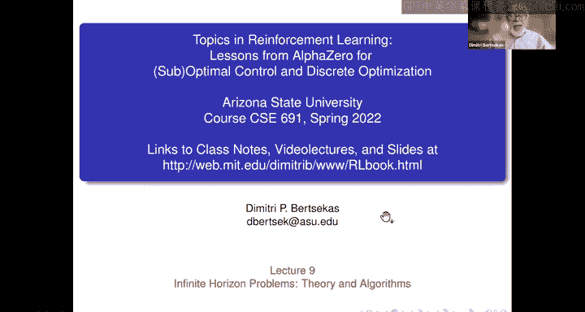

And today we're going to make another little shift from finite horizon problems to infinite horizon problems we're going to review the theory and the algorithms of these problems。

Paying attention also to the fact that。We eventually are going to consider approximations that are typical of reinforcement learning。

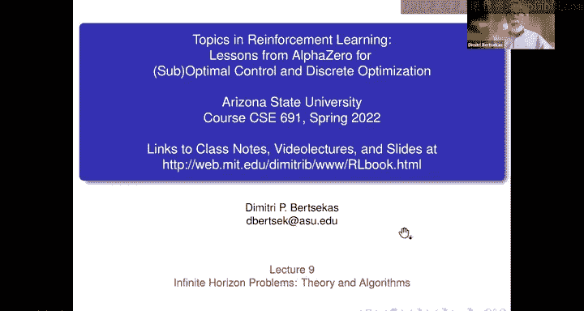

So， here is a。My outline。First we're going to introduce a new notation that is suitable for discrete state problems because the infinite horizon problems that we're going to discuss are going to have finite state we mentioned about this in early on about the two systems of notation that we're going to be using one for finite horizon deterministic problems and another one for infinite horizon stochastic Markovviian decisionion problems we explain the reasons we're going to go through this notation again。

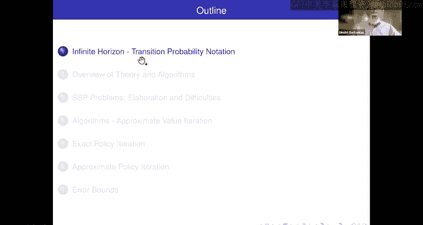

Then we're going to formulate the problems， overview the theory and the algorithms for infant horizon problems we're going to discuss two main types of problems。

啊。Discounted problems with a finite number of states and stochastic shortest path problems also with a finite number of states now these SSP problems are a little bit more difficult and they have some exceptional behavior so we are going to elaborate them a little more and discuss the difficulties around them。

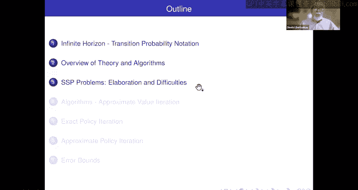

Then we are going to go into algorithms there are two principal algorithms here that focus on approximate value duration。

 value duration and its approximate version。And policy iteration。S。

The exact version and then the approximate version。

Then we're going to discuss some performance bounds。

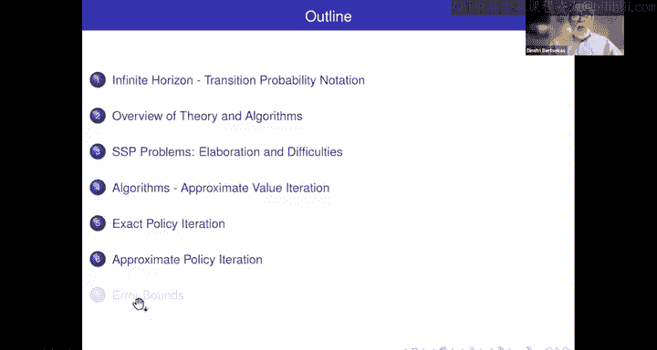

Both local and global around these methods。

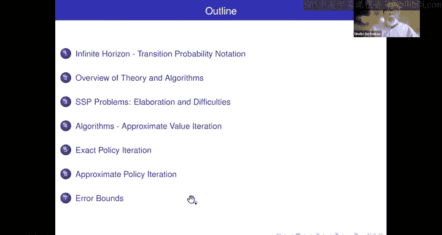

So。We are going to， let's go first into generals about infant horizon problems。

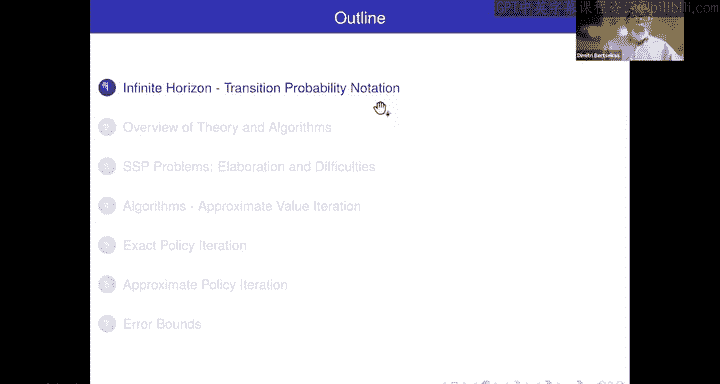

Okay， so first of all， why do we want to use an infinite horizon after all， all problems。

 all practical problems are finite horizon， it may be that the horizon is very long but it's still finite。

So there are a number of reasons for that， first of all。

 an infinite horizon may be a good approximation for the case where the horizon is finite but very long。

Now， another nice thing about infinite horizon problems is that their theory is more elegant。

 their notation also is less clumsy， less complicated。

And also there's a lot of intuition around their theory and their application and so all of this is nice。

 they are also more intricate mathematically， which is nice if you are a mathematician。

 if you're not a mathematician， it may not be so nice。

 but in any case that's the case that while finite horizontal problems are relatively simple from a mathematical point of view。

 infinite horizon problems involve substantial mathematical complications。

 although the problems that we're going to discuss are not very complicated。

 that are the nicely the most nicely behaved problems in this landscape。

So that's one good thing about infant verizal problems， elegance in notation and theory。

And now another major advantage of infinite Verorizon problems is that there are some nice algorithms that apply primarily to infinite Verorizon problems。

One of them is policy duration， the work of reinforcement learning。

 and there are also some other algorithms like linear programming that can be applied to finite correction problems to infant correction problems。

 but with。But they are not really applicable to finite horizon problems because they are not very convenient within that setting。

So these are the reasons for wanting to use In horizoniz。However， if you look at the literature。

 you might get the impression that the only dynamic programming problems that are around are in。

That's not quite true and there are some myths about that。

 and I'd like to take the opportunity to make some comments。

The first myth is that we don't need to worry about finite horizon problems。

 well that's definitely not true because many important problems。

 including discrete optimization problems and also problems involving time varying systems essentially can only be formulated as finite horizon problems。

Another myth is that we can focus attention on just finite state problems， because after all。

 the computer recognizes only finite state problems。Now this。

This focus is particularly strong in the reinforcement learning literature that stems from artificial intelligence。

嗯。But in other areas， like for example， in control theory。

 the problems are naturally continuous in both continuous state spaces。

AndNow you might say well if I have a continuous state space or a continuous control space。

 I can discretize that and get end up with a finite state problem。

 however the discretization issues are very tricky and often when you pass from a finite from an infinite state problem to a finite state problem a lot is lost。

 including you may throw away the baby with a bathwater。第部。

Another mythist area is that we can focus attention on just stochastic problems。

 Markovviian decision problems。Well， that's definitely not true because many practical problems are naturally deterministic。

 think for example， deterministic， shortest path problems or deterministic discrete optimization problems。

Other problems are also a formulate as deterministic， even though in reality they may be stochastic。

Because the deterministic setting affords some conveniences。

 namely it exploits the there's a more effective deterministic methodology that can be used。

And without deterministic formulation， we were able to exploit this methodology。So what will we do？

Well， we will focus on well behaved problems， finite state Markov decision problems。

 either discounted forced stochastic short path and other favorable of As。

These are the sort of standard problems in the field and also they are relatively simple so that their mathematics are relatively simple and reliable so that we。

We can afford the time to look at them in some detail if we were to go to more complicated problems。

 we would not have the time to do so in any depth。On the other hand。

 we are going to mention here and there exceptional behavior and particularly in this lecture。

 and I don't want you to get lo into thinking that only wellbehaved problems are of interest。

 there are many problems or arise and applications that are not so wellbehaved and it's a challenge both for the practitioner and the theoretician to understand what is going on and how they should be dealt with。

So with this introduction now， I'm going to go into the video。

From the 2000 from last year's lecture on this subject。

 and then I'm going to be stopping at strategic points to ask for questions that and then I'll also have some comments at the very end。

So let me now switch to the。Video。You've seen the slide before。

 this describes the infant corion problem。It involves an infinite number of stages。

 an infinite horizon。Transitions from x0 all the way to in Trinity。

A system equation that guides that determines the transition from a straight x to a straight X K plus one。

The transition mechanism does not depend on care， the problem is stationary involves involves a stationary system。

And。X is as usual x is the fake use a control w is a random disturbance。

 which probability distribution depends on x and U。We're going to be looking at stationary policies。

That do not depend on the time index。In other words。

 all the control functions of the policy are the same， regardless of the stage we're in。

There are constraints against station A。And the cost of a transition is as before。

 but there's also discounting， alpha is a discount factor。

 which is a positive number between zero and one it could be one。

And this is the course of the case stage。And。The cost of a upon CPU is obtained by taking the n stage cost。

 the finite Verizon cost， and taking their limit as n goes to infinity。

 this is a number of corresponds to the initial state。And it corresponds to the policy through new。

 of course all of this is random， the expectation carries are reflect to the uncertain quantities of WKs and so on as before。

And that's the definition of a stationary policy new and I'm sorry the thing of the cost of the stationary policy new it's a cost function like the ones we have been dealing with so far。

And the optimal cost functions of by minimizing overall。Policies。For any given initial state。

Now back to alpha is the discount factor。If alpha is strictly less than one。

 then the problem is called discounted。Now for discounted problems。

 the cost far into the future diminishes geometrically with alpha to K。

 and that's what keeps also this cost finite。The limit exists， and this is a real number。

 at least for the problems that were going to be discussed。Now， when alpha is equal to one。

 there's no discounting and the cost can accumulate， so in order to keep this cost finite。

It is necessary to have some special state， a termination state where the system can park。

 can go there and stay with no cost。That will keep the cost fine。

 so usually when alpha is equal to one there must be as a practical matter。

 a cost pretermination state。TWe're going to be denoting by T as before。

 and this is the general class of problems， which are calledtochastic shortest path problems SS speaker。

Now， if there are no stochastics， WK is a deterministic quality。

 then this becomes like a deterministic shortest path problem that you learn about in the first course algorithms。

 one of the most basic problems in optimization。So deterministic short spa problems are a special case of this and provide some guidance as to what we can expect for their more difficult stochastic version I have a question and' know these are the two problems that we're going to be talking about stochastic discounted problems and stochastic short spa problems。

And moreover， we're going to focus on a finite number of states and finite number of controls。

 this simplifies the analysis a great deal。And。And it also necessitates a new notation。

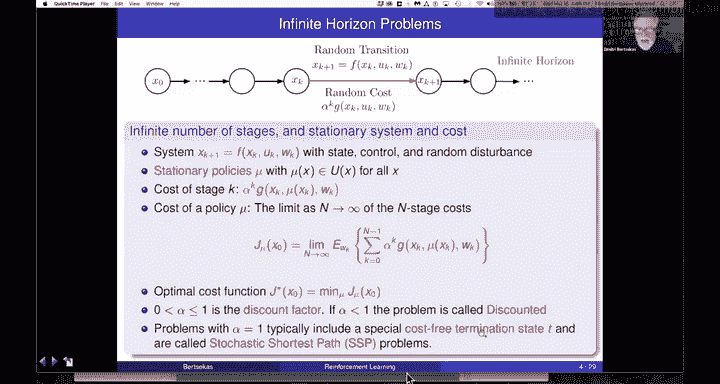

Okay， are there any questions？Yeah yeah I have a question do you need to add a cost free termination state or like for example。

 like inLQR you can ensure that like without a。A termination a terminal cost or a termination state。

 the debt sequence still is infinite， but the value is finite。You mentioned LQR。

 I suppose this means linear quadratic problems oh oh yeah， yeah， zero is a termination state。Okay。

 but it's just reached asytotically。Yeah， it researchyntically for continuous state problems。

 the optimal policy may reach the termination state asymptically， but the termination state。

 which is cost free and absorbing， acts as acts is essentially a termination state that keeps the cost finite。

ok， okay， thank you。Okay， I'm going to be posing the video once in a while between slides do ask for questions so if you had them save them for the transition points。

We talked about the problem of notation， the notation that we have been using is suitable for deterministic problems and also for problems involving infinite state and control spaces。

 like in MPC， for example。However， if the number of states is finite。

 then in social or stochastic problem， then it's better to have the transition probability notation。

 which I will now explain。here。And for the rest of the talk。

 we're going to be assuming that the number of states is10。And we label them by one through n。

In the successive states。Is or denoted by y， so transitions are from x to y。And okay， so for SSP。

 there's also the exitter state T in addition to these end states。

And we are going to consider transition probabilities from x to y under control U。

 this are den like so， this is the probability when we are in action we apply U the probability that we're going to end up in y。

 so the sumanmation over y here is equal to1。In the case of Scastraist Pa Robbins。

 his transition probably into the termination state， of course， right？呃。And also the cost。

From one state to the next state， the cost of this transition under control U is denoted like so。

And now you'll notice the similarity that we have here with our standard notation up now。

Notation systems are equivalent， mathematically equivalent， functionally equivalent。

 but more convenient for some problems， one system of notation more convenient for one type for sometimes types of problems。

 but not for others。And the mneonic here to go from one notation to the other is to think in the new notation as this being the new system。

All the uncertainty is encoded in WK through its。this probability distribution。So in the new system。

 we replace this transition equation with this type of transition equation。

And we replace the distribution of w given and x and U with the transition probability。嗯。ok。

Y is input to W， this is the conditional distribution that we end up in y。

 given that we study X and we use U。So in the new notation。

 we have a simpler system and a three dimensional matrix。Here。

 which is more complicated in the script， I think， than the one for。For the。

The distribution location。Now， given this insight here。

 how do we pass from formulas in one notational system to the other notational system？

Well the expected cost per stage that we had before in our fundless is replaced by this expression。

 the expected cost of the state， the expected cost of the transition。

 starting at U and starting at x and using in0 as our control。

 the probability of going to y is this one， and it weighs the cost of going to y。

So this is the correspondence。And。Similarly， expected cost to grow in the origin in the previous rotationtation system are。

replacedplace by this one， expected value of the cost of the next day， given that we started X。

And we use control you。So with this mnemonics。Belman's equation for discarded problems。

In the new notational system looks like so。It's a system of equations for。

For the optimal cost values。J star is a vector now of n values， remember that n states here。

So these are n equations with n unknowns， the values should j star of1 j star of 2 up j star of n。

And look at this expression here it involves minimization of the first stage cost。Plus。

 the discounted optimal cost to go from the next statewide。嘅。

So we're going to be looking at this expression a lot。

 this is Belman's equation for discounted problems。And for stochastic short dispat problems。

 a similar equation， but we have to take into the determination state。

There is also part of the expected cost is the portion that deals with the termination state。

So this is the conditional expected first stage cost。

 conditioned on the fact that we go to the termination state。

 and this is the conditional expected cost。That condition on the fact that we don't go to the termination state。

So this is overall the first stage cost， this is the optimalim cost to go and the usual minimization here。

And it is， again， in equations with n unknowns， the J stars of the states。So this is what。

This is how our notation is going to look like and I'm sorry about the confusion， but。in my opinion。

 there's no way to avoid using two different notational systems because this notational system is good for stochastic problems with a finite number of states。

 but it is absolutely horrible for problems with infinite state and control status and particularly deterministic problems。

 it just simply doesn't make sense。To put all of your description in one basket， okay。

 is transition probabilities when there is no uncertainty in the problem。

So this is the best notational choice that I can come up with。

And I don't think it's very difficult to get used to it and this mnemonic convention will help you in this regard。

Are there any questions？Are there any questions here？Okay， guys， we'll keep on going。Okay。

 so now let's。Let's summarize the theory。And the algorithms and preview what we can expect to see。

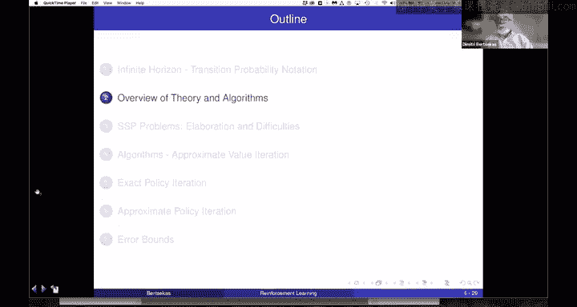

Remember in from lecture two the three Forems of infinite cor dynamic programming。

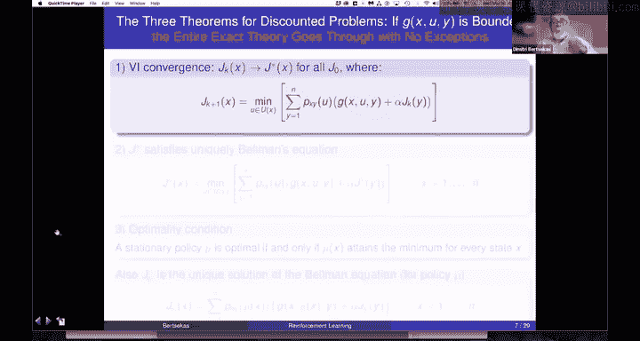

When the problem is discounted with a finite number of states or more generally。

 if the cost per stage is bounded， okay， this is true certainly if the number of states is finite and control is finite。

Now， in this case here。The entire exact theory goes through with no exceptions I mentioned that we expect these three feworems to hold。

 but there are some exceptions well for the case that we're going to consider here。

 the discounted case with the finite number of states there are no exceptions everything works out very nicely and this is the nicest problem of stochastic infant horizoniz dynamic programming。

Now， what are the three Forems， the first theorem deals with convergence of the value it algorithm。

The value duration algorithm computes sequentially the optimal finite horizon costs with larger and larger horizon。

Jk of x is the optimal。Cost of the K stage problem。With terminal cost approximation J 0。

And it is obtained by cranking the dynamic programming algorithm forward。

Accounting also for the discounts factor first stage to go。Cost to go from the previousview。

 the K state horizon problem， we obtain the optimal cost to go for the K plus one horizon problem after minimization here。

So this is value duration， a very fundamental algorithm。It's just an infinite stages version of the。

Dynamic programming algorithm that we know and love。Okay， Belman's equation。

This is the equation and the theory says that you can expect that J star solves this Belman's equation and in the case of discounted problems。

 this is the unique solution， J star is the unique solution of this Belman equation。

So that's a nice thing。And the third theorem says that。If you minimize in this expression here。

Of the Belman equation was Chase Star here。Then you obtain an optimal policy。😡，Moreover。

 if you have an optimal policy， then it must attain the minimum。那没什东 here。

This is an if and only if stick。So these are the three Fems you expect them to be true。

 they're not always true， but in this particular case they are true。Moreover， there is a。

Another Belman equation that's focused on a single policy， a given policy mu。

 it takes this form here， we simply take away the minimization there is only one policy and substitute news of X in place of U here。

And this is an equation that is sold uniquely by the cost vector of。Jame Muu of the policy Muu。Now。

 the。The difference between this equation and that equation is the this one is linear。

 it's linear in the variables Jnu， and what this one is not linear because of the minimization operation here。

So this can be solved by Matag， by Gaussian elimination。

 any one of your favorite linear algebra methods。On the other hand。

 remember that we are interested in problems where the number of states is potentially huge。

 in which case the MatL algorithms go out the window， okay。

 you have to use some other kind of method to solve this equation approximately either by detereration。

 possibly by value durationeration actually。Or by some other method。

 simulation as you need them and so on。So this is the theory for discounted problems and the value duration algorithm。

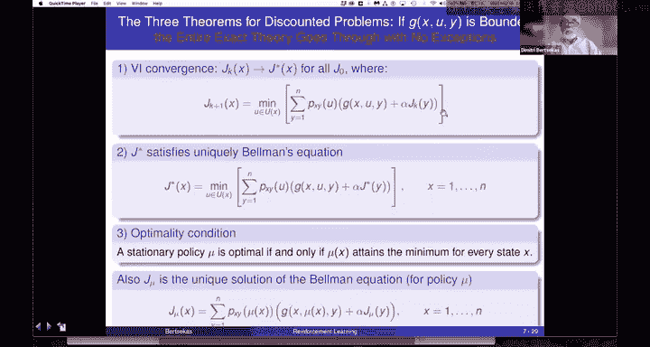

And the other major algorithm is policy duration which we have covered in one way or another。

 and today we're going to look at in more detail。It is intimately connected with a rollout operation。

It generates a sequence of policies。And at the typical iteration。

 we have a base policy we evaluate it by solving the corresponding by getting the JU values that we need。

And then we do a policy improvement operation， which is minimization in the Belman equation。

 but with J mu in place of J star， we can compute far more easily JU than J star。

 that's why we prefer to minimize in Belman's equation with JU。

Now this policy improvement gives us the rollout policy and if we make this the base policy for another duration。

 again we can loop infinitely around this loop， generate a sequence of policies。

And the important fact is that for the problems that we're going to be discussing and generally what you expect。

ThatThat policy duration yields in the limit and optimal policy。

For discounted problems with a finite number of states。

 it will give it will actually terminate in a finite number of its。

 you will find an optimal policy in a finite number of its。In its exact form， of course。

Now you have policy duration and value duration， value duration is a little cheaper to it's quite a bit cheaper to implement and policy duration。

 but policy duration is much faster， it is connected to Newton's method for solving Belman's equation as we have explained in lecture too it's a very important insight。

Both for rollout。Because it all outs a single iteration of Newton's method。

And also for the speed of convergence of policy variation。Pounster， if you can implement it。

 if you can have it is much faster。And if it's exact， it gives you the optimal policy。However。

 in reinforcement learning， we have to deal with approximations because the problems we're looking at are very challenging。

And that。Very often we have to resort to simulation。Typically around the policy evaluation step。

And there are a number of simulation methods and we have discussed simply averaging。

Samples of state and cost pays to calculate the values of J U that we need by Monte carnal simulation。

 but there are also other algorithms and a lot of the reinforce learning theory deals with these algorithms there is a nice mathematical algorithms with the intricate analysis and sophisticated properties and one class of methods which plays an important an important historical role but we're not going to cover it in this course is the class of temporal difference methods TD methods you'll see a lot of literature about them these TD methods provide an alternative。

methodeth an alternative possibility for doing this policy evaluation。

 either exactly or approximately using simulation。Okay。Now。

 when it comes to approximate implementation， we have discussed also value and policy networks and their training using data。

Cost state and cost data。To train neural networks to。To approximate the target functions。

 which are this Jnu。And policy networks that use state control data to approximate target functions that are policies。

And we noted also that these policy networks can be viewed also as classifiers so they can benefit from software and algorithms that are known in classification theory。

So approximate policy duration operates like exact policy duration。

 except we use value data to train a value network here and policy data to train a policy network here。

 and then we obtain an approximate rollout policy and we may stop here if we want to do just approximate rollout。

Or we can go into a loop and generate multiple based policies in corresponding rollout policies。Now。

 the important thing to remember is that the first iteration of this loop can be used for。

Approximation in value space。Online play， okay， for controlling the system in real time。But all out。

Is a one time online play type of algorithmism。That does not need to have a policy network or a value network。

Once you go into multiple rounds of iterations， then there is no alternative but to have。

A value network or a policy network or both of them， okay？😡，Now。

 having to train a neural network or rather approximation architecture with data means。

offffline training， you can't use this type of algorithm online。

 you have to train offline and use the last policy that you get in an approximation value space scheme for online play。

So we have covered the three theorems and the two algorithms of value duration and policy duration for discounted problems。

Now we're going to go into shortest path problems and look at counterparts。Are there any questions？

Any questions that you have， bring them up now。Hi Pro， so I have a question。

 so how do we actually select the base policy？You mean the initial base policy yes the initial base policy there are no rules for this do the best you can。

 perhaps using intuition， perhaps using some related problem of which you know the policy。

 the optimal policy are a good policy。嗯。There is no rule for that， any policy is allowable。

 but and there is no clear method for choosing that base policy。The initial one。Okay， thanks。Okay。

 any other question？Okay， we'll keep on going。Maybe you guys know of this already。

 given all the stuff that we went through。Are any questions？

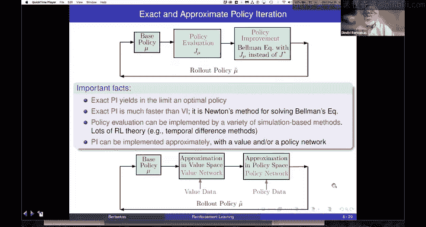

Okay。So now we're going to go into stochastic shortest path problems with finite spaces。

 finite stakes and fighting control， and I'm going to give you the main results。Now。

There is an assumption is to cast the shortest path problem that's the most favorable。

And this is that termination is inevitable under all policies。 By this。

 we mean that there is some number of stages such that。For every policy in every initial state。

 theres positive probability that we are going to reach that。

The determination state within the first M stages。Now M maybe1， maybe 10， maybe 100， maybe a million。

 but there is a number such that。The determination state is reachable with positive probability for every policy and every initial state。

 that's what this assumption says。So basically。This assumption says that this is really a finite horizon problem except that we don't know when we're going to terminate。

 we're going to terminate eventually with probability one。

 but we just don't know when we're going to terminate moreover。

 every M stages the probability of having terminated increases， so after a lot of stages。

 the probability that we have not terminated is negligible。

So this is really a finite horizontal problem and this also manifests itself in the line of proofs。

 the mathematical proofs that you use under this assumption， the analysis is relatively easy。

And the results that you get are the three theorems with no exceptions other than this assumption。

Value iteration converges for all the initial conditions。

And notee now that the value duration involves the additional expected cost to reach the termination state from the conditional cost of the rich termination state from x under control U。

Belman's equation， similarly， involves that cost。And J star solves this equation and a unique solution。

 this equation， and the optimality condition is that new is optimal， if and only if。

New attain things the minimum in this expression。

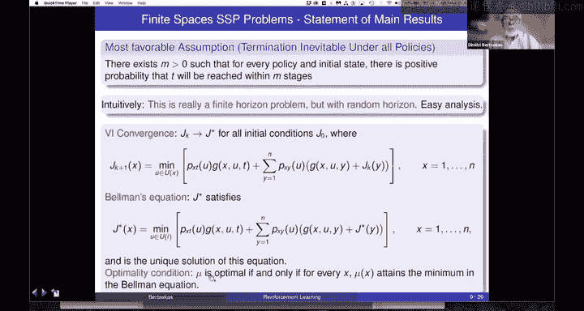

So everything goes through under this assumption。And moreover。

 the analysis is easy enough to be the basis for the analysis for discarded problems。

Here's the line of analysis。The idea is that SSP are easy to analyze， easy to understand。

And discounted problems may a little bit。Discovering the problems can actually be transformed。

Into SSP problems， there's a certain equivalence。So that we first analyze this a fee。

And then the results for the discounted problem fall out for free。So that's the point here。

 a discounted problem can be converted to an SSP problem with termination inevitable so that the theory of the preceding slide applies。

Okay， so this is our original discounted problem。This is the mark of chain corresponding to you the transition probabilities between the different states。

And when we are at x and we apply U， this is the expected cost per stage。

Except for the discount factor。Now we're going to formulate this。Stock has a shortest path problem。

Where we introduce an artificial。Deertermination state T。And at every stage from every state。

 there's a probability one minus alpha， alpha is less than one。

 so this is a positive probability of going to T from any state。

And conditional that we don't go to T， the probabilities of going to the other states are according to the original transition probabilities。

So when we add x， there's a probability of alpha pxy U to go to y and our one minus alpha probability to go to T。

 and the probabilities add up to1， of course， as they should。Now。

 I claim that this stochastic shortest path problem is equivalent to this discounted problem in the sense that the costs of policies are equal in both problems and the optimal policies are the same in both problems。

What's the reason for this？Well， what is the cost of the case stage for the discounted problem？

It is this expected cost times alpha to the K。Now， what is the cost of the K stage in this problem starting from x？

It is expected G times the probability that we have not terminated already。But that probability。

 I'm sorry， times the probability that we have not terminated， which is alpha to the K。

So the cost of the case stage for the SSP problem， probability we have not terminated times the regular cost that we would incur at x given U。

So the transitions are the same as long as we have not terminated and the costs are the same as long as we have not terminated。

So the two problems are equivalent， they have the same course， it's easy to see that。

And also the same policies because the structure of control is the same within the two。

So here how we get proofs for the discounted case， start with the SSP analysis。

And get the discounted analysis as a special case。It's immediate almost。

Now this line of proof applies to finite state problems。

 which are the ones that we are going to consider in this lecture and in this class。

On the other hand。If you have a more complicated problem， for example。

 involving an infinite number of states， still discounted。This line of analysis does not work。😡。

The reason is that there is no easy theory for stochastic shortage path problems with an infinite number of states。

So the SSP theory is restricted to finite state problems。And therefore， for infinite state problems。

 you need a different line of analysis。And this involves。Contraction mapping ideas。

 the idea that the Belman equation operator is a contraction mapping from a function space into a function space。

 the function space of cost functions into the same cost function space。

Now this takes us a muchch further along the mathematical ladder。

 and that's why I have preferred to go in this along this line here。

This is an important line of analysis and for those of you who are interested seriously in this field。

 particularly in mathematical aspects is something that you should look into。

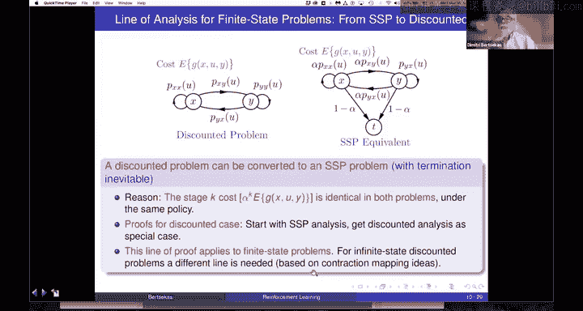

Okay， so now what we're going to do is go into stochastic shortageest path problems。

And we can the assumptions a little bit and see what may happen after that。

 are there any questions so far？Okay， I'm posing for any questions。Okay， so we'll move right along。

Okay， guys， moving right along。So let's go into srcasastic shortest path problems and elaborate。

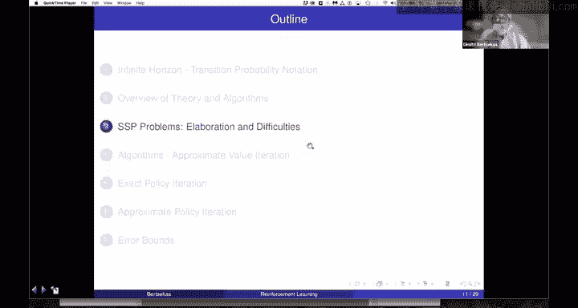

嗯。Okay， we said that everything is nice。When we have this assumption of termination inevitable for all policies。

While the other hand， many shortest stochastic deterministic。

 shortest path problems of interest do not satisfy this assumption。For example。

 take a deterministic problem that has a graph with a cycle。

 okay then there is a policy that just spins around the cycle and never terminates。

 so immediately termination inevitably is violated。

And a lot of most of the deterministic short path problems involve cycles。

 it's very common to have a graph that involves cycles。So。So。

It is very common for this assumption to be violated。

Now we have to replace this assumption with some other assumption。

 and here's one that is nice and applies broadly in practice。Okay。

This says that non terminating policies are bad， yes。

 there may be some non terminating policies in this assumption。

 but they have infinite costs for some initial state。

So here's a more precise statement of this assumption。

It requires that every policy that does not terminate with positive probability has infinite cost for some initial states。

In the context of deterministic shortage path problems with cycles。

 we require that there is positive cost of going around the cycle。

 so it's not optimal to spin around， it's the thing to avoid。So this is one part of this assumption。

And the second assumption is that there exists at least one policy under which termination is inevitable。

 This is necessary to keep the cost finite among other things。

So it is always possible to reach the destination with probability one， that's what it says， however。

 there are some policies that turn to that， but these policies are bad and they have infinite costs for some initial states。

So this is the assumption and it's a reasonably substantial extension of the theory。

And it requires some sophistication， it's analysis， it requires you'll see。诶呃。

You will see a theory revolving around proper policies and improper policies and we're not going to go into the details here but。

But the major results， the three firearmorems are salvaged under this assumption。

 that's the important thing for us。On the other hand， if you try to go beyond this assumption here。

Things can get very hairy。Very unusual things can happen and the theory is still evolving。

 particularly its approximate versions。Okay， things that can happen。

Btman's equation can have many solutions， not just one， but many。Another word。

 it's kind of mind blowing。Balance equation may have a unique solution。

 but that solution is not equal to J star， okay？嗯。That。

That blew my mind when I found out about it because it seems so unlikely。

But it is true for stochastic problems， not for deterministic problems。

 but it can happen for stochastic problems。With the relatively few states。Now。

 once you have this kind of anomalies， then value duration and policy duration may fail even for finite state problems。

Even state problems can become very strange， very strange behavior， all of this and more。

Even with bounded costs per stage。And。All of this is a mathematicians's delight， okay。

 interesting proofs， interesting phenomena， a lot of insight on into that the mathematics are reveal a lot of insight into the structure of the problem。

 but it's beyond our。Our scope in this course。But my online abstract dynamic programming book deals precisely with all these issues and the mathematicians or aspiring mathematicians among you may consult it for further material。

Okay。So， now。Let's take an early break。Ill take a 15 minute break。

And that will give you a chance to think about some challenge questions。

Here is a tricky stochastic short path problem。Actually， the deterministic problem。And。

It's the simplest。Theterministic problem that you never。

 one of the simplest problems in optimization actually。Here's the problem。You have one state。

Plus the terminal state， and you have two actions。This action keeps you in the's same state and costs A。

This action leads you to the terminal state and cost B。So there's only one decision to make。

As far as stationary policies are concerned。And。It fits our framework， right， a finite number states。

 a determination state， deterministic transitions。And given costs。So。

There's a Belman equation associated with it and all the other stuff。On the other hand。

 consider the case with alpha， I'm sorry， a a， this cost here is zero okay。

So spinning around the cycle cost you nothing。Then it may be optimal to just spin around the cycle。

 right， particularly if Bs positive， that would be the only optimal policy。So。Let's look at So okay。

 the other thing is that this。This policy here violates the。

Viols the non terminating policy are bad assumption， why this is a non terminating policy。

 but it has cost zero if a is equal to zero， so it doesn't have cost infinity from the one initial state that we have here。

Okay， so this example violates our assumption， and here's Belman equation， right。

 Belman's equation is a one equation with one unknown， why because there's only one state。

And this unknown is Js of1， okay， and it involves the right hand side involves minimization between the cost of control of this control。

 which is B。And the cost of this control， which is a plus change of one， okay。

 the cost to go from the state where you land。Okay， now Belman's equation has multiple solutions。And。

The reason is explained here。 This figure here shows you Belmon's equation。

 This is the right hand side of Belmon's equation。And this is the left hand side of Belman's equation。

So this equation has multiple solutions。And you can easily see also that the value direction algorithm。

Converges to J star。J star is equal to a here， right？啊。Because a is。If b is positive。

 then it's equal to a， if b is negative， then it is B。And it's evident， however。

 from this figure that the value duration converges to J star from some initial condition。

 but not for others。Now what I want you to do in this 15 minutes。Is still。2。

Verify the statements here， assimilate the character of this figure and the problem and consider the cases where a is positive。

A is zero and a is negative。What's happening in these three cases。

 what assumptions are satisfied in what's going on with Belman's equation。

 what's going on with value duration， what is J star， what's the solution set of Belman's equation。

 one solution， multiple solutions， no solutions。What is the limit of the value duration algorithm。

 Okay， this is a value duration algorithm right， it its for this mapping here and what does it do that it converge to something or not。

So are there any questions here。

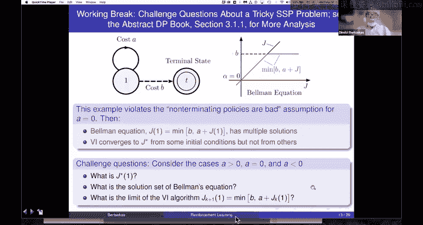

Okay， guys， we're taking a 15 minute break， but before we do so are there any questions so far？

Professor。Yes， I was just wondering like so what are the extensions to SSP that lead to such unexpected behaviors like what like you mentioned the further extensions of SSP could lead to these complications so what sort of extensions are we talking about here。

Well。SSP problems。can have a finite number of states。

 which is what we have examined here and also infinite number of states if you go to infinite number of states。

 the behavior can be very hair so let's not go into that， but with a finite number of states。

 this example you an provides you with illustrations of what can happen。诶。

The good behavior is obtained where non terminating policies are bad， okay。

 which is a greater than zero。But in practice， you may have shortest path problems。

 deterministic or stochastic where there are cycles like here。

 not as simple as that for this problem， but sight is perhaps involved in multiple nodes。

Where the cost is around the cycle is zero。Or even negative， this will happen if arc costs have。

Positive or negative。Are either positive or negative some arcs have positive costs and some other as have never negative costs these are the dangerous problems where tricky behavior can occur。

 however。In algorithms courses where you're getting taught about deterministic shortage path problems。

 you will see that the standard assumption there is that。

All the cycles have positive cost this is the assumption under which the standard algorithms work okay but there are other problems where this assumption is not satisfied and these are the ones that have tricky behavior and if you go into stochastics or the spa problems then there is a richer variety of of of unusual behavior。

Okay。嗯。Okay， guys， so we'll see you in exactly 15 minutes。Okay， guys we'll be coming back shortly。

 I'm going to start the video again。

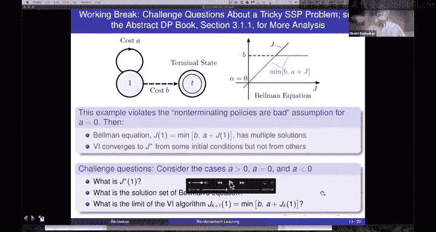

Okay。Okay， so what we want to do now is look at this simple problem with one state and the two controls。

And we want to examine the three different cases where A is positive。Zero or negative。

And what happens with Belllon's equation， what kind of solution does he have？

And about the value duration of it， we're starting from an arbitrary chain zero。How does it behave？

So what if A is positive？吓。Okay。So who wants to do？Who wants to discuss this case？

What's the solution of Belma's equation。I think it would just converge to B， right？

Or at least value iteration would。It's because you're just adding the future stages a plus J1。

 but as positive so that cost keeps accumulating up to the point where it reaches B。Yeah。

So what is J star？哪か one。I think it's B。It's B， right， because the other。

Because the cost of the other ones for staying there is infinite， right？

sNow Kat Bmon's equation is J star equals B is the unique solution of this equation。嗯。I think so。

Can we tell from this figure or a modification of this figure？Okay。

 so for a equals a positive this line here is going to rise up here somewhere right so this red curve which is the right hand side of Belmon's equation is going to go like this right？

And the points square the two of them。Intercept the left hand side of Belman's equation and the right hand side of Belman's equation。

Interssect at this point here。So this is B， right？And is there any other solution。

 are there any other points of intersection？嗯。There are none so this a unique solution。

And how can we explain this with theory？啊。Well。It is part of the second fearorem right。

 the Belmon's equation has a unique solution under there。

The assumption that non terminating policies are bad， okay。

 we have our assumptions holding for this case。The cycle who has positive cost。

 the cost of first strength within the cycle is infinite。

 so this non terminating policy is bad and we have a unique solution How about the。Okay。

 value duration converges to B。 you can see that， okay， if you have。If you are。

If you are anywhere then you take the minimum of B and this that's the same so so it's going to go to b after one iteration I believe starting from this side and it's going to。

即解先。Yeah， something similar from other initial conditions。So everything works fine。

 we are in theory in this case。Now， what happens when a has a？QudA is equal to0。

Who wants to discuss that？What is Belman's equation in this case？Well， a is equal to zero。

 so this line here is going to go up to here。And the right hand side of Bens equation is going to be this。

And it intercepts the left hand side， which is this。Along this line here。So all the numbers。From B。

Going lower are solutions for Belma's equation。There's an infinite number of solutions。V。

The minimum between0 and b the is the。Is the is J star and you can okay for first principles。

 it follows。Benman's equation for a equals zero is this one in solution set is from B to minus from B to minus infinity。

Now， the value generation algorithm。Has this one， okay， a is equal to zero。

It converges to be starting from。Higher values， you can see that from okay， in a number of ways。But。

Does have a unique limit， suppose we start at a different different starting point。

 suppose that we take as a starting point， any one of these solutions here okay。

All of the solutions of Belma's equation are fixed points of deperation。

 this is regime is not going to move if it starts at one of these solutions。

So the value duration algorithm will converge to B only if it started from initial conditions higher than B。

 but it will not move from a starting value less than B。

And the most strange case happens when A is negative， anyone wants to discuss this。

A negative is shown here in this figure。This is the right hand side of Belma's equation。

And this is the left hand side， they don't meet at all， there is no solution to Belman's equation。嗯。

All of the assumptions， of course， that we have are violated， the non terminating policies are bad。

 in fact， the non terminating policy is optimal here。And the optimal cost is minus infinity。And okay。

 strangely evaluate the diverges to this minus infinity。

 but this is of course outside our theory because in our framework， all policies must have okay。

 this cannot happen J star should be， Belmon's equation is an equation in real numbers。Okay。

 now I know that this is a very strange example。But it's also a very revealing example。

 and I want to ask you as a homework to go through this example in detail。

 it's actually very simple to do that and it's very revealing and may also dispel some of the preconceptions that you may have about the nature of our results in dynamic programming and reinforcement learning。

In more complicated so short spa problems involving infinite state space involving this cycles and so on。

 if you try to use our reinforcement learning algorithm on that type of problem it's going to go crazy。

 okay it's not going to do anything and you're going to be scratching your head as to what's happening but what's happening can also be understood in terms of the simple example here。

 which is thus very suitableable to sharpening your understanding and into what we are doing。Okay。

 I'll post the video， are there any questions about this slide？

As you see in the previous offering of the course， there was quite a bit of discussion。

And I still want to ask you to take a look at this example and try to understand it and as a homework。

 tried to explain all this different behavior that we just alluded to here without fully explaining。

So。We'll now move right along。Okay。😊。

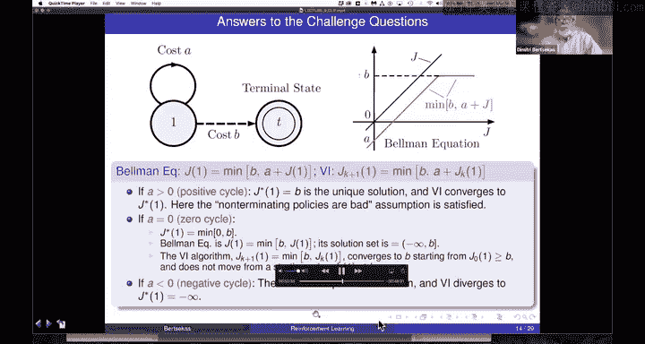

So let's go right along。呃。Let's go into algorithm some more in particular。

 an approximate version of value duration。Now。喂。Have discussed in the previous lecture an approximate version of the dynamic programming algorithm。

 the so called fitted value duration， and we're going to discuss the same algorithm。

In the context of infinite horizoniz problems。And this fitted value duration。

Now the exact value directional algorithm for the discounted problem。

 we're going focus on the discounted problem from now on for the most part。

The value directional algorithm is given by this equation。From J0， which is arbitrary。

 it generates J1 and then J2 and so on， and each time it applies a dynamic programming operation each time if it finds the optimal cost of a。

off。A finite horizon problem with length of horizonor one more than what it was before。

Now how can we do approximations of this algorithm， Well。

 what we can do is do this minimization approximately。And then call the result。Then you eat it。

So we start from J tilde 0， then generate J1 tilde by minimizing here within some delta， okay。

 so this minimization is exact within some delta and delta is the maximum tolerance of all states。

And then we go to J2， again， making error an approximation error of deelta and go forward。

This is exactly the same kind of algorithm that we discussed with neural network approximations and coding this J Tiils。

And in fact， some one of you asked the question， do these errors accumulate？Well。

 in a finite horizon context， they accumulate a finite number of times。

 but in an infinite horizon context they do accumulate and now I'm going to give you an example of how they can accumulate。

Okay， first of all， got theoretical result。😊，A fake theoretical result。😊。

If you assume this condition。Then you can prove that the error。V。

The long term error between the iters of distributed fitted value duration and the optimal。Cost。😮。

Is bounded by deelta over1 minus alphapha。It's a positive number proportional to Delta。

 So this result says that if this condition holds。Then the long term error that you will incur over an infinite horizon is delta over 1 minus alpha。

On the other hand， this result assumes that this is true。

 I assume that you can minimize within Delta and strangely enough this may not be possible when errors accumulate。

So this result may not be meaningful for some natural methods。

Because it may be difficult to maintain this equation over an infinite horizon。

 because arrows accumulate in J tilde J the sequence may become unbounded。

So let's give a simple illustration of that， one of the classical examples of reinforcement learning and approximate dynamic programming。

We start with some J tilde0 and we let J tilde K be generated by using some biometric architecture。

 let'll give you an example of that。And we。We given the parametric architecture。

 we obtain a parametric approximation J tilde K using at least square fit。

 the natural thing that you would do。And we'll show how the cost function error can accumulate to infinity。

We'll talk about field value duration and approximations， and here's the example I want to give you。

It's an old example， and it deals with the instability of fitted value duration。

Now this is also a very， very simple discounted cost example。It involves a single policy。

And two states， one and two。And。😊，That policy moves from one to two deterministically。

It stays at two。Deterministically， in both cases with cost zero。So the Belman equation。

Hows this formed？One stage cost is zero here， right？

And what's the unique solution was the optimal cost function， the optimal cost function。

Is the zero function here， right， because the cost is zero。And what is the value algorithm， okay。

 the value duration algorithm has this form， okay？Jk plus one of one。Is0 plus alpha JK of2， okay？

Now at state two， value duration。His gives you0 plus alpha Jk of 2 because you stay at two， okay？呃。

J case of two is on both sides of this on the right side of both of these equations， right？And。

Start giving any initial condition value duration converges to zero alpha is less than one right。

 so whatever you started with it's being reduced by a factor alpha， it's time in converge to zero。嗯。

So now suppose that we introduce approximations in this value iteration and we approximate the value iterates within some subspace。

And this is the approximation of subspace。Okay。Now。Okay。

 so let's get oriented a little bit here in this figure。

This's another one of your homework exercise is to understand this figure。

 I think there's a lot of benefit in understanding it and you can do that。

 but in the short time that I'm going to explain it。

 you might have difficulty figuring out right away。But I want you to try to understand it。啊。Okay。So。

Here is a。There are two states， right， one and two， so this is J1 and this is J2。

And the optimal cost vector is zero， right？And。呃。Let's consider。

Value iteration and then approximating the iterates on this subspace。In other words here。

 this corresponds to an approximation architecture that involves a single parameter R。

And this parameter and this architecture is defined by weights， one and two， okay。

 and it hass this line here。So we approximate a two dimensional cost function two states on a one dimensional subspace。

 that's what this approximation will do。So now what we want to do is。Takeake。

An itererate or fitted value duration on this line， which has to be of the form。

 should be aligned with a vector 12。And apply the value duration algorithm to it。

 which will give us this vector here okay。Now， the value duration algorithm multiplies by。

Alpha the second component， the second component of this vector is 2 RK。

 so it's multiplied by alpha to get both of the components。

Thus value duration starting from this point here， gives you this。And now what do we do。

 we approximate this on this approximation subspace。So we fit it。By projection。

That's least squares approximation， right？So starting from here。We do an exact value。

 is it and we do。An approximation by projection on this line here， and we get J tilde K plus1。

But now what I started and what I ended up with are going further along along this line in that direction。

 rather than in that direction。 In other words， from here。

 I don't get any closer to where I want to go。 but I get further away。

 And if I do the same thing from this point， I'm going to get。

An exact value iterate projected back again， and then I'm going to get an even further away Ierate and so on and the iterates diverge of value duration and the errors to J star of course。

 accumulate over time and the assumption that I made in the previous slide is also violated。Okay。

 are any questions about this？And how the algorithm fails。Okay。

 how can we fix the algorithm now this is a serious research issue in reinforcement learning people have spent a lot of time trying to figure out how to make these approximations so that this instability does not work this instability does not occur。

Okay， here we have used orthogonal projection on the approximation subspace。

But it is also possible to use a different kind of rejection with。

A weighted projection that has that doesn't go at a right a 90 degree angle onto this subspace。

 but rather it goes somewhere else， it goes like that， it's an oblique projection。

And the kind of projections that you can use are from here to here。

 this is the one extreme where you weigh one coordinate and the other one is zero and here's where you weigh the other coordinate in the projection。

And。Those projections， the ones that map below this point here， work， give you conversions。

And those projections。That correspond to。Waiting in an opposite way， the two components。呃。

Do not converge。So okay， now how can we control this weights of the projection。

 well the weights of the projection are actually related with sampling ratess。

 how often do you sample when you do things approximations with the neural networks in square fit and so on using more samples of one component versus using more samples of the other component。

 you can control this you can control this the character， the weighting of this projection。

And if you do the sampling in the right way， then you get convergence or fitted value duration。

 if you do it in a different way， you may not get convergence。

 and people have eager figured out that this optimal sampling frequencies are related to the optimal the long-term occurrences so the different states。

 the significance of the different states under an optimal policy。Okay， now this is a lot of fur。

 a lot of， a lot of。Fory that I'm cramming into these simple statements。

 but I want to make you aware that this is a significant question that has been researched。

It places fitted value integration into doubt， particularly when you compare it to policy durationeration。

 and that all of this can be explained， like many other things in reinforcement learning can be explained with simple graphical examples。

Questions。Have there any questions？On this example。It's a complicated example in some ways。

 but it's also a very simple example and has caused a lot of discussion and a lot of stimulate a lot of research。

And the reason I'm presenting this example is to indicate why。

We prefer to work with policy iteration methods for infant cor problems rather than value duration。

 that does not mean that fitted value duration is not a legitimate methodology。

 but this example casts a lot of doubt into it and shows that in fact it's pretty complicated to make it work。

So have there any questions？

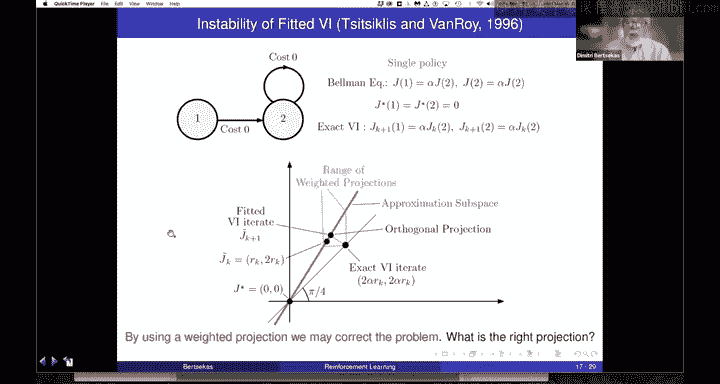

Okay， we'll move right along。Okay， so now let's go to policy。

 which is our main the workforce horse algorithm for this course。We have seen it before。

 generates a sequence of po starting from a certain policy we evaluated。In some way。

 and then we generate an improved policy by policy improvement and we keep going around the loop。

 there are two phases policy evaluation for the current policy in UK， we do a policy evaluation。

By solving the system of Belman equations。Corresponding to that policy。

And we do this in a number of ways。Simulation in the context of simulation based Monte Carlo based are allowed or for simple problems by。

Gausian and the nationation， so on， this is the theoretical exact version of policy duration and policy evaluation and then the policy improvement phase calculates the new policy by minimizing Belman's equation。

 but with of J Star， we have J UK from the previous evaluation。Okay， so we've seen this before。

 that's the exact form of the algorithm， how does it work？

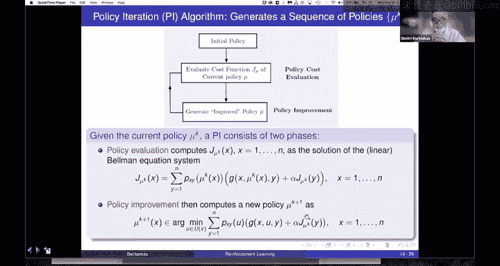

Well。Here's the feeling。The exact form of policy iteration generates an improving sequence of policies in other words。

Every。New policy is better than the preceding policy uniformly for all states。And the and。

And also the sequence terminates with an optimal policy。The reason being that okay。

Once the algorithm generates the same policy or the same cost。

 it stops and this theorem says that it will find an optimal policy in a finite number of variations under our assumptions which are a discounted problem with a finite number of states。

Okay， now I want to outline the proof here and part of your homework again。

 we did our last you delivered the last homework last Sunday。

 now I'm giving this many homeworks which I think however。

 are going to be very useful to you to go through to try to go through and puzzle them out。

I'm going to outline the proof of this result。And this result is important， first of all。

 it's intuitive by studying the proof you can understand how the method works。And second。

 because this is the standard proof。Just about every policy iteration conversion proof uses a similar argument。

 a modified version of the algorithm that I'm going to describe。

And this algorithm is based on monotononicity， we're going to construct a sequence of functions that are lower than this J mu。

 and they converge to J Mu Tilde， mut Tilda being the rollout policy obtained from the base policy。

And incidentally， this also gives a proof of cost improvement for rollout because this applies for every iteration。

And also for the first one， which is run out。嗯。So here's the key construction。We have mu， right。

 and we can generate mu tilde by policy improvement。

And let's call JN the cost function of a policy that applies new Tilde for the first n stages。

And then applies mu after that for the remaining stages to infinity。Okay。😊。

So now we can calculate this JN， by the way， by value direction starting from Jnu and。

Going backwards for end stages。So new satisfies this Belman equation uniquely。

And what is J1 J1 is the cost obtained by applying mu Tilde for the first stage and then mu after that。

Now I claim that this is less than Jnu J1 is less than Jnu uniformly。

 Why is that well by the policy improvement equation because mutilda is obtained by minimizing this expression with the muse of x replaced by U therefore muilda。

 this expression here for mutilda is going to be less than this expression here。

So it follows from the policy improvement equation that we have a first inequality。

And now I'm going to cascade those inequalities going backwards。

I'm going to go to J2 and I'm going to prove that it is less than J1 and less than J2。How so well？

J2 by definition is the result of applying Ne Tilda for two stages。

 so it's the same as applying U Tilda for one stage and then taking J1 as a terminal cost approximation okay。

Because J1 is a result of applying new Tilda for one stage and then applying new after that。

So J2 is equal to that， however， J1 is less than J U， so I can continue my inequality this way。So。

I have this is now equal to J1， right， so J2 is less than J1， which is this。

 which is less than J mu as I proved earlier。So I have dis relation holding photo X。

And I can go backwards， iss really it。What we called a monotity argument generating a monotton sequence of functions。

That starts with J you and goes。Downward。For all N and for all X。On the other hand。J N。

 what is J N is the cost function of a policy that applies mu tilde for the first n stages in new thereafter。

 So it the result of value duration after n steps of value duration。

 we know that value duration for mut tilda converges to J B tilde。 So this。

Sequence of functions is going to convert to J U tilde， therefore J U tilde is less than J mu。

This is the proof of cost improvement that I'm looking for。

It uses a value duration algorithm to generate a monotonically decreasing sequence of functions that converges to J mu Tilde。

Questions here。Are have any questions？This is an honest to goodness mathematical proof。

And incidentally， in addition to proving that the cost functions of the generated policies decrease monotonically。

 it also proves termination with an optimal policy。

 because there's a finite number of policies and if a policy is repeated then the algorithming stops with an optimal policy。

 so after a finite number of steps， we are going to end up at the optimal。🤧嗯。Any questions？Okay。Okay。

 so this is an important proof。Perhaps the most important proof around policy duration。

 but also it's important additionally because the line of proof applies to just about any kind of for generation algorithm and here's one that we're going to discuss right now。

 optimistic policy duration。Now， just as approximate policy duration。He。

Or exact consideration for a single the 31st iteration is rollout。

Optimistic policy duration consists of truncated rollout。

 just as policy duration consists of a repeated rollout。

 optimistic policy duration consists of a repeated truncated rollout。

 whereby the rollout is for a given number of steps and then a terminal cost function approximation is used。

Now optimistic consideration。Is very important in reinforcement learning。

 it comes in all kinds of algorithms in all kinds of contexts。

And we have seen the context of truncated roll out。

 but it also the ideas apply in other contexts as well。So let's see how it operates。Okay。

 now to do truncated allowed， you need a base policy and you need a terminal cost approximation。

So each generation starts with nu K and JK and generates new K plus1 and JK plus1。

It's given the typical pair。We do truncate the rollout with this base policy and this cost function approximation。

How do we do that well， we do NK steps of rollout using UK。

 we start the terminal cost approximation and go back several times iterating with the policy in UK to obtain the cost over NK stages。

So start with this， generate new case of one， then new case of two and so on for all states。

 so that's the policy evaluation。The policy improvement is standard。Given this result of the of the。

Of the policy evaluation， we minimize。In the standard policy improvement equation to obtain the new policy。

 again， this is exactly what truncated rollout does。 One step Look ahead plus。

NK steps of rollout with the given that the current based policy plus terminal cost approximation。So。

This is obtained by policy improvement， and this is the new terminal cost approximation that corresponds to this minimization here。

This is optimistic policy duration， and it's just repeated。

 truncated rollout with this particular scheme for terminal cost approximation。And。

The convergence of this。A similar convergence result holds for this optimistic version of poly using essentially the same argument as for the standard poly。

 again we generate a sequence of decreasing functions and using monotononicity arguments and we prove convergence in a similar way。

So standard pattern。

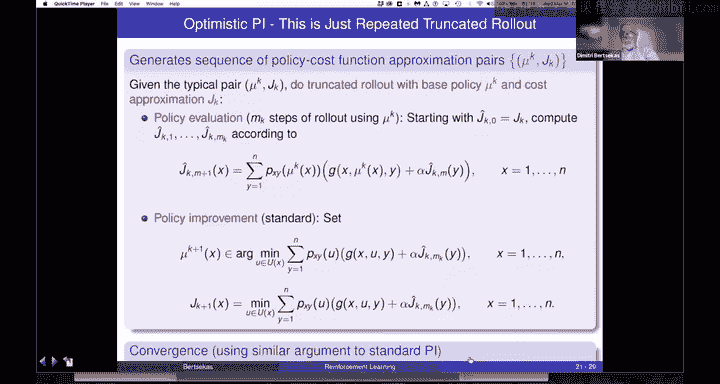

Okay。Here's another type of policyitederation， multi step policyiteration。

 it's like the standard version except that it uses multi step look ahead。

For policy improvement rather than one step look ahead。So given the typical policy。

We do the standard policy evaluation。Calculate the cost function of that policy by solving the corresponding Belman's equation。

Then we do policy improvement， but with L step look ahead in other words。

We solve the L stage problem with terminal cost function。Jame UK and if。

This is the optimal policy of the problem we take the first。Component of this L step policy。

 and that's our new policy and we throw away the rest。

We have gone through algorithms like that before and we give it a name now we call it multi step consideration and there is of course the easier case of multistep rollout that we have seen。

Now what's the motivation for this， it's the same old motivation as for multistep look ahead。

 we may get better policies with multistep look ahead rather than with one step look ahead at the expense of having to go through a more complex policy improvement involving L steps as opposed to one step。

Now， the convergence results for this is exactly the same as for standard policy duration。

Convergence in a finite number of iterations to the exact optimal cost function in an optimal policy。

And the proof argument is also almost the same as the proof argument I gave you。

Now there are also various combinations of policy durational algorithms。Optimistic multistep， okay？

And again， it admits a similar convergence analysis。

There are all these different versions of points duration。

 and you can mix and match your features as it turns out。I have a question here。 Yeah， so。

 so if the convergence is similar， then why multi step look ahead can give you the better。

 better policy。Okay， the convergence is a mathematical result。

 All it tells you is that it converges to the exact value。

 It doesn't tell you how fast it converges whether one converges。Faster than the other。

 howeverever it gives better policies， okay， all it says that eventually you're going to get the optimal cost function and an optimal policy。

That's the that's what this result will tell you， but our motivation is that。That。

In the sequence of generated policies， we're going to be getting better policies with multi step look ahead rather than with one step look ahead。

Okay， thank you。Okay。

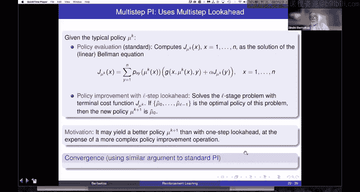

And love， please。Okay， now let's go to approximations。

Here's an enriched version of our standard figure。That describes all the different variants for policy duration。

And for rollout， if you do this only one time。There are the three approximations。

There is approximation the minimization， a simplified minimization。

 and an example of that that we have gone through is multi agent policy improvement and going to discuss that by the way in the next lecture as well。

W we do an approximation to this minimization operation。

Then there is approximation of this expected value， okay this involves an expected value here。

 we may do an approximation using our standard schemes， adaptive simulation and so on。

And then there are the values。Approxims of。The J mu， the cost function of the current policy。

And this can involve a rollout with possibly an exact simulation。Grantated the drawag。

 which is what we called optimistic policy duration。We can use parallel and rollout。

 we have discussed this in the context of policy duration。

We have discussed in the context of rollout， but it is possible if you maintain multiple policies。

 then you can use something that's the minimum of the approximations of these multiple policies。

And another possibility is through problem approximation。

 aggregation in particular that I hope that we will have time to discuss in our last lecture。

So there's a broad spectrum of rollout and policy duration variants。

 and you can mix and match approximations to get a rich variety of methods that may fit better or worse your own particular problem。

Moreover， this is for one step look ahead， there's also a multi step look ahead version。

The multiple policies version。Is this one here uses J Tilda as the minimum。

Of several cost functions once， perhaps with approximations。Okay。

 we can do this either in one generation or multiple durations。And。啊。

The approximate pulse duration algorithm generates a signal through a repeated approximate rollout。

Now， as I mentioned earlier， approximate alert needs offline training。

And either for a policy network。To do this rollout。

Or with a value network to approximate the cost function。And okay。

 it may use some of this stuff here， for example， you may use multi agent。Policy improvement offline。

 training and offline training offline and neural network。

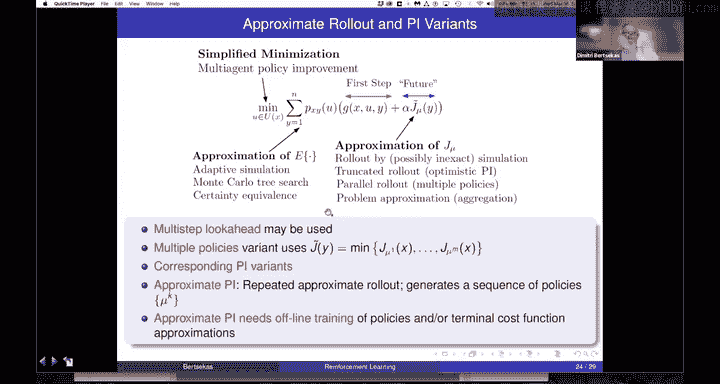

Okay， so now。Our last topic is error Bos。

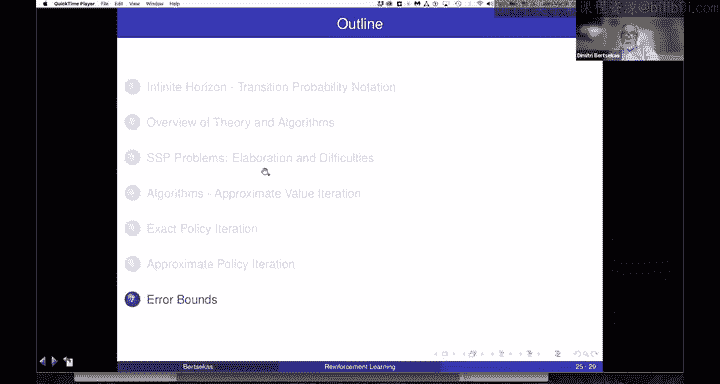

Here。We do a lot of approximations， approximations in the minimization， approximations in the。In the。

Cost function of the base policy。 Other stuff here。 Can we say anything about the limit。

Or the error bug or the error incurred by these successive policies generated by policy duration。

When you do approximate policy duration， you generate a sequence of policies and none of these policies is going to be optimal。

They're going to be subopti to a certain degree。 Can we say something about。

Hows about what they going to be in the limit as you add more and more iterations？😡。

So this is an important question。And。It is addressed with error bounds and there's a lot of error bounds in the literature。

Now， the abs themselves are not important。What's important is what they tell you about the。

The behavior of methods。Some error bombs are more detailed than others。

But they capture fine details of the method that you don't have time to observe。

 you don't have opportunity to observe and you can't really understand the bumps I'm going to give you are among the earliest ones。

Perhaps the earliest ones。And the simplest ones。And they are important because they mirror practical behavior。

And here's the first bound。It has to do with。Approximate non optimistic policy iteration。

So we generate a sequence of policies。With policy evaluation and with policy improvement。

Let's assume that the policy evaluation error。Is within Delta， okay。In other words。

You have the base policy in UK at a given iteration and you consider the evaluation of that base policy。

 which you use in one step look ahead。Now， this may not be the same because of neural network approximations because in perfectf simulation and so on。

We don't examine the source of the error， but we assume that the error is within Delta maximized across states。

We also assume。A policy improvement error。 so this is the error in the policy evaluation operation in the policy improvement error。

 we minimize this expression。Suppose now that we obtain the new policy。Not by exact minimization。

 but by minimization that's accurate within Epsidom。😡，How across the states。

So there are two approximation errors here， Delta quantifies the error in policy evaluation。

 Epsilon quantifies the errors in policy improvement。

And what you can show is an error bound like this， and now I'm going to explain this and what it means as a practical matter。

我大一小 here。Is an oversimplified picture。That's projected on a two dimensional plane。We look at J star。

 when you're represented by a single number， so J star is this level here。The optimal cost。

And these are the costs。That are generated。That correspond to the different policies generated。

 this is the initial policy。Of course， it is worse than the optimal， right。

 and this is the degree of suboptiality。Then we obtain a detereration one， a policy mu one。

And its cost is this one here。At iteration2 upon to thiscourse and so on。

 so we obtain a sequence of costs。We are not guaranteed that the sequence is going to be monotonically conversging to J star。

 this is only true for exact policy duration， not for approximate policy duration with these errors。

However， what we can prove is the following。That asymptically as the number of iterations increases。

 this is k， the number of iterations。Then you are going to come with it a zone， an error zone of V。

Optimal， and you're going to stay there。And the width of that zone， uniformly for all states。

He is given by this expression。Is proportional to epsilon？It's proportional to Delta。

And it's inversely proportional to1 minus alpha squared， okay？How I remember is a discount factor。

 less than one， but sometimes pretty close to one。So this denominator can be killing you。 Okay。

 can be a very， very can can。Makes the bound very large。Now， this is what the theory says。😡，And。

In practice， this  error bound is pessimistic， usually the  error is smaller than this。However。

 there are examples where this error bound has been shown to be tight， exact。

So this is a worst case bound that is attained。啊。What else can we say here？啊。

There is this oscillation。And。How do you know which one of these sponsors you're going to use？

Use this one or use that one。That's a dilemma， the reason is that yes you can evaluate a particular policy for a single state or for a small number of states and you can compare different policies and see how they compare with each other in terms of cost。

On the other hand， this is for a single state and this policy may be worse for one state。

But it may be better than other states。So it's not very easy to select。

A policy out of this sequence that's generated to use。Has your final policy。

 you have to do quite a bit of experimentation afterwards。啊。So that's one point to keep in mind。

Why is this bound important after all we don't know epsilon and we don't know Delta。

 so we can't use as a quantitative measure of the performance of our approximation scheme。呃。

This number here is not important in its magnitude。 What's important is that there is such a bound。

 In other words， this says that。This policy iteration algorithm is stable in the sense that。

It eventually stabilizes within some finite error， it doesn't go off to infinity like the fitted value iteration does。

The other thing that's important about this bound is that it mirrors practical behavior in practice approximate policy duration works like this。

You get typically monotonic improvement for the first few iterations。

 usually the first improvement is the biggest one which corresponds to the rollout。

And then you get oscillations eventually。A small size oscillations or not so small size oscillation in different kind of oscillation for different states。

So this  error bound。It reflects practical behavior。

And gives you just about all the inside you need to you are going to obtain from error bounds。

 it says it's proportional to a， proportional to delta and inversely proportional to one minus alpha squared。

Are then questions here。Okay， here's an improvement to this  error bound。

Before we go to the next slide， I any questions。

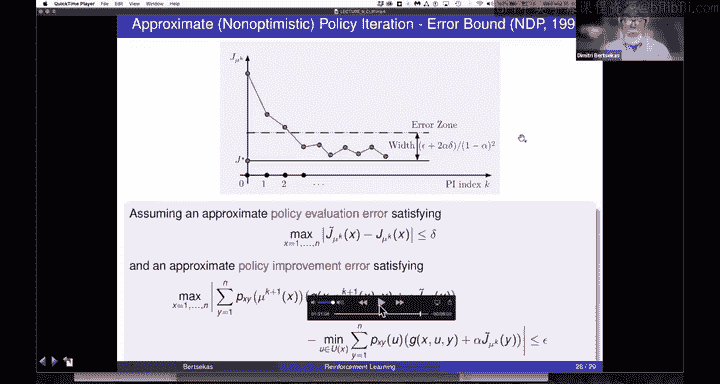

Okay。Suppose that you use approximate policy duration。But the policies somehow converge。

So that the mute case are not oscillating back and forth。

 but rather they go to some policy and then they stop there or they approach some policy。

Then there's a betterarrow bound。😡，And this ever bound？

Involves a1 minus alpha factor in the denoator。In the denominator less。

Quus before we cut squared here， here we have only to the first power。

And given that alpha is pretty close to one， such significant improvement。😊，And so if you can have。

The generated policy to converge， then you obtain monotonic decrease to something that's within。

This errorss result。On the other hand， typically。You have oscillations in approximate policy duration。

 certainly this is through alpha zero， certainly through black gamon in most cases。

 unless you use a particular type of method for policy evaluation。Which has some properties。

 then you're not guaranteed conversionvergence。On the other hand。

 there are some methods where convergence of policies is guaranteed。

And one of them is using aggregation， I mentioned this， I mentioned several times aggregation。

 I promise I'll say something more before the course is over， but as a preview。

 if you use aggregation for policy evaluation， then you get this better bound and this better behavior。

Now there are other。Policy direction methods， multi step optimistic and so on is。Its。

Almost all of them are like this， okay， it's just they just differ by the error zone and they differ by particularities to how violent the oscillations are and things like that。

呃。So that's what you should be looking for in approximate consideration as a check as to whether you're doing the right thing。

 you should be getting monotonic improvement in the beginning typically and oscillation afterwards。呃。

Interestingly， when the field is still young， people were getting these ocillations。

 but they were not reporting them because they thought that their method is wrong。

 that their software has bugs。But eventually it became understood that oscillations were the norm and not the exception。

 or the result of a method flaw。

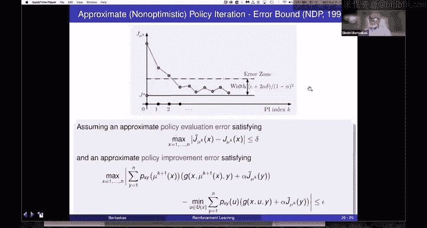

Questions。

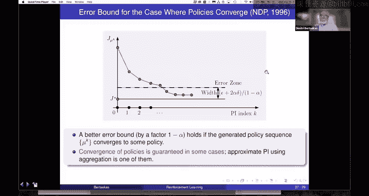

Okay， I'm going to give you one more  error， which is more complicated。

This does not have to do with policy。only iteration it has to do with rollout。

 truncated rollout with multi step look ahead， it's one of our favorite algorithms and it has an error bound that says something about how it works。

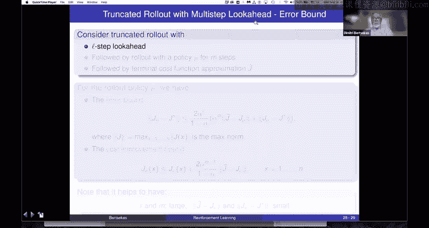

So let's consider truncated rollout with L step look ahead minimization。

Followed by Roout with a baseball for M steps。

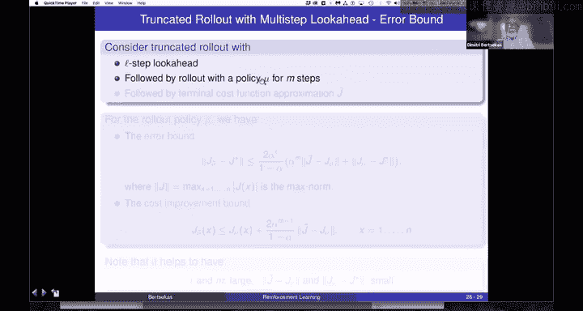

And then followed by terminal cost function approximation J Tilda。And we have this result here。

How does the rollout policy compare with the optimal and also with the base policy？

We have this error bound。😡，Okay。So what does the right hand side here。

What is a left hand side here involved？OkayThis denote norm， the maximum norm。

 so this is the maximum difference between j mutilus of x and j stars of x maximum over all states。

 the maximum norm is a legitimate measure of error between the performance of the rollout policy and the optimum。

And this satisfies the following inequality。That involves L， the number of steps for look ahead。

The more look ahead you have， the better off you are in terms of this bound。

It involves M the number of steps that you use for rollout with a policy。

The distance between the cost function approximation。And。The cost of the base policy。

The distance between。V。Cost of the best policy， and the optimal。

All of this play a role in this bound here。Of course。

 if you were not to use cost function approximation， terminal cost function approximation。

 this term would go to zero here。And if you're lucky enough to get a base policy that's pretty close to optimal。

 then this would also go to will be near zero。Okay。

 so this is error bound between rollout policy and optimal policy。

And there's also a cost improvement bond。Given the base policy， how much can you improve it， okay。

This gives the cost of the rollout policy compared with the cost of the base policy and the error bound is involves。

M， the number of steps。And the distance between the terminal cost approximation and J U。

 in particular， if you use Exaga route。Where J Tilde is equal to J mu。

 then you get the cost improvement in equality， the standard cost improvement inequ。

 the basic property of the rollout procedure。So again。

 these bounds are not very useful in practice because how can you calculate this term。

 Sure you can't calculate this term because you need to know J star， you can't bound。

 you can't calculate it。Similarly， you can't okay， you can calculate these terms here so that。

These are not quantitative bounds。But they are qualitative bounds in the sense that they tell you what you can expect from the method that you implement。

As you change various parameters of the method。As you change L， the more the look ahead is。

 the better of you're going to be。😡，The longer the rollout is going to be。

 the better off you're going to be according to this bound for large values of M this may not quite be true。

 so one should not take this bound too literally， one should check them against practice。

 but I think that the fact that they enter L and M enter these calculations is helpful。Finally。

 as you would expect， if the base policy is closer to the optimal and this error is small。

 then you should be getting better performance from the rollout policy and as the terminal cost approximation is close to J andU you would be getting close to exact rollout and you would be getting。

Okay， I think this is the end of the video and I have a couple more slides。

One thing that I want to mention here is that the error bounds are global， okay， in other words。

 they don't hold for J tillilda close to JU or for JMU being。

Close to J star new being of nearly optimal， they hold for arbitrary J Tilda and arbitrary Jnu。

 so they're global in that sense， they hold for even the worst possible values of J Tilda and Jnu and that's part of the reason why they are conservative and also as I mentioned in an earlier lecture。

They are not。Very good at predicting the ultimate convergence rate or performance behavior of methods such as rollout and the poly duration。

 particularly when J Tilda is close to J star。And that brings us to Newton's method。

And I'm going to discuss how you can obtain localarrow bounds that are more descriptive of the behavior of various methods。

Then the global bounds of what we have obtained here。So let me go back to my slides。

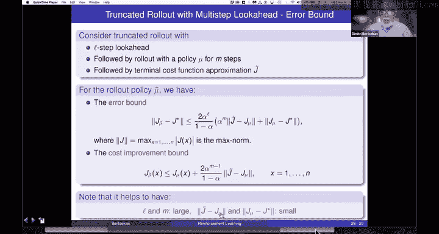

Okay。So here's what I was saying， the global narrow bounds are conservative and often they do not predict well reality。

 particularly if if you're near convergs or you're near the solution。

 and locally the Newton step view is more representative。

Now this is a figure that we have seen before， its complicated。

 I claim that is extremely intuitive in predicting what's really going on in approximation in value space。

And just to make a connection with error bounds。啊。Here we have Belman's equation。

 it involves the Belman operator in an earlier notation for discounted problems。

And for minimization and also for a single policy mu and Belman's equation is J equals to Tj。

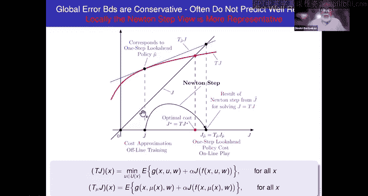

For J is represented here on horizontal and T sub Js on the horizontal and this red graph is the graph of the Belman operator。

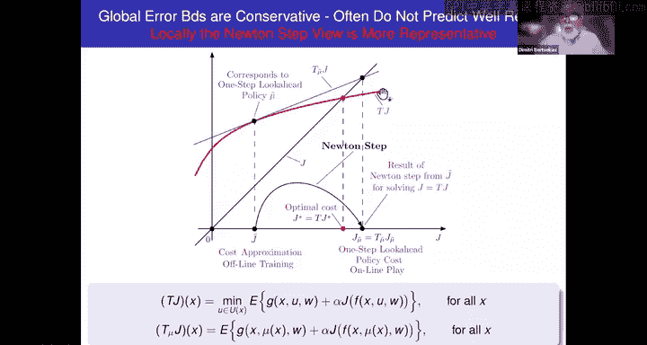

And the solution Bel equation is obtained at the point where this red graph intersects the 45 degree line j equals to Tj and here's J star okay。

 the point of interception。And consider now one step， look ahead minimization。

With J tilda cost function approximation and no rollout。

 there similar figures with some truncated rollout in here。

And how do we obtain the cost function of the one step look ahead policy that's what we're interested in this is what the offline training gives us and were interested to find out how close the result of online play is to J star the optimal。

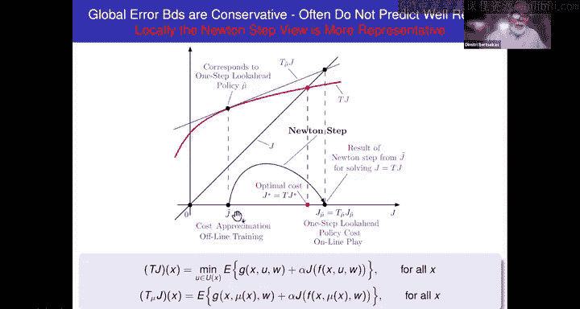

。So the construction I've given it before。

Basically at JTilde， the cost function approximation， you go up here and you find the tangent policy。

 the one whose graph comes just touches the red graph。

And the graph of that policy is linear and is tangent and the policy is the one step look ahead policy that you obtained by one step look ahead minimization。

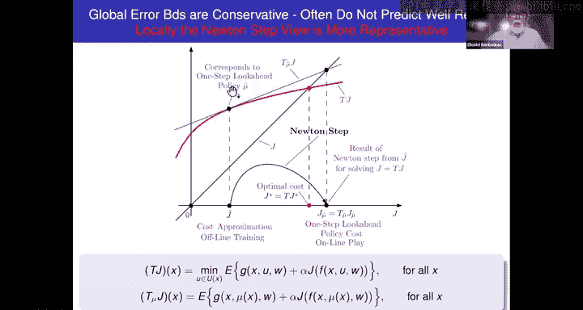

And its corresponding Belman's equation has a solution that's obtained by the intersection of this graph of that Belman operator with a 45 degree line。

 is this J Muilde。

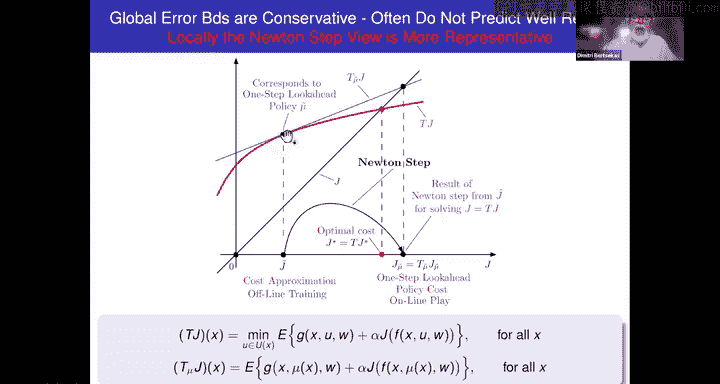

So that's the result of offline training， that's the result of online play and what we're interested in is how this error here compares with this error here。

D。Because this has been interpreted as a newton step involving a linearization of Belman operator at J Tilda。

This error here， the online play error is tiny relative to the offline training error provided we are close to J star in other words this is not a global view。

 this is more of a local view that says that if J Tilda is close to J star then J U Tilda is far far closer to J star and the  error bound is very very favorable。

So that's what I'm going to show in the next slide。

A comparison of local and global performance bonds。Okay。

 so the Newton step that takes us from J Tilda to J Utilda suggests a local superline performance estimate。

When J Tilda is close to J star in other words， the maximum overall states of the error that you make from J Tilda from J Mu Tilde to J star the suboptiality error is little O of the upper priori offline training error the error between J Tilda and J star in other words。

 this is tiny relative to this provided J Tilda is close to J star。

Now this bound does not hold for J Tilda far away from J star。

 and the difference here may be large when J Tilda is far from J star。啊。

For J Tilda far away from Jstar， this global error bound， however， is still operative。

And this is the version of the error bound I gave in the trunncate the rollout slide a couple of slides ago。

 but without the truncations， a special case of that。And it says that。

The global a bond goes down as the。Size of the look ahead。increases。

 but it's also still affected by one might solve by the denominator and can be very。

 very large in general or alpha particularly close to one。

So this globalarrow is more generally applicable， but it's overly conservative and typically not a representative or the performance of successful approximation in value space schemes。

And as an example of that。Let's。Consider a finite spaces alpha discounted。Problem。

 Movvi decision problem。Then it is possible to show rigorously that new tilde is optimal。

 the exact optimal policy provided this quantity here is sufficiently small。嗯。

This can be explained by the fact that the Bel known operator is piece linear for finite spaces alpha a discounted problem。

So。If Jtil is close to J star， you hit the correct linear piece。And with one step。

 look ahead minimization， you obtain the optimal policy。So in this circumstances， the global。

Performance balance is way off。It's just meaningless completely。

Completely of out of proportion of reality， out of relation to reality。

 whereas this error bound is operative and in fact for the favorable structure of the alpha discounted MP from finite numbers of states and controls iss even more favorable than this expression suggests it you hit the optimal in just one step。

 even though there are approximations involved。So that's my last slide， are there any questions？Okay。

 we covered today theory， I wanted to get a little closer into the theory。

 a little more deeply into the theory of infant horizon problems and to sensitize you that there are easy parts to the theory and also far more difficult parts that as the field progresses are likely going to become the more difficult parts are likely to become more prominent and more of a concern。

Now what we're going to do in the next lecture。Is a。

Go some more into issues of approximate policy duration and also its variations。嗯。

Discuss the method of Q learning and how it connects to optimistic policy duration。

 to learning both exact and also with approximations。

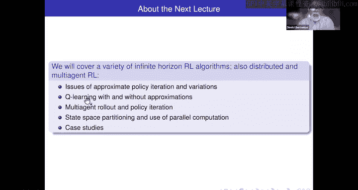

Then discuss various special settings like multi agent problems。

And also pay some attention to issues of parallel and distributed computation。

Our technological landscape is becoming it is changing very fast to the better parallel computation is going to be is already and will be even more prevalent and accessible so a lot of the operations involved in this reinforcement learning algorithms are parallellyizable and can take advantage of parallel computation so we're going to talk about various methods of using parallel computation into this methodological landscape。

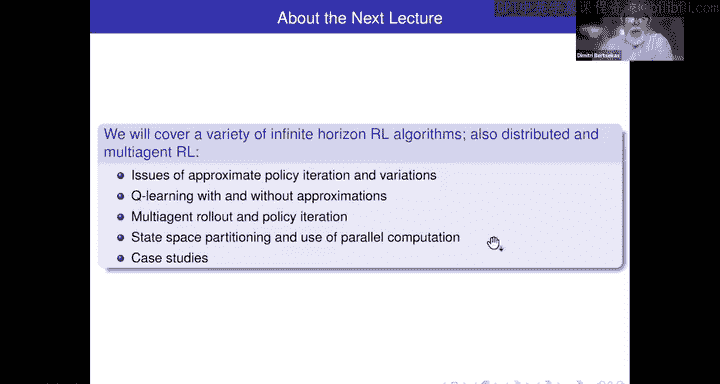

And finally， I'm going to talk a little bit about a couple of case studies that illustrate the theory。

Hand up。

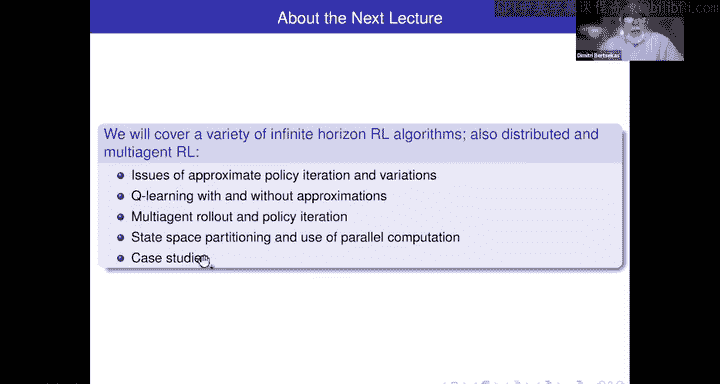

So that's it for this lecture， I any questions。

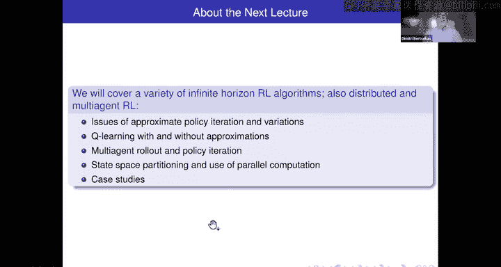

I have received one page summaries of your term papers from most of you。

 but I suspect there are some that have not given send me in their plans。

 so please do that if you have not done so。And。We'll see you next week。

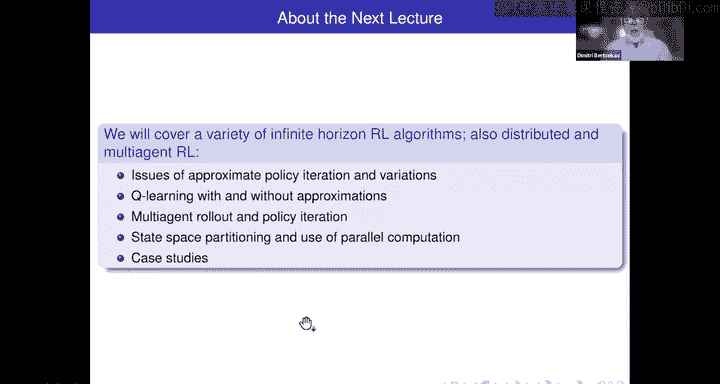