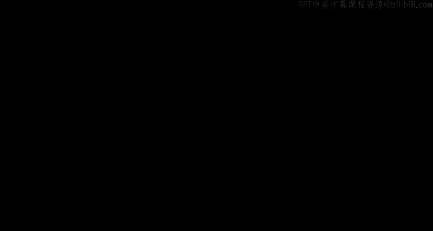
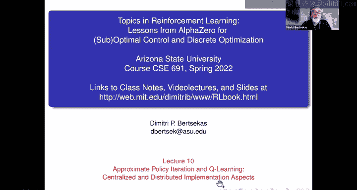
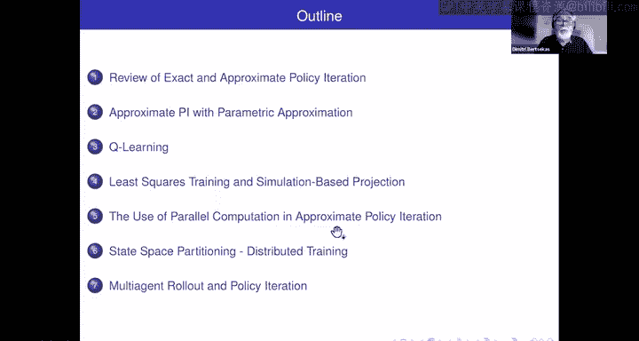
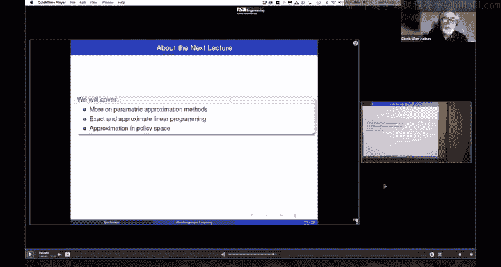
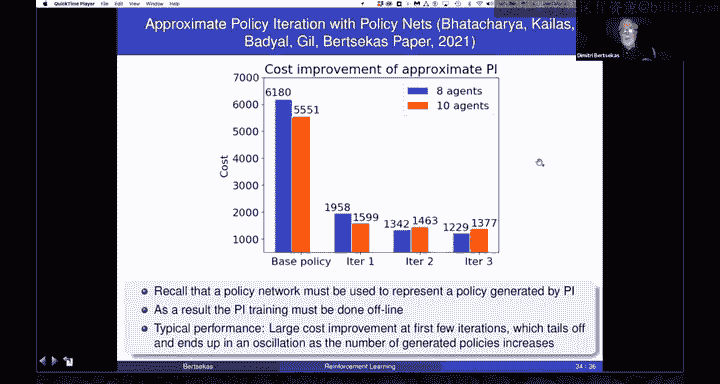
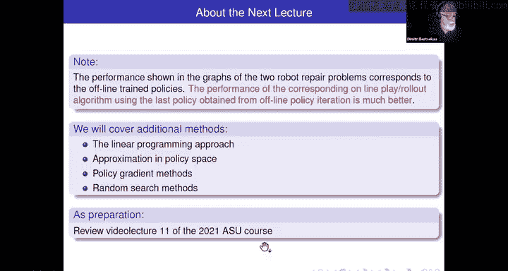

# ASU《强化学习2022-2024｜cse 691 Reinforcement Learning Course at ASU》中英字幕（deepseek - P39：[28]Lecture 10, Spring 2022_ Approximate policy iteration, variations, - GPT中英字幕课程资源 - BV1zcfVYdErD

嗯。

。Okay， let me welcome you to this10th lecture of our course on reinforcement learning at ASU。

In the previous lecture， we talked about infinite horizon problems。

 their theory and algorithms with a view towards approximations。

Today we're going to focus on approximate policy iteration。And its variations， including Q learning。

And we are also going to discuss parallel and distributed computation aspects of these methods。

Before we go into this lecture， which is long and has many moving parts。

I'd like to make some general remarks on approximate policy deter that I would like you to keep in mind as you listen to the talk。

The first thing is that。Policy duration in its exact form has a nice， rigorous theory。

 reliable theory， but for large state space problems。

 it cannot be implemented exactly it has to be implemented with approximations。

The reason is that we can store policies and cost functions when the state space is very large。

So the method requires the use of approximation architectures like a value or a policy network or both。

Like a neural network or some other approximation architecture in order to be able to pass from one iteration to the next。

So fundamentally， approximate police duration is an offline training method。

 it cannot be used online。It does produce a sequence of policies。

More or less one better than the other， except for some oscillation at the end。

And the last policy obtained by this offline training method can be used for online play directly。

Alternly， however， and much more effectively。🎼The last policy obtained from the offline training method and its cost function approximation can be used for online play through an approximation in value space and trancated through a allowed scheme is the kind of scheme that we discussed extensively in the first seven lectures of this course。

And this is exactly the approach that's been used in alpha0 and in TD Gamon。

Where offline training is used based on variations of policy iteration to produce a value function and also a policy and these are used in a multistep or single step look ahead scheme to play online。

And the performance of the online player is much better， that's a very。

 very basic fact that we want to emphasize in this course。

The policy produced by offline training of alpha zero is。A relatively mediocre policy。

I'm a relative mediocre chess player， despite the fact that extensive training has gone on with deep neural networks and sophisticated parallelization techniques。

All of this would amount to nothing had it not been for online play and similarly for TiD Gamon。

 and all of this is due to the relation of online play with Newton's method。

And the fact that it doesn't use any approximations， all the approximations。

 neural networks and the like go into the offline training process。

So I wanted you to keep in mind that offline training is not the end of the story。

 offline policy duration is not the story is how you use it later that may make quite a big difference。

We are also going to talk about variations of the approximate policy st method。

One important variation is an optimistic version， which uses a very approximate policy evaluation process and corresponding neural network training or other approximation training。

In these methods， we use just a few samples and grade integrations before we pass from one policy to the next policy。

Then there are Q learning versions of the approximate policy duration method。

 instead of training cost functions， we train Q factors。

And we are also going to discuss distributed and multi Asianian versions of approximate policy duration。

So keep in mind all of this as we go through this long lecture。So here's the outline。

A review of Ex approximateox policy duration from the previous lecture。

Then we're going to focus approximatepoli duration with paramedic approximations like neural networks。

Then the Q learning variance of approximate policy iteration。Then we're going to。

Then we' are going to discuss。In a somewhat abstract setting， how this all connects to projection。

Simulation based projection methods and risk square training。

And then in the second half of the course of the lecture。

 we're going to discuss the use of parallel computation approachoxpoli duration。

There are two types of methods that we are going to talk about one is based on。

State space parallelization， whereby we partition the state space into pieces and we do training separately on each piece with appropriate communication during the process of training。

Then we are going to discuss another type of parallelization。

 control space parallelization that is useful in the context of multi agent problems。

 multi agent rollout and policy iteration。So。I'm going to use a video from last year's lecture。

And this video also uses a video from even earlier year and everything is consistent with what we have been with the material of the course in this year's offering。

 except for one thing。I use instead of x for state and y for next state。

 I use in part of the video I for current state and J for next state。This should not confuse you。

 but bear it in mind。So now I'm going to switch to the video， are there any questions？

Okay。So let's review some of the ideas that we have been discussing for the past couple of lectures。

 we consider infant discounted problems， a finite state space。

 states denoted by eye controls within some control constraints set， transition probabilities。

 this is the basic model。Cost per stage and also a discount factor will focus on this lecture exclusively on discounted problems。

 everything that I'm going to say has counterpart in stochastic short path problems。

 but we are not going to get into that。Okay， the main results。

 Belman's equation holds for the optimal cost function J star。

 it has a unique solution and there is also a unique solution to a Belman equation corresponding to a policy that has this solution developed by J U。

 okay this is a vector of n component one component per state。

We have the value duration algorithm that starts from an arbitrary vector J0 and generates a sequence of vectors Jk using this recursion。

And with a minimization here， it converges to the optimal cost function without the minimization and for a given policy nu。

 it converges to the cost of the policy cost vector policy nu and we also have an optimal condition。

 if mu sub I attains the minimum here for every eye， then mu is optimal and converse them。OK。

So now the policy iteration algorithm。Generates a sequence of policies。

 start with an initial policy and given the current policy。The same UK。

 the first phase is policy evaluation to compute the cost vector of that policy。

By solving the Belman equation， it's a linear system of equations principle can be solved and this is policy evaluation。

 is's this box here。Then we generate an improved policy by minimization， one step look ahead。

 minimization with the cost of the current policy used as。As look ahead， approximation。

Is this box here。 So we cycle around here generating a sequence of policies。

 and the property is that the。The convergence property is that this process terminates with an exactly optimal policy。

And there is also an optimistic version of that。Which does not solve exactly this system of equation。

Thus policy evaluation by value direction， by a finite number of value directions for the policy new carry。

Now this will not give you the exact Jnu， but it will give you something that you can still put in here in this minimization。

 and it turns out that this is also solid， a solid algorithm。

 it converges asymptotically to the optimal cost function and gives you also an optimal policy asymptotically。

The reinforcement learning algorithms that use value space approximation are typically based on approximations of this process here。

 and they are typically optimistic， they use value duration or approximate value duration for generating cost evaluations。

Okay， so we're getting into the familiar picture of representing approximation value space simply with one step look ahead。

It involves。Minimization of the sum of the cost of the first step and the expected cost of the future as approximated by J Tilde and you remember that there are three types of approximations here and they can all be more or less designed independently。

 one is J Tilda， how do we compute J Tilde。All of the ideas that we have discussed so far for finite horizon apply also to infinite horizon。

 and we can use problem approximation， roll out approximate policy duration。

 parametric approximation representation of parametricic architecture here and also aggregation which we haven't talked about。

 we are going to focus on this green stuff here today okay。

And there are also approximations in the computation of the expected value， approximations。

 the minimization and so on。So we're going to focus in this lecture on rollout and particularly approximate policy duration schemes which operate as follows。

Several policies are generated， starting with some initial policy。

Each policy is evaluated approximately。With some。J tilde co function。Often。

And it's going to be our focus actually in this lecture。Using a parametric approximation。

 architecture， for example， a neural network。So the current policy is evaluated approximately using some kind of。

Feature based architecture， neural network and so on and we generate the next policy by policy improvement based on J Tilga okay so we have a starting policy。

 a second policy and so on at some point we stop okay and we use the last policy。four。

One step look ahead here。So that's the idea now if we don't go through several policies。

 but just use the initial policy， this is rollout okay， rollout is just one step policy iteration。

Okay， so let's talk about rollout。Now， roll out。In the context of infinite correlation problems is。

 is used in a truncated form。 because remember， rollout evaluates。

cost values by Monte Carlo simulation over the rest of the horizon。

 but the horizon is infinite so we cannot go to the end at some points we have to stop。

 blanket the trajectories and use some kind of approximation for the remainder。

So the typical use of rollout with a given policy knew the base policy is。Do have。

We are the state IK， we use a one step or multi step look ahead tree。

 then from every leaf of the three， we run the rollout policy number for a finite number of steps。

Sometimes fixed， sometimes not fixed， depending on belief， okay。

And it may be also approximate in some sense， right。

 some leavess may be evaluated more accurately than others， but in any case after the rollout。

 the truncated rollout， we take a terminal cost approximation。

To compensate for the lost accuracy for the last remaining steps。So that's truncated rollout。

 L step look ahead， rollout with a given policy。For a limited number of steps and finally。

 a terminal cost approximation。Now， without an internal of cost approximation， this ideal case。

 this is just a single policy duration。Combined with multi step look ahead。

With a terminal approximation， it's a single optimistic policy duration。 Remember。

 optimistic uses a finite number of value durations for evaluation。So。

Optimistic is what underlies this truncated rollout。Now in your book。

 youll see performance bounds for this scheme， for the rollout scheme， single policy generated。

And the performance bounds say that the performance of this truncated rollout policy improves as the。

The bound on the performance of this rollout policy improves。

As the depth of the look ahead increases。And also as a terminal cost function approximation。

gets closer to the optimal course， which is the ideal， of course。And notice that， close mean。

Close to Jstar here is in the sense of modular constant shift。What happens here， you can get a very。

 very bad approximation。 J Tilda in the sense of distance from J star。

 But if you shift everything by a constant， then the roll law policy does not change。However。

 the the。J tiltil and J start become close。 So what we mean close here is modular constant shift。

 And you can look at the。At the book and see a precise statement of this type of result。

 There are several results of this type。They are not。Theyre qualitatively useful。

 They tell you that you should be striving for longer。 Look ahead， if you can。

 and you should be striving for a good。Approxiation。At the end。嗯。

And so that's how you should view them。 They are qualitative statements。

But they are not helpful in designing specific schemes in any way。Okay。Now。

 for the case of approximate policy durationeration， I mentioned last time the typical。

A result and also a mathematical result。 and also。The typical performance of this approximate poll scheme。

Okay， so in this figure。J UK is the cost function of the policy in UK and on this axis we start is the policy index。

 the first policy second policy if third policy and so on and typically the performance improves in the beginning。

 up until to the point where you get within a certain error zone and then the performance of this generated policy oscillates goes up and down。

 perhaps the same policy generates， perhaps sometimes a better policy sometimes a worse points and so on。

And the width of this zone depends on two parameters， epsilon and deelta。Okay， Delta。

Is quantifies the approximation quality of the policy evaluation。

Hepsilon relates to policy improvement。 So accuracy in both of those plays a role and。

And this is the width。 It's not very， very exciting because there's a1 minus alpha squared in the denominator。

 so this number here could be huge， but the important fact about this figure is that it represents。

The typical behavior qualitatively of the method， steady improvement in the beginning and oscillation at the end。

This bound。Is sharp in the sense that you can find an example where the bound is satisfying with equality。

 but typically this bound is conservative for typical problems， the bound is conservative。

And there's also a better bound in the case where the generated policies converge。

 in which case you'll lose a one minus alpha factor of the dumbator here。We covered this last time。

So now。Let's go into further consideration with parametric approximation。

Okay let me stop the video here， all of this was is a review we covered this last time。

 but perhaps it's worthwhile to ask for some questions at this point。

I had a quick follow up on one of the statements you had made in that video。

 which was basically you were saying the fact that more look ahead and closer the initialization。

 J Chiptilda should be closer to Jay。There is qualitative things。

 but now that you have the Newton method interpretation can we make more formal statements now that there is that new interpretation is that fair to say？

Yeah that's a good question first of all this video was made before the Newton ideas were developed so had I made this video today I would have included the fact that。

The bound with the zone， the one over one minus alpha of squared zone is a global a bound。

 and that's why it's conservative in most cases。If the zone is relatively small， close to J star。

 then the Newton type of superlinear convergence bound takes effect。So。应。

If you manage through approximate poll St to get close enough to J StarR。

 then you would get a qualitatively different kind of performance， very good progress in every step。

So。So that's the difference and this comment will supplement the commentary of the video that you just saw。

Does this answer your question？Yes， thank you， thank you。Okay， any other questions？Okay。

 so we'll continue。Okay。So， here we introduce。A parametric architecture for representative costs of policies。

So for a policy new and a state I， we have this parameter R that gives you the approximate cost value of I and as we change this parameter of the weights of a neural network。

 we change the shape of this J tilde and we try to make this J tilde as close as possible to J J new。

Okay。So examples for architectures are linear feature based architectures， neural networks。

And other nonlinear architectures， possibly。And。This exact policy evaluation box is approximated so that for the current policy view。

 we evaluated approximately using the parametric architecture obtaining some hard bar here。

And we use the。U evaluation in our one step look ahead policy improvement procedure to get the new policy。

So how do we do this approximate policy evaluation？Well。In the usual way of training。

 we generate data pairs and we match the architecture to the pairs right by list squares。

 so we generate a large number of state cost pairs。

 high S and beta S S here could run from one to millions okay is indexes the data point and beta S is a sample cost corresponding to that state。

And then we use this question regression。So we fit the pairs of state and cost to the architecture in a leastque sense。

 and that gives me this parameter R bar， which we use now in the policy improvement box。

How do we generate this？Cost values。 Well， it's like crncated rollout。

We simulate a trajectory that starts at the state I。 We use mu for some number of stages。

Accumulate the corresponding discounted cost。 And then we add some terminal cost function approximation appropriate discount。

 So this is exact。 is like truncated rollout。 That's how you obtain the the。This cost values。And。And。

This type of scheme is also described the literature as an actor。クれてく月き。

The policy evaluation box is viewed as a critic。A critic。

 think of a theater critic that sits in the front row and evaluates a performance。

 takes notes and evaluates the performance。Then publishes the critique in the newspaper。

 and the next day the actor goes and reads that and tries to adjust his acting。

In the direction suggested by the critic。So this is the critic box evaluation， this is the aor box。

 policy improvement and where a neural network is used here。This is also called a critictic network。

 in the literature。And when a network is used to implement this improved policy。

 this is also called an actor network。So the lets就 find a lot ways。Combinations of actor networks。

 clinic networks combinations and so on。 they represent more mathematically the evaluation and improvement boxes of policy direction。

で。讲式嘅。Special special large enough policy improve。Because mostly they just talk。

Of most ingredient methods。There is。There is a gradient procedure， incremental gradient。

 which is in the next slide for this minimization。 You can do this by， by gradient。

There is also a pure actor。Network which we're not going to talk about in this lecture but we're going to talk what is's for Thursday okay where this is what people usually call policy gradients here there are gradients involved but the gradients are mainly in the critic box。

 not in the actor box。Yeah。セクレスバジ。ます。デて。就色类。嗯。首び上的你。The way I have presented here， there's a。

Clean separation。Between two different policies， the evaluation of new board does not use any data for the evaluation of new。

 However， look at the possibility this year。 there's a terminal cost function approximation。

Which could borrow data from the preceding policy evaluation。 like for example。

 we could use a terminal cost approximation。The approximate cost function of the preceding policy。

Likely it's close， close enough， okay， there are ways to share data。

 but in this slide it's they not shown。Okay， so now let's discuss this box here， values issues。

This policy direction。Sキ。First of all， the training problem。

 remember the training problem comes into policy evaluation， how do we solve this problem？Well。

 this problem is very well suit for incremental gradient， why， because it involves a large sum。

Of differential differential square terms， so we can use。We can adjust。 We can， we can。

Implement an iterative algorithm for adjusting the parameter vector。

Ping at every duration a single term here， calculating this gradient now this is the gradient of a single square term。

 a it K， we pick a single index Sk， evaluate the gradient of the square term and move the current iterate in the direction of a negative gradient。

 this is the standard incremental gradient method that we have discussed。啊。

For training general architectures， we just use it in this context involving state and cost payers。

So。That's the way the training is done， if you have a linear feature based architecture。

 this is a little easier if you have a neural network。

 then this gradient here has to be calculated with this back propagation algorithm which is possible ands convenient。

 both for shallow and neural networks and for deep neural networks。Okay。

 now here's an important issue。This beta of S involves course calculated over a long trajectory。

And gives just a single data point， right？A single state， a single trajectory。

 lots and lots of computation。However， we can reduce traories。What do I mean by this。

Given a long trajectory for a single starting state。

We can obtain a cost sample not just for this state， but also for all the other intermediate states。

So we started some state， generate a whole sequence of other states。Otain a single cost sample。

 And then we move to the first to the next one and use the tail portion。

Of that trajectory to calculate a cost sample corresponding to I1 and so on。

 So we can pick up as many as n cost samples this way。Of course。

 as we move towards the end of the trajectory， they become shorter and perhaps less accurate。

 so all of this has to be balanced out in a reasonable sense that this way that makes sense。Okay。

 trajectory use using reducing the tail portions of a trajectory。

One trajectory can give you as many as n data points to use here。Another major issue。

 very important also。Exploration。When we evaluate mu with trajectory reviews。

 we tend to generate samples of states that are favored by this mu。Okay。We use long trajectories。

Otain several cost samples from that， but they are for states that this new likes to go to， okay？

So if this new has some favored part of the state space。

 we're going to get a lot of cost samples from that favored part and not enough from other parts。

On the other hand。When。When so we're going to have some overreed states in some underreed states in this three square sum。

As a result， when you do。When you calculate this R bar。

 this R bar is going to be chosen so that the well represented states。

Cb costs that are accurate and the other is not so accurate。

And when you go to the policy improvement phase， you may have very serious errors。Some major。

 major problem。Policy evaluation is not done uniformly well for all parts of the state space。

 but is done for some parts of the state space better than others。

 but policy improvement requires that you have a fair view of the potential of all the actions in all parts of the state space。

So you have to deal with that。What's the。What would be an obvious remedy here？Use short trajectories。

 right。And many more。That's the obvious thing， there other also。

 there are other schemes that people have used and we'll come back to this question。Okay。

About the length of trajectories， as the trajectory length increases。

 then the cost sample that you have。Is more accurate。

 right because exact you're using simulation over a longer number of steps。

 you're not using the terminal cost approximation。On the other hand。

 as you add more and more cost terms in a long trajectory。

 there's more and more noise that's being accumulated。对。So this is called the bias Bars tradeoff。

As the trajectory， length increases。That is。More variances。And less bias okay short trajectories。

 more error in the cost calculations and less variance again。

 you have to strike a good good balance between these two All of this is an art。

 theres no theory okay this is trial and error in intuition into your problem。

 making these schemes work， making your your exploration。Bers vary trade off。

 all these other tricks that go in here makes getting all of this to work is a form double task。

 don't underestimate it okay。Here is another trick to which we're going to come later。Okay。

Given my problem。With the cost。Stage cost given by this G。

We can modify this G without affecting the optimal policies or the cost evaluations in some sense。

How do we do that， introduce a cost function V， an arbitrary V， and replace this G with that G hat？

Wwhich involves adding and subtracting V terms then if you do that and if you look at the Belman equation you will see that with this substitution of the G hat cost in place of G。

 then going the Belman equation is going to have as solution J mu minus V。Okay。

 so changing the cost changes the cost values by this function V。And， and then。

Ja given that you know， you can recover Jane you and you can also recover J Star this way。However。

 if you do approximations of this genuineu， then。The choice of V is going to affect the policies that you obtain。

In the reinforce learning terms， it's called cost shaping， shaping the cost so that。

Poolice generationeration becomes more favorable。How would it become more favorable， well。

 if you take V to capture a lot of the nonlinearity that's inherent in JU。

 then this difference may be much easier to approximate。Maybe a linear architecture will do here。

 and in fact， you can use a two stage procedure。First， get a good cost shaping function。 and then。

Pg it in the policy duration scheme to obtain an approximation to Jnew this way。

So it allows the use of enhanced approximations。Okay。So， this is。This is sort of a potourri of。

A number of problems that can occur here。 And did I forget to mention oscillations。

that's another layer of difficulty here。Any questions。搞面就。Yeah， there was a。我。所い该か。Explainment anti。

Most of the time。家到务性。有关的。Many of these district。しら帮。Engineering。And so。Be know actually gave a talk。

Essentially， not about fact that they took huge number of other。Reserv。

Like to have grad students to them and。And so I think there's enough of details。

Which wind up becoming important。Yeah， yeah and your common points to another related difficulty here。

 many people present results and evaluate methods on the basis of a few examples and a few runss of these examples and then a lot of the insight that can be gotten from example is not portable to other problems this is a real problem in the field。

Random seas have completely change the random seed， even on the same example。

 can produce very difficult very different results because any of these things can go hey， wire。So。

 okay。没。Okay。So now。Let's take a break， okay？For five minutes。And。The question is。

 how would you introduce both exploration and trajectory using the policy evaluation。

 We talked about a little bit， but try to think of your own schemes。 Okay， How would you do it。

 but also think。About。Deterministic problems， okay， much harder exploration。

 The deterministic problems is more difficult。Estimating two factors in the context of policy duration is also difficult Okay。

 because again， for a given policy， you need to get。State。Control peers。

 but the policy generates only its own controls。 doesnn't generate， generate rich sample of controls。

 So what would you do under the circumstances， Let's talk about that， after we come back。Okay。

 there's no way to get around using short trajectories。Many starting states short traories。

 and therefore you need to use a good terminal cost approximation that becomes more important in this case。

Now there's one other trick here。That。Which has received a lot of attention。

 the reinforcement learning literature， and that is the use of an off policy， okay is an off policy。

In policy iteration。We try to evaluate a given policy。

 this is called the target policy or the own policy。

Now this own policy has its own favoriteed parts of the state space and it drives you naturally to those parts and does not explore other parts of the state space。

 so an off policy is a different policy that you use for exploration。Occasionally。

 you follow the off policy and you go off via off to other parts of the state space that。

That will so thereby contributing to a better exploration of the state space。

How you design this off policy is a real nightmare。For a given problem， you know。

 it requires you to have a good。Good view， good understanding of how your state space looks。

 how your dynamics are， how the change of a policy will take you to to other parts and how do you know that you have explored everything okay if you have a toy problem with like five states okay？

Fine or even 100 states， but if you have a huge problem。

 how can you tell that you have explored enough？So this is very much on art。

 you can try it and see if it works。Now there's one other thing about the off policy that was overlooked in the early literature of the field when you use a different policy part of the time you're going to be getting a different evaluation。

 you're going to be evaluating you know to some extent your target policy to for the remainder of the off policy so this will bias your evaluation get better exploration perhaps but bias in the evaluation。

 it turns out that this can be circumvented by modifying。Okay。

 there are tricks to circumvent that and I'm not going to get into that because it's really complicated。

 but that's not so much a concern， it is a concern but not to the extent that you might think the bias contributed by a enough policy。

Okay， so much for off policies but're not going to get listened to my favorite is many starting states short trajectories。

But but okay， there's a lot of literature on this subject。Okay。Yeah。見せですね。the。States。じてい。

This was just certain states。已经俾到。state。ステーそ？the。Okay， perhaps。So， problem dependent。いいですよす。

People use all kinds of heuristics， likes use a whole bunch of policies around them。

And yet a lot of states， and you use those as starting states， okay？There's no rule， yeah。

 absolutely there's no rule。Yeah。デじな。不です。300。Were not do that best。이제 리 볼도지。皆さん？

Iing large enough problems where they don't have to compare it to anybody else。 if they get done。

 they're done。And they have Google clusterster。And whereas if you spend more time designing a much better half policy。

 maybe you don't earn better。 but you are the first to。但不pos。勘定意思。Because I mean。

 essentially in the literatureature just。Only best epsilon greedy， but。

 but you can easily construct examples where epsilon greedy is。Does not work so well。 And by the way。

 how big should Epsilom be。詳しにたさ。so well。That big。I mean， if you have Google。

And you're doing 15 billion epos。Inefficiencies can go under that。是。

There is a proof that you still can watch， right？ok。

Let me give some background for the benefit of the class with what Epsilon greedy means。

 the policy improvement just finds the greedy policy based on look ahead with the current policy evaluation。

 right minimizes。The Epsilon greedy scheme chooses a policy that's within Epsilon of attaining the minimum。

 It's a suboptimal， but within Epsilon。Okay， so if you have a cost function， that's very flat。Then。

With with some epst that looks reasonable。 you can't pick up much exploration。 On the other hand。

 if you have some cost function that rises very steeply。 Small changes in control can give you。

Big changes in the look ahead minimization then you can get wild choices of policy maybe that will work maybe not but to me epsilom greedy is sort of like the lack of the draw okay youre throwing in the drawing the dice and you don't really know what you're going to get of course you can you can experiment with different values of epsilom but it may be that different values of epsilon work for some initial states but for some states but not for others so if you have a huge state space you try this kind of exploration you may be lucky and hit it you know after a few trial and trials there but。

In general， you may have a hard time， it's not a general procedure， it's a procedure。

 auristic procedure that may work like a lot of these procedures are of course suristic okay so it's one more thing to try。

But there's no solid basis。I for it。Okay， so here we evaluate policies by approximating their cost vector policy in2 factor based policy duration。

We evaluate approximately， the two factors。我。Current policy so we introduce a parametermetric architecture for Q factors involving a parameter R that gives you an approximation for the Q factor corresponding to a pair state state control pair and the given policy。

And the policy evaluation。Portion is done by generating triplets now。 Okay。

 states controls and cu factor samples。Okay。And。The Q factor samples are generated by simulating a trajectory that starts at the state control there uses mu。

For a number of stages after the first and then。And then adds a terminal cost function approximation。

 it's very similar to the case of cost approximations。

 we just use Q factors and we have to do this for state control pests opposed to states。

The training problem is very similar。Okay， we have。

State control pairs and corresponding Q factor samples。

 and we match them together and list questions and find the parameter R bar obtain our bar。

 then use then。Upon obtaining our bar， then we can obtain an improved policy by this simplified minimization。

 Okay， this may be a simpler minimization than the look ahead in minimization that involves transition probabilities and so on。

This approach also tends to be more model free， okay。Because。

This course can be generated without a model using a simulator and this minimization can be done here without the transition probabilities。

Okay， a few comments about。About model free policy duration。First of all。

 trajectory reduce is more problematic in  cu factor evaluation， why is that？Wet see all the action。

 state action fair。Right， for a given policy， you use an arbitrary state action period the first step。

 but other than that， you use the policy new afterwards。

It's very biased towards the current policy and it doesn't explore other controls other than those given by the policy。

So。Okay， this is stated here in cost ofval， he's trajectory generate state control pair of the special form for every stage after the first。

 so other state control pairs are not adequately explored。

So that means that you should be using short trajectories， there's no way around that。嗯。

You'd have to include in the samples a rich enough set of trajectors that start at Pa IU with you other than what's given by the policy。

Now， here's an alternative approach， okay？This is approximation in value space on。

Combined with approximation in policy space。We use model free。

A model free policy duration for cost functions。 we can do that because we don't have to do any minimizations。

 we just run the policy and we this can be done in a model free fashion。And then after we obtained。

This expression。Then we take the corresponding Q factor and we approximate that with a second sampling process。

So， we built。An approximation， a Q factor approximation using samples from the cost function approximation。

Okay， so it's approximation。In。Q factor space on top of approximation in cost space。

And this is well suited for model three implementations。嗯。And。Of course。

 it requires a second risk square fit。And there's more possibility of error。

 but it deals better with the exploration issue because approximating cost vectors is not susceptible as much to the exploration issue as approximating Q factors。

Okay， so we're going out the ladder in approximation， difficulties， things that can go wrong and。

I wish you all success。With your these schemes do work， but it takes for many problems。

 but it takes a lot of experimentation， takes a lot of time and also some luck。Okay。

 so we're done with approximate policy。Let me pause the video here。

 there's a lot of material that goes into the implementation of approximatepoli duration and you heard some of the exploration difficulties。

And other issues， are there any questions before we go and on to few learning ideas？And by the way。

 I have decided to include the questions and answers from the previous year's video because I thought that they were interesting and they added to the discussion。

So we're going to move right along。Now let's talk about Q learning。Guys。

 I want to take a small break to ask you for questions。

Are there any questions on the video that we have watched so far？Okay， so。

I take there are no questions， so we'll move right along。

Te learning is an important concept that came around in the late 90s and sort of gave a different perspective in the field。

The initial key learning algorithm involved lookup table representation。

 no parametric approximation by lookup table representation， I mean。

Every state control pair has a value， okay？The two factors are represented by a table that gives the values to the corresponding state control biass。

So， we try to evaluate the。The exact optimal Q factors。And we do this by a form of value iteration。

Okay， the value duration for Q factors takes this form here。 I've written somewhat。Abstractly。

This F here， f of Q is given by this minimization expression。The point that we made sometime。Well。

 perhaps in the previous lecture， or two lectures ago。

 is that this mapping here is a contraction mapping and value duration converges to Q star。

 the optimal Q factors。So。Valu duration algorithm is this。Q learning is a takeoff on this。

 implemented by simulation。By iterrating on a single pair I you at a time。Ordinarily。

 value duration iterates on all the Q factors for all PerIU。Te learning operates on a single。Bear。

Okay。啊。There are asynchronous dynamic programming concepts regarding value duration which tell you that you can actually implement value duration in a very flexible way。

 implement it for some states here for some other states later and mix them up and do it one state at a time and it always works okay it's just the nature of the algorithm and and this is you actually to contraction property contraction and monotonousity property that's inherent in this algorithm so fundamentally true learning uses as synchronous dynamic programming ideas。

And it's basically value duration， but one pair at a time。And also。With， with randomization。

Because in true learning， these transition probabilities are not needed instead。

 we use only a sample using transition probabilities。So let me describe this。

It generates a sequence of state control pairs。And。I'm sorry。

Did you give it a sequence of state control pairs， an arbitrary sequence of state control pairs it doesnt they don't have to be generated in any way that's connected to the transition probabilities。

 just an arbitrary sequence of state control pairs and for each one you generate a successor state according to the transition probabilities。

And then you update the cu factor of this chosen pair。Using a step size。Okay。

 you go in the direction of this expression here。啊。The details are here。

 but the idea is that you make。You make。As stochastic。

Update to the Q factor of just this pair here and you leave all the other Q factors unchanged。

So in particular， this expression here is this。For the targets pair。And it's the same。

It doesnn't change for the other peers。Gmma is a step size here。And。

After so this a stochastic algorithm， why is it stochastic because you generate a successor state according to this probability distributions and the successor state and they's in these calculations here。

 so it's a stochastic iterative algorithm with a step size which is diminishing for convergence of the algorithm and。

And you can prove with a long technical proof， a substantial proof。

 you can show that with lookup table representation and under the proper conditions for your sample selection and for the step size。

The choice of step sizes。You can show that the generated sequence of Q factors converges to the optimal Q factors。

Now this algorithm has very， very nice theory， but it's not useful in practice。

 Why is it not useful in practice？i'm sorry。Practically generated sequence。

Too many state control pairs。 Yes， yeah， if you have a large problem with zillions of states and zillions of controls。

 the number of pairs is even more zillience。 And how can you store all of this into a。

You can't even store the results of the computation。 It's impossible。

Te learning in theoretical form is an algorithm that is sort of for homework problems， but not for。

not poor。Real problems。We are practical problems。Now。This algorithm， however。

 has been used as a starting point for approximations。

 introduce approximations here in this approximation there。

 I'll give you an example and actually this example algorithm has been used quite widely。

 but it's as sl as they yet okay。It's just nothing that you can prove about it and so many things that you can go wrong with it。

Okay， so this is the algorithm that I'm going to present。 There are many variations here。Okay。

We introduce a linear parametric architecture。Of this form。

 so this is a feature based architecture with features depending on state control there。

 so we parameterize Q factors this way and we're going to calculate approximate Q factors in other words find r so that this thing here is close to the optimal Q factors that's a nice thing about Q learning it doesn't aim for the Q factor of a policy it aims straight for Q star what an approximation Q star the optimal set of  Q factors。

This algorithm is called SArsa。It's state action rewards， state action。

 I think that's the name of the algorithm， it's quite popular。And I have several versions of it。

 I'm going to give you the simplest version here。Of course， with different variations。

 you may get better performance。 This is the most optimistic version， where you change。Your policy。

 after every duration。O。So now notice that。For every parameter value。

 there's a corresponding policy obtained by minimization here。So， at the gate direction。We have。

The current parameter vector。We have some state IK and we have a controlled UK that we have chosen in a way in a grity way that I'm going to discuss shortly。

We simulate the next transition using the transition probabilities of the current control。Okay。Then。

 we generate。A new control that we are going to use at this new state by minimizing the corresponding Q factor。

 essentially with a change from。From IK to IK。Essentially。

 we're using the policy that corresponds to RK。Okay， to generate a new control。And okay。

 there may be to enhance exploration， you may use an epsilom greedy type of。Of， of control。And now。

With the new control as chosen。You calculate in a new state。

You calculate an update to the current parameters that involves this term here。

Gmma K is a step size parameter。 This is the feature vector corresponding to IK and UK。

 and there is this QK term。That's called a temporal difference。

Temporal differences are an important concept in reinforcement learning。

 we're not going to discuss them very much， but they are important。

 perhaps we're going to say a few more things about the next lecture。Now this QK corresponds。

The estimate of Q factor at time K minus。喂。Future Q factor。 Okay。

 at next state I K plus1 will control UK plus1 in this one stage。

So this is like a residual in Belmon's equation。Current Q factor minus discounted Q factor at the next state of flow here minus the one stage cost。

And。This can also be viewed as a gradient in some regression， underlying regression。And。

And that's how the algorithm works。 So at every direction。

 theres a new RK vector and there's a new policy that's being used to generate。Controls。

And you keep going like that and okay， something happens at the end， sometimes it works。

 People have had success for this algorithm in problems that are not insubstantial。

But I'm sure there have been many failures as well。There are all sorts of technical issues here。

 how do you pick the step size， how do you do the exploration， and so on。Okay。

 so this is a sample of of algorithm。 and let me also mention a multi step version that involves updates of。

Of， the policy after several steps if sometimes。To the method to settle down， basically。

 to slow it down。 This is the extreme optimistic version and the most likely to fail， actually。Okay。

Now we move to the last topic for this lecture。Okay， so。

We are we have covered the issues of approximate。Policy duration and offline training。

 including exploration and Q learning versions。And the next topic has to do with an abstract view of training based on projection ideas。

 its sort of it will serve as a motivation for further reading more than anything else。

 but are there any questions in the previous segment？Okay， we'll move right along。

 talk about projection simulation based projections， and then we'll take a 15 minute break。

High level view of， of list square training。 I'm going to bring in the idea of。

Implementing projections using simulation。 It turns out that policy evaluation。

With a parametric approximation architecture corresponds to。

Finding some vector within the manifold represented by the approximation architecture。

And what better to do than to project or how we we project on that manifold。

It turns out that list squares is a form of projection that's the point of view we're going to discuss here and we're going to bring this we're going to take this as a starting point for other methods。

 not just the training methods that we have discussed so far but other methods that have received quite a bit of attention in the literature for example a lot of literature on temporal difference methods。

 TD methods and TD methods can be viewed as。Policy evaluation type methods with simulation based projection。

So I'm not going to go into the all the details of this， it's a very fascinating subject。

 there's a lot of interesting theory around it。But we just don't have time to cover it in depth。

 However， your book has a section on this topic that you may read as an introduction。

To further reading， okay， just to give you some language and some conceptual framework to go with。

Okay。So we're looking at approximate policy evaluation and a projection view of that。

So we have Belman's equation for a given policy。And suppose we introduce a parametric architecture。

Involving a parameter vector R。Now this defines a manifold over which all of our approximate vectors lie。

Maybe a linear manifold for a linear architecture or a nonlinear manifold。Like a neural network。

 a neural network would have a horrible manifold， and your approximation vector are going to lie on this manifold。

So this is what we call M here， and we have J mu and somehow we want to squeeze it onto the manifold。

 that's what we're trying to do with policy evaluation。So a common approach。

 very common in numerical analysis that goes back to God knows when made house maybe before that。

Is to project on the manifold of。Of， of the approximation architecture。

And this is the notation I'm going to use。The typical vector J is projected onto the manifold by finding the vector V。

 which is at minimum distance from J。 Okay， this is called the projection。

And I'm going to be using a Euclideian norm， but weighted， okay， with weight parametersi。

These are positive weights。And then。And I'm going to actually use weights that add up to one。

 So they form a probability distribution。So that's a common way of approximation。

 and you can think of three general approaches for approximating the cost of a policy using projection。

One is we have this manifold。M， and we project。Jame Muu on to the manifold to obtain this projection。

And we use the projection in place of Jm。The second is。It's like truncated rollout。

We start with some approximation J hat of Jnu， we perform n values on that to obtain this now I'm using the abstract notation because I just don't have enough board to put it。

 so this is the result of n value directions corresponding to new starting with J hat。And then。

We project。On to the manifold。This result of values。 And then we use this in place of that。

This is pretty much what we have been doing so far， it turns out with trannkcade that roll out。

And the approximate concentration scheme we have been used。Okay， so that's one scheme。

 a second scheme， a third scheme is to take this Belman equation and consider a projected version of that and solve the projected version。

Now that's different than the other stuff。 It's not like this。 here we project Jnu。

 here we project the equation and solve the projected equation。Does this make sense？Okay。

 first of all， JU because the projection will lie， the solution here will lie on the approximation manifold。

 so it makes that sense and this equation is something like Bellman's equation it may or may not have a solution。

 we don't know that。Temporal differences methods are based on this third type of approximation。

 they introduce a projected equation and perhaps with some lambda parameter in here。

 which I'm going to discuss perhaps。In the next lecture。

And there are methods for solving this type of equation and by the way。

 this third approach is not a cookie approach that just came up in the last few years has a long history in numerical analysis。

 it's called the Aling approximation， it's a general method for solving for approximating the solution of systems of equations。

On to it's used by the extensively impart differential equations in multi grid approaches where you take okay。

A problem is defined a continuous space space space or a very dense grid in the approximate solution on a lower dimensional grid。

A lot of these methods are based on this approach， Gal an approximation。However。

 all of these methods do not really apply to our context， why do they not apply。

 why doesn't this apply？Suppose I give you mu， find me the projection of J mu for a given value。

 how would you do that？Well， you have to know Jay New， right， to project it。And。

You have no values of JU project it， and we don't know that。 That's what we want to find， right？Now。

 this is a little bit more applicable because it doesn't require that you know J U all it requires that you are capable of doing value iteration on some J hat that you know。

 So this is a little bit。More looks like more feasible， but still has problems。Why。

For a large problem。Okay。This projection is just impossible to perform。

 and the only hope is to approximate it by simulation。

 and that's what the direction in which we're headed。And about this the same problem again。

 for a large problem， how right hand side cannot be evaluated exactly， but again。

 there are ways of doing it by simulation。And that's what a lot of the theory。In the mathematical。

My classically interesting theory。In reinforcement learning comes into play。

So perhaps I'll get into this subject next time， but I'll give you a bird's eye view of how these projections can be implemented by means of simulation。

Okay。So we consider a manifold of this form。A linear manifold， a subspace。Involving a feature。

 feature vectors fee。So phi is a matrix that's long in rows， short in columns。

 every row corresponds to a state。And the role is。Denoted by so。

 and it involves the features of the state。K so P i prime is the feature corresponding to the I state and there is this phi matrix and is multiplied with R to give you a long vector that's going to be。

And it's going to be a potential approximation to the cost of policy。And。So this is a subspace。

Spanand。By basis functions。The basis functions are the columns of phi。

 Each column is multiplied by the correspondingent coefficient of R。Okay。

So how do you calculate the projection of a typical vector J？On this subspace。Of course。

 we have to solve this least squares problem and using the form of this weighted norm。

 it's a least squares problem。Right。Projection is a least square problem with weight Psi I。

 the weights of the。Nor and we're trying to match。To find a phi I prime R。

That is close to the state J。 so the randomizations over R here。

So this is a linear least square problem， which is has a nice。Close form solution。

The solution is like so。So projection is a least waste problem and has。

A close for solution provided that your manifold is a subspace。Okay。Of course。

 the problem in calculating this is that you may have a lot of states and then this vector is a column vector that's very big and this is a row vector that's very big and doing this。

 calculating this matrix is a task that you cannot perform。And we've got a large problem。However。

 here's how simulation will work， suppose that the size define a probability distribution。

 they are positive and they add up to one。Look at this term here。Does it remind you of something。

 it's unexpected value， right，'s unexpected value of this vector with respect to this distribution。

Being unexpected value。Is great for simulation， okay。

 you can approximate expected values by sampling。And that's how we are going to approximate this term here。

By sampling。 And this is also unexpected value， right。It's this same year。

With weighted by probabilities。So we view these two terms as expected values。

 and we approximate them by Monte Carlo simulation。

And the Monte Carlo simulation works as follows as follows。

 it will generate sample states according to this societyci vector。Okay。

 because we want to emulate this problem distribution and we form these estimates。

 So this is the empirical estimate of this。Materx product， this sum of other products。

But if you do things right you on the car of simulationulation。

 this thing is going to approximate this。Genrate a lot of。Of states。

Calculate the sum divide by the number， this sum Monte Carlo estimate。

 an empirical estimate of this matrix。How about this term here。

 we also viewed unexpected value now one of the problems that we may be facing is that we may not have exact values of J。

 so you need to sample J also。Now suppose that you sample J with some zero mean noise。

So beta sub S is a sample of JI of S plus some0 mean noise that。

 the noise has to satisfy some condition which makes this relation true here。

So with Monte Carlo sample， we approximate this with that， we approximate this with that。

We obtain an approximate projection phi R bar now where r bar is given by this matrix here。

So that's the Monte Carlo approach for doing projections。And now here's another thing。Okay。

 so here's the estimate， the Monte Carlo estimate， we see that this same estimate is obtained by a least square minimization。

This list query minimization involves if you solve this， you get this as a solution。

Does this remind you something？We've been doing things like that all the time， right？

We calculate state cost pairs and we've been fitting them together in a least square setting。So。

based simulation based projection can be implemented in two equivalent ways。

 replacing expected values in the exact projection formula with simulation based estimates。

 this is this type of solution。And the second is。To replace the exact least square rejectionion。Okay。

 remember that at least question projection is this。

 we replace this with a simulation based estimate also。And it is。This minimization。

So all these minimizations that we have been doing， all these ten problems that we have been solving。

We've been doing projections actually， on some approximation manifold being nonlinear in the case of neural networks or being linear in the case of feature based architectures。

And。There's some other interesting things here。 There is a art involving implementing this kind of simulation based projection。

 However， it is not necessary that the sampling is done independently if you obtain independent samples。

In the case of。Of reinforcement learning， you almost never get independent samples。

 but it's not necessary in this methodology。啱。What is。

What you need for these to be faithful estimates that converge to the exact quantities as the number of samples it cases to Trinity。

Is that the empirical frequencies by which the indices appear in the simulation sequence are consistent with the probabilitybabilities si。

 In other words， thesi weights。Determing the empirical frequencies by which you should be sampling the different states。

On the other hand， you don't really need these probabilities。Ahead of time， you just design。

A reasonable simulation scheme and left the probabilities。

Become it way become whatever the simulation dictates。 In other words， implicitly。

 the simulation determines thesi。 So all you have to do is。

Have some kind of a reasonable simulation scheme， generate your samples， use this formula。

 or solve this problem here， not in closed form， perhaps iteratively。

 and then you have obtained a projection。Now， if you go back。Here。That's how。You'd project。

The cost of a policy onto a manifold， get samples。And do a square fit。That's how you would implement。

The training process of timed rollout or approximatepoli st， you generate samples of this。And。You。

Put them into a least square training problem to obtain an approximation onto your architecture。

And similar also to this type of projected equation approach。

Can implement this approximately by Monte Carlo simulation。Okay， guys， that's the end of the video。

And。呃。I'm going to switch to slides。Okay。So that。🎼Okay， so it's not the end of the video really。

 it's the end of the video of the end of the early video and then comes more video for the second part of this lecture。

 which will deal with parallelization issues。So at this point we'll take a break for 15 minutes and we will come back。

 but before we do that are there any questions and before let me preface this by saying that。

This section， section four of this lecture。has been somewhat abstract and it's somewhat of a foot for thought if you want to read further and understand more deeply these training methods by at least squares。

 I think this type of framework of how you do projection by simulation will be helpful to you。

So before we go to a 15 minute break， are there any questions？I had one。

 so the parametric architecture space， how do we is there a proof for why that forms a manifold and I'm assuming it's a topological manifold。

 not a smooth one。Well， a neural network defines a general manifold。

 a manifold is simply a parameterized set of vectors。Okay。

 so now a linear feature base actually actually defines a linear manifold， so a subspace basically。

Right， so at this point， it's just a subspace of R N and let of the Euclidean space。Yeah。

 I a linear subspace of our end or some kind of arbitrary。Set in R N。

 simply all the parameterized factors， according to the parametric architecture。

 each parametric architecture defines a manifold。Right， okay， got it， Okay， thanks。

Any other questions？Okay guys， so we'll be back in 15 minutes， let's say around the。615。

 Arizona time。Okay guys， we'll get started。Please make sure that you have muted your microphones。So。

How。We're going to turn to issues of computation and fast computation。嗯。😊。

We're looking at this approximate policyit diagram that we have seen before where we use approximation in value space。

To evaluate the base policy and we use this evaluation in policy improvement。

 and then we approximate the policy that we get by policy improvement， which is a rollout policy。

 and we obtain an approximate version of this policy through this policy network。Now， all of this。呃。

It requires a lot of computation。For offline training and also for online play。

 even if you get the final policy， you still have to implement it。

And the collection of the training data may require lots of simulation， computation。

 training or the neural using a training algorithm， which may be slow。

We have the issue of exploring adequately a large state space， which means more simulation samples。

 more data that you have to collect from the entire state space and in some equitable way to enhance exploration。

And then。After you have obtained a final policy from this approximate police duration。

 you do online play， online implementation of the。Of the policy that you of our rollout policy by using whatever you have obtained here as base policy and this requires。

Minimization， which may be difficult， truncated rollout。

 which involves a lot of simulation calculations， and all of this under tight time constraints。

For offline training， we can train for days and weeks， right， it's offline however。

When it comes to online implementation， there are usually some time constraints between stages that you have to produce a control。

 You have to calculate a control in between stages。 Now that may be。One second， one minute。

 one hour or maybe a few microseconds， okay， so all of this is very important and for implementation purposes and doing the calculations fast。

Can be very important in both of these contexts。So。

The obvious answer to speeding up computation is parallelization using a parallel computer that can parallelze operations and there are many of those parallel operations that can be performed and now we're going to ask the question how do we use parallelization in rollout in approximate policy duration？

So we'll take a break here for five minutes and I want you to think about all the possible ways for doing parallelization here。

 parallelization here， and also in one step， look ahead。

 minimization and approximation with value space， where do you see opportunities for parallelization？

And。I'm going to let you think about that for five minutes and then we are going to discuss values possibilities。

嗯。I want to ask first。About this parallelization， what do you see as possibilities。

 give me an example， the simplest example where we can use parallelization in this landscape here of rollout and approximate policy。

Any suggestions？Can you like break the state space up into regions and perform all your computations in these individual regions and then aggregate them somehow？

Yes， yes， that's one possibility。Do separate computations in different parts of the state space with different processors so you can break up your state space with 10。

000 processors， let's say。And construct 10，000 neural networks。

 that's a lot of neural networks for value and another 10，000 for policy。

And then have them combine the results and even communicate interim results。

 that's a possibility and we're going to discuss that。

Are there any simpler possibilities that you can see？Okay， well actually。

I can see four possible types of parallelization。The first two are trivial， okay。

 very simple unsophisticated， just a very naive application of the concept of parallelization。

 the other two are more sophisticated。The first one is Q factor parallelization。Think of what。

Put all out。Or think of approximation in value space in general at the current state。

 the one step look ahead does a separate cu factor cultation for every control。

And then we compare those controls， that's how rollout works and approximation by the spaceboard generally。

Well， the calculations for each control are entirely independent of the calculations of any other control。

 so all of them can be executed in parallel。All the Q factors corresponding to a state with all the different for all the different controls can be done in parallel so if you have。

N possible controls to choose from， you can use end processors to do this calculation in the time that you need to do one calculation。

So that's fairly simple and you should do it every time you can do it。嗯。

Another possibility is Monte Carlo parallellyization。

A lot of our calculations involve Monte Carlo simulation。

 like Q factor calculations for stochastic problems， they involve Monte Carlo simulation。

 which just roll out a policy which take a lot of obtain a lot of stochastic samples and then we average them。

Now， Monte Carlo simulation is a primary， is a perfect example。Of efficient use of parallelization。

You have to calculate zillions of samples， but all the samples can be calculated independently of each other and then average at the end。

So that's another。Naive kind of parallelization， which however， is very useful。

And you should do it every time you have a part of the system that you can use。

Now here's a third type of parallelization， which we will call multiprocesor parallelization。

 and this is along the lines of the question that we had just a little while ago by James and I believe。

呃。We use a state space part。We partition the state space into subsets and we execute separate。

Value and policy approximations on each subset and we do this in parallel。

But the calculations are coupled in the sense that， okay these。

These policy approximations and value approximations should communicate with each other in order to generate complete trajectories。

So here we break up the space space and we did with a large state space。

The other type of parallelization is multi Asian parallelization that we have dealt with earlier。

Which deals with large control spaces， in particular， the K square。

 the control consists of multiple components。And the number of few factors increases exponentially with the number of agents。

And here's a maximum number of possible values of UI we have seen this situation。

In multi agent parallelization， in multi agent schemes， multi agent rollout， for example。

We do this minimization， one component at a time， one agent at a time。

 this reduces a lot the amount of calculation， and we have also discussed schemes that involve some autonomy with these signaling schemes to parallellyize the calculations of the agents。

So what we want to do now is focus on these two which are non trivial。And， and the。

Discuss them and also give an example of each one。Okay， first stay space practitionering。

And distribute training on its subset of the partition。We have gone through this picture before。

The idea is to partition the state space into several subsets and construct a separate policy and value approximation in each subset。

Now， when we were discussing approximation architectures。

We said that it's not a good idea to introduce a regular partition like a grid like partition of the state space。

 rather it's better to partition the space of features and then introduce the partition that's induced by the features。

嗯。So that。States within each subset of the state space partition have similar features okay that makes sense on a number of ways and but it's not going to be important for our discussion here。

 we just assume that there's a partition but the fact that you may be using features to generate a partition is not going to be material。

What we can you focus on is how we implement truncated rollout and policy duration with state space partitioning。

So。There's a fairly obvious idea of doing that。We have a part in the state space and we assign one processor to each subset of the partition。

And each processor uses a local value and a local policy approximation only within its own subset。

Remember the value functions are functions of the state， the policies are functions of the state。

 so a local value in a local policy is a cost function restricted to the processor's own subset。

So each processor has a piece of the value function and a piece of the local of policy。

And communicates with the other processors whenever they need some information about the values of from other subsets。

 they communicate with the processor that controls the subset to get the corresponding information。

So is there are local calculations and on occasion exchange of information as needed by the algorithm。

So its processor updates values locally on its subset。For example。

 it does policy evaluation for the value network by value duration。

And also updates policies locally on its subset by doing policy improvement。

Possibly using also multi agent parallelization， although multi agent parallelization is not going to be material to this concept here。

And now the processors communicate asynchronously to the other processors。

Their local values and policies are as needed。Now， the computation is asynchronous because some。

Some processors may compute faster than others， or may have more。

More states to deal with than others。So all of this is rather chaotic。

 but I'll give you a picture on how it will work shortly。But theres before we get into that。

This obvious algorithm。Fs。And fails under relatively simple conditions is an old example by Williams and Bden that takes back to almost 30 years ago。

Which provides。An algorithm without approximations， the lookup table case。

And also a deterministic example。Simply a synchronous computation。And the younger gets stuck。

And does not converge to the optimal。Q factors in this particular case。嗯。

Now there is a fixed to this algorithm， a different algorithm that does not have this problem。

There is a paper that I wrote about。10 years ago， a series of papers rather。With my Forbe student。

 Jenny U。And。We have an algorithm that corrects this difficulty and proves convergence。Rgoously。

 for our look up table representations of policies and cost functions。

This is a non trivial type of proof and analysis。And I'm not going to even go to attempt to go in there。

 but there are references that you can consult。嗯。This algorithm also。Admits in principle。

 neural network approximations， although the results are more sparse in this part of the case。

 we just have some error bounds。啊。Okay。Is this correction needed。

 it's not very clear because usually this algorithm actually works。

It is only on the rare cases and maliciously and artificially constructed examples that it can fail。

So even though this analysis here has broader implications within the field of dynamic programming in the reinforcement learning。

 in the example that I'm going to in the case study that I'm going to show you shortly。

We have not used this algorithm， instead we have used this simpler algorithm。So let me get into。

An illustration of how。呃。State space partitioning publicizations will work。Okay。

 so here is the state space， the squared here。And we have a partition into five subsets。

And we have five processors。Each processor？Computute a piece of。

The maintains a piece of a policy and a value function， a cost function。Defined over its own subset。

 so this processor has the value function and updates it within the subset。And that does。

Policy evaluation and policy improvement in the context of policy duration。

And there are five processors and each one does the same thing。However， to do。The rollout process。

 the policy evaluation process。 What do we do， Let's say， let's focus attention on this processor。

This processor picks initial states， sample states， and then runs simulation trajectories。

Now this simulation tra is。Use the local network， the local policy network of this process the current policy。

Up to the point where we cross into a different processor of territory。Once we go in here。

 we don't know how to proceed， so what we do is we use the local cost function of that processor which is communicated perhaps asynchronously to this processor。

So these red dots here are the points where we cross into other parts subsets。

And we update a terminal cost approximation what is supplied by the local value network of that processor。

To obtain this value over here， we obtain the local value approximation of this processor and so on。

So it's local simulation using the local network and once we cross into other subsets。

 we use the values of other processors which have to be communicated。

It's not a difficult scheme to implement all you need is to do the same thing that you would do in a single processor and then truncate the simulation once you get into another processor's territory。

So we start with some base policy and a value network， base policy and a value network for itself。

We obtain a policy and a value network for the truncated rollout policy using。

Vues supplied by the neighboring networks。And then we repeat。And。So。

We generate a sequence of local values and local policies and that gives us that can be patched together in the end to produce a global cost function and global points。

And incidentally。I don't going to spend much time into this。

 but we have observed and it makes sense that by partitioning the state space。

 you can control better the issue of exploration。Remember。

 exploration of the state space requires that you get balanced information from all parts of the state space using the current policy。

 you have to explore the entire state space more or less evenly。And by partitioning the state space。

 you tend to help this process because you can localize your searching the different parts of the state space in a natural way。

Okay， so I will to leave this at that and we're going to look now into a。Take study。

This has to do with a pipeline repair problem， a difficult problem as it turns out。

Involving partial state observation。And this is from a paper with four other quarters。

hi Ba as held by the Al which are greater as Gido， Thomas Wheeler and Professor Stephanie Gill。

And this is from last year。And。呃。被。Problem is one that involves。20 locations along a pipeline。

Arranged linearly。Which are potentially damaged， they may have some damage。

 we don't know what how much damage they。They have， except probabilistically。

So some sites have a lot of damage， some sites less damage。

Some sites have very slight damage and some do not have any damage。However。

 the damage of this location is imperfectly known。And it changes with time。

 it evolves according to a markov chain。So all we know。

For each location is the probability distribution over the five levels of damage。So。The states。

 the number of states here。Aside from the location of the repairman who moves around back and forth。

 trying to repair the damage。Aside from the location of the repairment， the number of states are。

All the combinations of different damages。Five levels of different damage along 20 locations。

And if you， so that's。5ive to the 20， and it's about 10 to the 15。

 if you'd like to think in terms of powers of 10。This is a humongous number of states。And the。

The actual state space here is far worse。It's the set of probability distributions over this 10 to the 15 states。

Okay。So it is the set of belief states over this finite but very large state space。So。呃。Quite the。

What the robot does now is decides at each。Stage whether to move right or left。

And when he moves to a location。It can inspects its location。

It can inspect its location and then it fixes the damage if there is a damage。Otherwise。

 he can just rush through and go to another location that perhaps needs damage more urgently to repair more urgently。

So that's the trade off in each decision of the robot。Are there。

neeglect to look at a particular location and move forward towards another location that has higher probability of damage or stock inspect and then spend one stage time to repair the damage。

So essentially the trade off is between repairing。Even small damages or rushing forward towards the more urgent damages or what we think are the most urgent damages because all we have is a probability distribution over the levels of repair。

So now we have implemented this。Approximatemal consideration have implemented allout and rather successfully。

 but we wanted to do。A full flged policy direction。

And we wanted to test also this idea of state space partitioning。And we used。

 we partitioned the state space。Into six pieces。Involving six policy and we。Six policy networks。

 and we need only three value networks， which turns out。

And the partition is done on the basis of features。呃。We classify states。As being。

In six different categories， one category is there's lots of damage to repair in the aggregate and most of the damage is to the left。

Of where we are。Another category is damage in the aggregate。

 there's a lot of damage to be repaired and most of the damage is somewhere。你你也回 we are。

And the other one is when most of the damage is to be right。And now so these are three subsets。

 which are further divided into two， depending on whether there's a lot of damage in the aggregate to be performed or not。

 so these are the six subsets。And the three value， we need only three value networks because okay once。

Once we cross into a region of the state space where there's little damage to be done。

 then we can perform a full leg simulation without the use of a value network from other sets of the partition。

Okay， so here are the results of the experimentation。

 there are a lot of details in this implementation， details that have to do the neural networks。

 these are neural networks by the way， that were traineded with Tensorflow。

 I believe off the shelf software。There are issues of how many sample points you use。

How many layers you use for the neural networks， how many nonlinear units you use for each layer。

 all of this， how do you do the exploration， how do you theres all sorts of issues here that took a lot of time to resolve it's not a non trivialvi implementation。

However， what I want to show you。医生。The range of results that we have obtained。

Starting from some base policy， the base policy is。You go to the nearest。Damaage site。

A as a site that has some positive probability of some repair of needing some repair。

And you go to that， so if that is to the right， you go to the right， if that's to the left。

You go to the left and if you reach a site。That is damaged， no matter how severe the damage is。

Uipent。 that's the。ベスポですよ。It's somewhat intelligent， but not all that hot， okay， all that impressive。

And here is the course that we obtained by simulation， of course， because it's a stochastic problem。

Here's the cost that we have obtained with this base policy。And you see three bars here。

The blue corresponds to。Paraallel computation， state Partitioning with six policy networks and three value networks。

The red corresponds to using only policy networks and no value networks。

 so in this case the simulation was done all the way to the end and we did not need any value network for terminal cost function approximation。

Finally， the yellow corresponds to。Centralized computation， no parallel computational at all。Just是。

A single。Parharmacy network， nothing else。Now， here you see the results。Let's focus on the。

On the yellow， which is the ordinary policy duration without any parallelization。

It exhibits the kind of behavior。That is sort of typical。The first human duration。

reduce the cost so going from the base policy。To the first policy， this is the rollout policy， okay？

Quorsponding to this base sponsor。We obtain an improvement。And then with a second iteration。

 which is rolled out using this one as the base policy。

 we obtain further improvement and further improvement and further improvement。Now。

 here we obtain steady improvement， but if we were to continue with more iterations。

 you'd see that we would reach a plateau and then we would be oscillating。

That's the general character of approximate policy duration without any further structure。

So without priorization。It's the yellow bars here。With policy network parallelization。

Is the right bars。A little worse， but not that much worse。However， much faster， okay。

 six times faster when it comes to policy improvement operation。The blue bars。

Give you the results where you have even more parallelization with the six subsets and six points networks and three value networks。

 this is the fastest of the three because we have the most parallelization。

And the cost is not that much deteriorated relative to the red。

Calculation and the yellow calculation。Now our paper has a lot of details about how the implementation was done。

 what the choices were， what the pitfalls were， and also。

Some comparisons with other state of the art methods。Which actually work very poorly on this problem。

 This is a challenging problem。It's simple to represent it。To give a picture of it。

 but when you try it comes to solve it， it's extremely difficult to solve it。

And the state of the art software for it。呃。Did not work well at all on this problem。

 in fact they gave results that were worse than the base policy itself。

 which is kind of disappointing。However， we did much better。And。

And that's what we found and you can find again， you can see the results of the experimentation in the paper。

So are there any questions that you would want to ask me or Sahiil about this case study。

 any details of the implementation that you may be interested in？

I have a question about how you divide the state space。

So you said that you divide the state space where you collect states that have similar features together into one section or region。

 correct？无 idea啊。Okay， it just， it seems to me that。嗯。States with similar features。They don't。

 they're not necessarily。Near each other in the state space， you may， in order for example。

 if you're in a region where all of the states have similar features to get from one state in that region to another。

 you may have to go through many other different regions， according to the transition probabilities。

 just to get there。 it seems like。Maybe in general， that's sort of a strong assumption that。嗯。

That states with similar features are necessarily close to each other in the state space。Yeah。Well。

 here we use the very few features， right？We use the feature of。Lots of。

Lots of damage to the left or lots of damage to the right or lots of damage in the center or little damage and most of it to the left or to the right or the center okay so these are very simple features we could have used more features in which case we would have a finer partition of the state space。

Possibly， but we do use features here。And it is true that there are heterogeneous states within each partition。

 each absolutely of the partition， for example。B。Location of the robot is not specified。

 so for example locations in there may be states in the first subsetsid of the partition where the robots over here or also over here obviously these two states are going to be quite different so there's a lot of differentiation of states but it's with respect to the features that we have selected to use we could have used more features but we elected not to do that because it's just too many neural networks to train okay。

啊。Does this answer your question， Yeah， I think so。 So I guess my more general question is。

How do you decide or compute the boundaries in your state space and it sounds like it's just really problem specific。

But maybe there are some more general rules。Well， it's like how do you generate features okay。

 the features are problem specific unless they're automatically generated through a neural network。

 remember we had two different ways of calculating features。

One was to look at the problem and decide what's important。

 what are important characteristics of the state based on our experience based on some preliminary computations。

 and the other is when we ignore the other extreme， we ignore the features of the problem。

 we give up on trying to figure out on our own other features of the state and instead we use a neural network which both calculate the features and the weighting of the different features。

So here we did not use the neural network for that purpose。

 and also if you use a neural network to construct features。

 you may also use simultaneously features that are problem dependent。However。

 in this particular case， all the features were problem dependent。But they make sense， okay， I mean。

 if you look at this problem， obviously a good feature is to know which part of the pipeline is the most damaged。

 okay， relative to the location of the repairment。And also， whether。

There are lots of damages all over relative to few damages。

 that's also an important feature heurically。So。You did hit on a particularly sensitive and important issue。

 how do we select features and a lot of on a given problem。

 a lot of the success that you may have hinges on being able to select，Nice features。

And be able to reduce essentially the dimension of your problem to a lower dimension。

So that's all I have to say about the features that we have used。

So Hil do you have to add something here？Yeah， sorry。Hes told her。Okay， I want to ask a question。

 How many data point you need to evaluate for each each iteration。

 You see it seems the damage of the number of the damage is1 to the power of 15。

 and the number of the state for the robot is another10 to the power of 15， right。 So how many。

Have you give me a magnitude how many states you need to evaluate for each deter。Yeah。

 that's a good question。 So Hill， do you undertake that， Yeah， sure， yeah。 So for this problem。

 we So we had to first sample initial states from which we can kind of run our methodology。

 So we use around the 20000 sorry 200000 training samples。And out of those。

10% will produced for evaluation from all these networks， policy networks， as well as well networks。

On this particular case， which is 20 damaged locations and1 to public states。 So that's the number。

10% of 22000。ok。All of this is empirical and it's hard to know when you have sampled enough， okay。

 let me add this。Any other questions？Okay， let's go now to control space parallelization。

Let me pause and ask for questions on this first case study dealing with state space practitionering。

 do you have any questions？I have kept the questions from the previousviews here。

 so perhaps some of your questions may have been answered through these previous year questions and answers。

Okay， we'll move it right along。And multi agent or allowed in policy direction。呃。Okay。

 we have discussed this earlier in the context also of simplified minimization in approximation of value spread schemes。

 one age at a time for the case where there are multiple components， multiple agents。

And this minimization is done one at a time in a given order。

 we select an order and we do the one step look ahead of each agent in sequence。

This reduces dramatically the cost of policy improvement。

 but it is an inherently serial operation because each agent needs the rollout control of the preceding agents in the order。

So Asian number one computes and finds its control at a given stage and state。

Then the second agent computes to find is on rollout control。

 but it needs the rollout control of the first agent and so on。

 so the preceding agent controls in the order are needed to calculate the rollout control of a particular agent。

So how can we finalize that now？Well， we have discussed this。

In the context of a different in a previous lecture， two lectures ago， I think。

By using precompd signaling， in other words。In order to。

The main problem with parallelization is that to compute the KH the rollout control。

 we need the rollout control of the preceding agents。

 so suppose we use precomputed substitute guesses in place of the preceding rollout controls instead of waiting for this to be computed。

 we use guesses， these new hats of x these are functions of x that are precomputd with the help of a neural network or something like that。

So what are the signaling possibilities， one possibility is to use the base policy controls for signaling。

And I have shown you a demonstration of this。Where it works very poorly。

 it can work well for some problems， but some other problems， it can work horribly bad。

The other possibility is to use a neural network representation of the rollout policy controls。

Whereby we pretrain a neural network to emulate this rollout policy and we use that。

In the context of online one agent in the context of online。One agent at a time computation。

 which is done simultaneously。Okay， so there are other possibilities also for signaling and our paper。

 which I'm going to show shortly， has several of these possibilities involving delayed communications of rollout controls between agents and so on。

So let me return to this problem。That I have。That I have discussed and I showed you some videos。呃。

A couple of lectures ago， and this is from a fairly recent paper， Shapi Baariia， Shiva Kas。

 Shail Baal， Stephanie Gilll and myself。And。The case study for this。呃For this。For this paper。晚十。

This network of damaged sites， 32 potentially damaged sites and four agents for robots that go around and repair the damages and the damaged level of its site is unknown except when a robot goes there and inspects it。

And it deteriorates according to a known Markov chain unless the site is repaired。

 so again we have a po DP， we have a partially observed problem with a belief state being the probability distribution of damages。

 the showing probability distribution of damages over all the sites。And also。And， and。And okay。

 the location of the robots I've known。The observations here are the inspections that are done by the robots。

 which are used to update the belief state together with a Markov chain that you have assumed。

Now the control charge of this robot is to inspect and repair a particular site。

 which takes one time unit or inspect and move to a neighboring site。

The state of the system is set of all robot locations plus the belief state of the site damages。

And the stage cost of each un repairped site depends， this is the cost per stage right。

 it's the sum of the cost of all the sites。And it depends on the level of the damage of the site with obviously more damaged sites costing more to be left unrepaired。

And。For this particular problem after all a sudden and then， there are 10 to the 30 states。

10 to the seventh controls。And approximately。But of course。

 the true state of the system is much larger。Because it involves the belief states。

The belief of distributions over these 10 to the 30 states。

There is some structure that's helpful here in the sense that the pro distribution of the different damage levels at each site are decoupled from each other。

Although in a more difficult version of the problem。

The centralized version of the there would be a more centralized version of the belief state。

 whereby there would be correlations between the damages of neighboring sites， for example。Okay。

 so now we have applied policy direction。With multi Asian parallelization。

Not state space practitionering， no state parallelization， just agent parallelization。

And I'm showing you the approximate policy iteration results。With them。Using a policy network。

 there's no value network， theres policy network to represent a current policy。

 but there's no partitioning， there's no partition in the state space。

Just a single policy network to represent a current policy。And。That's what this says here。

 there's a policy network that used represent a policy generated by policy generation。And of course。

 the training has to be done offline。We generated data in neural network training and so on。

And what I'm showing here is a result of approximate st for two problems。

The blue problem that involves eight agents， the red problem that involves 10 agents。Okay。

And the base policy is。Is go to the。Go to the nearest site。

 each agent goes to the nearest site that has some damage。

 some positive probability of damage and after one iteration we get a reduction。

 a very substantial reduction。Incidentally， all of these points duration is multi agent， okay。

 this is multi agent policy iteration with neural network approximations for the policies。

So for both the red and for the glue problem， we get reductions。And。

If we were to continue for more iterations， we didn't run too many directions。

 each generation costs a lot of time we're talking about hours of computation。

And we would have had oscillations here， and I think perhaps we have run。

Some made some brands with multiple with more than three iterations， and the results are typical。

However， the method is successful and when we compare it with the alternatives。

 the state of the art methods that are available are published。We find that our method。

Works much better， but also that the other methods just don't work for this problem。呃。

They do worse than the base policy， or perhaps comparably in some cases。Some of them work。あお。

Qurrifically poorly， okay which is okay a warning， but just because some piece of software has been published and the authors advertise good results with the examples that they showed they chose to present。

 that doesn't mean that it's a trustworthy method。Nothing is there very little that's guaranteed in this field。

 and you have to pick and choose how much faith you can place in different software that are available。

So this is what we have obtained and as I said， the performance here is typical。

 the cost improvement turns off and ends up in an oscillation。Okay。So again。

 there are a lot of implementation details here， our paper contains a lot of discussion。

And also comparisons with different signalling policies。

The signaling policy here is training neural networks。To。

To represent the rollout policies of other Asian。So are there any questions here？

I'd be interested in hearing how， how would you apply techniques discussed earlier in the lecture regarding exploration for the case in which we don't know the mark out chain that determines the dynamics of the problem。

 Specifically， in this case， the evolution of the no damage levels。 like would you use。

Model for your approach， try to estimate the model， or how would you approach that。Well。

 with great difficulty， okay？The okay exploration has to do with selecting the training set。

 the training set from one policy to the next and as we said the problem would exp with the di form of exploration if you use just。

Just the traors and data that is generated by one policy。

 that may not be a good training set to train the next policy。

So one has to explore and obtain a representative sample set。Of states。Okay。In our case。

 we generate we used， I think a Seil may give some more details， but we used a。呃。8。呃。

A scheme that's heuristic。Whereby。We combine samples from different policies。In other words。

 we given。Given the current policy， we generated sample states that are visited by that policy and then we added some more。

 and that's where we were generating more policies we。

We added sample points generated by these new policies and and dropped out some of the samples from earlier policies。

 So our sample set consisted。Of a mixture of sample points obtained different using different policies。

And the details of that are kind of opaque。It's not easy to。To come up with a perfect skin。

 you just try some skin that makes some sense。And then you。

You try to improve on it by trans and error。And that's all I can say there's a lot of literature。

 by the way， the reinforcement learning literature up to。Including recent but also from the past。

That has to do with them。Sample re trajectory reuse there is people talk about buffers where they store their samples and they replenish the buffer once in a while。

There's also quite a bit of analysis that people try to do， but all of this is imperfect， okay。

 there is no good answer to the question of exploration in approximate policy duration。

 and you might say it's the Ahi is heal， the point of vulnerability。

 the point of greatest vulnerability of approximate policy duration。U。Okay。

 so that's all I can say about exploration， Sahiil， do you want to add something to that？Yeah。

 I think what he said was correct。 we used。Like a few samples。

 like typically around 30% of the training samples were generated by some previous say law policy。

 for example， And rest of them were just randomly chosen from， you know。

 using some metal number generator。 So， yeah， we wanted。Exploration。

 but we also wanted to have states that are closer to the previous states。 So， yes。

 it's a difficult subject to talk about。This is how we did did。Are there any other questions？

Okay， so let me go to the last slide。U。In the last part of this lecture。

We focused on distributed reinforcement learning。And it's motivated by the fact that it is a very computationally intensive methodology and distributed synchronous computation is an obvious answer。

And it's important to identify methods that aremenable to distribute computation and。

rollout is one of those， and multi agent parallelization is a possibility for rollout。And also。

 we may use some precompd。Value approximations。And policy and the representative based policy with policy networks to parallellyize all of this operation。

Now there's one thing that I want to impress on you and I really believe that and okay different people may have different opinions and different experiences。

 but in my experience as I look into this landscape of reinforcement learning methods is。

Only one type of method that I have found to be reliable and consistently give you reasonably good results and that's rollout。

呃。When you try to go into approximate policy duration or other methods。You use， for example。

 or repeated it orlo。Okay。You're talking about a different level of difficulty。And and。

When you add partition architectures， multi Asian parallelization， all this other stuff。

 local value and policy networks， okay？It's an ambitious kind of methodology。

 but it's also more complicated， it does exploit reasonably well parallel computation。

 but you're talking about a more complicated methodology because its but also more ambitious has the potential to give you better results as you saw from this case studies by doing approximate policy duration we are able to reduce the cost generated by rollout。

 but this can also fail far more easily than this。There's another type of parallelization that if you look back to the lecture where we talked about applications to discrete and combinatorial optimization problems。

Multi agent parallelization is very much applicable to these。 Okay。

 there are opportunities there and and。But we just don't have time to discuss them。

And needless to say， there's a lot of things that we don't understand about both centralized approximatepoli and also distributed versions。

And the analytical challenges are significant and the implementation challenges even more so。

But remember， there would be no alpha zero if there was no parallel computation。

So that's an interesting thought to keep in mind。Okay。

 this is the end of the video and now I'm going to switch to slides。For the very last slide。Okay。

 before I take some questions， let me make a remark here。

You saw the two previous in the previous slides， two case studies involving robot repair problems。

And。What the graphs， the performance graph showed was the performance of the offline train policy。

 it restricted itself to policy duration。Now， if you take the last of those policies。

And use it in a non online play rollout algorithm。Then you get a much better performance。

This is something that we haven't shown， but it's a fact。

And the reason for this is that the online play policy。Involves a newton step。

 which is very effective， particularly if you have a reasonably good policy from from the or all out。

From the policy duration。This is the same kind of thing as what happens in alpha zero。

 using pulse duration and deep neural networks gives you a chess player that's relatively mediocre。

 but once you couple it with multistep look ahead and online play。

 then it becomes phenomenal in performance， a similar type of situation happens in this robot repair problems。

 you take the result of offline policy duration and use it online as a。Approx value space scheme。

 then you get very significant performance improvement。So。

Are there any questions about the case studies or any other part of this lecture？Okay， let me review。

Next lecture。We will cover some additional methods that a linear programming type of method for infinite variation problems in approximate version。

 which we have not seen before， it's a legitimate method。

 but we're not going to be covering it in depth。Then we are going to talk about the other major type of reinforcement learning method。

The other。In place of approximation in value space， do approximation in policy space。

And this is a different type of methodology that's not so much tied to dynamic programming。

 it's more tied to optimization methods， machine learning methods involving neural networks and gradientdiant type of techniques。

There are popular methods called policy gradient methods for approximation policy space and there are also random search methods and we're going to review them in the next lecture。

And we're going to be using parts of video Le 11 from last year's course。

 and you may want to watch that before coming to class。

So this is the end of this lecture and we will see you next week。

