# ASU《强化学习2022-2024｜cse 691 Reinforcement Learning Course at ASU》中英字幕（deepseek - P3：[07]Lecture 3, 2024, LQ Problems, Approximation in Value Space, - GPT中英字幕课程资源 - BV1zcfVYdErD

Okay， so let me welcome you to this lecture three of our course。Thank you for evening。

Today we're going to review linear quadratic problems that we started on last time。

 discuss approximation value space for these problems。V duration， policy duration algorithms。

And we're going to focus also on visualizations of all these topics and their connection with Newton's methods。

Conceptually， it's an important part of the course and explains a lot of things that we're going to be discussing。

And we're not going to focus so much on Newton's method in the future。 but I want you to keep。

Keep in mind this framework because it underlies awful lot of stuff related to our subject。

Then in the second part of the lecture， we're going to discuss practical problem formulations by dynamic programming。

Reformulating problems so as to fit the format of dynamic programming or to make them easier to deal with。

 and we're going to give some examples and we will continue along this line of reformulations in the next lecture。

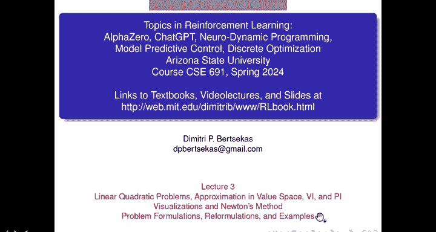

So here's the outline for today， we're going to review infinite coral linear quadratic problems with an emphasis on visual representations and explanations。

Then we are going to go into approximation value space for these problems with one step look ahead。

 again， focus on visualizations。Then we're going to talk about multistep look ahead and trancate the drug out。

Again， for linear quadratic problems。And after that。

 we're going to go into the second part of this lecture。

Which has to do with the art of formulating practical problems as dynamic programming。

 and we're going to give some examples。And like I said。

 we're going to continue along this line in the next lecture。Part of this art。

Is the technique of state augmentation that we're going to demonstrate with examples。End up。

 and also。Multi stage multi agent problems which pose a computational challenge within our framework。

So let's go into the review of infinitevarial linear quadratic problems。

Remember that we have a linear system， A and B are given， I'm taking here deterministic。

Everything holds through for stochastic as well， but its a little easier to deal with deterministic。

The cost is quadratic， this Q and r are given our positive numbers， it's the cost on the state。

 the cost on the control， it's the cost per stage， we're trying to minimize the sum of all costs over an infinite horizon。

J style of x is the optimal cost starting from state x。And is given by Belman's equation。

 that's a central result。The Belman equation is what you see here。

 it involves the cost per stage plus the cost。Of as measured by J。Of starting from the next day。

And it is the limit of the dynamic programming equation as the horizon goes to infinity。

And I'm going to call it the min Belman equation because it involves this minimization。Over you。

And I'm going to contrast it with the L Belman equation。

Which has to do with the cost for a given policy。Which is linear and specified by a。A number L。

 a scalar L。So if I fix L， I get a linear policy but from this equation。

 so the control applied according to this policy is proportional to the state with constant proportionality being L。

So for this kind of policies。There is a Belman equation that gives us a solution， we。

The cost function of the policy。And it's easy to understand。

If the control is Lx and you plug it into this cost function， you get this L squared x squared term。

 and here you get the Lx term。So this is the same as the whatever is minimized here。

 but instead of minimization， we plug in the value of the control Lx。

And if you solve this by the same reasoning as we had for the min Belman equation。

 you get the solution as a solution， the cost function。Of this linear policy。Now。

 linear policies are important for the linear quadratic problem because it turns out that the optimal policy is linear and everything revolves around linearity。

And also a nice thing that's happening here is that these equations。

 Belman equations can be simplified to what we call ricardi equations。

So how do we solve these Belman equations？Well， we try quadratic solutions that is cost functions。

That are quadratic in the state with a constant K as the cost coefficient。

 we try them in and see if they work， okay if they solve the problem。And then。

What's happening is that if I plug。K x squared in here。

Then then that would be k A x plus B U squared and this expression becomes quadratic in U so the minimization of this quadratic expression can be done in close form and after I do all that then I get。

A solution that has this form with k being this express solving this equation here。

 what's happening also once I plug in K x squared。Then x squared drops out from both sides。

 so the simplification after I cancel out x squared becomes this equation here。

So that's the ricard equation， the mean ricard equation k equal to this。

Pg in this n then x squared drops starts from both sides and we get this equation in this operator here we call the ricati operator。

 it's a function of k， a nonlinear function of k。Now。

 the L Belman equation is obtained from here plugging in Kx squared。

 and we get similarly this expression and this is。The L。Prickati operator。

 which is given by this expression。Okay。So。How do we solve these equations graphically？

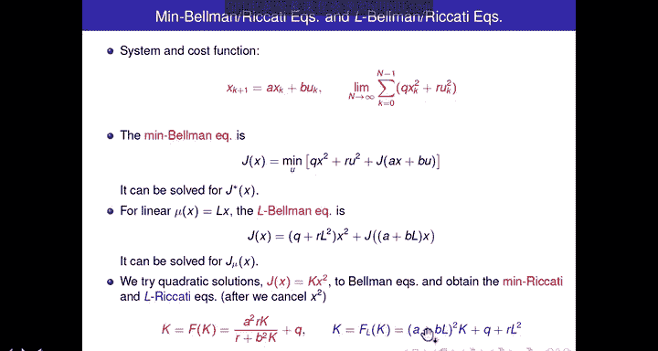

Okay， so we plot here。The rikati operator。And it looks like this okay you can verify that this is the form it's a concave function of k and it has an asymptote at this point and an asymptote this way。

 this a realistic figure。And。Pm up。K star is the solution of this。

 and it is obtained at the point where。But I can decide。

Of the riaddi equation meets the left hand side， which is this line here。

So the solution is right at this point， we intersect the 45 degree line with this。

Graph of the ricard operator。嗯。And you can see that there's a unique solution that's positive。

 but maybe there's another solution also that's negative but we don't care about that one because our problem。

 in our case， our problem is clearly positive。嗯。And。嗯。

How about the L ri equation Now the L ri equation is this K equals F L of k。

 and if we plot the right hand side， it is linear like this。 It's linear in K okay。

And so we intersect this line that corresponds to the L ricard equation and this 45 degree line。

 and the point of inter gives you the cost coefficient of the policy， KL。So。啊。

That's how we obtain the solutions of these two equations and how do we obtain an optimal policy Well there's a theorem that says that if you have a solution of the regard equation and you minimize in the right hand side and what you obtain is the optimal control。

 okay the optimal control for that state。So after you do this calculation here。

It is this linear function with L star being this。And。What would that mean？Well。

 we know that all these lines correspond to。I'd lie above the red curve。And。

What we need to find is the line that intersects the ver v 45 degree line。At exactly the same point。

As the。Without the graph。So it has to be this line here。And moreover。

 this line has to be tangent because if it's not tangent， that would cut through the red。

And get below the red curve， either on one side or the other。So this is a picture。At K Star。

 we sort of linearize。By a data series expansion。This red curve and we obtain the graph of the optimal L star revi operator。

ok。Is this very clear？Now of course this is a one dimensional graph because I can only plug in two dimensions right。

 but the same kind of insights that this graph provides and related insights that subsequent visual visualization will provide carry through for multidimensional linear quadratic problems and also far beyond that。

Two problems involving non nonlinear quadratic type of problems。Okay， so we go to the next slide。

 are there any questions？Yeah。多是一番用的用。why to be is it linear Why is it linear， well you see it here。

That's the form of this。E County operate as a function of case linear。

 this is the coefficient of the linear term， this is the constant。But by alsopoing their head the。

Of the policy because it because it is it turns out to be。He。

Why is the policy linear is like a question decay？All the policies have linear。P operators。嗯。

Allold the policy for NL， this expression here is linear in K。And this is the slope。

 the slope is a plus bL squared， that's the slope of the line， and the point the constant。

 the point that in yourect， the vertical axis isq plus rL squared。Okay。

And the same is true for the optimal as well。Okay， any other questions？

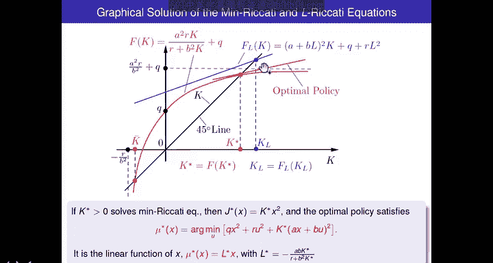

Okay，This is the solution。Of three。Plinium quadratic problem graphically。

 how about computationally well remember for infinite Hiz problems we have two major algorithms。

 value duration and policy duration value duration iterates with the finite Hiz costs and applies the Belman operator multiple times starting from some initial condition。

So now instead of iterating with the Belman operator。

 we iterate with a ricard operator and we cancel out by canceling out the expert terms。

So we started with a quadratic， first that's the starting point of value duration。

And then we generate。Successive。Is that it？By using this formula with this FB， the Rikati operator。

 this。So from K0， we get K1， K2 and so on， according to this。

Formula and the sequence of k converges to k star。And there's a similar iteration for a given policy。

With coefficient， given linear policy， with coefficient L， we iterate with the。

With the L Ricardti operator starting from some initial K0。So that's the method。

And the alternative is the policy duration algorithm， where instead of iterrating on cost functions。

 we on policies。We start with a linear policy。L zero coefficient。

 and every duration consists of two steps， policy evaluation。

 find the cost function of this policy and then policy improvement。

The policy evaluation of the caseF policy， the current is obtained by solving graphically or otherwise the LK Riad equation。

 a linear equation can be solved graphically or computationally with MATLab by simulation any way you would like。

And this gives us a solution， KLK， this is the cost coefficient of that policy。

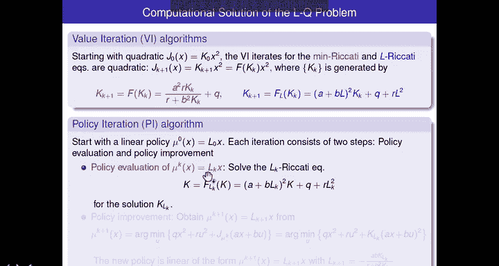

And now the next step is policy improvement to obtain the next policy。

 which turns out again to be linear with coefficientient Lk plus one and is obtained by minimization。

The same minimization that you do in Belman's equation， but instead of J star。

 you use the cost of the current policy。This。K LK x squared， so after we do that。

 then we have a quadratic problem in U。And after we do this quadratic problem。

 the result is solve this quadratic problem， the result is a linear policy。

Whose coefficient LK plus1 can be calculated in closed form from KLK。

So policy evaluation for a given policy。Solve this equation。

 policy improvement calculates the next policy。With this formula for the cost coefficient。

Now these are the exact forms of value and policy iteration。

 and we will try to interpret them graphically as well as we go along。

So what we can see is how do we initialize these outcomes with the initial case error like this one？

嗯。K0 has to be something that's zero or positive。And the issue of this initialization will come up in other contexts as well。

So I'm glad you're asking this question。As far as the policies are concerned。

It is important that you choose the first policy as being a stable policy now we haven't talked about stable policy so far。

 but we're going to do that in what follows in this lecture。And if the initial policy is stable。

 all the subsequent policies will be stable and you will obtain in the limit the optimal solution。

 the optimal policy。Yes。Okay。So。Okay， speaking of stable policies。

 this slide has to do with stability。嗯。Okay， remember the eric equations， the meanric equation。

 the ead equation。M card equation， El card equation。

And now I'm going to focus on the slope of these lines here。嗯。The slope of these lines。Is。

A plus B L squared， okay。So if a plus bL is less than one in absolute value。

 then the slope of this is less than one。If we。If a plus BL。

Is greater than one in absolute value then the slope is greater than one。

And this kind of line does not cut the45 degree line， except that some negative value。

This one works fine and gives me K L。The cost corresponding to this particular value of L。

 but this does not give me a solution。Now what's happening is that this policy is what we call stable and this policy is what we call unstable and what is the meaning of stability？

Let's consider our linear policy。With the。A plus bL， less than one in absolute value。

Let's look at the closed loop linear system。吓。The control is Lx， so in close look the system。Is this。

If a plus bL is less than one in absolute value， then the sequence generated by the system dies down to zero asymptically。

 right it goes like this or maybe like this， if a plus bL is negative。

Such a system we call stable if it tends to the origin， regardless of the initial condition in。嗯。

And without any control， the control is already taken in to this equation。It's one to the Lx。Now。

 in this case。We have this slope being less than one， we have a stable system and。The corresponding。

Cost coefficient of the policy is obtained by solving the Elricdi equation is this point here。

On the other hand， if a plus BL is greater than one， then the system is unstable。

And the trajectories of this system。You know。To infinity either this way or that way。And that then。

The cost of the policy is infinity right， because we penalize the square of the state。

 so if the state goes to infinity， then the cost goes to infinity as well。

So we are interested in stable policies definitely both from a practical point of view and also from a computational point of view。

 and we're going to be trying to have this condition satisfied。

And as I mentioned in just a little while ago， in policy duration。

 we should be starting with a stable policy， otherwise the method does not work。Moreover。

 it's true in general in reinforcement learning。That both theory and practical algorithms break down when you have unstable policies。

 and I'm putting this in question mark because I haven't defined what stability means in a general context。

But instability and instability are important in many。

 many different contexts in reinforcement learning。Even even in context that are not。那啊 not。

Related exactly to system stability， there may be algorithm stability。

 algorithmic stability that may make a method catastrophically fail。😊。

And we will see examples of this type later。But to begin with in control system design。

 stability is paramount， if you don't get a stable design then。Then that's。You failed。

 The first consideration in control system design is to get a stable policy。

And that's how we represent state policies geographicalally in the context of the linear cadtic problem。

Questions here。Okay， so we have elderly cardio operators and many cardio operators。

 how are they related？Minary carry operators is this。Has this red graph here。

 the allat operators lie above that and there are straight lines。And all of these lines qualify。

 right for Elder riarddi operators。And。It turns out that if you take the lower envelope。

Of all of these blue lines， you get the red curve。And how can we see that？Let's look at the。

At the righthand side of Belman's equation and the。Min Ricard operator。

 it involves disminmization with respect to you for a given value of k。

Now let's do the following trick。Break down this minimization into two minimizations first minimize over all U that are equal to L x for a fixed L and then minimize over L。

And I can do this inner minimization in closed form。And what I get。

You can see the algebra here is put L x here and then do the miniization you get exactly the the。

You get exactly。We。The elderly recovery operator with X star coming factoring out。

Chancell allowed Ext on both sides， and what you get is this。

The main ri operator for a given K is the minimum overall。

Linear quality coefficients of the L ricard operators。

 so what this says is that this red curve is the minimum of all these FL curve lines。Okay。

Here's another thing that this equation says that if I have some k over here and I want to find f of k。

 I can do it by minimizing over all these values over L。

So I can look at God this vertical line and look at all these points where these lines intersect。

 and then I can take the lowest line。In that lowest line。This one here has to be tangent， okay？

So this lowest line， which defines the value of the Minrickkati operator。Is a linearization。

Of the main operator。And that's going to be important for what's coming。

So let's try to interpret approximation in value space。

In terms of linearizations and also in terms of Newton's method。

 and we're going to focus on one step， look ahead first。

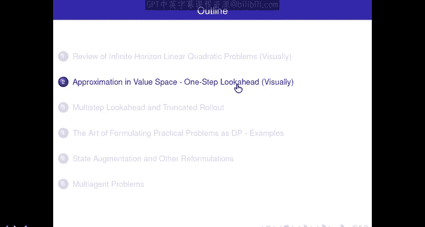

Okay， what do we mean by approximation in value space。

 remember this figure that we had at the very first lecture， we are at a given state。

 we look at all possible choices of control， all possible next states。And then， we approximate。

The cost to go from these states with some J tilde function and in this particular case。

We're going to look at quadratic cost approximations that involve IK tilde positive coefficient。

So this is the。Now this case， Tilda may be obtained in a number of ways offline training。

Or light forms of online training like training a heuristic policy or something like that。

We don't care really how you obtained Kate Tilda， somebody gave us to us to start the online play working。

 which does this minimization。Now， the online play algorithm。

I will show you that it is a Newton step aimed at solving the Belman equation or theickati equation because X star factors out。

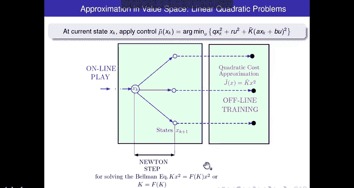

But what do we mean Newton's method？Okay， how many of you are comfortable with Newton's method and know what it means from calculus？

Question。Okay， most of us do， right， because most of us certainly have been exposed to it。

 but perhaps you may not remember it。Newton's method is one of the most fundamental methods in numerical analysis。

 it's used to solve。Equations， one dimensional equations or multidimensally nonlinear equations。

Or it may be used to solve optimization problems。And it's the most powerful method。

 the fastest method among all numerical analysis methods for solving equations is Newton's method。

hass what's called superline diveverence。And。诶。Once it's close to the solution， it just zooms in。

 takes like one two iterations and you're done to， you found the solution with great accuracy。

 it's extremely powerful。On the other hand， Newton's method has some drawback。

Namely that you have to start it reasonably close within its region of convergence to the solution。

 otherwise it may diverge unless modified。So let's also Newton's method can be solved for solving fixed point problems of this form。

Y equals g sub y g is some nonlinear function， which I'll assume it's differentiable。

Why is that well a fixed point problem is really an equation problem， right。

 I just taken y to the left hand side。So I'm going to give you Newton's method for one dimensional problems for this fixed point problem。

So here's the mapping G， and you can think of the riaddo operator， if you will。

 but here I'm being general。And the solution， which I call y star。

 I used to term why I don't want to use k because I want to be。

I'm going to talk about in genetic terms in this slide， so the variable is called y。

And the solution Y star is given at the point where。The right hand side。

 the red curve meets the left hand side， so this is a solution。

 this's also another solution over here， but let's look at this solution here。

And let's see how Newton's method works。It's an iterative method and that the case iderate。

 the current iderate。It linearizes the problem。With a first order expansion of G。

 first order Taylor C expansion。So at this point， we linearize this G。Okay。点。

The slope of this is just the gradient of G at Yk， right？And。诶。Now that we have this linearization。

 we can look at the linearized problem， which is the problem where G is replaced by its linearization。

So the linearized problem is the point where。The linearization meets the 45 degree line， it's this。

 and that's the next it of Newton's method。From YJ。

It generates Yk plus1 by solving the linearized problem instead of the original。

And then at y K plus1， it really linearizes。And。Goes to this point y k plus 2， pre linearize again。

 and it is evident from this figure that you converge very， very fast。If you happen to。

Once you get the close to white star。On the other hand。诶。😊，If you start far away from white star。

 you start right over here。You linearize and the slope here suppose is greater than zero。

Then the point of interception is away from y star and you don't convert you diverge rather from y star。

And there's a certain region。That。Is the region of attraction of a particular solution where if you start Newton's method within this region。

 then you eventually converge and you eventually converge very fast。On the other hand。

 if you start away from this region of attacks？Then you have a problem in that you may not diverge。

So that's the general intuition behind the region of attraction。

 the convergence and the operation of Newton's method。AndLet me also point that out。

That Newton's method extends very broadly。It applies to multidimensional problems that are differentiable。

It applies also to multidimensional problems that are non differentiable， where G has cos。

Then the question may arise。What are we？What is the linearization， Well。

 it turns out that instead of using gradients， you use something called a sub gradient。

 which is just a hyperplane。That。It's a hydroplane that supports the graph of the function。Um。

These are easy。There is an easy way to understand Newton's method for non differentable problems if you apply to the case where。

The right hand side is the minimum of several differentiable functions。

 Then you use the gradient of whatever differential function is active at the current point。

And there's an explanation of all this in your textbook。

 but I don't want to go into that because that will detract us from the we' get into mathematics and that will detract us from our main objective。

But Newton's method generalizes and it's applicable very， very broadly within our context。

 even though we are going to demonstrate for the case of linear pdratic problems where everything is nice。

So now in the next slide， I'm going to show you how approximation in value space is Newton's method。

 a step of Newton's method。Are any questions here？

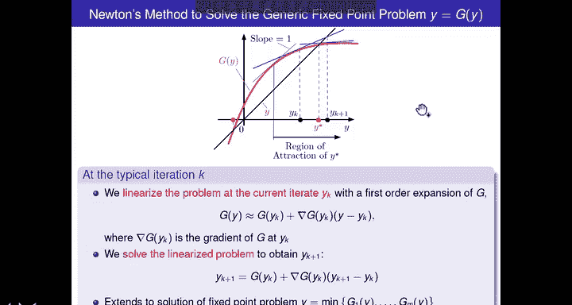

Okay， so that's what we you want to do where you want to visualize approximation in value space with one step look ahead and noout。

 we're not going to use any neuralout。So。He is the Min Belman operator。

And suppose that we approximate the cost to go with K Tilde K tilda x star。

 we got this somehow from offline training or whatever other method。

 and what we want to do is approximation in value space。Well， what we want to do is。Minimize。Is。Yes。

Find a policy。That minimizes for this kilde。And what we need to do then is for all the possible policies。

Finding the one that comes the lowest， right， according to this minimization。And。

So we look at all the crossing points of the linear graphs。And we find the one that's lowest。

 and that one has to be tangent。So the graph of the minimizing L。B the see。

Well the El riard equation。Is given by this tangent。And the cost of that minimizing policy。

Is given by the point of interception with a 45 degree line。

So you start with cost approximation K Tilde and you get a one step look ahead policy， KL Tilde。

 which is obtained by this linearization construction。So what is this， well。

 it's exactly Newton's method。Starting from Ca Tilda and going to the cost of the。

One step look ahead policy is a Newton step。Exactly。Now what's the consequence of this？

If this K tilde is close to K star， then this is going to be very， very close to K star。

 There's a huge。Improvement in cost if K Tilda， on the other hand。

 is not very close to K star in particular， if it lies outside the origin of attraction of Newton's method or the origin of stability that we called it earlier。

 then。This process does not work， breaks down。So that's the Newton step interpretation。

Questions here。Yeah， maybe I have won。 But why isn't it inverse。 if you go。

 I was going to work with myself shouldn't take gradient be inverse in the method。你这个都啲嘅啊。I mean。

 there was like was the gradient。 but for what usually the one over the gradient， right。

That would be another way to carry Newton's method and would be equivalent what we're doing here we are using Newton's method through approximation in value space and our objective is not so much to carry out Newton's method in the best way possible if that's if there is such a method our objective here is to visualize what approximation in value space does。

So this is not a method of solution。This is a visualization。An interpretation of what is the cost？

off。One step look ahead policy。And how is it related to the。

Because functional approximation possible I wanted to ask a question before。

 but I wanted to just check my work before， I just I just wanted to know whether like the equation is exactly correct of of the G of y is actually isn't it there was deltata G of y that's not like one or because the It know to be like x K plus1 but x k minus of x of x y。

Yeah， but that's exactly what this is。

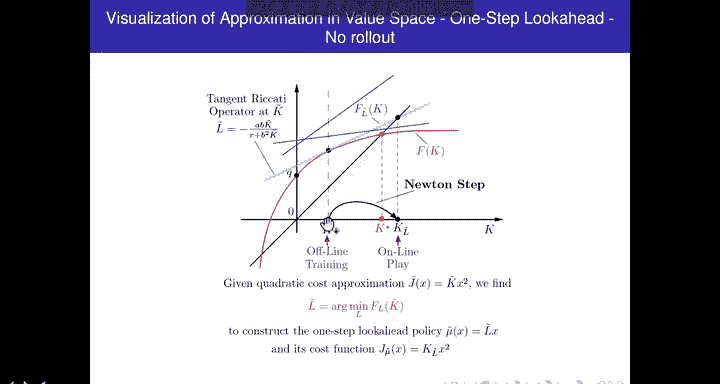

Look at this equation here to solve this equation， you have to solve for y k plus one so that's how you invert。

 that's where the inverse comes in。Not seen， but I think because I didn't see that you kept why the one。

 I thought we are okay。Okay fine。

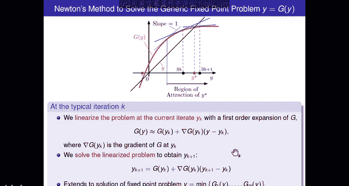

Okay， so this is the interpretation of one a plus string value space we linearize。

And then we obtain the cost of the one step ahead policy exactly as in Newton's method。

 and that's the critical connection。

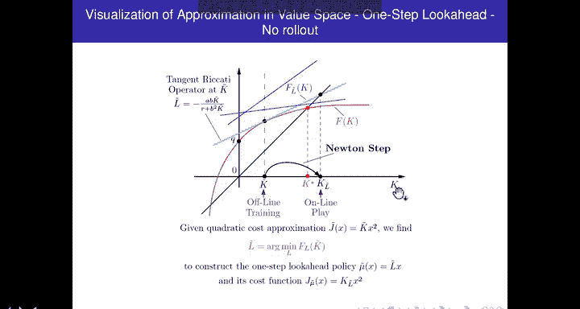

Okay。So now let's also visualize the region of stability in approximation in value space with one step look ahead。

Suppose that I take my Kate Tilda。Some put in here。Let's say you take Kilde to the right of K star。

Then the corresponding。Honestly。I's going to have this。

Then the corresponding policy is going to have slope less than one。And it's going to be stable。Also。

 if Kilda is in this region， then the tangent is going to have slope less than one and again it's going to be stable。

On the other hand。If you go to the left of this point。

 which correspond to slope equals to one and you use a K tilde within this region。

 then you're going to get an unstabletable one step look ahead policy。

 and then you're going to have difficulty。So。This Newton step interpretation。In visualization。

Shows you how instbilities can occur and defines also the region of stability as being to the left。

 to the right of the point where the slope is equal to one。And for the method to be successful。

 the start of the new step must be within the region of stability。

And characterizing the region of stability becomes an issue that's important within the context of linear catdratic problem。

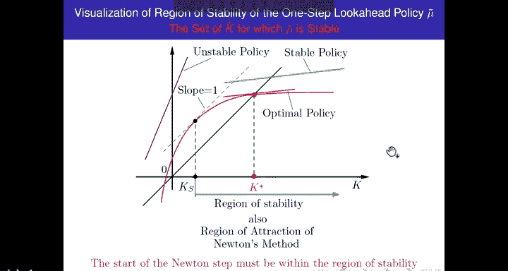

Now let's also try to visualize rollout with a stable linear based policy。Remember what loud is。

We introduce a base policy。Which has cost function J mu。And we use as cost function approximation。

 because cost of that policy， we use this J tilde here。

Now I'm going to choose the base policy to be stable。

 so its slope is going to be the slope of the base policy is going to be less than one。

So it intersects the 45 degree line， and this is the cost of the base policy。

Now rollout is approximation in value space with this cost function approximation。

 and it is given by linearization and a Newton step。

And that gives you the cost of the rollout policy？So here's the cost of the base policy。

 here's the cost of the rollout policy， and it's given by an exact newton step。And。

Because we have Newton's method that's very fast， this new policy。

 the rollout policy is much better than the base policy。

 particularly if the base policy is relatively close。Two K star。

Notice also that this particular approximation value space that involves。JL as J till JU。

Is an approximation to the right of K star and because of the way this concave party is smoking。

The approximation from the right， the Newton step from the right tends to be more effective than a newton step from the left。

So they all not policy。The base policy is a good starting point in the sense that is to the right of K style。

Moreover， you can see from this figure that if the base policy is stable so that it。

Gives you some point to the right of K star。Then the rollout policy is also stable。

You play around with this and see that this is true， not only a better policy。

 but also a stable policy。嗯。Okay there are a number of ways to see that okay from this figure。

 but the important fact is that if you start with if you use rollout with a statement policy。

 then you're going to get a stable once step policy and that's important for the point of view publication is also important the context of policy duration because policy duration is a repeated rollout。

 so if you start with a base policy that's stable， the policy duration then all the subsequent policies are going to be stable。

发信息。Okay， so。Covered a lot of figures， let's take a break here and then we'll continue with multi step look ahead and how we interpret mutant's method and approximation in value space。

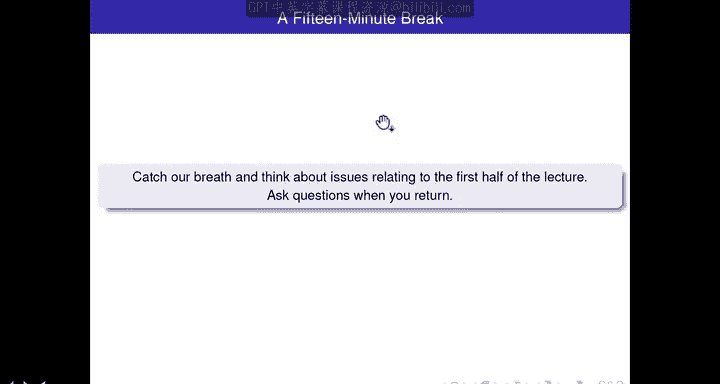

Okay， let' us get started。We talked about one step look ahead。And the interpretation。

 the Newton step interpretation that maps from the J Tilda approximation into the cost function of the one step Look ahead policy。

So with one step look ahead， what we do basically is minimization with with some cost function approximation at the end to approximate the。

The optimal cost。Now in multit ahead， we have multiple。Levels and steps of minimization。

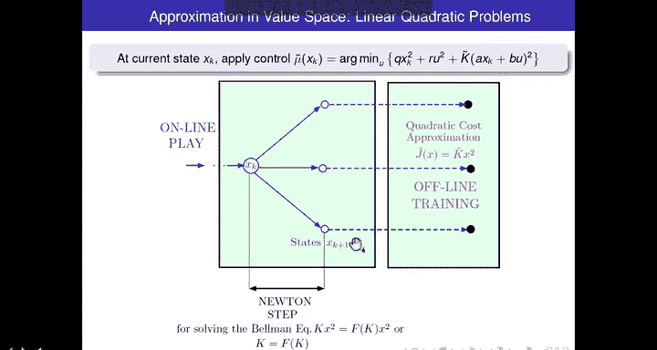

And the figure becomes。Like this， this shows two step look ahead minimization at the current state。

We look two steps ahead at all the possible states that can occur。

And then we take a costs function approximation， which may be preceded by truncated rollout。

And the cost function approximation for the linear quadratic case is quadratic given by this K tilde。

 so this is the same figure except it has an extra layer of look ahead and also this truncated rollout。

So the one step look ahead is applied to everything that follows after this point。

So this is a Newton step applied to the function that you obtain after you lump all these steps together。

And what these are。Theres one value duration here。 Multi value durations in the case of。

Look ahead of more than two steps。There's also some other stuff here and there's also cost for approximation。

So the interpretation that we are going to give is this general scheme involving multi step look ahead and perhaps other staff。

Is a Newton step but applied to something different than J Tilda。

 something that has hopefully been enhanced。And。These extra steps here serve to bring the cost function approximation closer to J star and perhaps into the region of stability so that Newton's step can be effective。

That's the whole idea we going to that I'm going to try to get across to you。

Multi step look ahead is the same as one step look ahead。

 but with a better starting point and this better starting point is affected through extra layers of look at minimization and also。

Look ahead with a policy as incate the rollout。Okay。

 to understand this value duration that I mentioned here。

 let's try graphically to look at value duration for linear quadratic problems。

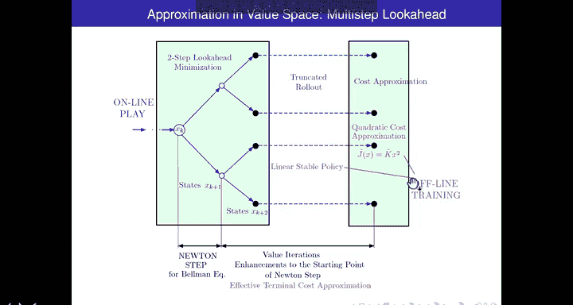

Okay， so value duration its on。Cost coefficients from Kk to Kk plus1， Kk plus2 and so on according。

To this equation， which uses the ricardi operator to map Kk into Kk plus1。

And this comes from value duration with cost functions。

 except that the x squared has been factored out from both sides。So， in terms of。

The Ricard operator graph。啊。Falue durations and iterative method that at the typical step。

Has a Kk coefficient。Finds Kk plus1 by。F of FK， so this is k here plus1。对。

We take this and we reflect it across the 45 degree line， here's Kk plus1。

And then we take us Kk plus2 the value of the riadti operator at this point。And so what。So。

 value iteration。In this graph here is interpreted as a staircase。Ascent towards the。

Do was the gay star。嗯。And you can see that for any positive starting point or zero or even some negative。

You're going to end up converging to K star through this staircase operation。

 and the same is true if you start from the right。Because the staircase operation is going to go like this and fact's going to be even faster from the right。

So that's how value it works。And it helps to bring some starting point closer to K star。

 the more value directions you apply， the closer you're going to get to K star。

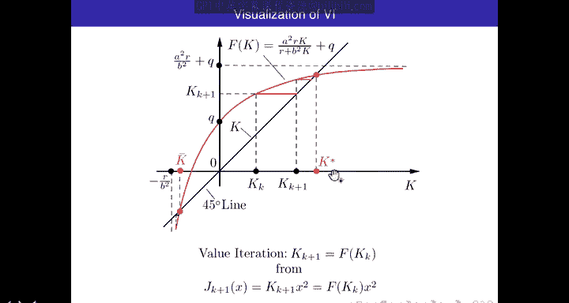

So now going back to。Two step look ahead and multi step look ahead， let's try to visualize that。In。见。

Approximation in value space， we have a cost function approximation， this K killed there。Now。

 in two step look ahead， we first apply a value duration to that and the result。

Is where the first step of look ahead minimization is that which is a Newton step。

So instead of going here and then taking。Clenniarizing。

 we do a value duration first and then looking at linearize。And that gives us。

The cost function of the look ahead policy， the two step look ahead policy。

 it is a newton step but not starting from K tilde， starting from the point K1。

 which is an enhancement of K tilde， it has been enhanced by a value duration。In three step。

 look ahead and we would have start with okay tilda， do one step， one value duration。

 then a second value duration， and then apply the Newton step。

So it will work better because the starting point for the Newton step is going to be better closer to K style。

So this brings up a general idea that the longer we look ahead， the better。

And even though I'm not showing rollout in this figure， rollout also helps。

And you can draw the corresponding figures and see how it works。

All of this is important and another important point that I want to make is that multi step look ahead improves stability。

Suppose that you start， for example， from some cost function approximation。

That gives you an unstable policy。Then you' are in trouble， on the other hand。

 if you use two step look ahead。The next step which this。

The first look ahead step brings you to a point which may give you a stable policy。In other words。

 extra layers on look ahead break you closer to K star。

 which can bring you within the reason of stability of the method。So that's an extra。

Benefit of multi step look ahead， not only better approximation of the optimal policy。

 but also improve stability， it can succeed where one step look ahead can fail because we don't have a good enough approximation multi step look ahead enhances the cost function approximation。

 brings it into within the region of stability makes the method work。That's again。

 a general insight within reinforcement learning。Longer， look ahead， helpps。

Wch longer look ahead also costs more computation time。Because you have to。ok。

Have to solve more difficult problem， more difficult minimization， not every step。

Any questions for this？By the way， your next homework is going to be playing around with figures like that。

 so I hope that。This will help understand some of the finer points that may not be evident。

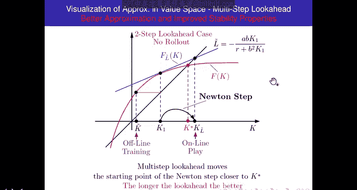

Okay。So let's now go to policy duration for linear quadratic problems。We mentioned rollout one。

Newton's step， starting from。The cost function of the base policy。Now。

 police duration is simply a repeated rollout。Get a sequence of policies。

 each one with a better cost。Starts with some linear policy。

 generates a sequence of linear policies involving cost coefficient Llk。

the two step process of policy evaluation and policy improvement。

 both of these can be done in close form in the case of linear quadratic problems。

 a very simple case， of course。The policy evaluation is done by solving the LK Belman equation to find this coefficient here in closed form。

I'm sorry。For a given policy， L case of x， policy evaluation gives the cost function。

Of theOf the policy by solving the LK Ricard equation in close4。

 and this is the solution as a function of LK。Policy improvement。

Gives you a new policy with cost coefficient Lk plus1。

And uses Kk from the cost evaluation and this formula here。

 which comes again from quadratic cost minimization， the formula for policy improvement。

So the formulaless here are not important to remember。

 but what's important is that they can be done and they generate linear policies in close form。

 essentially。A single policy duration is what rollout is and it's a single。

 and it can be viewed as a single newton duration。诶。你。

Policy iteration method is repeated rollout in this a full fledged Newtons method for solving the rikati equation equation with every iteration between a rollout step。

And it will asymptically solve the kind equation， but much faster than value duration。

 that's another important point， all this duration is much much faster than value duration。

 particularly once it gets close to the solution， then one it keeps you almost exact the exact solution。

There are a lot of variants of policy duration， they admit graphical interpretations。

 one of them is called optimistic policy duration where you evaluate the current policy approximately by using some value durations。

And this is the essence of truncated rollout， it can be viewed as an approximate or optimistic policy duration with inex policy evaluation。

早上班。And from。And it can also be viewed as what's called in numerical analysis， a Newton SOR method。

A newton SOR method for solving equations。Consists of a repeated application of a Newton step。

 but each Newton step is preceded by first order iterations like value durations。

So do a number of value directions and then a Newton step。

 a number of value directions in a newton step， that's the essence of this optimistic policy direction。

And it's an important method within the context of reinforcement learning because very often we cannot roll out exactly we have to deal with approximations。

Have a question。原始。So that guarantee that for a plus。BL K plus one will be smaller than one。

 but this equationion doesn't demand that。 So how can you guarantee that a plus。

The average value8 plus healthcare care plus one times be smaller than one。Okay。

 so the starting policy for policy de has to be stable， if it's stable。

 then all the subsequent policies will be stable。That's the fact that you can prove and it's easily seen both graphically and also analytically。

donて likeいや donて。Yeah， these updates guarantee the stability of all the policies if you start with a stable policy。

If you don't have a state police to start with， then you're in trouble。好。

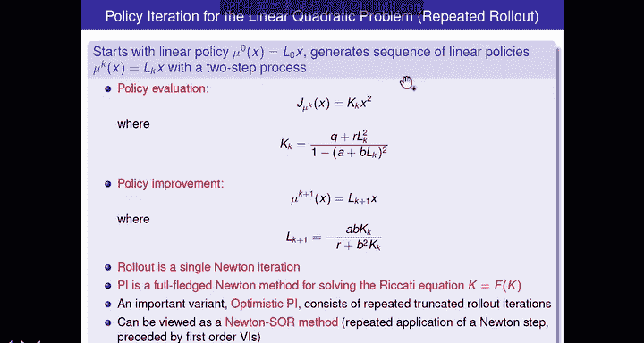

Okay， so let me also mention。That there's a broad generalization of all these graphs that I gave you and all the ideas behind them。

And they generalize very broadly。To essentially arbitrary dynamic programming problems。

 both deterministic and stochastic， both final horizon and infinite horizon。

Because dynamic programming ideas do not really depend much on the state space that you use or the control space。

 they apply in great generality and this generality passes through to this Newton step interpretation。

However。The mathematical analysis to establish all that， in other words。

 from intuitive visualizations to go to rigorous mathematical results that requires analysis that can be substantial。

But this analysis has been done， okay and you can look at your textbooks and also the references in your textbooks to get into it to get the full range of results of this type。

And just as an outline。In a generalized view of approximation in value space and newton analysis。

 pre operators have to be replaced by Belman operators， General Belman operators。

Newton's method for solving the Min Ricard equation becomes Newton's method for solving the min Belman equation。

A mathematical point that I alluded to a little earlier that non differentiability of the Belman operator is not differentiable because it's the minimum of several linear functions basically。

 and it can easily be non differentiable。However， this is not an issue because there is a form of mutants method that can deal with nondefiniability of the Belllman operator。

And you can look at your textbook and there's an appendix that explains this in greater detail。

All of this takes us a substantial mathematics， okay but those of you who are PhD students and want who look more deeply into research in this area。

 it's the kind of mathematics that are worth looking are becoming familiar with。In general。

 approximation value space a single neton iteration， but enhanced by multistep look ahead。If。

There is multi step look ahead and by truncated rollout if any， in other words。

 the picture is we have a single neton integration but the starting point the neton is enhanced by good cost to go approximation by multistep look ahead and by truncated rollout。

But all layout itself is a single newton iteration， provided the cost evaluation is exact。

Exact policy duration is a full fledged Newtons method。

And a key insight is that a multistep look ahead and truncated rollout enhance the stability properties of the policy produced by approximation value space。

And also leads to more stable methods， methods that。

Tend to work in spite of the many approximations that you may make in their implementation。

Was multi step look ahead costs a lot of computation。

 and that's the trade off better performance versus increased computation。

So that's all I have to say about this visualizations and Newton's method and the approximation value space。

 and now we're going to go into the issue of how you formulate problems。

 practical problems as dynamic programming problems and by extension as reinforcement learning problems。

So how do you do that in practice， well， there's no unique answer。

But heres the recipe that I suggest。The first thing thats given a practical problem。

That you want to address through dynamic programming reinforcement learning。

 you first define the controls， you first define the actions。

 these are easy to figure out have a if you have a scheduling problem。

The controls are the scheduling decisions， right？嗯。Once you have the controls。

 then you can look at what kind of information is available at each stage and when it is available and that defines the stages。

啊あ。诶。One way to look at how you divide the the horizon into stages is to look at the points where the information becomes available because that's when you would apply in want to apply controls。

The third thing that you want to figure out is what are the states and when it comes to states。

 there are many different formulation， you can choose many different things as states in practice。

Now there's one important guide here。Deffinine a state something that summarizes the past for the purposes of future optimization。

So that as long as you know the state。Everything that has happened before that state。

Happened is irrelevant。All the past is irrelevant， given that we know the state。

So that's how you recognize states。As the essential information for the purposes of future optimization。

And rationale is that。The controller applies action that depends on the state。

So the state must subshue all the information that's helpful for decision and control。And。So that's。

That's the way you're look into problems， on the other hand。

Stop sh all information that's using useful control can be done in many different ways。

 you can encode the information that's important for control in many different ways。

So let me give you some examples。嗯。Let's consider the traffic assessment problem with which you are familiar。

吓。We need to include in the state or the relevant of information。

That would be the current city is certainly an important thing to know when you apply a decision to go to the next city。

 and you also need to know what the past cities that you visited are because that's how you know what your options are for the next city。

Now， other information such as the cost of visiting previous cities in the tour。They don't matter。

 they are not important and they will not be included in the state。

 although technically they could be。Now， here's another important example。

That we are going to discuss in the next lecture。It has to do with partial information problems where the controller does not know xk。

 but rather receives measurements about the value of xk。

So we can use noisy measurements for control of some quantity of interest。你讲鬼车。

And which evolves over time。Like the position velocity vector of our moving state。

 what you were moving object， something that you would take a state had you known their exact values。

But if you don't know these exact values， then it is correct to use the measurements in place of those。

 all the information that you have after that time， that would be the state。

 that would be the state of information。But there's an alternative also。

Which is some kind of probabilistic state。It's possible to use the conditional probability distribution of the quantity of the interest given the information。

In other words， instead of using IK as state， which may not be maybe difficult to deal with。

 you may use a probability distribution over the quantity of interest。Given the state。

 that would also be a legitimate choice for state。In the PompppP literatureature。

partialial observation state literature is called the belief state， some kind of probabilistic state。

 it assumes all the information that's useful for the purposes of future of controlled choice。

 but it is in a probabilistic form。So the choice of state arises here and there are several different concepts of state that can be useful。

So of course， this requires a reform of the problem。From states， you may go to abilistic states。

 you may go to belief states， you may go to information states and so on。

And let's look at reform formulationulations now in from another point of view。

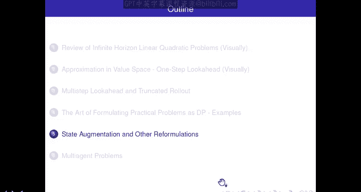

Okay。Is a general technical state augment， which I'm going to illustrate by example。

It is helpful in taking a problem that's not exactly in the form that you can use to apply dynamic programming。

 but if reformulates it to one query you can write a dynamic programming algorithm。

And here I think an example we with this。Where the system equation involves delays。

So the next state depends not only on the current state and the current control and perhaps some noise。

 but also on the preceding control that you have applied。And the preceding state that you had。

So there is a delayed effect on the next day， this is what we mean by the system equation involving delays。

So how do we deal with that？Well， the idea is to take a state everything that is important for the purposes of future optimization。

When we choose UK， it is important to know this， and it's important to know that because that affect the next day。

So it is natural to think about introducing additional state variables that encode these delayed quantities。

And we can write a system equation for those。Y k plus1 is equal to xk， according to this definition。

Sscape plus one， be delayed control。At the next stage， it's going to become the current control。

So technically， we have a system equation that involves an enlarged or augmented state that involves xk and also the delayed quantities。

And we can write a system equation that's basically this equation here。

 we can write it like so it involves。啲。Current augmented state， the new augmented state。

 the control and the disturbance also And if the day is the mapping that。一。

Forrespons to these expressions here。But now once we have done this reformbulation and we have a cost function。

 we can write a dynamic programming algorithm for this augmented problem， augmented system。

The dynamic programming algorithm starts from the terminal state as usual。

 and then at a typical step。The optimal cost to go at time K depends on the augmented state。

Which is xk xk minus1 and U k minus1， it's a bigger state。And the equation is what you see here。

 makes sense。Expected costs of the current stage， plus expected optimal costs to go that depends again on the augmented state。

So this is a legitimate dynamic programming algorithm， except it's carried out over a larger space。

The space is not on just xk， but also xk minus1 and u k minus1。And。The more delays you have。

 the bigger the augmented state can be。You may have problems with the dependence for the current state。

Depends on all the previous states， then all of these previous states can have to be included in the augmented state。

And in the dynamic programming algorithm。This type of state augment has a very large range of application is the go to tool when you have a problem that does quite fit exactly the dynamic programming framework you look for some kind of state augment。

And there are different types of state documentation plantation。

 your textbook has some other examples。For example， forecasts of future uncertainty。

Suppose that you had a time K and all of a sudden you get a forecast that's say。

 let's say the demand for your product in one month is going to be three times bigger than what we expected。

Then you have to include this information as part of the state。

 this forecast has to be part of the state because your control。

 your decision is going to depend on that。嗯。So there are many examples you you can look at all of this。

The general idea also here to keep in mind is that state augment is a very powerful and general reformulation tool。

 but also results in dynamic programming algorithms that can be very。

 very costly because of this size， the increase in size of the state。

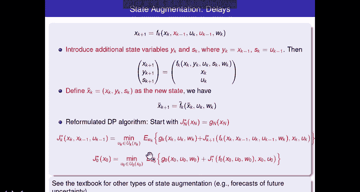

Okay， another type of reformulation， many times you have a problem where there is a termination state or a goal state that you're trying to reach。

 like for example， in shortest path problems， you try to reach a certain destination。

Or in games like chess， the problem stops when you reach the end of the game。

And so of course you don't know， you don't have a fixed horizon exactly when the game is going to end。

 but there is this termination state。Now。Dealing with such problems can be done in several ways。

One possibility is to view them as infinite horizonizon problems。

 even though you expect that you're going to terminate in a finite number of steps。

And that may be a matter of convenience or a matter of there may be some conceptual value to it。嗯。

And。You can do this transcription from from from。Essentially。

 finite horizon problems to infinite horizon problems by introducing an additional state corresponding to termination to which once you transition。

 you just stay there forever and ever。So that's one possibility。

ever finite horizon problem or every problem that you are going to terminate within a finite number of steps。

 you can also view it as an infinite horizon problem with an extra termination state。

 and then you can make use of infinite horizon ideas in its horizon algorithms。

Another possibility is to convert it to a finite horizon problem。嗯。Assuming that you know。

 an upper bound to the optimal number of stages， if you know that the optimum is going to occur within 100 stages。

 then you can consider it as a problem with 100 stages or 150 stages or 1000 stages。嗯。And then。

You can add a big penalty as terminal cost for not terminating。

 not reaching the termination state at the end of the horizon。That's a possibility also。Now。

 let me give you an example of a problem with a termination state。Here you have a。A graph。

And you have two vehicles moving one step at a time within this graph。

And the objective is to perform some valuable tasks that are located at particular nodes once a vehicle gets to that to such a node。

 then it performs a task， and the objective is to perform all the tasks。And to do it。As an example。

In a minimum number of steps， minimum number of moves。Now at every time step。

 there is a move by both vehicles。To enabling node from where they are。So。Okay， so we have。

The laws of evolution of the state we don't know what the state is。

 we have a cost function and but how do we formulate this problem as dynamic program what would you take as states？

Any。Any ideas？What would be important at any given situation for the purposes of future optimization。

 what would you like to know， what would you need to know？不欢。Sa it again。

 where the vehicles are certainly should be part of the state。

Is there any other component of the state that you would include？The number of moves taken。

I can't I can't。No， that would not be part of the state number。

 how many moves it has taken you to be where you are。

 that would not be important for the purpose of future optimization。

 it would affect the overall cost。But not the future costs。ok。

How about a list of the tasks that you have already performed？ok。I mean。

 that list would be important to direct you into completing the remaining tasks。

 so it's an important piece of information to have in a dynamic programming in problem formulation。

So a good state here would be the position of the vehicles at a current time and also a list of the tasks that you have already performed。

And there's a termination state， what is the termination state？Stop them forever。

It's the stage where all the tasks have been performed。

That's a termination state and then you can view this as an infinite cor problem， if you wish。

 where you stay at that state with no cost incurred in the future， but you can also view it as a。

Final Verizon problem。诶。What would you take as a horizon here if you wanted to formulate this as a finite horizon problem？

对对。这那份。The man number of node in the graph。It's not the number of nodes in the graph。Okay， beat。

It's an estimate on the number of steps that you need。oply。To do all the tasks。 So here you can okay。

 you can look at this graph， the optimalmost solutions mark in red here in three steps。You can。

Perform the task if you act optimally。Of course you can act non optimally and you can go around roundabout way to get to this to this task。

 or maybe even if you want to be really stupid you can just go back and forth and waste time and do nothing so in principle。

There are policies that can have an infinite number of steps。 However。

 the optimal number of steps here is three。 if you take a horizon three。Or。

More than that would be a correct formulation of as an infinite correlation problem with a penalty or not terminating。

Within three or whatever steps you said as qua。It's also possible to estimate the number of。Yes。

 they may be。An upper bound to the number of steps that you would need。Okay。

 there are two tasks here。And you would need the。No more than 12 steps for one vehicle to get there。

 okay？So multiply that 12 with a number of tasks that gives you an upper bound。

That would also be another possibility。What's the control space here， what's the action space？就是这个嗯。

You may have to take cross products of like equals fossil actions。Yes。Yeah。

 the vehicles move simultaneously， so you would have to take all the pairs of moves。

 all the possible pairs of moves。In general， if you have any vehicles。

 you would have to take off the carteian product of。10 of the moves of the individual vehicles。

So what does that do to the control space？诶。If you have， let's say。

10 vehicles and each one has two options to move in every step。

 it's two to the ten right you have 500 vehicles， each one with an option of two possible moves。

 it's two to the 500。The search space。Increases very rapidly with a number of vehicles here。

And the size is astronomical even for a modest number of tasks and vehicles。Now。To deal with this。

There's something that we're going to deal with in some detail called multi Asian rollout。

A form of rollout that deals with multi agent problems involving multiple。

Independent decision makers。With a result that the joint decision becomes very complicated and very large。

So let's talk about multi Asianian problems now。

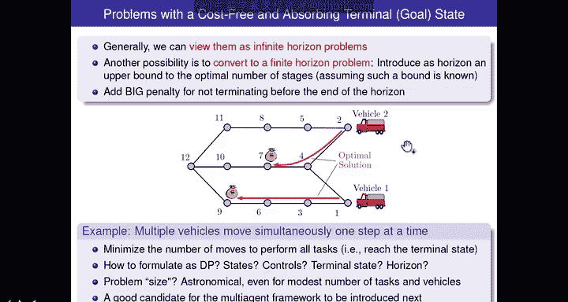

It's a popular class of difficult problems。It's also an old type of problem。It dates to the 60s。

And it relates to a situation where you have multiple decision makers or agents。

Collecting information from the environment and sharing information selectively with each other。And。

Agent I applies decision UI， so you1， you2， U3， and so on。

And the collective decision is this M component vector involving the choices of all the agents。Now。

 this is。A difficult problem， a difficult class of problems。

But there is a major mathematical distinction that characterizes the difficulty of the different problems of this type。

It has to do with information， how much information these agents have。

Theres the classical information pattern。Where the agents are fully cooperative。

 they're not fighting each other， they not have different objectives， they work for the same purpose。

And they fully share information and they never forget the information that they have that。Now。

 this is。The easier type of problem。Because it can be treated as dynamic by dynamic programming。

 as I'm going to show in the next slide。The other possibility is to have a nonclass information pattern。

Where the agents are only partially sharing information， so they act without common。Information。

 and they may also be antagonistic， they may have different objectives。Now this is a hard problem。

 very hard class of problems。And the reason is that it cannot be treated by dynamic programming。

To give you an idea of how hard this type of problem is。I worked on this 50 years ago。

 well more than 50 years ago when I was a PhD student。

 I spent about six months looking at these problems because they were very old， okay， they way back。

And。听。I realized after six months that I was never going to get。

And good clean to result in this area and I switched to research areas。

So these problems are notorious for their difficulty。

But people are still addressing them and with renewed interest because we have now new methods and more computational disposal。

So it's an important subject for research and reinforcement learning。There are lots of methods。

 some of them very crazy methods that people try， and some of them very misguided。

 but it's a subject of great interest。So what going are we going to do with this class of problems。

 well， we're going to look at the easy case first。

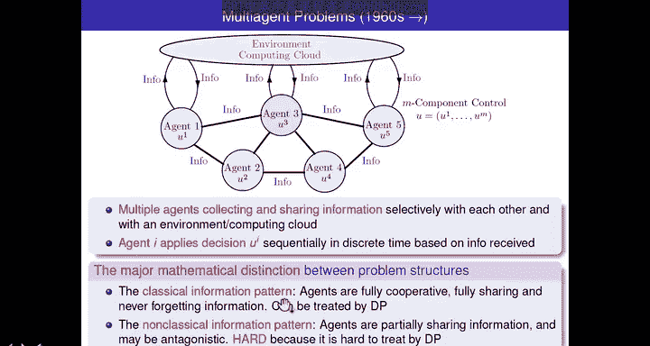

The starting point is going to be the classical information pattern。

 but later we're going to try to go into the non classical information pattern case。

Now the classical information pattern。Where everybody shares all the information and。

Everybody communicates their controls and coordinate their controls。

Can be visualized and can be conceptualized in terms of an information and control cloud。

It's a cloud involving a central decision maker that collects all the information from the agents。

 collects all the information from the environment。

Does all the computation and sends back to the agents， the controls。So this becomes。

A dynamic programming type of problem solved by the cloud。And it could be stochastic。

 it has a state and a control U， which is the Cartesian product of all the controls。

The Mtop of controls of the ancients。And let me also note that agents here just a metaphor。

 these agents could be distributed over over a geographic area or they could be housed in in a single computer okay。

 they may be parts of the。Parts of a robot doing different things， having two hands。

 two feet and other things， and you can view the hands and the feet as agents because they require decisions that are separate。

And the theoretical framework that we're going to use is dynamic programming。

And we will reformulate dynamic programming。And other approximate dynamic programming methods so that the computation becomes faster。

And were able to deal with this enormous control space。

So we'll deal with this exponential size of the search control space。And later。

 we're going to discuss how to compute the agent controls in a distributed fashion。So that。

The computation becomes faster and also in the process we will deal in part with nonclass information pattern issues。

Now let me illustrate this with an example and may you may。You may ask， save your questions for them。

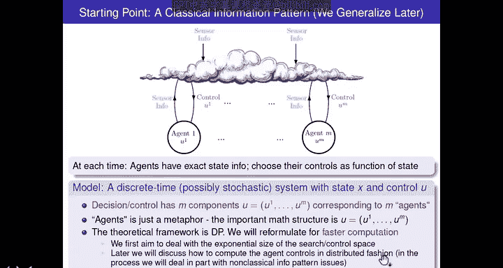

Okay， so this is a cute example， and in fact， a number of students in past offerings of the course have chosen it as a vehicle for a turn paper or a project。

系。It's typical of problems in behavior routing， in maintenance， search and rescue， firefighting。

 a lot of different practical contexts， but we're going to describe it in terms of spiders and flies。

Here we have 15 spiders。Moving。In the four directions within a grid or they may stay at any given time step where they are。

And。There are three flies。And the spiders are trying to catch the flies。And the。

The spideries have perfect vision and shared perfect information。They know where the flies are。

 and they also know where the other spiders are。And the。The flies on the other hand are blind。

 so they just move around and okay， so they're passive。

And the objective is to find a strategy for the spiders so that they catch the flies in minimum expected time。

So now what's the search space here， how big is it？

Each one of those spiders can move in the four directions or state what it is。

So it has five choices at every time step， except if it is at the edges， it has less than five。

 but let's say five。And there are 15。Spiderss。So。The number of all possible joint moves。

Is5 to the 15 or thereabouts， right？15 of them， each one， so the control is a 15 dimensional vector。

 each one component can take five different values， five to the 15。no。

We're going to look at rollout algorithms that will reduce the number of choices。To five times 15。

A much smaller number。While still maintaininging the good properties of the rollout framework。

And the idea is to break down the control into a sequence of one spider at a time moves。

So one spider moves。Tells what it has done to the other spider is， the second spider moves。

 then the third spider moves and so on， so each one has to choose between five different choices and 15 of them have to do in sequence。

 so it's five times 15 choice between five times 15 choices that we have to calculate。And。

There's more discussion in your textbook and there's also some videos on the internet and you can look into that。

So。What I said is that's a lot of reduction in the computational load while maintaining good properties and let me explain why this is so。

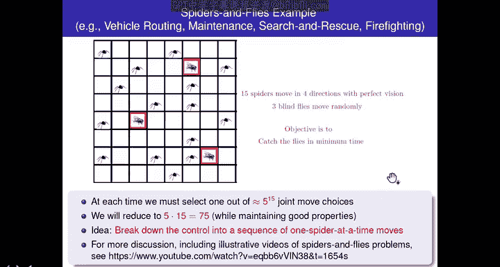

There's an old theoretical idea going back to。The neurodynamic programming book of 1996。

Which reformulates the problem by unfolding the control action。

Now we're talking about a general multi agent problem where the control space is the。

The U consists of components U1 up to UM。Now in the standard formulation。

 we go from a state to the next state， according to a system equation， it depends on x on U and on W。

 and there's a cost corresponding to this transition。

Now U consists of the M components and we are going to break down its choice to one at a time。

So we're going to introduce additional states like state augmentation。From x。ByBy choosing u1。

 we're going to go to state x U1 at no cost。Then we're going to。

Choose U2 and go to this state here again at no cost。At every stage。

 we are going to make one decision up to the last。Choice。Where the state is。

The current X and also all the controls that have been chosen up to this time。

 and we choose the last control completing the choice of you in making this transition and incurring this cost。

So it's one step at a time。And in this way， the control space has been simplified tremendously。

There are only a few choices to be made at every。At every step。On the other hand。

 the dimension of the state space， the size of the state space has also increased tremendously。

And if you try to apply dynamic programming within this formulation。

 you'd have to deal with cost to go functions that have much larger dimension， right。

 depending on a lot more arguments。So this idea is not useful at all if you want to do exact dynamic programming。

However， it is useful if you want to do approximations， approximations that do not like。

Large control spaces， but are not bothered by large state spaces and rollout is one of those。

In rollout， you only look at the current state， you don't look at all the possible states。

 the computation involved only the current state， and so rollout is not affected by this increase in size of the cost of low functions。

On the other hand， rollout for this problem， well， this problem is equivalent to the original。嗯。

Roll out one agent at a time where you choose u1 and the remainder is chosen according to a base policy。

 then you choose u2 and the remainder is chosen to a base policy。

 but what you've chosen before is still you know what you've chosen already。嗯。

So this is a different form of rollout。But it is the standard drawout for the reformulated probe。

As a result， it has the Newton property， it really implements a Newton step。

And that makes this operation just as good of this type of rollout just as good as the rollout where you would have to deal with a larger control space。

En up， end up。 it's not going to be the same but rollout policy that you're going to get。

But you're going to get a policy that could be better or could be worse。

 and general instance is in the same ballpark。So essentially。

 when it comes to rollout by unfolding the control space。

 there's an awful lot to be gained and very little to lose if anything。is really。

Very effective type of reformulation and very effective algorithm。

We're going to give examples of this， we're going to elaborate it on this point。

 give case studies and so on。The computational evidence supports very much but I've stayed here what I've said here。

So that's what this bullet says， the increase in size of the state space does not adversely affect it all allowed。

 only one states and successors are looked at at each stage during online play。

And if you do a complexity decalculation。The one step look ahead branching factor is reduced from n to VM to n times m。

Where n is the number of possible control for each component。So at every step。

 you have a branching of M steps， so M steps at every step。

At every state and that amounts to 10 times10。Complexity of calculations。In the great。

A huge reduction from an exponential complexity of N to the M。

So we're going to return to multi agent problems and multi agent rollout。

And also the issue of nonclass problems with non classical information patterns。

When in some future lecture。Are any questions here？Okay， so。We've reached the end of this lecture。

And in the next lecture， we're going to discuss reforms again， including more problem domains。呃。

Like Po DP， partial observation， Markovvi decision problems。

 adaptive control and model predictive control。And。There will be a homework due in one week。😔。

Which is exercise 1。2 of the latest version of the class textbook。There's a。

Last week I downloaded a new version that involves edits。And it includes an exercise， is exercise 1。

2， which is。Which is your homework。And this exercise。

Deals with linear quadratic problems in the type of visualizations that we did in this lecture。

Please read ahead。We're going to be staying with section 1。6 of the textbook。And。

The next lecture is going to mark the end of the。For lecture introduction to the course。

After the fourth lecture， we're going to get into more specific topics in greater depth。

Everything up to the first lecture is going to be a。A foundational review。

And so it may be a good time to watch the summary video lecture of this book here on the internet。

And there's also a multi agent video lecture， which I actually gave the link earlier。

ItThere's a YouTube video。On that on this link。 and it also includes。A demonstration。

With the spiders and flies。我时先。Okay， so we'll see you next week。

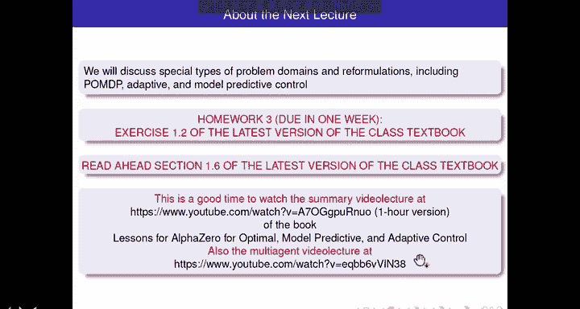