# ASU《强化学习2022-2024｜cse 691 Reinforcement Learning Course at ASU》中英字幕（deepseek - P40：[27]Lecture 11, Spring 2022_ Approximate linear programming - GPT中英字幕课程资源 - BV1zcfVYdErD

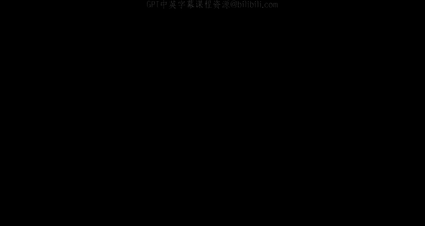

Okay， let me welcome you to this lecture 11 of our course on reinforcement learning at ASU。

So far we have discussed approximation in value space and the main algorithms have been value duration。

 policy duration， rollout and approximations thereof。

Today we are going to talk about some new methods that we haven't encountered in any detail before。

One is linear programming。There are three exact methods for solving dynamic programming problems over an infinite horizon。

Value duration and policy duration are the first two。

 and there's a third method based on linear programming。

And it hasn't received so much attention in reinforcement learning。

 but it has some interesting possibilities。Particularly because it can be implemented in approximate form using approximation architectures。

 so we are going to discuss briefly this method。And then we are going to focus。

On approximation in policy space。呃。Approximation in various spaces at the one end of the spectrum of methods in reinforcement learning。

The other end is approximation in policy space， where instead of approximating。

In training value functions or cost functions， we train and approximate policies using data。

And we are going to discuss various methods that are used in the context of approximation policy space。

 policy gradient methods and random search methods， both of these are popular。

 particularly policy gradient， and we're going to spend most of our time in this lecture。

Talking about them。So I'm going to go to videos， we have several videos like we're going to use in this lectures I'm going to go in the first one now。

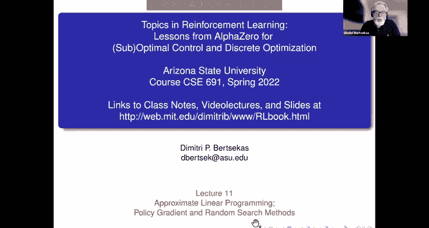

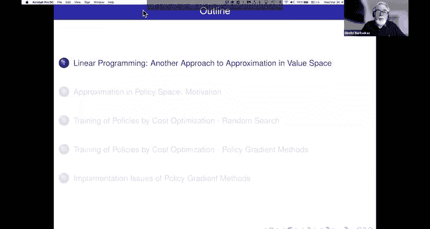

First topic is linear programming and by the way， I'm going to switch after this outline。

 I'm going to switch to a video lecture from the 2019 Off of the course。

Linear programming is another interesting method for solving dynamic programming problems exactly。

Or approximately。It's an alternative to approximation in value space and approximation policy space。

But it has not reached the popularity of these methods， nonetheless， I think it's interesting。

And I'd like to mention it one of its limitations is that it doesn't go well with neural networks。

 it requires a linear approximation architecture。Then we are going to switch to。

Appropxiation in policy space。 and I'm going to describe various contexts within which this approach is is。

It might be preferable than approximation value space。Of course。

 here what we're trying to do is obtain biometric forms of policies to use online。

And we obtained this parametric force by training。And there are a number of different methods for training。

 one is a possibility that's based on cost optimization， which we're going to focus。

And it uses random search methods。Another possibility is to use what's called policy gradient methods。

 both of these are quite popular。And we're going to。

Take a closer look and then discuss some of their inputs。

 let's discuss some implementation issues and also some of their advantages and drawbacks。

So I am now going to switch to the video。

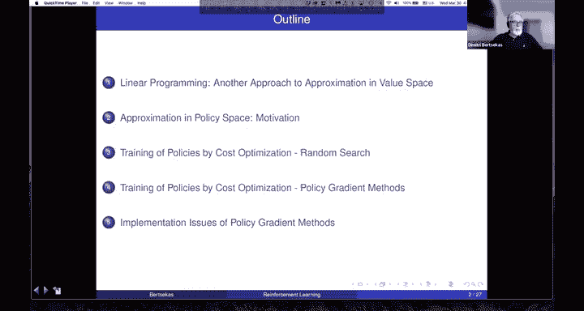

Okay， so here's a key idea。Let's consider discounted infinite horizon problems。

Optimal cost function is J star。 It's an n dimensional vector。

And the idea here is that Jstar is the largest。Bector J， that satisfies this constraint here。Okay。

 let's look at this constraint。First of all， this constraint is linear in the vector J， right。

 and there's one constraint for every state and for every control。

So there's a large number of linear constraints that specify a polyhedron in J space。

And the claim is that J star， the optimal cost vector， maximizes the sum of the components of J。

 there could be also other positive coefficients here is again the approach to the zig and J star。

Maximizes this linear expression， subject to this linear constraints。

So Jstr can be obtained by solving this linear program according to this claim。Now。

 let's try to visualize this result。Okay， this figure here involves two states and two controls。

 two states， so j is a two dimensional vector， J1， J2， so vectors J live in here。Okay。

Now let's look at an inequality of this type， let's look at the inequality involving。

I equals to1 and control u1， okay。State 1， control1。And this。Hyperplane hyperplane defines a line。

Okay， and the vectors that satisfy this inequality are on the green side of this line。

So this is this first inequality cuts off this part of the space。

The second inequality corresponds to state one control2。Okay。

 it's aligned like that and everything that lies on the green side satisfies the correspondingequ。

Let's go now to state two， control one， another hyperplane。

 and this green side is the feasible portion defined by the inequality and we have that one also。

So the feasible set of this linear program is this green。Green polyhedron here。嗯。

And what we claim is that there is a northeast corner to this polyhedron， which is exactly J style。

 it's a pointed corner。And therefore if I maximize the set of the components of J。

 which is like pushing this hyperplane all the way towards the corner， I'm going to find J star。

 I can the hyperplane would be strandted also which correspond to different weights on this components。

 this is really just the point so if I go in this direction I'm going to get where I want。Okay。

So how do we prove that？It's two lines。嗯。We take any point J in here and we apply value direction to it。

 We start value direction from that point。 Okay， and I claim that value direction is going to stay within this green。

Green polyhedron and go to J star。 Why is that。Well， if J satisfies this inequality。

 what does this mean that when I apply value iteration to it， I'm going to get something bigger？

So the first value eithererate satisfies this inequality。Okay。The typical valueuator。

 the case valueuator is。K directions of value， K value directions apply to J 0。

 And because t is monotone， if the first inequality goes to the right， all of them go to the right。

And we have this relation here， every one of these Jays is going to be moving to the northeast。

And you can also see that this stays in here in the polyedral， but that's not important。

 what's important is that value direction converges to J star。Therefore。

Every J within this green polyhedron north lies to the southwest of J Star。Okay。

 and J star also satisfies this inequality， obviously by Belman's equation。

 So J star lies on the green polyhedron and everything else the green polyhedron is below into to the southwest。

That's the proof。So。You might forget about value， might forget about policy duration。

 let's just go to your favorite linear programming， softwareft， CX is a very， very refined code。

 give it the data and get the solution。That's certainly a legitimate approach。

 but what is the problem here？What's the difficulty？Large number of constraints。

 large number of variables too right， n variables and as many constraints as there are state control pairs。

So， this approach。Can be applied for a limited number of states， but at some point， it becomes。

Inapplicable so we think of approximations but taking this linear program as our basis。

 so let's consider parametric approximation in value space。This is the difficulty。

 we just mentioned too many variables and too many constraints。Introduce a linear， that's important。

 a linear feature based architecture。Okay， we introduce。M features with corresponding M weights。

And now we're going to try to find the ways bi linear programming。A much smaller number of weight。

 a much smaller linear program。We replace cost vectors with parametric cost vectors。

And we reduced the number of variables this way。无异。Still， we have a large number of constraints。

 but we par them down by sampling a relatively small number of them。

And we consider this approximate linear program， okay？We maximize this expression， which is linear。

 right， because it's linear in R because。The parametric approximation is the parametric architecture is linear。

And now the constraints become like so。They are still linear。Because this is linearard in R。

 this is linear in R。However， we reduce the number of variables and constraint。By selecting。

A set of parametric of representative states and a set of representative controls。

So the true number of states in condos might be huge， but somehow will reduce this number。

Which means that we're considering a polyhedron that's bigger。 Okay， fewer constraints。

 bigger polyhedron for approximation。Okay。Now， the difficulty is here。

 How do you reduce the number of constraints intelligently， what obviously you should enforce。

The constraint for the important states and the important controls。

 important in terms of our problem。So one possibility that's typically tried in this setting is to sample the state space and the control space by using some known suboptimal policies。

 some you may know some good policies policies are look good and you introduce。

For representative states and controls。You're not afraid of adding more as long as you don't go overboard in that too many。

And you may solve the problem and look at the results， and if that doesn't work。

 then you may enrich the subset as necessary。All of this， of course。

 involves heuristics and choices and。Okay， but this is the main difficulty here。On the other hand。

 having chosen successfully the representative states and controls， now there are no pitfalls。

 you give this to your linear program and pull solve it exactly。

No gradient method to crap out on you， no oscillations。

 no exploration to deal with all of this stuff that we have discussed goes away once you have selected。

you have reduce the constraints set appropriately， then you are in good shape。This approach。

Use has not been very popular。 has been around for 20 years now。It's not very popular。

But it has been successful when it has been applied。And。And in my opinion。

 it deserves more attention。嗯。It's the jury still out on this approach and what kind of problems it can address。

AndLike I said， the main advantage， the strong point。

 is that capitalize on the reliability of large scale linear programming codes。Okay。说。

Let me just interrupt and ask for questions on this linear programming approach。

 do you have any questions？I have a question。嗯。So the parametric model。It's somehow。

Produces a reduced set of variables and a reduced set of constraints that you can just plug directly into your linear program。

Is that a true idea。Well。You use some kind of a heuristic sampling method to get a representative states and representative controls so that reduces the number of constraints。

 so it's like taking the polyhedron， the feasible polyhedron of the linear program and approximating from the outside with another polyhedron that has fewer corners。

呃。And then we solve that。And what we get is is an approximation in value space。

And then we have to use。We have to use a one step or multi step look ahead method for online play。

 The offline training is to solve the linear program and then and obtain the parameter the parameter vector R。

Then you do online play with one step or multi step look ahead， that's the that's the approach here。

 Okay， thank you。ok。Okay， so let's go into approximation policy space。

 Now I'm going to start the video， so let's talk about approximation policy space。

Exe me just one moment。Okay， so what's the general framework？Here we parameterized policies。

 not costs， but policies with a parameter vector R。So a parameterized policy is denoted by news of R。

Each r defines a policy， okay？And the components of new are denoted by Flso is one component for each state。

Of course， we're dealing with stationary policies because we're still for looking at infant correction problems and discount problems for that matter。

For the most part。Okay，We have discussed how to parameterize。Cost functions。

 But how do we parameterize policies？Well， sometimes your problem is such that you can tell what there are natural。

 good parameterizations for policy。 So that would be one thing。

Another possibility is to look at feature based architectures。

And then you may also use neural networks if you don't know a feature。 still possible to do all this。

And the idea now is to choose a parametric architecture and optimize some measure performance with respect to the pm。

So let's give a couple of examples of parameterizations。嗯。This is a problem where there。

It's much easier to think of a control parameterization。

 a policy parameterization than a cost parameterization。It comes from the general area of supplies。

 chains， inventory control， it's a very， very important type of problem in industrial engineering。

Here you have given you a simple version。We have a retail center。

Which stores some stock of some product。And it replenishes the stock by ordering。

Some production center， and after some delay， whatever you ordered arrives。

 there may be production delays， there may be transportation delays and so on。Now。

This stock is used to satisfy stochastic demand here。And the objective is， well。

 to have stock when you need it because otherwise， you may have to purchase it at a high price。

 let's say if you run out of stock， you may have to purchase at a high price。

 So thats that's basically one cost consideration。 the al cost consideration is。

If you order haphazardly， there may be greater cost for production。

 so somehow you have to smooth out your orders。There may be。And okay。

 there may be an upper bound on how much stock you can order， there are many complicated issues here。

Generally speaking this type problem can be formulated as a dynamic programming problem。

 you look at your stock and you look at whatever else is happening here。

 how much you have ordered in the past， how many orders are in transit and so on。

 and this becomes your state。The car in stock in here， the orders in transit。

 And there may be also some other stuff that。You can make it more complicated than that。

So you can formulate by dynamic programming， but it can be very difficult to solve it exactly。

Particularly if you have a more complicated system involving multiple production centers。

 involving as lines， assembling different products into other products and so on。However。

 in this setting， there are some intuitive policies， type of policies that you can use。And。

Here's an example。Here's an example of a near optimal policy。

When the retail inventory goes below a certain level， when you're running low。Order more， okay。

With the numbers。The critical level in the order amount being parameters。

So you may set these critical numbers and then try to optimize them。In。In a。Optimization。

 policy space matter。So。In fact， that's the way in many inventory systems。 That's the way they work。

 They set critical levels， and then。And then hopefully they work well and if they don't。

 they adjust it perhaps manually， perhaps with some algorithm。

 there are many heuristics around this type of policy。In some cases， this type of policy is optimal。

 but in other cases it's not， but it's close to optical， optimal often。

So there's an example where there's a natural， good parameterization in policy space。Okay。

 here's another example。Policy parameterization through value parameterization。You may know。

Good cost features。 So you may have a linear or。A linear architecture， using these features。

For cost parameterization。And once you have this shade， Tilda。Then。

You can define a policy parameterization through this look ahead minimization。

So I know a good J Tilde somehow because I have good features， I don't know the weights。

But I stick it in there， and that defines a policy parameterization。

So now we may try to find optimally the。The weights of the policy by using a policy optimization method。

Now when is this useful？If you know a good parameterization in value space。

 but you want to use a method that works well in policy space。我这。

And here's an example that I have had some personal experience with。That is， okay？

It's a good testbed for challenging quite a few methods。Now in Tes， we've seen this example before。

 there are good features for cost parameterization that Tes players recognize like the height of these columns。

The relative difference adjacent of the high adjacent columns， the number of holes in the wall。

 the maximum height of the wall， and so there may be some others too。

But there's a relatively small number， like 20，30 in that range。And these work well。

 and there's a good parameterization with respect to that。

So we could use approximation in value space in approximate policy duration and so on。

 but it turns out that with this policy parameterization here。

 people have been able to use random search and do very， very well。

So this is an example where we have a good linear parameterization through features。

But we used approximation in policy space and training in policy space through random search。

So there's another context of using。Butimetric。Using parametric approximation in policy space。

So let's take an early break and think about that。啊。

Think about context where approximation in policy space is either essential or useful。

And I've listed here six contexts just to consider。One。

 we have discussed problems where there's a good natural policy parameterization。

 like the supply chain problem。Problems with good value parameterizations where we use a good policy training method like the Tetrix problem I discussed。

Okay。I think I mentioned this。At some lecture， in the past。

 approximation in policy space on top of approximation in value space。

To facilitate the implementation of us above policy。Another one。

Use policy parameterization and policy optimization to learn。

From a human expert or a or a software expert that generates。

Good controls can learn from that by using some kind of training in policy space。Now。

 here's something that we haven't talked about。There are interesting problems that look like dynamic programming。

 but they don't fit neatly into the framework of dynamic programming because the information structure may be unconventional。

Like for example， there may be limited memory， we have assumed so far that the controller never forgets everything and anything right。

 remembers the past controls， remembers the past past information。

 but there may be some limited memory limitation， and here's another interesting context。

 multi agentian systems for you have your controller distributed out in various decision points。

And each decision point has its own local information that may not be shared。With other Asians。

 like robots going around， doing things， they have a common goal， but they explore their environment。

And they get information from the environment and they make decisions on the basis of this information。

 but they don't share this information with other robots because of bandwidth limitations， whatever。

 or they may share it， but there may be some delay。In getting the information to the other ofs。闹。

Conventional dynamic programming breaks down in this context。So think why。

Approximation policy space might work in this context。Okay， so。

We're actually not going to take a break， but we will。

We will continue with the next clip。That the first two policy approximation。

 top of value approximation。 Okay， suppose that we use some kind of a training method in the the training in value space。

 and we obtain some J Tilda。 Then this defines。

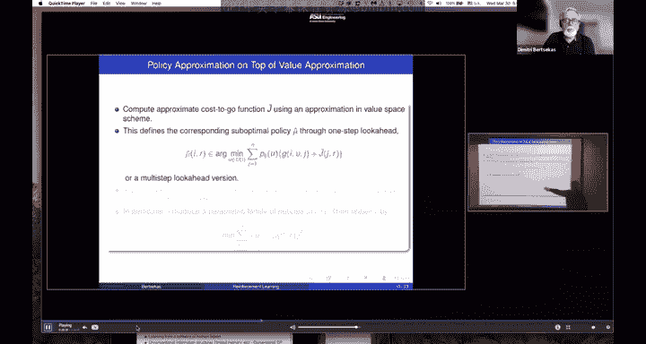

A policy right on the other hand is policy may be hard to implement because you may need hear the model of the system。

 transition probabilities and minimization online and so on approximation policy space helps to circumvent these difficulties how so we approximate this new hat。

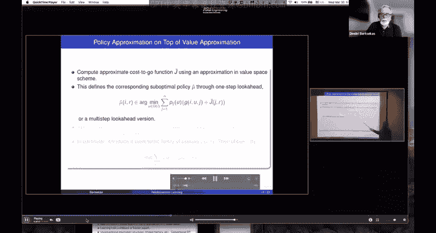

By using a training set consisting of a large number of sample pairs of states and controls。

We don't have to do it for every state just for a large enough training set。

 and then we use approximation in policy space by introducing a parametric family， mut Tilda。

 not new hat， new Tilde， and we try to match Mu Tilda to Mu hat。

 we try to to match mut Tilda in its parameter。Two。

 the sample controls obtained from this policy here。So this is like learning from a software expert。

 If you think of this as being an expert， we learn to mimic this expert by approximation in policy space。

We could have also a human expert， we discussed that we can choose a good or near optimal control US at any state I or S again。

 we form a sample set of representative state control pairs。Supplied by the expert。

We introduce a parametric family of policy， some new tilde that tries to mimic the expert。

This is also called the artificial， it's called supervised learning。

And there's a lot of literature on this type of methodology。

And it has been used in the context of dynamic programming in a number of ways， in chess and back ga。

 okay， there are examples of that。嗯。Another， of course， the main difficulty with this is that。

You don't expect。Approximation policy space to do better than the expert that you train it with。

 You cannot improve。 You cannot expect to improve on the on the performance of the expert。 However。

 this may be a good policy to use it as a starting point to initialize some other method。

 A good starting point。 It has been used in this， for example。Alpha go。Uses。

This type of initialization for a more complicated effort。Okay。Unconventional information structures。

So approximation value space is based on dynamic programming and there the premise is that the controller has access to the exact state or in the case of partial state information to a belief state。

However， there are contest where this may not be true where there is no full state or belief state available in all parts where the decisions are made。

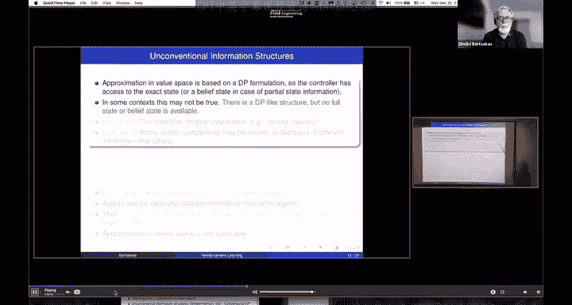

嗯。One possibility the controller forgets information。And another possibility， another example。

 some control components may be chosen on the basis of different information than others。

 like in this multi agent setting that I noted earlier。嗯。

So we have here decision making information gathering that is distributed among multiple autonomous agents。

Each agent's action depends only on the local information。

The agents may be receiving delayed information from other agents。And。

Then conventional dynamic programming breaks down and approximation in policy space is applicable。

There are ways to use conventional dynamic programming。

 but a lot of the approximation value space methodology that we have discussed does not apply anymore。

Another possibility of us in this context is to establish some kind of a center that picks up all this information。

From the agents and broadcasted down other words this information sharing among these agents using a central controller or even the central controller may make all the decisions。

 collect all the information that's obtained from distributed points up to a center where all the decisions are made and that brings us back to。

Dynamic programming， approximation value space and so on。 But barring that。

You are pretty much stuck with approximation in policy space。Okay。

 so now we are going to go into algorithms for approximation in policy space。

 we have what we have done so far in this area is to discuss context where approximation policy space may be useful and are there any questions on that before we go into the training of methods for approximation in policy space？

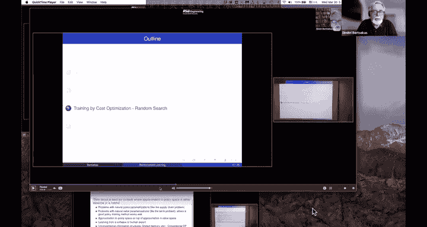

Okay。Now let's go into training by cost optimization， I'm going to restart the video。

So now let's go into how do we find R， how do we find the parameters in policy parameterizations。

 And let's look first at the random search。The general training framework that we are considering is one whereby we have our system that's driven by some kind it involves some uncertainty。

 generates a state or a belief state which is fed into a controller now the controller is parameterized with this R for each r iss a different controller and this control applies control and this cost generated so this is the genetic。

Dynamic programming， setting with approximation in policy space。Now let's look at the training。

 finding R by cost optimization， every R defines a stationary policy， which pretty not like so。

And with these components。And we determine R by minimizing。

The cost corresponding to the parameterized policies。Okay， what is this？This is the cost。Of policy。

 new tilda R。Starting from a selected initial state， I 0。So this is a function of R。

 the parameter vector。And we can try to find the optimal parameter vector。Of course。

 there's a limitation here that。The initial condition， the initial state is fixed。

 So if you don't have a preferred initial state and you want to optimize over。

A variety of initial states， then you may consider a modified framework。Whereby。

You consider a probability distribution of initial states。And you minimize the expected cost。

With different initial states weighted according to this probabilities here。

So this is the case where you have a single initial state。

 this is the case where you have multiple initial states and you take an average between them。Okay。

 so now the key question is how do you solve this problem and how do you solve this problem？

That's the training problem。So let's look at random search。 Random search is our。Quite a large。

 and widely used。Meththodology。And it applies to general minimization problems of this form。

Minimize a cost function of R， a generic cost function subject to R being in some constrained set。

And of course， this F here may involve an expectation。

Or it may involve something a lot more complicated than it appears here。

Random search methods generate are liter。 They generate a parameter sequence。

 always aiming at cost reduction， looking for better and better costs but exploring at random around the current point。

Given the current point our， we obtain， we generate randomly。Points in a neighborhood of ark。

And then we choose some new point with this neighborhood。

That hopefully is better or is more promising。 And then we keep going more random points。

 move forward and so on。 This is a typical fashion。

Neighborhood search with a nap of the points within the neighborhood generated in some random fashion。

There are。Quite a few methods of this type， and they generally have good convergence properties。

 other words， you'll see theorems that given a sufficient number of random points。

 you can get arbitrarily close to the optimal solution。However， in practice， they tend to be slow。

An advantage that they have is they don't care about local minima， okay。

 they're not affected as much。Gradient type methods are affected by local mini。

 These are not affected that much。 In other words， in theory。

 this method can find the global optim much approximate the global opt arbitrarily closely。

 given a sufficiently large number of。我发我发。Brranal points or iterations。

They don't require a defiable cost function either。Anything goes here， actually。

 there are adaptations of this method for discrete space， for a continuous space。

 for nondiiable cost functions and so on。And。Let me give you some examples of methods like that that you may have heard。

Evolutionary programming， K is a large methodology。With some theory and a lot of heuristics。

Taboo search is very popular in operations research。

Simulate de leaning is another methodology that you may have heard of。It has an interesting theory。

 but has the same limitations to some of the others。And finally。

 this cross entropy method that I'm going to discuss briefly here to give you an idea of how these methods work。

Okay， remember that we want to solve this generic problem。And。

We don't care if it comes from dynamic programming or not。 This is generic。

And here is how cross entropy works。Remember， like all the random search methods。

 it generates a sequence of idderets， right？RK， and then RK plus 1， RK plus2， and so on。And。

At the current id。It constructs an ellipsoid， which I denote here by EK。

Wch is center to the current electerate。This is the neighborhood within which we search。

We generate a number of random samples within this ellipsoid。And some of them are going to be good。

 some of them not so good in terms of cost。Now this method accepts a subset of the samples that have low cost。

And these are the green ones in this figure。So within this ellipoid， I generate all these points。

 the black ones and the green ones， and I select。Aor。Of those that have low cost。And now。

I can generate the sample mean of these accepted samples， the sample mean， okay。

Sample mean in the usual way and that I call RK plus 1。So I generate the good points。

 I go towards the good area， and I go right in the middle of those。That's my acade plus one。

And then I have to generate a new neighborhood and for this， I look at the shape of this region here。

 so I look at the sample variances or the sample covariance of these green samples and it defines an ellipsoid。

Now this ellipsoid will encircle those green points， but I want to make it bigger。

So I look at a bigger ellipoid with the same shape as the one defined by the sample covariance。

And now I generate new points here。Deellineate the greens， samples。

 move to the middle and keep going like that。Okay， so let me repeat。

 we construct a sample of variance matrix of the accepted samples。

Inform the new ellipsoid using this matrix， and conum。How does this method work in theory？It has。

Okay， there is a substantial theory actually here， some of it based on probability theory。

 some of it based on statistical concepts and however。

The guarantees of rate of conversion are limited。 This method can be very slow。Oftentimes。

Domain specific insight can be very helpful， heuristics， and so one like a lot of these methods。

However， it's very simple， it's very simple to implement all you need is to be able to calculate function values basically。

 right， you need function values to be able to delineate the green points from the black points。

And that's all you need。 And some elementary software here that you have to write to。

For ellipsoids and so on。Moreover， it's very well suited to parallel computation。Why is that？

Because these points can be generated and evaluated in parallel， right。So that's easy。

And there's an interesting。There's an interesting point of view here。

 This method resembles the gradient type of methods that we have been we have been。Discussing。

Why is that？Why does it may look like a gradient method， what is common with gradient methods？

Well what do gradient methods， yeah go ahead。Go ahead， please。Yeah。

 it's looking for better points like the gradient method， the gradient method。Is iterative again。

 generates a sequence R and calculates a direction for better points and it moves along that direction。

 aims for lower cost。Similarly here， we look at sort of a。A direction for better points。

 But what is better is evaluated by sampling， as opposed to calculating a gradient。Okay。

 that's the end of。

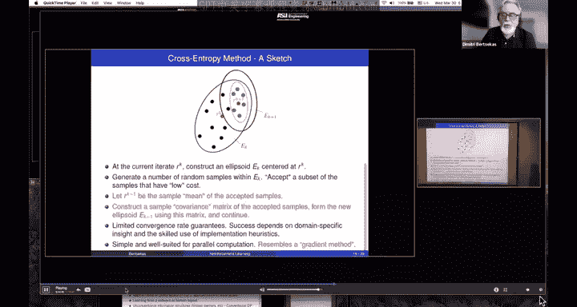

This video， and we are going to take a 15 minute break。And。

We're going to come back for a longer session。With two more videos。

Are there any questions before we go into the break？Okay， so we're coming back in 15 minutes exactly。

Okay， we're getting ready to start。The remainder of this lecture is going to be on policy gradient methods。

 and I'm going to start the video now。Going to go now into policy， gradient methods。

So I'll last that topic here。嗯。Okay， here， instead of using some kind of a randomized gradient。

 we look at gradient， real gradient。In particular remember that we parameterized policies with parameter vector R。

 we consider the cost of the policy for a given initial condition and let's focus for a fixed initial condition for the moment。

 and we apply the gradient method， this is gamma case a step size。

 this is the gradient of this function of R， okay this is a function of R。

And we take the gradient with respect to R of this function。

 and we have to assume that this function is differenti with respect to R so that the gradient exists。

Now， the main difficulty with this approach is that this gradient may not be explicitly available。

To differentiate a dynamic programming infinite horizon discounted cost with respect to a parameter is just just cannot be done。

 It's not It's very difficult。 So this gradient cannot be。Calculated。

you cannot write down a formula for it and you cannot calculate it even in software exactly the best you can do is approximated by finite differences。

 so we have a parameter vector R multidimensional， we are at a certain point RK and we go along the various directions and finite difference the cost to obtain the gradient。

O。Now， if the problem is deterministic， that may not be a bad approach okay because presumably costs in all directions can be calculated exactly right there's no randomness in deterministic problems so finite difference may not be a bad idea。

On the other hand， when the problem is stochastic。The cost function values that you need to difference must be computed through Monte Carlo simulation。

And then Monte Carlo noise。Comes into play and you need a very gigantic number of samples to get accurate enough gradients。

That are usable in this algorithm。 So that's the main problem with stochastic dynamic programming and gradient。

Drade the optimization。The gradients are not available and theyre hard to approximate by Monte Carlo。

However。There has been a clever getaround to this。That applies to dynamic programming is actually quite popular。

To explain this， I'm going to go back to the general problem of optimization of a generic cost function F of a vector Z。

 subject to some constraint。Now this F of Z may hide in their expectations and so on。

 but let's write it abstractly as F of Z。And we take a radical step， an unusual step。

We convert this perfectly deterministic problem to a stochastic problem involving an expectation。

And instead of minimizing over the Z vectors， we minimize over probability distributions。

Over the Z vectors， we randomized the problem， even though it's deterministic at an abstract level。

 Z lives in some set， constraints at Z， and we consider not points in there。

 but probability distributions over Z。Of course， the points themselves are pro distribution。

 They're atomic distributions。 So this set of probability distributions。啱。Over。

Is larger than the set to Z。 And this minimization is gives you a lower bound to this minimization。

 right。You minimizeize over more alternatives。But we used Z as a random variable and we can see probability distributions over Z。

We now minimize this expected value。Okay。So what does this have to do with our infinite correlation dynamic programming。

 how do I randomize a dynamic programming problem？Talking about the infant cor discount problem。

 it already has some stochastics in there through the transition probabilities。

But the variables of optimization， which are the controls， are deterministic at every state。

 you apply a single control。Now， we are going to expand this framework to consider randomized policies whereby at a given state。

 we don't have a single control that we apply， but we have a probability distribution of controls and we choose by。

By flipping a coin。Repect to that disab。So we enlarge a set of policies to include randomized policies。

 mapping a state eye into a probability distribution over a set of controllers。

And we consider optimization over randomized policies。Now， one thing to note is that。

In exact dynamic programming。In the problems that we have considered。

Discounted and stochastic shortest press optimization of a randomized policies give you the same results as optimization over the ordinary nonranized policies In other words。

 you get the same optimal cost and also the nonranized optimal is also optimal for the randomized problem。

So that's a theoretical result that tells you that。

The optimal value of this problem is the same as the optimal value of this problem。

And another thing to note is。What is Z in the dynamic programming context？

Z is the state's control trajectory。Okay， so given a state controlled trajectory， this gives me。

A costst value， which is then。Take the expected value， and。We get the cost like that。So。Now。

Let's go into approximations。 This methodology is for exact。Solution， right。

 now let's go into approximations。Where instead of optimizing over all。Probbil distributions。

 we restrict attention to a part of a price subset of pro distributions。And the parameter is R。

 so instead of minimizing over all probability distributions。

 we minimize over just this parameterized subset involving the parameter R。

And this becomes now a minimization over R。你看。😊，And we can use a gradient method for solving this problem。

 This is a function of R， this involves pro distribution， but still this expectations of this piece。

Depends on R in other words， for every R， you get a number here。And you want to minimize over R。

 And this expression here has a function of R hopefully has a gradient。

 We assume that it has a gradient。And。We generate a sequence of our vectors by going in direction in the direction of a negative gradient use a step size gamma K。

Now。Okay， so how do we calculate this gradient， that's the big question and calculating this gradient looks very formidable。

 but it turns out that it's a useful formula。A useful formula that can be implemented in a nice and convenient algorithm。

This formula involves the gradient with respect to R of the logarithm of the proal distribution。

In the reinforcement learning literature， it is called the the gradient trick okay or the。Yeah。

 I guess it's called the gradient trick， right？Yeah， and here it is。Okay， remember？

That we want to calculate this gradient of this cost function。

And we're going to express this a little different that involving the logarith of this P as follows。

Okay。So this is the proal distribution over which。We want to optimize。

 and I am at the current iterate RK unless let's opposed that this a discrete distribution so I can write sums instead of integrals here。

The gradientding that I want to calculate can be written like so this expected value is just the expected value of z with respect to these probabilities。

And now gradient of a sum is equal to the sum of the gradient。

And now I multiply and divide with the probability values。And this expression here。

Can be recognized as the logo。As the great name of the logs。O P。

So now what I have is this thing here。Wighted by these probabilities O。

 So this unexpected value with respect to this probability distribution。

So gradient of expectation has become expectation of a gradient。

 and in particular the expectation is with respect to T。The parameter tries pro distribution。

So now here is my algorithm that uses this formula in place of that。

We are not going to calculate the gradient here and use it in the gradient formula。 Instead。

 we're going to take just a sample。For the current IK， I'm going to take a sample of Z。

 and I'm going to use the sample gradient in place in place of the full expected value。Okay。

 so this is my problem， I am at RK。How obtain a sample ZK。

 according to this distribution in the context of dynamic programming that corresponds to generating a trajectory。

That corresponds to the current R and the current policy that corresponds to R。And。

I calculate this sample gradient。And I move in the direction of this sampled gradient rather than in the direction of the expected value of that。

And that's all You have the policy gradient algorithm here on the board。 That's all there is。Okay。

 let me switch to a new video now。

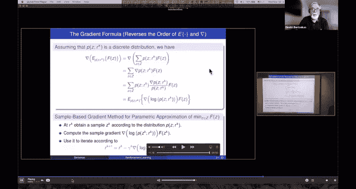

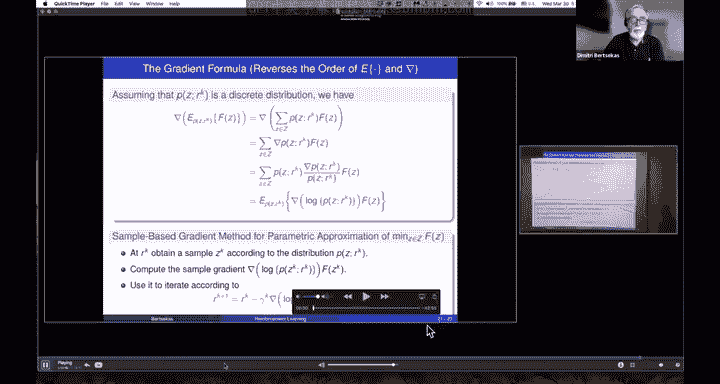

Now， we're going to go to。To discounted problems。Here， Z， okay， the samples are。Trajectories。Okay。

And for a given or for a given policy。These trajectories have well defined ro distributions。

 and they can be generated by Monte Cargo。So we consider parameterization of randomized policies whereby at state I。

 you select a pro distribution over the set of controls that's controlled that depends on the parameter vector。

 so this is our parameterized randomized policy。And then for a given or。

The state control trajectory is a random trajectory will will define probability distribution。

 which we denote by P。So remember， we have the random variable Z， the probabilitybal distribution。

That's parameterized by R and samples of Z generated by this from redistribution。Now。

 the cost corresponding to a trajectory is given by the standard discounted cost。

And this is just a sample， okay？And the problem is to minimize the expected value。

Of this cost over R。So that's the general form of D programming problem and we use the gradient duration。

 the sample gradient duration from the previous slide okay so we have to generate the this can be easily generated for a given R generate a sample trajectory。

 generate the corresponding cost， this is easy， but how do you calculate。

The gradient of this logarithm， well， it turns out again。

 that there's a nice formula and it's given in red here。This thing is obtained by okay。

 let me read this formula for you I think you have to look at it for a while before you can understand it。

 but this involves the logarm of the transition。Transition probabilities along the trajectory。

 the current trajectory they generate。This is。The logarm of the randomized control。

 And we take the gradient of that at the current point R along the。The trajectory。

So generate trajectory as I go， calculate these quantities here。

 add them up and that gives you the sample gradient。

 this is the cost sample and put them together and it becomes actually very simple。

It's very simple to program。And once you have a parameterization of the randomized controls， then。

Typically， parameterization admits an easy。Graadian calculation， and it all works out， its fine。Now。

It doesn't scale， okay， or it is very slow， I agree with that。It can be very， very slow。

But it's very convenient and seductive， okay。Again。

 there's a long discussion after this slide and it's not very intelligible or interesting so I'm going to stop the video here and I'll come back to the slide and I'm going to switch now to my slides as opposed to the video so let me do that。

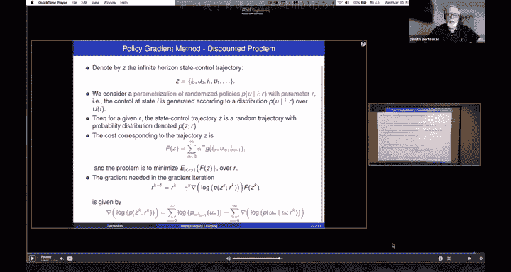

Okay， so let me remind you of the generic method。For。4our。

Solving approximately this generic minimization problem。

By using parametric approximation and replacing the the replacing the minimization over Z to minimization over。

A subclass of probability distributions that are parameter over z by parameterized by RK。

So what we do here is。At forgiven point RK。😡，We are going to generate a new point， RK plus1。

 how do we do that， we sample the we obtain a sample ZK using this distribution。At the current。

Value of parameters R k。So now we have Zk and we compute this gradient here that corresponds to just a sample。

Ordinarily we would like to have the expected value of this。

 but this would require Monte Carlo simulation， the true gradient involves the expected value of this。

 so we use just a sample gradient and we have this class of pro distributions， we have RK。

 we have the sample， we calculate the cost function at ZK。

 we calculate this log and the gradient or the logade with respect to RK at the sample ZK and we use this as the incremental gradient direction。

And actually。Let me note one thing here。This is called gradient or policy gradients associated with gradients。

 but actually the gradient of F does not enter into this formula at all。

That's very peculiar what you have instead is the gradient of the logarith of the parameterization。

And。And so it's a gradient with respect to something other than costs。

 and that's well come back to this point。But now， let me go into the next slide。😡，And。And then。

And so once more， the implementation of the method for the discounted dynamic programming problem。

So here Z， the variable of optimization is the trajectory and we generate trajectories。

 and with this trajectory we update the parameter RK of the randomized the parameter we update the parameterization。

 the randomized policies。So the cost function now is just the usual discounted infinite horizon cost。

And z， of course， is the sequence here and F of z is the sequence here。

 it's something that's random and the problem is to minimize this expected value over R。And。呃。

The policy gradient method involves theederation at RK， generate a trajectory， calculate this cost。

 calculate this gradient expression， and then go to the next point RK plus1 At that point we calculate the we generate another sample z K plus1。

 calculate the gradient， calculate the cost and go to RK plus two and so on。

And now this formula here， that's kind of mysterious。

 is given in a convenient form in the case of dynamic。Of discounted dynamic programming problems。

 it's given by this expression here。Which involve the transition probabilities。Of the problem。

 which are assumed known for this formula here and the logarithm。

 the gradient of the logarithm of parameterization。

 but it is a stepwise dis sumation over all the stages， UM is the a control。

 the control of the empty stage。So all of this looks very formidable。

 but it's actually very easily implemented， that's one of the attractions of this method that it can be implemented very easily。

So what I'd like to do now is discuss some of the properties of this method and other related methods。

Are there any questions？Yeah， I had a couple of questions actually I had a question about the initial optimization and training framework that shown several slides back。

I think you may have cleared it up in subsequent slides。But I just wanted to clarify for the。

Optimization objective。If we use randomized policies。Well also need to take another expectation。

With respect to actions that are distributed according to our policy， right？Right， yeah。

 that's what this involved here。O。Theres there's the uncertainty there that。

The transition probabilities is the inherent uncertainty in the problem。

 and then we randomize the policy so that adds additional uncertainty and the expected value is with respect to the overall uncertainty。

 let's say。Okay， so the。Initial objective function that was shown on。

 I think it was slide 14 that was that just for deterministic problems？

I think there is one expectation that's taken just in respect to the initial state。呃，对。Here， yeah。

 on the bottom on the bottom。 Yes， no， that's not the expectation with respect to the uncertainty。

In the inherent in the transition probability， the system dynamics and also in the uncertainty。

Inherent in the randomized policies。 once we introduce randomized policies。

 this is expected value with respect to。Initial condition。In other words。

 there's one version of the problem where the initial condition is known。

 but what happens if you don't know？TheThe right initial condition。

Then you modify this cost function to involve a weighted sum over initial conditions。

So this expectation has nothing to do with transition probabilities or randomized policy。

Does that make sense Yeah， it does I was just trying to connect the dots because so the objective that you define later on isn't really connected with this。

Because I was thinking like if we condition the expectation on a starting state or you know。

 for a given fixed starting state。The cost of that policy is still going to be random just even due to the stochastic dynamics of the environment so we need to take those。

Expectations over the full trajectory。 So this isn't related to what you introduce。

In the next few slides。Right， exactly， and in fact。

There's so many concept that I'm rushing through that it's impossible to retain some of the details。

 but in。At some point， I mentioned that we consider a fixed initial condition。

WIn which case this expectation does not come into play。Okay。Okay。

 so let's go back because you said you had another question， right？Feel free to go through it。

Let's go back to what we wearm。21。What conditions would we need to hold in order to move from the discrete to the like unaccountably continuous case？

Actually， I guess the title of the s kind of gives away like you need to be able to reverse the order。

Of the expectation， the gradient， so。I guess my question is like in the context of our problem。

 when does that hold in the continuous space case？啊。revversing the order of expectation and gradient。

Is legitimate。Under very， very weak conditions， it's always true， essentially。

For practical purposes because okay expected values are weighted sum and graded of a sum is equal to the sum of the gradients right so it's only under weird circumstances that only mathematicians care about that the reversal of the order is not legitimate。

So。However， you may note this。What this line says here。

 we assume that it's a discrete distribution okay， if it's a continuous distribution。

 then there are all sorts of mathematical questions that have to do with taking this expectation because it kind of an integral over some arbitrary spaces so。

Just to be on a safe side when you're taking this do these calculations， I have replaced。

I have assumed a discrete distribution， so that。So that Z here is just a finite set， okay？嗯。

Or rather than an infinite set。For our practical purposes。

 this is not really something to be concerned with。Okay， yeah it makes sense。Okay， so。Okay。

 so all of this requires a lot of calculations that I'm skipping here and。

And the point that's worth retaining is that even though this algorithm is very complicated to write。

 it's extremely simple to program， all you need is have a parameterization of the randomized policies and be able to generate sample trajectories according to parameterization you are the pointK that defines the policy and you have all the stochastic description of the system and then you can。

Similulate。A sample trajectory corresponding to RK。And then。There's a nice。And convenient formula。

 stepwise formula sumation formula that calculates this troublesome log in term looks almost like magic。

 but it's true and you can find in many reinforcement learning sources a a。

A justification of this formula here。And so。U are a dark， generate the random trajectory。

 generate the gradientd of the logarithm off you go to the next point with some step size。Of course。

 there's an awful lot of trickery that goes on here making all this work。It's a daunting task。

 people will not focus very much on how difficult it is to make this method work。

 but indeed it is not easy， but it's an offline method you can experiment a lot with different parameters and in the end you may be able to obtain some decent policy this way。

So let me go into the discussion about some of the practical aspects。

 the practical implementation aspects of this kind of method， which， as I said is very popular。

Implementation issues。Okay， some unusual aspects。It involves the cost function of a discounted product。

 but not this gradient， the cost per stage does not have to be defiable。

Is this really a gradient method in the mode of what we know in love like taking the gradient of the cost function well。

 it's not really。嗯。G may be non defiable， the problem maybe be。Yeah， it may be non differentiable。

 so identifying gradients of the cost function。What this gradient trick does is define some random direction。

Which on the aggregates a decent direction along which you minimize you you can decrease the cost function。

 but that's not the gradient direction。 Several people have pointed this out。

 but the name policy gradient is so popular that's impossible to reverse in my opinion。

 is somewhere a mis over。呃。Okay， here's another problem， you have a perfectly deterministic problem。

 potentially。Yet you randomize it in order to be able to apply this methodology。

 so what you saw is a randomized version of the original。

 so if you get a convergence of the sequence RK into some R bar。

 then you will get a distribution that may not be atomic。you are interested in atomic distributions。

 so if you get a randomized policy in particular， you have to make it deterministic to to apply it online。

So it's another difficulty here。And then there are the some of the usual implementation issues that have to do with approximations of various kinds in dynamic programming。

How do you collect the trajectory samples to？To make sure that you're exploring the search space appropriately。

 that you span the space of trajectories sufficiently well。

And how do you do in the way that you strike a good compromise between exploration and optimization effort。

 convenience of implementation， and so on？These are issues that are similar。

 but not identical with the exploration issues in approximation in value space。Policy iteration。

Then you recall that a cost calculation in the context of discounted dynamic programming。

Involves the cost function of the problem the ZK is a trajectory at state controlled trajectory and this is random。

 so there's a lot of noise in the calculation of this sample。And then this noise enters into this。

Forula， so this is a very， very noisy calculation。And now people have used a certain trick that has that tries to。

To reduce the variance that's inherent in this formula。

And that is to subtract a constant from F of Zk。Now what's happening。

 F of ZK may involve large parameters and on top some large values and on top of that some fine variations。

 so by subtracting a constant， you take out the constant values and you leave the finer variations and this helps in the overall approximation process。

So people have plague with the use of baseline， which are constants that you subtract out of this Fm Zk in a certain calculation that shows that。

The choice of B does not matter。These iterations are in some sense， equivalent。However。

 there's a more general idea。Which subsumes this idea here of baselines。

And I want to describe it to you in the next slide。Okay。

 this an old idea iss called called cost shaping。啊。

The idea is to transform the problem so that the noise is not so much a difficulty。

So we take the original problem。We're talking now about discounted dynamic programming。

Its cost function J stars of x x is the initial condition， J star is the optimal cost function。And。

You have some function， any function， some known function， v of x， and you subtract it out of J star。

So in some sense， you do a translation of J star with this v sub x function。

Perhaps there's a large constant involved here this J star and this would be something that approximate its constant。

 you change its shape and from J star you make it J hat。

And then you make a change in the cost per stage。And this is a customer for stage at state x going to state y under the influence of U。

And you add this term here and subtract this term。Subtract b sub x， the state。

YouSt from which you start and alphabe of y you add that where y is a state where you end up with。So。

Let's up。Introduce this J hatt and Ghat and take the Belman equation from the original problem。Okay。

So。Let's write， let's look at this equation if you use the definition of J hat。

In the definition of J of G hat。Then this equation is identical to the Belman equation of the original problem。

So the original problems Belman equation， j star equals mean sum of the pxy of U G plus alpha j star。

Can be written in this form。But now if you look at this。

 its another Belman equation where J hat is the cost and G hatt is the cost per stage。

So if you introduce another problem。Where the co per stage is G hat in place of G then。

J hat is the optimal cost of that problem， that's what this bullet says。Jy hat。

The translated version of J star。Is the optimal cost of another problem。

 which is simply the same as the original problem except that the cost per stage has been changed and from G it has become G hat。

So we can play around with different V functions and get equivalent versions of the discounted problem。

What do we gain from this？Well， if you're interested in an exact solution。

The optimal policies of this reformated problem are exactly the same as the optimal policy of the original problem。

 so nothing will change if you are interested in solving this problem or the original problem exactly you're going to get the same thing。

However。This reform that the problem may have a more favorable shape for approximation once we consider approximation methods。

 be they approximation in value space and policy or being policy gradient or random search or other methods。

They will give you different results from the J hatt problem than for the original J star problem。

And it turns out that if you choose this V close to J star。

 you can subtract out a big portion of J star that may be causing a lot of trouble in the sense of swapwamping out fine detailed variations of J star。

到。You may remember this or you may not remember this because for several lectures back in lecture 8。

 we talked about advantages updating。And advantage updating。Is Q learning。

 but with Q factor differences， which are called advantages as opposed to Q factors。

And by doing this change to advantage updating， I gave an example there and I discussed how approximation methods can deal a lot with this this。

Small scale variations in J star or the Q factors and so on。Now。

 what does this have to do with baselines， where these Vi of x are just state dependent baseline？

If you look at。

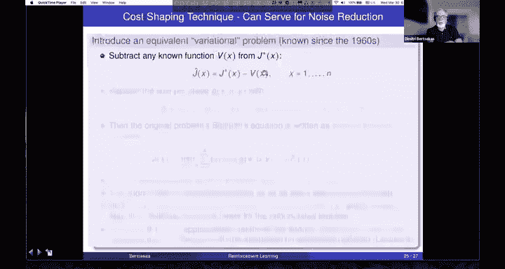

At this formula here， if you introduce a V here。That's going to be your state dependent baseline and basically you'll be approximating a problem that's equivalent。

It just is going to involve a cost function which is J hat over J star。

There's so many details here and。I can't really go into this。What I want to impress on you， however。

 theres an awful lot of methodology of these policy gradient method that revolves around these baselines and people talk about various tricks for selecting good baselines and how you use them and how you use them in the context of policy gradient methods or policy gradient methods that are modified in some sensible way and an awful lot of the methodology of policy gradient methods revolves around this type of techniques。

Are any questions about the slide？You any question for Ellan。

So you said you didn't want to get into I guess I was going to first ask like how do we know is there some kind of optimal choice for the baseline and。

Two， when you said， you know， that we can use a state dependent baseline and plug it back in。

To what we had on the previous slide。I'm kind of confused a little bit on that because everything there is is defined in terms of trajectories。

So if we did that， would we just be using？This state corresponding to the start of that trajectory or how would that work？

Okay， your second question first， the way you do it is after you have V and。

And we'll talk about how you get there。You simply change the cost per se， and that's all。

That's all you have to do in the previous formula in the previous slide in this slide here。Okay。

 actually， we should go to this slide here。Instead of G， you use G hat。

 and that's all you need to do。Okay， yeah， I see it， yeah。Okay。So that's relatively simple。

 but the question of how do you choose the baseline is very tricky。哎。One rationale。

 the most common rationale I think， argues for choosing V to be close to J star， okay？

So the range of this Jhat here is relatively small and which is convenient。

 it' useful for approximations。So suppose that you have some。Policy， some good policy。 Okay。

 you know， some policy that is relatively good。And。You can simulate that policy。And you can get a。

Cost function of that policy approximately through training perhaps one neural network， if you wish。

 okay， generate a lot of cost samples using this policy and fit a neural network to approximate the cost function of that policy and you use that as a baseline。

Of course， this takes a lot of work because you have to work first to obtain a good baseline and then you have to work again obtain to train the policy。

 but all of this is offline， all of this is done offline so you can work for hours and days and weeks if you wish if you're so motivated。

So that's one possibility for V。Does that answer your question Yeah it does I had a quick related question for the content on the previous slide as well is there any effect on if we use like a mini batch。

Say we were in a case where we were。Epleing this to a neural network。

Can we use like a mini batch instead to try to reduce the variance on the gradient？

Most definitely yes， okay， because you're you're saying like right now we're just using the one trajectory sample。

Right， this is the simplest way to describe this method， but you can take。

You can take lots of trajectories and then take the average of those in this formula。Okay。Yeah。

 I'm kind of curious the expected value over the samples that you collect。

And that reduces the variance， yes。Okay， and then also I was curious about like adaptive learning rates so the two things I was thinkinging in terms of。

How we could try to address that problem in terms of。

If we implemented this through neuraler network is you know batch size obviously。

 and then does adapting the learning rate help us at all？Okay， by learning great。

You're using the term learning rate with which gama you're familiar Okay。

 I don't use this term learning rate I use the term step size you're talking about gamma K either way。

And how do you choose the step size？Neurural network programs will do it for you。For the。

You use some heuristic ruless， you may have to play around with them。

 but this is another weakness of this method， how do you pick the step size if you don't have a program to tell you how to do it which。

It's not clear that the program knows what it's doing actually， but anyway， this is a witness。

 you have to play around with different ways to choose the step size。

And the theoretical the theoretical。呃。The theoretical possibility is to have this gamma K go down to zeros and diminishing step size。

And it has to go to zero at a certain rate。 and that rate is all of one over k。So okay。

 so you reduce the step size according to the sequence one over k。

 but people rarely use that people use。Complicated rules that diminish the step size for example。

 they keep it constant for a while and then they drop it again and then they don't reduce it beyond a certain floor that's also common and how do you choose the parameters of this kind of step size rule is kind of opaque you you can't really tell all you have is that theoretically if the step size is diminishing and it's diminishing at the general rate of1 over k then you're covered by theory as much as you're going to get covered the remaining is the remainder heuristics and the experimentation。

So that's all I can say about the learning rate。Thank you yeah。Any other questions？By the way。

 the issues here in this policy gradient methods。呃。

Including the step size issue and also the mini batching， how many gradients do you batch together？

All of this is part and parcel of the general methodology of incremental gradient methods。

In discussing incremental gradient methods。And the back propagation method that underlies the training of neural networks。

We described as if you do this。with a single sample。

 but it's possible to group samples together and obtain an approximate gradient that has that average over multiple samples and has less of a variance。

呃。All of this is part and parcel of the things that people do in practice。And as I said。

 it's all a difficult。Difficult methodology to work with。

 but everything is done online and there's a lot of software workout to that that。来。Is available。

 so all in all people have had quite a bit of success with these incremental methods。呃。

Now let me go into the next slide。😡，About 2 gradient methods。嗯。

What do you do with the policy gradient method？Well， you train is parameters。

 the parameters of the cost function， and then you have a fixed policy that you apply online。

But there's a general difficulty with somehow obtaining some policy through offline training and then tried online or system。

It is the kind of methodology。That's all training and no play。

All your work is done in training and then。And then you use what you have obtained from the training。

Online。You have this policy， you observe the state， you apply the corresponding control instantly。

That's very good because your compute controls very fast online and therefore you can deal with the very fast time scales of system control。

On the other hand， this would also be very bad。放 example example。呃。

This type of fancy gradient method， if you take the result and you apply it to your system。

 it has no way to adapt to changes in the systems parameters， in other words， it may be good。

For the parameters that he has seen， but once the problems parameters change， then it's lost。

 it doesn't do sensible things necessarily。So if you have an adaptive control context where the system parameters change with time。

 then a policy gradientd method is not very good because it will going to encounter a system that it has not met before through this parameter changes。

Moreover， one of the disadvantages of using a fixed policy online is that you do not get the benefit of online look ahead minimization and rollout。

 even if the system parameters do not change through one step or multistep minimization through one step or multistep look ahead minimization。

 you get the benefits of rollout， you get a policy that is better。

 is improved over the policy that you started。And particular rollout with this fixed policy may work much better than the policy itself。

And the best example I can think of is alpha zero。You remember that alpha zero through training。

 very vigorous training with lots of parallel computation hardware。Yields。A。A position evaluator。

 which is like an approximate cost function。It also trains a policy network。

 a policy to play online and this policy is used in the is used in the during online play。

 but in conjunction with multistep look ahead and。And they're all out。So。If alpha 0 were to take。

The policy network， the policy obtained from the deep neural network obtained through offline training。

Then it would。It would flavor it。Not very impressively， it may play like a strong player。

 but nowhere near the phenomenal level of play that is capable of playing through multistep look ahead and approximation in value space。

So bear that in mind， it is using a fixed policy does not take advantage of this rollout bump in performance and also cannot deal very well with adaptive control situations。

So here's an alternative use of approximation in policy space， which is life what is done in alpha0。

呃。It can provide a base policy to be used in truncated rollout and multistep look ahead。

 including possibly multi cargo research， and this is similar to what is done in alphapha0。So。

This leads to a view of of。Of reinforcement learning。

 where approximation in value space is the dominant method。

An approximation in policy space is used in a subsidiary row to enhance and enhance and implement various aspects of approximation in value space。

 obtain some base policy to use in multistep look ahead。

 obtain some cost function approximation to use at the end of the approximation in value space and so on。

So this kind of argument。Makes the case that you should be looking at approximation in value space and integrate approximation in policy space as you need to facilitate the implementation of the value space method。

Okay， I don any questions here？I'm just kind of curious if you've seen any papers where people have successfully found good policies using evolutionary methods。

Okay， evolutionary methods。Are a form of random search， okay？You could use。

In place of the of the cross enroppy method that I discussed。

 you could use an evolutionary algorithm。Both of these methods come under the general category of local search methods and the general pattern of these local search methods is that they are iterative and from one it to the next you construct a neighborhood of points within which you search always looking for cost reduction。

So you could use。The cross entropy method， but you could also use in its place genetic algorithm。

 or evolutionary algorithm。Or you could use some other kind of of random search method。啊。However。

 now people have used evolutionary algorithms。There is a literature。

 there's a lot of it's not a very popular method in this context， but people have used it。

 so coming back to your original question， if I know of any any references，呃。

I think there have been quite a few references， in fact， but。They have not been as far as I can tell。

They have not made as much of an impression as we。Papers that。Use either the cross entropy method。

Or methods that are based on policy gradients。Okay， let' see。Okay。

 I think we've reached the end of this video。And。Policcy gradients and approximation policy space of vast subject。

 a very popular one， and we covered it in very quickly。

 because our main subject had been approximation value space。

 the connection with Newton's method that so I referenced on the last slide。

 and this type of algorithm， but this lecture based on material that is in my 2019 reinforcement learning book。

 and there you find the explanation of this complicated formulaless calculating the gradient and gradient of the。

Of the log of distribution and various other aspects of the implementation。

So what I'd like to do now。I well conclude the lecture。啊。Excuse me。Too many videos， too many slides。

Okay。So where are we in this class， we have only one class that will cover new material and that will cover aggregation next week and aggregation is a methodology to train offline。

 an offline method to train a cost function approximation that could be used in approximation in value space。

And there is a video lecture from last year's class， which I will use next week。

And then on lecture 13， we are going to do an overview of the entire course。

And then we will be done and after that we will have the presentation of the projects in the discussion of a general discussion various hazards of the course within that context of projects。

So that's it for today。And we'll see you next week。

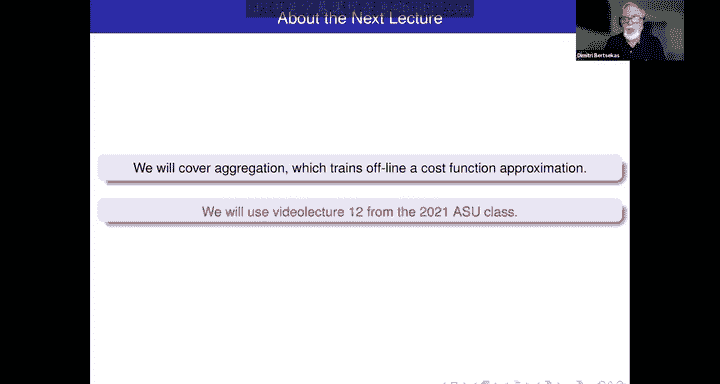