# ASU《强化学习2022-2024｜cse 691 Reinforcement Learning Course at ASU》中英字幕（deepseek - P41：[26]Lecture 12, Spring 2022_ Aggregation methods for off-line training. - GPT中英字幕课程资源 - BV1zcfVYdErD

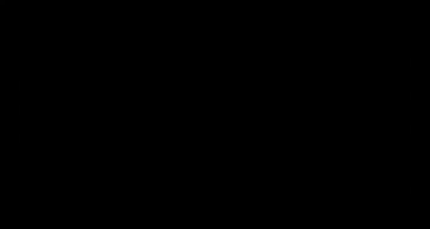

Okay， let me welcome you to this 12 lecture of our Cour in reinforcement learning at ASU and today's lecture is devoted to aggregation。

Now aggregation is just another offline training method， it's offline。

 so it produces a cost function approximation， sometimes it may produce a policy that are used for online play。

 for whatever scheme you may have for online play。Now。

 the difference between aggregation and some of the earlier ideas that we've discussed for offline training with neural networks and other approximation architectures。

Is that the training ideas are quite different。And they're based instead of。

Cost function approximations from samples that based instead on problem approximation。

 we approximate a problem， and then through the problem we obtain approximating cost functions。

And also the ideas are also related to discretization ideas that are common in other fields of numerical analysis as well。

So。Today's lecture。Is going to be based almost exclusively on videos from previous lectures。And also。

 we。E year courses of the 2019 version and last case version had more material on aggregation in particular the 2019。

 course， had two lectures on aggregation， so today's lecture is a little bit of a condensation of the earlier treatment of the subject and if you want to see more details。

 you can refer to the earlier versions of the aggregation lectures， particularly the one of 2019。

So what I'm going to do now。

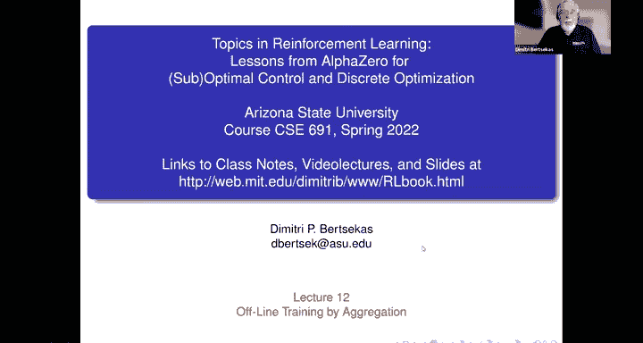

Is get into the video， we're going to have some introduction introductory remarks to aggregation。

 its nature and what we can expect from it。

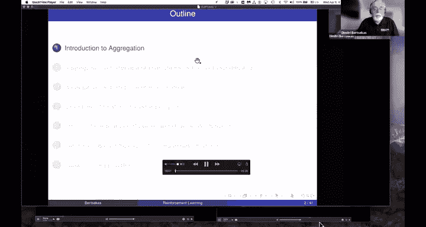

Then we are going to talk about a simple form of aggregation that involves a representative state。

 I'll explain what that is。It's a form of discretization of the state space with a coarsal grid than what there be might have been there to start with。

呃。Then the basic principles of aggregation for whatever presented States are going to be extended to a more general type of aggregation involving features。

And we're going to give a number of examples of this type。We are going to form an aggregate problem。

 a simpler problem than the one that we started from。

And we're going to look at solution methods based， for example， on policy duration。

And also simulation。Then we're going to discuss some variations of aggregation and that will be the last topic。

Now， most of our lecture， almost all。Is going to be based on videos from the 2019 class offering。

So I'm going to switch to the video， but at strategic points。

 I'm going to be pausing for you to ask questions。So let me go to the video now it started now。

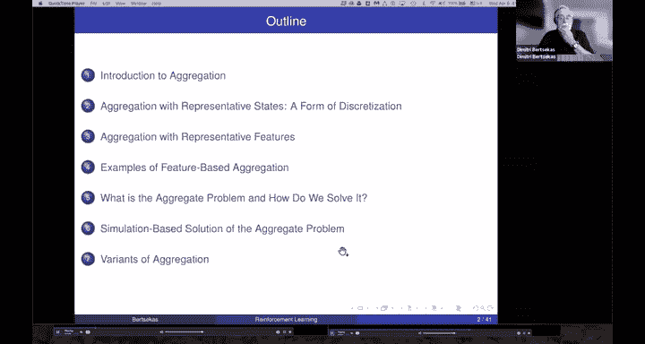

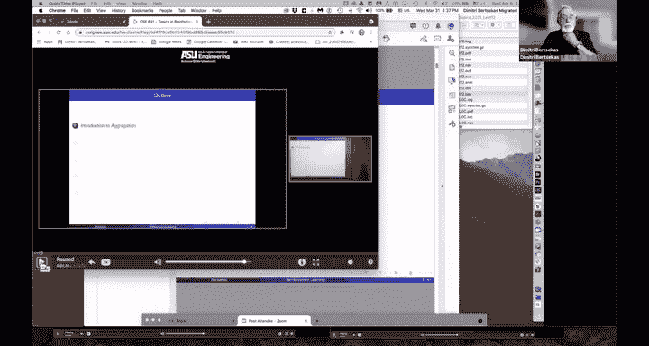

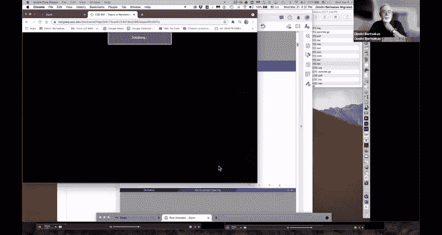

So。Where does aggregation fit in the big picture well we have our friend here。

 the big picture figure and here is aggregation remember this is for one step look ahead we're looking at a discounted problem we' going to be looking at discounted problems exclusively in this lecture and we're looking at one step look ahead and J Tilda is the approximation of the future costs and it can be obtained with any of a number of methods problem approximation or all approximation policy iteration。

 parametric approximation neural networks。And we have covered all this and now we're going to talk about aggregation。

 there are also the other approximations， but we're going to focus on this。

 How do we approximate using the aggregation method。

So now aggregation is actually a form of problem approximation。

 it qualifies as a special case of this， if you will。

 basically we approximate our dynamic programming problem with a smaller and easier。

 less dimensional version， we solve it optimally and we obtain JTilda in this way。

It is also related to parametric approximation because we are going to see that it produces J Tildades that can be viewed as feature based approximations and in particular if J Tilda。

 we're going to see a major special case， major special cases are going to be obtained when J Tilde is piecewise constant。

And we have seen that piecewise constant functions can be viewed as feature based approximations with the members。

 with the features being。0，1 membership functions， one over a subset，0， every where else。

So there is a relation of aggregation with this， there is a relation with this。

Not only there is a relation of parametric approximation。

 but it can be combined with parametric approximation。Like a neural network， for example。

 in two ways， we can use the neural network to provide features for feature based aggregation。

Or we can add a local parametric correction to J Tilde like a piecewise constant approximation to a J Tilde obtained by a neural network。

So we may have already some J tilde obtained bar from a neural network。

 and then we can correct it with piecewise linear piecewise constant approximations。

Moreover there are several versions of aggregation， here's one step look ahead。

 we could be looking at multistep Look ahead， which is very similar。

 finite horizonoriz as opposed to infiniteite Horiz。

 and there are other versions that I'm going to go into in the next lecture for today's lectures。

 this is the figure okay。

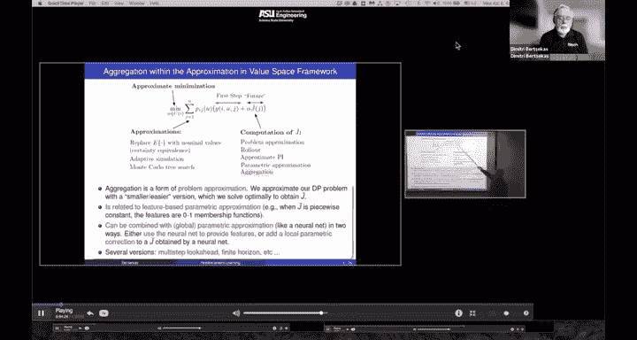

Okay， so let me get you get across this idea through a simple example。

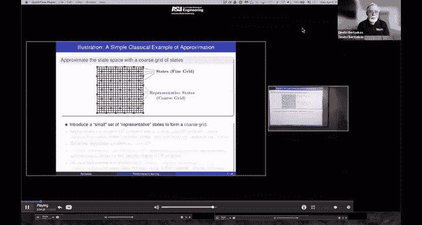

嗯。Which dates back to the early days of dynamic programming， approximating a state space。

 which may be large with a coar grid of states。In fact。

 it's an idea that goes back to the very early days of computation。 Okay。

 any kind of numerical computation has。Has has at some level involved ideas like that。

 sort of f out the number of variables。Fcus on a certain subset。

So here the states in this figure are the cross points on this grid， the black cross points， okay？

And they are in this they are represented they are represented by this fine grain。

The representative states are the red ones。 Okay， it's a small， smaller subset。

And so this is the red grid is a coarse grid that is lies in between the fine grid。

And we produce these， these。States， and we call them representative。

So now the idea here is to approximate the original dynamic programming with a course grid dynamic programming problem who states are these fewer red dots。

啊。To do this。We have to form an aggregate problem and for this we need transition probabilities from red states to red states。

 how do we move under the influence of control in order to define an aggregate problem。

 we need to define transition probabilities and we need to define also the cost of transition from red states to red states。

Now suppose we have done that。We can solve the aggregate problem by exact dynamic programming。

Because there are fewer representative states， we may consider doing that。Now。

 after we have obtained a cost。An exact cost from the aggregate problem for the red states we have to extend it to the black states right how do we do that Well there are a number of ways of doing it by some kind of relation or proximity for example states that are black states that are close to a red state may take the value of the red state or otherwise a red state right here maybe obtain an approximate cost by interpolation。

Of the。Approximate cost of the of the course of the red states。

One possibility is our nearest neighbor piecewise constant heuristic scheme。Where a fine grid state。

 a black state takes the cost value of the nearest course grid state。

 that will give you a piecewise constant。Approxiation， right。

 and the levels are going to be the exact optimal cost of the red states。O。

So that's the first idea and we're going to build on that。So。

We'll introduce this representative states and we are going to approximate the problem by projecting onto them。

So look at this figure here。The black states are in this black enclosure。

 and they are the original states， the K of the original problem。

The red states are the representative states。 It's just a subset， okay。And。We' are going to relate。

The original system states like this J。To the aggregate states by means of some kind of a similarity or proximity coefficient。

 this fees here。Add up to one。 there are probabilities。 There are weights that that connect the。

Original system states to the representative states。 They are no negative， and they add up to one。

 okay。So in a problem that has a geometric character， this may be distances， okay。

 or in a problem that has a different character based that can be selected on the base of intuition or a given problem。

You could also have only one of these fees be one and the others be 0。 Okay。

 and then you attach the black states to a particular。The representative state。Okay。

 so I have this red states and I have introduced these aggregation probabilities。

And this defines aggregation dynamics。Whereby the transition probabilities between two representative states like this x and this y。

 generally speaking out'll be use in the convention aggregate states are going to be x's and y's。

 Or system states are going to be I's and Js。So from x to y。

 what is the transition probability given these fees。

 well it's this one is's the probability of going here and the probability multiplied with the probability of going or this probability here and we have to add of course。

 over all possible successors of this representative state。Okay let me repeat here。

 the black state the red states are just legitimateit states， they're just a representative。

 the green arrows are the transition probabilities of the original system。

 and then we complete the transition to another representative state by introducing by using this aggregation probabilities。

So this defines， for me， transition probabilities between representative states。

In the process of this transition， we incur a cost。

 what is the cost Well along the Greek green archs， we have a certain cost。G of X， U and R J。

 and depends on U。 And if we。Average， over all J that come out of this x we obtain the expected cost。

From。That represent state X under control U。So my model is completely defined。 now。

 These are the transition probabilities。Given these filess， and these are the expected costs。

 And I'm in business with dynamic programming。Here's the aggregate problem。The original。

Problem involves transitions and costs from I to Js， the aggregate problem。

Involve transitions from representative states to representative states under these transition probabilities and under these transition costs。

I can solve this problem。

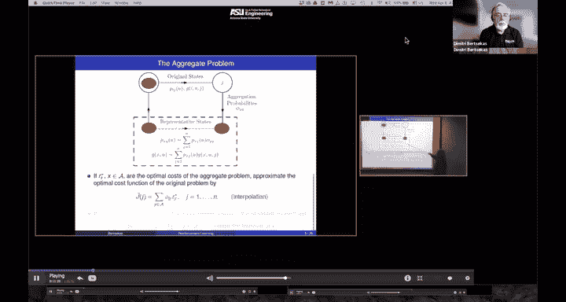

Exactly。And let me call R stars of x， the optimal cost of representative state x。

Now having done that， I obtain approximate cost for the original states to Js by interpolation。

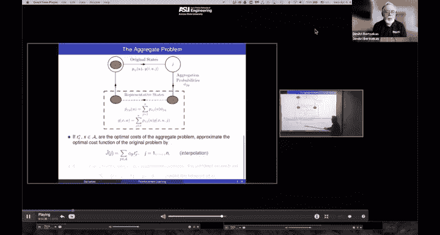

With with his f。Now， in a case where the phis are either0 or1， then I have a piecewise constant。

approximationroxiation， why is it piece wise constant because all the fees here are going to be zeros except for one that's going to be one and if you consider this set here of all Js where given why if you consider the set of all the Js that map onto that y which I call the footprint of this representative state。

Then。J Tilde is constant on this set and takes the value R stars of y。So。

This is a small dynamic programming problem， it gives me these numbers here。

 and I use these numbers to obtain a piecewise and interpolated cost function on the entire state space。

 which is piecewise constant in this special case where all the Phis are either zero or one。你看。So。

 basically， that's the。The aggregation framework of representative states。And for another picture。

Now Im consider again the case， the simple case of piecewise constant。

 where all the five are either zero or1。The green function。I the is J star， okay？

On this axis are the states and the representative states。 Now。

 the states are the things that are in here。 The representative states are。Just these。ok。

Each representative state under this assumption here has a footprint。

And the approximation is peacewise constant。Within each footprint， the level of constancy is the。

Is the optimal cost of the corresponding representative state？Now， if we didn't have this case。

 where J connects to a single x， if J connected to multiple x's。

Then this would not be piecewise linear， it would not be piecewise constant。

 it would be piecewise linear。Okay， and and。And。It's sort of a similar approximation。

 perhaps a little bit more faithful， more ambitious to approximate well， this green J star function。

O， now for this case there's an  error bound and this  error bound is not important because you can calculate it and get some conclusion out of it。

 but because it is qualitatively expressive of what happens in these approximation schemes。

So this gives you the approximation error for this case。

And it says that let's consider these footprint sets over which the approximation is constant。

Can suppose。That J star varies little within this sense。Okay。

Then the approximation is good in the sense that the error is small。So look at this bound here。

If epsilon is the maximum variation of J。Over all these footprints。Okay， so look at。

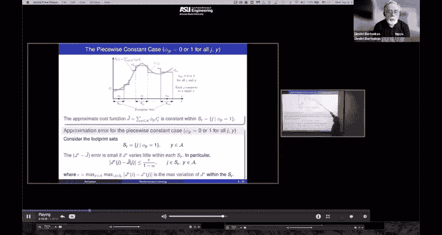

At this particular footprint and look at states， look at the maximum variation within ti。

 the maximum variation over all of those， and let's call this epsilon。

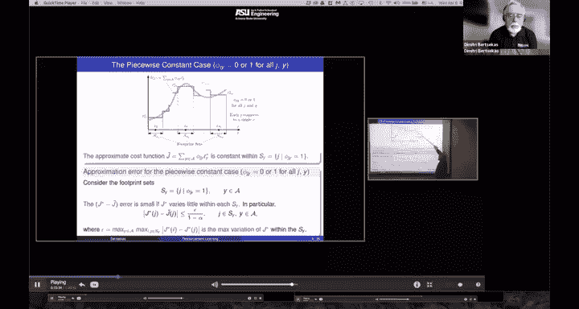

Then， Jay tilda。Produced by the aggregation scheme is within J star。With a bound of epsilon。

 but divided by1 minus alpha， which I don't particularly like， but。

The thing to read from this theorem is that。The arrows is small if J Star does not vary very much within this footprint。

In fact， if J star did not vary over the spoon， if the original green function were piecewise constant。

 exactly like that， then aggregation would nail it exactly would find the exact J star。

There are bounds like that all over the place in the theory of aggregation， and again。

 you should not look at them literally， you should look at them more from a point of view of what they express qualitatively。

Are there any questions about the framework so far？Let me stop the video here and ask for questions。

 are there any questions？Okay。Remember our terminology and notation。

 I's and Js are for original system states， x and ys are for aggregate states。

 we have representative states in this framework， we have this aggregation coefficients that connect Js with Y'。

And。And the approximate cost function produced by aggregation？Heres。

A is obtained by interpolation of the exact of the R stars that are obtained by solving the exact aggregate problem。

Okay。So how do we solve this aggregate problem？This is my aggregate problem here。

 I have defined its transition probabilities， I have defined its cost function。

And I can use any exact method。 if I can calculate all these numbers。

 I can use any exact method for solving the problem。Value duration， policy duration。

 optimistic policy duration， learning programming， whatever you might have。

The problem is a little bit more difficult perhaps because it involves these extra probabilities here and notice that the problem is stochastic。

 even if the original problem is deterministic， the aggregate problem is stochastic。他外边。

There is some problem here。 Do you see the problem。Potentially， for large， if n is large。

 suppose that n is large。What's the potential difficulty here？Suppose n is 10 to the 100， let's say。

呢边个。The percentage stay expensive。There's a summation here over n。 If n is very large。

 would never make it。Unless the problem is sparse， okay。

 I have relatively few x's and I have only few successors， J okay。

Then I'm lucky I can use this method here， otherwise。

I will need to have some different way to deal with this problem and the way to did。

 to deal with it is with simulation。If I have a simulator for the original problem。

 then I immediately get a simulator for the aggregate problem because my fees are given。

 so all I have to do is concatenate the system transitions with the fees and I get a simulator for the aggregate problem。

So I can use the simulator to obtain an exact model free method。Based on the simulation。Notice here。

 the use of the term model 3， I intentionally stayed away。From。From。

From using a sort of colloquial use of the term model free。

 model3 does not mean that you have a for our purposes， model3 means that you're using simulation。

 it doesn't mean that you don't have a model here we may have a model。

 but we may use a model free method anyway。Okay。So a little bit that's all there is to say about this representative states model because we have a solution method and we have a variety of stuff here that we can use if the number of access is very large。

 you may consider using an approximate dynamic programming method to solve the aggregate problem。

 it's also possible to do that， although we're not going to emphasize this possibility。

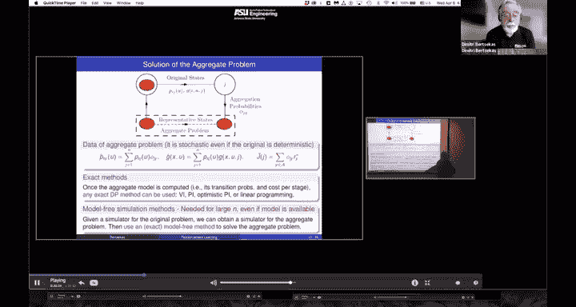

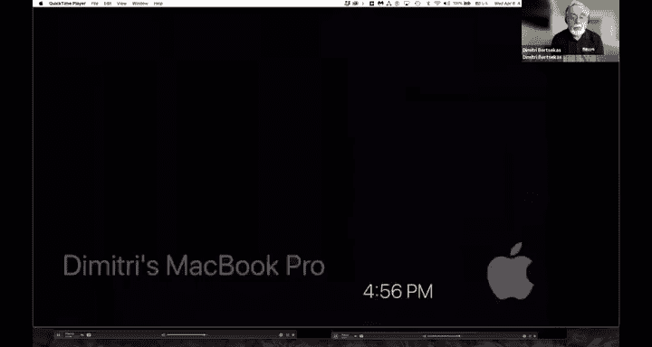

Okay。Now， if you think back at the framework， you'll see that everything applies to the case where the state space continues。

Okay， think of a continuous state space。

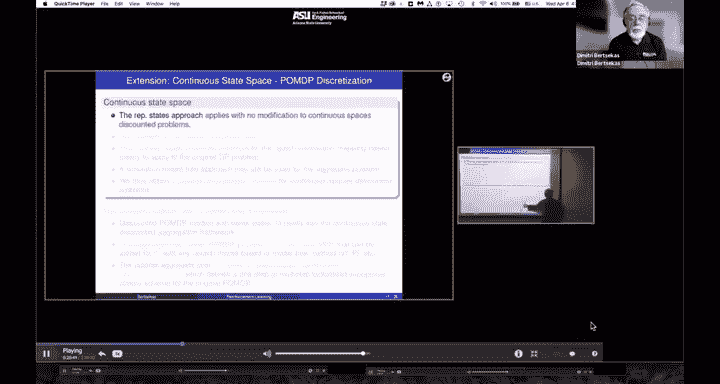

嗯一诶。A finite number of representative states in there。

 if you can calculate the corresponding transition probabilities and corresponding costs。

 you have an approximation to the original continuous space problem。

We haven't talked about infinite horizon continuous space， problems except in the very beginning。

There is a theoretical requirement that the cost per stage should be bounded。In order， therefore。

The theory， the good theory to apply because only then we would have contraction map under。

 but that's fine， okay， the cost per se should be bounded。

We can still use a simulation based approach for solving the aggregate problem because if we have a simulator for the original continuous space problem。

 we still have a simulator for the aggregate problem as well。So in this way。

We have a general discretization method for continuing spaces discounted problems。

AndThis can be quite useful in a number of contexts in an important context where this is true is po DP。

Now， Po D P， remember， is。Finite state problems with partial state information。

 And one way to to address them is to consider。The problem in the belief space of probability distributions of the state given the information。

 so in belief state land， you have a dynamic programming problem that has a continuous state space because the space probability distribution continuous。

However。This type of problem fits neatly into this formulation here。呃。All we have to do is。Introduce。

At representative states within the simplex of belief states。And then solve the corresponding MDP。

So the partial observation is lost。Within this framework， we have a regular playing vanilla。啊。

Mcovvian decision problem with perfect state information。It has a finite number of states。

 finite number of controls。It the pump P to have a finite number of controls。

And it can be easily defined and can be solved by any exact model base or model3 method。

And after we solve this discretized pump DP problem。For the optimal aggregate of our star。

 then we obtained a。A uninterpolateated approximate cost function。That's a powerful method， actually。

 to solve Poky appeal with relatively few states that people don't has been addressing the literature。

For quite some time， but people don't like it very much。 They look at other methods。

 whereas is very often this type of method applies very nicely。Okay。

So I have a challenge question for you involving continuous spaces problems。嗯。

I have a self driving car that wants to drive from point A to point B within this continuous space。

And it has to avoid these red obstacles here。And it has a travel speed of1 meter per second。

 but in any direction you can point a car in any direction you want， and that's its travel speed。

And this is 1000 meters， and this is 1，000 meters。Okay。

 so this is a problem that has a shortest half problem， but we have continuous state space。

So I approximate this by introducing a fine grid， okay？Make sense to do that。And。Okay。

We disquitize a space with a fine squared grid and we restrict in order to stay on the grid。

 we restrict directions of motion to be horizontal and vertical。So in this approximation。

 it has to move on the grid at this speed here， but go one step。Horizontally or one step vertically。

 So we restrict also the direction of motion， not only the direction of the end points at each step。

And then we take， we solve this by a short path method， right？And。

And we take this solution as an approximation。To the solution of this problem。

Is this a good approximation。Okay。I want you to think for five minutes。

 some of you may know the answers， so don't give it away。嗯。Okay guys。

 let's take a five minute break for you to think at this question。

 sort of a cute question because particularly because it involves a pitfall that many people fall for。

 even experience people， make the mistake， make mistakes around this question。

So what I'd like you to do is take five minutes to look at this question。

 we'll come back and also take the opportunity for you to ask questions about the the slides so far。

 the approximation， the aggregation with。🎼Okay， so we will take five minutes break and we'll take two breaks in this lecture and we'll come back in five minutes and you may give some thought to this question and also think about other questions that you may want to ask about other aspects of obligation that we have presented。

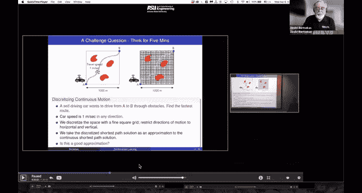

So we'll meet in five minutes。Okay， we are back now。

So let me ask first whether there are some questions on the earlier part of this presentation。Okay。

 so we will address this challenge question now。

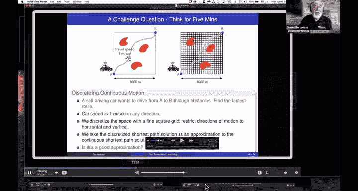

Let me explain this a little more。ok。The is flawed。And。Here's an example。

That assume that all motion costs one per meter， okay。And there are no obstacles。

 Then the continuous optimal solution is the straight A to B line。 there are no obstacles here。

And it has length。It has length square root of two kilometers， right？It's one kilometer this way。

1 kilometer this way around the hypoten is square root of two length。And this is the optimal cost。

The optimal distance， okay， from here to here。However， the discrete optimalmost solution involves。

Counting units along this piecewise。hororizontal vertical path and no matter how you do it。

 you're going to have a distance of one and another distance of one，2 kilometers。

Not square root of two，2， no matter how fine you make the discretization。

And the problem here is that the state space is discretized finally。

 but the control space is not okay， you have to discretize the control space also。

Many directions and then use aggregation。 Okay， use a stochastic formulation to make interpolations properly。

 And then in the limit you can prove that you can get the optimal cost。Yeah。スペースあい。个。C飞。えそ。最のに対。

thatだけ。No it will not work what you're saying if I understand it correctly is I suppose that here not only you can go up or down or you can also go diagonally that will not work the reason is that instead of having the control point discretizeizing with four points you want to discretize with edge points。

 but what we want is a large number of discretization points。

 you take all these diagonal directions and approximate with a finite number a large number and then you would be getting。

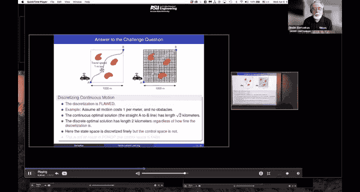

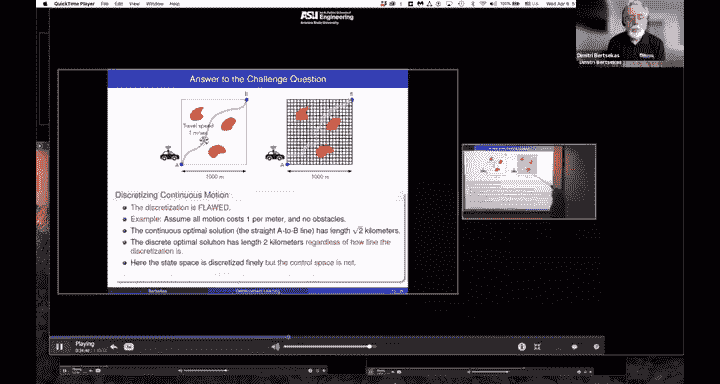

The optimal cost the limit， yeah。那第一。Eight points will improve it， yeah。

But instead of a squared root to2 bound， you have a different bound， a little better bound。Okay。

 but still。You have a problem。

But。What you can say mathematically is that if you add more and more directions。

 diagonal directions along which you can go in the limit， you're going to get the optimal。Thats谁。

It will not increase it， okay， it will not increase it because you will keep those black states to meet the representative states。

 and then you will add aggregation coefficients。So you move perhaps from here and you end up somewhere in the middle of the square。

 and then with aggregation coefficients， you interpolate to the neighboring black states。

So to solve this problem， to solve this continuous space shortest path problem。

 you need to make this stochastic， you need to make it a stochastic shortest path problem to solve it by aggregation。

 it's an interesting concept in order to get the exact solution in the limit by disctization。

 you need to pass to a stochastic formulation。Now in the PomDP example that I gave earlier。

 this is not an issue because in PomDP， the belief space is infinite， is continuous。

 but the control space is finite， still finite。So we don't have this particular problem here。Okay。

 are there any questions about this discretization paradigm or counter example？Okay。

So now from aggregation we represent the states， I'm going to pass into a broader and more powerful aggregation framework that will involve features。

Now， what's the main difficulty with the representative state scheme。Well。

It may not be easy to find a set of representative states and corresponding piecewise constant or linear functions that approximate well J star。

 if you do blind discredization， you can't figure out where the function changes by a lot or the J star changes by a lot or by a little so some parts of the state space may need more representative states and others may need less so。

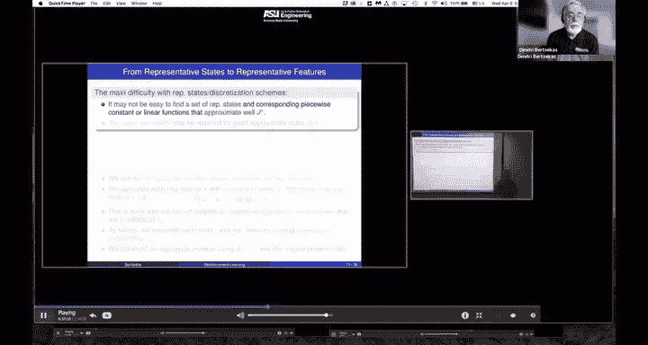

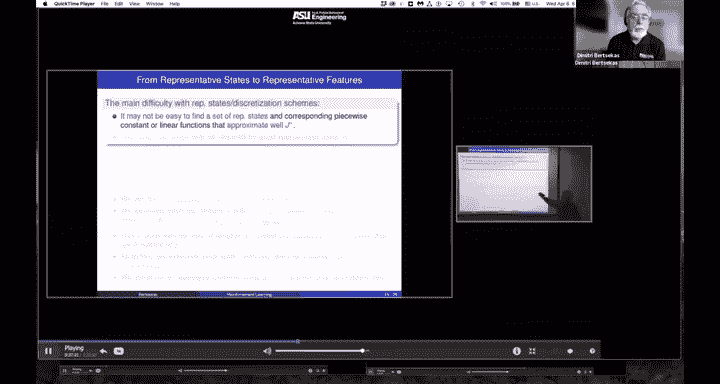

If you go blind into a given problem， it's hard to find。

 it may be hard to find a good set of representative states， they may be too many in other words。

 you may have to go to a very large number before you get into a good approximation of J star。Now。

 suppose you have a feature vector， a feature vector that you get trust。

 It sort of expresses the nonlinearities of J star well enough。

Then instead of discretizing the state space， we discretize the feature space。

So we introduce a representative features that span adequately， adequately the fissure space。

And we aim for an aggregate problem whose states are going to be representative issues rather than representative states。

And。We associate every representative feature with a subset of states。

That relate to it approximately， that approximately map into that representative feature。

 remember extra representative feature， and we consider states that have a featured map that almost map into that。

And this。A relationship between states and their features and representative features is done with the help of some ways。

 which we call dis aggregation probabilities。The de segregation probabilities roughly say how close。

State I is to the representative feature X。We also consider aggregation probabilities。

 interpolation coefficients， from passing from aggregate to original。Clst function。

And we construct an aggregate problem using the representativeative features。The Ps。

Aggregation coefficient in this additional coefficients that relate features with states。冇。

So here's the conceptual picture。

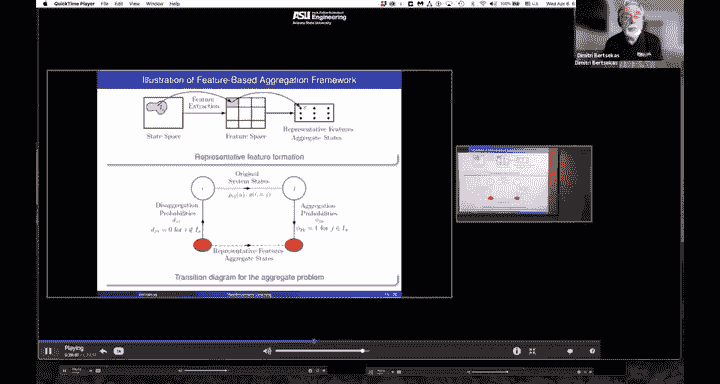

Here's the state space。

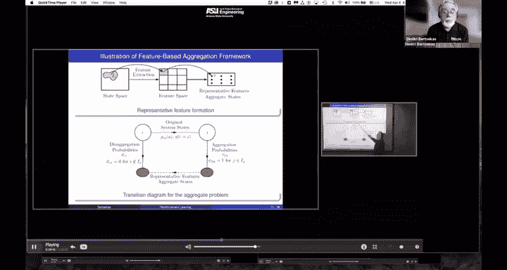

And this is the feature space， so these are features in here obtained by applying the feature extraction mapping。

 the F onto the states here， we discretize this a regular discretization in the feature space gives you an irregular。

Partition of the original space， where I of x are the。Okay， we pick a state X inside here。

 which we consider a representative， and I of x is the set of states that map into the neighborhood of X。

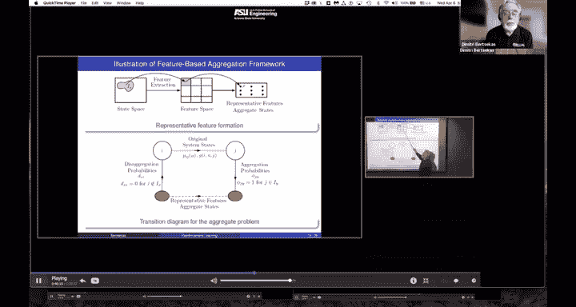

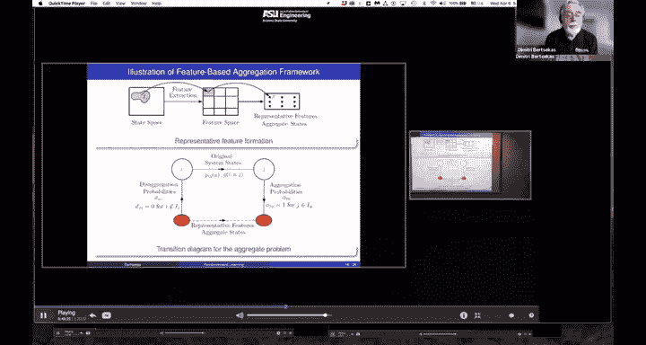

So somehow were able to look at the feature space。sortrt of partitionly discretized in some regular way obtain representative features inside each one of these and look at states that map in the neighborhood of each one of these representative states and we call them I of X。

And for these states here， I introduce a non negative， a possibly positive coefficient D。

So here's the figure that I had before， but enlarge somewhat。

We have transitions from representative features to representative features and from original states to original states。

And we go this way and we map representative features into a subset of states like this one。

 which almost have feature value equal to x， and then we go back here and we use these aggregation probabilities。

And once I define。This deco coefficient， this probability。 in this piece。

 I have a model for transition。From one feature to another feature。And also a model for the cost。

 the corresponding cost。Now we have to explore the properties of this problem here。

 whether it's good or not， but this is the basic framework。Representative features， plus。

Connecting probabilities， connecting wavess， connecting relations， if you will。O。

So let's take another break just to give you some time to assimilate this concept a little bit。

 but I'm going to ask you the following question。Okay。

 this is the figure I had in the previousview of the slide。

Why is the representative states model a special case of the representative feature model。

 Now that's an easy question just to warm you up， okay。And here's another question。

Just like we had this error bound for representative states。

There is a general principle in this feature based aggregation。

 which I'm not going to prove right now， but is intuitive。Namely。

 that we should be choosing features so that states with similar features have similar cost function。

Make sense， that's what features are for to tell us something about J star， right？

So suppose that we choose， we have a feature map like that。In other words。

 J star changes little within each of the footprint sets where these probabilities are positive。

Can you think of examples of feature schemes that would fulfill this type of condition？

What would be useful features to choose in this context here？

Let's take just a few minutes to think about Latin the look camp。Okay guys， I'm postsing the video。

 let's take five minutes to sort of warm up to these questions and try to get used to the notation and the concepts and then when we come back you can ask your questions and we we can also continue with these questions。

So five minutes and we're coming back。Okay we'll take five minutes all this is very new okay it's very different than cost function approximations from data and fitting target functions with neural networks and listques and things like that different conceptually different it's not difficult but it's different so I'll give you another five minutes to sort of browse through the formless and the notation。

And we will come back in。We'll come back in five minutes。Okay。

 let us come back to this question of what would be useful features for aggregation purposes are there any questions at this point that you want to ask？

Okay。And。I want to ask whether there are any questions so far before we go into this question one and two。

Yeah， can we extend this， we can extend this to a Q learning setup right where we would just use the aggregate state。

In place of the original state。So in regards to。Like the state action pairs that we would use in Q learning。

Yes， it's possible to use Q learning for the aggregate problem。

So the state action pairs would be correspond to aggregate， state and action pair。And。

It's not's not so simple as it sounds， but。It's a possibility because there are fewer state action pairs in the aggregate problem。

Yeah， that's we get into that。Okay， not going we're going to get into some other methods that are simulation based。

 but not pure learning。And then are we also going to get into， I think it lends itself。

 obviously to some。Paraallleization are we going to be talking about that later or if not could you just maybe。

Give an overview of that。I'm not sure there are interesting issues that are specific to aggregation。

 there are genetic parallelization issues that apply also to aggregation。

 but no specific issues have that exploit the aggregate structure。I don't think， okay。Okay。

 so let me restart the video。

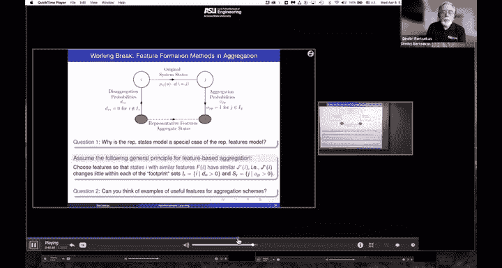

You know the answer。

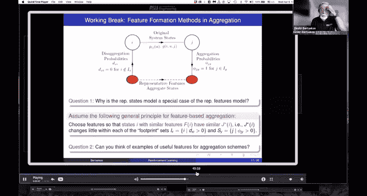

OK。So let me get into that。Exampleles of speech based aggregation。ok。Use a scoring function。 Okay。

 S you have some kind of a scoring function， V， which is approximate J star。

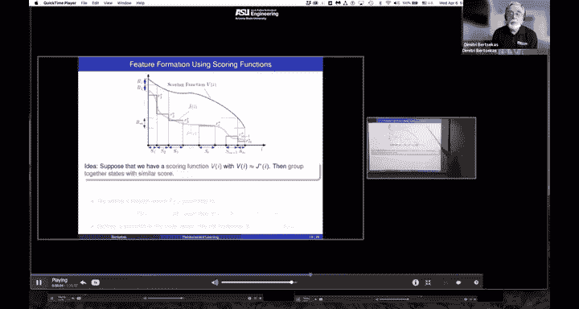

Then we can group together states with similar scores。

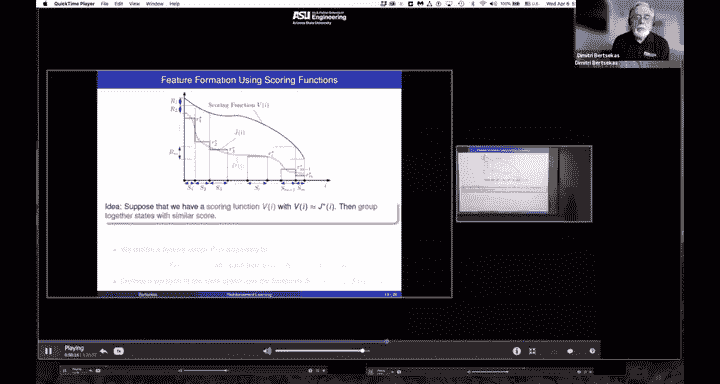

And call these sets features。 Okay， within which set does your state fall。In particular。

 we can partition the range of values of V into M disjoint intervals。

 like what you were saying earlier。Okay， so。Let's look at these figure。's a little complicated。

 The green function is J star， but we're trying to approximate。

 The red function is what we are going to get。The black function is the scoring function。

It doesn't have to be。Very close to the green function。 as long as it catches the rises and falls。

 the the shape of J star。So now we look at the range of the scoring function。

 which is from here to here okay。And then we cut it into pieces。And the corresponding states we call。

The footprints of。Of feature， a representative feature。

 So a representative feature would be the middle point。 let's say， of this， of this。

Of this interval that corresponds to the topmost range。And now the representative state。

 the feature would be here here and so on。And。And so we define a feature vector according to this。

 which says。If your score is within this interval， representative your feature is the index of that interval。

So the feature here is membership within the corresponding interval of the scoring range。Okay。

 so this is one idea。 And how would I get good scoring functions。Well。

 cost functions of heuristics or policies， we mentioned that。

Approximate cost functions produced by neural networks， perhaps after one or two policy durations。嗯。

Now let's draw a connection with rollout。His rollout。

What we do is we have a policy and we evaluate this cost。 Now， suppose we take a scoring function。

 the cost of a policy。Then rollout produce uses cost approximation this JM and aspires to do better than this JM。

Now suppose I use。Jame knew as my scoring function to form features。

hen the resulting J tilde is not Jm， but it's a nonlinear function of J mu that aims to approximate J star in other words。

 aggregation goes for J star， not for an improvement of J mu。

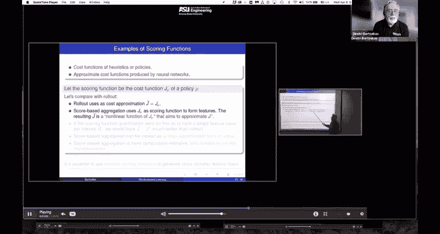

You see the difference。 It has the potential to give you much more than the rollout approach。In fact。

 if the scoring function quantization were so fine as to have a single feature value per interval。

 then I would have J tilde exactly equal to J star。Okay， if I make， if I digtize my feature range。

 fine enough， then I will get J star， not an improvement to J new like Rolo， I will get J star。

 which is much better。

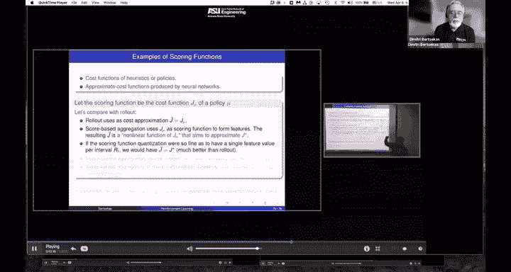

So with this type of scoring function， you can view aggregation as a more sophisticated form of rollout。

The downside to this is that it's more computation intensive。Because if you have J New。

Then rollout can be implemented very easily。 just one step Look ahead。It can be done online。

 however here there's a lot more computation to be done to solve the aggregate problem。

Using a single scoring function can be enhanced considerably。

By considering multiple scoring functions。So if one scoring function doesn't catch it。

 you get some differentiation of features through another scoring function。Okay。

 so let me get into the possibility of using neural networks。

 And this is the big thing about neural networks out there at the output。

 it produces features and produces some kind of a cost approximation by linear combination of these features。

So suppose that we have trained a neural network。Maybe with one or more policy directions。

 and we have obtained an approximation。These features now can be used by discretization to form representative features。

 In other words， we can sample this feature space。That we obtain from the neural network。And in fact。

 the training process of the neural network produces a lot of feature values， right， in fact。

 state feature pairs。So we can obtain representative features ands corresponding footprints of of corresponding states。

By from the training set。Of this neural network， and we can perhaps supplement it with additional pair data。

 perhaps to improve exploration， for instance， things like that。Moreover。

 I can extend the set of features that I get from a neural network by using some hand graphiced features。

In a more sophisticated and ambitious formulation。And notice now that this form of aggregation yield a non linear function。

 J tilda of the features。 This is linear。The aggregation would give you a non nonlinear function that aspires to approximate J star。

 not J hat。So it goes for a bigger target。Okay。So now let's look how policy duration will look in the context of aggregation and neural networks。

Suppose I use。A neural network based parametric approximation to do policy duration。

We have gone through this。We have， we have a scheme that generates a sequence of policies and from the current policy。

 we train a neural network to represent。V。Cost function of that policy。 How do we do that。

 The neural network generates a feature vector linearly weighted and whats an approximation to J mu。

 the cost function of mu。And then we do a policy improvement operation， a one step look ahead。

 and I obtain the improved policy。

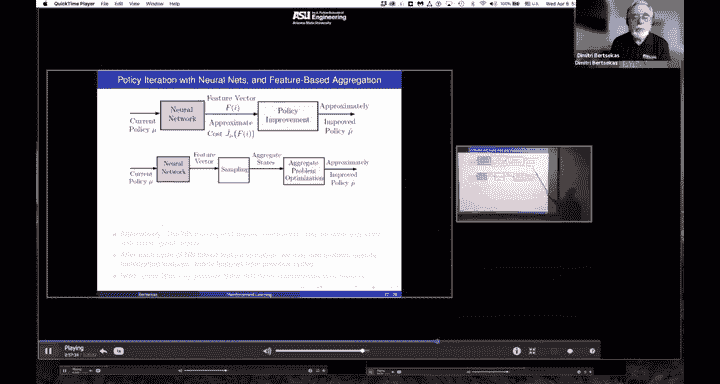

This is what we have gone through with a neural network。Now。

 suppose I bring in aggregation into this picture。How would it work？Again。

 I want to generate a sequence of policies。From the current policy。

 I have the neural network producing a feature vector。

 but instead of using this feature vector to obtain an approximate cost function。

 I sampled this feature vector for a representative values for representative features and I could obtain an aggregation framework which I can solve to obtain a new policy from the aggregation problem this is going to be different than that and potentially more powerful。

So there are several options for implementing this scheme。

Is sort of a mixed neural network aggregation based policy。

I can do this neural network process multiple times each time followed by an aggregate problem solution and that could strengthen a new policy。

 in other words， use this policy after policy after policy。

Another possibility is to use the neural network training process and the feature construction only once。

Okay。And then obtain some set of features， which I can use in the aggregation framework。

I can also add after the neural network feature formation。

 I can add problem specific handcrafted features， I can add features from preview cycles。

 I can enrich my several features in a more flexible way than otherwise。

And one more thing about deep neural networks， deep neural networks。

Use more sophisticated final features and relatively fewer， okay because。

The training and the weights go through so many processes at the end。You have。

At the end of a hierarchity of features， you obtain more sophisticated features which can be more useful in the context of aggregation。

 you will need fewer representative states if you have better features。

 which deep neuro networks for you。Now all of this is somewhat speculative。

 and those of you that have attended my lecture in here at ASU at the end of April or the end of last April。

May remember the， the flavor of this， of this line of development。 This is relatively new。

 It has not been tested。Extensively， okay。But。I hope that。

Some of you will not do this for a project in two weeks。

 but will do it sometime in the next few months maybe be interested in trying some of these ideas because I think they do have merit。

AndLike everything else。Like everything else in approximate dynamic programming。

 don't expect this to work well in every circumstance。

 but there will be unconfident circumstances where it will do better than other schemes。Okay。

 there's up。Big omission so far， we have discussed how to solve the aggregate problem for the case of representative states。

 but not for the case of representative features。 And this is an interesting challenge。

 How do we solve this aggregate problem and how do we formulate it。

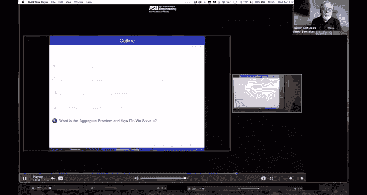

The simplest thing to do。Would be just to mimic the simpler representative states model。

In other words。Okay。What are the transition probabilities from here to here。 Well。

 there's a certain formula。That that corresponds to a given you for each pair X， Y。Okay。Okay。

 this is just the multiplication rule of probabilities to go from x to y。 I have to。

Go to one of the state's eye with these probabilities here。

And then go across with these transition probabilities and then go down with these other probabilities。

 and this is what you get。

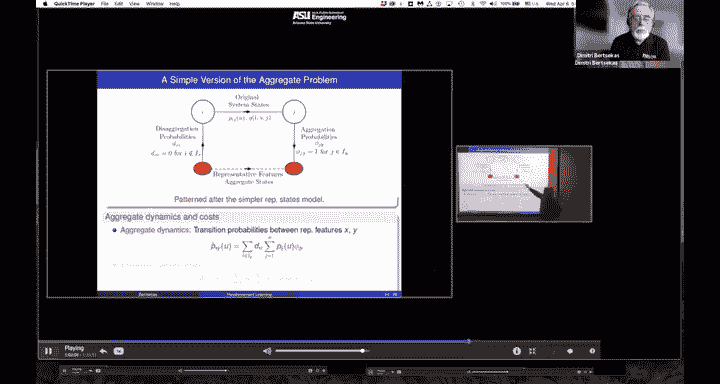

At the same time， as I go through the cycle here， I incur a cost right here right at this point。

 and that cost is the expected cost of going into states in here。

And then the extracted cost of making the transition， This down transition does not cost anything。

So this is the expected cost per stage。However， this gives you a legitimate aggregate problem。

 but it is flawed。Can you tell why it might be flawed？transition probabilities assign a U to。

To all the states that correspond to X， Okay， there's a big restriction on U here。

 that's associated with transition from x to transition from x。So。

He doesn't capture the variation of the control within the footprint states that this aggregate state maps into。

It gives you legitimate J tilde， but it is not very good， that's the problem。

So here's the flaw of this simple version of the aggregate problem。

Implicit in the formulas for the aggregate dynamics and the aggregate cost function is that for each given representative feature x is the same control that supplied at all states I in the footprint。

This is fine in the case of the representative states because there's only one state corresponding to which。

A representative state， but it breaks。 but this formulas become。Become fly when you have。

The more general framework of representative features。So what happens here？

This problem can be solved again by exact model3 model based methods to obtain corresponding costs for the representative states。

 however， the J tilter that you obtain may not be as good。

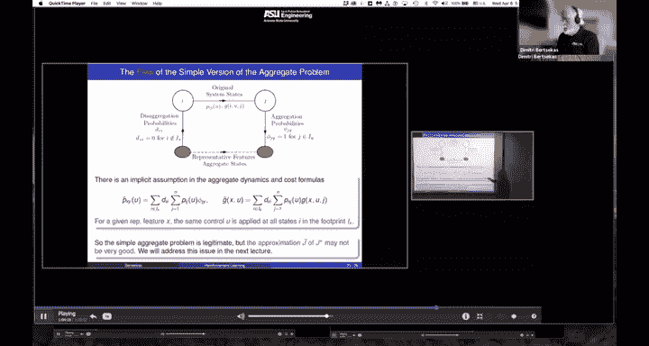

As good。Approxiation to JR， as you would like， is legitimate。

 but the approximation may not be very good。Okay， so we will stop here and we will continue there we will continue in 10 minutes。

 so let's take a 10 minute break。And at that time， you can ask your questions about earlier parts of the lecture。

 and we will also consider a more sophisticated version of the aggregate problem that also gives more accurate approximations to J Star。

So we'll get back in 10 minutes， exactly。

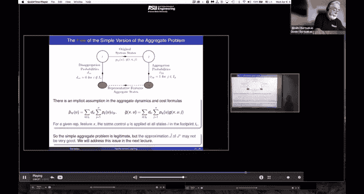

Okay， let us get started， let me first give a summary of the lectures so far。

It's a different kind of methodology， so it's worth taking a deep breath and summarize what we have done。

We are looking at an offline training method， aggregation。

 and it's different than the neural network approximation architecture type of methodology that we have discussed so far。

That's based on sampling and least squares solution of least square type problems agreation is based on。

Ideas of problem approximation， basically we approximate the original problem with a smaller aggregate problem that's presumably easier to solve in order to get some kind of cost function approximation J Tilda to use in online play。

And we define the aggregate problem by means of aggregate states。

And aggregation and disagggregation probabilities。And we saw two different types of aggregate states。

Representative states， which is the easy case one， each aggregate state。Is itself。

Each representative state is itself a state， a single state of the original problem。

And we also consider the more complicated case of what the aggregate says are representative features。

And each representative feature is associated with a subset of states of the original problem。

 what we call the footprint of the representative feature。

And we have seen one formulation of aggregate problem， which we argued is not very satisfactory。

 what perhaps does not give us as good results as we would have liked。Because it assigns。

The same control to all the states within the footprint of each representative feature。

So what we're going to do next is look at this。More accurate version。All of an aggregate problem。

 which we call the enlarged aggregate problem。Are there any questions before I start the video？

In order to bring in controls associated with states， we have to bring this into the aggregate model。

 And what we will do is we create an enlarged state space that would involve both representative features and the original。

States and their transitions。 So now from these。哎，这不。

The number of states I have this is part of one component of state space。

 this one other part of the component and another part and each one of those has an optimal cost associated with it R star and I call this J tilda0 and I call this J tildas of1 these are not the same。

Because there's an in between transition between the two。Okay。So now I have an enlarged problem。

I have， of course， the full transition mechanism through this aggregation segregation probabilities and transitionpro of the original problem。

 and I have Bellman equations， there's one Bellman equation for this cost。

 another Bellman equation for this cost and another Bellman equation for this cost。

The first one is this one， right。Is the weighted iss the expected value of J tilda 0 weighted with the probabilities of the segregation probabilities。

The second Bellman equation is the original Belman equation of the system。

And there's another Belman equation going down， J Tilus1 is an interpolated version of R star with interpolation coefficients B。

B phi。So I've created a gigantic Belmon equation bigger than what I started。

 but it turns out that it's still simple， and the reason is the following。If。

I take this J1 Tilde and plug it in here。And then take the resulting J0 tilde and plug it in here。

 I eliminate J0 tilde and J1 tilde， and I end up with this equation。 you see what I've done？

Taking this， put it in here。They hear this whole thing。And put it in here。

And I obtained an equation that has on the right hand side the art stars。

Ha our star on both sides and the J tilda zeros and J tildas of once have been eliminated。

So now I have a composite Belman equation that involves only r star。

It has some differences than the Belman equations that you have seen before because it involves an minimization here and expectation here。

But it also involves another expectation on the outside。ok。Still。

 it turns out that this p equation has a unique solution for a discounted problem。

 because this mapping turns out to be a contraction mapping。

 You can prove that a contraction mapping has a unique solution。

And you can try to solve it in various ways。Okay。Before we go into solution methods。

 let me mention an arrow bound。

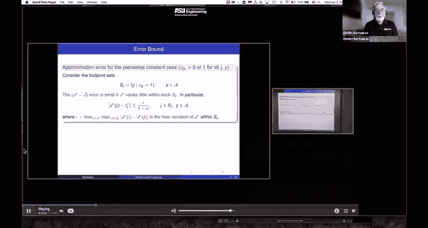

For representative states for the peacewise constant case where the aggregation coefficients are zero or one。

So the approximation J tils of one is piecewise constant。 Okay， it's constant within each footprint。

So for that case， consider these foot concepts corresponding to the representative features。

The result basically says that the error between aggregate cost and optimal cost is small if J star varies little within each footprint。

In other words， you get an approximation that's piecewise constant like that。

 if J star itself also varies is very little within。These footprintets， then the。

The approximation to the O coast。Is small。And here's the bound。

If Epsilon is the maximum variation of J star within each footprint set across representative features。

😔，Then the error of the approximation scheme is absoluteps over one minus alpha。

 splification factor of 1 minus alpha。 This is just a generalization of the band I gave in the previous lecture for representative states。

 which is not surprising because representative states is a special case for representative features。

So the im here is that you ought to choose a representative features so that J Sava is little over the footprint。

Of x。 And this is true for this piecewise constant case。

 but it's generally true in the aggregation schemes。Roughly true。

 although it's hard to write a precise result。So that gives you a guideline on。

Which sort of supportive to what I mentioned earlier that you should choose。Feature maps such that。

States with roughly equal J star have roughly equal features and also that you should be choosing their representative features so that their footprint within their footprint。

 J star does not very much。Okay。So now let's go into the solution of the aggregate problem。Okay。

 so here's the aggregate problem， This is a composite Belman equation R star。

On the left side should be equal to h of our star， which is the right hand side of Belman's equation here。

And I want to solve this equation。And it is natural to use some form of value duration Now value duration would actually replace R plus1 with H of RK right。

 that would be value duration and it would work on the other hand。

 it's difficult to implement because there is an expectation here that bothers us。

It is a legitimate algorithm and converges because H is a contraction。But。

But it's difficult to calculate H of RK because of this outer expectation。

We're going to use sampling to approximate that。 and once you use sampling。

 you need to introduce all such step size。Whereby at this duration。

 you compute an approximation to this h of RK， and then you move in that direction of that approximation with a step size gamma K that's diminishing。

Okay， now all of this is not easy to digest because it involves。

Difficult proofs and some insight in stochastic approximation methods that I understand that many of you may not quite have。

 but。So this is something to look into at some time later if。You don't quite grasp the details here。

Okay， so here' is how this works。 instead of computing and expectation。We just sample this。

 We sample and at the。Time K， we for a single representative feature。

 We pick a representative feature at random8 X K。Update。The cost estimate of that。Using this。

Interpolation formula， and we keep all the others unchanged。Now I here。Okay。

 we need an IK Ik here is a sample from the footprint of xk。

And selected according to the disaggregation probabilities。And this is。This algorithm is solid。

ItHa a convergence result that dates back to the mid90s。

If you choose gamma K to go to0 at a rate of 1 over k。And some other technical conditions here。

Actually， this is the main condition。 gaification go to zero and also。The other condition is that。

Each representative feature you should be taking up for reeration infinitefamously often。 Okay。

 you can't stop iterating on some X， right。So with these two。

 you get converges to the unique solution R star。And。This is sort of reminiscent also of Q learning。

 In Q learning， we also had expectation of minimization。 The minimization was inside an expectation。

And。And we did sampling。You sample the other outer expectation。 This is very similar。

 and the proof of convergence is somewhat similar to true learning proofs。

 All of these proofs were done in the 90s。Okay。Now this algorithm is still quite form double because you have an inner expectation。

 So if the problem is not deterministic。This is this may be a form double computation。So。

Policy duration does not have this problem。Why is that because in policy duration。

 we don't have this minimization during the policy evaluation so I can sample both the outer expectation and the inner expectation。

That's the difference。Okay， so I'm going to go through this and show you the formula。

And so this is a policy duration for solving the aggregate problem。

And it consists of cycles of policy evaluation， policy improvement。

 it generates at each generation a policy and also the aggregate cost corresponding to that policy。

And these Rs converge monotonically。There's no oscillation stuff here。

 it's all good monotonic and in a finite number of directions， RK is equal to our style。

Essentially what you're doing here is exact policy duration。For the aggregate problem。

 there are no approximations involved here， and there are no oscills， exploration issues。

 all these other stuff that can go wrong here everything is guaranteed theoretically to work well。

So let me give you the policy evaluation and the policy improvement cycles here。

So we have a policy in UK。 This is a policy that connects the upper transitions from original system state to original system state。

And the policy associates each state。To a control， right， it stayed eye to a control。

 not a represent the future， but it stayed high。So the policy evaluation。

 we have the policy in UK and we solve the corresponding composite Belman equation。

This composite Baman equation I've written here in shorthand。R。

 so x should be equal to this right hand side。And notice this now。

 this right hand side does not involve a minimization。

It involves the aggregationaggregationbabilities， it involves the transition probabilities of the policy。

Okay。And involves also the。Aggregation probabilities here。

And so how do I solve this policy evaluation problem Well。

 I can use a sample version of value duration， the one that I had before。

 but we can do sampling for both I and for J。 Okay， we can sample this probability。

 this composite probability here。And。So that。That facilitates a Monte Carlo policy evaluation。

But there's also an alternative。Look at this equation， okay， our case on this side， dark k over here。

It is a linear matrix equation， right？And can be written in this form。回。

RK appears on the right hand side， left hand side， RK appears on the left hand side。

With linear coefficients that I collect in a matrix Ak and this coefficients are。These things here。

Times that。 Okay， this multiply the components of。Of the vector RK。

And there's also a constant vector， the components of the cost of vector， I just see this part。

There's one for each x， and this is the vector。BK。So now these are expected values that can compute by Monte Carlo simulation。

In other words， for every X， I can compute this thing here by Monte Carlo simulation。

 I get one entry， then a second entry， all the entries of BK can be computed separately and in parallel。

By Monte Carlo simulation。Similarly， the coefficients of this matrix AK can be computed in parallel。

By Monte Carlo simulation。喂。Doing this。Pro build this。

And then after I had calculated this to a degree of accuracy。I can。Use matrix inversion。

To obtain this solution。I make it sound easy， but in fact， it's quite formidable。

 and here's one of the difficulties。There's an inversion here。

And there's noise in the evaluation of this AK。Inversion does not like round off noise or any noise can w havoc。

If you have。If you have。A discount factor that's close to one。

 then this discount factor is related to the spectral radius of this matrix In other words the eigenvalue of this matrix is one eigenvalue set right up to1 is equal to alpha。

If alpha is very close to one， you have to do a lot of simulation。

To get this A K accurately enough in order for this inversion to make sense。

And there are special methods for inverting this type of method that。

That tried toconvent around this problem of instability due to Monte Carlo noise。Okay。

 I don't want to get into that。I don't want you to think that this is trivial， it's not。

So this is the policy evaluation phase of the current policy， and we have to do policy improvement。

And policy improvement is done in the usual way by one step Look ahead。I have the solution。

 I have RK from the policy evaluation， I plug it into the usual policy improvement equation。

 and I obtain a new policy。Notice that there's an expectation here that will potentially bother us for some problems。

You may have to use。You may have to use。Approxiation in policy space on top of approximation in value space。

 in other words， calculate samples of this Americanan side and fit some policy using some kind of a neural network or approximation architecture。

Nothing is easy in this field， okay？嗯。But we have， in principle。

 a certain method that has some nice properties。And we can work with it。Okay。So we have covered。

 that's all I wanted to say about simulation based solution， the aggregate problem。

 now let's talk about variations of aggregation。There's something called bias aggregation。And。嗯。

It deals with the following situation。Suppose you have already a good approximation of J star。

Aggregation aims to approximate J star， but if you have already a good approximation。

 you may want to build on the approximation and correct the approximation V rather than start from scratch。

Standard aggregation the way I have presented it corresponds to v equals0 okay now J star is this green curve here。

 it is the state， this is a function， state， very oversimplified an oversimplified picture。

And v equals zero， you can set up the aggregation， correspond aggregation。

Framework the way I have described it and obtained。Something like this red approximation。Now。

 suppose you know V that is。Sort of captures the shape。Of J star， more or less。

Then you may consider to use aggregation to build a correction。 Our aggregation is going to。

Give you a correction to this V that will approximate J star。And how do you do this。

 you can do it very simply， actually。By modifying the cost structure of the aggregate problem。

To add this V。

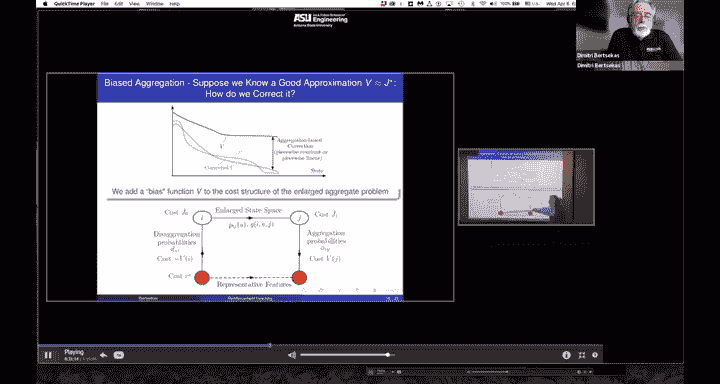

the up transitions？And this be inter down transitions。

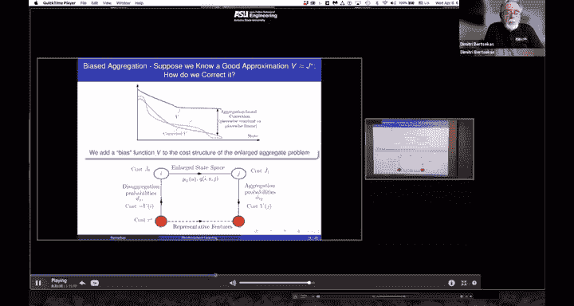

Now with this trick。对。Structure is modified so that J Tilde gives you V。Plus。The interpolated R star。

Now， this is not all。This takes a lot。 It's easy to see。

 but you need to write it down to convince yourself that I've done the right things here。

 I have added and subtracted the proper。The proper amounts。嗯。

This is actually in reinforceal learning。This process。He's also called。Cost shaping。

 You may have seen this。 Cos shaping or reward shaping is actually an old technique in dynamic program that date back。

Maybe 30，40 years。嗯。When people try to modify the development equation by adding this attracting quantities and put it in some kind of variational form。

But in the modern days， you may see that cost shaping。And。嗯。And given this view。And now。

 in given this。Alicgate framework， including the large state space。

 but just a different cost structure。Then you will have three Belman equations， given you R star JtL。

 then Jt1， JT is0 J1。And。Note that because of the presence of V。

 J tils of1 is going to be V plus a correction。This is the correction that we add to V in order to get an approximation to J star。

If you know V to be if you know J star itself and you stick it in here， then。You're going to get。

A tilda zero Tilda。0 and1 J at 1 equal to J star， and the aggregation framework is going to give you the optimal policy for the original problem。

So this suggests that if you know a V that's close to J star。

 the aggregation problem is going to give you a better result， a good result。

Suppose you have some policy and you choose V to be the cost function of that policy。

Then you can apply the seggregation framework， and then you get something that looks like a rollout。

In fact， if you have a single representative feature that maps to all the states here。

It's going to be exactly the rollout algorithm。And this suggests that if you have multiple representative features and therefore a more accurate approximation framework。

 then。The aggregation policy is going to be much better than product。嗯。

All of this has to be verified， but it's clear from simple examples that this should be true in some form。

All of this is very new。 Okay， we're talking about stuff that's been developed in the last three months。

Okay， that error bounds also similar to the case where v is equal to0 and suggests that。

Once you choose a representative features and footprint sets so that。Within which。

V minus j star value is little。Not just J star， but v minus J star。Now， okay。

 I'd like to use v minus J star to construct representative features， but I do not know J star。

So one possibility is to use them。K value directions on V to approximate J star。

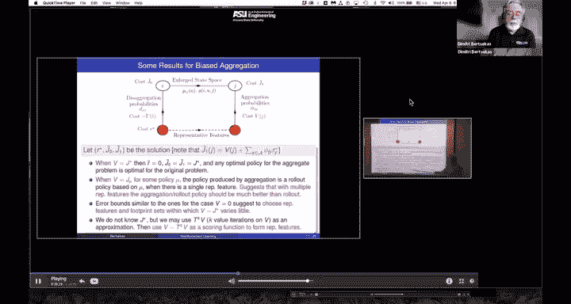

That will give me roughly the shape of this difference。

 which is what I need to know actually for using for picking representing features by using this expression as a scoring function。

I'm rushing all this by you， but you may want to look at all this later。 it does make sense。

 but you need to look into it a little bit more deeply。

So that's what I want to say about bias segregation。It looks like a promising idea。

 but a present has not been tested extensively。The idea of。Of using。

Cost shaping has been tested in reinforcement learning with results that look good。

 but not fully convincing to me。But's something that people have looked into。Okay。By the way。

 this lecture was videotaped in 2019， so the biased aggregation result in some of the earlier。

Earlier ideas in the lecture。Were very new at the time that they were presented。

 but now it's been like three years30 years that have passed still the subject is unexplored and I hope that some of you will be interested to take a closer look because I think they're interesting ideas that may be very uniquely well suited for particular application context。

Are there any questions？I have a short video for another variant of aggregation。

And I'm going to go to that。So now let's look at another version of multistep Look ahead。

You remember。We had an aggregate。Problem structure involving representative features。嗯。

Transitions to the original system states， according to the segregation probabilities。One transition。

To a system state J from I to J， according to this transition Pro。And then go down to。

And I can get feature using disagggregation probabilities。

Suppose now that instead of a single transition before going down， I use n transitions。

What would be the benefit of that？What would be the benefit of using this multi stageage structure versus using the structure per n is equal to 1？

Well this problem may be a better approximation right it's more faithful to the original problem the original problem is an infinite number of green transitions right so here we're going to take a large number of transitions potentially in between dropping down to the aggregate states making some kind of compression of the state space every end stages so we hope that this framework will be。

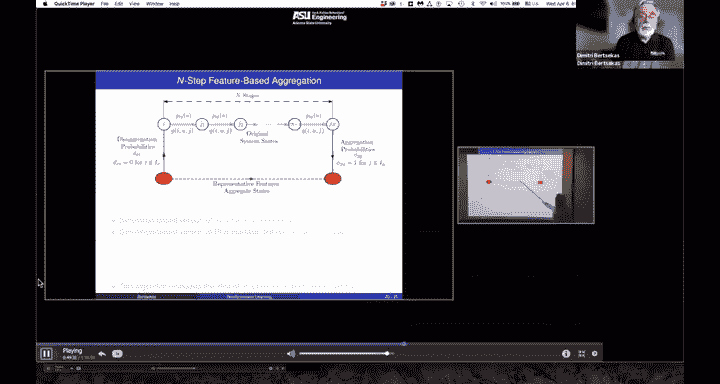

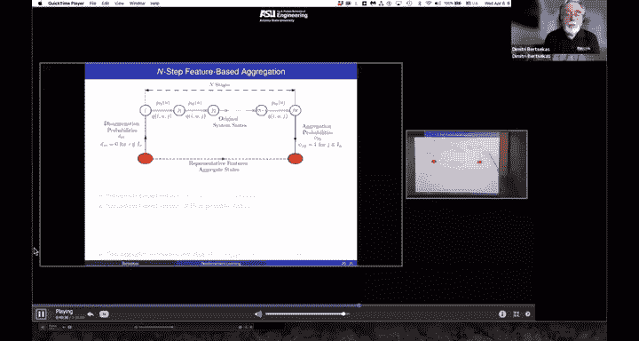

More faithful to the original problem。However， now we have an enlarged state space just like that。

And it involves n plus two stochastic Belman equations。Value duration， based on sampling。

Because other boards， okay， you can't do it， why？Because there's a minimization over a minimization a minimization over a minimization each time involving an expectation in between。

So it just cannot be implemented。You can implement policy duration because for a given policy。

This transitions here， you can do Monte Carlo。 There's no minimization。

 so you can do Monte Carlo across its transitions。However。

The policies that we implement are multi step。 Okay， they're not just a single step policy， but。

And stage policies。So that complicates things for a general stochastic problem。

Now here's a simpler case that I'm going to focus on。Had the deterministic problem。

In the representative states， no features。 Okay， so from a representative state。

 I go to a true system state。To the stayed at the same state。

 and then I move deterministically across， I end up with some after the end of end stages at some original system state。

Which I interpolate with the fees and go down to the representative features here。Okay。

So now value duration。Involves the solution of an end stage deterministic problem。

There is a minimization across the stages， but this is deterministic。

 so that means a shortest path calculation over the end stages。And basically， what you're solving is。

An end stage Belman equation， I'm sorry。End stage value duration。嗯。

Tpe of equation involving end stages of the dynamic programming operator so value duration would take to this form and this would involve minimizations in between。

 but these minimizations are solvable by shortest path calculations。

So now if you look at this algorithm here。It involves aggregation in space。

Because I'm looking at a small subset of states， the representative states。

 but also it involves aggregation in time。I'm aggregating one transition from x to y into I'm aggregating n stages。

And time steps into a single transition from x to y。Okay。

There is the 2019 lecture has a lot of more a lot more material on the aggregation in both space and time it's an interesting subject that has not been explored fully。

 but we're not going to get to this because it becomes too technical so we will now。

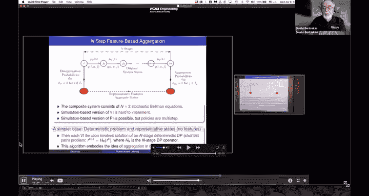

We have now finished。The technical part of this lecture and also of the course， by the way。Because。

Our。来。😡，Our last lecture， we have only one lecture left。And in this lecture， we will do a。

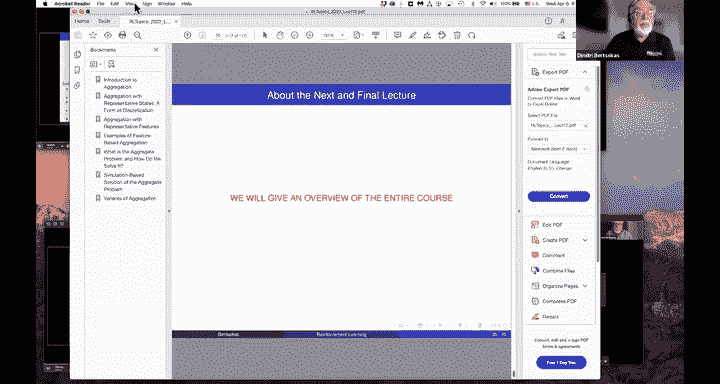

An overview。Of the entire course。And you can bring your questions from any part of the course at that overview。

听。Howeverever。There will be no new material， all the material of the course has been covered。Okay。

 so we'll see you next week for the last lecture， which will be an overview。

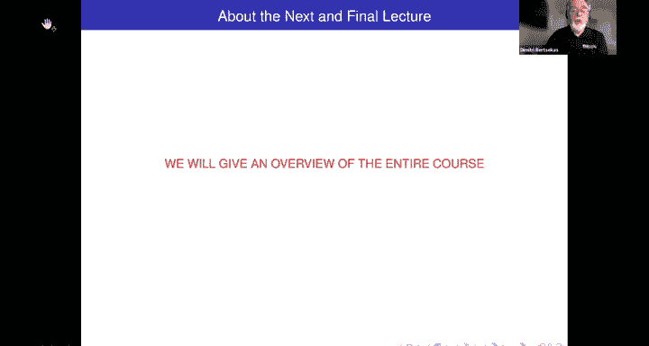