# ASU《强化学习2022-2024｜cse 691 Reinforcement Learning Course at ASU》中英字幕（deepseek - P42：[25]Lecture 13, Spring 2022_ An overview of the entire course, - GPT中英字幕课程资源 - BV1zcfVYdErD

Let me welcome you to this last lecture 13 of our course on the reinforcement learning。

This is going to be the last lecture and also an overview of the entire course。

We are going to rely in this lecture primarily on videos from previous offerings。

But before I start the video， I would like to review briefly two conceptual figures that have formed the backbone of our course。

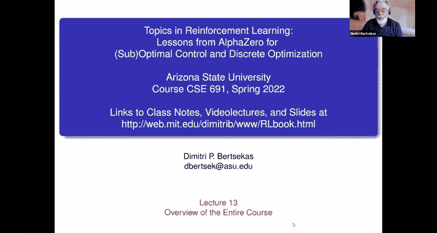

The first figure is our basic architectural design， the design of Alfa Ze。

 and the major conceptual idea here is that we will be using online clay on top of offline training。

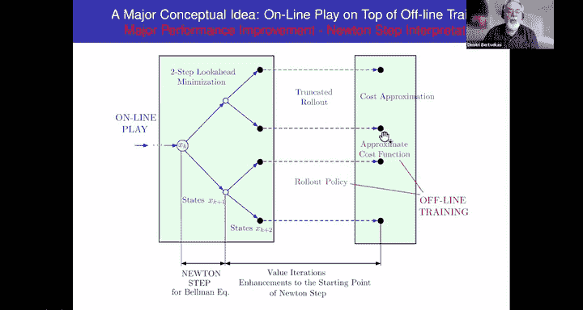

With the aim to improve in a major way， the performance of whatever we have gotten from offline training。

So the online play algorithm is what you see in glue here and it uses offline training in two ways to provide an approximate cost function。

An approximation to the optimal cost function and also an approximation to an optimal or a good suboptimal policy that is used if we are using rollout。

Now the online clay algorithm at a given states Alexa control and it does this by look ahead minimization over a several steps here by showing two steps。

And then possibly truncated rollout with a cost function approximation at the end。

And this can be viewed as a newton step。foollllowed by enhancements to the starting point of the Newton step。

 the Newton step is applied to the approximate cost function that's obtained by offline training。

 but preceded by value its minimization type of value its for whatever were the remaining of the look ahead minimization plus。

Look ahead with the rollout policy if there is rollout。

And this Newton step interpretation is mathematically speaking the cause for the major performance improvement that we see on the performance of offline play。

 this is a Newton step on the Belmon equation with a starting point provided by the terminal cost functional pro enhanced。

 but all this minimize look ahead look ahead steps。So that's our first figure。

 and we're going to come back to that in the course of this lecture。And that。

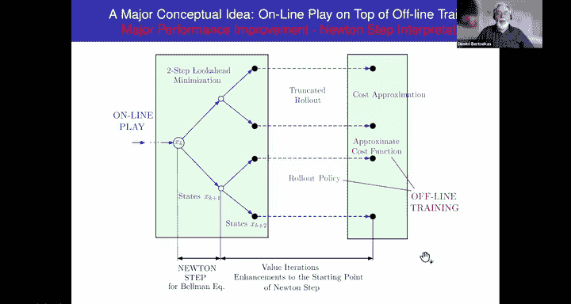

As far as the details of that， we need approximations at various places and the question is where do they come in？

And here is the one step look ahead scheme at state XK。

 we do this minimization well with the first step and an approximation of the future。

And there are potentially three approximations that enter in this process。

We can approximate the cost function， optimal cost function J star， we approximate by some J tilda。

If the problem is stochastic， there's an expectation here。

 we in way approximate the expectation some way because this is computationally very time consuming。

And we may also approximate the minimization， which can also be very time consuming。

So the question here at ariseizis and are the questions that we have been dealing extensively in the course is how do we do this minimizations the cost function approximation can be done in a number of ways problem approximation。

 rollout， pull policy， model predictive control， ideas。

 parametric approximation involving neural networks in training。

And aggregation， which we covered in the previous lecture。

The approximation of the expectation can be done by replacing the random quantities。

With a certainty equivalent， a deter deterministic quantity cutting coordinates in the use of simulation if simulation is used to。

Otainane its expected value and one way to do that is Monte Carlo research method。

All of this we have discussed and we have also discussed methods for approximationization。

 particularly simplification using in the context of multi Asianian problems。

And let me also add that if we use rollout here to construct JTilda。

 we need a base policy and we talked about various ways of obtaining a base policy。

 including heuristics， particularly in the context of discrete optimization。

 or methods based on approximation policy space， like policy gradient methods that we talked about two lectures ago。

And finally。Even though this figure depicts the one step look ahead minimization version of online play。

 there's also the L step look ahead version which involves similar approximations。

 basically the L minus1 steps， the remaining L minus one steps are folded into this J Kilde here。

 and all of these three approximations apply in somewhat modified form。

So this has been the major conceptual elements of our course。

 and now we're going to amplify those in this lecture in the order that we have covered them in the semester。

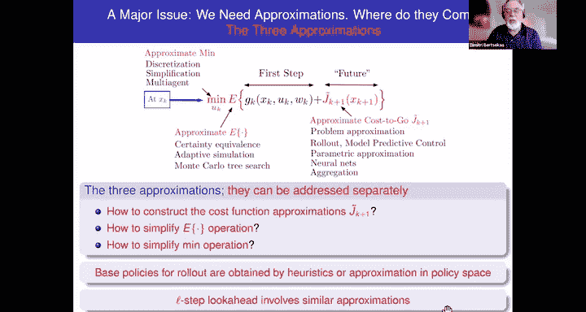

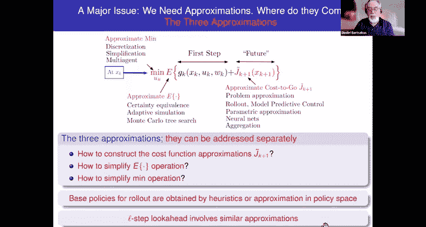

Let me go into the outline。We're going to go through a number of topics。In the order。

 that we covered them in class。So we started off with Alpha zero， an amazing program。

 and also we talked about some related programs。And we use this as a motivating application。

 trying to understand this methodology and also to generalize it to a far broader context。

We mentioned that it involves two algorithms， really。

 one is the offline training process by which it learns how to play。

 and the other one is the algorithm by which it actually plays against real opponents。

 real computer opponents。And we made the point that these two algorithms are related to fundamental algorithms in dynamic programming。

 so we discussed dynamic programming for finite Horiz problems first。

Then we gave the theory of infinite horizon problems in summary， and then later in more detail。

And we discussed the ideas of approximation involved in approximate dynamic programming in value space and policy space and how these connect with offline training and online play。

Then we talked about rollout。 We spent quite a bit of time on rollout and these variations first for deterministic problems and then for stochastic problems。

We。We discussed a more difficult case of rollout， which involves infinite control spaces。

 and we discussed ways to deal with those using optimization heuristics。And in particular。

 we discussed the context of model predictive control。

 a very important methodology in control system design。

Then we talked about multi Asian problems where we control consists of multiple components。

And we discussed how we deal with those with one agent at a time computations。啊。This subject。

Involves a recent research， my research over the last year and a half。

 we spent quite a bit of time on it and we gave some case studies around it。啊 we。

Then the preceding topics still primarily with off with online play。

 now offline training is done usually with parametric approximation architectures and neural networks in particular。

 and we discuss how we use neural networks within this context， how we train them and so on。

Then we went on in more detail to infant horizon problems。

And discuss the theoretical properties and also how they connect to approximations。

A fundamental algorithm is policy duration， and we discussed how we construct approximate versions of that。

Then we talked about a fundamentally different type of method involving approximation in policy space。

 talked about gradient methods， random search， and so on。And then we closed with aggregation。

 as we did in the previous lecture。So I'm going to take all these topics one at a time and I'm going to be posing once in a while for questions。

 we can ask any questions about anything and everything。

And then you may interrupt me also if there's something that you want to interject。So。

Let's go to alphapha  zero。

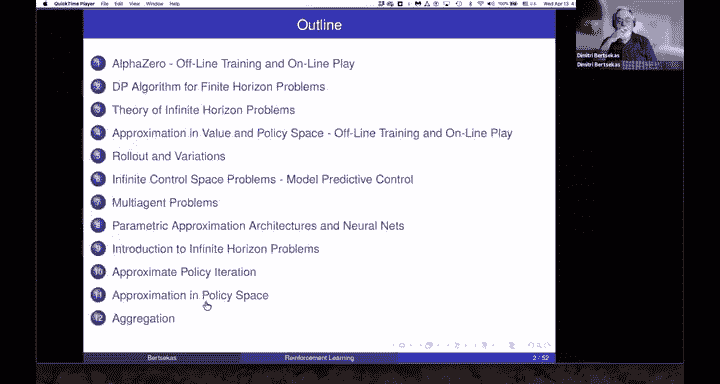

It came up a few years ago and created quite a bit of interest。

And there was a program before that called Alpha Go that could play the game of go at a superhuman level。

25 years before that， there was another program that played back Gammon。

 goes by the name of TD Gammon or other related names by the So。

And it creates similarly a lot of interest and motivated a lot of work in reinforcement learning。

And these two programs fundamentally use the same kind of ideas， the ideas of offline training。

 online play， park policy duration， rollout and the like。Now， as I mentioned。

 it's important to understand there are two types of algorithms around these programs。

One is offline training， which represents the learning process by which the programme learns how to play。

 in particular， it precomputes value and policy approximations。

And also other useful quantities that may be useful at some context later。And then another algorithm。

 which is。The algorithm that actually plays against human or computer opponents。

And this is a different kind of algorithm， It involves multi step look ahead， rollout and。

It involves also the pre computeutd value and policy approximations obtained during training。

 So that's how these two types of algorithms connect。Offline training。Compute some very。

 some useful quantities that。That。That are used in actual play。

So now this process here has strong connections with dynamic programming and the principal ideas involved are rollout。

How。Given a policy， we compute a new policy by look ahead minimization that has improved properties。

Policy generation is a fundamental algorithm in infant correction dynamic programming and involves a repeated rollout。

 one rollout after another switching the new policy with the old policy。

Then there's the policy improvement principle。Every new policy within this context here performs better than the preceding one。

 It's a fundamental property in police。 That's what makes police st work。

Then there are approximation with all these because we're looking at challenging problems where exact versions of these ideas will not are not feasible。

 so we use approximations to deal with a cur of dimensionality， too much computation。

 too large dimension。And the approximations come into value space。

 approximating cost functions and policy space， approximating policies。

And we may use a variety of approximational architectures。

 but neural network is the one that we emphasize the most。Now this course。

Has a focus and a point of view。It starts out from alpha zero and it tries to develop。

 to extend and to unify all the underlying methodology so that it applies far more generally。

It applies to general dynamic programming applications such as those appearing in， for example。

 in operations research in industrial and engineering。Optimal control。

 including a methodology model predicted control topics in robotics and planning。

Multi agent problems。嗯。Combininatorial optimization。

 deterministic integer programming type of problems。

Decision and control in a changing environment when the date of the problem changes as you control the system。

ho comes under the name of adaptive control。All of these ideas connect around all of these applications in a unified way。

 and that's the point of view that we emphasize in this course。So now let me go into the。

The offline training of Alpha0 and also Alpha go in the back Ga program。

The method of policy iteration is used， but with approximations and self generated data。

The current policy， we call a player， it's a player， it plays games。

 given a position generates a move to play。And the current player is used to train an improved player。

And this is done by。Two neural networks。One evaluates the performance of the current player。

 This is the value network。 In other words， the current player plays a lot of games。

And we collect the performance in the valuation of positions that generates。

And we feed a neural network to that。Then we use a policy improvement operation an on state position and move paces。

 and we represent this trust with a policy network。And this。

Gives us the improved player that for what we call improved， we hope that's improved。

And we repeat the new player。Starts in the place of the current layer， and we keep going。

 generate a sequence of players。Now， the successive neural networks are trained using this self generated data。

 but playing games。And we usually squares and methods that we discuss later。And。The back gamon game。

 which as I said dates back to the 90s， has a similar structure but uses only a value network basically the value network evaluates the positions of position evaluator and it also serves as a substitute to a policy network by look ahead minimization。

 in other words， by looking forward one step or two steps with this value network we generate moves and these moves are the ones that we use online for various processes of。

Look ahead minimization and all out。So sometimes we use two networks， sometimes one， the policy。

 the value network is essential， the policy network may be dispensed with at the expense of alternative calculations。

Okay， now the value network and policy network that we obtain from offline training is used in online play in particular。

 the general structure is the following at the current position be chsuit go or back gammon。

We generate。A look ahead three of moves and counter moves。And then from the leaves of the tree。

 we ran the policy network。Forward a number of steps。And at the end。

 we approximate the effect of future moves by using the opposition evaluator。 in other words。

 the value network。So。Now these three programs use slightly different configurations of this different variations of this figure。

 for example， alpha alpha zero does not have the middle part， okay， does not do rollout。

 but it use a very long look ahead。Alphago uses the middle part。呃。

T the TD gamma or the rollout version uses all of those in the way that you see them here。

One difference of alphas0 and alphaphago from the TD Gament player and other players is that it uses also Monte Carlo research to do this look ahead minimization。

The details are a little different， but the structure is saying this is our fundamental structure。

 some piece may be missing， some maybe pieces may be slightly modified， but this is our structure。

And this involves online play。This involves online play and perhaps offline training if we use a pretrained policy network。

 this part involves offline training， so the offline stuff that we have learned is used to play in real time。

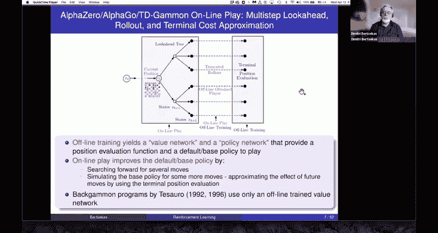

Okay。So。Let's go now into dynamic programming and for infinite for finite horizoniz problems。

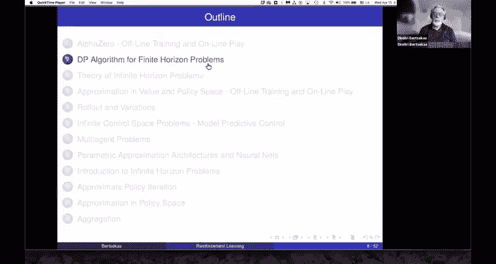

Our basic mathematical model for finite horizoniz problems。

 you see here it involves a dynamic system whose state is xk at time K。

 the system runs from time0 to time capital n for finite horizoniz problems。

The control is no UK WK is a random disturbance with given probability distribution for deter deterministic problems there is no random disturbance and that makes the situation easier and also provides us with a few more algorithmic options。

Now with this transition from Xk to Xk plus1， according to this equation。

 there's a cost that generated that's random because of the presence of WK and the cost。

 the overall cost over an end step system trajectory is the sum of the stage cost plus a terminal cost now this random value because WKs random。

 so we take the expected value of that and this is the number that we want to minimize。Now。

 we are looking for policies， sequences of functions of state， Each mu is a。

A closed loop control law。 is's a function of Xk or a list， if you'd like， for every X K。

 a time K it gives us the control that we should apply。

And there are many of these policies and we want to find an optimal policy now the cost of a policy is given by this number here。

 we plug in this mu case and this is a number for a given policy and depends on the initial state so the cost is a function of the initial state for every policy and we want to find the optimal cost by minimization over all policy。

 this is a function of the state and it's one of the main objects of interest。

 this is the most important quantity in the entire optimization problem。

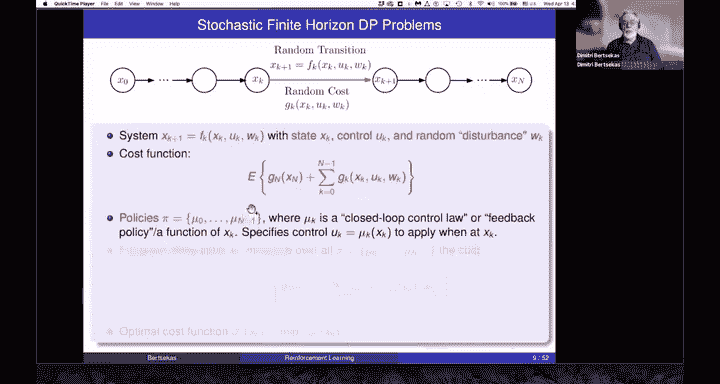

Okay， we've gone through this in great detail and repeatedly and there's a dynamic programming algorithm that addresses this problem optimally exactly。

啊。It produces the optimal costs of the tail sub problems that start at Xk。 In other words。

 we start at Xk。We disregard whatever happened in the past and we look forward to the end and we obtain a certain cost that depends on xk。

And the algorithm generates these JK stars backwards， starting from the terminal cost。

And this is JN star， this is trivially the cost of the trivial and take sub problem and given the optimal cost of all the tail sub problemsble starting at time K plus1。

 it generates the optimal cost of all the tail sub problemsble starting at time K。

And as we go back from n to n minus1 to0 at time0， we generate the optimal cost by definition。

 J star is the optimal cost of the tail sub problemble that starts at x0。

So that's dynamic programming algorithm。Now， once we have carried out this algorithm。

 which is of course quite formidable and we have obtained this optimal。Fite Hiz costs。

 J1 start up to J and start。烟。In online play， in real time operation。

 we generate controls going forward。 We observe the current state X K。

 and we do this minimization over all you。That satisfied the constraint。We minimize the。

The right hand side of this equation involving the first stage cost plus the optimal cost to go from the next state。

So once we have these J stars， we can go forward and generate controls。On the other hand。

 the problem is that this is not so easy because Jstar is very hard to calculate。

That's the principal impediment。We also have to compute this expected value。

 which may be time consuming。We also have to do this minimization， which may also be time consuming。

 so these are the basic issues that preclude exact dynamic programming to be from being a general purpose。

 widely useful tool。To make dynamic programming a tractable， useful methodology。

 we have to introduce approximations。 There is no way around that。

And the principal approximation is to replace this J star， which is the most onerous。

 the most difficult to compute， we replace it with some J tillde。

 and there are a number of ways of calculating this J tillde case that we have gone through in great detail。

There are also the other issues of approximating possibly the expected value here。

 because this does not arise in deter deterministic problems。

 but in stochastic problems this can be difficult， we may consider doing approximations。

And this minimization over you， what we have called the three approximations and these three approximations have to be dealt with and fortunately they can be dealt with more or less independently of each other。

Another point worth noting here is that this process of generating the exact optimal solution also involves offline training to obtain these J stars。

And also real time implementation or online play going forward to obtain a UK star so even in the exact version of the algorithm。

 theres offline training and online play conceptually this conceptual distinction is going to be is going to be carried over to approximations as we have seen。

Okay。So what is done for finite horizon extends to infinite horizon problems。

 the basic ideas are the same， but the mathematicals are more complicated。

We have not gone too much into the mathematics。😡，But generally speaking。Excuse me。Just speaking。

 there are three theorems in infinite horizoniz problems that you look for， okay？

We have focused on problems involving discounting and also problems involving stochastics or the spa problems involving a finite number of states。

 but infant corion problems come into a far broader variety。

 but there are always the three theorems that you want to look at。

And the first theorem has to do with whether they finance horizon on optimal costs。

Converge to the infinite horizon optimal cost as the horizon goes to infinity。In other words。

If you consider the。K stages problem， Okay， and let J K of x be the optimal cost of that finite horizon problem。

Starting from state x， then befiorem says that J stars of x。

 the optimal infinite horizon cost is equal to the limit as j goes to infinnity of the finite horizon cost。

For all states X。And this is true for the problems that we consider in this class discounted in stochastic sort paths to the finite number of states under some assumptions。

But I'm putting here the question mark to indicate that you should be careful that if you go to more general problems。

 this is not taken for granted， you should not take this for granted。

The second theorem has to do with Belman's equation J star satisfies this equation。

 a functional equation， one equation for its state x。

 almost always it holds certainly for the problems that we have considered。

 but has some freaky cases where this is not true so okay that's another case where we have this question mark。

We。Optimality condition holes whereby once you have found J star by minimizing this Belman equation。

 you obtain an optimal policy， and this is an if and only if statement。

 and it's certainly true for the problems that we have considered the finite state problems of discounted in stochastic short paths。

 but there are some exceptions。Okay， so from now on we'll just take this for granted that they hold and we'll worry later for cases where they。

Don't hold maybe in a different course。

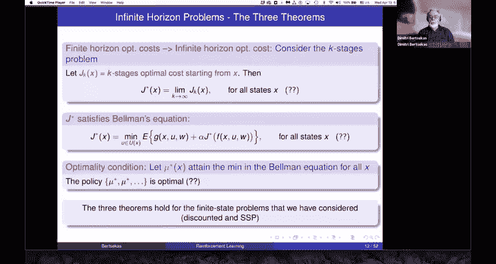

啊。Okay， so this is the theory， the basic theory， and now we have algorithms。

 and there are a few algorithms， the most basic of which are value duration and policy duration。Now。

 value duration generates a sequence of optimal cost functions。

But the difference here is that v0 is arbitraryrbitarily okay。The cave iderate is obtained from the。

From the previous data according to this equation and。

And note that alpha here is the discount factor， okay should have mentioned that。

And we expect this to converge to J Starr。Now， the policy duration algorithm is the one that we have used the most。

Instead of generating values， a sequence of cost functions， it generates sequences of policies。

 a sequence of policies。And theyre corresponding cost functions。 These are stationary policies。 Okay。

 applying the same UK for all times。K here refers not to state， but to iteration index。

Start from an arbitrary initial policy， generate a policy mu1， then u2， and so on。

And this is done in a two stage process。 The typical iteration starts with upon CMU。

Gens a new points in utilda in two steps。Policy evaluation step， which computes。

The cost function of this policy， new。And the policy improvement step。

 which computes animp policy using the one step look ahead minimization。

With J new here in place of the look ahead function。And。Okay， so now。

This algorithm in this exact form converges in a finite number of iterations。And in fact。

 converges very fast。And it can be viewed as Newton's method for solving Belllman's equation it's an important interpretation because。

Because it provides some insight into various variations， optimistic policy duration whereby。

The policy evaluation step is done approximately。Typically using a fews of a few values rather than an infinite number of value durations or a full exact policy evaluation。

 this is optimistic。There are there's a simplified variance where this's minimization simplified some multi agent variant which we have talked about and we'll talk about a later。

 and there are also two learning versions of policy duration so policy duration comes in several different forms and。

In this exact form， it can be viewed as Newton's method converges very fast。

 the variations do not have some limitations， but they retain a lot of the favorable convergence properties of policy duration。

Rollout is just the first iteration of policy duration。

 The full fl policy duration requires a lot of computation。 rollout is a lot simpler。

 It's just a single duration。 It's a simpler iteration。 However。

 it is still a new iteration making it pretty fast and this manifests itself。

In the fact that from mu zero， we obtain mu one and new one is already a pretty good policy。

 great great improvement in performance from the very first iteration。 It's a mutantton iteration。

 particularly if you're close to optimalimum in fact converence and single that it gives you the exact optimal policy。

 you can prove。Okay， so we have algorithms value iteration in policy durationeration。

 These are exact， and now we have approximate versions of policy iteration。

Which are very close to the heart of this course。Here we generate a sequence of policies and from a current policy which we call base policy。

 we generate a lot of data about its performance， we represent this by a value network which givess you an approximate cost function of policy so this approximate policy evaluation and then we generate we generate through a policy improvement process policy data and represent a new policy by a policy network so from a base policy we generate a rollout policy and we keep going。

And this the approximation is done with with value and policy networks。

 possibly neural networks now it's important to note that this is offline training。

 there is no policy， the original algorithm going beyond a single policy that is online clay is always offline training。

 which means you train neural networks for hours and days and weeks and so on。

 and then you obtain this data to be used for online clay。

Now rollout is just the first duration of policy duration and can be done in online play fashion。

In online fashion。And as I mentioned earlier， rollout typically improved substantially the base policy。

And that's because you're applying Newton's method for one step。

 and Newton's method is a very powerful method。That's the best explanation that I can give you。Okay。

So now let's go into approximation in value and policy space in general， not just through policy。

 but in general。By the way， are there any questions so far， Kenna you have any questions？

If we have a problem that requires system identification。

 would methods for system identification be considered a third type of algorithm kind of alongside the algorithms for offline and online play？

Or would we group those together and modify our offline algorithms？

Nothing that we have covered in this class deals with system identification。Right， yeah。

 I understood。So。Okay。If you want to do simultaneously system identification and control。

 you would have to pass into a far more complicated model that involves the unknown system parameters involved them as some kind of initial condition。

And then it would be a problem with imperfect state information and extremely complicated and with pitfalls that。

Had been considered since for the last 50 or 60 years and still we are struggling to deal with them。

The the closest we came to considering system identification within our context is through a process of adaptive control and online your planning in other words you may have a system identification algorithm running in the background and once in a while this algorithm gives a model to the controller or to the rollout player and then online through online your planning the controller uses the new model that the system identifier provides but in our context the system identifier is not coupled。

With the control process， it simply runs in the background using its own data。

 and then once in a while it provides a model for the online player to use。这是30页 question。Okay， yeah。

 thank you。Okay。Okay。So this is a familiar figure， it refers to approximation value space and it deals with online play after offline training。

 okay。And it generates controls at a given state， Ut Xk and generates controls by this minimization involving the first stage cost and the future cost as represented by an approximation J Tilda。

Okay， there are three approximations involved here。And。The most important one is this J Tilde。

 this is obtained。To a great extent through offline training。However， not necessarily。

 but for the most part。For example， you may use problem approximation whereby you take a related but simpler problem to the one that you are given。

 solve it exactly offline， and then use the results for online play in this approximation in value space scheme。

Another possibility is through parametric approximation。

 you have a neural network to train it or some other approximation I train it with over days and weeks and then you get used your J Tildas and you use online in the scheme。

Aggregation is a form of problem of approximation。 Finally， there is rollout。

 which involves a mixture of offline。Training and online play， Sometimes you do online simulations。

 sometimes you use terminal cost approximation。Model predictive control is similar to rollout。

 a special case okay。So there are many， many different methods in this category here。And。

Most of reinforcement learning， in fact， deals with how you approximate J Tilda。However。

 there are other issues that are important， how do you make this expectation。

 the calculation of this expectation cheaper， one possibility is。

To make this expression deterministic。Okay， the source of uncertainty here。

 the source of stochasticity is this random variable WK if you replace this WK with a deterministic quantity。

 which is called certainty equivalentvalence， then the issue of expectation disappears。

And there are also other related concepts， whereby for some controls you use more exact or less exact simulation。

 depending on which control is more promising than the other Monte Carlo research is based on that idea。

 some controls you spend more simulation budget with in some other controls you spend less。

 less simulation effort。Approximate minimization， for example。

 the minimization here may be over continuous space。

 you may want to do it approximately by discretizing the continuous space。

Or you may want to do some kind of simplification whereby you throw away some controls that are judged to be non promising。

Multi agent minimization， one agent at a time is a form of simplification。

So there are a few different options here， depending on your problem structure。Moreover。

 this represents one step look ahead， you can also do multi step look ahead。

 whereby you minimize over the cost of the first L steps and then the future。

 as represented by the approximation J Tilda。And then you obtain a control plus a sequence of control functions。

 and you use only UK and not the others。And the three approximations also arise within this context。

This tends to perform better intuitively， the reason is you treat more of your cost exactly， okay。

 through exact minimization， exact representation， less of the cost approximately。Roughly speaking。

 this is the reason why you get a better performance typically by multistep， look ahead。

Although theoretically by through artificial examples。

 you can show that it's not necessarily true that by increasing the length of the look ahead。

 you obtain a better subopmal quantity， I think we gave one example like that in one of our lectures。

Okay。So now。Let's look at the other type of approximation， we covered approximation in value space。

 and there's also the possibility of approximation in policy space。Otain a policy。

Which is approximately optimal。Now， this is strictly offline。 Okay。

 it's not a good idea to do approximation in policy space only。In in in。

ItIn a real application in online play， there are a number of reasons for this。 However。

 you can use approximation in policy space as。To provide some。To provide some information。

 some data that can be used in approximation in value space， In other words。

 it can be used as a component of approximation in value space。Okay。

So here the basic formulation is one whereby we have a parameterization of the policies with a。

Parameter vector RK for the case of a finite horizon problem。

 RK depends on the stage for the case of an infinite horizon problem。

 there's only one set of parameters for the stationary policy mu。

And we plug this in here for a given value of RK and it provides generates costs， okay。

 system brands， there's a cost associated with every parameter set。

And we optimize the parameters by minimizing the corresponding cost。

So the restricted case is usually a parametric family of Q like that， our case a paraor， for example。

 a neural network is one possibility， but there are a lot of problem specific possibilities here。

And the training， finding the optimal parameters within this restricted class can be done in a number of ways。

You can use classification software。By viewing controllers as classifiers。

That classifies states into the controls to which they map。You can use gradient optimization。

 optimize the cost generated here over R， or you can use random search is' a broad variety of methods。

And these methods don't have much to do with dynamic programming。

 there are general machine learning methods rather than dynamic programming specific methods like policy。

 approximate policy duration or rollout。Now， approximations policy space has a great advantage once you compute the parameters RK。

The online computation of controls is often much faster。

 basically if you have an approximation architecture which has been trained already。

 you look at the current state and it takes milliseconds。

 microseconds to generate the corresponding control。

 you don't have to do any complicated calculations。On the other hand。

 it has an important disadvantage。It does not allow for online repplaning once you have a model and you have generated a controller for it through approximation in policy space。

 if the date of the problem changes that controller may do crazy things。

 it was trained for something different okay。On the other hand。

 approximation in value space with or without a policy space component is well suit for online planninging。

 even with off online offline computation J because you take into account the change data in the。

Online minimization of current stage cost plus future costs to go。

Another disadvantage that approximation in policy space has。

It does not take it does not benefit of the bump in performance obtained through rollout in approximation in value space in the previous figure。

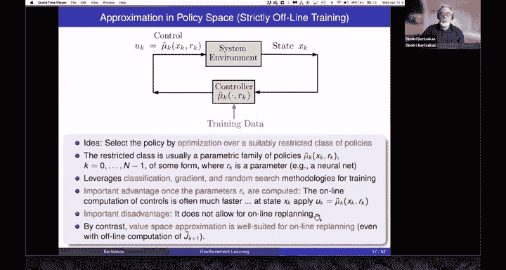

If this is the cost of a given policy， the policy that you generate is a rollout policy。

 what has improved improved performance， approximation in policy space by itself cannot provide that bump。

 that increase that improvement in performance。

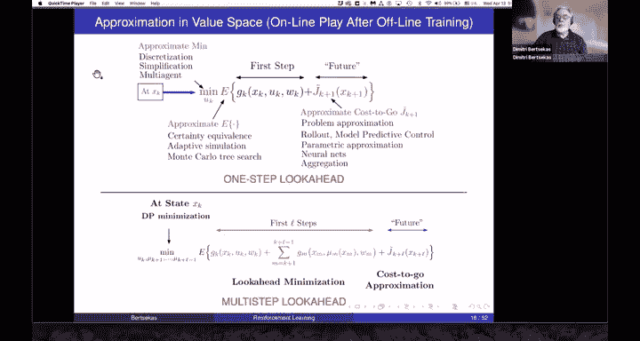

Okay， but approximation in public spaces all is。Needless to say， however。

 it's a very important part of the RL methodology， and it plays an important role。

 although you may use it in ways that are better or worse。Okay。

So I've emphasized this online versus offline computation scheme。

 It's an important conceptual scheme。 and I'd like to to。To hope you one more time。

Here's the familiar figure with the three approximations and approximation value space。There are。

Partly offline methods。Where these JTildas are completely computed for every day before the control process begins。

 so there's a long offline training process in these methods and examples of those are neural network and other parametric approximations to compute JTilda also aggregation。

At the other end， there are mostly online methods where J Tilda is not computed completely for all states at any point。

The values are computed only at the relevant next states maybe that will be encountered as we generate controls online。

So only the necessary J tilde values are used to compute this control here at each one of the end time steps。

And examples of methods that are mostly offline are rollout and model protective control。

Now they may contain an offline component， particularly if you use cost function terminal cost function approximation。

He in tranccate it roll out and similarly for multi predictive control， but mostly and fundamentally。

 the methods are online。These are offline primarily。And these are offline online primary。Okay。

 let me go into rolloutance variations。We separate the treatment of rollout into two parts。

 deterministic and stochastic， deterministic rollout。Is more effective。And also。

 it provides a few more options。 Let me describe the deterministic rollout in this pure form。We。

Generate states in a thecca state。We look。啊。All possible controls and the corresponding state。

 the single unique state that is generated by application these controls。

And we calculate a cu factor obtained by running some heuristic。

 any heuristic from this state all the way to the end。

 this heuristic only has the property that it can complete a trajectory。

 given a trajectory up to here， it can run a completion in some way。

 it can be very intelligent or very stupid。However， in principle。

 anything will do and we generate these factors here first stage cost plus the cost of the heuristic starting from the next state。

And。We compare these Q factors and choose the control that has the minimal Q factor。

We move to the next state X plus one and then generate again all the controls around the heuristic from each one of the possible next states and continue。

There's also multi step look ahead versions and other versions that we're going to discuss because the problem is deterministic here。

 you can afford to do multi step look ahead because the。

The branching factor of the look lookhead tree is is smaller。

 It does not blow up with the branching factor of the random disturbance。

And so deterministic problems have important advantage when it comes to rollout over stochastic problems。

Okay， now still deterministic rollout can be time consuming so we have。

A version that involves truncated to allowed。Internal cost function approximation。

And the motivation is that longer rollout is costly because the trajectory is to complete maybe very long。

 in fact， if you have an infinite horizon problems， you cannot complete the trajectory。

 it's an infinite trajectory。Also， it's not necessary。

 it's not theoretically clear why by increasing the length of the rollout。

 you're going to get improved performance。 In fact， some experiments and some analysis show that。

The length of the rollout should be some kind of a compromise。

 some kind of a tradeoff between length of computation and improvement in performance。

 and one should for each problem one should experiment to find the right length of rollout。

Now to compensate for plant of the rollout， we use a terminal cost function approximation。

 which accounts for the cost of the remaining stages and also allows combinations with offline training the terminal cost function approximation may be obtained by offline training。

For this scheme， we can prove various cost improvement properties under various assumptions of sequential consistency。

 sequential improvement in modifications like the fortified rollout algorithm。

 which guarantees cost improvement。And I emphasize the point。That in my view。

 there's no question that the rollout is the most reliable and most easily implementable reinforce reinforcement learning algorithm。

A lot of these other algorithms that we're talking about or other people are talking about are flaky。

 rollout will never betray you， will always do good things for you sometimes in very substantial improvement over the over the base policy。

And and， and。And。Always some improvement， it is a very rare case where you don't get good results from rollout。

 but you never get bad results。Particularly if you use things like Q rollout and so on。Still。

 however， if you're aiming to solve a difficult problem。

 you need to do some trial and error experimentation。

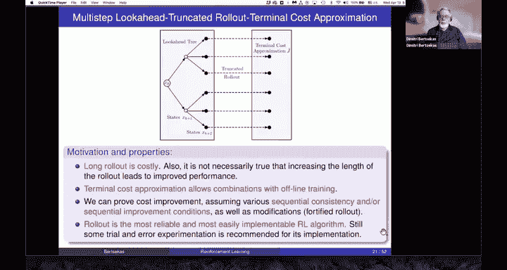

Okay， I would spend a lot of time on rollout。 Remember。

 this is not a general course in reinforcement learning。

 This was targeted towards rollout and approximate policy duration。In multi Asianian problems。

So we discussed a lot of different variations overall rollout。

One of them is 45 year old out for deterministic properties， which guarantees cost improvement。

Basically， you generate a sequence of trajectories and always maintain the best trajectory。

Before switching to a new trajectory， you make sure that that involves cost improvement。

Simplified it allowed instead of minimizing over all key factors， we minim in over some key factors。

Or we do some other kind of。Process like with multi Asianian problems。嗯。Constrained it all out。

 where there are site constraints， Tra constraints。 We discussed that。

Problems where you don't know a cost function， the cost function。

 but you have access to an expert that can rank two different trajectories and can tell you which one is better。

 That's all you need in deter deterministic rollout。rollout with continuous control space。

 I mentioned about that and NPC multi predictive control is an important example of versions of rollout that are adapted to continuous control space。

Multi agent allowed for problems with where control has multiple components。

We'll talk about those a little later again。啊。There are combinations with Monte Carlo research which affect this look ahead three part。

 we do it less precisely by emphasizing branches that are more likely to give you better controls。

 better choices。嗯。And okay， the objective here is to save simulation time。And。Also。

 combinations with approximations with value and policy space。 Okay。

 you need approximation in value space to。For this part here。

And sometimes you need approximation in policy space because you need to represent a control by which you do the rollout。

 represented it in some more。In some compact form。So all of this， there are many。

 many variations and a lot of interesting possibilities。

 both from the implementation point of view and sometimes from a theoretical point of view。

I have any questions on this slide that has so many methods on it。Yeah， another question。

I haven't thought about it。For a while， so hopefully I phrase this right。

 but so for this deterministic case， we sample the。

The deterministic traject is from all the next states。We're essentially computing the Q values。

 right， so。The improvement properties are related to the contraction properties for that bellman operator。

I would assume so for the stochastic rollout。We're going to basically go and sample number of these trajectories do like a Montei Carlo estimate of our values。

In that case， can you talk just a little bit about the bias and variance of stochastic rollout？Yeah。

 okay， there's a handful of issues that you bring in。First of all， contraction properties。啊。

Are relevant in the context of infinite horizon primarily。

Here we're talking about finite horizon problems as well as infant horizon problems。

 but the focus here is mostly for finite horizon problems I mean a lot of these variations do not apply for infant horizon。

So。So。I think。I would say that perhaps in some types of analysis。

 there may be a role for contraction mapping type of theory， but not very much。Okay。

For deterministic problems， there's no issue of variance of trajectory we just generate the trajectory just a single trajectory for satorcchastic problems。

 however。The results of cost improvement。Assume that there is perfect simulation。

 an infinite number of samples to calculate the corresponding costs running from each one of these leaves。

To calculate it exactly。啊。There's a lot of analysis and a lot of algorithmic。Algorithmic。

Vations for variance reduction， in other words， supposed you're given a fixed。

Budget of number of samples that you can use。You can structure the simulation so that you get your musical data efficiently。

And get small variance from your average estimate。Or you can do things， let's say more naively。

 And then you may get large variances。 The problem， the issue of various reduction。

Is a very important issue in simulation。There is analysis like that in the literature in my reinforcement learning book。

There is a section on that。However， in our class， we have skipped this completely。

 We didn't talk about it at all。嗯。Generally speaking， with layman's approach to variance reduction。

 you you just compute more samples， you use more samples。

But there are some tricks that you can use and it would take me too long to explain them at this point。

Let's see what else why did I forget remind me please。No， that was great thank you。

 I think you covered most of the points I brought up so。Okay， fine， very good。 Okay。

 so let's go into infinite control space problems。嗯。Okay。Let's consider a deterministic。Problem。

Where the number of controls however， is infinite， so you cannot enumerate all these Q factors and compare them。

 you have to do something different。And we need a different implementation and suppose of course one possibility is to discretize the control space。

 but then we may need an excessive number ofQ factors so we're looking for something a little different and the major alternative is to use optimization heuristics remember that we generate all possible next states using all possible controls and then we run a deterministic heuristic now suppose that this heuristic is some kind of an optimization heuristic involving the choice of controls from this state。

To。To another L minus one stages， okay？And then。You can combine this L minus1 stages minimization。

 is this first stage minimization to build an L stage， a single L stage deterministic optimization。

And now this optimization， which will involve continuous control spaces。

 can be addressed with continuous spaces optimization techniques like nonlinear programming or optimal control methods。

 quadratic programming， gradient type of methods and so on。

Now this is the idea this idea applies more generally to linear programming。

 multi stage linear programming problems， a number of interesting， stochastic programming problems。

 but we have not covered those in class， but we did go into was model predictive control。And。

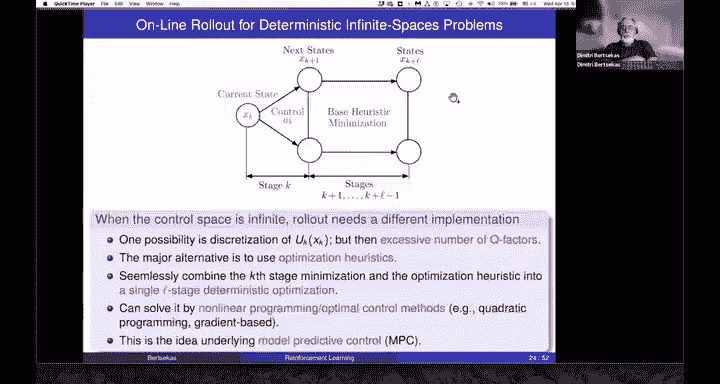

呃。We spend a lot of time， but here I have only one slide。

Model predictive control in its most basic form involves deterministic control。And to the origin。

 okay， control problems come in two varieties， either control a system to stay close to a certain reference point like the origin。

Or control the system so that it follows a certain trajectory now let's discuss the case where we want to keep the system close to a given a reference point and we take this to be the origin for specificity。

So the system is deterministic like so。And。The cost per stage is non negative except that the origin where we want the system to go and stay is cost free and absorbing。

 so there's an incentive here to move towards the origin which has minimum cost and continues to have minimum cost once you reach it。

So that's a classical formulation， optimal control formulation of the regulation problem。

Now there may be state constraints like the state XK has to belong to a given set and control constraints and this is really the most important thing in model predictive control。

 we are trying to address constraints like that more effectively than we would with unconstrained formulations like the linear quadity formulation that we have discussed at various points in the class。

Multipative control deals better with state and control constraints。

And what it does at state Xk it solves an L step look ahead version of the problem。

Requiring that after L steps， the state is the optimal state0 Okay。

 and the costs here are the same as well。 So this is。What it computes is a legitimate。

Of control sequence， go to zero and then stay at zero。And it solves this problem。In this way。

 it will obtain a sequence of L controls one stage and then L minus1 stages。

It keeps the control of the first stage， throws away the remaining of the controls。

 and then goes to the next state and just does the same thing， another problem else steps ahead。

 keep the first control， throw away the others and so on。

Now modelpoli control is a very broad subject， there are quite a few books written on it。

 there are many， many variations is still a subject of ongoing intensive research。

 and there are many variations， one is instead of aiming to in this in this heuristic optimization L step minimization instead of trying to go exactly to the origin。

 we introduce a terminal cost function approximation and under some condition like。

Like a sequential improvement type of condition or liov。Condition as it's called control。

 you can prove that the overall system is stable。 by the way。

 the main advantage of this of this formulation here with driving the state to  zero is that it produce a stable controller okay。

 that's a major result in NPC。And this property is maintained with a terminal cost function approximation under a certain condition of the sequential improvement type。

There are issues having to do with how how do you keep satisfying these constraints， for example。

 the control that you。Cculate with this minimization。

 maybe such that it's good if you just focus on this L step minimization。

 but it may drive you to parts of the state space where it is impossible not to violate。

 it's impossible to maintain this state constraint。

So there's a whole lot of reachability of target tubes type of methodology to obtain。

To to modify these constraints so that they can be maintained at all times using this heuristic minimization。

There are simplified versions like multi agent versions of NPC。

 and there are others involving both continuous spaces， mixture of discrete variables。

 discrete discrete control variables and continuous control variables where this problem here becomes an interteship programming problem may be difficult to solve and there's lots of stuff here。

Okay。

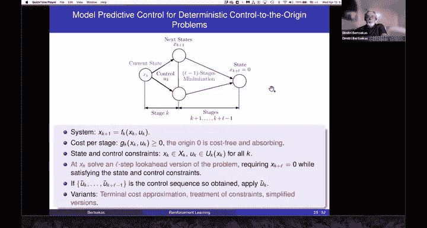

So。I'm going to spend。Sometime with multi agent problems， remind you of the basic ideas。

And then we're going to conclude our discussion of approximation in value space and we're going to go into approximation in policy space and other related。

Well， in offline。We're going to look at offline training type of algorithms。

 and I'm going to switch also to a video from the 2019 offering of the class。

So let's look at multi Asian problems which is a problem at the cutting edge of research。

 I mean this problems at least in the approach that I have discussed here is only about one and a half year old。

 still however， enough research has been generated and enough case studies have been produced to suggest its reliability and effectiveness。

Using the idea of one agent。One agent control calculation at a time。

Okay， you've seen this figure before I represented it's a general schematic of multi agent problems。

 we have this decision making centers， each one involving its own control， U1 U2 and so on。

And there is an environment， the agents exchange information that they obtain through sensors。

Among each other and they exchange information from the environment and each agent given the information。

That it possesses applies decision applies a decision。 So agent I applies decision U I。

Seququential is discrete time and the overall control is the Cartesian product of these use， okay？

Hes me。M double for M agents is M components of control。好Now。A major distinction。

 mathematical distinction between different problems， which was well known 50 years ago。Is that？

There are problems involving a classical information pattern where all the agents are fully cooperative。

 fully sharing and never forgetting information。And this is relatively easy because it can be treated by dynamic programming。

And the other one is the case， the non classical case。

 where the agents may not be fully sharing information， maybe antagonistic。

The environment may be sending information intermittently is all sorts of deviations from the classical information pattern and these problems are extremely hard to address even conceptually because they cannot be treated by dynamic programming。

 the optimization problems， but，But very unstructured in particular。

 they cannot be treated by the program。So our approach here has been。

To look at problems where the classical information pattern holds。啊。Exact state information。

 perhaps exact belief state information for the case of upon D P。

And the agents shoot their controls as function of the state and they all share the same information。

 the same state， so it's like having a information cloud here that collects all the information and then passes on to the agent。

All the information that they need from a dynamic programming point of view。

Now we adopt a stochastic dynamic programming problem。

Fynite or infinitefinic horizon state x control U， and the characteristic aspect of this problem is that the control has M components corresponding to the M Asians。

Now agency here is just a metaphor。It may be that you have M agents spread all over the Phoenix metropolitan area where you may have M agents housed within a single computer the important mathematical structure is multiple components。

And。We aimed here at faster computation。There's a major problem here involving the size of the control space because the control has multiple components。

 the size of the control space grows exponentially with M， the number of agents。So in our approach。

 we have dealt with this exponential size explosion of the search space with one agent at a time computations like miniization。

 minimizations in the context of approximation value space。And。

In the case where we are in the nonclass information pattern situation or to further accelerate the computation。

 we use signaling。Information that estimates。Information consisting of estimates of what we don't quite know exactly。

And this signaling is pre computed。Using neural networks or other estimators。

 we have seen examples of that， but exactly how signaling is pre computeutd is also a problem related issue。

So classical information pattern and whenever we deviate from that。

 we use signaling and bring in neural networks or other kinds of estimators。

And I will give you again， the basic structure。Involving the infinite horizon case。

 this a simplifying notation， the same thing applies for finite horizon。

And the standard rollout operation with a。With a given policy mu， with a base policy mu。

Is to do this minimization over all Mtops of controls。The multi agent rollout case。

 does this minimization one U component at a time is a form of simplified rollout。

Where we don't do exact minimization， we do it approximately， but in a way that's intelligent。

And the remarkable thing about multiage rollout， it still guarantees cost improvement。

If the way it operates is。It breaks up this minimization into M minimizations over a single agent at a time。

The first agent。Does this minimization over its own component？

Assuming that the future agents use their base policy。

The second agent assumes does this minimization assuming that the future agents will use the baseball policy。

But。The third preceding agent uses the controls already computed in the previous stage。

They're all out controlled in other words。Similarly。

 every agent computes by minimization over its own control， assuming that the future。

Agents will use the base policy， the past agents use a rollout policy and finally we reach the last agent which assumes that all the preceding agents use the rollout controls and finds the last component and this sequence of M minimizations provides you with a control to replace the control that you would get from this minimization here。

Now the search space of all these the amount of computation needed to do these operations here is linear in M and not exponential。

 and the speed up of first is enormous。And there are a number of papers。

 some of them have already been published， others are in the process or archive papers over the last year and a half。

And also there are the case studies that we there's a case study that we have discussed involving the。

Multi robot repair over a network gave you a demonstration of that。嗯。Okay。

So we also gave demonstrations and we used this spiders and flies example。

 just to repeat here we have 15 spiders and three flies。

 the spiders move in the four directions so they mistake where they are， they have perfect vision。

And they are the controllers。 Okay， each one， each choice represents a component of control。

The flies are blind， do not do anything purposely move randomly and they provide the uncertainty for this problem we could have also deterministic flies that don't move at all or move according to a known trajectory。

And the objective is to catch the flies in minimum time now， okay。

 now the size of the control space is5 to the 15，15 spices。And five choices each。

 approximately that enormous number of joint move choices。

 So we have to compute five to the 15 Q factors here at each one stage to find the optimal joint move。

Now with multi agent road La， this is reduced to just five times 15。

 75 choices while maintaining the cost improvement property， as I will show in the next slide。

So first spider。Makes a choice， sends its choice to every other spider。

 then the second spider makes its choice， broadcast its choice to the other spiders and so on。Now。

We also gave an examples of。Precomputed signaling implying coordination between the spiders。

which allows the 15 spiders to choose moves in parallel while guessing what the other spiders are going to do。

And that can speed up the computation by up to 15 by a factor of 15 or whatever the number of agents is。

 spiders is。And。The and perhaps。The use of signaling information。

May deteriorate the performance of the overall scheme。

 but you can gain a lot in terms of computation in terms of speed。

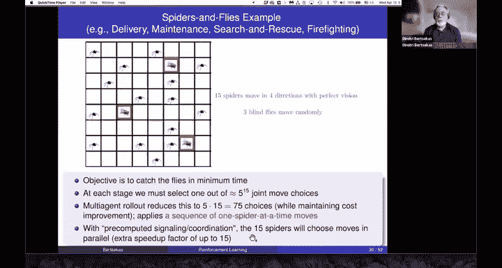

Okay， finally。About multi Asian rollout is not really fundamentally a new approach。

It involves at its heart， a reformulation to an equivalent problem。

And this reform goes way back 25 years back in my neurodynamic programming book with John Siicks。

It involves a general approach for trading off state complexity with control complexity。

So if the if the control space bothers us and it's too big。

 we can take it off with state complexity and in the case of rollout it's。

Control complexity that kills us that can make a big difference。

 State complexity is not so important because we never look at the entire state space。

 We only look at one state at a time。Okay， so what's this reformation？We unfold the control action。

By making a transition from Xk to Xk plus1， breaking it up into M transitions。

 each one involving the selection of a single control by a single agent。

And we move from this state to a composite state involving state and control。

 then the second agent applies the control and we get a composite state involving two controls and so on after M minus one choices we reach this state here and the last agent chooses its control and now we have the complete joint control vector and and we can make a transition according to the system equation to xk plus1 with this cost。

 all these other transition involve no cost。And so this problem is equivalent。

 it really does make a difference whether you have your。

You're selecting all controls at once or one at a times， as long as。

All agents know the exact value of the state Xk。The control space is simplified because it's only one at a time with a lot less few factors overall all。

 but there are some additional layers of state。Involving these intermediate states here。

And multi agent rollout is just standard rollout for the reform related problem。

 and you can see here the similarities involving one control choice at a time taking into account the current state which involves the previous choices of controls。

And the increase in size of state space does not bother us because there's only one state per state that's looked at。

For which we calculate Q factors during online play。Theres tremendous complexity reduction。

So the key thing is that we maintain this cost improvement property because after all what we're doing is just standard rollout。

 which has the cost improvement property， but we just do it on a reformulated by equivalent problem。

Okay。Are there any questions now before we go to the video？From the 2019 offer of the class and。

Go into questions of training。offffline training。Any questions？

You have a couple of questions do we need to optimize or what to help optimizing over the order of the agents like that seems like it should matter in general。

 right？Actually you gain some improvement in performance by optimizing over the order。

 there are clever ways to optimize over the order approximately。

Whi I'm not sure that it's given in your class notes。

 but certainly given in the survey paper that I gave， I noted earlier。So it does matter。

 the order does matter because okay， if you change the order of the agents。

 basically you're looking at a different reformulated problem okay。

 and you're applying an approximation method on a different reformulated problem and it's going to perform possibly differently。

And there are other intuitive ways to explain it。I mean。

 you can put simple examples where the order matters。For example。

 if there's a control that's kind of dominant， okay， relative to the others。

 it's a good idea to pick that one in the right order。Okay。

 thanks yeah and also I was wondering without knowing the full details of how the signaling is implemented。

 but can we ever use this signaling to。Alleviate the need for knowing the dynamic model dynamics model of the environment。

Because it seems like and how was thinking about it before is。

That knowing the the current policy and what the other agents will do， we could use that to plan。

head and see what stayed so land， but it seems like the signaling is saying no。

 we can actually do these moves in parallel little。

So is it possible to just do a model free version of this？Okay， if by model3。

 you mean that we don't know a mathematical model， the answer is。Probably it too difficult。

 The signaling all the signaling theory is just very， very recent。 We're talking about months now。

 okay， and。The range of applications of signaling within this context has not been fully explored。

There may be something that you can do along the lines that you suggest。

 but I don't know of anything right now。Okay。And then also curiosity。

 do you know of any works that have tried to combine this with the aggregation schemes？嗯。

The answer is no， but I wouldn't be surprised if there are ways。Okay。Like I said。

 all of this is very recent， yeah not much has been done I mean I'm learning about it going to on a weekly basis。

 you know people write to me and say well I have applied this and I have applied that and I haven't even read all the things that they bring to me。

Okay， so now we're going to go to the training of neural networks。And be corresponding。嗯。

Let me stop the video and ask questions on the roll out multiation problems and what we have been discussing and then we will take a long break to sort of stretch a little bit。

Okay， so we will meet in 15 minutes， let's take a 15 minute break， okay。

And we will go into the second half of this lecture， Shalong lecture。

 which involves offline training starting with neural networks。So see you in 15 minutes。Okay， guys。

 we'll get that started now。approximation architectures。And other issues。

 and I'm going to use the video。

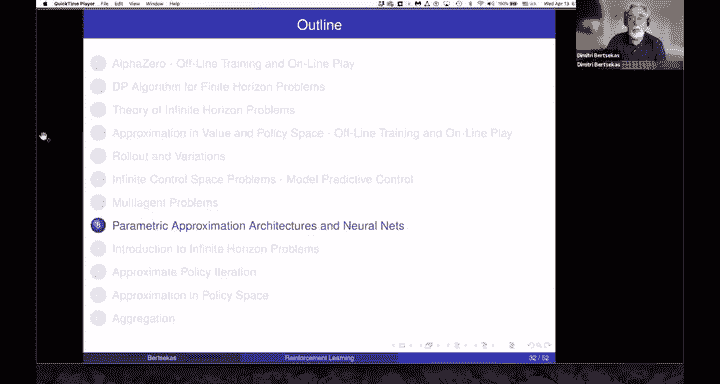

是。

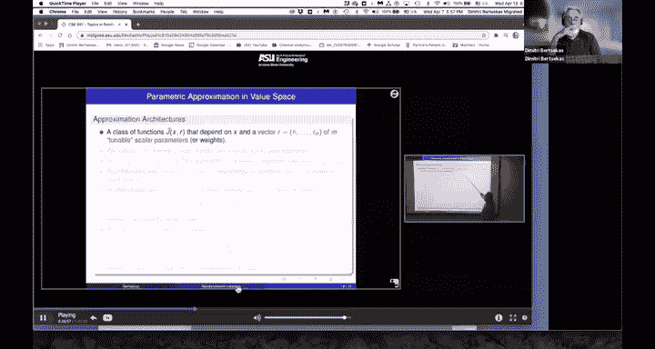

Involves a parameter vector。It involves a class of functions parameterized by this parameter vector。

 it's multi-dimensional parameter， these components are called the weights。

 and the objective to tune the weights to use data to find proper values of this weights so that the corresponding function。

 approximates well， your target function that you're trying to approximate。

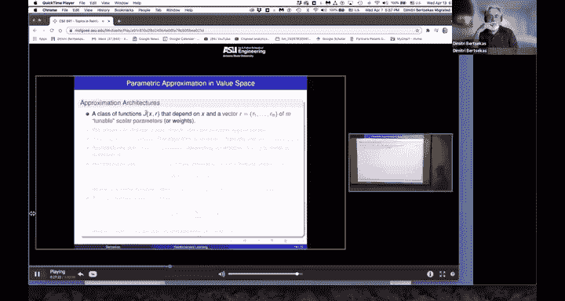

So we adjust R to change Jtilde and match the cost function approximated。

 and we do this by training the architecture。The training algorithm is the algorithm that you choose。

That you use to choose R。There are many different types of training algorithms。

 but the most common is to use data， input， output pairs that you match with the approximation architecture using some kind of quadratic regression。

Now， this architectures can be linear or nonlinear。

 depending whether the dependence on R is linear or nonlinear。啊。Also， typically。

 architectures are feature based。They depend on x。Through a feature vector， F of x。

So the idea here is。For the this phi of x， this feature vector。

 the idea is that it captures the dominant nonlinearities in the function that you want to approximate so that you can use a J hat function that's simple。

 for example， linear。

This is an example of a linear feature based architecture。There is nonlinear dependence on x。

 but the nonlinearities come through the features。And the features are supposed to capture the dominant ups and downs。

 the nonlinear。What we want approximate。And these features are weighted linearly。

 and we want to find the weights of the features。Of course， the premise here is that。

That you have good features， somehow you have good features。

 so that linearly weighing them gives you adequate results。Now。

 in problems where you don't have good featureses。

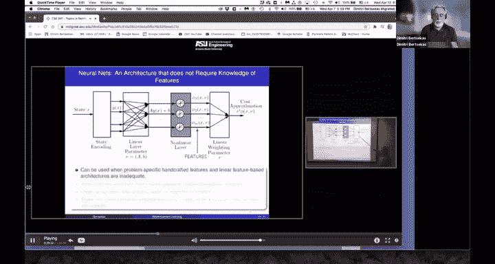

This beast comes along， okay， to help you。It's form a doubled。It works， okay？

And it works and there are software for training it。Okay。

 so this is a neural network involving a single nonlinear stage and a single linear stage。

 a deep neural network is one that involves a concatednation of these linear and nonlinear layers at the very end。

Just before the output is produced， we have these functions from the last nonlinear layer。Which。

Are viewed as features。 So this entire stuff that happens before。Is used to， to。

Give you these quantities， which are then linearly weighted to produce a cost approximation。

So training and neural networking involves both discovering the features and finding the coefficients that weigh them。

 okay， that's a major convenience。

If you know some features already， you can still add them to this structure because the state。

It first has to be encoded in a way that makes sense for the neural network。

 And part of this encoding may involve。Handcrafted features that you may know that are useful in the given context。

Still there there are。That。

There are issues to deal with in， in approximating functions with the。Ural network。

You have the training issue。You have peers of states and approximations that you match to data。

 you have a big。noling a regression problem involving zillience of weights。

And you have to solve that problem。

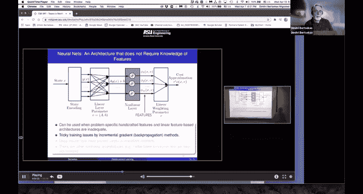

And the method of choice is。Incremental gradient or gradient descent。

 as it's called stochastic gradient descent。 It's neither stochastic and it's neither descent。

 but people call it stochastic gradient descent。 I prefer the method incremental gradient。

It doesnt decrease the cost function at every step。It has theory。Soly theory behind it。

 which we have covered in this class we spent quite a bit of time talking about various incremental methods。

 These methods are also called back propagation in the term back propagation is used very loosely in prement learning people talk about back propagation networks。

 but。

The original use of the term back propagation had to do with a special type of computation of the gradient of the quadratic training objective with respect to these parameters。

 it turns out that you can compute this gradient going backwards through the layers and this is basically the chain rule that you're using back propagation is just an intelligent way of using the chain rule to calculate the gradients that you need for the training problem the gradients of cost with respect to theVs。

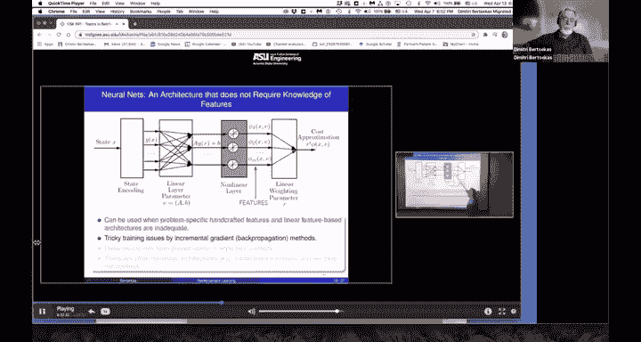

The A's of the B。O。Deep neural at。 It's a big industry these days。And。

And they have scored some major successes in important context。 You can't argue that success。

 they are here to stay。 People are going to be able to try them。

 They were tried in the early days of neural networks like the 90s， and they were found to be。

Not a big thing perhaps because we didn't have as much computing power in those days。

The problem is much more difficult。 many more weights with deep neural networks。

 You need a lot more computation power， And we have this computation power now。

 So within the last 10 years， people have been able to。

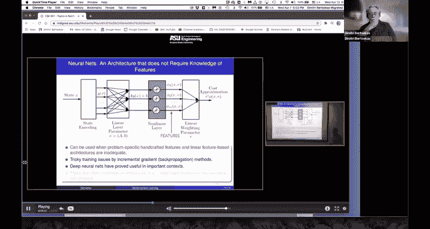

To have some breakthrough successes in important context in。

In speech processing， image processing， and also if you look at alpha 0。

Alpha 0 uses a deep neural network。

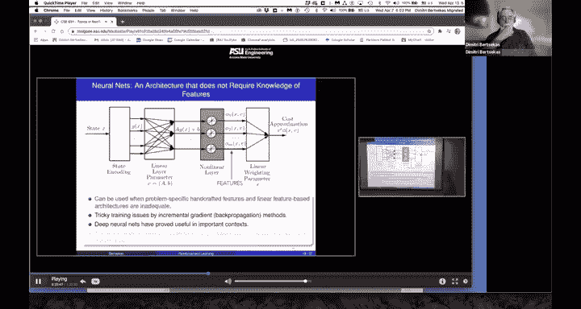

So deep neural networks。They're not different。 They're just bigger。 Okay， that's all。

 And they are governed by the same approximation guarantees than the shallow neural networks。

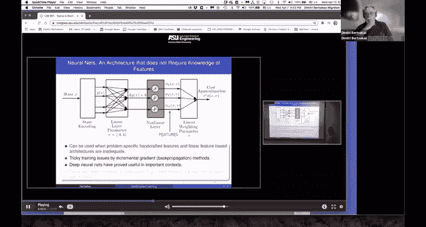

Which is the universal approximation theem that says that。If you。

 you can approximate arbitarily closely any conceivable function that you might want。

You might encounter by using a sufficiently large number of weights， not layers， weights。

 a single layer linear and nonlinear is sufficient to calculate arbitrarily closely any target function。

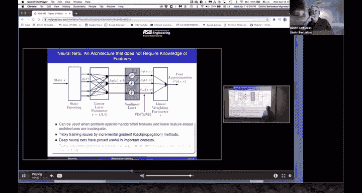

However， with deep neural networks， you may be able to structure the layers a little bit more cleverly and use fewer weights in the end to get the same degree of approximation。

So。嗯。A lot of people are doing theoretical research here。

 and I'm looking into the literature to see for exciting， interesting and insightful results。

I haven't found any that I can report to you okay。Let me just pause the video here。

 this lecture was given two years ago and I was indeed looking for literature that would explain the success of deep neural networks。

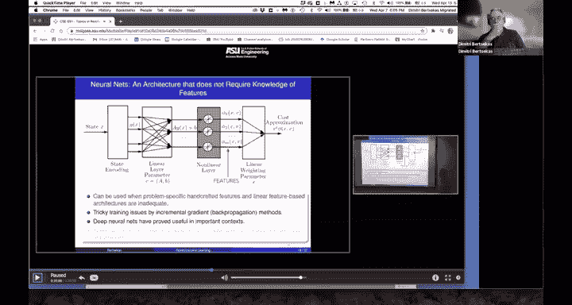

People were arguing from various points of view， but it seems that the most likely reason that least analysis can support why deep neural networks are doing well is over parameterization more parameter than data。

 okay。

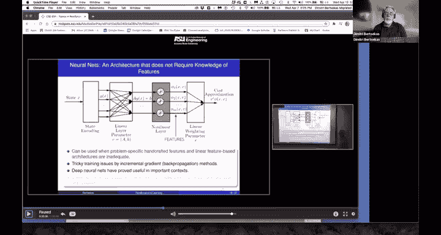

It used to be。The conventional wisdom。That if you use over parameterization。

 then you run the risk of getting。Not very good results， but people have shown。

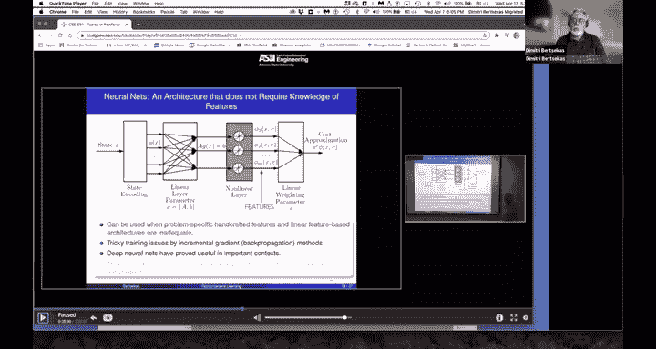

That with enough sufficiently large number of weights。

 then you can get a benefit from over parameterization。

That in a way that avoids a so called overfitting problem。

 its a well known problem in machine learning。And so。

I think that the theory is gravitating towards this point of view， there are important contributions。

 I think when I gave in our class earlier， I mentioned over parameterization as been an important characteristic of deep neural networks because of a large number of layers。

 they have a lot more weights。

And that seems to be the determinant of their success in practice。So anyway。

 I just wanted to interject here the latest， as you can see。

 the field is moving very rapidly and important issues are addressed very often at this stage。

So I'm going to go back to the video now。

Maybe that's not a fair statement， but that's my state of the art anyway。嗯。Okay。

 so we have nonlinear architectures， this is a typical example。

 there are other nonlinear architectures。

For example， radial basis functions is one where the basis functions are。

Tusian looking functions and the parameters are the height and the center of the the variance。

And the center of this。Gussian looking function and you can use。

I linearly weighted some of these raial basis functions to provide an approximation architecture and try to train these are also useful in a number of interesting contexts a neural network is what's called a global architecture choose if you change one weight。

 then the whole function is going to change radial basis functions you change one weight。

 only the function is going to change only in some local way， not globally。

Okay。Yeah。

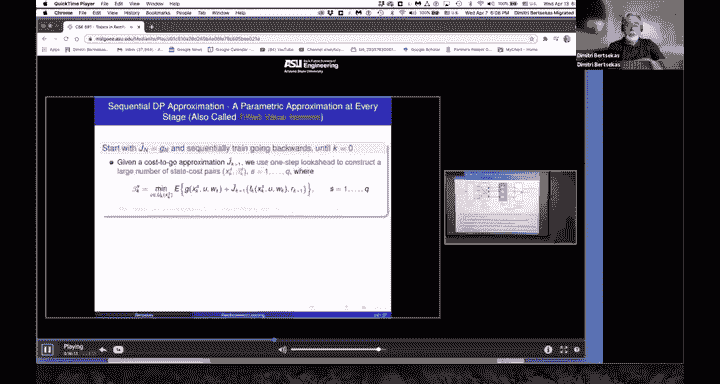

携体。Okay， I haven't gotten to that， I'm going to get into it in the next two slides。

 but generally speaking the data is you need pairs of x and the function that you want to approximate。

 you want to approximate some target function， some Js of x。

 let's say what you need is pairs of x and Js of X。

 and then you fit you fit the neural network to this pairs， that's where the data comes from。Now。

 let's look of how they can be used in the context of dynamic programming。

So this is finite horizon sequential dynamic programming approximation。

 we also refer to this as fitted value duration。

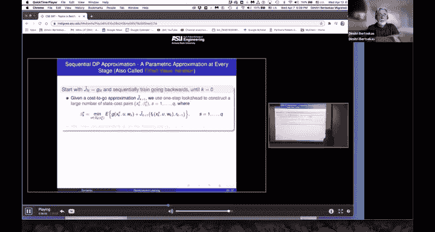

And。And。You do a parametric approximation with a neural network。

 some other architecture at every stage， starting from the end， you start at n。

And then sequentially train going backwards。 you first train。A parametric architecture for Jn minus1。

 then for Jn minus2， Jn minus3 and so on， generally given a cost to go approximation j2 of k plus1。

 you use one step look ahead to calculate state cost pairs， okay。

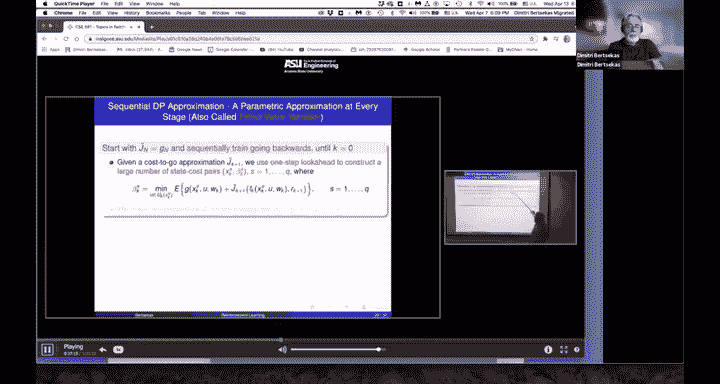

So you have J2 decay K plus1。You generate a large number of states here。You do this minimization。

Which could be a big thing。

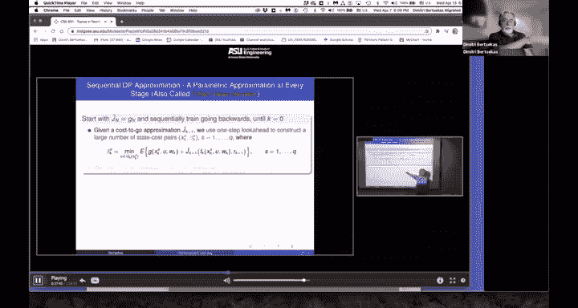

And you calculate this number。 So now you have a state and。

Cost pair and you collect all those and you train an architectural J tilus of K on this training set。

In particular， you do it by least square regression。Plus， a regularization term。So again。

 we have J tde K plus1。We generate。

A training set of sample states， we calculate this number here for each one of them。

 and we do this minimization。

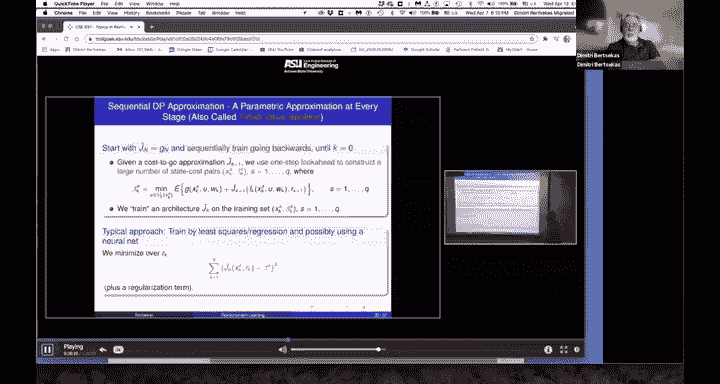

And we go backwards from n to n minus1， n minus2 all the way to the end。

 and we obtain J tildeus for every stage， and we use this for one step look ahead to calculate an optimal a suboptimal policy。

Okay， so is this？This context is clear。Okay， the difficulty here is that we have to compute an expectation。

And the minimization。And to compute this expectation。We pretty much need a model。 Okay。

 if you want to implement this。This procedure in a model free fashion is not easy because of this expectation。

The alternatives to use Q factors。

Where you train sequentially cu factor approximations starting from the end and going back to the beginning by using this cu factor approximation formula。

So。You generateq tilde of n n to obtainq tildeus of n minus1。

 you generate theq tilde n minus2 then using the corresponding formula and you go backwards and here's the big difference。

Here， this formula that you。

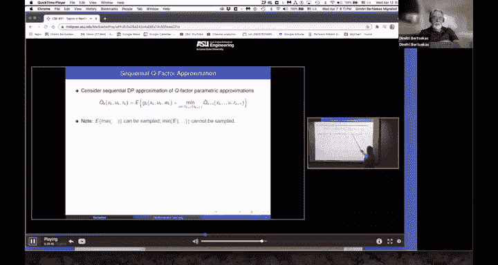

1ant to use to generate。2 factor samples involves expected value of minimum。

The preceding formula had a minimum of expecting value。You can sample expected value of minimum。

By generating samples of this minimum， basically and advertising them， but you cannot。

Sample men of expected value。It's a simple mathematical trick and it accounts for the use of two factors versus cost approximations。

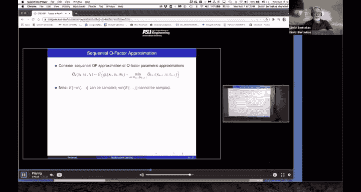

So how do I do the sequential cu factor approximation？ie。I haveqilde k plus one， and I generate。

State control says and corresponding samples of this thing here， not the expected value。

 but a sample。Of this inside the brace。

So I have these pairs， there's no need to compute an expected value。And then。In then。

I do my training using this data。I don't need a model to calculate a sample of this expression。

It's sufficient to have a simulator that generates。

State control pairs and corresponding costs and corresponding next states。

 All of this is efficient to obtain samples of this Q factor that you can use in square regression。

And now， given。A。An approximation。Of the Q factor。The one step look ahead is obtained by minimizing this expression。

 So this is an extra bonds。 Now， this minimization becomes easy。 if you have a neural network here。

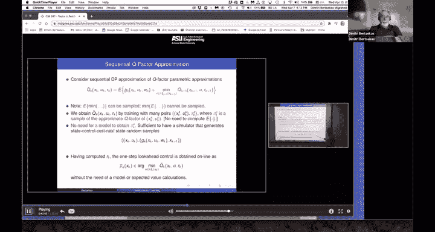

That generates these few factors and you have a finite number of controls。

 you have your neural network generate these things and minimize。

 it's much simpler to implement online。Okay。So。We looked at parametric approximations and their use in the context of。

Fineite horizon。Dynamic programming problems， we fitted value iteration， and then we fitted Q factor。

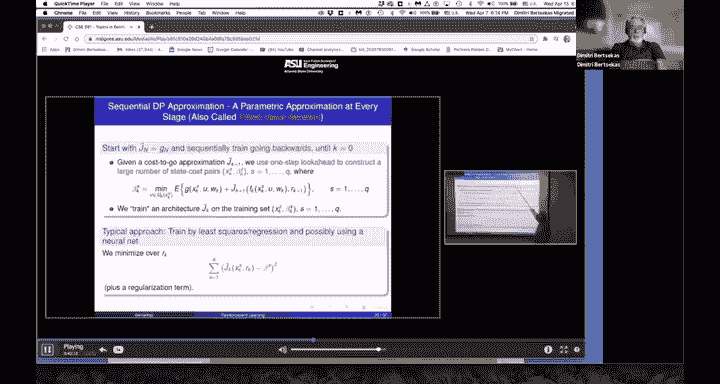

Iteration。Feded Q learning。 if you'd like to call it that。

So now we are done with finite horizon and we're going to go into infinite horizon。

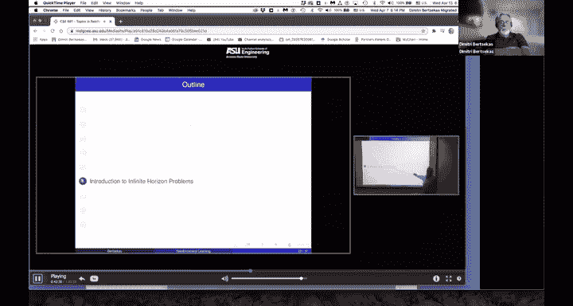

我也是。The view that a lot of the methods that we have developed for this context can be applied to this context。

 for example， rollout parametric architectures and so on can be applied within this context。

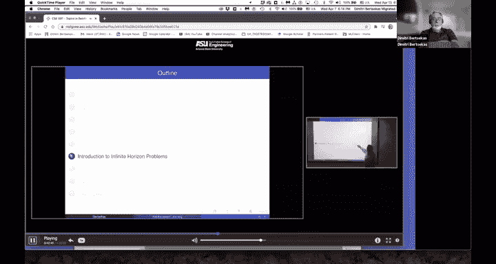

But if any horizon problems。It requires a mathematics， okay， but they have some。

 some theory associated with them that。

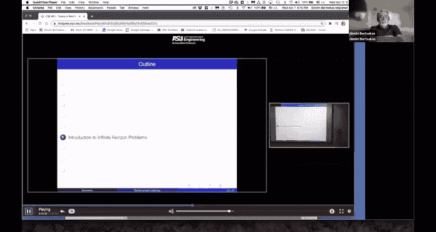

That's more substantive than the theory for finite horizontal problems。

 The theory for finite horizontal problems is essentially trivial， okay。

 there's only one algorithm and I'm programming algorithm the rest is is various ways of working with this algorithm。

Here we have。We have。

First of all， I need to impose some assumptions。And we have。Assume a finite number of states。

 one up to n。We have changed our notation。 We used I and J for states， rather than x。On X。

WeWe're using transition probabilities between states。Rather than dynamic systemic equations。And。

We have assumed a discount factor alpha。

And in the discounted version of the problem。Do you try to minimize the。

The expected discounted cost over an infinite number of stages。And。

We also considered stochastic shortageest path problems that involve a goal state。

 cost free and absorbing state。And again， a finite number of states will also assume that every policy will lead to the gold state with probability1。

嗯。So， we。These two problems have a similar theory， and we're going to focus on discounted problems we're not going to say anything about。

About stochastic orness spa problems。Under the assumptions that I have made。

Of all policies reaching the destination， reaching the goal state with probability one。

Let me also， as a warning I mentioned earlier in the course。

 once you deviate from this simple framework。There are all sorts of complications that arise theoretical complications。

 these three results that I'm going to discuss now that we have been operating with do not hold anymore because there are all sorts of anomalies there is theory for they' are much much more complicated and moreover the application of approximation methods to problems that are more complicated than this discounted and stochastics for this problems is。

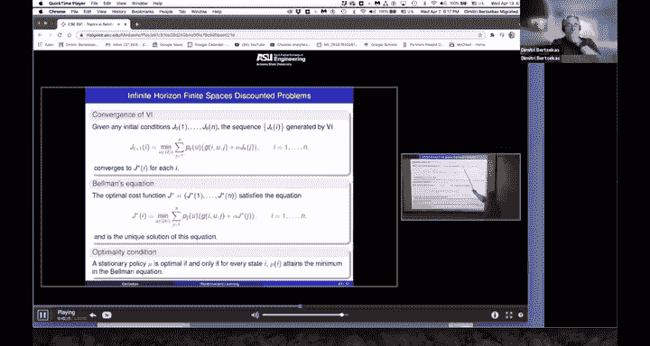

iss more difficult， approximation is much more difficult and also people have not done it。

 it's subject for research at this point in many ways。

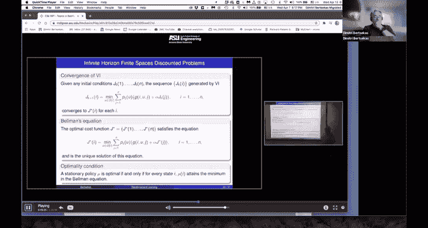

Okay， so we're going to stick with this easy case for this review because that's the only case we have covered。

And the first result says that。Value duration converges from any initial conditions。In particular。

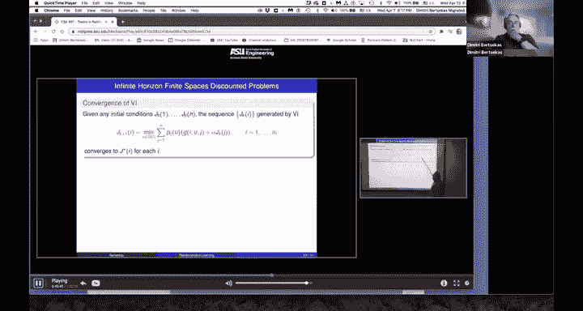

Value duration starts from some J0 vector of n scalar components and generates。呃。

And generates a sequence of vectors， J0， J1， J2， and so on using this formula。And and。

The general sequence has the probability that is guaranteed to converge to J star for every。I。

 every state and every initial condition。

Belman's equation， the optimal cost function， which is a vector here。Satisfies this equation。

 This equation really is a limit of this equation as K goes to infinity。

 and it is satisfied uniquely by J star。

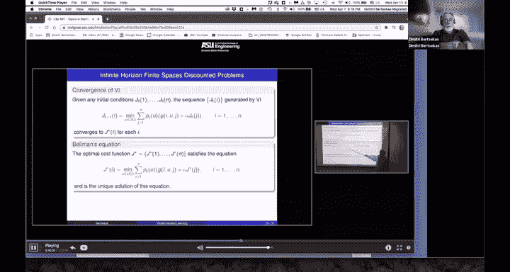

And the third is an optimal condition that says that a station records is optimal if and only if for every state I nu of I attains the minimum in this equation。

 it's an if and only leave condition。So these are the three standard results for exact。

Discounted dynamic programming problems。And。An important algorithm。

 perhaps the most important algorithm from the point of view of approximations is policy iteration。

Where we generate a sequence of policies starting from some initial policy。We evaluated。

By calculating the corresponding cost。And then we generate an improved policy by one step。

 look ahead。And here is here the details。Given the current policy in the UK。

We first evaluated to compute。These costs of the policy for every state。

By solving this Belman equation， which is linear， this is the Belman equation that corresponds to the policy in UK。

 it has a unique solution， The unique solution is this。And it's a linear equation。

 you could solve it by matrix inversion， but often you want to solve it。

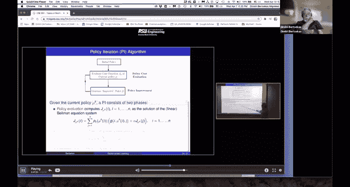

By duration， like a value duration。嗯。

And the policy improvement phase calculates the new policy by one step， look ahead。

And the theoretical properties of poly are very strong。

 it generates a sequence of better and better policies， strictly better policies， and stops。

 finds the optimal policy in a finite number of steps。

And there are several variations of policy duration。 There's an optimistic version。

That uses value it to approximate the solution of this policy evaluation equation。

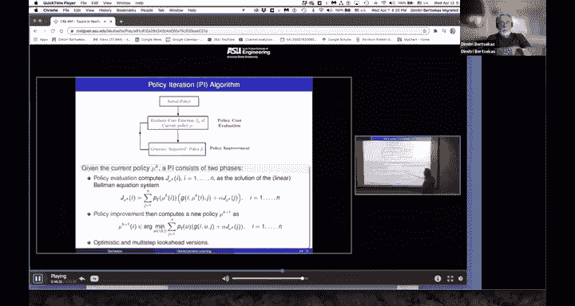

With a finite number of value directions。 that's optimistic。 That's called optimistic。

Multistep look ahead version is one where instead of using one step look ahead in the policy improvement。

 you use multistep look ahead aiming for perhaps a better policy。

嗯。

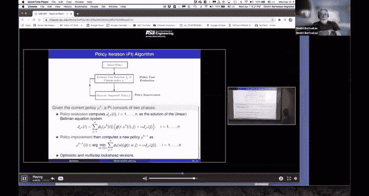

And all of these， all of these versions have the same solid guarantees。Of convergence of the。off啲。

Of the standard policy duration method。So this method has a strong starting point。

At least for exact problems， and it's a prime candidate for approximation。

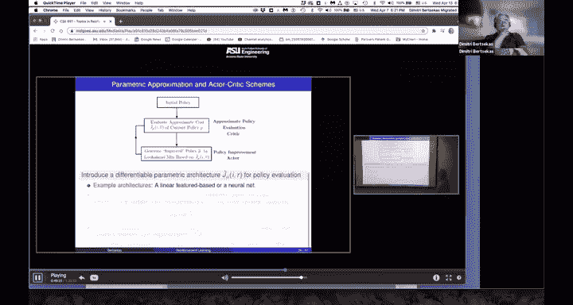

And the approximation happens in this box here。We generate a sequence of policies by first evaluating。

 then improving and then going back again。 And this improvement is done by。

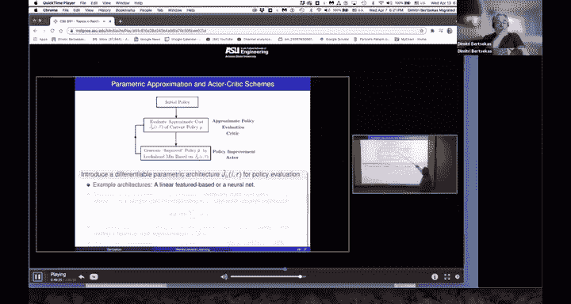

Approxi。In particular， we may use a parametric approximation method。

To approximate the solution of the Belman equation corresponding to that policy。

So。Let's call J Tildades of new I and R， the parametermetric architecture， R is the parameter vector。

 this could be a linear feature based architecture or it could be something more complicated like a neural network。

And what we do is we generate data corresponding to this policy。

 and one possibility is to use least square regression to obtain the parameter。

That specifies。The policy， the。Yeahep。The policy evaluation box。So。

We generate a sample set of states and a sample set of costs associated to this state。

How do we do that Well one possibility is to simply run the system from the current state forward using the policy and collecting the costs。

In particular， we may simulate an endstep trajectory starting at IOS。

Using mu and then perhaps adding a terminal cost approximation after the end steps to obtain a cost sample。

And we put this all together into a nonlinear regression。

 and that's how we do this approximate policy evaluation。

There are in the literature， you will find many different methods for doing this policy evaluation。

 and particularly the temporal difference methods， the class of temporal difference methods are。

You'll see them。Very frequently in the literature。 There are a number of reasons for this。

 These temporal difference methods of these examples are TD Lambda， LSTD Lambda， LSP， E Lambda。

 Lambda is a certain parameter by which you。You structure this least square regression。And。And。And。

They。They are more sophisticated methods mathematically。 They were introduced early on in in the。

Late 80s， early 90s， and they have interesting theory。 You can prove things about them。

 and that attracted theians like myself， okay to do work here。

 That doesn't mean that these methods work work well。 Okay， they're just more interesting。

 and people have worked a lot in them。 and there's a lot of。

Of culture in the reinforcement learning that revolves around temporal differences。

 people think of them， they are fundamental to learning code and code。

ok。Some people believe that， but there's no clear。The term fundamental is hard to justify anyway。

 but it's not clear why they are fundamental and why they are not just just particular formulas to do computation。

Anyway， these methods here tend to be more solid because these methods require have interesting mathematical analysis。

 but they also involve significant assumptions。

For their convergence， they can be more fragile than this type of method here。And。And that。

We did not spend。Too much time on these。 But if you look at your notes， you'll see。

You'll see。Some。High level discussion of these methods。That also points the way to the literature。

that you may want to read to understand these methods better and at the same time。

 be able to read a lot of literature that you'll find in journals at the current state of the art。O。

So these are nice methods， interesting， and I think that as new methods come along。

 it's important to compare them with these， they sort of form a benchmark。

And they have scored quite a few successes。

So far。

Okay。So now let's focus on this method here。

Remember that we have state cost pays。And we want to fit them to an approximation architecture in the process of generating these sample pairs。

 there are a number of issues to consider。

First of all， there is the training problem， solving this problem here。

 You can solve this problem by an incremental gradient type of method。 And this is the gradient。

 and this is the gradient of the。Actually， there should be a new here。 Okay。

 this is the gradient of the approximation architecture obtained by back propagation in the case of of neural networks。

Then there is。There is。The trick of using trajectory reuse。Remember， here we have。

State and cost pairs corresponding to a trajectory starting at this I of S。Now this trajectory。

Goes forward for a potentially large number of steps and as you generate it。

 in fact you're generating cost samples for starting at every one of those states so you have one cost sample going from here to here another cost sample going from here to here and so on so you can use the tail portions of the trajectory to generate more samples this is called trajectory use it's an important technique because it saves a lot of computation。

There is the issue of exploration when you evaluating a certain policy with trajectoryuse。

 you generate many cost samples that start from states that are not frequently visited by new When you generate these trajectories。

 you tend to go through states that are preferred by new。

So there's a certain bias to those states and if you want to have。

The cost of all states being represented well in the leastquiz objective。

 you need to introduce some additional samples that explore the state space more widely。

It's a major issue in approximate policy duration。

嗯。Then how long should these trajectories be as the length increases？

Then， you get。Better， better cost samples， more accurate samples。

But then the samples are more noisy because the more random costs that you add。

 the more variance the costs have。嗯。So we discussed this a little bit and we also discussed error bounds。

4our。V。The difference between the final policy that you obtain by approximate policy direction and the optimal cost function J star。

And。One of the most important bounds is that the。Approximate policy duration method tends to converge monotonically in the beginning and then converges to some error zone without error zone。

 depending on the quality of。

Of off。Of policy evaluation。It's a qualitative result， but it's interesting because。

Practical approximate policy duration exhibits this type of behavior。Okay。so。

Let me pause the video here is a long lecture we havent taken a break。

The other reason I want to stop the video is for you to give a chance to ask questions。

So we'll take a 10 minute break in which I invite you so working break。

 I invite you to think about things that you'd like to ask and that are that or things that we should have covered and perhaps we haven't。

So let me first ask questions offer you the opportunity to ask questions of the proceeding。

Ting。A portion of the video， and also。

On the lecture， so far。

Are there any questions？And。

Right now。Yeah， for the fitted Q value iteration。So we have bias that's being introduced by each time we put a network on QI using the old network to update the new one。

Is doing a multi step look ahead when collecting the training set the only effective way we can reduce bias or is there other ways that we can effectively reduce bias？

Okay， I'm not sure whether it with a reduced bias by multi step ahead。

 multi step look ahead is extremely time consuming。And to do it at every step。

 going and steps backward to system。Toall order as it happens。

 value duration is already a very time consuming process remember there are n neural networks here that you fit。

 right？

诶。There is the issue also of error over time， whether it builds up to the point where it means abilities。

Other ways， other ways know use another method， I'm not too fond of this fitted value duration。

 but because it's very simple to understand and very simple to implement people have used it a lot it's time consuming but simple to implement。

So I don't know if this answers your question， I don't really have a satisfactory answer。

No， yeah， that answered my question， thank you。ok。Any other questions？Okay。

 so the time is 632 in Arizona and we'll convene in 10 minutes。 That's 6，42 K， are there questions。

Has there been any usage of rollout as a sort of soft start to deterministic IP or MIP problems？

IP or MIP so integer programming so has there been any cases where they use it for a way to start the branch and brown bound to as a potential candidate for a feasible solution to start cutting trees。

Yeah， that's a good question all loud。Is a cheap way to do branch and bow。

 you cut through quickly through the branch and bow tree。

And you get a good solution。Oftentimes much better than what you would get with a lot of grants and bounds starting from scratch。

It's roll out for an integer programming problem like the contiatorial problems that we have discussed。

Will cut through the branch and boundary tree and in an effective way and give you a very good solution。

Now， of course， you can always improve a very good solution。

And I'm not sure I don't know that people have done that。

 but I would not be surprised at all if it can be done。

And。

That's true for。Integer programming problems。And it's also queue for mixed integer programming problems。

 provided you can deal with the continuous variables。Effectively in rollout。So。

That answers my question。 Thank you。Okay， good。

Any other questions。

Is this the general questions？

Yeah， general questions， okay， yeah， a high level question。

I was wondering what you see as the most promising directions in the field towards achieving more sample efficient methods for reinforcement learning。

Okay， that's indeed a very general question and it's hard to answer。

Because there are so many irons in the fire at present and there are so many cultures involved in this field。

 Okay， the field is just vast。 People are going to be working in reinforcement learning for years and years to come and they are going to be working from different angles。

 So there are people like。

Artificial intelligence people。Who were discovering。

New ways to formulate their problems in planning all kinds。

 just about anything can be formulated as a reinforcement learning sequential optimization problem if you try hard enough。

 you can do it。

And there are lots of people in artificial intelligence， a vast a vast number of people。

 a vast population。

That are working in various aspects of these problems。Then there is robotics， which okay。

 the robotics people are have control have artificial intelligence。

 depending on the training they have received or the culture in which they live。

There are all sorts of things there。And there is there is control people， NPC people。

 and there is the operations research people who actually have been slow in waking up。

To reinforcement learning， but there's an awful lot of opportunity like the mixing energy programming type of combinatorial problems that the previous questioner brought up。

And then there are people in economics are that are。

Waking up to reinforcement learning。People in finance use reinforcement learning already。

 and there are a lot of opportunities there。

So。There are application specific directions or discipline specific directions。

 and there are general directions， like for example， multi agent problems。

 they have fine applications in all kind in hope in a great many different application fields。

But there are also generic issues to be resolved， like what we have tried to do with agent by agent policy duration or age by agent rollout and signalling and so on。

 these are new directions and I'm sure that there will be a lot of work in that area。

There will be a lot of work on parallel computation in the context of reinforcement learning。

 because there are so many opportunities for parallelism。

And there are some a lot of opportunities for blind parallelism。诶。

you know just parallellyzized Montecarlo simulation， very effective but not very。

 I mean does not require much ingenuity to apply it。

 but theyre also intelligent intelligent choices in distributed reinforcement learning asynchronous computation。

 the use of multiple neural networks that communicate with each other。

 special types of neural networks there's all sort of opportunities for research and moreover it's the way of the future。

 distributed computation， parallel computation is the way of the future it's already very plentifully available is's going to be even more so and it's what is needed to address the large scale computations that are necessary with the methods that we have today。

Okay。I've talked a lot and may have forgotten some some directions and if you ask somebody else some other work in the field。

 you'll probably find a few other ones。

But that's what comes to mind， is there something that you have in mind？

No thank you well yeah the thing the main thing that i've been thinking about that we haven't gone over in this course is what I see in the literature is referred to as model based reinforcement learning so I guess just trading off between。

When we don't have dynamics of the environment。

Using a model free algorithms versus algorithms which try to learn the dynamics and reward model of the environment and then use that approximated model for planning。

Yeah， very difficult I think you ask me a question earlier about the use of system identification in constructing models as you control the system that's the issue you can always construct models and then model now control later okay。

 or model in the background as you control this is the approach that we have taken in this course。

The simultaneous modeling and control， whereby you use control signals to stimulate or to enhance the quality of identification。

 is a far more difficult problem to do it well， it's referred to as the dual control problem in stochastic control it's an ancient problem that dates to the 60s。

And we have not covered that， you're absolutely right。

And more， I have no suggestions in this direction， just the difficulty of this problem just overhels me。

I know that people are working in this area， but I haven't followed the literature very closely。

So that's where I am with respect to this problem。And perhaps if you have some specific questions。

About literature， because you said there's a lot of literature border based。

Reinforcement learning。Then， you know， you can bring them。Can send me email， okay。

Yeah， thank you。Anything else that？We have not covered。 I think we have not covered so much。

 particularly because in this course。We took a very targeted approach towards roll out in policy duration and also this multi agent stuff and distributed computation stuff。

So this was not a full fledged broad reinforcement learning course。

I think the 2019 offering of course was much more was much broader， considerably broader。

 this point was a more targeted research oriented version of the course。

So there's a lot that we have not covered。And。And。There will be other offerings of the course in the future。

 so we'll cover more。

Okay， so now I'm going to return to the video to cover a policy approximation in policy space。

 and we still have about。About 25 minutes of video。

Okay。So。

Let's switch now to approximation in policy space for infinite horizon problems。

 we parameterize stationary policies with a parameter vector r， we de them by mu of r。

 and each R defines a policy。

And。The various ways of doing parameterization will'll discuss some of them later。

Possibly used a neural network， possibly using features that that specific to a particular practical context。

And the idea is to choose R， choose a policy within this parametric class that optimizes some measure of performance。

And I have here five contexts within which you might want to use approximation in policy space。

Problems where。There are natural policy parameterizations。

 like I gave the supply chain example where there are parameterizations of policies that recommend themselves through simpler problems。

 simpler optimizations like this SS policies or up to inventory ordering policies and so on。

There are problems which have natural value parameterization。

 but you can use a good policy training method for them。

And the the Tetri problem that I discuss is in this category。

 there are nice features that provide good。And natural value parameterizations but。

When it comes to training， it turns out that policy training methods have worked better。

Than value training methods。We mentioned approximation in policy space on top of approximation in value space。

嗯。To overcome some of the。Difficult with the。Not having transition probabilities， not having a model。

Learning from a software or a human expert。 Suppose you have a human expert that that knows how to。

To choose to make good decisions， that you may try to emulate his decision making process by training a policy to match his decisions。

Finally， there are problems。Where you have unconventional information structures。

 where conventional dynamic programming breaks down。You just。

Approximation value space does not make sense because dynamic programming cannot be applied to these problems。

Still， problems like that may admit a policy parameterization。

And one example I have in mind is multi agent systems with local information。

 not shared by other ages， making decisions on the basis of their information。They have feedback。

 their policies can be parameterized， but the feedback that they have is not shared by other ages。

 at least not at the current time， it may be shared with some delay。

Then you can't write a dynamic programming equation， it turns out。

 and you have to resort to approximation in policy space。Not much is known about。About。

Methods of this kind。 but there are certainly。Certain。Possibilities。

Okay。So let me go into the cross entropy method。For approximation in policy space。嗯。

This here we introduced。A cost optimization objective。 And we find。

A parameter vector that minimizes the corresponding this objective。

The framework is what you see here， a system with cost at each stage generating。

A state which is fed back into the controller， which is a parametric controller。

And generates a control， and each parameter vector defines a stationary policy with these components。

And for a given initial state， you may consider the cost associated with R。

The controller corresponding to。Or。And for a given initial state。

 and then find the parameter vector that minimizes this cost。

呃。You may not know the exact initial state， but instead。

 you may have a probability distribution over initial states。 So in this case， you may want to。

Minimize the expected value， expected value over the probability distribution according to some。

Some arbitrarily chosen distribution。This is an objective that can be minimized over are。Now。

 this cost function or this cost function， they are ugly in the sense that it's very hard to calculate the gradients of these expressions here and however。

A random search method。Does not have this type of difficulty deal。

 The random search method does not require gradientius。

So here's the cross entropy method， which has hurt some successes。

 and what it does is generates a sequence of parameter vectors aiming for。

For convergence to an optimal parameter vector。 and the cost function is this cost I gave in the preceding slide。

So at the current， either at RK， we construct some kind of an ellipsoid centered at RK。

And then we generate a number of random samples in the space of R in the parameter space。

 and then samples are the black ones and the green ones and we select a set of green samples that have low cost。

 we can evaluate the cost correspond to each sample， don't any gradients for that。

 we can evaluate it， and we take a subset of low cost samples。

 how you do that the are auristic methods， some of them analytically moderate。

Then。We can calculate the sample mean。

Of these accepted samples。 And that's the next point， R K plus one。

And now you need to calculate an ellipse within which you' are going to sample at the next step。

And what you do is。You construct some kind of a sample covariance matrix or the accepted samples。

Sor of captures the shade。Of the location， of the locations of these got these green points。

 And then you perhaps enlarge it。This is sort of a step size parameter。

And you generate a new ellipse within which you sample some more。 and then pick out the。

The low cost samples from here and keep on going。

It's very simple， it's well suited for parallel computation。

 all sampling methods are well suited for parallel computation。

 and it resembles a gradient method because it tends to go from high cost。

Pararameterters to low cost parameters， it moves in the general direction of the gradient。

So like a stochastic gradient， you might call it。It is also model 3， okay。

 because the costs here can be calculated by by simulation， some kind of。

Some model free method， you can calculate costs in any way that's possible。

 you don't need to have a model， a similulator will do。So it has its advantages。

 it has limited convergence rate guarantees， but there have been successes and the implementation is simple。

 so it's a method that has attracted serious attention。

Okay， aggregation， I spent two the last two electrical aggregation。

 there are reasons I'm not going to say too much about it。

You remember the premise， we tried to form a problem of reduced dimension， reduced size。

 and one way to do it is to use features， discretize the feature space in some kind of a regular partition and pick a representative state from each state of the partition。

We use a feature mapping that maps original states into features。

 and you consider for each representative state a footprint of original system states that map into the set of the partition corresponding to X。

And then you form this composite optimization problem whereby from the representative states。

You go up to the。Original system states using these disaggregation probabilities。

Then transition to original system states and then down with some aggregation probabilities to the representative features。

And you construct a composite system whose state space is this。 Okay， it's bigger， but theres a。

This is a composite Belel equation that corresponds to that。

 which you can solve by simulation based value duration and policy duration。

So just some high level comments about aggregation， it aims to approximate J star。

 not JU of some policy， and doesn't run into some fundamental limits that have to do with the power of the approximation architecture。

You can get an arbitrarily close approximation to J star if you have a sufficient number of aggregate states or representativeative features。

We made a distinction between a representative feature schemes and there a simpler special case over representative states。

 a representative state is just one of the ordinary states， okay， a representative feature。

For response to multiple states。And the representative state schemes。

Are less powerful but easier to implement and require less computation。There are methods。

 value durationeration policy， iteration methods for solving the aggregate problem。

 and finally I talked about spatial temporal allggregation， which involves compression。

Of states and compression， of time periods to obtain simpler problems。Okay。

So I have a couple of slides more。 we've reached the end of the review。 Okay， concluding remarks。

 words of caution。

I have words of caution， words of optimism I'll switch between the two and sometimes I do it unconsciously okay words of caution they are challenging approximation issues in all approaches。

 all methods are difficult no there's no guarantee that any one method will work for all or most problems there's no foolproof method and the thing to do here is to have a toolbox of multiple methods and try to find the good candidates to apply on a given problem challenging problems。

Okay， in order to select features。

You need to have some domain specific knowledge。 You need to understand your problem to understand what is what should be good features for the given problem。

 You may need to look at simpler versions of that problem to get insight and so on。 So this。

Cannot be。Cannot be。Packaged， okay， you have to。You have to have some。

Understanding your problem in order to implement whatever method you want to try。Dining issues。

They are not as reliable as they tell you， okay， they're just hard。

And you need to play with parameters。A nice thing is that neural network software have become available。

 like what's called the。

Tsor Tensorflow， Tensorflow。 So it's good to have this software。

 but that doesn't mean that if you put your problem in there。

 youre going things are going to work to begin with you have to choose various parameters。

 How many layers are you going to use How many units you're going to use in this layer。

 What structure you're going to use all of this。You have to。 its， it involves trial and error。

 let alone issues of step size， issues of。嗯。

我。All sorts of gradient related local minimum type of issues that can cause you problems。

Approximate policy duration involves oscillations okay how do you know as the method oscillates which which policy you're going to use in there and the oscillation may not be uniform like for example。

 one policy may be better than another for some states but not for others okay so which one are you going to use。

Exploration issues can be a big， big headache， particularly with Q learning involving polyation Q learning。

How do you know and a challenging problem that you have succeeded。

 you have some policy that produces some results that make some sense。

 how do you know how they compare to the optimal or even whether they are good or not？

If you have some some insight into your problem， you may say that this cannot be good， okay。

 or you can say that。

It looks like he's doing reasonable things that humans would do in a similar situation。

 but there are no good quantitative ways of recognizing success。

There have been amazing successes in game context like chess。

 I continue to be amazed by the Alpha zero program。I could never believe just。

N thought， I'd lived to see this kind of amazing， amazing chess program that。

Would succeed in discovering new strategies to play the game of chess。

 a game of several hundred years， several hundred years old。However， in this game context。

The models are stable， okay？It's the same game。Every time。

And it' perfectly known。 The rules are perfectly known。Moreover。

 in many of these games where they have been successes， there's a small number of controls。

 like in chess， for example， there's a small number of moves and go and so on。

 all of these games involve a small number of controls。

If you have an infinite number of controls， as you do in optimal control problems then。

Some of the methods that have been used in the context of games like Monte Carlo research cannot be used anymore。

嗯。Finally， problems with partial state information。

Remain a big challenge because of the infant States' belief。The belief space is infinite。

And there's a big issue of size with these problems。Okay， on the positive side。

We have massive computational power these days。And including parallel computation。

Which is very well suited for doing sampling， Monte Carlo simulation and so on。Finally。

 even though we are not assured of solution of very difficult problem， we at least have。

Methodds to try。So we can begin to address practical problems of incredible difficulty。So。

There is an exciting journey ahead in which I hope you will all be participants。Okay， so now let me。

At the end of each course， particularly older faculty tend to give words of wisdom。

 okay unfortunately， I don't have any words words of wisdom， but I can give you some quotations。

 words of wisdom of others。First one is this， the book of the universe is written in the language of mathematics。

Why is the world around us？

Wri in mathematics， why can it be explained by mathematics。

 to me it's a great mystery and's an amazing opportunity to use human reasoning for understanding of what surrounds us。

So never lose sight that mathematics at the bottom of everything， okay？Okay。

Chinese wisdom from 2 and half thousand years ago， the word learning is part of reinforcement learning and also is being。

Its being used in in the field various different meanings。So let me tell you Confuuous meaning。

 first of all， you have to understand that this quotation。Involves thought， the term thought。

 learning and thought in the language of confuuous learning。

Was roughly non obtaining knowledge by reading， by apprenticeship and so on。

 thought relates to ideas， ideas on how to do things。 So to read this quotation properly。

 you have to read it as。

Learning without ideas。Is labor lost？Ideas without learning。It's perous， okay。

So。There is something connected to a subject that you may consider。

Okay， this is a ancient Greek quotation。About learning through experience， a lot of。

A lot of the underpinnings of this field is learning through experience。

 experience with using various methods and also collecting experience through simulation， Okay。

 learning about。Some process by simulating it and observing it。

So many arts have been discovered through practice empirically。

 experience made our life could proceed deliberately but inexperienced unpredictably。

This is one of the dialogues of Plato is attribute tribute Socrates。 Socrates did not write anything。

 Plato wrote for him。Okay， thanksng Xiaoping。呃。Our field is is whatever it works， okay。

You may have theoretical methods that don't work and non theoretical methods that do work。

 It doesn't matter。For it's white or black， as long as it works。Okay。

 so now let me go into some a couple of more recent quotations about machine learning and artificial intelligence。

 there's a lot of enthusiasm about and brightly so， because the successes have been phenomenal。

 there's no question that artificial intelligence and machine learning are going to be very important you the world around us。

In the near future。So here's a quotation。 Machine learning is the new electricity。 Andrew Eng is。

It's a professor at Stanford。So this quotation has circulated widely and in his words， I believe。

 at least as reported by Google， electricity changed the way the world with how the world operated and artificial intelligence is supposedised to do the same thing the future in many fields。

 transportation， manufacturing， agriculture， healthcare and so on。

Here's another quotation that also has become very well known。嗯。By Ali Rahimi and Danrek。

 whom I had the pleasure to have as students in several of my classes at MID， I know them very well。

And。

This is a more skeptical assessment。And says that， yes， we have a bright future ahead of us。

 but we don't understand。The underpinnings of the field。

We do not know why some algorithms work and others do not。

 nor do we have rigorous criteria for choosing one architecture over another， just as in alchemy。

 you mix several ingredients and sometimes you get something interesting， sometimes not。

 but even when you get success， you don't know why it has worked okay。

And they make the argument there's an interesting video that has many， many。Many hits。

 YouTube that you may want to。You may want to。To listen to。嗯。So。There's a lot of things to learn。

 a lot of things to think about， but our course is over。再就。

Okay， so。This is the end of the lectures， thank you very much for your attendance and I'll see you all at the project presentations in two weeks。

