# ASU《强化学习2022-2024｜cse 691 Reinforcement Learning Course at ASU》中英字幕（deepseek - P5：[06]Lecture 5, 2024, Deterministic Rollout, cost improvement, - GPT中英字幕课程资源 - BV1zcfVYdErD

Okay so we're going to get started today welcome back to CSC 691 topics and reinforcement learning I am going to be giving today's lecture so the first four lectures of this course were sort of like a coursegra overview on what we're going to be covering in this course in more depth。

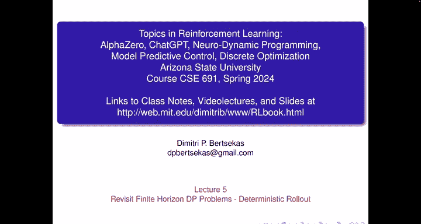

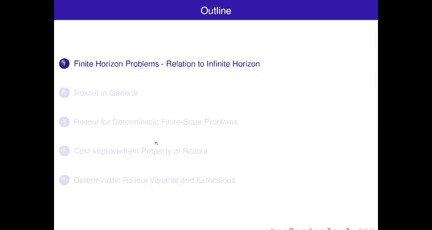

And so the next series of lectures starting from today is going to be a more focused look at each of the topics that we looked at in the first four lectures of the course。

 So today we're going to be focused on revisiting finite horizon dynamic programming problems。

 and we're also going to cover deterministic rollout in much more depth。

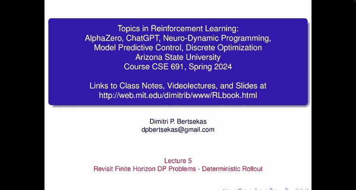

Okay， so。Okay so here's the outline of today's lecture so first we're going to cover finite horizon problems and their relation to infinite horizon problems。

 so in the last couple the couple of lectures， all of the intuition and visualizations that we developed were related to approximation and value space for infinite horizon problems we want to show you how finite horizon can inherit all of this intuition as well。

 so to do this we're going to show a construction on how we can reduce any arbitrary finite horizon problem into a corresponding infinite horizon problem and therefore in inherit all of the properties that we like。

Oops，Next we're going to cover rollout in general in greater detail。

 and then specifically we're going to look at rollout for deterministic finite state problems。

And then in part four， we're going to look at the more theoretical aspects of rollout under what conditions is rollout expected to perform well and what can we say about it。

 then we're going to take a break and then the last portion of the lecture is going to be devoted to deterministic rollout variances and extensions。

Okay， so we'll start with finite horizon problems。Let me remind you as review what the generic finite horizon dynamic programming problem looks like。

 so we're given this state space and control space and at a specific state XK we have a system equation defined FFK which takes in a state fK a control UK and some random variable WK and it spits out the other side the next state Xk plus1 so WK represents this random disturbance which can represent things like physical noise。

 market uncertainties， demand for inventory or other unpredictable factors in the dynamics of your system。

We have this cost function， so the transitions here are random and the costs are random as well。

 they're both functions of this variable WK the cost function at a state Xk is defined areas is labeled as GK it takes in the state it takes in a control and a random disturbance and and spits out a real valued costs so the cost function here since in general we'll look at stochastic problems but it could be deterministic is defined by the sum of all costs along the control trajectory given by the sequence of control starting from the initial state。

Then we add to it a termination cost， G of N， we take the expected value of this。

 and this is the cost of a particular controlled trajectory。

A policy given by pi is something that's generated when。Sorry， I guess。

It's a set of functions m0 to m and minus1 where each of these is a state dependent function output that outputs in action。

 and the reason we need policies for stochastic problems is that in an optimal or sorry a control sequence will not suffice because if I am at a particular state XK。

 I apply a control where I end up in Xk plus1 is not necessarily deterministic so the next control in my control sequence may not necessarily apply to where I am。

 so instead we have a policy which is a sequence of functions。

 it's sort of like a lookup table it says if I'm at a particular state I apply a particular control which is the output of these functions mue。

Then for a given initial state x0， the cost of a the state at x0 under a particular policy pi is given by this cost function here。

 and our objective is to minimize the cost function， so we compute J star from x0。

 which is a minimization over all possible policies pi。

 and then the optimal policy which we call pi star has this cost J pi star。

 which we just shorthand as J star from the initial state x0。

So we'll be focusing on finite horizon problems because it's most convenient for our algorithmic purposes so we can talk about rollout。

 et ceter， and it's just easier to talk about， but as a matter of concept。

 nearly everything we talk about for finite horizon problems will apply to infinite horizon problems as well。

Okay so let's review the end stage dynamic programming algorithm。

 this is an algorithm that produces optimal costs at a state Xk called JK star and it's the optimal cost of the tail subproble that's starts at XK so in exact dynamic programming we start at the end of the horizon and work backwards so we start with the terminal cost G of NxN and then we work backwards to compute the optimal cost of the tail subproble starting at each state at each stage XK and it's computed as the minimum over the set of controls and we take the expected value of a particular state and control pair plus a random disturbance and this is representing the immediate cost of taking a particular action at a particular state and then we add the optimal cost to go so the optimal cost of the tail subproblem starting at the next state。

And we do this for all XK， so layer by layer， we do this for all states。

The optimal cost J star x of0 is obtained in the final step once we reach the front or the first stage of the problem。

 and J0 star of x0 is just J star of x0。Then once we've gone backwards， we go forwards。

 the optimal policy is obtained using minimization in the same way。

 take we have the optimal cost at each stage computed for each state and we take the arg min over the set of controls to obtain an optimal control sequence going forward from stage zero all the way to the end。

So that is the exact dynamic programming algorithm for end stages。Now。

 sometimes solving this problem actually often can be intractable。

 the state spaces can be very large， and we may not be able to compute it at any reasonable amount of time。

So for this we turn to approximation and value space here there is no going starting from the end and moving backwards and then going forwards。

 we only go forward， so we start at the beginning and we choose our control UK Tilda as the argument over these set of controls in a similar way where we take the expected value of the corresponding state and control pair and then we add the costs to go。

But the cost to go， J K plus1 Tilda。Is an approximation of J K plus1 star。

 and it's obtained in some way。There's also a multi step version of this where we solve this。

Exact dynamic programming problem with a limited depth。

 and we use this J JK and say plus L star as a terminal costs for each of the leaves of this dynamic program and calculation。

So there are many possible ways to compute JK+1 Tilde， in fact。

 90% of the field of reinforcement learning is looking for ways to compute this and some examples of how you might compute this is using some kind of problem approximation offline training by a neural network or you may use heuristics online to approximate JK+1 Tilde。

Are there any questions so far？Okay。So I want to compare finite horizon problems to infinite horizon problems so we can inherit all the good intuition。

 but let me first remind you of how infinite horizon problems were。

So again we have a state and control space and at a state Xk。

 we have the system equation that brings us to the next state， and again we have a random cost。

 but the random cost has this factor in front of it， alpha of k。

Here there's an infinite number of stages and a stationary system and costs。

 so in the finite state or finite stage dynamic programming problem， each of these functions。

 the cost function G and the system dynamics F or subscripted with this K。

 because it might matter what your cost is and what the next state you should go to。

 it may be stage dependent。But in the infinite horizon case， the number of stages is always infinite。

 it's always the same from state to state， so we don't have these subscripts。

 so then the cost of a policy pi， which is a sequence of functions is given by this sum of immediate cost given a particular policy。

And。It's a sum of n costs and but we take the limit as n approaches infinity so it yeah。

 so this is the cost in the limit。And okay， I'll explain alpha later。

 but the optimal cost function J star of x0 is obtained by obtaining looking over all policies and obtaining the minimum。

And the Belllman equation is given by this， so the optimal cost at a particular state x is the solution to this nonlinear functional equation。

 which is called the Bellman equation。Okay。So the nice case is these so called discounted Markov decision problems or MDPs。

 this is the case where you have finite state and action spaces and where alpha is less than one。

If alpha is less than one， then this sum as n goes to infinity is going to converge to a specific value because the terms of this sum decay geometrically。

Another nice case is the stochastic shortest path problems here we have a finite state and a finite action space。

 but alpha equals one to prevent to prevent the。To prevent the problem from going on forever。

 we have this costfr absorbing state which represents a goal or a termination state where we can end the process as soon as we arrive at this state。

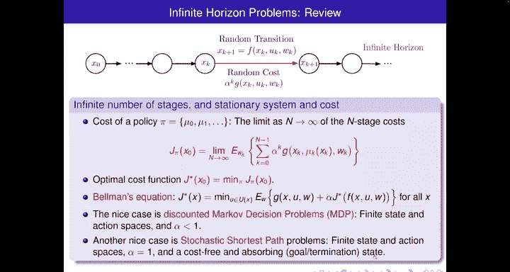

Okay， so how do we compute the solution to Bellman's equation Bellman's equations。

 there are two workhorse algorithms， the first is value iteration where we apply this bellman operator iteratively over and over again to the cost function until we converge to Jstar。

And the second one is called policy iteration， this one generates a sequence of policies muK and our cost functions JUK where the initial policy or the base policy mu0 is arbitrary。

So the system starts with a policy mu and generates a new policy mu Tilda in two steps。

So first there's the policy evaluation step， which computes J mu。

 which is the cost function of the base policy mu。Then there's the policy improvement step。

 so we obtain a policy improvement by doing a one step look ahead and we update the policy by finding the argument of this function here。

 the control corresponding to the minimum expected cost。

I'll point out it will be important later that rollout is just a single iteration of policy iteration and。

And it can be performed online。So the policy evaluation part is performed online with online simulation as needed。

Okay。So now we come to the connection between all stuff for questions， so you guys have questions。

玩事儿。嗯。U of x is in the Mar than。Because there might be multiple policies corresponding to the the minimum cost to go。

 so we view the。The set of minimum we view the minimum Q factors as belonging to a set。

 so we say the optimal policy is an element of the argument， which is a set。And that smaller。Yeah。

 I mean also' given though the Ws are fives。We don't I don't make any assumptions on them。

 it may be necessary to make those depending on what your problem is。

 but it's just some random variable that's stage dependent。Good。Okay， so now for the reduction。

 so we're given this finite state finite horizon problem。

 and we need to transform it into a infinite horizon problem that's equivalent。

So for the infinite horizon problem， I need four elements， I need a state space， a control space。

 I need the system dynamics F， and I need a cost function G。

So the way we're going to generate these is as follows。

The state space is given by a union of these sets and what are these sets。

 big x subK is going to be all of the states available at stage K from the finite horizon version of the problem。

And so we're going to take the union of all of these， and so in this sense。

 in the finite horizon case， if you have a state， it's called it x at a particular stage k。

In the finite horizon case， it's the same state， if it's X K plus L， for example， some other stage。

 but in the infinite horizon case， we're just going in this construction。

 we're going to treat X K and X K plus L as two distinct states。

 So the stage is sort of wrapped up in the state in this infinite horizon construction。ok。All right。

 then we're going to add this termination state T to the union。And that's our state space。

The control space similarly is going to be the union of all of those capital U subcases。

 which was a function that gives you back all of the controls that are available to you at state X subK。

So that's the control space。The system dynamics are going to be taken directly from the finite horizonment problem。

So I mentioned that Xk and Xk plus whatever are two distinct states in this construction。

 so to define F of Xk UK， I can just use this exact definition from the finite case， let me find it。

This function here， I just I can just say that that's what this F is， similarly the for the costs。

 I give it this this costs as well。So then。On this construction。

 if I'm going to construct a trajectory。If I start from some initial state in x0。

 then the system dynamics are going to necessarily put me in some state then that's in the next stage corresponding to the finite horizon problem so if my state is Xk my next state is going to be some other state in stage K plus one from the finite horizon problem。

So in this diagram， a trajectory would go up and to the left like this until we get to the n stage。

 at which point we arrive at this termination state。Once we get to this termination state。

 we go horizontally like this， and the cost of these arcs here are just zero。So in this construction。

We solve the problem at most in n plus one steps where we get to this termination steps and then it's cost free until the end of the horizon。

So in this case， the Bellllman equation for the infinite horizon problem is exactly equal to the end stage dynamic programming algorithm。

And so it's fairly easy to see that these two problems are equivalent and this is an infinite horizon problem because the costs going into the future are just zero。

呃ok。Are there any questions about that？Okay。Like this construction。

 you're saying it's probably possible grant answer are paper than correct。

No you can take an arbitrary finite horizon problem and transform it into a specific infinite horizon problem so in other words any finite horizon problem can be viewed as an infinite horizon problem and what does that mean it means all of the analysis and intuition we developed from infinite horizon problems in particular Newton's method that all applies to finite horizon problems as well so that was the point of showing you this。

Any other questions？Okay。Okay， so now we'll move on to rollout in general。

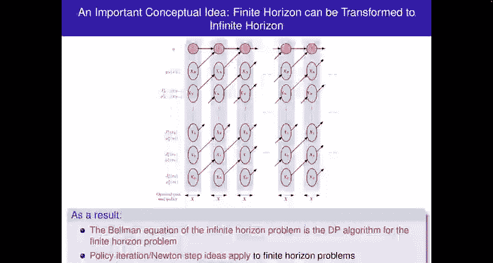

So rollout is a special case of approximation and value space。 So at a state X K。

 we perform this dynamic program in minimization。 We minimize over the set of controls and compute the expected costs for each state control pair and we may have an L step look ahead。

 which again， we solve this sort of depth limited exact dynamic programming problem where the termination costs are given by this J K plus L Tilde。

 This represents the future costs， and we call this the base policy costs。

So once we perform this minimization， we obtain a control and this control is we call UK Tilde。

 the rollout control。And the rollout policy maps to this rollout control at a particular state Xk。

So the future cost or the base policy cost is obtained by some。

This cost is obtained by some policy or heuristic that we simulate。

Maybe for a limited number of steps or perhaps to the end of the horizon in the case of a finite horizon problem。

So the policy used for rollout is called the base policy， that's this。

And the policy obtained via look ahead minimization is called the rollout policy。

There may be a approximation variance you as I meant， as I kind of alluded to just now。

 you the computing the base policy might be something that's expensive or something that you can't do for too long。

 and so you might do this thing called truncated rollout where you limit the amount of time you spend simulating the base policy。

In this case， you'd have some kind of cost function approximation and you'd have an approximate based policy cost。

Okay。

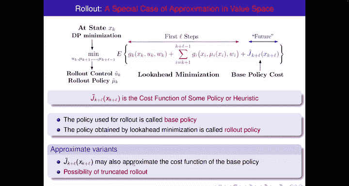

So I want to say a few things about why rollout is important for this course and what the role of rollout is so it provides important options for cost function approximation in the context of value space methods it's good because rollout approximates the optimal cost from above and as we saw in our visualizations it's important to approximate that cost from above because if you approximate it from below you might run into stability issues if your initial cost is too far to the left of the optimal cost。

 you might start with an unstable policy and you won't converge as desired on the other hand if you start to the right in other words。

 you approximate it from above you don't have this issue。It's as I mentioned before。

 it's the basic building block of the fundamental policy iteration algorithm。And more importantly。

 it's an algorithm that can be run online in the sense that the full trajectory can be computed without any offline computation。

This can't be done in general with policy iteration if you have more than one iteration。

 because that would require updates from states that you're not currently visiting。

 so policy iteration is done offline。On the other hand。

 you may do approximate policy iteration where you use some neural network to predict the intermediate policies。

 and that's an option too。So why will rollout be important so in its peer form it's a reinforcement learning method that's easiest to understand and apply it's not hard to see why given some base policy you can make some kind of improvement just simply by doing a look ahead。

Moreover， it's really easy to implement， it's easy to code。

There are a lot of really complicated methods out there to solve very niche problems and these methods as complicated as they are。

 they can be a bit flaky we call them， meaning they don't generalize well to other contexts on the other hand rollout is by far the most reliable we've seen the connection between approximation and value space and Newton's method where the cost going from the cost of the base policy to the cost of the rollout policy amounts to a Newton step。

Ro it's also very general， it applies to deterministic and stochastic problems and to finite and infinite horizon problems。

And as I mentioned， it's a special case of approximation and value space。

 and therefore it has this connection to Newton's method。

It deals well with online repplanning and it provides a useful alternative to reoptimization in adaptive control。

It also has a deep connection with model predictive control and can be used to improve the stability of model predictive control schemes。

嗯。Some more complicated methods like learning aggregation and approximate policy iteration and others can be used in conjunction with rollout in particular if you do this truncated rollout。

 so there's two ways that you can combine methods， you can use your method of choice as a base policy on which rollout can improve potentially。

 or you can use these methods as a cost function approximation in the case of truncated rollout。

I'll just say a couple things about your project， I'm going to talk a little bit later like near the end of the lecture。

 but if you're somewhat new to the field of reinforcement learning。

 we strongly recommend that you consider rollout as your methodology if you're going to do a mini research project。

As I mentioned， it's much easier to code and it's more likely to work with any given problem。

On the other hand， if you have a favorite like 12 letter acronym of your favorite algorithm or whatever and you want to apply it to some very niche problem。

 knock yourself out。Okay。Are there any questions about this sofa？Okay。Okay。

 so next we're going to look at rollout for deterministic and finite state problems。

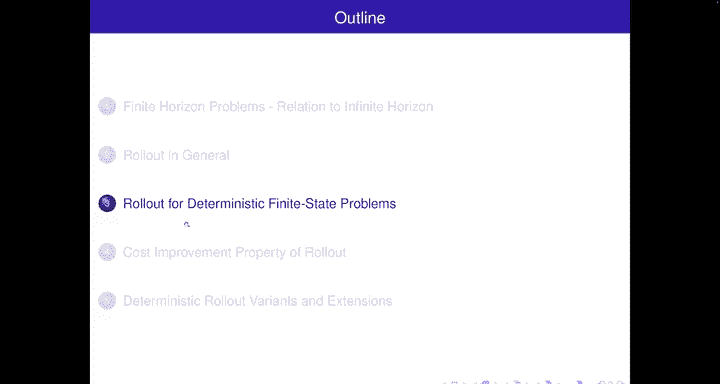

So let's review the deterministic optimal control problem。So again。

 we have a state space and we have a system equation。

 but this system equation it takes in a state and a control only， there's no random variable。

 so given a state and a control， the next state is determined xk plus1。

Then we have a cost function which gives the sum of all of the immediate costs incurred by selecting controls plus some termination costs。

And then given an initial state x0 and a trajectory。

 the cost of the trajectory is given by this cost function。

 and our objective is to compute an optimal control sequence by minimizing over the controls at each stage。

 this cost function。

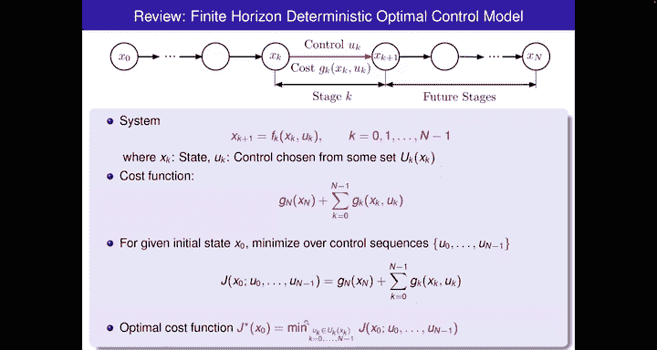

Okay， so we showed this a little bit in lecture one。

 but the execution of this can be sort of viewed as a DAG， a directed acyclic graph。

 so this graph is a set of states that are arranged in layers where each layer corresponds to a particular stage at stage zero。

 it contains all of the initial states and at stage one contains of the X1s and two。

 et cetera all the way to the end all the way to stage N。And then the last。Well。

 the last layer has this artificial termination node called T。

So the nodes corresponds state to states xk and each of these arcs corresponds to a state and control pair and where the start node is xk and the end node is xk plus1。

 so in the case of this x0， this arc corresponds to applying control u0 at x0 and we arrive at x1。

Also， an artrc corresponding to XK UK has a cost， GK，XK， UK。

And our objective is to try to find a trajectory from x0 to T that has minimum length。

 so the sum of all of these arc lengths should be ideally minimum。

So the problem is equivalent to finding a minimum cost shortest path from x0 to T。

So there's a sort of a knowledge check question that I always like to ask students every year。

If this is just equivalent to finding a shortest path in a graph and we know of efficient。

 shortest path algorithms， then why for finite state deterministic finite horizon problems do we need approximations at all。

 why can't we just apply our efficient shortest path algorithms directly to this graph。

 come up with the optimal solution and be done。No one want to guess？So。

ItDoes doesn't matter that there's no cycles， so that actually makes it easier。What do you mean？我是こ的。

Its。general of。I'm not sure what you mean？Because what was algorithm a problem that has structure。

Well， any finite state deterministic finite horizon problem has this structure。Yeah， yeah。

So why can't I just run my efficient shortest path algorithm on this？Biketra or Belman Ford。

 or whatever。Because like big to like genuine argument before， we don't engage strictly all。

They't listen dispatcher or drop， right？No， we know the structure is fully defined in any finite state problem unless unless you don't know the transitions or the costs or whatever。

 but suppose you do like for like for example， for like a any combinatorial optimization problem。

ThisThis graph is a enormous structural drug while not use is more now about problem。所以。

They know more assumptions about this problem。Still， the problem could be really。

 really hard to solve， but why， okay， I'll just tell you。All right。

 so let's think about your traveling salesman homework problem。So。When I'm running。

 if I decide to run a Dykester's algorithm， I'm on this graph。

I'm going to be this graph consists of all the states of the problem， right？

But what were the states in the traveling salesman problem example？有冇识调佢识。

So the states weren't there wasn't one state per city that so it wasn't the city set。

 it was a set of partial tours， it was a set of permutations。

 partial permutations over all cities of which there is astronomically many there's more than exponential them。

 so I would be applying an algorithm that runs in polynomial time in the size of the state space which is just going to be' the result is going to be。

Horrible it's going to take forever to solve this problem， so we have to introduce approximations。

I mean because you're thought this is efficient， that's why think say asset then why did you you the solution as an efficient solution because it is because I can give it an arbitrary graph and it will compute a shortest path in time polynomial in the size of the graph。

 but what my point here is that the size of the graph is enormous。😊，So it's not good enough。Okay。

 so we have to introduce approximations。But course yeah， occurs。O，好的。Okay， great。

 so speaking of combinatorial optimization problems。

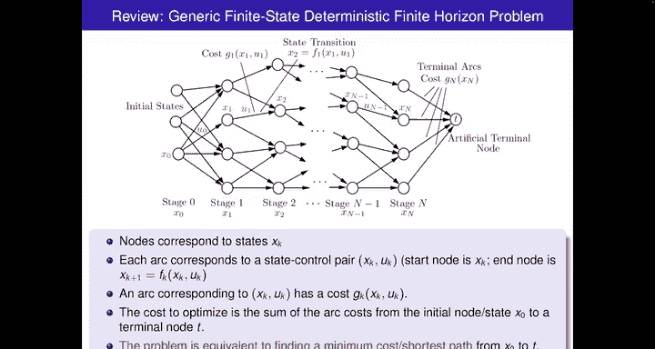

Let's look at this problem called the N queens problem。

So what is this problem you may have heard of this it's kind of used as like an AI benchmark sort of thing。

 but you're given this end by end chessboard。And you're given a set of N queens。

And your objective is to try to position the queens on this chess board。

 such that no queen is threatening another queen， according to the rules of chess。

 So if you remember a queen can move as much as it wants， side to side。

 it can go up and down like this。 And it can also go as far as it wants along the diagonals。

So we want to find a configuration that positions all N queens on the chess board such that have this you don't have any pair of queens that are threatening each other。

So an example of such a configuration looks like this。So here， if you look at any of these queens。

 there's no queen threatening that queen。So this is a N Queen's feasible configuration。

So how do we apply rollout to these combinatorial optimization problems so if you have a problem that you can say represent as an integer program we consider each of the variables one at a time in some order and we assign a value to these variables so in the case of N queens we'll start out with an empty variable assignments so the chessboard is empty。

Then we're going to look row by row， starting from top to bottom。

 and we're going to assign a queen to that row。So if I start with an empty chboard。

 I have well I have four options for row1， I could put it in one of these four spots but it turns out that due to symmetry placing it either here or here is enough because it ends up being the same thing if you extend this to force positions so we're going to look at two positions either in the corner or in the spot next to the corner so here's two control possibilities for a variable assignment for the first row。

Suppose I come down here and I choose to put the queen in the corner。

Then I have to pick where the queen is going to go in row two。

So there's two possibilities well I can't place the queen here or here because that would mean this queen would be threatening either of these positions。

 so I basically have this option or this option。If I put it in this option。

 then when I go to try to assign a queen to Roe3。I see that there's no place that I can place a queen that is not threatened by some other queen。

So we call this a dead end position and we assign it a high cost theres from this position。

 there's no way to complete the variable assignment such that you get a feasible and Queen's assignment。

Okay， so that's a dead end， we give it a high cost， in this case， one is sufficient。

Likewise over here。If I put the queen here， then that's okay。

 it's not being threatened by another queen。I can put another queen here without it being threatened by some other queen。

And that's the only option from this point。 But if I try to assign a queen to the fourth row。

 I find that I can't there's no place for me to put the queen in any of these four positions that it won't be threatened by some other queen。

So this is another dead endposition。And this has a high cost。Now， on the other hand。

 if I place my initial queen here， then it turns out I have one possible place to place the next queen。

 I have one possible place to place the queen in the third row and in the fourth row and what I end up is with a feasible N queen's assignment。

 and this is a trajectory with cost that's low in this case zero。

 so a minimum cost trajectory in this graph corresponds exactly to a feasible N queen's assignment。

Um。I'll say a couple things about N queens， it turns out it's actually trivial to find like one N queen assignment。

 but finding like the number of N queen assignments given given an end by N chessboard is not trivial。

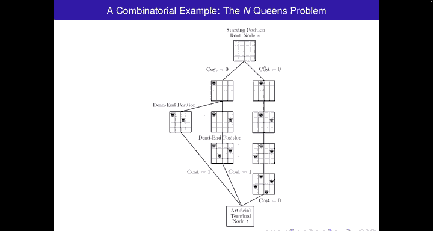

O。So that's one example。

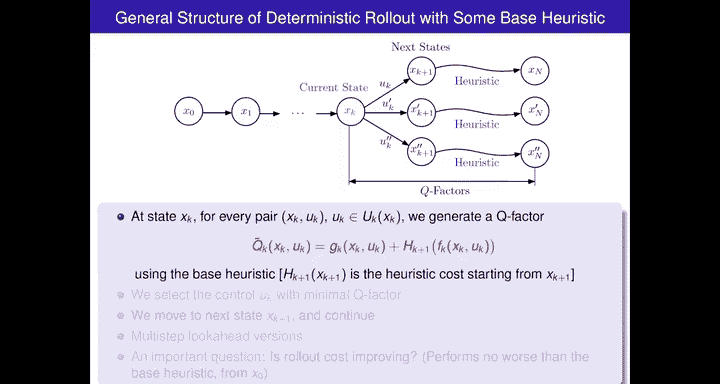

Yeah。SorryOh yeah yeah okay okay so so if we started at this initial state we would do this look ahead to the positions that we can place the queen these correspond to variable assignments so in the case of rollout like U one would be the position of the first row exactly so we would do this look ahead and repeatedly apply rollout until hopefully we found a feasible and queen's assignment I guess because these like。

So you can apply roll to any discrete optimization problem so it's as I said。

 you consider the variables of your interpreter program one at a time。

 you may end up like in this position here this dead end position where you find a path that violates the constraints of the problem and this is a dead end position okay so if you remove if you prune all of these paths that don't that correspond to in feasibleasible solutions then rollout can find a feasible one。

😊，Okay my question that， you know， the the formula given all doesn't seem。

applied formulaSo the controls correspond directly to variable assignments and the states correspond to a partial variable assignment so here this is an empty variable assignment on top and then we。

One by one assign these variables， so the state space is the set of all partial variable assignments and the control is to assign a particular variable to a certain value。

Okay， I guess yeah， I guess that's the part that， you know， of these kinds of。

 I guess disruptscript problems， this is maybe the difficult part to make sure that we take we change it to a code。

 like it doesn't seem intuitive。 I mean， it is problem but。I guess so said we have to directly。

Well I mean you can do this for any discrete optimization problem。

 you can do it for Napsack you just go through each item one at a time and you decide do I put it in my S or do I not。

Okay， it has a similar structure for any of these problems。

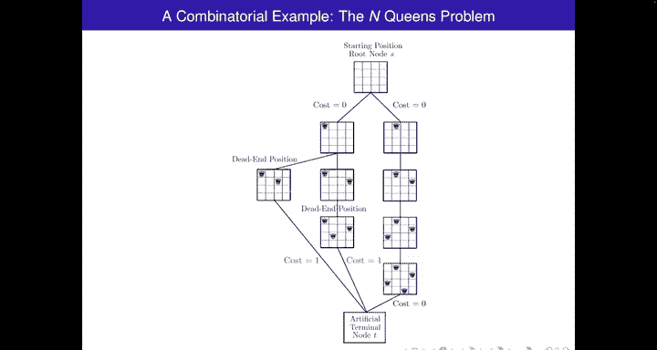

Okay， so the general this is the general structure of deterministic rollout using some base heuristic it'll generate this trajectory up to a current state Xk and then it will consider all possible controls at state Xk so in this case it's UK UK prime and UK double prime and each of these controls leads deterministically to an x state Xk plus1 Xk plus1 prime and Xk plus1 double prime respectively so at the state Xk for every pair Xk UK we generate what's called a Q factor。

AQ factor is obtained like this。If we're looking ahead to say this state， x K plus1 double prime。

 we run this heuristic to the end of the horizon， and we obtain a cost from that heuristic。

Then we add the immediate cost of being at state Xk and applying the control UK double prime。

 so this is the Q factor， so the heuristic cost which we define with this function H of k at a state xk。

Plus， the immediate cost is given this definition， QK Tilda。Okay。

 and rollout is going to select the control UK with minimum Q factor。Then we move to state xk plus1。

 which is determined by the minimum Q factor， and we repeat this over and over again until the end of the horizon。

There are multi step look ahead of versions of this as well， as I mentioned a couple of times。

But an important question is， is rollout cost improving in the sense that it's going to perform no worse than the base policy？

The base policy could be anything you could think of it could be something stupid。

 it could be something random and we want to know what are the conditions that we need to impose on the base policy so that we can guarantee that rollout at the very least is going to perform no worse than the base policy so that's what we're going to talk about next。

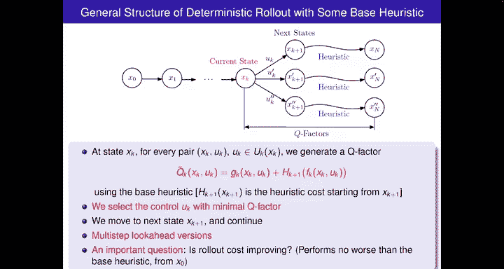

Pro， actually not， we're going to talk about another combinatorial example before we move on。

So this is a problem that I am very familiar with， this is called the multi vehicle routing problem。

 so we're given some network。And we're given a set of vehicles which are represented by these red trucks。

 and were're also given a set of tasks which are represented by these little yellow money bags。

And the objective here is to compute a set of trajectories， one for each vehicle。

Such that each of these tasks is visited at least once by some vehicle。

 and we want to make these trajectories of minimal length。So that's the objective here。

So let's choose a base heuristic， maybe one similar to the nearest neighbor heuristic from the traveling salesman problem。

 this is going to be a base heuristic where each vehicle moves towards its nearest task。

So vehicle two， its nearest task is this one at node7， it's two steps away。

 but the one at node 9 is significantly farther away。And due to some symmetry here， vehicle one。

 the nearest task here is the one at node7 again， so this is two steps away and this is three steps away。

 so the nearest task to both vehicles is this one at node7。So what does the base policy do？

Well each vehicle is going to move towards its nearest task， so when we execute the base policy。

 both vehicles one and two are going to move to node4。And by the way。

 I'll mention how how we charge costs here， we're going to charge a unit cost for each vehicle movement。

 so if both these vehicles move to node four。That's a cost of two because both of the vehicles moved once。

Okay， so once they move to node4， the nearest task for each vehicle is still this task at node7。

 so they're going to move here and incur another cost of two and then after that the nearest task is down here so they each move here a total of five steps according to the base policy so the total cost of the base policy is 10 two vehicles five steps each okay。

Now， what does rollout do？So at each stage the rollout algorithm is going to look at all pairs of next vehicle possible next vehicle positions。

 so vehicleicle1 is here in vehicleicle2 is here where can each of them go in the next stage well vehicle2 could move to node5 and vehicleicle one could move to node3 in the next stage that's one possibility another one is vehicle2 could go to node4 and vehicle one could go to node 3 or vehicle one could go to node4 or vehicle 2 could go to node 5 or both vehicles could go to go to node 4 which would correspond to the base policy so there are four possible Q factors here。

Now， I already did the one for the base policy， we know that that one had a cost of1。

I won't do all four Q factors， but I'll pick one that I know is good。

 Let's pick the Q factor where vehicle 2 goes here to node 4， and vehicle 1 goes here to node 3。

So using this Q factor as a starting point， we then simulate the base policy。

 we don't actually move the vehicles， but we simulate the cost as if they were there to obtain a heuristic cost。

So if both vehicles start here at4 and three respectively。

 then vehicleicle1 will move towards its nearest task according to the base policy and it will go to node 7。

 complete the task。Vehicle1 starting from node 3 will move to node 6 but it won't complete a task at this point vehicle  vehicleicle 1 will be at node 6 vehicleicle 2 will be at node 7 and there will still be a task remaining vehicle 2 will see this task at node 9 and it will continue in the direction towards the shortest path towards it so in the next stage vehicleicle 2 moves to node 10 vehicleicle 1 moves to node 9 and then the problem is solved。

So the cost of the base heuristic starting from this Q factor 43 is four because each vehicle moves two positions according to the base policy。

And then the cost of moving to this Q factor is another two because both vehicles had to move one position each。

So the cost of the base policy we saw was 10 and the cost of the rollout policy we saw was six。

So rollout， it turns out this is the minimum Q factor， in fact。

 moving along these paths here corresponds to the optimal solution。

 so rollout will choose to move vehicle2 to node4 and vehicle1 to node3。

 and then we repeat this calculation again simulating the base policy next in the next stage。

You guys have any questions about how this works？Okay。

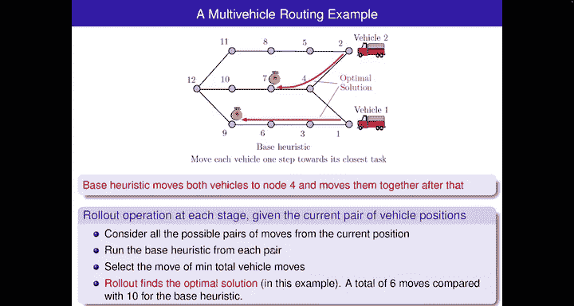

Here's another problem， this is called the search for an N Arc breakthrough in a path in a tree。

So this is kind of like navigating through a maze， we start at a root node and we're going to navigate n steps through a maze。

Here it's represented as a binary tree。And these crosses on an edge represents a blockage in the tree。

So we can't move through these and our goal here is to search through what's called a breakthrough path。

 it's one that looks like this where there's no obstructions。

So let's consider a greedy based heuristic on this tree。The greedy heurtic is， if one arc is free。

 use it。If both arcs are free， then only use the right arc。And if neither ark is free。

 you're already in a dead end state anyway。So here， if I execute the greedy heuristic。

 the heuristic tells me to move right because both arcs are free。

And the hereic causes me to immediately arrive in a dead end。

If I were to try to solve this with exact dynamic programming。

 the complexity would be O of n times 2 to the n， this is because we know that this tree has n levels and the number of leaves at each levels doubles as each level continues down。

And in a tree like this， the number of leaves corresponds exactly to the number of unique paths in the tree starting from the root。

And then so we would in the exact dynamic program algorithm。

 we would end up considering each of these paths and having to compute a cost for them。

 and it takes linear time to compute the cost for a particular path。

So that is the complexity of the DP algorithm， its exponential。On the other hand。

 the complexity of the greedy algorithm is just a linear because if I'm at a particular node。

 I have to make exactly two computations， I look to see what's left and what's right。

 and then I can immediately move to the next node， so the complexity of the greedy algorithm is going to be two times n because the length of the path is n。

Rollout on the other hand。At each of these layers in the tree。

 it's going to perform two base heuristic calculations。

 so it's going to run the base heuristic twice at each level of these trees of this tree。

And we know that the base heuristic requires linear time to solve。

 and so the complexity of the rollout algorithm is O of n squared。

If you assume that these arcs are blocked with a given probability。

 so like if you generate a random graph or a random tree。

Then it can be shown that the rollout algorithm has an O of n times higher probability of finding one of these breakthrough paths。

 so the greedy algorithm I showed you in this case。

 it doesn't find a breakthrough path and the rollout algorithm might not find one either。

But the rollout algorithm has a linear factor， higher times probability of finding one in the case where these edges are blocked with some fixed probability。

The analysis of the analysis of this you can find in your textbook and the cited literature。

 but the point of this slide is to show that this is a qualitatively typical example of what you can expect from rollout in general。

 there's no guarantee， but rollout improves the performance of the base heuristic substantially at the expense of a polynomial amount of extra computation。

 which is something that you saw in your homework assignment I guess two and one as well。

Any questions about this one？Yeah。B。We like。They not simple for order。Right。

 it doesn't rollout won't consider every single path in this tree。

 and so it might find itself getting in a dead end state。I said if it breaks all the possible that。

No， rollout is not guaranteed to find the optimal path。

 it's not guaranteed to find a breakthrough path。What we show or what what can be shown is if the edges are blocked with some probability。

 the probability that rollout finds a breakthrough path is much higher than the probability of the base policy finding a breakthrough path。

spike so capacity。Well， rollout doesn't it's not going to look at all possible paths and so there might be it might be the case that in an arbitrary instance of this。

 there might be one exactly one path that brings you all exactly one breakthrough path。

And because rollout is dependent on this heuristic， the heuristic might lead it astray early on。

 and so it may never see this path。But in the special case， where we're generating this random tree。

You can show that the probability that rollout actually finds a breakthrough path is much larger than the basehuse。

Yep， and so how does it like Min Book？You're looking one step like that you're doing to roll up and then just doing greedy from like the second film but in that case that you mentioned where you got stuck because you didn't find you didn't follow the right catlet like。

 so is it known not just looking at did the greedy here so。

On one or the other given answers is it life of that maxal thought that gave or something like that。

So if it so okay， so you could assign like in a similar way the dead end states could have could lead to a very large cost。

 so yeah if it does like a look ahead and it sees that the cost is very low。

 then that's like a promising direction to look for the breakthrough path。So that's not a。

 it isn't just always going somewhere where you like find not。

So how many steps here is well so the height of this is an anarchrc path。

 so the height of this tree is N。So it's trying to traverse each level of this tree and find a path that is unobstructed。

For example， you are the you make first choice， and then you're on the left。

 the top note of the battery， and then you just roll out till the end and then choose the next one for what。

So you repeatedly do this one step look ahead and you do the minimization and then once you move to your next state you just repeat this process again。

 you do another one step look ahead， run the base policy and figure out what your next state is。Okay。

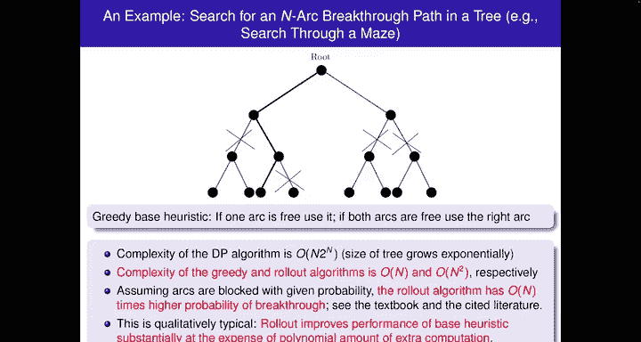

All right， so now we're going to look at the cost improvement properties of rollout and then we'll take a break。

So。Cost improvement is not something that just automatically happens with rollout there are special conditions that must hold to guarantee that the rollout policy performs no worse than the base heuristic。

And these two of these conditions are called sequential consistency and a more general one is called sequential improvement。

We say the base heuristic is sequentially consistent if at a given state it chooses a control that depends only on that state and not how we got to that state。

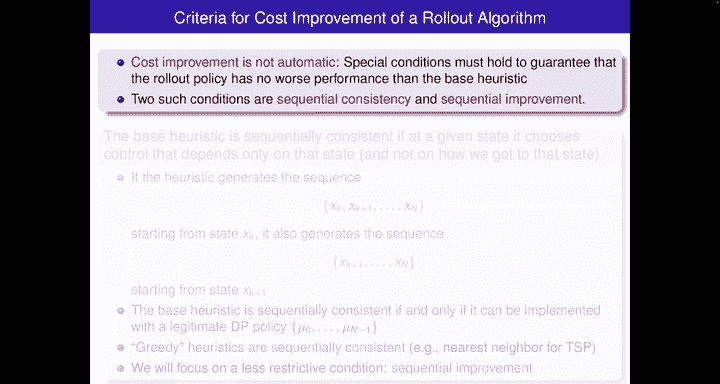

In other words， if the heuristic generates this sequence starting at xk， xk plus 1。

 all the way to xn， then if we've started xk plus 1。

 the sequence that it generates is necessarily the tail sequence here， starting at xk plus1。

Another way to think about this is the base heuristic is sequentially consistent if and only if it can be implemented with a legitimate dynamic programming policy。

A legitimate dynamic programming policy is a sequence of functions that depend only on the state and output of control。

嗯。Greedy heuristics are sequentially consistent heuristics， for example。

 the nearest neighbor heuristic in the traveling salesman problem that's only dependent on the state and we pick the next dark according to the minimum cost。

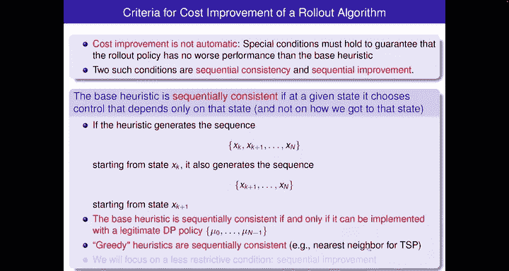

So we're going to focus on the less restrictive condition， which is sequential improvement。

 which is the more general case。Okay， so the sequential improvement condition informally。

 it sort of means this the cost of the rollout policy is at most the cost of the base heuristic so here's the definition。

The best heuristic Q factor is at most， the heuristic costs。

 So if we take the minimization over the set of controls of the immediate cost。

 plus the heuristic cost at the next state X K plus1。

 this needs to be at most the cost of running running the heuristic at state X， K。For all。

 so this needs to apply to all XK。If this condition holds for all XK。

 then the heuristic is sequentially improving。So rollout upon reaching Xk Tilde and okay。

 so let me preface this with this。I want you to think about rollout as an algorithm that generates a series of trajectories and I'll make this more clear with an example in the next slide。

 it starts with a base policy at the initial state and then by doing this minimization it generates a sequence of trajectories that have this property。

 the cost of RK is at least the cost of RK plus1 so the cost of these trajectories that it generates is monotonically non-increasing。

Okay， so here we have this trajectory generated up to state Xk。And we do our look ahead。

 UK versus UK Tilda， and we obtain the base heuristic costs and we do this minimization to produce a new trajectory that has this monotity property。

 so the cost of RK is at least the cost of RK plus one。

So the current trajectory cannot get worse and r0， which is the trajectory generated by the base policy at x0。

It has this property of being at least the cost of RN， which is the rollout policy。

 the final policy given at the end of the algorithm。

 and since all of these intermediate inequalities are true as well。

 then this inequality holds as well。So I said that the sequential improvement property was a more general version of the sequential consistency property。

 meaning that if your heuristic is sequentially improving。

 it may not be necessarily sequentially consistent on the other hand。

 if your heuristic is sequentially consistent， it is necessarily sequentially improving and this can be seen by the fact that if your heuristic is sequentially consistent。

 then if you're at a particular state Xk， the heuristic cost of Xk is going to be exactly equal to the heuristic cost of K plus1。

 plus the immediate cost of the action prescribed by the base heuristic。

And because rollout does a minimization over and its minimization calculation includes this particular action prescribed by the base policy。

 than the trajectory that rollout produces can be no worse。

Oftimes it's much easier to verify that your heuristic is sequentially consistent rather than sequentially improving。

 this is a bit harder to verify， on the other hand， if you can verify this。

 then you get sequential improvement for free。Okay。So let's look at this familiar example。

 and this is meant to illustrate the idea that rollout is generating a sequence of trajectories。Okay。

 so again， we're going to be using the nearest neighbor base heuristic at the initial state x0 at city A。

 we use the base heuristic to generate the initial trajectory。

 the base heuristic says move to the city with the lowest immediate cost。So in this case。

 the smallest edge weight is one， so we move here， three is less than 20， so we move here。

 and then from there on we have no choice， so we get this trajectory R0 that has a cost of 28。

So that's the initial trajectory。Then we run rollout， so from A。

 we do this look ahead to states the cities B， C and D。From cityC， we already ran the base heuristic。

And from city D， we get a cost that's pretty large。But from city B。

We run the base heuristic and that requires us going to the lowest cost arc。

 so the base heuristic tells us to go along this way oops。

So the second or the first policy generated by rollout from the base policy is this one on the outside。

 so this one is going to correspond to the smallest Q factor of all of these states and so rollout is going to tell us to move here and then this is the first policy that rollout generates。

Then okay， and then the cost of this Q factor is 27。

 so it has a smaller cost than this one and it certainly has a smaller cost than this one。

Then we repeat this process so from from partial tour AB， we look ahead to the next cities C and D。

From here we have no choice， so we get this trajectory of cost 21 plus the immediate cost is 22 and then from here we again have no choice and we get this houristic or this trajectory with heuristic cost four and we add the immediate cost and we get a cost of8 and we compare these and then rollout tells us to move here so this is this is the trajectory R2 so we started with R zero。

Then we obtained R1， and then as we move through this state space， we obtain R2。From here。

 there's no further choice， so we continue down and the policy we don't generate a new trajectory anymore。

嗯。But as I've demonstrated， we have this sequentially consistent heuristic and I've shown you that the cost of R0 is strictly greater than the cost of R1。

 which was strictly greater than the cost of R2， but you don't necessarily have to have any improvement at all。

 what the guarantee is is that you won't generate a policy of greater cost than the one that we have before。

 but in this case you actually see cost improvement。Are there any questions about this site？So。

 what do you do， What to。a you。嗯。If you already see that the first course， like just say this one。

 imagine that the that one C you go from no based policy to world one do you still do roll out one the first cost of the first was 100 and your base policy。

 your best cost was like of the total line was lets say you say 28 do you check， okay。

 do I still do this 100 and C the or do you say okay， I see this 100 so no matter what I will cancel。

You can't make a decision like you're saying that like if this edge cost was 100 or something。

You our ignore the decision。 you made first code， you check A D， A C and A B， because maybe at A D。

 the subsequent one are unless。 But if you see that the cost of a to B is greater than the just from A for D is greater than what you got as the total cost of the patistic。

 do you still consider a A A D on that。So if you're starting at A。

 you definitely want to consider all of these Q factors Okay， but at the this point of Z。

 we' just want to a， right？Yes yeah okay yeah so okay okay。

 so so the cost of this arc is 20 I know and I know the cost of this one is 28 right so if I if I look ahead and I run the heuristic so like let's say that this arc was still 4 and this arc is still 3 and the heuristic is going to return this cost of 43 and then plus 20 and this Q factor is going to be 63。

It might be that this arc cost is zero right yeah my question was again than the total this A was  than we cancel that path from the beginning because we're going to follow the path that corresponds to the smallest Q factor so if it's greater than if it leaves you down a path that has a Q factor with greater cost than some other one。

 then yes we don't go that direction。I think this question is like 180。

 this edge itself is already like larger than the。Thenhan the base heuristic maybe you could do some kind of like。

 well， I mean， rollout doesn't tell you to do that。

 you could maybe depending on what your problem is。

 you could do some kind of pruning youre saying like if this edge here。

 has a greater cost than you then okay， then maybe you could save some computation。sYeah， okay。

 so you could cancel your base calculation earlier。

 if your base policy calculation earlier from a Q factor。

 if you find that the cost is getting too large that's an optimization， you can make it。Yes， okay。

 yeah， sure。Okay， can I comment。PoinsThat we you mentioned is， essentially that。You know。

The total cost of some basic risk， which essentially imp you are to some sequential execution of different branches。

 but you can imagine a situation where Go are well committed for parallel where you allocate straight competition though。

We checking both AB， A C and AB， and in that case， we not have no way to know beforehand whether or not this tag itself is larger than the university policy public。

Particularly if you want on chat， that means you are improving some intermediary computation with different node。

 which is。That necessarily ideal so essentially depending on the computational code you use to carry out loanout and so on。

Whereas would you mentioned it a nice way to cut down Asia if people probably have one to carry out its calculations。

嗯Yeah。Can you explain the sequential consistency using this as a？Well。

 I' when I'm at a particular state say， okay， say I'm at state A。Well， actually。

 that's a bad example， say I'm at state AB。Im going to pick the next when I pick my next control。

 all I care about is the fact that I'm in state AB。

 it doesn't matter that I was in state A before because all I need to know is what state I'm currently in to choose the next arc of minimum cost。

 so this is sequentially consistent because it's not dependent on any state that I've been in in the past。

Okay。Let take a break Okay so yeah take a break and if you have more questions at the end of the break we can take some time to answer them Otherwise we'll continue with the last part of the lecture so we'll meet back at。

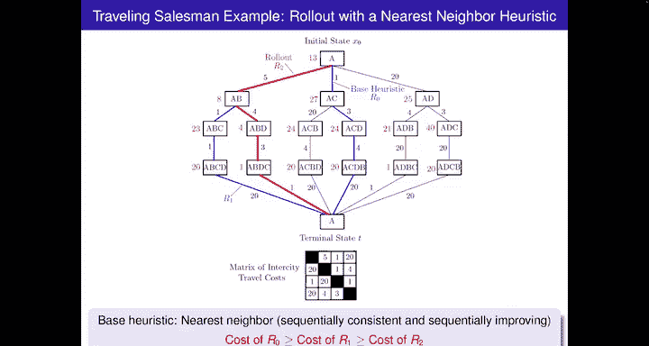

557。Okay， let's get started again， are there any questions coming back from the break？Okay， just。

I just conceptual it doesnt seem like you are something within a solution technique but why would Well it depends on how you define learning but I showed how rollout generates a sequence of policies that have nonincreasing costs so if you think about learning in that way in that it's learning from its lived experience and generating a sequence of trajectories each no worse than the last in many cases much better than the last then you could think of learning in that sense。

I've seen reinforcement learning defined in a couple of ways。

 one way you can think about it is approximate dynamic programming and we use those terms interchangeably in this course another way is learning through lived experience。

 but I wouldn't say that reinforcement learning requires you to implement some kind of neural network or something like that like maybe it's easier for you to see like why Q learning is like learning because it's using this like gradient based technique to update the Q factors of a state。

But that's not the only reinforcement learning algorithm。

 so it depends on how you define learning and it depends on how you define reinforcement learning。

But if you think of reinforcement learning as approximate dynamic programming or learning through lived experience。

 something like that， then I would call roll out a reinforcement learning algorithm。

The only question I other them solve that they may generalize I' your it works on any initial condition for any problem and its performance is going to be dependent on how good your base policy is and what are the properties of your base policy。

But it's an online algorithm。And that's19 because it doesn't store for the next popular。

 I can't imagine why。O。O。Any other questions？Alright， cool。Okay。

 so in the last part of the core the lecture today， we're going to look at。

Deterministic rollout variances and extensions， and we're going to touch a little more on sequential consistency as well。

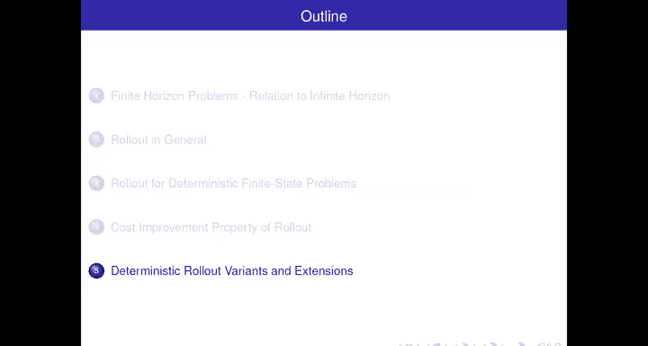

Okay， so the first variant we're going to discuss is called simplified rollout。So to motivate this。

 think back to the Wordortle example from one or two lectures ago。

What did we have to do there at each stage we needed to choose a five letter word as a guess right and then we got some kind of feedback that says。

 oh， these letters are in the word but they're in the wrong position or it might say that this particular letter is in the correct position but we get some kind of feedback。

But what about at stage zero， we have to pick some initial word。

How many words can I pick that are five letters long， about 12000 in the English language。

 and although you get some feedback from the wordle game as you continue to guess。

 the size of the control space is still very large。Okay。

 so that that motivates this simplified rollout algorithm。

 so instead of computing a control with minimal Q factor。

 we use any control with Q factor that's less than or equal to the heuristic cost given by HK。

So when at Xk we choose the as a rollout control， any control that satisfies this inequality。

 so of course the minimum control will satisfy this inequality。

 but maybe that's not the only control that satisfies this。So in this way。

 we focus on a small subset of promising control to save computation。In the case of Wdle。

 I'm not sure how they do it or what mechanism they use。

 but they reduce this control space down to like 15， 20 or 50 words， something like that。

 instead of 12，000， so they use a form of simplified rollout。Okay。

 so does the simplified rollout algorithm have this cost improvement property？

So let the rollout policy of under the simplified algorithm be given by pi Tilde and let JK P Tilda Xk denote its cost starting from state X K。

 then it's really easy to see because you're picking the controls exactly in this way that this inequality is satisfied。

So the proof is is sort of trivial it's easy to see this the cost of r zero is at least the cost of R1 et cetera。

 all the way to the cost of Rn so this is a way of saving computation when your control spaces are excessively large and remember Wordle is a game and it's played online and you're expected to come up with a response within seconds because I think your score is based on a timer if I remember correctly I might be wrong no am I making that up okay anyway it's a game and it's played online。

Okay。All right， so the next is called rollout with a super heuristic。

Depending on what your problem is， it may not be obvious。

 which is a good heuristic to use as a base policy for your rollout algorithm。In fact。

 that there may be multiple heuristics that work better under certain parameter settings of your problem。

So one idea is to consider combining several heuristics into a thing called a superheuristic。

 so the idea is to construct the super heuristic which runs all of the heuristics that each state encountered and it'll select the best out of the trajectories produced so you run many heuristics and you select use the heuristic corresponding to the smallest Q factor。

So the super heuristic can be viewed as the base heuristic for the rollout algorithm。

And it can be verified using the definitions that if all of your heuristics that you are using are sequentially improving。

 then the same is true for the super heuristic and this is not too hard to see so the first step for the proof is to write down the sequential improvement condition for each of the M heuristics so this superscript M corresponds to the heuristic M in this set。

And then by taking the minimum over M， so we apply the minimum over m to both sides of this inequality and we interchange the minimization。

We get this expression here， which is the minimization over the set of controls。

 and then we minimize over the heistics， over the different heuristics and we get this inequality。

 which is precisely the super heuristic Q factor so we run each of these heuristics。

 we take the minimum and then if all of the heuristics are sequentially improving。

 then this inequality holds as well and this is the proof。

So the sequential improvement condition holds for the super heuristic as well。

 so this is one thing to consider if you're thinking about doing your research project。Okay。

 so that's that variant are there any questions about this one？Or are the simplified rule level？

All right。Okay， so here I want to give a counter example to cost improvement to the cost improvement property of rollout when in the case where the sequential improvement condition does not hold for the base policy。

So suppose you're given this control problem and you have this state x0 and if you apply control u0 star。

 you go to state x1 star and if you apply u0 tilde， you go to state x1 tilde。

 and then the rest of the problem looks like this。And suppose the optimal trajectory is this trajectory given in blue。

And assume that the heuristic tells you from if you're starting at x0。

It tells you to pick U0 star and if then when you're at x1 star it tells you to pick u1 star so in other words。

 the heuristic if you're starting at x0 tells you to do the optimum thing okay。However。

 if you start at x1 star and you run this heuristic， it tells you to do something different。

 it tells you to go along this edge to x2 tilde and tells you to pick this control u1 bar。

And this edge has a really high cost。 So this heuristic is not sequentially consistent。

If I start from here， it gives me one trajectory， but if I start from here it gives me a tale it doesn't give me a trajectory that is a tale of this trajectory starting at this state so is this heuristic is not sequentially consistent。

Now， what happens if we apply rollout using this as our base heuristic， So we start at x0。

And we do a one step look ahead and we consider control U0 star and U0 tilde。

 and from each of these respective states， we run the base policy。From here， x1 Tilda。

 there's no choice， we just have to go this way。From here。

 the base policy tells us to go along this edge， that's what the base policy says。

So and this edge has a high cost， so rollout will choose this control as the minimum control and the rollout policy will tell you to go this way。

Now， but we know that。The base heuristic starting from this state also happens to be the optimum trajectory。

 so you can see that the in the presence of this non sequentialequly consistent heuristic。

 the cost of the rollout policy here actually must be greater than the cost of the base heuristic。

Okay， so that's what this says and then so in the absence of sequential improvement rollout can deviate from an already available good current trajectory。

So this suggests a possible remedy， the idea is to follow the best current trajectory found。

 even if rollout suggests following a different but inferior trajectory。

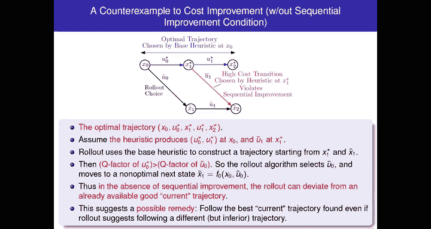

And that brings us to fortified rollout， so the objective or the aim of fortified rollout is to restore the cost improvement property for base heuristics that are not sequentially improving。

So here's the idea now we saw that rollout generates a sequence of trajectories。

And what we're going to do is at each step， we're going to follow the best trajectory computed so far。

 so we're going to keep track in memory whatever the current running best trajectory is and its' associated cost。

 and if rollout tells us to do something different。

 then we're going to disregard rollout and follow our current tentative best trajectory。

So at a state Xk。In addition to the permanent rollout trajectory。

 so from x0 to xk these are decisions that we've already committed to online。

 so this is part of the permanent trajectory。We also store the tentative best trajectory。

 which is in this diagram as given by this trajectory here。

Then when rollout does its look ahead at's state xk。

 suppose this state here corresponds to the minimum Q factor。Well。

 we reject the minimum Q factor choice UK Tilde， if its complete trajectory is more costly than the current tentative best。

Otherwise， we accept UK K Tilda and update the tentative best trajectory。 So this is handy。

 if maybe you don't know something， like， if you have some houristic in mind and maybe it's the best thing you can think of。

But but you can see that it's not consistent。And you have no idea if it's cost improving。

 so then fortified rollout might be a good candidate variant for applying to your problem。

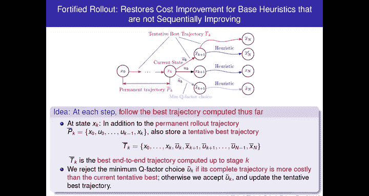

Okay， so let's look at the same example as we saw before， but instead of rollout。

 we're going to apply for toified rollout。So as before， starting at x0。

 we found that the rollout control corresponded to this trajectory here。

But we have this initial trajectory which is which we keep track of in memory。

 so when we do the one step look ahead， we see that this state here corresponds to the minimum Q factor and we obtain a cost for it。

 but then we compare it to the tentative best trajectory which we obtained initially。

 and we see that this tentative trajectory has a higher cost or sorry a lower cost。

So we discard the rollout control and we simply move to x1 star instead of x1 tilde。

And so in this way， we overcome this problem and in this particular example。

 we end up with the optimal trajectory。Does that make sense？Okay。

Are there any questions on any of the variants that I've talked about so far。

 I'm going to talk about one more and then we're going to finish up the lecture。

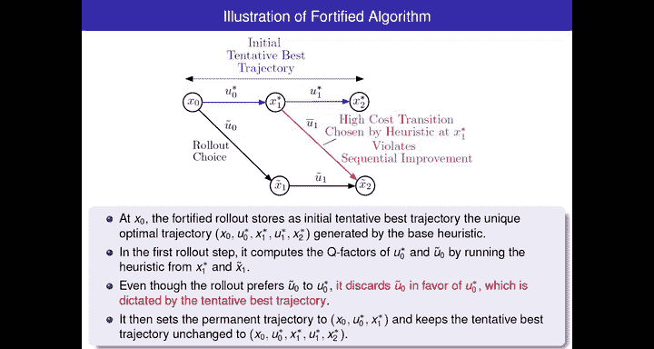

Okay。诶。The last variant is called model free rollout with an expert this one is interesting okay。

 so if you have this general discrete optimization problem， which I talked about earlier。

 you have controls that are corresponding to variable assignments and you have this cost function G which you give the variable assignments to and we want to choose variable assignments such that the cost function G is minimized。

是。Okay， so starting at a current partial solution， rollout looks ahead one step and it runs some base heuristic to the end。

 and ideally we get a cost obtained here and we can choose the minimum Q factor and continue。

But what if we don't know G and what if we don't even necessarily know the constraints the constraints at UK？

So instead。Os， we have a base hereuristic， which given a partial solution you zero to UK。

It outputs all next controls UK plus1 Tilde and then generates from each complete solution。

And this is done using a human or software expert， there's some expert that can given a partial trajectory。

 make a complete trajectory somehow。And then there's also an expert that is capable of ranking any two trajectories。

 it can say this trajectory is better than this trajectory。Well。

 in rollout all we're looking for is the minimum Q factor and if we have some kind of ranking system。

 whether it be a human or software expert， these are all of the ingredients we need to perform rollout so the point here is is that we can even use rollout in the case where the cost function is unknown and I'll show a real worldorl example of that。

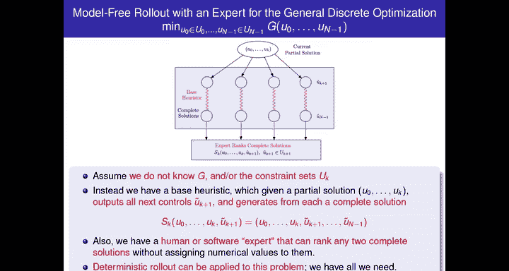

Okay， so this is called the RNA folding problem and then there's this paper from a couple of years ago。

 I believe worked're done by Professor Pricis where they used rollout with an expert to solve this RNA folding problem。

So。The problemm i'm going to skim over a lot of details but but the high level picture is this given a sequence of nucleotides。

 which are these molecules of type ACGU we're going to fold them in an interesting way to produce an interesting structure and by folding I mean we're going to take pairs of them and connect them with each other so。

We're going to look at a partial folding at each state and then we're going to make a decision one of three decisions。

 so suppose this of partial folding。Here are two molecules that have been paired with each other。

 and this here is an open pairing。So at a state Xk， given a partial folding。

 we're going to make one of three decisions， we're going to either close an open pair。

We're going to do nothing or we're going to open a new pair。

So earlier in the sequence at this molecule， we decided to do nothing。Here。

 we decided to open a new pairing。 Here， we did nothing。 Here， We closed an existing pairing。 Here。

 we did nothing， and here we opened a new pairing。 And now here。

 we're trying to decide what the next thing to do is。

So the base heuristic in this case we'll complete a folding using some kind of software。

And then the same software can be used to compare two complete foldings and say which one's better。

 it's not generally agreed upon what makes a folding interesting or which foldings are better than others。

 but this software has some way of doing that。Okay， so。

This is just an example of a specific application where there's no explicit cost function and the software is the expert software computes not only the base heuristic but also the costs of a particular trajectory。

 I would think that this kind of thing would also be useful in the context of large language models where it can be difficult to evaluate how good a string is relative to another string。

Depending on the context， so maybe that could be another potential application for rollout with an expert。

Are there any questions of yeah para do you could do like a tournament？Yeah。你 else。

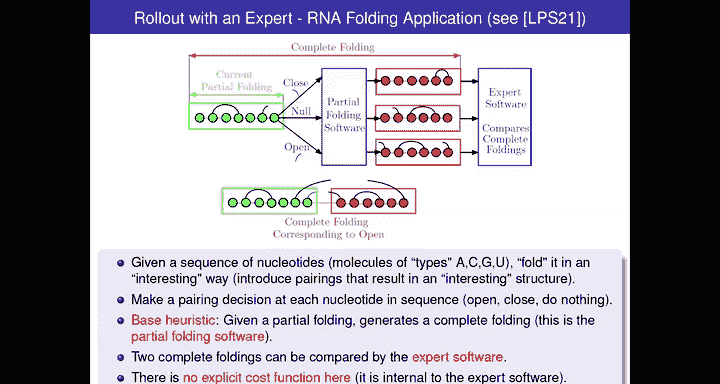

Awesome。Okay， so that is the end of this lecture so next time we're going to continue this series of lectures of going into more depth。

 we're going to look at a rollout with multistep look ahead and we're going to look at rollout for constrained problems and applications integer programming so we'll see more discrete optimization problems there。

There's a new homework assignment that's due in two weeks。

This is a programming exercise and it's related to the spider and flies problem from a previous exercise。

 so this is a stochastic multi agent problem。And you'll be asked to make three different implementations。

 so given a specific instance which we identify in the book。

 we're going to ask you to compute the optimal solution， remember this is a stochastic problem。

And then we're going to ask you to implement rollout and then we're going to ask you to implement a variation of rollout called multiagent rollout。

 which we're going to go more into in next lecture。

 but for now you can think of it as a form of simplified rollout so you'll be implementing these three algorithms and running them on a specified instance。

Regarding your project， I think it was yesterday or maybe a couple days ago。

 I uploaded the guidelines for your project on Canva so you can go and access them under the file section。

So please go and read them and if you have questions or need clarifications， please send us an email。

We're going to ask of you that by the end of spring break。

That you send us a one page or less proposal about your term paper。There are two possible options。

 there's the read and report type paper and there's the mini research project。

For the Read and report type paper， we're going to ask you to look at a particular subfield of reinforcement learning that interests you and look at various literature regarding the subject and write a report on it that involves some kind of synthesis or possibly includes directions for future research on the other hand。

 if you choose a mini research project we're going to want you to perform some kind of novel research on a new problem。

 not an existing paper that you've already written。

For the proposal in the case of the Read and report type。We'll ask you。

We want to know what is the subfield that you're interested in and we'll ask you for a tentative list of references for what you plan to read。

In the case of the Min research project， we're interested to know what problem you're thinking about and what kind of methodology you're thinking of using。

 and also please include a tentative list of references that are relevant to this。

So send us up by the end of spring break， you can email these directly to Professor Bcis and please email sorry C U Cha。

Are there any questions？Yes， they're on Cans right now under files， the 2024 project guidelines。ok。

All right， well， that's it for this week， guys。

