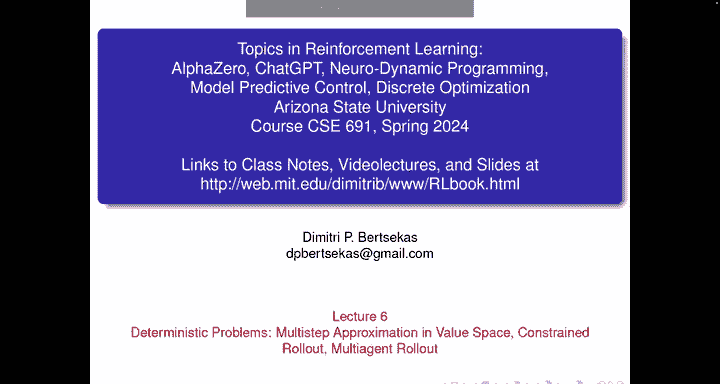
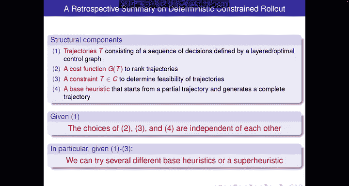
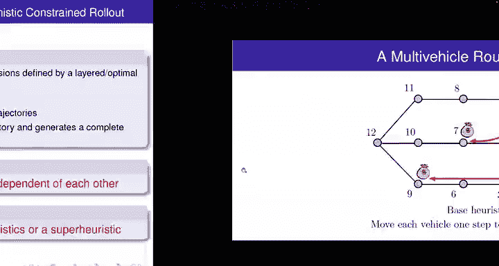
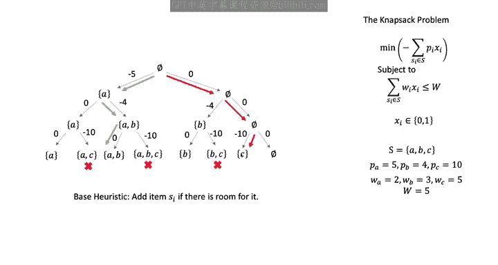
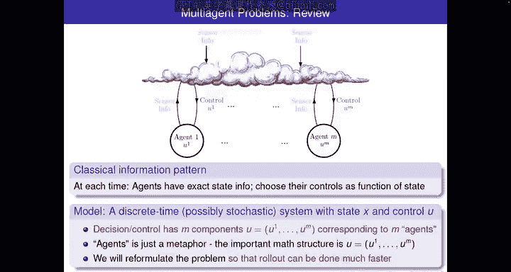
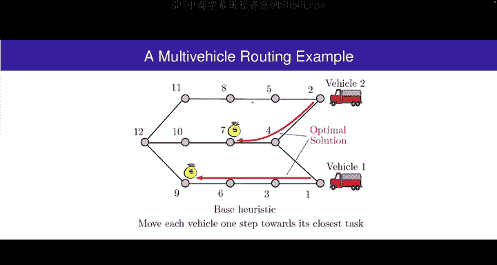
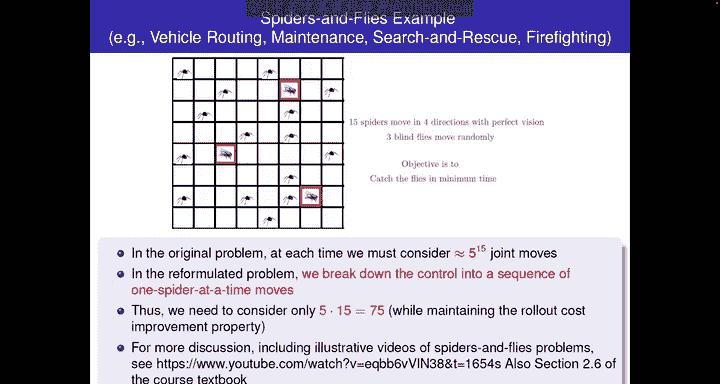
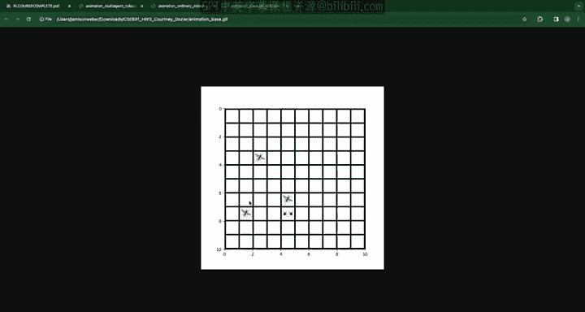

# ASU《强化学习2022-2024｜cse 691 Reinforcement Learning Course at ASU》中英字幕（deepseek - P6：[05]Lecture 6, 2024, Multistep Approximation in Value Space, - GPT中英字幕课程资源 - BV1zcfVYdErD

Okay， we're going to go ahead and get started now， I think。Okay。

 so welcome to lecture six of topics and reinforcement and learning for CC 691 today we're going to continue our discussion of deterministic problems and look in more depth on multi depth approximation and value space。

We're going to look at constrained optimization and also multitage and rollout to address some techniques that you'll need for your current assignment。

Okay， so the first topic we're going to look at is。

Approximation and value space with multistep look ahead。

 we're going to look at ways to economize computation in multistep look ahead。

 and we're going to introduce the concept of in any time algorithm。

And we're also going to look at ways of pruning trajectories。

 which is a popular question that's been asked a lot in this course so far。

 so we're finally getting to that。U。Next， we're going to look at constrained rollout for deterministic optimal control。

 we're going to look at cases for problems where certain trajectories are either not acceptable or not admissible for whatever reason。

And how they apply to discrete optimization problems。And then we're going to take a break。

And then in the last part of the lecture， we're going to talk about multi agent problems and a reformulation of。

被诶。General problem so that it can handle multi agent constraints。Okay， so yeah。

 so first we'll focus on multieplic。Okay， so this is the general case for multistep approximation and value space。

 so this is the exact same figure that we saw before regarding the architecture of alpha zero。

 we start at some initial state and we build a trajectory up to a current state Xk。

And then we do a multi step look ahead， so this is a multi step look ahead tree。

The nodes in this tree represent states that we can visit。

 and the arcs of the tree represent controls being applied at a certain state， so for example。

 we can apply a control state at Xk and arrive at a state x plus 1。

We then build this tree down to a certain limited depth。And we have then leaf nodes here。

We evaluate the cost of these leaf nodes using some kind of terminal cost function approximation and possibly a base policy。

 so the idea of multistep look ahead is to do this depth limited exact dynamic programming calculation where the terminal costs are of the leaves are given by some terminal cost approximation。

So there are a couple of special cases that we'll consider in this lecture。

 the first case is the case of no rollout， so in this case this middle section where we're simulating a base policy to some depth。

We're going to abstract it out so it's still going to be there。

 but it's going to be sort of abstracted in this terminal cost function approximation normally we run at each of these leaves we simulate a base policy if it's truncated we simulate it to a certain length a certain amount。

And then we apply a terminal cost function approximation， J Tilda。

But to focus more on the multi step look ahead part， we're going to abstract this middle section。

The other special case， which we're going to look at in more detail with constrained rollout。

Is the peer multistep look ahead this is where at each of these leaves we run the base policy fully to the end of the horizon and we obtain a cost evaluation at each of these leaves just from that there's no terminal cost terminal cost function approximation because we've run the base policy to the end of the horizon so this is another special case。

 no no truncation and no terminal cost function。Now we take。As fact。

 something that's not necessarily mathematically true。That the longer the look ahead， the better。

 this is sort of a principle that's helped drive this success of alpha zero。But。

There are kind of pathological situations where having more information。

 a longer look ahead does not necessarily lead to a better outcome unless you're doing exact dynamic program。

But these are kind of rare in practice， and it's borne out in many case studies that this general principle is true。

 the longer the look ahead， the better。But it has a downside in that it can be costly。

The amount of computation required is going to grow exponentially in the length of this look ahead。

 so maybe you know at each layer of this look ahead。

 the number of leaf nodes considered gets multiplied by a constant factor。

 so this sort of explodes if you look too far ahead。

So our strategy is to have some sort of computational budget。

 we have a pool of resources that we can in a dynamic way。

 pour into doing multistep look ahead as needed， and we can just do this until we run out of resources and then we continue on with the rollout。

This brings up the concept of an any time algorithm which I'll describe a bit。

 which I'll describe pretty soon。Another idea is to use truncated rollout so truncated rollout is another type of look at so there's this look ahead where we look ahead in this tree and evaluate the leaves。

But then executing a base policy at each of these leaves is another type of rollout or another type of look ahead where we run a base policy for a certain length。

But the length that we run this space policy is only going to grow sorry。

Polynomly in the length of the truncation， so this this sort of look ahead is much cheaper than this sort of look ahead here。

牛皮。Another potentially computation setting idea is to selectively prune states and trajectories in the look ahead tree。

 so the idea is to only consider a portion of this look ahead tree and sort of narrow it down and if you do that you can look ahead for longer with the same computational budget。

Are there any questions about this slide？Good。So you set of increase polynomial？Generally， yeah。

The idea is that executing a base policy is much cheaper than doing a dynamic programming calculation。

 and what we typically see is that the base policy is designed to run in polynomial time。Yep。

 why is the screen？Can you say it again？喂喂。Oh， I'm not calling this constrained a lot。

 I'm saying that。When we look at constrained rollout later in the lecture。

 we're going to look at a special case where we don't have any truncation。

 we're going to look to the end of the horizon。Okay， so let's focus on a multistep look ahead。

 so here's a figure that's more or less the same figure from the previous slide except for it's sort of flipped vertically and we're ignoring the rollout portion of it so that's been abstracted away in a cost approximation。

So we start at this state xk and is this represents a look ahead tree。

 so at state xK we can apply some control and move to a state in the next layer each layer of this look ahead tree represents a stage。

And thelf layer or layer L represents the length of the look ahead。

 and from here we can apply the terminal cost function approximation。

 which is given maybe something that looks like this。Which may involve running a heuristic。

 but that's all abstracted in the function。So we want to obtain a trajectory ak to Ak plus1。

 all the way to Ak plus L。That minimizes the shortest distance from X， K to X， K plus L。Plus。

 the terminal cost function approximation。And once we obtain this trajectory。

 we choose the control that moves us one step along this path from xk to xk plus1。

And then we scrap all this and redo it in the next stage。

So all of the shortest path problems from Xk to Xk+ L could be solved simultaneously by using backward DP。

 we call exact dynamic programming on state XK， and then we go to the end of the horizon and obtain our terminal cost function approximations and then we work backwards to state XK。

But an important alternative for reasons that will become clear soon。

Is the idea of the forward DP algorithm。And this is。

Sort of motivated by the idea that if you have a graph and you have two nodes in the graph A and B and you want to compute the shortest path between A and B。

 well， if the graph is undirected， you have two options。

 you could start at A and compute a shortest path tree that encompasses B。

Or you could start at B and do the opposite。So the idea of backwards Dp。Is。

It's an equivalent DP formulation that where the directions of the arcs are reversed。

So we expand this tree fully down to layer L。And then for each of these states in layer L。

 we're going to call this different dynamic program exact dynamic programming algorithm。

 which I'll show you in the next slide。That's going to start from state Xk and move forward。

And move forward to Laer L。So let's look at that formulation。So here's the same figure as before。

 and we're going to define this new function called B of n of X of N。

Which measures the shortest distance from state x0， by the way。

 I've relabeled the initial state here to x0 to make the notation a little bit less cumbersome。It。

Outputs the shortest distance from x0 to a state x N and layer M。So that's the function。

T the forward DP algorithm。Works as follows， so the shortest distances for nodes at a layer say n plus one。

Are obtained from the shortest distances obtained from the previous layer N as follows。

 so the shortest path from state x0 to state x n plus1 at layer n plus1 is given by a minimization over the states in layer N。

And we add the cost of going from Xn to Xn plus1。Plus， the length of the shortest path from x0 to xn。

 which is computed recursively。And then the solution to the L step look ahead problem。

So this layer here。Is given by the shortest path to a state Excel star somewhere here。

Of layer L that minimizes the shortest path from x0 to Xl plus this terminal cost function approximation。

So this is a formulation now where we've sort of swapped the beginning of and the end of our dynamic programming computation。

It goes in sort of a reverse order， so at each of these states。

 we can compute this value dn plus one of xn plus1 and the computation is going to start from x0 and move forward to L。

So why do we do this well， there's a good reason。And it comes from this algorithm called iterative deepening in this algorithm。

 we solve the end step look ahead problem。Before solving the n plus one step look ahead problem and we solve the n plus one step look ahead problem only if we have time if our computational budget allows for it。

So the way iterative deepening works is we start with a small look ahead， say L equals1。

We perform a one step look ahead。And we obtain a feasible solution， given our one step look ahead。

Then in the next iteration， we increase the look ahead by another another increment。

 so say two in the next iteration， and then we perform this calculation up to layer2。

And as we go down。We have already computed in the past all of the DN values of the previous layers。

And the idea is here for each at the end of each iteration。

 we're going to have a solution computed by rollout for an increasingly large look ahead and each of those solutions will be feasible。

So at any time， we can just stop this iterative process as soon as we run out of resources to do so。

So this is the idea of an anytime algorithm， it's going to it's an iterative algorithm that returns a feasible result whenever you interrupt it。

 so if you interrupt it you know mid iteration， it can just output the solution from the previous iteration。

Are there any questions about this？Okay。Okay， so here's another concept。

Or another mechanism that we can add to the iterative deepening algorithm。

That can help us economize our computation。And the idea is iterative deepening with tree pruning。

So iterative deepening can be enhanced by per pruning states XN hat。

 such that the end step look ahead costs of the shortest path to x from X0 to xn hat plus the terminal cost to go is far from the minimum over the other states in that layer。

So in other words。We're going to compute the shortest paths for each node in the layer。

And we're going to see what they all are and if we see that one of the XNs like XN hat has the much larger cost compared to say the best one that we'd find in that layer。

 then we're simply going to disregard it。And we do this before going on to layer n+1。

And so this has the effect of ignoring entire trajectories in this tree。

And the ultimate effect is we have a narrowing of this tree。So it sort of looks like this。

 these are the prune states。And what that means is with a fixed computational budget。

 we can run this look ahead for longer， so we're going to ignore less promising trajectories in favor of more promising ones。

But this is not without pitfalls， it runs the risk of overpruning。

 so some states might turn out to be good in hindsight。

 so your terminal cost function approximation may overestimate the cost of a certain state at some point in your look ahead tree。

And in reality， if you had gone through that trajectory， it may have led to a better solution。

So how can we go back and check for overpruning there may be like a more systematic way to do it or you might use heuristics。

 but in the next slide I'm going to talk about a more systematic way of doing it。Okay。

 so this is an algorithm called incremental multi step rollout。

 and it's a flexible or maybe even like a dynamic pruning algorithm for iterative deepening。

And it has sort of a diktra or a star search kind of flavor to it。

 at least it has those very familiar components。So for this， we use a less regular graph。

 which is expanded at each iteration based on a shortest path computation。

So starting from the initial state， we gradually build this shortest path tree。

By appending leaves to it as we go， and if you're appending leaves to the tree。

 you can never create a cycle so this thing is always as sickly。So at the start of an iteration。

We have this acyclic connected subgraph S that's rooted at x0。

And we compute the shortest distance d of x from x0 to all of these nodes in x， or sorry in S。

Then we find the leaf node X star that minimizes this sum。

So d of x is the length of the shortest path from x0 to x， and then we have this H of x。

 which is a heuristic distance。That helps us calculate the distance to go going from a state X all the way to layer L。

Then。Once we have found the node that minimizes this distance。

We enlarge the subgraph S by expanding it using its controls and we add two or not necessarily two。

 but some new amount of leaf nodes to this tree。m，Okay。Or if we make it all the way down to layer L。

 we stop。So let's look at this in a bit more detail。Okay。

 so I'll repeat this at the start of an iteration， we have this acyclic connected subgra S rooted at x0。

 and we minimize the sum of the shortest path from x0 to x plus this heuristic distance to the layer L。

Over all of the leaf nodes， and we expand the subgraph by choosing the node that minimizes this distance and adding the leaves corresponding to its controls to form a new subgraph。

The computation of the shortest path distances DX can be done progressively again with the DP algorithm。

 we have all of these DX values computed from a previous iteration so we can expand it。

 do you have a question？Okay。So we can expend it like that。

And let me give you an example of a heuristic that gives a cost from going from a state x to a node in layer L。

So the Hersl is given by。The cost of a base heuristic。

That starts from X and ends at some node in layer X， however you define that。Plus。

 a terminal cost function approximation。Plus an extra term helps us that favors paths with few hops and encourages backtracking。

 so this extra term serves as a mechanism to help us systematically backtrack in some parameterized way。

So this。Third term that we're minimizing over is the number of hops from x0 to x multiplied by this parameter delta。

 which is greater than zero。And the effect of this is that states that are further down in this tree。

Become less desirable in this minimization。And it encourages you to add new leaves to the tree higher in the graph。

And if you do that， you broaden the graph so you get more of a search of this multi step look ahead tree。

嗯。In the case where deelta is zero， you get maximum pruning。

 so this term is not relevant and you get a tree that is sort of skinny and goes down quickly to layer L。

On the other hand， if deelta is infinity or close to infinity。

You get something more akin to a bread first search of this search tree because any node that has not been expanded at a higher level is going to be cheaper than nodes that are at a deeper level。

 so you explore the tree in this sort of pattern。And you get the multistep look ahead tree that's as fat as possible。

Are there any questions about this？一系。not just about this， but not exactly about their you said。

 but just about the point in general， I wanted to know whether coding can somehow also be used to detect like if your action is causinging some cyclic behavior called example either cyclic or a no like course some states。

 some action， you know， if you go from a， you go back to a So in that case。

repeating you can go backwards in terms of stages， but maybe you could visit the same at a later stage not any's causing you're doing's to move that。

But you know because of the policy so so if you're not making any progress and you're having like a stage by stage cost that's accumulating。

 then if you are in some kind of loop， then this cost is going to you know build up to infinity and so I would think that if you had some kind of trajectory like this it would be reflected in the cost because the depends on the it would be cost based it's going to be like oh。

I'm not sure about like detecting like you can conclude that there's some kind of cycle cyclic trajectory based on the cost unless you like。

Run it a lot and you somehow conclude that the cost is。

Never reaching the horizon the trajectory trajectory is never reaching the horizon。啊ok ok。O。

So that is multi step look ahead。So now we're going to move on to constrained rollout before I do。

 are there any other questions about multistep look ahead？没。

So like take take example when you serve you Tuesday。

Renu what the possible two steps after the and then。

Run the baseball right and then you make the one step choices and then let's say see and they see and then nuerate the all the possible two steps afterwards。

is so the first step you run a bunch of phase policys are those costs counted as the Dx。

the the Dx is going to be the shortest path from your current state to the leaf of your look ahead tree but that's just。

对对对。Is that like a huge processorer？Is it a huge cost example？

When you just enumerate the possible choices， it doesn't seem to be like you have to run some competition intensive style。

Well， if if the look ahead is only two steps， then probably not we're talking about like a sort of a。

An arbitrary like look ahead， like how do we handle it if the look ahead is quite long。Okay。

But maybe you could rephrase your question。like， for example， even if it's like 10 steps， Yeah。

 still you just like you record the。Possible accommodations of choices。 Yes。

 the accommodation intensive part comes with the。The the base policy yes。

 but you have to run a base policy for each of the leaves in your multi step look ahead tree。

 of which they're going to be exponentially in many in the length of your look ahead。Yep。Yeah。

If boss did you that looks like。Just amazing。The later one plus an extra from that that mean that thing to control like。

Its controls how much you're willing to backtrack so you could think of Delta as sort of an exploration parameter for this multi steplohead tree。

Let。好点。Yes。It still may miss a trajectory that。Looks bad， cost wise。

 but can eventually lead to a better outcome。这 my。对。嗯。Yes， and I mean， the more you search this tree。

 the more you're likely to find a better path or a better trajectory。But again。

 it might be really expensive to do so depending on the length of your multi slic。

It's currently talking about the leavess exploration and we do not go straight to the Museum town。

So I've sort of abstracted away the running of the heuristic in this terminal cost function to focus in order to focus on this multi step look ahead tree。

嗯。They could involve running a base heuristic from each one of these leaves， which you know。

 might take polynomial time per leaf。Okay。Let's move into constrained rollout for deterministic optimal control。

Okay， so this applies to problems with additional constraints on the entire optimal trajectory。

 as I said before， it involves trajectories that we can deem unacceptable because they violate some constraint。

This greatly expands the range of applications of rollout。For example。

 it applies to intractable discrete optimization problems， for example。

 shortest path problems with a limit on the number of hops。

 so it turns out if you take the shortest path problem and you know that we have efficient algorithms to solve that problem and it's really nice。

But if you make minor tweaks to it， like you add this constraint that。

Not only could the length of the shortest path be minimized， the number of hops。

 like the number of actual edges in your shortest path is fittedted by a fixed amount。呃。Also。

 if you do that kind of thing， then the problem actually becomes really hard again。

 another example of how you can tweak the shortest path problem is if you just negate the optimization function or the cost function。

 if you're trying to find the longest path in a graph， that problem is NP hard。

It seems like these tweaks， the shortest path might not affect things too much。

 but they can make the problem。Much， much harder。Okay。

 so here's an example of a difficult problem that we can apply constrained rollout to。

So it's similar to unconstrained rollout in that as we expand the rollout path。Well。

 the obvious due would be to exclude from consideration。

The Q factors that correspond to a constraint violation。

But this in itself can lead to some pitfalls unless you make some careful assumptions， and in fact。

 it requires a problem reformulation。It guarantees cost improvement over the base heuristic under appropriate conditions。

We're going to look at modified versions of sequential improvement and sequential consistency and in the absence of either of these properties。

 we introduce a fortified version of constrained rollout， but even with the fortified version。

 you still have to make some assumptions on your base heuristic。So here's our old friend。

 the traveling salesman problem， and we're going to make it slightly more complicated。

So remember the rollout policy computed from node A。Ended up being this policy here。

And this also happened to correspond to the optimal tool in the case of this problem。

So we're going to introduce some additional constraints。We're going to say that each tour。

 each possible tour has associated with it a safety cost。Where the higher the safety costs。

 maybe the more dangerous the tour is like you're driving along a cliff side or something like that。

And we're going to enforce that the tourist safety is at most 10。T safety costs is at most 10。

So here's a list of tours and their associated safety costs The tour ABC DA has a relatively small cost of five。

 whereas the tour AB DCA has a cost of 20。Well， that happens to correspond to the optimal tour and also the one selected by rollout in the unconstrained version。

So we can't use this tour， it's not an amissible tour。

So what can we do to handle these kinds of additional constraints and make rollout work？

So that's what we're going to get into next， so we're going to look at deterministic rollout with trajectory constraints。

First all I'll give you a review of the unconstrained rawout version。

Remember that it constructs a sequence of trajectories where T0 is the base policy executed at state x0。

And then it generates this sequence of trajectories with this monotonically non increasing cost。

Provided the sequential improvement condition holds for the base policy。

For each of these trajectories， they share this common initial portion starting from x0 going up to Xk Tilde。

 and then as we execute rollout， so these represent the decisions that we've already committed to in the past and as we execute rollout into our cost minimization over Q factors。

 we may choose a path that deviates from the most recent trajectory considered。

So the base heuristic is used to generate candidate trajectories that correspond to the controls。

 so for its state xk tilde， each of these controls corresponds to a new candidate trajectory。

The next candidate trajectory TK plus1 is simply the candidate trajectory that has the minimum cost。

So this is the unconstrained version of rollout。So how do we handle these constraints？

So we formalize it in a succinct way by this set C。

C is a set of constrained trajectories that are admissible for our problem。

So to deal with the trajectory constraint， maybe the obvious thing to do would be just to discard all of the candidate trajectories that violate the constraint。

And of these remaining trajectories， we just select the best one， the one with minimum costs。

What go wrong。So let's consider this deterministic a more general deterministic optimization problem。

So we have this deterministic optimal control problem with a system equation， as you've seen before。

 Xk plus1 is given by this function FK applied to a state xk given a control UK。

And a complete trajectory。Is an alternating sequence of states and controls up to the length of the horizon。

So we start at x0， we apply a control U0 and arrive at state x1， et cetera until we do this n times。

And then in the most general way， the problem that we're trying to solve is to compute a trajectory in the set of constrained trajectories。

That minimizes some cost function G that it can be applied to T in an arbitrary way。

So G is just a generic cost function。And ses the given constraints set of trajectories。

This is about as general as it gets， right？So what can happen here？Well， if you have constraints。

And you have this coupling of stages and costs in an arbitrary way。

Then moving from state to state can be unreliable， so decisions that you make early on can adversely affect decisions that you make far into the future and you may make a choice that is in some sense irredeemable。

Unfortunately， I don't have a simple example to show you where things can go wrong。

 but they typically show up in much more complicated constrained optimization problems。For example。

 if you have a control decision that needs to be remembered into the future。

 or if you have some sort of multi objective optimization problems problem。

 so things can go wrong unless you do something about it。So here we're going to。

Look at the state augmentation technique again。And we're going to do something similar to what we've done with the traveling salesman problem and other discrete optimization problems。

 and we're going to redefine the state to be a partial trajectory。

So the new state YK is given by a sequence， a partial sequence of state and control pairs all the way up to a certain state XK。

And then the partial trajectory evolves according to a redefined system equation。

So y K plus 1 is equal to the previous trajectory from x0 to xk。Plus， a new control UK。

And then the next state that you would arrive at given your system equation。

So we appended to the previous trajectory， a new control and a new state。

Then the problem becomes to minimize the cost of the final state subject to the constraint that y of n is in the constraint set。

 so the cost is only evaluated at the termination。And in this way。

 we decouple this interleaving of states and costs and we avoid this problem。So this is the new。

Formulation that we the transformation that we make。

We also have to take care that we have certain assumptions on our heuristics so that we don't end up in like a dead end state。

 which is what I showed you last time in the N Queens problem。

 we're going to talk about that next or soon。So here is the constrained rollout algorithm。

So given a state y k tilde， which is this partial sequence going from x0 to xk。

 we consider all controls UK corresponding to the next states xk plus1， so here we're at xk tilde。

 we consider each of these controls that lead to a state xk plus1。

We're then going to extend YK Tilde to obtain partial trajectories。

 Yk plus 1 plus the corresponding control plus the next state for each of the controls in the set UK Xk。

Then we run the base heuristic from each Y K plus one to obtain a partial trajectory R of y K plus1 and R of y K plus1。

 It takes a partial trajectory starting from the beginning， and it finishes it。

 It completes the trajectory all the way to the end of the horizon。

Once we have these two partial trajectories。We join them。

 so we join the partial trajectory is y K plus1 and R of yK plus one to obtain a complete trajectory that looks like this。

诶。Fixed trajectory that we've already decided upon from x0 to xk tilde。Plus the new control。

 plus the remainder of the trajectory， and we call it TK，YK， Tilde UK。The next step is to。

Find a set of controls based on our original control set， UK Tilda， Y K Tilde。

 for which every trajectory every trajectory in it or every corresponding trajectory in it is feasible。

So yeah， we need this condition to be satisfied。So now we have this new set of admissible controls at state Xk Tilde or Yk Tilde。

 rather。And then we minimize we choose the control corresponding to this minimization the rollout control is given by the arg min of the set of controls that lead to feasible trajectories that minimizes the costs of the full tra computed at the end of the horizon。

 so now we're looking at costs of entire trajectories and not stage by stage。

Are there any questions about this？Yeah，好。AndYeah， yeah。

 so we always start from state x0 and we generate， this is how we generate our trajectory。

Given initial trajectory could just be x0 tilde。O看。Okay。

 so let's do some constrained rollout on this example。So here。

 so I haven't talked about heuristics yet， but let's just pick a given heuristic。

So these trajectories in blue represent houristic trajectories from each of these partial tours。

At state A or the initial state， the heistic tells me to go along this path here。At state AC。

 the heuristic tells me to go along this path here。

 so what can I conclude about this heuristic already？It's not。They're sequentially consistent， okay？

O。Likewise， at this partial tour， here is where the heuristic tells me to go。And here again。

 this is totally for me to go here。She。What。Yeah， so this is just given a heuristic。

 this is what the heuristic tells me to do。Okay。All right。

 so let's do some constrained rollout we start at state A and we consider all of the possible next cities。

 so these are our Q factors we look at going to city V， going to cityC and going to city D。

Then we discard any cu factor that leads to an infeasible tour。So in my look ahead here to AD。

 the heuristic tells me to go along this path。But this path violates my tour safety constraint。

 it has a safety cost of 15 and that's not allowed， so I disregard this tour here。

So that leaves me with two possible cu factors。At state AC。The heretic tells me to go this way。

And the total Q factor cost here is 45。At state AB。

 the hstick tells me to go this way and the total heuristic sorry。

 the total cost of the Q factor here is 27。So this is the minimum Q factor and rollout tells me to go here。

 so we've discarded a trajectory that's not feasible。Then from here， we repeat。

 we do the look ahead again。At State ABC。Well， the heuristic has no choice。

 so we go down this way and the total cost of this Q factor here is 22。When I look ahead to ABD。

 so that we're on this point now。The total cost of the Q factor is eight， however。

 again we see a trajectory that doesn't satisfy our constraints and so we disregard it so there's no comparison to be made we just follow this path here because it's the only available trajectory out of this state。

Are there any questions about this？You mentioned the special is。

So we're going to talk about heuristics and whether or not this heuristic is sequentially consistent or sequentially improving。

 I was just pointing out right off the bat that a set of neurons in your brain should be firing when you see something like this。

Okay。So let's look at the theoretical properties of constrained rollout。In particular。

 the notions of sequential consistency and sequential improvement。For sequential consistency。

 the definition is exactly the same as in the untrained case。But for sequential improvement。

 there is an additional condition that must be satisfied。So in addition to what we had before。

 we also require that the set of feasible controls at each so each of these sets big UK Tilda。

Must be non empty for all K。 This is an assumption that we make about our heistic。

And then the other condition is that the best minimum Q factor over the set of controls that are feasible is no no larger than the heuristic costs at y of k tilde。

 so this is exactly analogous to what the sequential improvement condition was before in the unconstrained case。

 but we have this other requirement that this set must be nonempty for all K。

So that's what it means to be sequentially improving in the context of constrained rollout。Now。

 if it happens to be the case that the sequential improvement condition does not hold。

 then there's a fortified version of constrained rollout。So as before。

 it maintains the tentative best trajectory， and it follows it up by replacing it with new feasible trajectories that have a lower cost that we find with rollout。

And if you do it this way， then you can have the cost improvement property。

But there's a critical assumption that you have to make here。

And that is that the base heuristic starting from the initial state x0 has to be guaranteed to find a feasible trajectory。

If you don't have this assumption， then there's nothing you can prove。Kind of screwed。

There's a multi agent version of constrained rollout as well that selects one control component at a time and it applies rollout to the equivalent reformulation。

I'm going to talk more later in this lecture about。Multi agent problems and just know that。

In the reformulation to adapt for multi agent problems。

 you can still apply constrained rollout in that case as well。Okay。

 so let's look at whether this heuristic we looked at before is either sequentially consistent or sequentially improving。

Well， I already pointed out that it's not sequentially consistent。But is it sequentially improving？

Well， for this， we have to verify two things。That at any partial tour that rollout would consider the set of trajectories that you can generate from that partial tour is not empty。

And this is easy to verify at state A， there's two possible tours at state A B。

 there's one possible tour。And at state AD， there's one possible tour and then for each of these other states in this layer and this layer too。

Any state that rollout would visit， so not including these also has an obvious tour community。Okay。

 so that is half of the definition of sequentially improvement。

We also have to verify that the sequence of trajectories that rollout generates is monotonically non decreasing。

When we did this example before with rollout， we saw that actually only two trajectory or actually one trajectory was generated。

 we started with the base policy which had a cost of 28。

And then the rollout policy was this one here。Which has a cost of 27。

So this heuristic has the sequential improvement property that satisfies it。However。

 if we change the cost from D to A to 25。This base heuristic is not sequentially improving anymore。

 that property is lost。So so let's suppose that's the case。

 this is 25 and we execute constrained rollout again。We have this base policy which again costs 28。

 we do our one step look ahead， we can ignore this state because there's nothing feasible coming out of it。

And we consider the Q factors again。This one is still 45。But this one is 32。

 that's the cost of this Q factor here because I've added five to this。Ark。

So rollout is going to tell us to go here again。And then we do the look ahead again。

 we find that there's an infeasible trajectory here， so this is then again the rollout trajectory。

But the cost of this trajectory， as I mentioned， is 32。

The cost of the base policy starting at A is 28。So we lost something。

We lost the sequential improvement property。Just by increasing this cost。However。

If we increase this cost， as I described， and we add fortification。

We know that the initial trajectory T0 generates a feasible solution， we can see that。

So we keep this as the best so far。And when rollout considers this choice。

 it will disregard it because it has a higher cost than our previous tentative best trajectory here。

 which happens to be the base policy。Are there any questions about this？ok。

So here's a summary on deterministic constrained rollout。And these are the structural components。

 we have trajectories T consisting of a sequence of decisions defined by a layered optimal control graph。

This is the graph that I showed you here。We also have a cost function G that can be applied to T in an arbitrary way to rank the trajectories。

We also have a set of constraints， C that determines which trajectories are feasible。

 but this is a set of constrained trajectories。We also have a base heuristic that starts from a partial trajectory and generates a complete trajectory。

So if we have one， the choices of two， three， and four are independent。

 we can choose our cost function independent of constraint sets and also independent of the base heuristic and likewise for the rest of these。

And if we are given one through three， we can try several base heuristics or even combine them into a superheuristic。

 So I mentioned that a minimum assumption that you need to make for your base heuristic is that it the base policy at the initial state can generate a feasible trajectory。

This might be really， really difficult to come up with a base policy that can do this。

But in some cases， it might be trivially easy。So I wanted to show you one example of the easy case。

So this is the Napsack problem， I've mentioned it before。

 you have a set S of a certain number of items。Each of these items has associated with it a profit value。

 in this case we have items ABC with respect profits five，4 and 10。

 and each item also has associated with it a weight in this case， two， three and five respectively。

We also have this weight limit， which in this case is five。So here's the optimization problem。

We want to find a combination of these items to put in our bag that maximizes the profit。

 or in the case of a minimization， we want to minimize the negative profits。

Subject to the constraints that the sum of the weights of whatever item you put in your bag is at most w。

So we can apply a constrained rollout to this as well， but we need a base heuristic。

 so here's the a similar tree to what we saw for the traveling salesman problem we start with an empty bag assignment and at each layer we consider。

Part item and the control is do I add the item to my bag or do I not so in the case of layer one here I'm considering item A in the case of item two I'm considering B and here i'm considering C so a trajectory here corresponds to an assignment of items to your bag so for example here I may decide not to put item A in here so I have an empty bag I may decide to put B in here so I have B in my bag and then I put C in my bag。

Okay， but some of these trajectories are not admissible。For example。

 this one where we end up with BC in our bag， the total weight of B and C is eight。

 but the bag weight limit is five。So this is an infeasible trajectory。

So we would disregard it and roll out。But the point of this was to show you a base heuristic that is guaranteed to generate a feasible solution。

 and here it is， it's given by this green trajectory here。

And the base hereuristic is to add item SI only if there's room for it。

So here I start out with an empty bag， and then I consider item A。Item A has a weight of two。

 my bag is empty， so there's room for it so I'm putting it in my bag。Then from A。

 I'm going to consider whether to put B in my bag。B has a weight of three。

 and the sum of their weights is 5。Well that satisfies the constraint， so I'm putting B in my bag。

Then I consider C。And C's weight is five， if I were to put C in my bag， the total weight would be 10。

 which exceeds the limit。So I don't put C in my bag and I end up with this trajectory here。

And this base policy is guaranteed to find a feasible trajectory because if I choose not to add an item to my bag。

 that can never violate the constraint。So this is an example of a base heuristic that won't。

Or that's guaranteed to find a feasible trajectory from the initial state。

And I marked this tour here in read this is the optimal， not tour but bag assignment。

 so it turns out if you put in C by itself， then you fill up the weight limit of the bag。

 but it has profit of 10 and if C is in there you can't add either of these other items because it it exceed the weight limit on the other hand if you put A and B in your bag。

 then you meet the limit but the profit is only nine。So the optimum trajectory is this one here。

Okay。Are there any questions about constrained rollouts before we move on？Yeah。这是。这里的天。Pish。Okay。So。

Yeah家费。Are you saying that， like， you may violate the constraints， but in some limited way。I display。

嗯。没。How please that。没就是。Soまさ。喂。So yeah， so I mean it's a topic in approximation algorithms that you might violate the constraints of your problem by some bounded amount。

 but I have not thought about it in the context of rollout if you have some approximately small way of violating the constraints。

 so I'm not sure。嗯。I have to think about that， I guess。不有是。It's also more。There's so。后歉。Yeah， yeah。

 so once you have the complete trajectory， you can efficiently check like in the case of like like these linear integer programs。

Yeah， you can efficiently check whether or not whether or not the constraints are satisfied or not。

 unless like the formulation is like exponentially long or something。

And here T in C means that all possible trajectory so C is a set of trajectories that satisfy the constraints。

Y。O。Let's take a break before we talk about multi agent problems。So come back at 548。Okay。

 let's finish up。Okay， so in the last portion of the course of this lecture。

 we're going to focus on multi agent problems。So we talked a little bit about multiation problems at some point during the first four lectures of that course。

But a key aspect or assumption that we make or that we have made in the past is that。

We follow this classical information pattern， this is typical and this is a paradigm to which we can apply a rollout。

Okay， so in a classical information problem。We have this centralized computational cloud。

And it's capable of communicating freely with each of the M agents that we're considering。

 so the agents are able to freely relay sensor information to the cloud on which it may produce computations and produce trajectories and once these trajectories are computed by the cloud。

 it can freely pass back the corresponding controls to each of the agents。So at each time。

 agents have exact state information and they choose their controls as a function of the state。

So our model operates in discrete time and it may be stochastic in the case of the spideries and flies problem。

It's a discrete time system with state X and control U。

And the critical thing that differentiates multiagent problems from other problems is that the decision or control is an M dimensional vector。

 and each component of this vector corresponds to a control for each of the M agents。Um。

But agents is just a metaphor。 The important mathematical structure here is that you is a vector。

So for example， I could apply this structure to a robotic arm that has， for example。

 M degrees of freedom， so maybe it can extend the elbow， turn the wrist， move the fingers。

 in which case each of these components would correspond to a change in the angle of some mechanical feature of the robotic arm。

So it doesn't necessarily have to apply to directly interpretable multi agent problems。

There is a complication here， however。Approxiation in value space involves this minimization over the set of controls at each stage。

And if you have， for example， n possibilities for each of these control components。

 the total number of vectors in this space is going to be n to the power M。

 so its going the minimization calculation might require an exponential amount of resources to do so。

But we're going to reformulate the problem so that rollout can be done much faster at some small cost。

Okay， so this is a reformulation idea， again， using state space augmentation for the second time in today's lecture。

And here we're going to trade off control and state complexity。

 and this dates back to the Ndynamic programming book from 1996 from Professor Bess and Johnson Ss。

And here is the reformulation。We're going to unfold each control action in the following sense。

So the control space is simplified at the expense of m minus1 additional layers to the states。

 so for each state we're going to add m minus one additional states that follow this line structure。

And each of these is going to have associated with it a cost。

The idea is that we compute the controls one at a time。So if I'm at state X。

 I choose a control component， U1， and then I arrive at this new state x U1。

 which reflects being at state X and having committed to control U1。

 and then I incur a cost J1 x U1 at this transition。

And I do this for each of the components of the vector until I obtain a full assignment for the vector。

At which point I can transition to the next state of the unreformulated problem， which is X bar。

 and we have the cost transition for doing so。So this allows for a more efficient rollout computation when we do this one at a time。

 and this is just the standard rollout for the reformulated problem。So why is it， oh。

 and so we get to inherit the Newton step and all of our intuition and that's all great。

So why is this more efficient？Maybe it's not obvious if I choose the controls one at a time。

 for example， if I'm choosing control U3。When I choose control U3， U1 and U2 are fixed。I'm never。

 ever going to consider what would have happened if you。

 if agent one and agent two had done anything different。And so I'm just selecting one of N controls。

For each of these。Component calculations。So another thing is that the increase in the size of the state space does not adversely affect the rollout policy。

 only one state and successors are looked at at each stage during online play。Like this。

So the complexity reduction goes from considering n to the power M possible vectors to just considering one of n possible controls to each free agent。

好的办出。It can change things and we may see that soon I'm told not this lecture but in a nearby future lecture。

 so yes， the order in which you consider these controls can generate different trajectories that's true。

Can you find the you know， can you post find the like you know a good ordering yeah， yeah。

 you can maybe not I don't know about the optimal order， but in certain scenarios。

There may be an obvious choice in which to consider the order of the agents。Okay。Okay， so right。

 so the number of components we're considering in this case is n times n and not n to the power n。呃。

O。So let's look at an example。So。This is going to be helpful for your homework if you haven't already figured it out。

We're going to look again at the multi vehicle routing problem。So if you remember。

 we have this network and the nodes in this network are on the nodes in this network are some tasks represented by these yellow bags。

And we have also vehicles represented by these red trucks as vehicle one and vehicleicle two。

And every time a vehicle moves， we incur a unit cost。

And the objective is to compute a set of trajectories， one for each agent。

 such that each task is visited at least once by some agent。

 and then the total length of these trajectories is minimize。

And before in rollout we used this base heuristic， which says each vehicle moves towards its closest task。

 we saw that this is the optimal policy as well as the rollout policy。

 which is not necessarily true in general， but in this case rollout finds it。

 so now we're going to do multiagent rollout instead of rollout here。

So let's consider the vehicles in order of vehicle one， vehicle two。So vehicle one。So yeah。

 we'll consider them one at a time， so not all of the Q factors at once。

 so vehicle one has two options， it can go to node three or node four。

When we're doing multi agent rollout， we're going to make the following assumption。

When we consider the vehicle or the agents in a sequence。

We're going to assume that all agents in the future portion of the sequence are going to operate according to the base policy。

And also that all moves made by any agent in the future will also follow the base policy。

So we'll see this in action if that sounds confusing。Okay， so vehicleicle one has two choices。

 it can move to node3 or note4。If it moves to node 4。

 then it's going to assume that Veicle2 is following the base policy。

 which also brings it to node 4 because this task is the nearest to vehicle 2。

So when it evaluates this Q factor， it will be the one where vehicle one and vehicle2 are in the same position at node4。

And as we computed last time the cost of this Q factor is eight because each vehicle will make three or two additional steps in addition to moving here oh I'm sorry。

 yeah yeah， no no they go around this way that's right so it's 10 so vehicle one equal two move here that's two。

 three，4，5， six， seven， eight and nine1 so that's the cost of this Q factor。On the other hand。

 if vehicle one moves here， then it's still assuming that vehicle two is moving according to the base policy。

 so vehicle two。Is assumed to move here。And the cost of this Q factor is。

 while it corresponds to the optimal solution， each vehicle makes two additional steps until all tasks are solved。

 and so the cost of going here， that Q factor is six。So this is the minimum Q factor。

Vehicle one is going to fix its control， it goes here。To 3。

Now we can compute the control for vehicle two， given that vehicleicle one has fixed its control to move to three。

So vehicle two has now two choices。It could go to 4， or it could go to 5。

 And it knows that vehicleicle 1 is definitely going to 3。So if it goes to five。

 then it sort of has to backtrack to get to its nearest task using the base heuristic and it will go one。

 two， three， four， and this vehicle will also make four moves following the base heuristic so the cost of this Q factor is eight。

Otherwise， if it chooses this Q factor， then that's going to correspond exactly to the optimal solution。

 why because。We know that Veicle one has already committed to moving to node3 and if vehicle two moves to node4。

 then the optimal trajectories would be followed。So vehiclehicle 2 picks this as its Q factor and both vehicles move to four and three respectively。

 and we repeat this process。So。I actually did the same number of calculations as I did previously for standard rollout here I did two times two calculations or four that's the number of Q factors I considered。

But before in rollout， I considered two to the power to Q factors， which is also four。

 the point is that as the number of these agents increases。

 the number of Q factors I consider is going to increase exponentially in the number of agents。

 whereas when I'm doing multi agentent rollout， it's going to only increase linearly in the number of agents。

Okay。So that's an example of multi agent rollout for your homework， you basically do the same thing。

 so it's spiders and flies。But the sorry the okay， I'll talk about this， but the flies do not move。

 so it's equivalent to this problem。Okay， so there's a question yeah。Yeah。

So rollout in general does not guarantee the optimum。But。

Because you're applying rollout to this reformulation。You still get the cost improvement property。

However， the number of controls you're considering is much less than in the previous formulation。

And you may miss the control that rollout would have chosen。

 so the trajectories generated by rollout and multi agent rollout may be different。But in practice。

 the amount of loss or the increase in costs going from rollout to multi agent rollout。

Appears to be really negligible in practice。嗯。Ching those。St students free because of the later。Bes。

Yeah， they're still considering the future costs according to the base policy。

 the main difference here is that when we're considering them one at a time。

We need to assume that the other agents are doing something and the natural assumption is just to assume that they're following the base policy。

In rollout， we're just considering all possible combinations for the agents to be and so we don't need this assumption。

 but for multi agent rollout we do。Yep。Essentially this way of doing stuff is just not holding one large step into multiple small steps Yes and to does it affect how you control the backtracking because essentially for example。

 only back like three steps in previous setting it covers larger when you say backtracking what do you mean like for example。

Like be part was before and section bad。That is the fact。Right。Har stuff into possible small steps。

 We have to go back more steps to make it。Well， in this example we saw here that multi Asianian rollout chooses the exact same trajectories as rollout does。

So we still had vehicle one committed to going here and we had vehicle two committed to going here because these corresponded to the minimum individual Q factors during this expansion so vehicle one considered two Q factors do I go to three or to four。

Then once I committed to the control for vehicleicle1。

 I considered the key factors of vehicle two in the augmented state space。

And there were two of them again， five and four。SoBut when I chose or when I considered the Q factors of vehicle two。

I already knew what vehicle Mos1 was going to be。Okay， so I'm still doing a Q factor minimization。

But the effect of this is that I'm considering a much fewer number of control possibilities is it that the law kind of you to do a lot of unnecessary？

Well， it it。I mean， I'm not sure what you mean by unnecessary。

 but it means that it's possible that in the standard rollout computation。

 you find a control that you would not have considered with multi-ageent rollout that leads to a better outcome。

That's possible。I like to comment the first thing is in the standard roll allow。

 basically you compute all the combinations of actions of all vehicles using this context and then essentially you compute all possible cube vector and find a。

 whereas in the multi agent version will compute a small selection of it and you need to distinguish that the actual performance of the roll allow method。

I。Definitely lower than the Q vector and the Q vector is an upper bound of the actual report。

 So what is true is that the standard rollout have a smaller Q factor。

Because they compute all the combinations of actions。

 So the two factor will be lower than the two factor computed by Mao high agent version。八字。

The Q factor is an uppergon of the actual performance， it's not necessarily in cost。

Of the role policy you compute in the end。 So what is true is。

The standard version would always have a smaller coupon factor。探休で。

But the actual performance of multiiveversion rollout and standard rollout。I mean。

 they can be comparable or even cases where the O Asian version are smaller actually。

It's it's something that have been been sort out or in practice， they are typically。

s the first thing， second thing is the significance of the reformulating problem is that it shows or this reformulating problem the multi a conversion rollout is。

The exact mutant step apply to this。We fortunate forward with means。

 we can expect a large in improvement in terms of in terms of the performance。 So it's。Conceptly。

 it indicates that。This is an encouraging method for us to try， despite。

The significant reduction alone。Comation。 So yeah， that's not。可。All right， thanks， youelle。嗯。

People steps cannot be easy， usually even affect drink。这出来说这地方。对对对。他说下个理见。

The multi agent profile does one type of lymphce solve the development equation。

The red rolled out as another with the step for solving the same double equation。And the。嗯。

You can't tell which one work format that that both with themselves。

 they do both do very well as long in time they end the study the recent。

Still in the York I like pretty much。It's as close as you can get to a free lunch and reinforcement。

Okay。So。Let's talk a little bit about spiders and flies， and then we'll conclude for today。Okay。

 so this is like the vehicle routing problem， but it has stochasticity applied to it so in this case we have spiders and flies that are operating on this grid graph。

And the flies are sort of like tasks， and the spiders are sort of like vehicles。

And the objective is to catch the flies， which means that the spider occupies the same space as the fly。

 so if that happens， then the fly is caught， so it's similar to a vehicle visiting a task。

So in this instance， we have 15 spiders and if they're not on the boundary。

 a spider can move in one of four directions and it has perfect vision according to the classical information pattern。

These flies， we say are blind and move randomly， we say they're blind because they might move directly into an adjacent spider。

And they move according to some known distribution。So in the original problem before reformulation。

At each time， we must consider at most 5 to the power 15 joint moves。 Why 5。

 Because if I'm not at the boundary， I could go up down left or right。

 but I could also choose to staple。 So there is five possibilities。

And since there's 15 spiders at most， we would have to consider five to the power 15 control vectors。

In the reformulated problem， we break down the control into a sequence of spiders with these one at a time calculations。

And so we reduce the number of moves to five times 15 instead of five to the power 15 while still maintaining the cost improvement property。

So there's more discussion in your textbook in section 2。

6 of spiders and flies and there's some videos here so last。Year， a lot of students decided。

To make visualizations of their code， something that looks like this。

 this is not required for the assignment， which by the way。

 has the spiders and the flies fixed to their specific positions they don't move。

But if you want to make a visualization， that's up to you， you can do that。

And I have some video example。So this is like these are the spiders acting according to multi agent rollout。

 which is one of the。Requirements for the problem。And we're also asking you to do ordinary rollout。

As well as the base policy。So and here in the base policy。

 because of the way that the spiders are initialized。

 they kind of stupidly move together and don't spread out。I can make these videos available but。

I'm just saying this is kind of fun， but it's not required for the problem so what we're asking you to do is。

Produce a program in whatever language of your choice。

That solves a specific instance of spiders and flies where the flies don't move and we're asking you to compute the base policy。

The rollout policy and also the multi agent rollout policy。

And we also want you to give us a written report or a typed report about your findings。

 so there's two components， there's the report and there's the code that you'll submit and I'll give these instructions on canvas。

Okay。Yep。😊，这是46水。嗯。We specify that the flies。Do not move random make the problem journalist therefore easy。

On the other hand， these are adventures and you'd like to make the flies more massively that to involve a layer storcchastic simulation because the few factors。

Thatcell not difficult。 Just more computer time。 wasn much more difficult program。

 So if you feel like you want to do that，ll go ahead and do it。

Make it clear in your report if that's what you decided to do。O。

Are there any questions about the homework or anything about multi agent yep？It's due next Tuesday。

But yeah， one week from last night。Okay， if there were some different preidencies on the。

Like the one age of one makes an action。We are only considering that the action of agent one does not in any way course correlate with the action of agent2。

 Well， you know， the impact of action one however the impact of action2 is different。

whatever you know， agent took connection on not not necessarily。Well。

 when you're computing the control for agent one， you're assuming another agent in the future the sequence is using the base policy and in that sense it does impact the control of agent one。

 but that might not ultimately be the control that that agent in the future chooses。

 so it may or may not。Directly impact the control of agent one you go something I have to be careful that the I'm not sure what thepsack problem means in a agent don' know which don'。

 suppose you had a multi agent version of thenapsack problem that made some kind of sense and I'm just supposing that because I have not thought about that at all。

In principle， you can still apply a constrained rollout to the multi agent reformulation of the problem and that would work。

I hope that answers the same question。O。还问啲在谢在谢。O。All right。

 so that's the end of the lecture initially。Next time we were going to cover these topics。

 so stochastic rollout， Monte Carlo research and rollout for infinite spaces。

But I think we may push this to。Two weeks from now， if that doesn't put us in spring break。

 I'm not sure。Do we have class two weeks from today？Okay， if we do。

 then maybe this will be the topic。But next week， we're going to look at more applications。

to help kind of maybe hopefully inspire you to come up with an idea for a course mini research project if that's what you choose to do so we're going to look at my work specifically and also you Cha's work and the work of another student that we've worked with so that's the plan for next time and then the time after that we'll look at these topics。

Okay， so there any last questions？Now all of these will indicate studies in the field that we have studying here。

Like values please。Pro expansion of all neural networks into the mix。对。就你上班个咧。

think the publication idea that we like students has said， perhaps you can stimulate green。ok。Well。

 thanks a lot guys， have a good night。

