# ASU《强化学习2022-2024｜cse 691 Reinforcement Learning Course at ASU》中英字幕（deepseek - P7：[04]Lecture 7, 2024, Case studies_ Multi-robot warehouse, - GPT中英字幕课程资源 - BV1zcfVYdErD

Hello， everyone。 Welcome to today's lecture。Today we're going to talk about some applications of approximation in value space method that is covered in previous lecture。

Our goal is to show the versatility of approximation in value space method and dynamic programming formulation。

And also help you to prepare your term paper。

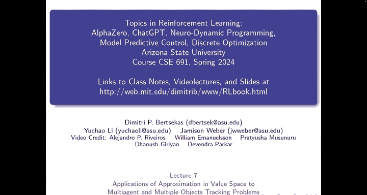

So as a first application， we will show how multi agent rollout can be applied to warehouse robots past planning problem。

 and this is a problem where it possess the classical information pattern and after that jamon will share with us his research where。

It's a similar kind of problem， but fundamentally different in the sense that it's a nonclassical information pattern problem。

 After that， we would take a 15 minutes break。 And after we came back。

 I will present approximation value space， applied to the so called multiple object tracking problem。

 Also known as data association problem。 This is a important problem in computer vision community。

So let's jump into the first application。Before going to the detail of practical application。

 I would do a short recap of multi agentent problems and multi agent rollout。

 Multi agent problems are a classical problem that dates back to the 1960s。

And the key characteristic of the problem is that there are multiple agents collecting and sharing information selectively with each other and also with the environment or a computing cloud。

Each agent applies。Its own decision sequentially in a discrete time based on the information available to that particular agent。

 So if we look at this picture。There is an environment or computing cloud。

 and some agents have access to this computing cloud。

And can also download information from the cloud， whereas others do not and can only share information between each other。

 It may select， share information only。Collectively。

 only a subset of information that is available to this particular agent。

And what is important is that the overall situation is impacted by the collection of controls of all agents。

 that is of。Present in this environment。So there are major mathematical distinctions between problems that seems quite similar in this that can be depicted by this figure。

One type is known as classical information pattern， whereby all agents are fully cooperative。

 fully sharing and never forgetting information， this type of problem we view as the easy case because it can be treatedd by dynamic programming what do I mean by fully cooperative I mean that they are all the agents that is present in that are present in the environment that are in the same team and they work for the same goal and they sharing all the information that is available to to each other and this is the easy case and the second case is called nonclassical information pattern where agents are partially sharing information。

It may even be antagonistic。 This is difficult type of problem because it cannot be treateded by dynamic programming。

 So that's a case where Jamieson going to share some ideas where special designed multi agent rollout or multi agent type of algorithm can be applied。

For the classical information pattern， conceptually， you can imagine there is a。

Information cloud that is available， that is present and every agent have access to both in terms of uploading information。

 but also in terms of downloading information。This means。

Regardless how many agents are there in the environment and when each agent making decision。

 they all have the full picture of the situation， so they all have access to the information that are stored in the cloud and every agent share fully it local information to the cloud。

 so in that sense， every agent make decision based on the common information。

 common collective information。In this case， this problem can be modeled as a discrete time system with state X and control U。

 and this state X is what I refer to a moment ago this common picture of the overall situation。And。

The unique feature of the multiage problem is that the decision or control have M components。

You1 until you M and each component correspondinging to one agent。

And in the applications that covered in this lecture。Actually。

 every control component corresponds to a physical entity corresponds to one robot。

 but in some other situations， agents may simply be metaphors。 For example。

 the application that mentioned in earlier lecture， this robotic arm involving multiple joints。

 and you want to control the robotic arm。 and each join may be viewed as。

An agent and collectively we want to make the control selection in order for the robot arm to fulfill some finish some operation。

So for this classical information pattern problem。The theoretical framework is dynamic programming。

Surely we will reformulate for faster computation。In the application I' going to cover shortly。

 we will deal with exponential size of search or control space later in Jamie's application。

 he will talk about both computation in distributed fashion， but also more importantly。

 deal with this nonclassical information pattern issues。All right。

 so for the warehouse robots past planning problem。We can。

Consider this situation where there are multiple warehouse robots。

They are moving in a common shared warehouseehousing environment。

And they have been equipped with some sensory or equipment that can share information。

 local sensory information with each other or with a cloud so that each agent have the full picture of the overall situation。

And we don't deal with the with the part about which agent assign or which robot assigned to which target and so on。

 We assume that those。Assign target。 Every robot has been assigned to a target。

 and they are certainly work。As a team in order to finish the task as soon as possible。

 So in this situation， this problem can be modeled by this read world representation where in this particular figure。

 there are three agents， which are depicted by the solid circles。

 they can move at most in four different directions or standing still at each time instance。

And with perfect vision， this is what we mean by a perfect classical information pattern that every agent are fully aware of the overall situation。

So the agents have been assigned to some target。For example。

 this particular agent show by red solid circle。The open circle in。

With the same color is the target that this agent aim to reach。The objective is for all agents。

 all robots。To reach their respective targets in minimum time while avoiding collision with each other。

For this problem there， there is a simple heuristic。

 which is each agent follows the shortest path to the respective target。And well。

 assuming all other agents are not present。 And this is show by thearrowose in the figure。

So starting from this。MulD agent has finding problem inside the warehouse environment we first abstracted to become a great world representation。

The next step is to go to the mathematical terms and derive the dynamic programming formulation for it。

Once we get to this stage。The state should be all the information that can be useful for control selection purpose。

 And in this case， it's the current position of all agents and their respective targets。

And the control。At each time instance， each agent has at most five choices。

 So their combination would be the actual control in this problem。And needless to say。

 it would grow exponentially with the number of agents， M。

And we define the stage cost to be a function that is related to the number of collisions occurred at each time instance。

 as well as the number of target reached at that time instance。So at this point。

 we obtain a dynamic programming problem， which in principle can be solved。But because of this。

Exponential grow of control or search space。え？In fact。

 it cannot be solved so at this point do you have any questions？All right。Everything is clear。

As I mentioned earlier at each time。We must select one out of at most 5 to the power M drawing moves。

We show shortly multi agent rollout reduce the amount of search space to five times M while maintaining good properties。

The key idea here is to break down the control selection purpose， control selection process。

Into a sequence of one agent time move selection。Surehorly I will show you videos。

 animations of multi agent rollout calculation， I will show three different cases。

So this is one case where。Agents are sort of spread out。 And the。呃。

It so happened that the base heuristic by simply following the base heuristic。

Every agent will reach their target positions safely without collision。And this is。

A different case where simply by inspecting the figure， you can say， okay， in this region。

 it's a little bit more crowded and quite likely they are going to be collision。Occur。

If they simply following the basic heuristic and the third case is more extreme where there is only a narrow order for all agents to share if they follow the base heuristic。

But we will show that by following multi agent rollout， actually。

 in the case where base heuristic works well， multi agent rollout can recover the base heuristic。

 whereas when。Based universityD fails， mode and rollout managed to find feasible trajectories for all robots。

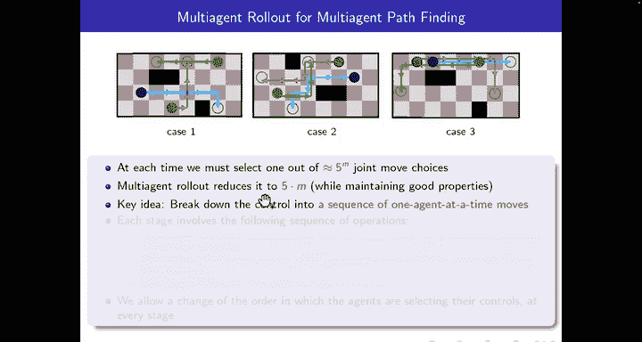

In particular。needed to remember that multi agent rollout is。

Just like rollout is an online algorithm that the calculation or computation need to be repeated at each stage。

 and each stage involved the following sequence of。Operations。

Let's say this is we call this agent one， and this is agent2 and this is agent 3。

 So each stage need to be repeat those three step of operation。

 The first is to minimize Q factor associated with the first agent。Well。

 the following two agent 2 and 3。Follow their basics heuristic。And after this stage。

 agent  one would complete its control selection。 and we go to the next stage， agent 2。

P for minimization of Q factors， while agent 3 follow basic heuristic。

And then we proceed to the last stage。At which point agent1 and two have selected their control at the present stage。

 and only agent three need to perform minimization over Q factors。All right。

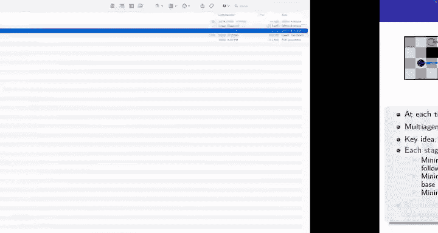

Let's go to the animation。For the first case， I will first show。As I mentioned a moment ago。

This is the blue one is agent1 and red one is agent 2 and green one is agent 3。

 and they have been assigned to some target and a row here indicates the basic heuristic。

 which is the shortest pass assuming other agents are not here。Well。

 first show how base heuristic perform， if you look at this figure and you see actually by simply following the base heuristic because all the agents are kind of spread out。

 so following base heuristic would not involve any condition。

I see how well the multidi Asianian rollout performed。As I said。

 we first start with the first agent and the first agent try all feasible actions。

 controls at the present stage。 you can see it can go left。

 it can go down and can go right or up or stay still。And you try all five。

Actions at the present stage and a payout portion is constructed by following the bauristic。

Whereas for agent2 and 3， they simply follow the basic heuristic。ok。You can see。个梦。All the cases。

 the year。The one in the here would。Have the smallest cost。Yeah。

 you can see this one have the smallest cost。Therefore。

 the first agent choose to move to the right at the present stage。 And then we move on to。

The second agent。Repeat the same procedure， although you notice that for second agent move down is invisible。

 So there are only four。A candidateidate control to try at the present stage。

So after trying those four different actions， the tail portion is again。

 constructed by base heuristic。And notice that here is a subtle difference。For agent one。

 since the previous step have already calculated its present action。 Therefore。

 agent one only follow， follow the previously determined。Ha。

 whereas Age three simply follow the basicistic。Okay， so you can see here in this simulation。

 there is a collision incurred。And this is。The point of running simulation in real time， because。

For difficult layout or configuration。We cannot know。

A prior whether or not certain planned paths would cause collision and running simulation。

 particularly cheap simulation is easiest way to find out， so。

Then we find out the action for the second agent， and we move on to the third agent and repeat similar procedure。

Yes。😊，是。3。I it like just。Thank you。It， it looks like it already had。Okay。

 so this is one step Look ahead。 multi agent rollout involving one step look ahead minimization。

 right， So we only want to or we just branching out the control options for。Each agent for one step。

い。Thank。But remember that if you look at here， this part。

 this part is determined by the first step that involving calculation involving agent1。

 but the tail portion is generated by bauristic， so。啲。

Dark blue is the one that the outcome of multi agent rollout。

 whereas the tail portion is generated by basic risk。Okay， so， and you can see， actually。

After all those calculation， we recovered the basicuristic。

 So in the case where ba heuristic works well。😊，呃。Mdi rollout would not mess it up。

 but typically basic risk is not good enough。So that's where case2 is。 If we look at case 2， okay。

We can see。 There is a collision。拿出来。We can arch course。respond to collision in other words。

 you allow have coals。So if you look at here， every collision there would be a cost right and all right and three collision in total so now this time our hope is by running multi agent rollout through all those calculation we can improve upon it。

So for the first agent， again， we try 1，2，3，4，4 different actions， whereas go left is not feasible。

 right， So we try four different action， which is show by this orange row。

 and the tail portion would be generated by base heuristic。

And agent 2 and3 are simply following the basic heuristic。So at this point。

 we do not know a prior what the cost going to be and the easiest way is just run simulation and find out。

Alright， so one， we run simulation and actually see this one only involve one collision。

 So we already improve on it。 recall that the initial base usually have nearly 400 cost。

 and now we have 119。And that is smart because Age one tried to avoid this narrow pass。So for agent2。

 we repeat similar procedure。And know that for agentnt1。

The pass is calculated by the first iteration， first step。

 first round of calculation and agency3 just follow the basic heuristic。So we notice， okay。

 at this point。This one still do not have condition。 Fing crossed that there's no condition。 Okay。

 so at this point， we already find。feasibleas path for all agents。But。

Let's carry on and follow the calculation。But if you want to stop early， I mean。

 this is one variation you can introduce， right？Alright， so this is。呃This is。

How Malian Roout operates and。Remember， at each time instance for each agent。

 it involves calculation that try out all its actions and then construct tail portion by base heuristic and the later agents simply follow the base heuristic and the preceding agents using the pass computed in the previous calculation。

And some of you in previous lecture have mentioned about the possibility of。

Changing the order in which the agents operates or calculate the minimum Q factor。

 So here first agent， second agent， last agent， It seems pretty random。 How， how do I order them。

So in principle， the formulation allow a change of order in which the agents are selecting their control at every stage。

 remember。This calculation needs to be repeated at every stage。So， let's go to the。last case。Again。

 if we look at。The current policy。It involved two collision。And if we follow this before the order。

Agent 1，2， and 3。So remember that basically you really have this cost 358。And okay。Okay。

 here must be a rounding error。You see at this point we have improved upon it， we get 191。

But after this calculation。It's still 150， which means there is still cause collision involved。

So what should we do？And one way I mean， there are more principal way that I can touch upon later。

 but one way is simply randomly reshuffle the order in which the agents optimize their control。so。If。

 instead。We optimize the control for the third agent first。You have one， two， three， four。

 four feasible actions。T out all four。Different actions。All of a sudden， we see。

This is the case where。No one gets involved in collision。 So apparently。

 agent 3 is a troublemaker in the previous case， and we already find feasible paths for all agents。

And we can carry on and repeat， finish the calculation。 but you may just stop here at this point。

 it's a variation that you can decide。O。

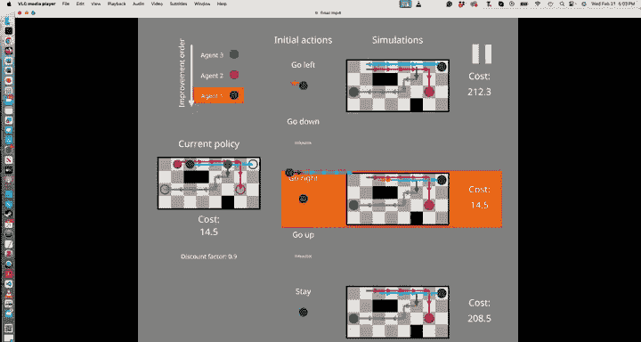

So let's get back to the slides。And actually， we。Perform tasks of the algorithm。 and compare it with。

Coopating a star。And introduced in David Silver's article in 2005。And in principle。Corporate a star。

 basically compute。One agent at time， as well。But it compute entire path in a sequential manner and only at time zero。

And what we find。 And on contrary， multi agentent rollout again， as I mentioned earlier。

Perform calculation at every stage。And in practice， we find。

Muldi agent rollout always find feasible paths。And by which， I mean。

 we vary the number of agents present in the environment。And perform multi rollout。

 And if there is no feasible pass find or fulfill some criteria。

 we reshuffle the order in which the agents optimize their control。

 and we find typically two utmost to reshuffle， which suffice after two reshuffle。Entirely random。

Agents would find feasible actions。Not for the entire pass， but no collision for certain rain。

And also at a comparable cost。And this is the average cost between multi Asian rollout and corporate a star among the feasible ones。

 so remember for corporate a star when the number of agents grow to around 200。

 there's only 60% accurate success rate， whereas multiian rollout always in our tests。Yeah， yeah。

One method exceeds 100% of the dying prime for the other one。How is blue squares and so the。

This red thoughts。Yet， these red dot are the success grade for malian rollout。In all the test cases。

 So in each test case。There are certain number of agents present in the environment。And。

For each case， we randomly generate 10 test examples。And run both multi rollout and corporate a star。

And we note that the success rate of corporate a star drop。When the number of agents increase。

Whereas mount rollout in our tests always find feasible paths。

We need to mention that when the situation is more challenging。

 there are more random reshuffle involved。 Yes， please。Yeah。Yes。😊，Yeah。Well， that's a fair question。

 What happened with CS star is that。A compute calculate the entire pass， one agent a time。

More specifically， it's calculating in an environment。 So if we look at a grid environment。

It's a static environmentver， right？But what happened with corporate a star is attach a time tag tag to。

The physical environment， for example， you will make copies of physical environment。

But put a time tag on top of it。 So you are searching passes in a three dimensional。

Space with two dimension to be the this 2 D。Gre， and the third dimension to be the tie。

So searching in that environment is more costly。Then1 searching in。The static of the environment。

And more importantly， in this study environment in our bauturistic。

Since we ignoring the presence of other agents， so it's a static environment， it's not changing。

And what happened in practice is， we can even compute。Optimal passes。And store them offline。

Whereas in this three dimensional case。It's more challenging and that's why we did not try out and compare in that way。

Yes， please。Yes， this slide。 So on the left picture。

 when you said like multi agent will always have 100% success rate is it saying that you try every possible。

No， no， no， no。 What I mean is。I I think the change is the resolution is 10， which means we try。

200 or， I don't remember precisely， but several hundred tests in total。

 And we find among the several hundred tests。 roller multi agent roller always find feasible pass。

 And in practice， remember， multi agent rollout need to。Operated。

 this algorithm need to operate at every time instance。 So at every time instance。

We carry out the calculation。And if the resulting。Solution do not incur collision among all the robots within certain distance。

 we accepted it and move on to the next stage。 And if there is immediate collision。

Then we reshuffle the order。And what we find is typically。

Up to two reshuffle would suffice for all robots。To not collide into each other within certain reach。

So it's not like enumerating all orders because in this case， I said it scale well up to 200 agents。

 So if I try 200。Different orders。 it would not be possible。 And in fact。

 there are more principled ways to define order， which I going get to。Short。Oh。can't。

So you tie one doesn't work， you randomize the order， I the second。What's happened is then。

You only need two。You get应 get a fish。呃，什么东西是。In order that reach the peace。I have a follow question。

 which is when you said like you set up the testing instances。

 are you saying that you randomized the target position and the source yes， yes， yes， yes。Yesす。Yeah。

 and just。wanted to clarify what C start self action does like is that just you start you take one agent a little bit and then everything else to move around where it moved so more specifically。

Let's look at。This figure so。For this agent， let's look at the first agent， the agent move。

Compute its shortest pass。And then， you construct。You construct a three dimensional grid environment where。

In this the first frame of the grid。There is this agent。 Yes， precisely。 And in the second frame。

 there is the agent is here and so on。 so there is dynamic obstacle moving inside this three dimensional grid environment。

 whereas in our case， we just deal with this 2D environment and we left for the simulation to sort out whether or not this strategy is a good one or a bad。

Good through more agents were potentially even inbe just because theres walls I mean they theyre well。

 I think。you are referring to corporate a star or referring to multi agent robot Oh so CA in our experience is that just like here。

 order matters and recalculating is just a bit more expensive work。A lot more expensive。

 If the length is fairly long， you can imagine for long passes。

 it's certainly more expensive to search in long passes because this three dimensional grid environment would be larger。

 Of course， there are more clever ways to， to。To keep track of this time stamps over the past。

 But nonetheless， searching in this two dimensional grid is cheaper and。So。

 let's take a quick look at the。呃。嗯是嗯。

Okay， let's here。So， this is。This is how the。Simulation for the test environment looks like。

 so we have。Up to 200 robots。 And since the slot where potentially goods are delivered are。

A priory and the shelves are none a priory。We can compute shortest path between。

All shelf spots and delivery spots and store them。And because it's a static environment。

 this can be done and then at every time instance for every agent you don't need to calculate the shortest passs in real time。

 and that's one of the reason it can be operated so efficiently。

All right。So we have both paper and implementation can be fine online。

So we touch upon one variation of multiage rollout， whereas the reshuffling of the order。

Would result in different。But equivalent problem。 What do I mean by that。 So essentially。

 you can imagine for a new order。 Let's just look at the reversed order problem。

 reversed order showing the animation。 Then it's it equivalent to this unfolded system dynamics where you first select the control of the last agent。

 and then you get to this day。 and you select second to last control and so on so forth。

 So this would amounts to。An equivalent problem。Where again， mortgage rollout would amount to。

normalormal rollout， nominal rollout applied to this。equivalentquient problem。

 therefore we can anticipate a large improvement because of Newton's method effect。

And another thing that is important is multi rollout allow parallel computing。Of Q factors。

 as you have seen in the animation that simultaneously。

 we can generate the candidate solutions for a particular agent and run simulation and so on。

 It can be done simultaneously in parallel。Process if there are parallel computing you need available。

And another thing is multiple basic heuristics can be applied to enhance the performance。

And all those ideas are independent on each other and can be combined。In textbook。

 there are additional material for both other optimization and some other additional variations。数。

Any questions at this point？嗯。Me it feels like the first have。First。

 like the AM agent choices for hand agent。Yes， yes。Well。

 what I mean by parallelization is that in when you select the control for the first agent。

Let's say you have five different control candidate than those five calculation。

 each involving simulation。And in order to find out the cost and on this part。Can be parallel。

But not， you are exactly right。 It cannot be parallel in in in terms of。

 in terms of different agents， but that's something that Jamie and gonna touch upon。 Actually。

 in some cases， you can do that。 So that's a perfect question to introduce the second application。

Allright。So let's get to multi agent problem with non classical information pad。O。

So let's take a look at multi agent problems with non classical information patterns。Okay。

 so you Chao described briefly what a nonclassical information pattern is we saw the figure where each of the agents were connected to each other and also this computational cloud so we're going to look at the cases where any of those links that you saw in the figure may or may not be there so that's at a high level what a nonclassical information pattern is and I'll make it more specific what what we actually mean here。

So this is an outline of the section first we're going to review the multi vehiclehicle routing problem。

 I have a special formulation of it that we haven't quite seen in this course。

 but it's not complicated， so we're going to review that。

And then we're going to look at a generalization of the multi vehicleh routing problem for non classical information patterns。

And then to approach solving these types of problems。

 we're going to use a distributed computing approach and I suspect that none of you have ever seen anything related to distributed computing except maybe if you've taken like an undergraduate operating systems course and if you remember like the dining philosopher's problem。

 it's all that kind of stuff， but I'm going to give you a very bare bones introduction to distributed computing and it will be all the information that you need to understand the solutions that we're going to present。

Okay， that leads us to this algorithm called decentralized multi agent rollout or Dmar。

Then we're going to look at an experimental study which looks at the impact of communication and coordination on performance。

Then we're going to look at some physical real world implementations and lastly we're going to discuss conclusions。

 we're not going to look at extensions but I will give you a way to access the paper。

Okay so first is the multi vehicle routing problem I have this kind of special representation of it。

 so an instance looks like this， it's this rectangular grid in two dimensional space it's a discretization of two dimensional space。

There's a set of locations representing obstacles in this picture the black squares are obstacles and these squares are not visible by agents。

 they represent blockages in the network。There's also a set of agents that started some initial position。

 so here I have agents represented by these little car drawings， the colors don't mean anything yet。

 but they will mean something later， but these represent the agents。And lastly。

 there's a set of task locations which I have represented by these red X's。So to remind you。

 an instance is solved when each task is visited at least once by some agent。

And the objective is to compute a set of trajectories that solve the instance such that the total number of vehicle movements is minimized。

In principle， this can be treated directly with dynamic programming。

 although it will be very computationally complex， but this applies when we assume a classical information pattern。

Are there any questions about this representation or this formulation of the vehicle routing probe？

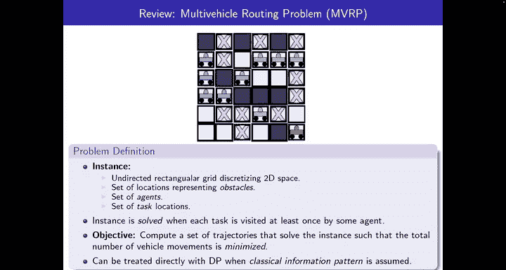

Good。So I'm going to present to you a new problem called the unmapped vehicle routing problem with local constraints。

 which I have abbreviated as UMVPL。In this generalization， the instance is not known a priori at all。

 we don't know anything about what the network network looks like。

 we don't know the initial positions of the agents or the tasks or even where any obstacles are。Also。

 there is no centralized computational cl， that thing is gone completely。And。😊。

Interagent communication and sensing is restricted to a sensing radius。

 which is a term I will use often of K hops on the grid。 In other words。

 an agent can only see within K hops of this grid。So this is clearly a nonclass information pattern。

 there is no computational cloud and the communication between agents is restricted based on locality。

However。If you bring the sensing radius up to infinity。

Then you just get the regular multi vehicleh routing problem back because because you have as long as you have at least one agent。

 you can see the whole instance and you can treat it as if it were just the multi vehicleh routing problem。

And this type of problem to our surprise had not been considered in the literature until now。

So as far as we know， we're the first ones to address this type of multi vehicleh routing problem。

Are there any questions about this generalization？Yep。Do we have。

So I'm going to talk about grids because it's easier to say stuff about them。

 but in principle our results could be extended to arbitrary graphs。By意。关系。Pro might。Thank。是越对越迟的。

So they can't communicate with each other unless they're within KHs that's right so they can only see other agents that are within KHs and therefore they can only communicate with other agents within KHs let me get to the computation part of that。

Because obviously some kind of computation has to be done here。

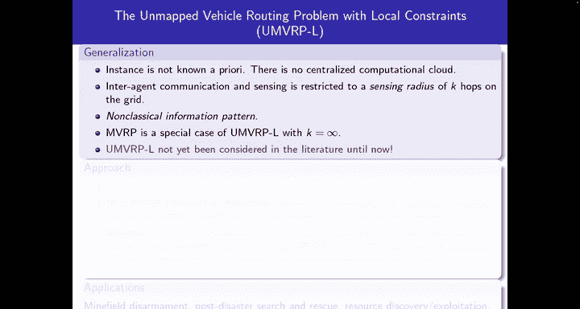

Okay。So our approach is like this。We're going to treat the problem with a dynamic programming based decomposition。

And for this， we're going to use a distributed computing approach。

 so the agents themselves are going to be processors with persistent memory。

They're going to be capable of limited sensing， locomotion and local communication。

 so in this problem， any computation that's performed at all must be done specifically by some agent with its limited knowledge and abilities。

So no cloud。The strategy will be to generate subins locally around agent clusters where information can be shared between agents。

 and these will form little small instances of MVRP， the classical problem。

And then we'll apply approximate dynamic programming to these sub instances individually and in parallel。

And in the case where。Some tasks are not being covered by these clusters。

 there needs to be some sort of exploration aspect。

 so agents that end up not belonging to clusters will do a random search of the graph。

So the applications of this are kind of interesting， so the first one I put is minefield disarmament。

 I see this as sort of an antiwar application， so in in Europe today and especially in Vietnam and locations where there have been wars in the past。

There are still just thousands of landmines buried everywhere。 and occasionally， there are。

Accidental deaths of people who step on these landmines still。

And they can't be seen obviously because they're buried in the ground。

 but if you have a mine detector and you get close to the mine， like within five feet of it。

 you can detect that it's there and do something about it。

 but usually people don't carry those around。So that's an ideal application for this。

Another application is post disaster search and rescue， so if the landscape， for example。

 has been maybe devastated by some kind of disaster and it no longer looks like it did in the past like maybe it's a city or something and there's been a large earthquake。

And there's people that need rescuing， but you're not sure how to get to them or where they are that that kind of we have that kind of application in mind。

Also， I have resource discovery and exploitation， resources are not typically visible from the surface。

 but maybe some kind of like cave diving application。Not sure， but these are some ideas yes。

 we don't know the number of tasks or what the landscape looks like yeah， right？Okay。

 any other questions？对。All right， so because we have this sort of distributed computing setup where each of the agents are processors。

 I wanted to cover some preliminaries related to distributed computing。

So the first thing is the idea of a distributed model。

A distributed model involves a collection of processors。

 and these processors have some sort of internal state。

And they belong to this thing called a communication network。And it just looks like a graph。

 so here's an example， here's processor P0， P1 and P2。

 and the links in this network represent communication channels between these processors。

Processors can communicate with each other oh， I should mention this。

 a configuration is the collective states of all of the processors combined by。

Communication between processors is facilitated via message passing along ports。

 so a processor can communicate with a neighboring processor in the communication network simply by sending a message along these channels。

 which we call ports。There is this object called an event。

 which is characterized by either a computation， the sending of a message。

 or the receiving of a message， or anything that can update the state of an individual processor。

And then a distributed algorithm is something that you can think of as like sort of like a transition function。

It's an individual protocol that is assigned to a specific processor。

And we start with some initial configuration an event happens and we apply the distributed algorithm as the transition function to achieve the next configuration and so on。

 and this is how the process ofults。So here's an example of a distributed algorithm。

I wanted to emphasize that it doesn't really look like your standard algorithm。

 so it's specifically for a processor P。So here's one。

If you have a message in your buffer and your state is read。

Then set your state to green and forward messages along all of your ports。

 This is a very basic distributed algorithm。But how do we decide who gets to execute these individual protocols？

This is done by some kind of scheduler。 A scheduler will choose a processor to wake up or we use the term activate。

And when a processor activates， it just executes this algorithm that it has available to it。

A special case of a scheduler， there's many different kinds。

 but a really easy scheduler to analyze is called a synchronous scheduler。In this。

 the processors repeatedly wake up and execute their common algorithm simultaneously。

 so this is divided into rounds in a synchronous round， everybody wakes up。

They execute their algorithm that they have on board。And then they go back to sleep。

 and then we repeat this。 So everything is kind of nice and synchronized。

So here's an example of this distributed algorithm being executed。Let's start with processoror P0。

 assume that its initial state is red and that it starts with a message and its buffer。

So everybody wakes up。P0 has a message in its buffer by assumption and its state is red。

 so it's going to do this， it's going to change its state to green and it's going to forward a message along all ports。

At the same time， oops。P1 and P2 are going to wake up at the same time as P0。

But this condition will not be true， their state is red。

 but none of them have a message in their buffer。Oh， so they do nothing。So in the next round。

 they all wake up again。嗯。P0 has nothing to do because it has no messages in its buffers。

 so it just stays in its green state。But P1 and P2， well this condition is true。

 they have a message in their buffer and they're red。So they change their state to green。

 forward messages along all ports， and then we arrive at this configuration。

And after this configuration， there's no further progress that can be made because everybody's green。

Does anyone have any questions about the distributed model or synchronous schedule？

You mentioned so i'm going to get to all of those nice details。

 this is just like a preliminary computation or as a preliminary slide to explain how our approach is going to work。

有。Bye拜。Very。There has。In some distributed models， yes， there could be some kind of message delay。

 but this model is very simple， we assume that in between rounds all sent messages are received by the time of the next round。

There's。Like you receive me or。Iて。给我。We给 out。So in this algorithm it does sort of a broadcast where it just sends the messages out along all ports you might have a situation where a processor has like an ID and the algorithm can check against the ID and make decisions about a specific processor is that what you mean or。

Yes。It seems like a。对单单。H。I。Okay。In this algorithm， yes， but if they have IDs。

 then you can make special messages that only apply to certain processors。Yeah。

 we'll assume in this really simple model that once all of the messages are sent they're all received and the buffer is empty by before the next round weekends。

 there are definitely other more complicated distributed models that don't make these kinds of assumptions。

So like a message lives in a walker for one not， yes。Whether it's。Anything else。Okay。

 so that's distributed computing。So here is our solution decentralized multi agent rollout。

So Dmar is an iterative distributed algorithm that specifies state updates and message handling leading to the collective behavior below so oftentimes so。

A distribute algorithm is kind of difficult to read it's difficult to say what the behavior of the system is going to look at look like just by looking at the algorithm itself。

So often we describe them in terms of what is their collective behavior。

 and then it's sort of a challenge to prove that the distributed algorithm actually generates this behavior。

So at a high level， I'm just going to explain what is the collective behavior that Dmar generates and then we're going to look via an example at how it achieves this with their local algorithms。

Okay， but first I'm going to define something called a view and the view of an agent A includes all instance information available within k hops of the agent on the grid。

 so it's convenient to talk about views。Are there any questions about these first two points？

to give us some examples that the algorithm for appreciationation is to Yeah so they're all what we call homogenous they're yeah homogenous yeah。

 they all run the same algorithm all the time in parallel。Okay。Okay， so what is Dimar。

 so each iteration of Dmar repeats the following steps。

So agents are going to self organize locally into clusters of constant size around special agents called leaders。

Agents within these clusters are going to form a tree communication network。

 so explain what a communication network is， we're going to work with trees because it's convenient for broadcast。

诶。And the root of these trees will be the leader of that cluster。Okay。

 so I mentioned that the tree structure facilitates the flow of messages。

And then we're if there are smaller clusters that are adjacent to each adjacent to each other。

 we're going to combine them into larger ones because a source of subopality will be is if two clusters are sort of overlapping over the same tasks。

 they may send agents to try to。Take up these tasks without coordinating with each other because so the clusters are going to be independent and we're going to try to make them somewhat big。

Okay， so once these clusters are formed。For each cluster K。

 agents in K will route their views to the cluster leader。And then for each cluster K。

 the leader computes a set R of control sequences， according to the multi agent rollout algorithm。

 using some kind of greedy based policy。And this is applied over the assembled view information obtained from the previous step。

 so everybody communicates their view information， this somehow gets all aggregated at the leader and the leader can treat then this individual cluster as a case of MVRP so it has complete information within the cluster itself。

Once these trajectories are computed。They get broadcasts throughout the agent tree。And by the way。

 each agent has associated with it an ID， so it's easy for it to figure out which trajectory belongs to it。

And then each agent moves along its assigned control trajectory， and once it finishes this。

 it unassigns itself from the cluster。It may be the case that some agents just end up not joining clusters at all because they're too far away from tasks or other agents。

 and in this case they're going to generate a random trajectory of bounded length and follow it。

 searching for tasks。So this is a high level overview of the collective behavior that the distributed algorithm is going to generate。

Are there any questions about that？Step5， seven leaders assign control director to initiation。

 but multi allowed at each stage use assign one step hearing read that right。

They're going to treat each cluster as its own little instance and it yes to all agents within the cluster。

 so all of the stages will be contained in that cluster and they will generate a full trajectory stage by stage。

So for example， two clusters like dus from living clusters。

 they cross out each other and they just passed at the end。

 because they're too far so they don't assign themselves on the orders and't ask。嗯。

what do you think about so there is this parameter that i'm going to talk about there's something that is going to prevent the clusters from getting too big。

And it's going to be based on a constant parameter，で。

It's going to be a number that's independent on the network size on the instant size。

 so it's just some constant that you pick and it's usually quite small like somewhere between four and 10。

And just make sure that you've got a leader and you've got someone foster say that that like that the or something could't take fives for each。

Yeah， so it would， yeah， exactly。That sort of wants to communicate some laundry problems。

So I'm leaving a lot of details out here， but there's a way to synchronize this whole thing where if certain。

 so for example， if maybe one cluster is smaller than another cluster and it finishes its computation early。

 because of this parameter that we give it， they know exactly how long to wait such that each agent is going to produce the same the exact same number of operations every time they execute this local algorithm so there's a way to synchronize them like that。

 because we have this nice model。He shouldn't be as honest by yourself。going。Yes。Yes。Yes。

 I'm going to go into detail about how the clusters are formed。Anyth else。Okay。

 so let's look at an example。So。In in this representation。

 the color is going to indicate cluster membership， but by default， everybody's gray。

 gray it just means you don't belong to a cluster at all。

We're going to let k equal two so any agent can see two hops away from it and so for example agent2 its view will consist of this agent here。

 this agent here， this agent here and this task here so that's the view and it can also see the obstacles in that。

Okay， so the way the cluster formation works is as follows。

So any agent that can see a task at the beginning of this iteration of Dmar。

We'll raise a flag indicating so， so that's what these little flags represent。And then。

If you see if an agent sees an agent that has its flag raised up。

 it will disqualify itself from becoming a leader if any such agent has a larger I D。

So one can see two and two has its flag raised， but one's ID is less than two。

 so one becomes disqualified。Two can see three and three has its flag grays。

 so two can disqualify himself from becoming a leader。

 and this leaves one unique leaderer per cluster。And the same thing is happening on the other side here。

 so this is a different cluster。Okay。All right， so once an initial leader is found。

Agents around these guys will start sort of iteratively appending themselves to the cluster。

And there's also this other process where two adjacent clusters can be joined into a larger cluster。

 so I'll talk about that next。Okay， so three and seven are our initial leaders here。

And two is going to see three and see that three is in fact a leader and in a cluster。

 so it's going to append itself to three。Four， likewise is going to append itself to seven because it sees a leader。

And5 is also going to append itself to7。But when this happens。

This agent 8 sees two different clusters in its view。So once it notices this。

 it's going to send out these messages and it's going to attempt to subsume these two clusters into a larger cluster where eight is the leader。

Okay， so it sends these messages。And then three and seven accept the messages。

 so they join the purple clusters cluster， but there's still these messages in transit。So。All right。

 so going back。Yep， so agentnt one joins this red cluster。

 which is in the process of dissolving and we get this other thing where six now sees two agents in different clusters。

 so it also initiates this cluster join process and starts sending out these messages。

But it might be the case that an agent like this one receives two of these join messages at the exact same time。

If that's the case， it will just disregard one arbitrarily and just pick one somehow。So。

In this scenario。Four is going to disregard the message from six and join the purple cluster。

And the green cluster is still growing， it will send a message to agent one and this is the final cluster configuration I could continue this process and eventually combine these clusters。

 but I've picked a size parameter that prohibits this， so this is an example of a multiclu instance。

What去。For why is 406。For not joining six。Oh， so it could have joined six it chose to it received a message at the same time from two different clusters and it just picked one of them to join y arbitrary。

一分。Labd how like came like two hops started from the project。行。

So this guy can only see this limited area around him， unlikewise everybody else。

N is actually too far away to see anything。There's nothing within two hops of nine。你家开视。So。It sell。

It has a radius of two hops so it can go one， two and then that's it。

 so it's ir radius looks like this。So， like there was。Yeah。

 sos it's something like k squared times pi approximately that's the area yeah。Okay， yep。basis trip。

And。Yeah。是。Yes。8。Right。So i'm sort of leaving some details out of the algorithm the reason is it's in the algorithm it's not meant to do so at this time。

 so I haven't described this whole thing like in complete detail。

 but at this basically at this phase of the algorithm it's not looking to join the new cluster。

Or sorry， it's not looking to join two clusters is what I mean。So at this part of the algorithm。

 it's just receiving two messages at the same time and disregarding them i'm trying to keep this like。

As abstract as I can and and hide as many details as possible because the algorithm looks complicated。

In this case， we don't let it block vision， but in the extensions of our paper， like in the appendix。

 we consider line of site based view definitions and look at how those affect the performance overall。

哎。No， no diagonal hops。Are there other questions？Okay so the point is I guess the takeaway from like understanding this is is these clusters get formed locally around tasks via this leader election process and sometimes clusters can be combined into bigger ones。

 but what you end up with is this collection of clusters at the end of this process that's the takele。

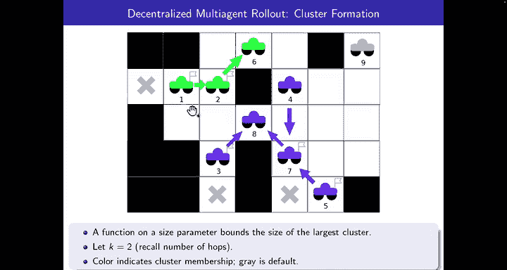

Okay。So once these clusters are formed， this is basically the rest of the algorithm。

Agents in these clusters will pass their view information through these tree edges and they will aggregate a complete map of the cluster at the leader in this case。

 eight and six。And then the leader applies multiage rollout to the cluster mat and then broadcast these trajectories throughout the tree。

Then agents follow these trajectories and agents not in cluster will perform a random walk。

 so I mentioned that agent nine was too far away to join a cluster so it remains gray。

 so this agent here would start moving randomly whereas these agents would move according to the trajectories computed by their respective leaders。

Okay， so that is the algorithm at a high level。

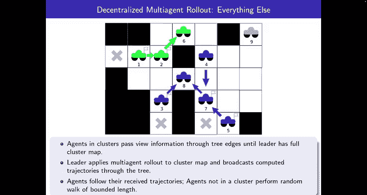

So what are the connections to approximate dynamic programs， so here's some observations。

So I mentioned that when k is infinity， a single cluster is formed and rollout is performed with respect to the entire instance by a single processor。

 so if k is infinite， only one cluster is formed and the leader will perform multiageent rollout on it。

And it'll just be the same thing as MVRP。But reducing k approximates the rollout structure by decomposing the instance。

And the aggregation of these smaller solutions yields a solution to the full instance that approximates the rollout solution。

 that's the idea。And even when these clusters are small。

 using multi- agentent rollout as opposed to rollout is still an imperative because of this curse of dimensionality。

 even if you have like 10 agents or something it greatly increases the amount of computation necessary。

 unless you use this one at a time approach。

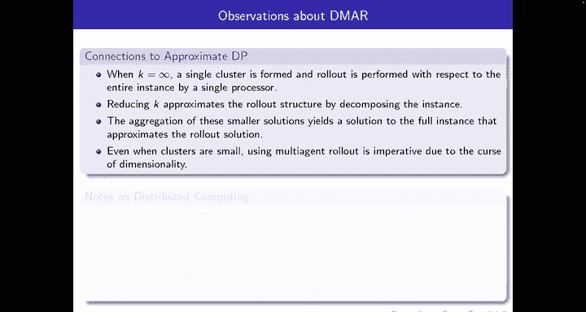

And then some notes on distributed computing， distributed algorithms can be challenging to design and also challenging to describe。

They rely on these primitives such as leader election and message passing。

And sometimes the communication networks are dynamic， as somebody pointed out， in this case。

 they change over time。And proving that a distributed algorithm produces a specific collective behavior can be also challenging due to these things called deadlocks and invalid configuration。

An invalid configuration is some kind of configuration that you shouldn't be able to reach for example。

 if you have like five agents in a cluster and they're nowhere near each other。

 this is some kind of invalid configuration so you have to prove that the algorithm doesn't generate these kinds of configurations。

And also there's this idea of a deadlock where the algorithm can't make any further progress before it' solved the problem。

In addition， randomized elements as this algorithm has can be they also require careful analysis。

Okay， so are there any questions about this slide？I wonder like each cluster is consider MDRP likeRP when you do simulations like it could or crash into another so in this model we assume that agents can co locatecate。

 but we're going to again， at extensions look at what happens if they can't be in the same place at the same time。

But yeah so。And I think another part of your point was。Here's two clusters。

 suppose they'd both like overlapped a task。 They're both going to try to solve that same task。

 So it's kind of a source of subopality。

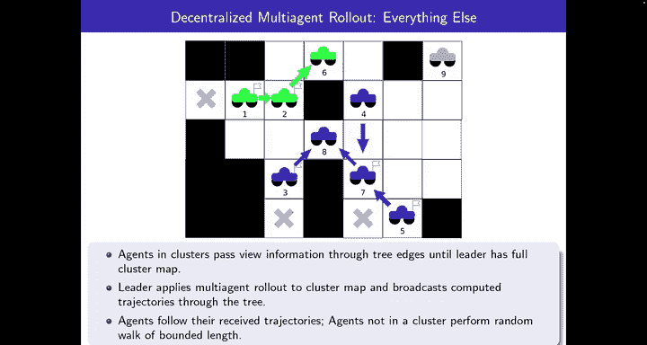

So you wouldn't have that if K was infinity。Okay。All right。

 so next we're going to look at this experimental study that looks at the impact of communication and coordination on performance。

So the goal of this study is as follows。We want to quantify the amount of local information necessary for Dmart to produce good solutions。

But I mentioned。That this problem has not yet been considered in the literature。

 so there's no benchmarks for it。So to address this。

 we consider a greedy strategy that we call the base policy， if it's similar to Dmar。

 except for it doesn't use multi agentent rollout， it just uses a greedy nearest task type of heuristic。

So this base policy involves no coordination。And it can be applied to this UMV RPPL case because agents can just sort of move around the map and if they happen to see a task。

 they can just go for it。So eventually provided all tasks are reachable。

 this greedy algorithm will solve the instance。呃。We're going to look at the role of coordination and communication。

 so specifically we want to know how large must the sensing radius K be such that Dmar outperforms this base policy。

So here's the experimental design。We're going to consider eight classes of grids。

 we're going to look at 10 by 1s， 20 by 20s， all the way up to 80 by 80。And then for each class。

 we're going to consider three different agent to task ratios， so same number of agents and tasks。

 two to one and one to two。Then for each of these size and ratio combinations。

 we're going to uniformly distribute obstacles over 20% of the nodes and we're going to repeat this 10 times。

 so we're going to make a lot of different instances。And then for each of these instances generated。

 we distribute the agents uniformly and execute Dmar and the base policy 10 times for each of these over several fixed k values。

 so we're going to vary the sensing radius over all of these aggregated instances。Then for each run。

 we're going to record the total number of vehicle movements。As well as wall clock running times。

 but we're not going to focus on this part。Just the vehicle movements。

The total number of simulations， so there's a lot of combinations here。

 so like the total number number of actual simulations ended up being more than 50。

000 for the primary study。Just wanted to point that up。Okay。

 are there any questions about this slide before I continue？All right。

The people of two different cluster are within keyboards， would there be some the patients。

So we therere in this algorithm all of the clusters are independent so there's no communication between them。

 however， you could potentially extend this to have inter clusterluster communication。

 which might be interesting。F that you are talking about once the costs are are that's correct， yeah。

But maybe you could， I haven't tried it。O。这是当时可以看。So。因为。Then great folks Asians drift away。

 perhaps to do some fast that's far away。That's what gettingiding me back class together。Yeah。

 so we thought about like so in this algorithm， once all of the tasks in a cluster are solved。

The agents could be anywhere within that cluster they they might they might be like disconnected from each other。

 meaning that。There's no way to like， if you're just hopping， like。K hops。

 you might not be able to get any more from one agent to another。 So to address this。

 the clusters just sort of dissolve and the process repeats again。

 But there is this idea of maintaining persistent clusters that try to like blanket an area。

We haven't done this， but that has some distributed computing challenges associated with it to try to keep them all within hops like he hops of each other。

Okay， I have question when you design the baseline for this one。

 you're saying that we first have to let all the agents to randomly screen the map right And then if it sees like task within the Pay it does it。

 So I guess the performance of this baseline also is really impacted by this like a search strategy。

Yeah， okay that's another good point， you could pick possibly better exploration strategies。

Like one that we thought of was there's another random search strategy called a random waypoint where you pick a direction and a distance each uniformly at random so instead of kind of a brownian kind of random movement you get this kind of zigzaggy movement and maybe that's better we don't know。

each last term only time for the task not another one correct it's possible that if some beyond the initial came up never gets served or is there a second iteration where。

So because okay， one of the reasons we picked like the simple random walk。

 even though it might not seem very intelligent。It's because it's quite easy to analyze。

 so I don't have our theorems displayed on these slides。

 but we have theorems that show that the expected number of rounds before Dmar can solve all tasks is bounded。

And also the probability that some task remains unsolved or uncompleted in the limit goes to zero as time goes to infinity so that's a part of our theoretical results。

But we figured you guys didn't want to see any math right now。So I didn't put it on the slide。Okay。

 but so that's the theory about Dimar and its properties and then we also show stuff like it doesn't deadlock and you don't get invalid configurations and things like this。

Okay， so back to the study。Okay， so let's look at the results。So let me help you read this figure。

 so here's a representative sample。This is just looking at the 80 by 80 grids。

 but the other plots look like this。So on the horizontal axis is the。

View radius so here on this part of the axis， the view radius is small and then it gets bigger as you move to the right。

On this vertical axis is the total number of moves for this talk。

 let's ignore this axis and we're going to focus on these two curves right here。

So the blue curve represents the total number of movements incurred by Dmar。

For a fixed radius value and this is averaged over thousands of instances。

And the red curve is the same thing， but for the base policy。So as K increases， as you might expect。

Performance yeah okay the the performance of Dmar gets better and better because this sort of represents the amount of local information available so the bigger this V radius。

 the fewer number of movements computed by Dmar and also the base policy too but it should be the base policy is sort of independent of this V radius well no actually it's not because the bigger the V radius。

 the more likely you're going to see a task that's like maybe 10 hops away and you can just be lying towards it right。

So okay， so the base policy is not decoupled from the V radius。O。At some point， we found is。

 as you increase this radius， there is this special radius， which we call the critical radius。

 hay star。At this radius， Dmar starts to consistently outperform the base policy。

 so it's at this point here they're sort of the same more or less。

 and then at this point you start to see a divergence where the cost of the base Dmar starts to get lower than the cost of the base policy。

So we call this the critical radius。And then， just beyond Caar。

Is this thing that we call the effective range， which is represented by this。Brown shaded area。

In the effective range， you can look at the costs incurred by both Dmar and the base policy and compare them to when the radius is really big so because of the way we've distributed agents across the grid。

 when the0 when the radius gets close to like 16 or 20 or so it ends up sort of subsuming the whole grid like everybody can see everything。

 remember this is an 80 by 80 these are 80 by 80 grids。

 if the V radius is 16 then just about everything can be seen。

But to measure the amount of decentralization， we have this other plot here。So。

On the horizontal axis， we still have the radius size。

 but on the vertical axis we have the number of clusters generated on average。

So in this effective range， compared to the。Largest radio we considered。

We see a factor of two to four detriment in the cost of Dimar。

While still there is a reasonable amount of decentralization happening。

 there's still a lot of different clusters being generated。So。What we're seeing is。

Things are scalable like the detriment of the cost for having this restricted view is like a constant factor than if you could see the whole map。

 for example。So that's what this is showing。Are there any questions about these plots？

Oh so we oh the okay， yeah， okay， so the only difference between the base policy and Dimar like it still forms these。

Cluters and communicates map information around， but when it comes to actually computing the trajectories within that cluster。

 instead of multi agent rollout， it just uses the base policy。没有。

You could have another option for a base policy would be to not generate clusters at all and just move around randomly。

 I suspect they would perform even worse。Because worse than the cluster based policy then。

I'm because if you're sharing view information， you might be able to see more than if youre just using your own local radius。

But I mean， we haven't done any experimental studies on this， but it's just sort of a hypothesis。

这个正在听。Both so within the cluster， they're just acting greedily。If for the basic policy。对。ItYes。

Yes last again， yes。这无人店应该住加对我边一出的。Right so sorry what was the question oh the cluster。

 the fact that they're in a cluster won't really make a difference， that's right yeah。

I can just foresee possibly some sort of like edge case where sometimes an agent can see more。

 I don't expect that it will affect things all that much。

 but if anything it would perform a little bit worse。But I don't know。Because you in。对对。Yeah。Okay。

 so this is a representative sample， the 80 by 80 grids。Let's look at the aggregated results。

So this plot。Thoughts on the horizontal axis， the number of nodes in all of the networks and the vertical axis represents the critical radii。

 so for a 10 by 10 network we got this sample as the critical radius on average。

 and then for 2020 squared， this was the average critical radius and so on。So。

If n is the number of nodes in the network， then we found that the critical radiI grow proportionally to log star of n。

 so this is not log of n this is the iterative log function if you take a number say n。

The iterative log function returns the amount of time。

 the number of times you need to apply the regular log function until n gets less than one。

That's the iterative log function。And what's interesting about this is that log。Star of N。

Is at most five for any n that's less than or equal to this astronomically big number。

 this is an incredibly slow growing function。What this means is that the critical radius is basically just a small constant for any relevant instance。

 it's just constant， it doesn't matter how big the network is。So that's what this is shown。

Are any questions about this Oh I have sorry， I have some other like slow growing functions here just to show you how like slow log start grows。

The number of notes， is it the number of agents inwester it's the size of the network。

Like the whole instance that you don't know about。So like for in this example。

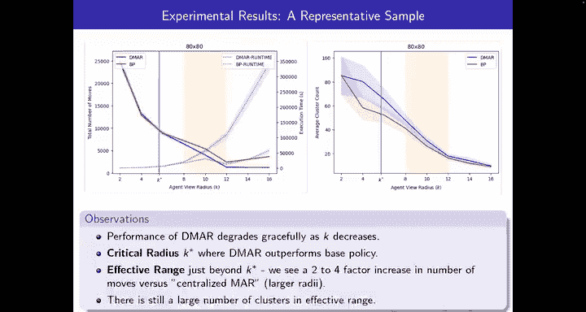

The number of nodes oh well it's just like okay， it's all of these squares so in for the 80 by 80 case。

 the number of nodes is 80 squared。

对。Any other questions？we have better AsianYeah。Yeah。

 so if it was very dense or very sparse then that that matters at least so in。

In the way we've distributed these agents， and by the way， I don't think I wrote this anywhere。

 but if you have an 80 by 80 grid， then we put 80 agents down。

 so it's always square root of N agents in this experiment。O。

We also did physical implementations of this algorithm。We use the robottium platform at Georgia Tech。

 I'm not sure if you've ever heard of this before， but it's basically this citation generator for the scientists at Georgia Tech。

You you give some code that you programmed yourself to a server it does some safety checks and then these little robots that are about the size of cell phones just sort of run out and perform your algorithm in this arena and there's nobody here monitoring it it's all just automated I'll show you some video it's kind of fun。

Okay， so this is a physical implementation。Planning by these robots occurs in discrete space and time。

 but once these controls are computed， they're mapped to this continuous space velocity vector and a new position is moved to with auators so there's some kind of function that maps discrete controls to some physical actuation that's how this is implemented。

The simulations were reed with these varying varying sensing sensing radii。

 so these are real valued numbers now， so we did 20 centimeters， 40 centimeters。

 60 and 80 I didn't put it here， but we also did infinite just to see how much of a difference it would make。

And the results reflected our discrete simulations in terms of competing with the base policy。

 so I'll show you a video。

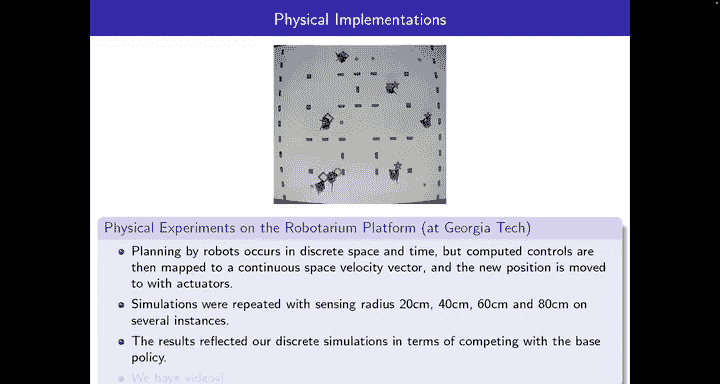

Okay， so I have this sped up 20 times because they're a little bit slow， but let me pause it。

So these little rectangles or quadrilateals represent obstacles。

The little circles represent tasks and the robots are obviously the agents and when they form clusters you'll see these shapes that are overlaid on the agents like for example。

 this guy has a star it's a little bit hard to see but this guy also has a star and these shapes are going to indicate clustered membership so this is just a。

A little arena， and there's this overhead projector that is beaming down these shapes onto the floor。

 and then these are little little robots。So I have three instances in here。

 it takes about a minute and a half to watch this video。But they go through and execute DmarR。

 and eventually they solve all the tasks after they form clusters over and over again。

I love watching them run out under the arena， it's my favorite part。

So let me pause it yeah so here's a cluster here these guys have this little circle associated with them。

Here's another one here。And this is another one here and this guys by himself。

 these the shapes indicate the cluster membership。I。That would be sounds like a great idea。Okay。

 so there's some example simulations for you。So let me wrap this up。

Here are the conclusions of the study。So the conceptual framework coupling in classical and non classical information patterns is as follows。

We explore the interface between classical and non classical information patterns by adapting methods used in the classical setting to the non classical setting。

This led to the concept of clustering and applying multi agent decision making in a decentralized and parallel way。

The critical quantity connecting the classical versus non classical information patterns is the sensing radius。

And what can we say about the sensing radius？Choosing a sensing radius in the effective range allows for greatly increased scalability at a small detriment to solution costs。

 so one thing that I didn't emphasize much is that in these distributed systems。

 because all of the computation is spread out throughout the processors。

There's essentially depending on your algorithm， there could be like infinite scalability。

 so these these clusters generated are bounded by a constant， which is given by a parameter。

So each agent only ever has to remember a constant amount of stuff and do a constant amount of computation。

So this thing is just going to scale infinitely no matter how many agents you have。

What else can we say？Because of this log star growth of the critical sensing radius。

 you can choose a good sensing radius without knowing anything about the size of the network。

 it doesn't matter， so truly the instance can be unknown and you can handle it。

Then the sensing radius must be large enough for good solutions。

 but not so large that agents can deceive the whole network。This principal conclusion。

And then lastly， they have this applicability conclusion。

 which says that our approach is highly scalable and is conceptually adaptable to continuous space and is robust the sensor noise。

 which augments its real world applicability。That's it。

This paper is going to appear in the proceedings of the 23rd International Conference on autonomous agents and multiageent System or almost 2024。

I don't have the ACM link yet， but if you want to look at the archive version of the paper。

 you can take the picture of this if you code question with respect to the sensing like at least for the spiders and。

You kind of do simulation and make the best choice along this stage and then all the spiders move a little bit like when the spiders spread really out。

 like， for example， like out of the cave houses， are you still able to like are they going to see what each other sees？

Because like it seems have a k hops is Well actually no。

 so the limit for communication is based on these agent trees because you can have a chain of agents and each of them can be with k hops of them and an agent on one end can communicate with an agent on the other end just by message passing through this chain。

So their communication with the range of is not when we found required a physical practice distance。

Online customer。Well， it takes some time for the messages to reach from one side of the cluster to the other。

 but it happens eventually and in bounded time。Are there any other questions about anything that I've showed here？

一系得是。Make a comment but you just take my mind that a turn date。Sp this supplies the sensing ratings。

呃、那かに片。Yeah， so a stochastic extension of this。I'm not exactly sure how that would be done。

 but that's a potential avenue for future work yep maybe according to some known distribution。即系。

Well， if you have any questions that come to later， you can always ask me。Thank you。All right， great。

All right， guys， let's jump into the last application， which is。

Approximation in value space apply to multiple object tracking or not as data association problem。

This is a wildly different problem than the previous two。

But hopefully I will convince you that the methodology introduced in this course are equally relevant and equally effective。

But before we go to the application， I will first remind you the general discrete optimization problem that has been discussed in previous lecture。

一。This general discrete optimization problem is about minimize a function G of U subject to some set where U belongs to。

And we assume that each solution， you have n components。U0 until u and minus1。And we can view。

Each component。As a stage of control。 So the problem can be viewed as a finite horizon optimal control problem that can be treated exactly in principle by dynamic programming。

Whereby starting from the artificial initial state。

We select the first component will control and view as state。This。

New single select selected control component and move on to the next stage by selecting the second component。

 So the state。At stage K would be the partial solution constructed in the previous stage。

 You are familiar with this picture， because you have been。

Dealing with traveling salesman problem in， in your homework。So。

There are no costs in the intermediate stage。Until at the very end of the horizon。

 we have a cost G of U， which is the cost of which would be the viewed as terminal cost in the context of。

Optimal control。Of course， this formulation。Typically makes little sense to solve for us to solve the problem exactly。

 but often it makes a lot of sense。For approximate dynamic programming or approximation in value space methodology apply to address discrete optimization problem。

In particular。For this problem， if we want to solve it by dynamic programming。

We start with this non function G view， which in in the context of dynamic programming。

 it would be the optimal cost of the terminal stage， the last stage。

 which we denote by standard notation。J N star of X， N。

 which would equal to the terminal cost G of X， N， which X N is the complete solution for all X， N。

 And recall now X， N is the complete control U。 The control sequence。 It must belong to this。Set。

And for all for K from 0 to m -1， we perform the standard dynamic programming calculation by minimizing all the control available control at a particular state and typically we see a stage cost and optimal cost of future stage。

 But now that term is gone because as I mentioned earlier， the intermediate stage cost are0。And X UK。

 this control constraint said， of course， depending on the problem。

 need to be constructed or defined suitable。After we obtain all J star。

 we can construct the optimal solution by forward calculation that one component at a time start with U0 star by minimizing over J star of 1 and so on so forth and eventually we construct the sequence。

But as you have experienced in the traveling salesman problem。

 if you solve it exactly by dynamic programming， this would mean that start with the last stage with。

 which is the complete。Trajectory， the complete tour of the。Traveing salesman problem。

 you inaurate all of them and and calculating backward。 And it really make lot of sense。

 So what happened in reality is if we want to solve it using approximation in value space。

 we use some。Cost approximation J2 the K plus1 in place of J star and performing this forward calculation by starting from the artificial state。

Set。😡，Respective component to be U tilde of K at case stage by minimizing over this expression where this J K plus1 tilde is something we construct or define or even calculate in real time。

So how is this relevant to multi object tracking problem？

If we look at this academic example where we have。Lets say a video stream and this video stream have three frames。

 and we have three。Objects of three people。 They are moving。In this common environment。

 And what we like to do is we want to match the same。二审。Over。Various frames。

 So this is precisely what multiple object tracking problem aim to do is try to match the same object over various frames。

And as you may see。If we list。All the objects in one particular frame and do this frame after frame。

 then matching the same person over various frame would。Somewhat loosely speaking， look like this。

Matching over this layered graph。And this problem is highly non trivial because of various challenges。

 and in practice there can be additional challenge。

 but let's just assume that every object in various frame has been identified and put books in clearly draw box than there are still other challenges like occlusion。

 for example， in this particular case。 this gentleman is blocked in part by this lady。Also。

 change in object appearance， for example， this lady in this frame and this frame， look， I mean。

 from our view， it's quite obvious it's the same person， but for computer， it's different。And also。

 there are pressing real time computation constraint because typically we want to do this matching in real time and typically this frame coming in in a very fast speed。

 And we want to conclude the calculation in real time for as soon as possible。

And it's an important problem with a lot of applications。 For example。

 both pedestrian or vehicle monitoring， robotics application， consumer analytics， for example。

 in a in a store that the business owner in the big store。The business owner would like to know。

 okay， what group of people are most often stay in which store。

Like how long so that it can arrange business suitably and also augment and virtual realities。

So mathematically speaking， as I allud to a moment ago。

 this type of problem can be modeled by the so called multi dimensional assignment problem。

 whereby we have。Multiple layers of node。 And in this particular figure is six dimensional assignment problem。

And in general， we say that there are M plus one layers of frames of nodes。 So individual。

Person that appeared in the in the previous slides would amount to one node。

And what we want to do is we want to construct groupings。

 and each grouping consists of M plus one nodes。With each node belong to， for example。

 IK belong to the case layer together with their cross bonding arcs。

 So the arc connecting nodes in adjacent layers。And。For each grouping， there is an associated cost。

 depending on entire grouping。 For example， will give a particular cost to this entire grouping。

It need not to be simply some cost associated with independent ors and sum them up together。

 If that's the case， then it's an easier problem than the problem we are treating。

So our goal is to find M grouping， where in this case， M is the number of objects in each frame。

Such that each node。Belongs to one and only one grouping。And our goal is to minimize the cost。

The sum of costs of all group。Is it clear。ok。So we apply approximation in value space method for this problem。

As you have seen a moment ago。The state for this problem is a partial solution。

Where X K would month to U 0 U 1 until U K-1。And we would like to match frame by frame。

What we do here is we do one step look ahead minimization by which I mean we construct matchings or we select UK one frame at a time。

But in addition to that， we also perform truncated robot。By which， I mean。

To select the control UK here。We construct some tentative matchings。Starting from the next frame。

By using some paeuristic。And then apply certain cost function approximation with structures that matching the assignment problem。

It will be clear a moment later。 So essentially， what happened is， let's say。To select。

The matching between frame K and frame K plus 1。What we do is we construct a cost matrix。

Between all the arcs of those two frames。In particular， let's say this particular arc。

We assign the cost。 That is the cost of。This entire。入品。

So the constructed tail portion of the problem would facilitate。The value we assign。

 we facilitate the design of this arc cost。And because of this special cost structure。

What is nice about it is that。When we do selection of UK。

The Q factor minimization reduce to solving a two dimensional assignment problem。Recall that。

 I said a moment ago that。We have a truncated horizon。

 and we construct tentative solutions starting from the next frame for the tail portion with certain fixed length。

And this， once this is done， this part have construct some tentative solution。Then。

This particular arc， we would assign the cost that equals to the cost of。This entire grouping。

 So it's not anymore a cost that only relate to。Similarity or overlapping between those two frames。

But similarity in a way between the tentative trajectory and the trajectory we have constructed until the stage。

And the effect is， by taking into account。The truncated， constructed tail portion。

 even though it's tentative， we only use space heuristic to construct it。

 And once this matching is done， this part gonna break and we're going do we're gonna extend this truncated matching and in order to solve this new matching again。

 So once you construct this purple。Like finish the control selection UK。

 We move on to the next frame and start to go to this stage and X K and UK become X K plus  one。

 So this purple broken line would become red。 Supp this is the final solution and repeat and so on so forth。

 and the effect of taking into account this future frames and。

For in order to facilitate the control selection for the current stage results in robust and consistent matching against occlusion。

So let's look at an benchmark study。And you can just staring at this gentleman。Which using peistic。

He's assigned with number 17。And。Over the frame。 And you can see after a while， it was blocked。

By this family。And when he。Re emergeged。Ill be you become a new person。

The algorithm considered him 41。 Even obviously， everyone can see， okay， this is the same guy。But。

Because typically for what is known as online algorithm。

 they only deal with one incoming frame and comparing the similarity between adjacent frame and this incoming frame in order to do the matching and in some rare cases。

 they also use the historical frame。But they don't use the future frame in the same way we do。So。

Clearly， in this case， it fails。Now， let's look at。Our method， approximation in value space。

It's still 16。 Okay， let's pause。At this moment。 So what， what is going on under the hood is。

In several future frames， our algorithm construct。Our algorithm would use this space heuristic and construct the path of the same gentleman。

And this constructed tentative paths in the future。Would be used to facilitate。

The frame the matching。Decision at the immediate next time instance。 So because。Now， moment of truth。

Because of this long term memory。When。Just at this moment， you already see in the future。

 there is this old gentleman look incredibly similar。To this person I see in the previous frame。And。

It decide， okay， this is the same person。And that is what what is going on under hood。

 And if we go back to this illustration here。あです。Critical moment。The future constructed trajectory。

In form， okay， despite thecclusion that happened in this in the previous frame and so on。

 it can kind of connect the dot。In between the frames that happened during occlusion， so。

This is why intuitively， it results in this consistent and robust。Matching outcome。Yes， please。但是。

This assume isn't being run online at the exact same frame it means some future yes， precisely。

 that is credit。But if this network yes that's precisely correct so there' is I mean。

There is a limit that our algorithm can stand， for example， just as you've said if。

This gentleman happened to be just walking almost aligned with another person for long enough and beyond the truncated rollout horizon and。

There' is nothing we can do about it。 And it's true。

 This category of method typically are known as batch method and this every incoming frame and you match it。

 this is the online scheme is known as online method and our method is called typically categorized as batched method and what is typically known in literature is。

The batch information is sort of passed through certain neural network to。De with。Altogether。

 instead of in our case， using the dynamic programming formulation approximation in value space。

 we treat still treat frame by frame， despite that we have the entire batch information and it's true。

 for example， in in our experiment， let's say the truncadial rollout is the window is8 frame。

 then we are eight frame behind the real time compared with this online method。Yes， essentially yes。

 so for example， if we go back to this illustration。After this control selection is finished。

At the end of truncated horizon， there would be a new frame coming in。

 Then we deal with this frame and still have a more frame for us to run truncetated rollout。So。

 that is。How how the method is working。Yes。😊，我。有。Oh。Well， that's correct。

This is a simplification of what is going on。 And in reality。

 it's certainly not all the time it's symmetric and there are object coming in and coming out。

 And we typically maintain under the hood， certain frames and， and if this object never reappeared。

 or if all the object that is present that。啊。Nowhere near similar in measured by our feature vector than we deleted。

 So there are a lot of technical like implementation details the hood and Patrusia in the audience is one who actually do the heavy lifting。

 So if you want to know more about it。Yes。这他现在。So once North math， I just for a while and。这个可。

如个你 you喺。不边不咩。Right， just repeated panel when the going。喺嗰个啲诶。3rry。关。关。Okay， that's。

 that's a very interesting question。 And in fact， what happened is。

We the method are in the spirit of rollout。But it's not identical to Roout in sense that。无异。

We lost the hope of having all the nice properties of cost improvement and so on so forth。

 And that's mainly because。One thing is， this is a truncated version。 So it's not。Loyal。

 like faithful reproduction of the exact version of rollout。 That's the first thing。

 And second thing is， even though I saying that once we construct a tentative tail portion。

 we have this grouping cost and this grouping cost， for example， this。

Group would assign to this org and so on。 But this grouping cost involve a lot of heuristics and testing and so on。

 And in reality， we don't really know what is the right group cost for a particular matching， so。

I guess this is what we say as guided intuition。 We are guided by， by theory， but。呃呃。

The application is more involving a lot of other complications that we just deal with in byeuristics。

 essentially so traditional some of you this video this mapping better than So that's kind of difficult。

嗯。

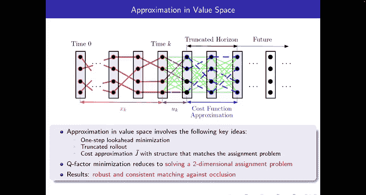

Alright。Any other questions？Okay， that conclude today's lecture。Yeah， like Jamesson said。

 there's no lean post for post here。It just paid in some software。That we can calculate its value。

 but we can't visualize exactly its transportation， its forms and analytical form。

So the no pose a little of further challenges， it's covered in your class notes after the term thrown out to an expert okay when the expert is the one that it evaluates。

It provides manage for course function。And that let me also recognize Ra Sunu。

 who is the prime poet of this study and hes feeling the last species right now。

And and she knows a lot about implementation details。

So you may ask the questions about things that that sort of were complicated and that other people have that actually traditional relied on software and implementations that were already available。

And downloading the software and use part of the software and so。Yeah。一车。

We to inspired project was the whole point of this。Okay。

 next time we hope to have another title limitation is also of a workfront。

Has to do with tasks to if you think kind of stuff。And。We're still working on that。

And I hopefully we need to be done by an excuse next Wednesday and be able to be giving the election that it will be in time。

 or it's going to be。Next week's lecture is going to be the live lecture before the spring break and remember that we have a deadline at the end of spring break。

 provide a proposal for your return character。So we we giving as much information astro want that we to get started。

跟住嚟话就将系。