# ASU《强化学习2022-2024｜cse 691 Reinforcement Learning Course at ASU》中英字幕（deepseek - P8：[03]Lecture 8, 2024, Rollout for stochastic DP. Value space approx - GPT中英字幕课程资源 - BV1zcfVYdErD

Okay， let us get started。Let me welcome you to this eighth lecture of our course on reinforcement learning。

And。In previous lectures， we discussed rollout at some length。Both in methodology and applications。

 but we always dealt with deterministic problems， the uncertainty no disturbances。

 so now we are going to look at rollout and more generally approximation value space for stochastic dynamic programming problems。

And also for problems with continuous。State and control spaces。不。

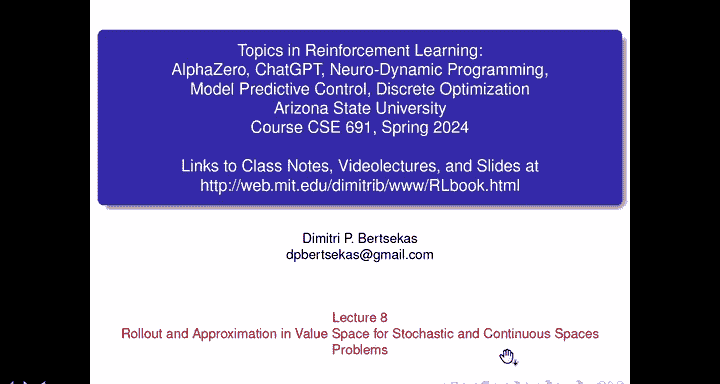

So here's the outline。First， roll out for stochastic problems and we're going to start with one step look ahead。

Then we're going to look at the multi step look ahead version again for stochastic problems。Then。

We're going to talk about ways to economize on the multi step。Look ahead the minimization。

And one possibility is going to be certainty equivalentence。

 another major possibility which is very popular and is discussed extensively in the literature is Monte Carlo research。

 which you can view it like pruning， thinning out the look ahead tree but a stochastic form of that。

 which involves a limited simulation。Then we're going to talk about problems with infinite state and control spaces for which rollout and approximation value space。

 as we have discussed it does not work because of the infinity of the control space。

An infinite number of Q factors to evaluate。So we need speak to look at different kind of techniques for this type of problems。

 and incidentally， these are a kind of techniques that are applicable to MPC。

Modern predictive control。Then we're going to look at a special type of problem which also involves infinite spaces。

 stochastic programming， it's a very popular model that has been around since the '60s and it can be viewed as a special case of dynamic programming and we're going to discuss the special issues associated with it。

So roll out for stochastic problems。You remember our favorite figure involving one step look ahead？

At State XK， we minimize overall possible controls。The sum of the current stage cost。

And the cost to grow。 However， here， the system involves a stochastic disturbance W K。

And the number here within the braces is a random variable。

So in order to minimize over numbers for this to be a well definedfined minimization。

 we have to take expected value， the expected value of this， in other words。

 the weighted sum of these random values weighted with the corresponding probabilities of WK。So。

Here I'm showing also， in general， be the。Cost function approximation is some J tilde。

 however here I'm going to focus on the case where the cost function approximation is obtained by running some policy pi which we call the base policy So this J K plus1 pi is the cost function of some given policy pi starting at time K plus one from this next state okay so this is similar to what we had before but before we had a slightly more general situation where we were running some kind of heuristic Now we insist that if here is not arbitrary。

 but rather policy it's a policy pi now was a rule that gives us tells us what to select at every possible state and time。

So this is a minimization for the case where we have rollout with this pi based policy。

 we minimize at state XK overall U and we obtain the rollout control。

Now the minimizing control is the one step look ahead policy， and of course， we want this to be good。

And perform well。So P， we're going to be calling it base policy。And P Tilda。V。

Policy that implements these minimizing controls is going to be called a rollout policy。And。

There's an important fact here is a cost improvement property that says that。

For every state XK and every K， the rollout policy performs at least as well and usually betterladder than the base policy。

Now we dealt with cost improvement in the context of deterministic problems also。

 but we impose various conditions like sequential consistency， sequential improvement， and so on。

 it was not automatic。That cost improvement holes in deterministic problems。

Basically because this base heuristics。Could be anything They could be as stupid as they get Okay。

 it can be anything at all， and they had to have some basic property so that they did not do crazy things and we could get an improvement。

And we impose the assumptions sequential sequential。Sequential improvement， sequential consistency。

 we don't need these assumptions here because。With this choice of the base policy as being a legitimate policy。

 we automatically get sequential consistency。So it holds because pies a legitimate policy。

 it has a sequential consistency property， in other words for visiting the same state at the same time。

 it will do the same thing， okay thats regardless of how it got there。

 that's a property of any policy。It's defined only by the current state and time。

 the action that you use at any state and time。So we're going to prove actually this cost improvement property。

诶。However， let's first talk about some of the difficulties associated with this stochastic rollout。

The big difficulty is lots and lots of。Expected value calculations。If you're very， very lucky。

 this expected value may be may be calcium level in closed form。However。

 usually youre left with no option other than to calculate this expected value by simulation。

This means running lots and lots of samples of WKs。And。Haraging them by Monte Carlo okay。So。

There are many， many different sampling possibilities here because W can take different values and also u takes different values。

 so there's a lot of simulation involved here。And moreover， to calculate this quantity。By simulation。

 you have to run the base quantity to the end of the horizon， right？

Lots of steps to simulate lots of variants involved， lots of Monte Carlo samples needed。

So how do we deal with this？This central problem of the simulation effort。嗯。

There are various ways that we can try。To approximate this base policy cost。

One possibility is truncated rollout， in other words。

 we don't simulate this expression all the way to the end。

 but rather up to some limited number of steps。There are also other possibilities。

Prune the look ahead three， okay， prune some controls and therefore not simulate them。

Where it is not simulating them very fully。Another possibility is a certainty equivalentvalence approximation yes we take this first expected value and we calculate by simulation。

 but for the remainder we plug in for the remainder that involves uncertainty from time K plus1 to the end。

 we make a certain equivalence approximation and we treat this。

 we calculate this as a deterministic quantity that has a very。

 very radical that can affect a very radical reduction in simulation effort and we will see because of our framework based on Newton's method we can be assured that loss of performance is not going to be too large。

So certainty equivalence is a major way to cut down on the simulation。

 and we're going to discuss that in this lecture later。Then。Use limited simulation。In other words。

 cut down on the Monte Carlo instead of doing a thousand samples of Monte Carlo simulation。

 if a control does not look very promising， we just simulate a little bit just to check it out like 10 samples instead of1 thousand0。

This leads to a method called Monte Carlo research and related methods。

 and we're going to discuss it also in this lecture。So to summarize。We have。Sttochastic rollout。

 more generally stochastic approximation in value space。

The big problem is the amount of simulation we have to do to do these calculations。

And there are a number of remedies which we're going to discuss， which work。More or less。

 depending on the problem at hand。Some questions。Okay， so before we go into this issues。

Let's discuss an application。

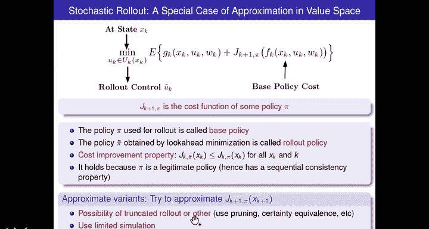

嗯。One of the very first applications of stochastic rollout。Perhaps even the first。

I mentioned this application， the context of Bagamon。

 the So's program in 1996 and his earlier programs。

Rollout was applied in game context before the So actually。

 but the SoR did the first really challenging study and an in depth study of all the ramifications of simulation。

 truncated rollout and so on。So let me remind you about backgammon。

It's an old game of strategy and chance because it involves a all of a dye。And at the typical step。

 you have a board position。And there are white pieces and black pieces。

 and they move according to certain rules。And the possible moves at any board position are controlled by the role of a die。

 okay the die is like okay three and five means one piece can go three can move three steps。

 another piece can move five steps so the board positions that can result after this position here are a random and depend on the role of a die。

 but there are a number of positions here and in the case of backga and they're in the order of them。

20， 30， 40 somewhere in that range， so the look ahead three here is fairly substantial in terms of its breadth。

In terms of dynamic programming。The states here are the board position， but also the dice roll， okay？

Because that's what we know when we make the decision of how to play the role。So， that's the state。

And of course， the zilience and zilience of states， okay， an astronomical number。

given now the current state， the board position， the dice row。

 via actions that we can choose are the different ways of playing the dice row and they arere defined by these possible next positions。

And the stochastic disturbance is the dice row， so from this we move to those and then we all the die and then we have to play again。

 so that's where the stochastic disturbance comes in。Okay。嗯。I think I mentioned the history of this。

A 1990 the so。Developed this。TD Gament program， which involved them。One step or two step look ahead。

With cost function approximation， but without rollout。This was called Td Gam。

And the cost function approximation。Weretrained with them。With a form of approximate consideration。

That used。TD Lambda， a temporal differences algorithm。

You don't hear much about TD Lambda these days because other methods have become more popular。

 but in those days it was a novelty and a very central focal point of reinforcement learning。

So the sortra applied this temporal difference sagon was the first application that was really on a very challenging problem。

And somehow it worked attain for a long time， I understand months， okay。

 we're talking about 1990 computers were very primitive at that time。

 so Tesora had his his TD Lada work for lots and lots of time and provided a cost function approximation that cost function approximation with bootst on a one step look ahead scheme and produced。

T the Yemen， a program that could play online。Now， that program played the。

Pretty well came close to beating the world champion， certainly was beating all the。

Back ga on programs that were available at that time。

The programs based on so-called supervised learning。

 in fact sort of had written one but people other people had also written programs like that。

 but this TD Gamon beat decisively all of those that came close to be the world champion now TD Gamon did not involve this rollout。

And thes introduced in 1996。A truncated rollout。系。Scheme。Goodbye。你。

The cost function approximation that was used at this step was obtained by running Tidigamon for a number of steps forward and taking the tidigaman approximation cost at the very end。

So it was a truncated rollout program。And。It played very well。

Much better than the one without rollout rollout was the decisive difference。

 and it was playing better than any human as well as much better than all the previous programs。

And I think we've talked enough about rollout to understand the reasons for that。And。

There's a better Newton step and so on。However。It's really amazing to contemplate how to sort of manage to do that because we were talking about 1996 and computers were very primitive。

 so imagine generating training samples。By running games all the way from here。

 all the way to the end。 So from this position here。But I a thousand games， okay？

And average the results。What percentage black won， what percentage black lost？

Do this for all the 30 positions。Do this at every game。

 okay and the amount of simulation was overwhelming， hence he had to introduce trancation。And also。

He had to use parallel computation one nice thing about rollout is that it's very well suited for parallel computation。

 why because the average scores here can be done in parallel from every one of these positions。

 so if you have 30 positions and you have 30 processors， parallel processors。

 you can do this in parallel。But not only that。Monte Carlo simulation is very well suited to parallel computation。

 right， you can generate samples in parallel。So if you have here， let's say if you have 30。

000 processors， you can probably use them to speed up the computation。嗯。In thesosstein， this。

This required a lot of online computation and generally it was thought that rollout is just too slow for online play。

However， now if you look at the internet， you will not find a rollout program in the internet。

 you'll find a lot of T gam looka alikes。And they played a pretty good game。

 but stochastic rollout is not available in the internet because it just is too slow。

That's the major difficulty。And。People in the world of Vga think of rollout as being optimal。

 the optimal policy， it's not optimal， we know that right， it's not optimal。

 but it's plays so well that they think it's optimal。

And it is the yardstick against which the quality of all the programs are measured。

So that's the story of TD Gamon and a lot of the concerns that arose at that time are still concerns today。

The issue of simulation and the amount of it and how you overcome the excessive simulation problem is central still。

Any questions here？You guys take a lot of things for granted， but in those days in the 90s。

 this was really an eyepoping success like alpha zero， but better than alpha zero。

 and I think I may I mentioned earlier， it got me into this field because I just couldn't believe my eyes that dynamic programming could be used in such an approximate mode to address problems that were completely beyond the horizon of possibility at that time。

Okay。A lot of computer scientists are fearless， okay？

I would be totally scared of addressing a problem like blackham and computer scientists just go right in。

And sometimes they succeed， sometimes they fail， but then when they succeed can be really impressive。

So。Now let's turn to theory。The cost improvement property for the noncncated version of rollout。

 if there's truncation you can't prove cost improvement。

 you can prove that there's a mutant step involved in so one， but we cannot prove cost improvement。

 so let's look at the nontncated version of rollout and let's prove this property。Okay。

 let me remind you the notation here。Pi is the base policy， pi Tilde is the rollout policy。

 and we want to prove that for every state in every time from zero to capital n。诶。

This property holds。And the way to prove this is by induction， the proof is very simple。嗯。

It's just one line， okay， one， okay， what one equation。One string of equations。嗯。So we use induction。

 clearly this relation holds for K equals n。Because it reduces to。

The terminal cost for rollout and for base policy， base is G sub n， the cost function。

 the terminal cost function。So let's assume that this relation holds for K plus1。

And we're going to prove it for k and for every xk。So here's how we go， we express the。V。

The cost to go for the rollout policy starting at state Xk as so now what is this equation this first equation is just the dynamic programming equation for pi Tilde。

 right？The co of xk of pi tilde is the expected value cut of the K stage using mu tilde K pi tilde。

Plus， the cost to go of the remaining stages using P tilda starting from the next day。

And expected value of that， that's dynamic programming， but focused on Pi Tilde only， right？Okay。

 now we upper bound this by this expression here where we use the induction hypothesis。

This thing here。Cost the go of the base policy is by hypothesis。

 by the induction hypothesis larger than the cost of the rollout policy okay so we have this inequality this holds for every possible value of the inside the parentth。

 so it holds。That's what I'm saying here that the first inequality goes by the induction hypothesis。

Let's go to this step here， The second equality holds by the definition of the rollout algorithm。

Right。What is mu mut tillde k of xk， it is the minimizing U in this expression right by definition that's what Ro allowed is。

 that's how it's defined so this is equal here。And。

The minimum is smaller than what you would get for any other control。

 including the one of the base policy new case of xk is the control applied by the base policy。

And the rollout policy minimizes in this expression， so this is greater than that。

And by the dynamic programming equation， this is equal to the cost to go。

From time k at state xk of the base policy。So we assume that this is less than that。

 and we proved that this is less than that as required by induction。And that's the proof。

 it's not difficult。And by the way， this is the proof that you would use for a deterministic problem。

Under the sequential consistency assumption， it's exactly the same steps without the expectation。

 without the expected value。啊。The proof for unders sequentialequ improvement。

 which we did actually in class。Is different， does not use this argument。

 but to prove of the sequential consistency uses exactly this argument。

 but simplified because it's a deter deterministic problem rather than a stochastic problem。Okay。

Just wanted to make sure that we do some theory here。I'm my the addition， as you know， right？

Questions。

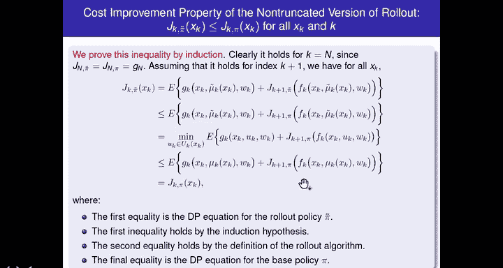

Okay， so now let's go to implementation issues。Of stochastic or all loud。

Assuming a finite control space， right， because。We want to choose between a finite number of alternatives and in particular。

 given the current state Xk for every control UK we。Compute this expression。

For that control and this is the Q factor associated with the pair Xk and UK。

 but corresponding to the policy pi because we're going to take as course to go that policy over here。

And then we minimize over to UK。So。We have to compute for every U， the corresponding Q factor。

 and select the U that has the minimal Q factor。Now。

 another way to do it also is to calculate cu factor differences between controls and then find the one that has for which the cu factor differences。

Is is positive for every other two factor， right？嗯。up。Now， the way we're going to calculate。

 of course， the expected value is by running for every you around this。Random sequence of Ws many。

 many times。Many samples。All the way to the end。 And then we。

Average these samples by taking the sum and dividing by the number and then we obtain the Q factor or an approximation to the Q factor as as through the average cost because we average over a finite number of samples。

 there's going to be some error right we're going to get an estimate of this Q factor and there's going to be some error。

 some random error， the error of simulation。So that's what I'm saying here。

 the number of samples is finite by necessity， so the calculated values you hat。

Are an estimate of this cu。They are approximate and they involve some stochastic variance there's an error variance there's an error and there's a variance associated with that error of course the more samples we have the small error we have and usually we estimate the variance of the error through the central limit theorm。

Now in Monte Carlo simulation， there's a major， major theoretical subject。

How do you do variance reduction， How do you organize the sampling that you do so that。

So that the simulation error that you get has as small variance as possible。

If you do your simulation in an improper way， then you may get a lot of variance error but。

People in simulation have studied a lot， the way to organize the samples so that you get smaller。

 as small error as possible。And。In the。What we would like to do actually。

 is to reduce the variance of the cu factor differences。

 because that's is the thing that can't play at all。And now notice that if you。

You're differenten two random variables。And depending on proable distributions here。

 the difference may have smaller or larger variants。Generally speaking。

 doing Monte Carlo on the difference of two random variables is a tricky subject， okay。

 because the errors in the samples may be aligned or not aligned and that can make a big difference。

And there's a section in your textbook。That argues that it is often best to use the same sample disturbance trajectories for all UK。

In other words。Let's say there are you have two controls。

 simulate the first control using a set of samples。

 and then simulate the second control using another set of samples。Now。

 your book argues that it is better to choose the same random samples for both。Okay。

's the same W sequence， the same random seed if you'd like。And the。Okay， to understand this。

 you need to go into the probabilistic arguments， but these are simple examples that illustrates this。

Okay， let's forget about this complicated setting， let's try to suppose you have two numbers。

 Q1 and2 Q2 and you want to calculate their differences by simulation。

So you take a sample of the first one， this is the sample of the first one， it involves a W1， okay。

 that's the error。Take a sample of Q2， it involves this error or W2。Now。

 if you take the difference between these two and look at the variance。

The variance of S1 minus a2 then。A simple probabilistic argument where you calculate the variance of this shows that。

The variance goes down as the correlation of W1 and W2 increases Now。

 more the better correlated W1 and W2 are the smaller the variance of the differences。

In particular suppose that W1 and W2 are perfectly aligned and the arrows are exactly equal in other words。

 you use the same random seat to generate W1 with the random seat that you use to generate W2 then w1 is going to be equal to W2 and the difference S1 minus S2 is going to be exactly Q1 minus Q2 and it's going to involve no variance at all zero variance。

意见。😊，So this is true for this example， but something similar happens for the more complicated case here。

People。Sort of ignore this subject。 sort of sort of。Goes un notice this， but in fact。

 it can be very important in practice。In a simulation in general。

 but also particularly in the case of what do your force point learning？你郭是先。Yeah。哎，你是。嗯。因为这没验收，应该根本。

And what is agent fix？Each of the two countries are in the areas of two countries。一。Okay。

 these you're going to calculate separately。Okay， but then to find the minimal cu factor。

You have to look at the differences。Between the two， between all the possible differences。Okay。

 that's how you're going to declare the winner。By looking at the differences。

 the absolute values don't matter， you can add the same number to all of them。

 you can add 1 thousand0 to all of them， and then the minimum is not going to change。

Is the differences that are important？Yeah in terms of how you're going to organize your software。

 of course， you're going to calculate all of those and find the one that's minimum。On the other hand。

 so you're not going to bother with the differences。

 but in terms of the performance of your scheme or whether it's going to give you the actual minimum or it's going to give you something else。

 depends on the variance of these differences。Because one can overtake the other and it depends on the difference between the two。

 the error or the differences that is a critical factor here。Okay。

So now let's go to multistep look ahead。Roll out for stochastic problems。

You remember our figures for multi step look ahead approximation value space。

 it involves at a given state Xk， a dynamic programming minimization over L steps。

And then the future is approximate by some J Tilde。

 which in the case of rollout is taken to be the cost function of the cost function value of the base policy。

At the state。L steps ahead， okay。So now this is a substantial minimization that we have to。

Due by dynamic programming。And it involves finding a policy here。Not a sequence of controls。

 a policy because it's a stochastic problem。The first。Element in this policy is going to be。

Just a single control that you apply at xk， UK， and the remaining is going to be some new functions。

Then once you solve this problem， you select as your rollout control。

 the control that you apply this first。Goodponent。And you throw away the rest。

And this defines the rollout policy， this utility K you apply as state Xk。Generally speaking。

 we take it as given that the longer the look ahead。The better performance of the rollout policy。

This is not always true。But it's true in practice， okay？

There are theoretical facts that are not true in theory， but they are true in practice。

You can find counter examples， artificial counter examples where by increasing the look ahead。

 you get our words。What is policy？But these examples are artificial and they are not representative of the practical word in practice。

 the more look ahead you have。The better。Your policy is going to work。嗯。Who'se probability won？

On the other hand， so we want to have long look ahead。

 but the problem is that the necessary simulation increases very rapidly with the length of the look ahead。

Look at the problems that are involved here， first of all， to simulate the rollout policy。

 we have to search over a much larger。Number of next states is the next states L steps ahead。

 not one step ahead， but L steps ahead， so the number of simulations of the future cost increases exponentially with the length of the look ahead。

Similarly。The number of these terms also increases exponentially with the length of look ahead。

 and you have to calculate the expected value of that again， you need to do。A lot more simulation。

So the simulation here can be overwhelming。And you definitely have to do something about it in most cases。

So that's the big issue， how do we save in simulation efforts？

Okay trancated rollout suggests itself right， where is trancated rollout going to help is going to reduce the amount of calculation needed for this instead of doing a simulation all the way to the end we're going to do as simulation only for a few steps forward that's going to cut down the amount of simulation by an x because it increases exponentially okay。

So。That can make a big difference， truncated or law can make a big difference。

The second simulation saving approach is to use certainty equivalents。

Here we have a disturbance sequence that affects this calculation that starts at WK goes to Wk plus 1。

 Wk plus 2 all the way to W n minus1， all the way to the end。So what we do is。

We allow WK to be stochastic and take the expectation with respect to that。

 but fix the subsequent values， WK plus one to Wn minus one to some deterministic values。

 some nominal values。Now that cuts tremendously on the simulation。

 the deterministic simulation is much cheaper than stochastic simulation。And the main thing。

And this is why I insisted to give you the insights associated with Newton's method。

 this is still a Newton step， even after you do the certainty equivalentvalence approximation。

 this is still a Newton step that maps performance。That maps Jay Tilda。

To the cost function of the rollout policy。And in practice， this works。Quite well。

 almost as well in many cases as。V。The long simulation that does not use certainty equivalentvalence approximation。

It's a big timetan saving。Possibility that at least one needs to try。

There are also some intermediate， some approximations to the certain equivalence approximation。

 whereby instead of fixing the ws to some nominal values， you allow them to take one or two values。

 okay like two values。That's going to be a limited simulation as opposed to a full blown simulation with a reduced number of。

Possible values of de。But we're not going to focus on that very much。

 we'll just look at the certain equivalent of approximation as being the limiting case， which is。

Also， you can。You can。You can reason about it in a more intuitive way。

So we have to that allows certain equivalent of approximation to cut down the simulation。

 and the third one is Monte Carlo research。Monte Carlo research is basically a form of limited simulation。

And。The idea is that some of this。Controls， they be really bad。 And after a few simulation samples。

 you can tell that they are not doing good things。 while it's not worth than spending。

A lot of simulation effort for this not very promising controls that's the idea of Monte Carlo research focus the simulation on the most promising controls and and treat the other controls lightly just check them out to make sure that you have not for either not overlooked them completely。

Okay，There's not much we can say about Racaada Rola， but we haven't said so already。And。

What we're going to do is focus on certainty equivalents and also on Monte Carlo research。

And as I mentioned， certain equivalence maintains the new to step character。

 but Monte Carlo research does not。It is is does not give you it can sometimes it will work very well。

 but some other times it will not work well at all。Whereas the other one。

 certain equivalence typically works reasonably well。Okay。

 so let's go now to certain equivalence approximation。

 and we're going to sort of look a little bit more closely on why it requires much less simulation。

Remember， we're looking at multistep， look ahead。At the current state。And instead of xk。

 I call it x0， okay？Let's focus on lets label， let's translate everything to zero。

So this is the current state。And without the certainty equivalence approximation。

Multi step look ahead is going to work as follows。We look at all possible U zeros。

 all possible controls， and there are two in this figure here。

Then this is followed by the generation of the disturbance WK。

So these are going to be the next states， x1 or the possible next states theyre in layer one。

Then we apply U1。And we generate。More possibilities。 And from there also we select W1。

 and these are the next states。Two steps ahead， x2 at layer2。And so， on。So for L steps。

 we're going to get to this layer L。And the number of possible next statess is what you see here。

It grows exponentially。With the number of。The number of look ahead steps。Right。

But there's also a two stage expansion of the number of next states with every layer。Okay。

 so now we generate all those。 We have to do stochastic rollout after that， right。

 So we have to go from。K plus L all the way to N。And the。

And that requires also an exponential number of。Exponial amount of simulation because of the fact that we have to do Montecarlo simulation and a number of disturbances for each one of those grows exponentially with the size of the horizon from layer L to the end。

So this is all the work that we have to do。Without the certainty equivalence approximation。

Multi step look ahead。Look at all the next states， simulate them。All the way to the end。

 get numbers and then do dynamic programming over this tree。Okay。So now let's look at them。At the。

At the certainty equivalentvalence approximation。So what we do is we fix this w to some nominal values。

And then do the same thing。So from the current state。We allow the first disturbance to be stochastic。

And then we take the controls after that， these are the next states。One step ahead。However。

 here we fix W K plus one。 So we only have to look at。The controls available at these states。

So we got into layer two。But the expansion is less。Of the tree。

And we go down instead of expanding by two steps。U and W， we expend by only one step。As a result。

 the expansion factor of this tree is much smaller。And。

If you want to get to the same number of next states， you have to go further and look ahead。

 essentially， you can get the same number of states with twice as much look ahead。

And now from each one of those。You have to do deter deterministic rollout。

 which is much cheaper than the stochastic rollout。So here's a the twofold benefit of。

Of the certain equivalentvalence approximation， we do the termministic rather stochastic simulation from the terminal states of the lookhead3。

And moreover， there are fewer applications of the base policy。Because。Okay。

 fewer applications of the raise policy because there are fewer number of states at the base of the three。

And because we can we have to do less simulation， we can afford。To look further down。

 look twice as long into the future， which improves performance for a given computational budget。

So that's the idea， increase the amount of look ahead with the same computational budget。

And this certain equivalence approximation allows you to do that。And the。And。

And that's the main benefit， less simulation。It's also very easy to apply in practice there's no complicated software associated with no complicated programming associated with the implementation。

First steps， stochastic， all the remainder deterministic。Of course。A question here is。

 how do you pick？These nominal values。And that's where insight into your problem may be important。

 and like I said， also another possibility is to do a limited simulation with two nominal valuess or three nominal valuess that are sort of representative。

There's a lot of art that goes into here to make a method succeed。But。

Long look ahead is very important in these problemsse。Questions。Yeah。

 thes from the perspective now it is fewer applications because for the same amount of look ahead。

The number of terminal states is going to be much less。

So these applications are the base policy from here onward。

Baseball is applied after we reach the last layer。So for the same L， let's say L equals 10。

You're going to have the number of。Of states ahead is going to be much smaller。Exponentially smaller。

There is also an， an extra advantage because the deterministic simulation costs less than stochastic simulation。

So even from the same state to do a simulation forward。

 it's much more expensive here because the simulation is stochastic than it is here because。

The Ws are fixed。Okay， so we want to take the advantage of。3。That is your。

Like this and one does it here。Yes， this figure shows the same tree the same length， essentially。For。

DeWe with the certain equivalence of approximation and the without it without it with it。

The length of this tree is 2 L， okay， it's twice as long。Because the number of because。

Going from one layer to the next does not involve the W because one， instead of going two steps down。

 it goes one step down。So with the certainty equivalence approximation。

You get longer look ahead for the same effort。So if your objective is to apply as long look ahead as you can with a given computational budget。

 this comes in very handy and helps a lot。Thank you。

Other variants of certain equal of just limiting ourselves to have one stochastic W can help two or three stochastic ws or repair the risk orWs。

Youでパ。I know， who there used to be。哦，对对。对，是在认。Well。

 one of the things you can aggregate them into a single event。And do the same as show。Yeah。

 these are these are vector， vector Ws。 This Ws are vectors， right。Okay， they're not necessarily。

 I call them random variables， but they are really random vectors。It can have multiple components。

 they're just WK is a bunch of our stuff that happens at time K。

 but it could be more than one number。我能稳大你。Okay。Let's go on now to Monte Carlo research。

It's a stochastic form of pruning， cutting down on the simulation by pruning unnecessary controls or what we think are unnecessary。

嗯。So。We have。We have assumed that。We evaluate all the Q factors of all the controls of that given state with equal effort。

 equal number of samples。They say we have 10 controls。

 we're going to apply a thousand samples for each one。

Now the drawbacks of this is as some controls may be clearly inferior， some of these ten0 controls。

 let's say five of them， you can reject right off the bat on the basis of some preliminary calculation。

 it may not be worth as much sampling effort， may not be worth to do a thousand samples on each one of them。

 maybe you can do like 10 samples on them and then reject them right off the bat。Also。好。

Some controls that appear to be promising， they may be worth exploring better with more samples。

 just to be sure that we're getting the best one， we can do more sampling and also multistep look ahead。

 take advantage of the possibility that the possibility of multistep look ahead。诶。Now。

 Monte Carlo research。Is geared in that direction， trying to alleviate these drawbacks。

Is some form of approximate look ahead minimization that tries to economize in simulation time。

And it involves adaptive simulation。By this， I mean simulation effort adapted to the perceived quality of different controls。

And the mechanism with which it works is balancing。Exploitation and exploration。

Aims to balanced exploitation， meaning the extra simulation effort on controls that look promising。

 take advantage of them as much as possible or evaluate them as best as possible。And exploration。

 make sure that we don't overlook other controls。 We adequately explore the potential of all controls。

Now here's something that some possible social of confusion because if you read the literature。

 people tell you that Monte Carlo research improves performance。

Monte Carlo research does not directly improve performance relative to full blown multi step look ahead。

It works like simplified or roll out。In pruning it just cuts down the simulation effort。

 but this savings allows you to look longer， allows longer look ahead with the same computational budget that's where the improvement comes from you don't improve performance but with less simulation effort you can look longer and then you can gain from that。

So's a lot of misconceptions about Monte Carlo research， how it does， how it should be operated。

 why it's good when it's good and so on， it's generally a flaky methodology。

 but it works for some problems and with special tuning on the problem at hand it may work。

 it may or may not work， that's the bottom line on Monte Carlo research。Okay。

 so let me explain one the call research for the case of one step。Look ahead。

 One step approximation in value space。Yes。So what do we do with approximation value state space with one step look ahead？

We look at the current state， we look at all possible controls and we assume a finite number of them。

 and then for each one of those controls we simulate。The trajectory is forward。

And calculate the corresponding Q factors。Right。Cost of the first stage。

 cost of the remainder using some J tilde doesn't have to be brought out here with a given policy。

 just some J tilda。And you have to simulate it。And the。Here is the。Here's how we do this。

We don't take。each control in sequence and do zillions of simulation samples from them let's take take control。

 one do a thousand samples of that， then take control two。

 the thousand samples of that control a thousand that we don't do it that way instead we pick one controller at a time。

 we pick one sample for that control and then pick another control judiciously and get an next sample。

So here's the scheme。Pick a control in some way according to some calculations and generate a single sample of the Q factor。

 then go to another control and to another control depending on the results。Now， after。

I have collected n samples。 I have an empirical mean of the cu factor of every control。However。

 with a different number of samples。I have， let's say done  a thousand00 samples。

 so I may have allocated 500 samples on this control。

 200 samples on that control and 300 samples of that one， right？

Because of the sampling policy that they have followed。So at the end sample， after the end sample。

 let's call Q U N， the empirical mean of the Q factor of a control U。

So this is the mean after n samples。N is the total number of samples that they have。

And we view this as the exploitation index， it's a measure of quality of U based on the simulations that I have done so far。

And then I could use this estimate to select the next mental to sample。

But then there arises a problem， some controls may look good in the beginning and continue to look good and good and good because the other controls are not so do not look very good and then I overlook the others and how do I know that with more simulation these other controls may not become better。

So I want to make sure that I do not overlook some controls that have been less explored with fewer samples。

So we simulate some controls a lot， but some controls not enough。

 we have to get back to those to make sure that indeed they are inferior。

So that's where the conflict and the tension comes between exploitation and。In the exploration。

I need exploitation means I sample controls that look the best based on the current sampling results。

Exploration， make sure that I explore the potential of all the controls and I have overlooked any without sufficient consideration。

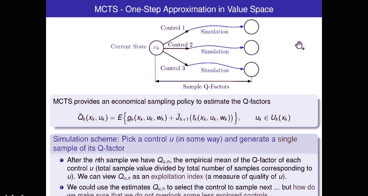

这个是。So how do we do all this？We balance exploitation and exploration by using。An exploration。

 an exploitation index and an exploration index。This is the popular strategy and the strategy that's being used in multi in Montelo research。

We introduce an exploration index in addition to the exploitation index。

 this is the running estimate of the Q factor of that control。

 and then I calculate also an exploration index that tells me how much I have explored this control。

And I add the two。And I sample the one that has the best sum。Now。

 how do I get this exploration index？I use a confidence interval approach。Whereby are you in？

Gives me an estimate of the error that I have in the simulation calculation of that particular control。

And。The formula for this are。Is that。Is a。Is I'm giving it to you here。

This particular formulaer is called the UCB rule， upperpper confidencefid Bo。And。

It is roughly speaking an estimate of the  error bound VS for the Q for that particular control。And。

It comes from a different problem， from analysis of a different problem， multi arm bandit problems。

Where it has worked very well and it's based on solid theory。

And it has been adapted to multi step look ahead and approximation in value space and cu factor estimation。

 it has been adapted。Furistically speaking， okay？And the formula is something like this。

Sees a tunenable parameter there。At time end。Here we have collected n samples， right？

And we consider control you log n is the number of samples so far。S of U。

Is the sample count of control U N is the total number of samples at the present time。

 S U is the number of samples that have been。That have been allocated to control you。And。

C is a value that okay， usually between between。Around one， let's say。

 square root of two is nominal usually given。But in practice。

 you have to select it by trial and error。And。Also。

 this formula assumes that these cus have been normalized to take values between minus1 and zero。嗯。

All of this。Works some of the time okay with a lot of tuning on the particular problem that you have sometimes I had from my own experience it's possible to try for days and days to tune this scheme on a particular problem it may not work okay。

On the other hand， it does work sometimes， and in particular， it has worked on alpha zero。

With an extension of this rule here to multi step look ahead， this is for one step look ahead。

 but alpha zero does not use this formula use a different formula again based on heuristic considerations we just found it to be to work well。

In their。Training。Of the both in their training and also in the online play。

So that's roughly the story on Montete Carlo research in your textbook。

 you're going to see material on this， you're going to see references for multistep look ahead。

 it's a subject that has been researched a lot and still being research。

In theres one more thing that I want to mention about Monte Carlo research。

 it's gearedto stochastic problems。 It doesn't make sense in a deterministic setting。啊。

Remember that for deterministic problems we discussed pruning and multi step look ahead。

And other things like incremental rollout and so on。

These schemes make sense on a deterministic setting。

 Monte Carlo research does not make sense on a stochastic setting because it's geared towards stochastic simulation。

 there is no stochastic simulation in a deterministic setting。

Still you'll see a fair amount of literature about extensions of Monte Carlo research to deterministic problems。

 basically they convert the problem from a deterministic or stochastic problem for the sake of applying。

Monte Carlo research。it's a little bit of a twisted logic。

 but you may take a look and judge for yourself。Yes。Re is。

And when does this kind of exploration or exploit starts when you reach your simulation budget constraint。

不 say。Excuse me。You set a certain target number of simulation samples。

That's how much you can afford to do， Okay， and when you reach that。

When you reach that point and you stop。And you select whatever control gives you the highest Q， okay？

like two times of Tra row， the first slide which the you end。 That's one simple。

 And then after that you give the exploration and exploitation， and then there should be lot stop。

一样 yeah。Yeah， yeah， you set a goal of let's say 10，000 samples and then one by one。

 you allocate the next where you're going to， what would control your going sample。

And you keep a running count of miscus and uss and select the one that has the best sum。

So you see by two stage。Is polish。I'm sorry I didn't effective。Play， it the optical control to the。诶。

Well both of them are updated simultaneously， right？嗯谂。With every sample you update。Thisisar。

Because this formula requires you okay， who it place。

N by n plus one with every new sample and also you update this SQ depending on what you sample and also you update the queue of the control that you sample。

You。You keep on， it's an online。Procedure of selection。

I assume it shows like one particular gloss show you go much deeper。

The final selection of control is going to be at the end of the sampling process。

And then you're going to compare all these。Exploitation indexes the Qs。

 which are the estimates of the Q factors。And you're going to treat the estimatesestes of being through Q factors and pick the control that has the minimal Q factor。

So during a simulation these are updated and at the end of the simulation we compare and find the one control that has the minimum Q。

Okay， so we'll take a break now for 15 minutes and then we have two more topics to cover having to do with infinite state and control spaces。

Okay。Let's go into infinite spaces problems， infinite control space。

 infinite state space and approximation in value space and these conditions。Problems like that。

Are typical of control situations， control theory type of problems。And you remember that。

I showed this slide earlier。There are two basic types of control problems。

 one is the regulation problem to keep the state near the origin。

 like in this classical inverted petrole problem。Where the control is the force that you apply on the card back and forth。

 it takes continuous values， doesn't take a finite number of values， continuous。Also。

 the state space。Consists of the。Angular possession and angular velocity。Of this ro and both again。

 take continuous values。嗯。The other major control problem type is path planning like this car going through find the path。

And the state space is the position and the velocity of a car and two dimensional space。

Control has to do with acceleration and direction of the vehicle and there constraints。

 all sorts of things， but all of those are continuous。There may be some discrete in other contexts。

 there may be some discrete variables， integer variables。

 but there's always in this control problems， there's always a continuous component。

So now what's the difficulty with this？We talked about approximation value space calculating Q factors for every control and comparing them and picking the control packs of best Q factor。

 but here is's an infinite number of Q factors， how we're going to calculate that。

So we need a different approach。

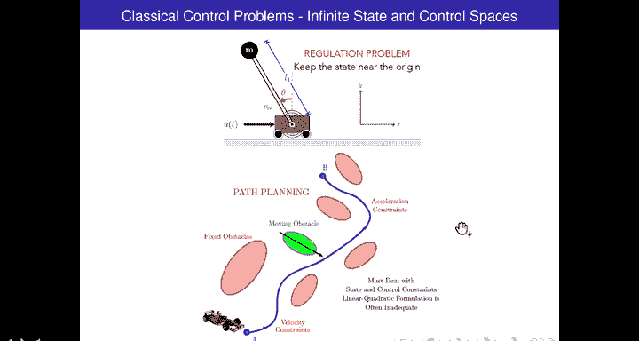

To implement approximation value space。And here's one possibility。

Let's suppose that the control space is infinite。And we are at a particular state Xk。

So the control can take a continuum of values here at the current stage and also a continuum of value values in future stages。

And。One possibility is to discretize the control space。 But then the number of few factors success。

 I'm not saying that this cannot be done or it may not be it may not work out in some cases。

 but it's a problem to contend with。It may be that the number Q factor is so so large that you need that that。

一。It' just it just becomes computationally very difficult to deal with。Now。

 another possibility is to accept the continuity， the continuous character of the control space。

And look at the forwarder controls as continuous variables。

And use some kind of heuristic that involves optimization， but over a limited number of steps。

 L minus1 optimization。And so the total becomes L minus1 plus1 L step optimization。So。

Oimization based heuristic is merged into the first step minimization to become an L step minimization at every step Now L step minimizations。

Can be done with。When it comes to。Multi stage optimization with continuous state and control spaces can be done with different techniques。

 nonlinear programming techniques and optimal control techniques like quadratic programming。

 gradient descent and so on so you one cost function for the controls are the variables of optimization。

 you do this you use nonlinear programming。And this type of formulation also can deal with constraints。

 state constraints or control constraints。There's also a possibility of a terminal cost function approximation。

 which has to be given in an analytical form， has to be differentiable。

 also we aim to deal with the requirements of nonlinear programming algorithms。

 optimalal control algorithms。I don't know how much background you have in nonlinear programming。

 if basically in pure form has to do with minimization of a nonlinear function subject to some constraints and the optimization is done over vectors and the vectors here are the U controls。

And。The kind of methods that you will use here is a very broad trust of methods I've written a book on not your programming I spend most of my professional life actually。

Working on nonlinear program。The method that you probably have heard is gradient descent。

 of which we're going to talk about in future lectures。Where given a certain a current iterate。

 you move in the direction of the opposite grade， a negative gradient。

 trying to make progress in finding itererates with better values of the cost。

Other methods are Newton methods， other methods that are in between gradient des and Newton methods。

 a very large variety of nonlinear programming methods。

For both constrained and unconstrained optimization problems。嗯。

Including quadratic programming and others。你。These methods have a long record of success and they can be applied within this context and in fact they are the principal methods in the original methods that have been applied in the context of NPC model predictive control model predictive control。

 very often people use this continuous space optimization methods based on quadratic programming or gradient type or Newton type。

's these are the methods of choice in model predictive control。As opposed to calculating all values。

 enumerating， doing simulations， whatever you have。

 and then finding the control with best fact with best Q factor。It's a different approach。

 same philosophy。Multi step look ahead minimization， but with different techniques。

 the techniques of continuous optimization and nonlinear programming in particular。

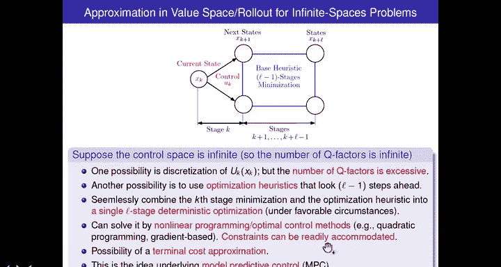

Let me give you an example。Of a class of problems that arises often in practice。

It's a multistage linear programming。下。Oftentimes resource allocation problems。

Over time are being imposed as linear programs。Where there's a linear system。Next K being the state。

 UK is the control and these are vectors， multidimensional vectors。A and B are given matrices。

And the objective is to minimize a linear cost over time。So the cos per stage is linear in the state。

 linear in the control。And these are in a product， Okay， CK， Xk， these are and dimensional。

Multidimensional vectors， and this is the inner product。

 this a row vector multiplying a column vector。So it's a standard form of them。

Lingar programming problem。And。It can be solved by linear programming methods。

 except that it become very large。If the number of stages is large and if the dimension of these vectors is fairly large。

 then you can get with a very large dimensional problem that。

Lineer programming codes may have trouble dealing with that。However。Is another important case。

Which involves。Integer constraints。In addition to continuous constraints with integer constraints。

 it becomes a mixed integer programming problem of large dimension。

 and it can be very difficult to solve。So people have addressed problems like that。

With reinforcement learning methods and approximation methods。And here's how this can be done。

In our context。We cant use。Multi step look ahead。Trancate the horizon and use terminal cost function approximation。

So instead of looking at the entire problem over the end stages。

At a given stage we trunnccate and look forward for unlimited limited number of stages。

 even if this problem involves integer constraints， it can be handled because it's lower dimension。

 it can be handled by current software like Cx there's some very efficient interteger programming software that are available these days and for moderate dimensions that can do very well and online。

Moreover， this approach handles readily online re planninging。

So if some of your constraints change over time。For the cost functions for some of the A and B matrices。

 you can incorporate them in your calculations can solve this linear programming problems or interteger programming problems online。

But。Jenral likes to into your constraints， as I will say。And。

It is possible to use our earlier methods involving thisization， base heuristics and so on。

 but this does not exploit at all the linear programming structure of the problem。

So there is an advantage in looking at it as a continuous problem to exploit the linear structure because of the availability of linear programming software and individual programming software。

YourYour textbook has more detail on this type of problem and also references that you can look at。

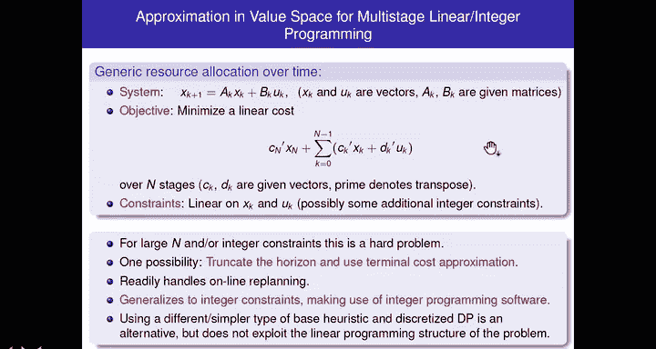

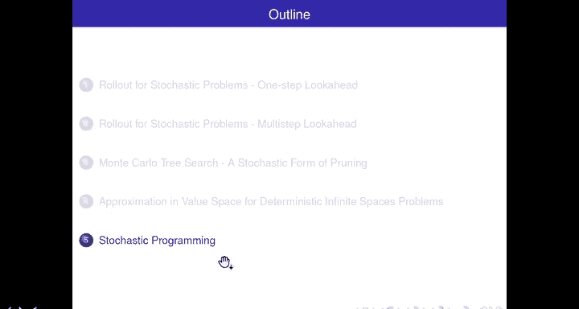

Are any questions about discontinu spaces problems？

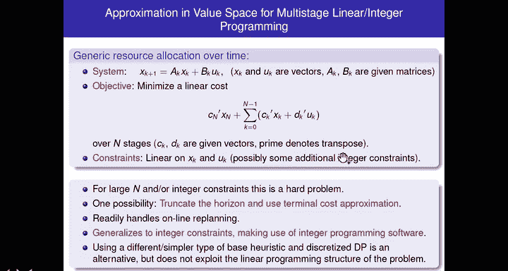

Okay， let's go into our last topic and it has to do with stochastic programming。嗯。

This a classical problem that I remember was a hot topic when I was a graduate student。And that。

It was at that time， it was。It was。It had received attention in the two stage case。And it was a。

The kind of stochastic， sequential decision making problem。

That people would formulate because dynamic programming was too difficult。

 so people were looking for alternatives to dynamic programming we're talking about the 60s 60s and 70s。

And this two stage problem involves two decisions。Initially， I select one decision U zero。

Then something random occurs W say iss an disturbance here that takes a finite number of edge with given probabilities。

And gives different outcomes， of course。And then you get a chance to apply a second decision after you after you get to know the value of W。

So control， observe a W that has occurred in control again， two decisions， two stages。And。

After the first control is chosen， the W occurs。嗯。And takes one of M values with given probabilities。

 Okay， this is part not given in the problem。And once w occurs， then we will know its value。

 and then we can choose a vector that depends on what we have applied first and what we have observed。

So it is a policy basically for the second stage， the state here is the the state。

Here is the pair of control。And。Disturbance。And here there are four of them。

In one of them in the beginning。So there are five variables for optimization here。

And we want to minimize expected the cost function。The cost of the first stage C is0。

And then we expected value of the cost of the second stage， right？

Here are the Ws with their probabilities， corresponding probabilities weighted this is the expected cost of the second stage。

So we can write down directly the expected cost in terms of the values u0 and the u1。

 the four values u1 and this becomes。A problem that you can try to optimize using nonlinear programming or linear programming something like that。

What's the difficulty with this formulation？Well。If you have a large number of。Of Ws。

Then the number of views that you have to consider here is also correspondingly large， okay？And。诶。

And then if you had three stages， you could repeat this figure， right？And then。The number of。

Possibilities for the third stage would grow exponentially。 and as you consider more and more stages。

 the number of variables。You。Increases to the point where this minimization becomes very difficult。

So that was the state of the art for a long time and still is in stochastic programming。

Two stage stochastic programming problems。Are solvable， but once you go to three， four， five。

 and so one， you eventually hit a wall very quickly and you can't solve them。

So that brings into play a reinforcement learning， which。Can deal with large dimensionment。

Are there any questions here？Incidentally， there are many。

 many problems in the literature that gen practical problems that people have formulated and cast in this form。

 one of them is。Production planning is a general class of problems where U zero is to decide on the production of resources that you are going to allocate to a certain project。

W is the demand for the product that you're going to to to。

That the demand for the product that's going to occur sometime after you。

 you set up the production facility。And then the use in the second stage are the amounts of a product that you're going to allocate for satisfying the demand。

 so if you don't produce enough here， then there's going to be some deficit the demand turns out to be high and there's going to be a penalty associated with that and so on。

 I don't want to go into details but that's one example and many other examples of the same tight。

And you can look at books with stochastic programming to see the range of applications of problems here。

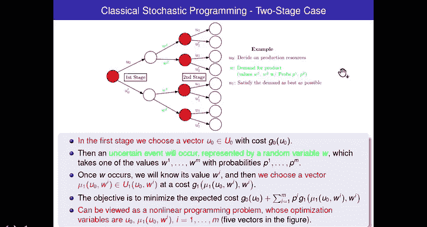

Okay。So in multi stage stochastic programming。The decision is a function of the history after to that point。

And we can use。A similar formulation is for the two stage case。

 but the exact solution by dynamic programming or nonlinear programming gets rapidly out of hand as the number of stages increases because the number of variables。

 the number of states that you get after a number of stages increases exponentially and therefore the number of variables that you have to consider in a given stage also increases exponentially with the number of stages。

So here's how we can address the problem alternatively by reinforcement learning。

We can view it as a special case of finite H， stochastic optimal control。Therefore。

 approximation in value space applies。Then rollout with or without Transation applies。

And one possibility for base heuristic would be。Two stage stochastic programming。

Use a two stage stochastic programming with some terminal cost approximation as the base heuristic。

And this base heuristic is an optimization based heuristic。

 but it is of shorter horizon than the full horizon of the multistage stochastic programming problem。

Moreover， certain equience approximations can be very useful in stochastic programming context。嗯。

The first W is stochastic， subsequent disturbances are fixed at nominal values。And that。

Cuts down the number of controls that you have to consider。And it makes the computations much easier。

嗯。Or you could consider alternatively instead of certain equivalent some form of limited simulation。

Whereby you simplify the probable distribution of W。To a fewer possible values。

 which reduces the number of。Next day of states that you can encounter in the future。

So all of this stuff that we have been considering in other contexts can be to a greater or lesser extent be applied to multi stage stochastic programming。

With。With good chance of success。嗯。Your textbook has some references of applications of this type and you may consult them if you want to see more details and get more to。

So this is the end of this lecture， are there any questions？Okay。We're coming into the spring break。

After the spring break， the next lecture， at least by our present planning。

 is to talk about stochastic estimation， vision optimization。

Adaptive control and application to the word puzzle。There is a lecture。

 I think is lecture9 or lecture1 in think lecture  nine。In last year's offering， and you can。

Look at the slides in the video from that lecture。This material also is in sections 210 and 211。

Or your textbook。Okay， here's the video lecture  nine。And the other thing I wanted to mention。

I to remind you that a proposal for your term paper or a summary proposal。

For your term paper will be due at the end of the spring break。And then。In some sense。

 we're moving into a different phase of the course where the focus is going to be not on homework or new material。

 but rather your projects， I expect you also to be involved with that and focus on that to do an interesting and project that perhaps can interface with your calendar research if you're doing research at the moment or looking for the research topics。

We want very much to help you if you need some ideas。You should generate the ideas yourselves。

 don't expect us to give you a project， okay， on the other hand。

 if you need some advice on how to go about your chosen area of concentration we'll be very happy to do that all of us。

So。I wish you rest and have a good spring break。

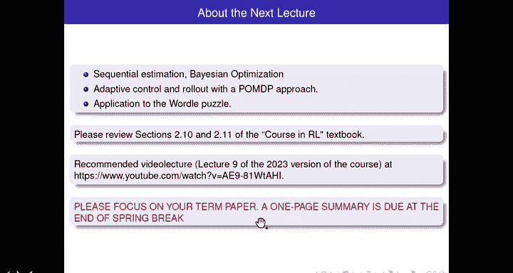