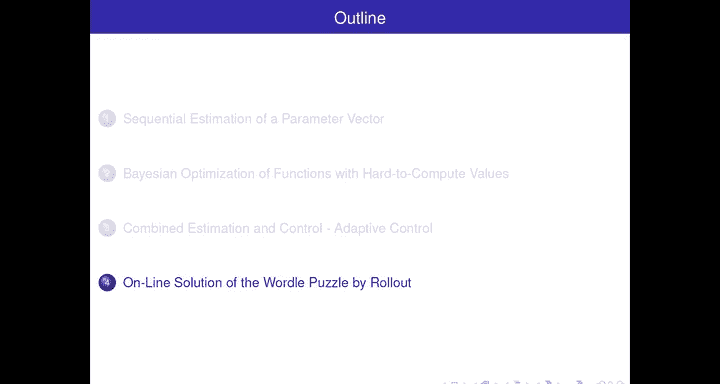
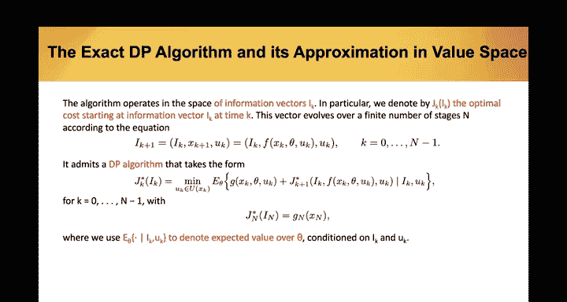
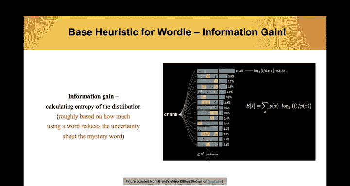
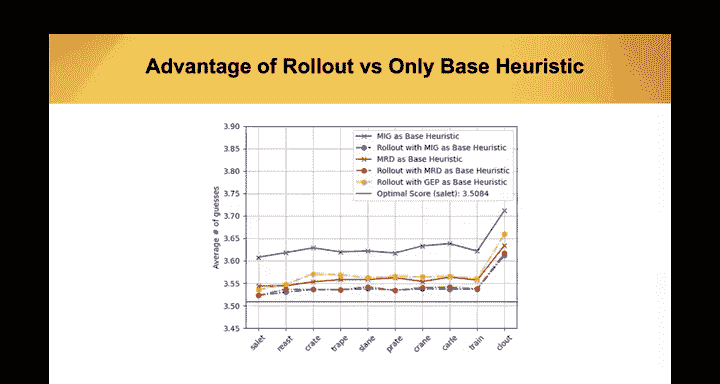
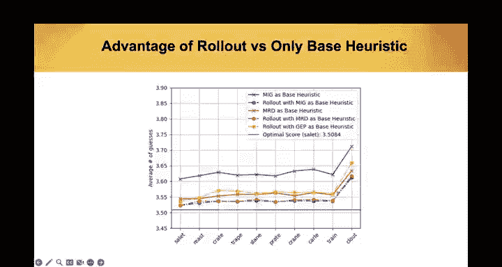
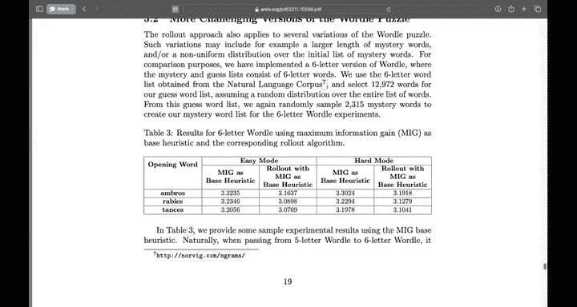

# ASU《强化学习2022-2024｜cse 691 Reinforcement Learning Course at ASU》中英字幕（deepseek - P9：[02]Lecture 9, 2024, Bayesian optimization and adaptive control - GPT中英字幕课程资源 - BV1zcfVYdErD

Okay guys let's get started I hope you guys had a restful spring break we're still going through your proposals but we will return some of the feedback if applicable so welcome back to topics and reinforcement learning this is lecture nine in this lecture we're going to focus on combined estimation and control and particularly we're going to look at sequential estimation as a general framework and then a special case called Bayesian optimization and then we're also going to look at adaptive control and all of these have a PoDP approach so that's going to be the first part of the lecture and then the second part of the lecture will have a guest speaker。

So。First， we're going to look at in general sequential estimation of a parameter vector and discuss why you might want to do this anda。

Then we're going to look at a special case called Bayesian optimization of black box functions with hard to compute values。

Then we're going to look at a more challenging set of sequential estimation problems that involve applying controls as well as estimating the state。

Then we're going to take a break and then we're going to look at an application of combined estimation and control in the form of the Worddle puzzle addressing it with rollout。

 and today we have one of the authors of the Wordtle paper Saant Bambbury who's going to give a much more detailed presentation on the particulars of that project。

 I will give a slide that applies the concept concepts that we've covered in lecture today and show how it relates to the Wordordle project。

Okay， so let's get started。So the scenario that we're considering today involves a system with an unknown parameter theta。

 theta is a random vector with some known distribution。And through the use of costly observations。

 we're trying to estimate the parameter vector theta。

And the number and type of observations are subject to choice。

 there may be multiple types of observations if you have multiple sensing types。

 they may each have associated costs with them and fundamentally we're looking at a decision problem of how to and whether to apply observation controls。

So the outcomes of these observations are obtained and evaluated online with a view towards stopping or modifying the observation process。

 so in this diagram above here we have our system， it has this unknown parameter theta。

 we obtain an observation outcome， and then online we consider whether we want to make further observations at some cost and also what type of observations we would like to make。

 if we choose to make an observation at all。And this process continues。

 we select an observation type and we keep observing the outcome until we ultimately decide to stop either because we've run out of a computational budget or we may have some other stopping criteria。

And then once we've stopped， the estimate that we have of theta is the final one that we're going to use。

So fundamentally， this involves sequential decision making。

 thus bringing dynamic programming to bear。And as a bit of motivation。

 I'll give you an example from the world of industrial engineering and in particular quality control via hypothesis testing。

 suppose you have like a production run of some product。

 and you want to test using sampling of observations to see whether the product run is good or not。

 you might have two hypothesises hyposes， one that says this production run is acceptable and the other hypothesis might be this production run is not acceptable。

And we want to accept one of these hypotheses， so we obtain an observation via a batch of some of the production run。

And。One algorithm is called the sequential probability ratio test that dates back to the 1940s that's based on dynamic programming。

 and it states that after a particular observation， we update the posterior distribution。

 posterior distribution of the probability of whether we meet hypothesis A or hypothesis B。

 and if one of those probabilities gets large enough up to some threshold， we accept that hypothesis。

 and that's the algorithm。So that's just one example from the world of control。

 let's look at some other applications or sorry from the world of industrial engineering。

 so let's look at some other applications， it applies to classical and sequential experiment design problems or sequential sampling strategies and statistics like the example before you may have more than just two hypotheses so it can apply to these kinds of scenarios as well。

And also to the design of clinical trials or tests for medical diagnosisosis。

It applies to classical sequential search problems such as search and rescue， you might have a field。

 and you want to search locations in this field to find people that need rescuing and each search comes or each observation comes at some cost。

There's also route planning through sensor networks。

 so sensor networks involve the deployment of sensors in some field。

 they are linked up via communication network and be their information can be relayed to some base station and activating each sensor comes at some cost。

And the idea is that you want to find a sequence of sensor activations that's going to lead you to obtain the information you need to suit whatever purpose you have at hand。

There's also sequential decoding problems such as the mastermind and wordle puzzles。

 which we're going to talk about later today。And then another special case of a sequential estimation is the。

Estimation of surrogate functions via Bayesian optimization。

 And I'll explain what a surrogate function is， but this is used for minimizing black black box functions。

 and we're going to spend a lot of time discussing this。呃。

There's an important distinction I want to highlight that is does the current choice of observation affect the availability。

 the quality or the cost of future observations so does using once can I use a sensor only a limited number of times or does it using a sensor degrade the quality of the reading？

This is the question at hand here。If the answer is no。

 then we call these simple sequential estimation problems。

And we're going to discuss these first in the context of basing optimization。If the answer is yes。

 then this can be viewed as a combined estimation and control problem。

And can be viewed within the context of adaptive control。

If you remember adaptive control is this is a problem setting where the parameters of your problem may change over time。

 and the strategy that we discussed was to make some estimation of what the parameters are and then apply a control as if they were true for the whole problem。

So for this one， we need a more。Priinciipal dynamic programming approach that's where it's not going to matter what what。

Or whether this is true， whether we have。The cost of future yeah whether the cost of future observations is affected by our current observations。

 so this yes part we're going to discuss towards the end of the course before the world presentation and now we're going to focus on Bayesian optimization for these surrogate functions。

Okay， so Bayesian optimization。So。A black box function， you've probably heard of it。

 is a function where there is no known analytical form。

And evaluating the values of this function may be difficult in practice。

 So the strategy here will be to use what's called a surrogate function。

 We generate a different function that is going to approximate the unknown black box function。

 and then we minimize the surrogate function。So we minimize approximately a function whose values at given points are obtained only through time consuming calculation。

 simulation or experimentation， we're assuming that the observations cost a lot to do。

So this is a similar figure to what we had a couple slides ago。

 we introduced this parametric model of the cost function with parameter theta。

 yeah so here's the unknown function has an unknown parameter theta with a known initial distribution。

 and we observe sequentially the true cost of the function at a few observation points。

 not very many。Then we construct a model of the cost function， which we call the surrogate。

By estimating theta。We then minimize the surrogate to obtain a suboptimal solution。

So a question here is how can we select observation points based on the results of previous observation。

 how can we select future points that are going to suit our purposes the best because they're costly。

 we can't do too many of them。This brings up the topic again of the exploration versus exploitation tradeoff。

 which we saw previously in the context of Monte Carlo research。

 where observing at points likely to have the question is。

 do we want to observe points that are likely to have near optimal values， for example。

 where the mean of the function is low？Or do we want to observe points in relatively unexplored areas of the search space where the variance is still high？

So that's the question。I'll stop up for questions， you guys have any questions yet。

choice of observation， but actually of control and feedback the we are going to view the choice of observation as a type as a control in the context that we're going to look at today。

Okay。So here's some example of surgate optimization， there's this geostatistical interpolation。

 this is the classic example of this and involves the context of gold mining。

And there's a practice called Krieing， which was pioneered by the South African engineers。

 Maeron and Kriga。And they were trying to identify locations of high gold distribution based on samples from a few borehole。

 so drilling is a really expensive process it requires time and labor and it adds a lot of wear to the drill head。

 which is often made of expensive materials。So this is the sort of inspiration for this problem。

It's also another application is in design optimization， if you have some application。

 you may make a few prototypes of products that can address this application such as in aerodynamics or material design or drug development。

And a prototype may be costly to build， and so you don't want to build too many of them。

Another more relevant example is in hyperparameter selection of machine learning models such as things like learning rate or a number of parameters or number of layers in a model and this has been done in particular in the architectural parameters of the deep neural networks used in alpha zero so this。

Method has been used for that specifically。Okay。So let's make the Bayesian optimization stuff a bit more formal。

 so we're going to introduce this M dimensional parameter vector in ourM。And theta u is or sorry。

 theta is basically going to represent the function F。

But the domain of our surrogate function is going to be made discrete。

 so for an index u theta u is going to represent the output of the function F of U。

 So we're going to restrict our domain to a finite set and the vector theta is going to represent the outputs of the function F。

And the index will correspond to the input， so theta is F。Then。Our observations are of this form。

 z equals the actual output of function F， which we will observe directly。

 plus some noise and an important special case that we're going to look at today is the case where there is no noise。

 in other words where we can observe the function output directly via an observation。

Then we estimate theta with n noisy measurements chosen at different points， U1 to Un。And ideally。

 we want big N to be much， much less than n because the observations are expensive。So we assume。

That theta has a given a priori distribution， B0， which is this m dimensional vector of random variables。

 each with some known initial distribution。And。Ideally。

 the values of F at neighboring points should be correlated。

 meaning if you have two say consecutive random variables。

 those random variables should be correlated， so close in other words close together inputs should yield close together outputs for the function F。

Deciding on this initial distribution is a bit of an art。

 but ideally you would have one where points that are far away from each other have a diminishing correlation。

Okay。So then here's sort of an inductive description of what's happening。

After observations at points U1 through UK of this form， we choose the next point UK plus1。

To observe the value of F。Then we update the posterior distribution。

BK using some estimator function so Bk is like like a state estimator function。

 it can be computed or can be given using online simulation， or it could be a particle filter。

 a common filter， some kind of state estimator function， and it takes as input。

 the current posterior distribution at time K， the next observation UK plus1， and then Z UK plus1。

 which is the outcome of that observation。And then it produces a new posterior distribution。

 BK plus one。So then BK is essentially the surrogate cost function after the ca observation。

 so the more observations we do and you'll see this graphically。

 the more closer our surrogate function is going to approximate the unknown black box function。Yes。诶。

So as you probably have seen in like a introductory graduate level machine learning course。

 if you've looked at like Bayesian decision theory。

 if you assume that your random variables follow a Gaussian distribution。

 you can often get really nice closed forms and so that is the case here。

 so if B0 and the noises W or Gaussian BK can be updated using out closed form。

 using this Gaussian processor using Gaussian processor regressiongion formulas。

Are there any questions about this slide？Hopefully it's clear。O。All right。

So here is an illustration of the true cost function F and its surrogate。

So this black line here represents the true cost function F。

And then this purple range here represents the surrogate cost function。

Which you remember is just a distribution of points， okay？

So this is what it looks like after seven noise free observations。

 the middle line of this purple distribution represents the mean。

 and then these boundaries represent the standard deviation or the confidence intervals around the mean of the current distribution。

And the seven noise-free observations that we made。

 they show us the exact output of the function because they're noisefr， so at these points，1，2，3，4，5。

6，7， the variance collapses at this point because there's no noise and we get the true output of the function and the idea will be is as we keep doing this。

 this purple distribution will start forming itself around this black curve。Okay。So okay。

 so now we're going to discuss myopthic Baysian optimization。

 this is the technique that's been most widely seen in the literature。

And then we're going to look at alternatives as well。

So the key question is how do we sequentially select the observation point UK plus1。

 given the current observation results C1 to ZU from the previously selected points U1 to UK。

So here's a dynamic programming view。You can frame this as a partially observable markup decision process。

 so in this kind of model the posterior distribution BK。

 given the observations up to time K is the belief state。UK is the control。

And the belief estimator function is this big B of k， this represents the system equation。

And the cost function is based on the cost of observations and the quality of the surrogate obtained at the end。

 so there are some immediate costs that are based on what the cost of the observation。

 and then there's another cost function that evaluates the full surrogate function at the end and decides whether it's a good surrogate function or not。

But the dominant method used in practice is the greedy or myopic policy。

 which is based on this thing called an acquisition function。

So the acquisition function looks like this， it's denoted as big A of K。

 and it takes in the current posterior distribution and a new observation。

And it is a measure of the heuristic benefit for selecting a point UK plus one when the belief state is Bk。

And then， okay， so it's a greedy heuristic。And then the myopic policy will be to select the observation point that corresponds to the a max over all of the different evaluations of the acquisition function。

So we pick the next observation point according to the maximum acquisition。

An alternative method would be to use rollout using a myopic based policy。

 so we'll discuss this a little more later， but this has been advocated and done already in several research work since 2016 with promising results although still more testing is required so this is sort of a fertile frontier of research if you're interested。

Okay， does anyone have any questions about what's on this slide？Okay。All right。

 so let me give you some examples of acquisition functions for the myopic baesian optimization。

 so again， the myopic policy tries to maximize over AK each of the controls。

And here is a common example of an acquisition function。This is called the upper confidenced Bo。

 and this acquisition function is the sum of two terms， TKBKU and RKBKU。

 where RK is weighted by this parameter beta。So this Tk function。Is the negative mean of F of U？😡。

And the RK function is the standard deviation of F of U both under the posterior distribution BK。

So TK can be viewed as an exploitation index， so remember we're trying to minimize the surrogate function。

 so we're trying to look for points where the mean is low。

And since we're trying to maximize this acquisition function。

 taking this negation will mean that points with a low mean are more favorable in this maximization。

So this can be viewed as an exploitation index。On the other hand。

 this RK value or this RK function can be used in an exploration index。

 areas with high variance are more attractive with in this maximization for RK。

But there is this beta， which is like an exploration parameter that tells you how much you want to favor exploration versus exploitation。

Okay， here's another example of an acquisition function this one's called the expected improvement function。

 so it is the expected value of the reduction of F of U relative to the minimum value of F obtained up to time K so in other words where can we get the most improvement over our best results so far that's essentially what it means。

Okay， are there any questions about these acquisition functions before we move on？Okay。Okay。

 we're going to look at an example of this Bayesian optimization process。

 but I have a bit of a curve ball for you， it turns out in the literature。

They view surrogate function optimization as more of a maxim problem because they're thinking about benefit so far we've framed it in terms of costs that we're trying to minimize。

 but we had trouble finding examples of ones that were trying to minimize the surrogate function so we're going to switch it on you and now we're trying to maximize the surrogate function。

So this is an example from the Bayesian optimization article in Wikipedia。Again。

 this true function is given in black and the posterior distribution is given by this purple distribution here and all observations are noise free。

Okay， so here is what the surrogate function looks like after six observations。At this point。

 what we want to do is evaluate our。Acquisition function at each point and then choose the point corresponding to the maximum。

So here I have the expected improvement acquisition function and also the upper confidence Bo。

We have the upper confidence bound displayed it on the slide。

 but we're actually going to just use the expected improvement one。

For actually choosing the next point that we'll observe and let me just back up a little bit since we're trying to maximize the surrogate function。

 this definition is slightly different so the expected improvement function now means it's the expected value of the increase in F of U relative to the maximum value of F obtained up to time K。

Sorry for the confusion， does that make sense？Okay。All right， so let's go back to our example。Okay。

 so here we are after six observations。And then I evaluate my acquisition function。And I see that。

 okay， so here are the maximum points we found so far。

 So according to the posterior distribution that we know。

The acquisition function tells us that this is the point where we can expect to see most improvement。

Now you might ask， why wouldn't this be the point where we would expect to see most improvement？

But it's true we might see more improvement there we probably would。

 but remember the function F is not known， so the acquisition function is only a function of the current posterior distribution。

 and so this is the information that it has available to it。So okay， so after six observations。

 the maximum of the acquisition function tells us to go here in the case of the upper confidence bound it happens to be the same point。

 so we add this new noisefree observation and we see the exact value of F of U at this point and so our distribution then gets updated。

And the variance around this point sort of collapses。

 and we have a pretty good estimation of what the function F of U looks like around this area of the plot。

Okay， so let's do this again。So here we are after seven observations。

 we evaluate the acquisition function again。These are the maximum points here。

 and the acquisition function tells me that the expected area of most improvement is around this point here。

So we make the observation at that point and then we update the distribution again and the shape of this purple distribution changes shape once more due to the update。

 and now we have eight observations。Let's look at another。So here。

 the acquisition function tells us to choose this point。

So around here is where we expect to see the most improvement because around here。

 the variance is sort of shrunk。So then after nine observations。

 so here's the new point what you're starting to see is that this part of the。

Of our estimated function is starting to very closely match the true function， not so much over here。

 it's quite different， but it's starting to really conform to this。So let's do it one more time。

 the expected improvement acquisition function tells us to choose this point here which makes sense and after 10 observations。

 this is what the distribution looks like。So that's the end of this example。

 do you guys have any questions about this or anything I've said？嗯。这可以。Yeah。

So it depends on the belief the state estimator function。

 i'm not too sure why the variance has increased here。

I'm not sure what the initial distribution is or anything like that。

But the changes in the distribution are not necessarily local like to the area around the point。Okay。

Okay so now okay so that was the myopic Bayesian optimization now we can look at a more maybe principled approach this is the dynamic programming algorithm for the palmm DP formulation of Bayesian optimization so add of belief state BK。

 the optimal cost so this is the usual Belman equation。

 we minimize over the set of controls and we have the costs。

 the immediate cost of taking observation UK plus1。

 and we add the expected cost to go where the next state is given by the the next belief state is given by the estimator function big BFK and this is all given the current distribution posterior distribution BK and the selected control。

So C， the little C is the cost function for the observation。Then at the end of this。

 we have a terminal cost function， which is this big G， which looks at the full completed surrogate。

And it measures the quality of the surrogate obtained at the end。

 so it may favor surrogate functions that have small means for their minima or surrogate functions that have low variance。

 those might be good criteria。So once we obtain these terminal costs。

 the exact dynamic programming algorithm will tell us to work backwards towards the current stage BK。

Okay， so clearly this is。Intractable for practical purposes。

 so we can use an approximation and value space approach。

 so as usual we replace JK plus1 star with JK plus1 tilde and we couldn't we choose the observation point corresponding to the minimum approximate Q factor。

 given the current posterior distribution and a new observation。

So here is the approximate Q factor calculation， it's just the same thing as the interior here except for we've replaced J star JK+1 star with JK+1 tilde。

And so this is the usual approximation and value space approach that we've looked at time and again。

A specific case is rollout。So we could use as JK plus1 tilde。

The cost function of the myopic base heuristic based on the acquisition function。

 so we use the acquisition function as a way to simulate future controls。And we perform rollout。

So this was first proposed by Lamb Wilcox and Wopert in 2016 and followed up on by others with very promising results。

 but least still require more testing。Okay， so that's the Po DP formulation for Bayesian optimization。

Okay so here's a diagram so this is the same diagram you've seen before。

 so at the current posterior distribution we consider all possible observations we can make to obtain all possible posteriorors BK plus one so this layer is stochastics so this is a substantial tree and then at each of the next possible posterior distributions we run rollout for a base policy using the acquisition function and this may be a truncated horizon I think in practice people have truncated it after four or final observations but in principle you could do more。

And we choose the minimum Q foot as usual。Okay。All right。

 so that was baing optimization now we're going to move on to a more challenging set of sequential estimation problems that add controls in the context of adaptive control。

Okay， so here we've made some simplifications， but there are extensions to what I'm about to show you or generalizations to what I'm about to show you。

 but here we have a deterministic system。Which is given by this function F。

 which takes in a state Xk， a parameter vector theta and a control UK。

 and it gives a new state xk plus1。Now， the unknown parameter theta。

Has the space that this vector exists in has been discretized to impossible vector values。

 so there's impossible vectors that theta can be in this formulation。So then， okay。

 so Xk can be observeded directly。On the other hand， Theta cannot。

So we view theta as a part of this augmented state， X K theta。

 and this state is partially observed because theta is partially observed。

And then the bellman equation for the optimal cost function J starK is given by this expression。

 let me describe to you some of the terms down here first before we go through the expression or the equation。

So IK is called an information state， so this is one of the ways that you can formulate your PM DP。

 it contains the history of states and controls visited so far。

And BKI is the distribution over theta conditioned upon the current information state。

 so BKI is the probability that theta obtains is holding a particular value theta I given the information state I I of K。

 and we have this distribution defined for all I and1 to M。 so this is the belief state。

So now the optimal cost of an information state is given by the usual immediate cost of the observed state or sorry。

 the immediate cost plus the cost to go。Where the cost to go is dependent on the information。

 the current information state， and in this function F extends the information state by one more state and control。

And this is all weighted by BKI and then summed， so this is the expected value expanded here for you。

Okay， so again， this is generally intractable。So we can use an approximation and value space approach。

 we use this approximation J I Tilde。Of X， K， theta I UK。 So in these approximations。

 we're going to ignore the information state。And we have a function J I for every fixed value for theta。

Okay， so we use this in place of JK plus1 star， and we minimize over UKop to obtain a one step look ahead policy。

So here are two examples for JI Tilda。Well， if theta I or if theta is fixed to a theta I。

 then this problem becomes fully deterministic， at least in the future。

 and you may be able to compute the optimal policy according to theta I because you've removed all the stochasticity from the future steps of the problem。

Another example。Is to make J I Tilde the cost function of a known base policy that again assumes that theta is fixed to a value Theta I。

So this is the case where computing this optimal policy is still not feasible for you to do。

 you can estimate it using a base policy that assumes that the value of theta is fixed。

So this is a rollout。Are there any questions about this slide？assuming。So。

LetLet me show you the next slide and hopefully it'll become clear and then you can stop me if I still haven't addressed your question okay。

Okay， so here's an example for rollout for adaptive control for a po DP formulation。

 so this is almost the usual diagram that we see so at the current state XK。

We consider all possible controls， in this case there's only two， for example。

And then from each of these controls。We consider all possible values for theta I， so in this example。

 we assume that theta I can take on one of two values。So at this， okay。

 so we say we select this control UK， and now I consider theta1。

 the value for we'll assume that theta is fixed at value theta 1。At this state this next state here。

 we simulate the base policy to the end of the horizon using some base policy， say pi 1。

And we do the same thing for this fixed control UK。We consider the other possible value of theta。

 and we do the same thing， maybe with another base policy pi2。

And then once we've computed both of these， we take the average and then that becomes the value of the Q factor。

 so that's what this says down here。So at Xk， we minimize Q hat k。

 which is the average Q factor Q of U， which is defined like this。

 so we look at all possible values of theta I， we compute the Q factor assuming that value is fixed。

 and then we use the belief state distribution to compute a weighted average。Okay， yep， okay。

 so and then this is the Q factor computed assuming that okay， so I explain that。Oh yeah。

 okay so the yeah， and this is the value of the Q factor again。

 has the immediate cost plus the cost to go simulating with policy pi I。

So it turns out that if pi I is the same for each one of these， so they all use the same base policy。

Then you can prove cost improvement properties and there's some details of that in your text but did that answer your question great？

Okay， are there any other questions？Data is the and youre nursing the Catholic。Yes。

 but I also assumed that all of the possible values was a finite set。

So we assumed that theta could take on one of M values。Okay yeah。

 so the vector space here is the street。Any other questions？ok 我。Going pretty fast。Okay， so。

Let's take a break here and then I have one more slide that's going to connect the Ortle project to what we've discussed so far。

And then I'm going to let Siant take over the rest of the lecture。Are there any other questions？

We're going pretty fast， so okay， well， I'll see you at 531。Okay guys， let's start this。Okay。

 so now we're getting into the final part of the lecture where we'll look at the online solution of the Wordle puzzle by rollout。

 but let me first connect this to what we've discussed so far today。

Okay， so。This is a paper called the Roout App for solvinglving On the Wle puzzlele。

 and this has worked from a couple of years ago with authors Sidant Bambriri and Amriita Batarji。

 so Saant is here today to discuss it， but let me just give you a quick overview。

So there is a hidden mystery or code word theta that is drawn from an initial mystery list。

 according to a known distribution。So in the standard version of the puzzle。

 this distribution is uniform。Then the mystery list shrinks as a result of guesses and observations。

The guesses are chosen based on feedback about the mystery word provided by the preceding guests。

Then the puzzle is solved when the mysteryless shrinks to just a single element。

So we want to minimize the expected number of guesses to solve the puzzle。

So here's an important fact， the belief distribution over the current mystery list remains uniform throughout the solution process。

And this makes it possible to solve using exact DP， the optimal solution。

 but it requires days of computation and this was done by Selby in 2022。

Important to note is that without this uniform initial belief distribution assumption。

 and if you make small changes to the problem structure。

 such as adding a letter to the word or anything else you could think of。

 computing an exact solution would be impossible in our lifetimes。However。

 and this is the conclusion of the paper rollout can solve near optimally the puzzle。

And its variations online in a matter of seconds， instead of days。

So I will let Siant go over all the details are there any other questions about。This lecture so far。

Before I hand it off。All right。Hello， everyone。So first of all， I'll like to begin by thanking Dr。

 Butses for allowing me to present this work once again in this course and thanks to Jamieon for setting up the stage for a lot of slides that I would be referencing what he already talked about and trying to connect it with the game of Vdle that some of you would have already played back when it became popular during the pandemic times and my motivation here would be to draw insights via the game and talk about how rollout or the online role or algorithm it can be a very useful technique for deterministic Pod did the Vdle case in point。

I'd like to begin by some introductions hi I' Saan Bare， I'm a fourth year PhD student in Dr。

 Subaralka Emmpathy's lab， my co-author， Amta who is also a fourth year PhD student in Dr。

 Juan Liu's lab and she would like to extend her apologies for not being able to be present be present today as due to a Friday deadline and Dr。

 Beses who guided us through this work。

So what is the wordle puzzle just for a brief introduction。

 you are given six trials to guess a five letter word and there is an easy mode and there is a hard mode of the game。

 but before that for the rules of the game， you start by guessing a word。

 the simulator or the New York Times on which we have played this game mostly。

would tell you if the alphabet is in the correct position and also like the correct alphabet and in the correct position it will give you a green observation such as the example for the hard mode where I played the word cars is correct however if the alphabet is correct but not in the correct position it will be yellow or otherwise gray。

The only distinction here between the easy mode and the hard mode is that in the easy mode there is absolutely no restriction on what file letter word you can play given your guesses you can try to come up with the final answer that you think would be the final answer for the hard mode。

The idea here is that if， for example， in this case you have guess the word cars。

 E has shown to be green， you have to come up with the second guess where the fifth alphabet is E。

So that restricts the number of possible words or guess words that you can use at the second step and we moved on with globe and final word with L and L in the second。

Position and E in the fifth position would get restricted to probably just olive among the different five lit words as far as I remember correctly。

The state of this game， at least how the original game is defined by New York Banks。First of all。

 New York anxious frosts again the game is originally by somebody else。There's 2，315 words。

 which could be the possible answer。The actions here is a much broader list of five letter words。

 all possible five letter words as per web dictionary， 12 about 13，000 words。

The transition here is essentially what you can think of as the probability of going from one mystery word list to the next。

Which essentially would mean that if I guessed stern。

What is the probability that basically the number of words that would have ENR in this position and PNN and I can out of which I will choose one of those。

 so that will essentially define your transition probability and the cost is a very simple term here。

 one guess equates to just one unit of cost that we are taking。

Observations are what we are getting from the game itself。So using dynamic programming。

 the optimal solution， as Jamesson pointed out， can be computed over days of computation。

The reason for that is this enormous take space because put you could have any of the words out of those 20003 that could be the right answer。

 and you need to have the optimal value function， which is hard to compute in this case。

And the solution， as you have been seeing this figure on and on。

 is how rollout helps us to approximate that optimal value function。

Before I go on to how the rollout would work， which was pretty much already explained。

 but at least in the case of Hle。I'll just take a step back。

 look at the way how we approached this problem and this。

Vion these slides have been adopted from the longer version of this word。

 which can be found in our key。So we had the state X and the action Control UK I'll come to these in a minute of what these mean in the context order。

Theta was the unknown system parameters that could take any of the values from1 to M and the state Xk could be computed。

 so again we are dealing with the problem a partially observable problem where the augmented state space consists of Xk and theta xk is perfectly observable theta can only indirectly inform us about the current state Xk。

And information vector， which is the controls at the list of states and the controls up step8。

And you can always compute the conditional probabilities， which we are calling as BKI。

 given the information vector。So。The cost function again will refer to SG and we wish to choose the control which minimizes this cost in this case。

And the equation with the estimator Bk tells us what the next belief distribution would be。

Now there are different ways that there are different examples that you can use for here。

 one of them could be the Montegalo estimation in this simple in the case of Hdle。

Since it is a uniform distribution that out of those 00 2315 words。

 any of the words could be the answer。It is assumed that I'll take a uniform distribution。

Once maybe after a certain step， I know that only my answer exists in 100 possible words。

 then my uniform distribution is over those 100 words。

 so that's how we'll at least we can get away with using an estimator in this case。

So the mystery word or the answer that we are looking for is the the in this case。

And the set of the mystery words at any possible stage of the game K。Will form a mystery list。

 the initial distribution as I mentioned， will uniform over all the words that could be the possible answer。

 and this obs the need for this estimator capital。And。That's it so we had the information vector。

The optimal way to compute this using traditional dynamic programming method would be to use the optimal cost function jam is important how this would depend on the information method。

 but this is an impactable problem in that case， given how the state space can be enormous。

So how does rollout？Utilize this is by approximating this cross function J。呃。And in that case。

 since again， we assume that theater is fixed at any given stage。

So we can assume and get little of the information with so this optimal bus function can get approximate by the。

And this is what we will be using， at least for the case of Hdle as well。

And a reminder that that JTilder will essentially correspond to our bases。

So connecting it back to the game， at least how it is solve， what is the base policy here？

Most of you won' be aware of three Blue One Brown's YouTube channel。Predit where it's due。

 he was one of the first people who tried solving the game。

 explained it through amazing visuals as always， and what he used as a power base policy or is that's what we are calling it here is maximum information game。

So maximum information gain。Can be thought of in terms of。Reducing the entropy。

 which one way to define it is that if I have an distribution over what my possible answers are。

If I take a step by taking a guess word， say cars that I had used in the example。

Did my mystery list reduce？And that is an intuitive way to think that the word that reduces my possible options of the answer the most will be the word that I'm using or that will give me the maximum information at every step so I can use this as a base policy it doesn't have to consider any of the other possible actions that need to be taken at every step I can just utilize this。

So how the algorithm would proceed， I'll just stop here if there are any questions I'll be happy to answer so far。

Okay， I let's come back。So we'll start with an empty list of Q factors。

 which are essentially going to tell us how the key factors of taking of a guessword。

At any states okay。So for all possible mystery words。

 we are going to perform the roadout given action given us starting a state XK and a controlled UK。

And。Well select our basicistic cost function as edge。

 which is our maximum information gain and we'll compute till assuming that。

Every mystery word is the answer， compute till the end， apply the rollout。

 calculate the Q factor and average it across all possible answers that that could be validd。

The average cost for taking that particular action。

And then we just apply the control to the game so that we can take the next section to move on to the next step。

Any questions so far on the algorithm number， please before I move on to the results。ok。嗯。

I'll help you interpret the large set of numbers on the slide so we used three heuristics at least for this work to compare and the idea is not to compare and I'll show you the plot in a minute but the idea is not to compare the different heuristics。

 but at least what advantage。Having a base policy heuristic can give us utilize with the rollout approach instead of solving the optimal value function。

So thanks to Alex Elby who gave us the optimal scores we could compare and we started with the baseline。

 which is just using the baseline heuristic using maximum information gain。

 what is the average number of steps starting from this word that we can solve all 2，315 words？

So the best word at least through optimal scores has been this word salary。

And I still find it hard to remember what it means， but that's okay。

So if you just use the basicistic， we'll have the average scores that we get using the starting word and we compared with the top top 10 words that have been。

Found by using various characteristicsistic in the literature。

So we wanted to see if the results are consistent over different starting wordss and the results are not dependent on what word we are starting。

There is a significant improvement from the PAU district and optimal scores obviously since this is a suboptimal approach it'll give you a subopimmal solution。

 but the scores come very close to the optimal scores in both the easy and the hard mode。

A good way to interpret it is this plot。So as I mentioned that we use three heuristics。

 one was the maximum information gave that treatment and there were two other。

Hereuristics in the paper that you can see each color represents the blue color represents the maximum information gain。

 right it represents another yellow yellow represents the third。啊。

And I tell you why the line is not that because it goes over 3。9。

 which is the y axis label here y axis maximum value。

So the idea here is that the optimal score using the word value。

 which is the minimum across all possible starting wordss is 3。5084 comes close to about 0。

04% of the optimal score。And one interesting observation is the better the base hereistic has been。

 the better the rollout approach that basicistic has given us。And that trend is similar across。

The rollout for maximum information gain is better than the base heuristic。

 same for the blue heuristic and same for theuristic， which performs the worst。

 and the average is an over4 average number of gases are more than forward at least in that case。

So some limitations of rollout that we tailized while working and applying it to this a problem。

 the reason finding a reasonable base policy， we were lucky maximum information gain has been shown and there were a lot of other efforts in parallel going on at that time that were using different different heuristics based on。

Some of them talked about how like the frequency in which the alphabets occur across five letter words in English language。

 and those are all valid heuristics， but finding a reasonable base policy is definitely a challenge based on the kind of problem you'd be approaching if you want to use rollout for partially observable problems。

The need for a posteror distribution estimator， in this case。

 the assumption was that well the assumption the mechanics of the game define it to be a uniform distribution over all the mystery words。

 if that is not the case。That is definitely a problem in itself below handle。

And the third would be the number of factors that need to be computed now you could at every stage if you are thinking that。

Imagine in the first game， in the first step， I started with one word and there are 12。

71 words that are possible that I can take next。You may not want to calculate Q factors for each one of them。

 there are ways that you can prune it。Maybe you can rank those words based on the base policy heuristic because that is that can give you a quick。

Suboptimal score for each word to begin with and one of the approximations that at least we make while operationalizing this work is that we only compute for the top 10 words and an interesting。

Thing from the observation from the experiments was that even if you took  hundred0 words。

 the improvement was minimal。So that is a problem dependent way to work it out。

 but this is something that can actually lead to a lot of computational time in your experiment。

So quick summary， we used a dynamic programming based online rollout strategy and this was specific to the deterministic prompt with unknown parameters。

The online word puzzle is a great example and helps us explain at least what the problem looks like in this case and how overallload can be useful in that case。

 the good thing is that we could have the optimal scores and scores from the rollout approach provided really could close enough estimates of those optimal flows across multiple heuristics and multiple starting boards。

And finally， the limitations that we pointed out， at least some of them were relaxed already because of the dynamics of the game itself and some like the pruning part。

 at least were adapted while we were working on this problem。

I would encourage you to look at the paper and be happy to take any more questions， thank you。Yes。

So optimal score comes from this another publication， which actually calculated the。

Think of a brute force approach。You would calculate at every step what the all possible next words that could be your guessword and your computer score which would lead say your final word was solid。

To read salad by a starting word， I would look at all possible combinations of words that I can try in the middle。

 select the trajectory which gives me the shortest number of in the shortest number of steps three makes reaches salad and that will be my optimal score at least for that starting word。

So that's how at least I'm just giving you an intuition as to how you can build the approach。Yes。

 go slide。The yes， so。A， but offline training with a network。

 Can you provide an example of output training。没有。こた。SoSo the second one。

 are you saying that rent policy is important。are training specifically no。

It's a possible way to do it I just wanted to highlight that it is a possible way to do it that you could have instead of pruning if。

 for example。Think that I don't want to compute like the way we did it at least was we only use the top 10 words which had the minimum Q factor of values now if I cannot compute the the base heuristic online I can have some estimates maybe I train the network given an input word。

Say x and given the output or the final answer that could have been y。

Given that can I tell me the number of guesses or an approximate number of guesses I can reach that word if I have that sort of a data and I have trained a network it can give me an approximate value or or a Q factor in that case as to how useful that word could be to take at that current state now if you have access to that the only thing online that is left is calculate all the scores of the possible words that you could use by using the inference of the neural network and all you need to do is find the minimum。

So in that case， it definitely helps， you can have that approach。Now。

 computing maximum information gain， which is the base policy in this case。

 is not very computationally expensive so we could do it online itself。

And we just growned the number of actions words that we could have computed the information in。

 that's all。佢自期诶。今。喂以。Absolutely， absolutely。Yes。I want to go back to the table， yes。嗯。Well。

 efficiency， you can think about in terms of computational time one way to think。Absolutely。

 absolutely。と。As good as my memory from two years serves me。This。

Takes about two to three days on a 64 bit machine。This is in order at least for one starting word it takes about。

Im minute and a half。And the takes about 10 seconds or something。

 so these would still be on a relatively similar scale of computational time。

Optimal score is a different question altogether to。Yes。It must to speculate。 So we know that。

If the word is longer than five letters， you would not give it。哦，错。

But I'm a bit curious and I'm going to be out intuitions if you were to extend the number of letters in the board。

What you could do is still compare the base here pull out of these texts。哦。

Do you have a intuition or a sense of what would happen to this gap between the law of law policy and the base characteristicsuristic if the number of letters were to be involved would be the same？

Thank you for the question we actually so the AQ version does have some experiments on the six letter word as well so allow me to share the screen quickly and then i'll at go through that。

嗯。

O。嗯。Really good question。 So as Jamieon pointed out， if you increase the。Number of alphabets to six。

 the computation becomes absolutely inable even for optimal like especially for optimal finding an optimal solution and that is one of the cases where this approach。

The daily gains the benefit。啊。So we tried this for a six letter word version as well。

 and we saw similar gains at least from the base heuristic moving on to the rollout with MIGS based heuristic。

The computational time is slightly more naturally for that case。

 but the improvements are consistent even in that case and unfortunately there is a there's no easy way to find an optimalim solution so I'm missing that column here。

 but yeah I hope that you should see what happens。对。What happens to say。Yeah。不是 words。所你。啊。不。下回。飞啲。

So。That Senate is independent the size of the property。S the criminal Mexico。等你大。第一。

Scents of recovery， reason is that in both cases， regardless of dimension。

 you have a mutant step that's operating immediately， which makes the distance the recovery。

 the recovery percentage close to 100%。70% and 8% the percentage is independent of dimension。こ。对。在。以。

That the question that we learned from hearing and is very consistent。是。Any more questions。

 maybe just like probably an relevant question， so this is like a deterministic problem right。

 but what could be like a storcchastic。Like个 in this case。Well， in that case。

 so by what we mean by determin is that if I。Imagine the final word is。In it's hard okay， Illus。

 maybe this is your final answer word and this is your starting word。And given my simulator。

 if I play I started with this word。It may not give me the correct observations that would be based on this。

So the observations are noisy， maybe it give a3 or it could have been just yellow。

 so the observations would become noisy in that case。Yeah。

 so that is at least one way could think that。The next state。

 which would be like if this was the answer word and this was the guess word。

 the next state that should have been there。What is the property that makes the game deterministic right and that's exactly the word that I would get which helps me have a uniform distribution finally over the possible mystery words。

是。But yeah， you can play along with the world game。

 at least change the mechanics in different ways and it's fun because I' I'm trying to feel like。

M it really similar if you just change， for example， the ground truth word these emils。

 but it's stocastically tried to bece in a way， for example。

 out of six word term like the true information the fo letterss that will turn into。啊， 그。那个个的。刚没去。

Do have a for's a standard there is an existing environment that we were able to do the best。

 so that was a useful。Yeah。Somon， thank you so much。

Okay。